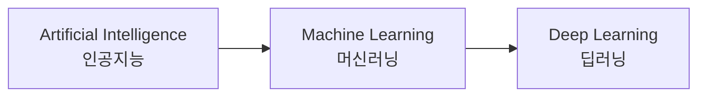
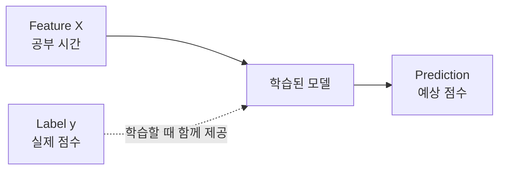
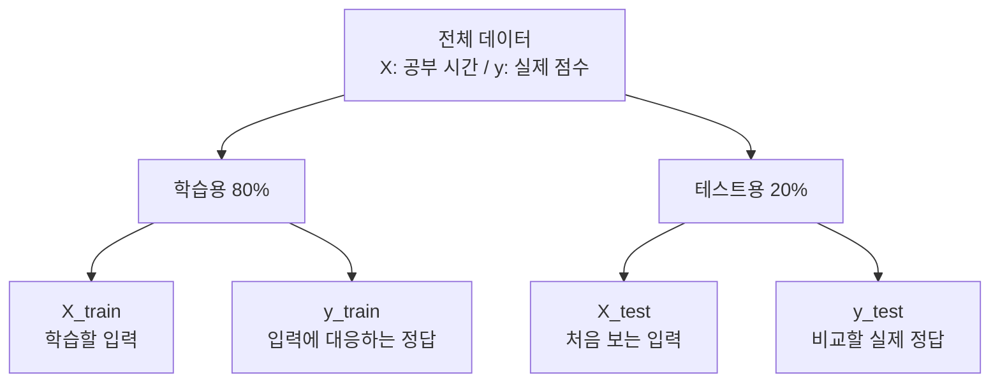
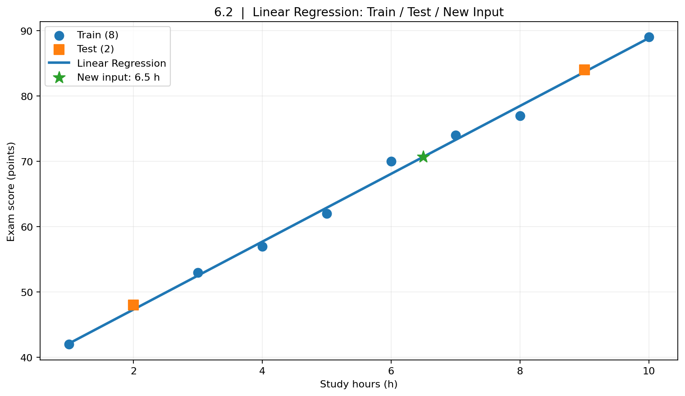
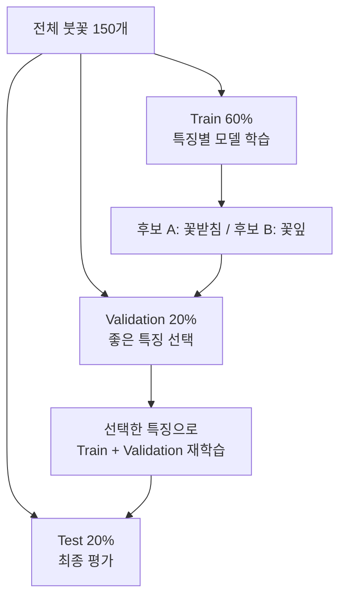
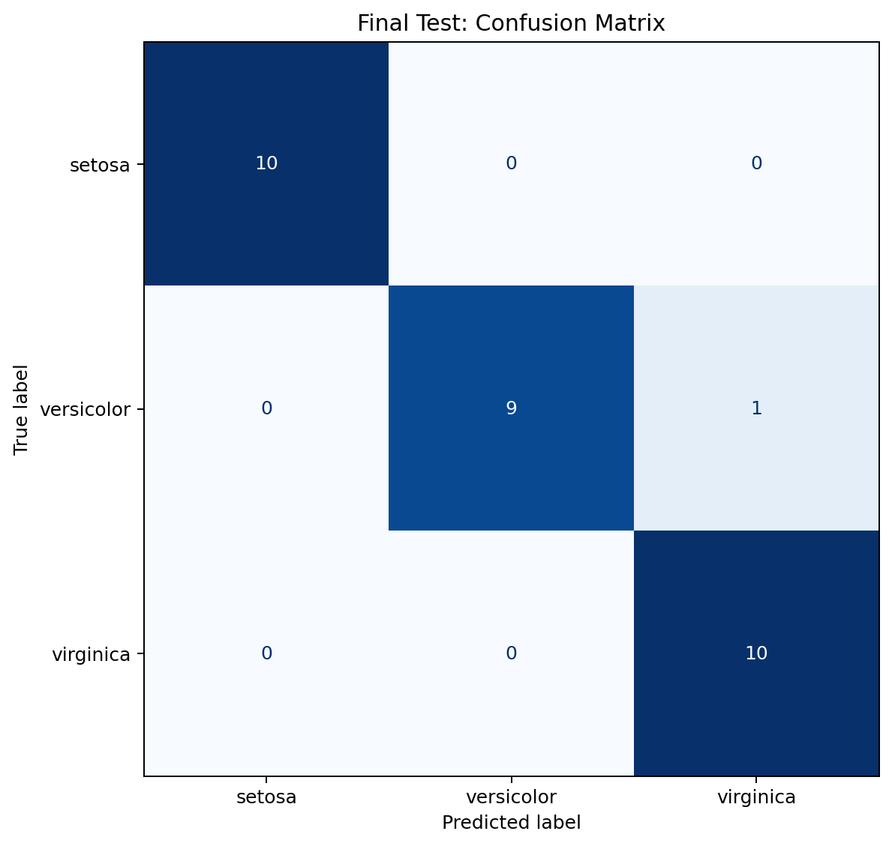

# Chapter 06. Artificial Intelligence & Machine Learning

**Week 07 · Python Intermediate · Google Colab**

## Contents

| 구분 | 주제 | 세부내용 |
|:---|:---|:---|
| [6.1](#61-introduction-to-artificial-intelligence) | Introduction to Artificial Intelligence | AI·ML·DL 비교, 규칙 기반 분류 |
| [6.2](#62-how-machine-learning-works) | How Machine Learning Works | 선형 회귀로 시험 점수 예측 |
| [6.3](#63-classification--prediction) | Classification & Prediction | KNN으로 붓꽃 품종 분류 |
| [6.4](#64-model-evaluation--applications) | Model Evaluation & Applications | Validation data, Accuracy, Confusion matrix |
| [Summary](#summary) | 요약 | 회귀·분류·평가 비교 |
| [Quiz](#quiz) | 퀴즈 | 개념·코드 분석 |
| [Exercise](#exercise) | 연습 문제 | - |

## Getting Started — Google Colab

실습은 [Google Colab](https://colab.research.google.com/)의 Python Notebook에서 진행합니다.

### 1. 실행 환경 및 라이브러리

Colab에서 **새 노트**를 연 뒤 첫 번째 코드 셀에 다음 명령을 입력합니다. 이미 필요한 라이브러리가 설치되어 있다면 생략할 수 있습니다.

```python
%pip install -q numpy matplotlib scikit-learn
```

- `%pip`은 현재 Notebook의 Python 환경에 패키지를 설치하는 명령입니다. 일부 라이브러리가 기본 설치되어 있다면 재설치하지 않아도 됩니다.
- 설치 시간은 네트워크 상태에 따라 달라질 수 있습니다. 패키지 업데이트 안내에 런타임 재시작이 표시되면 재시작한 뒤 다시 실행합니다.
- `numpy`는 수치 계산에, `matplotlib`은 그래프 작성에, `scikit-learn`은 머신러닝 모델과 데이터셋을 다루는 데 사용합니다.

설치 확인:

```python
import numpy
import matplotlib
import sklearn

print("NumPy:", numpy.__version__)
print("Matplotlib:", matplotlib.__version__)
print("scikit-learn:", sklearn.__version__)
```

### 2. 실습 파일 실행하기
**방법 A — 배포된 ZIP으로 실행**

1. `Week-07.zip` 파일을 다운로드합니다.
2. Colab의 코드 셀에서 아래 명령을 실행하고 ZIP 파일을 업로드합니다.
3. 압축을 해제한 뒤 `practice/`에 있는 Python 파일을 실행합니다.

```python
from google.colab import files
files.upload()  # Week-07.zip 선택

!unzip -oq Week-07.zip -d /content
%cd /content/Week-07

# 원하는 Chapter의 실습 파일 실행
%run practice/6_2_linear_regression.py
```

이미 코드가 들어 있는 셀에 `!python practice/파일명.py`를 입력해도 실행할 수 있습니다. `%run`은 Notebook 환경에서 Python 파일을 실행하므로 그래프를 바로 확인하기 편리합니다. 생성된 이미지 파일은 `assets/`에도 저장됩니다.

**방법 B — README에서 실행**

각 Chapter의 Python 코드 블록을 순서대로 Colab 코드 셀에 복사하여 실행합니다. 배포된 실습 파일은 같은 코드를 독립적으로 실행할 수 있도록 구성되어 있습니다.

**GitHub에 Week-07을 업로드한 이후**에는 아래 명령으로 해당 폴더만 내려받을 수도 있습니다.

```python
!git clone --depth 1 --filter=blob:none --sparse https://github.com/JSeong2024/MYPAUL-PYTHONEDU.git /content/MYPAUL-PYTHONEDU
!git -C /content/MYPAUL-PYTHONEDU sparse-checkout set Classroom/PYTHON-2026-09/Intermediate/Lecture/Week-07
%cd /content/MYPAUL-PYTHONEDU/Classroom/PYTHON-2026-09/Intermediate/Lecture/Week-07
```

> 위 Git 명령은 **Week-07 폴더를 GitHub에 업로드한 뒤** 사용해야 합니다. Colab 런타임이 재설정되면 업로드한 파일이나 생성한 이미지가 사라질 수 있으므로, 필요한 결과는 별도로 다운로드해야 합니다.

### 3. 실습 파일 목록

```text
Week-07/
├── README.md
├── practice/
│   ├── 6_1_rule_based.py
│   ├── 6_2_linear_regression.py
│   ├── 6_3_iris_classification.py
│   ├── 6_4_model_evaluation.py
│   ├── exercise_01_regression.py
│   └── exercise_02_classification.py
└── assets/
    ├── 6_2_linear_regression.png
    ├── 6_3_iris_knn.png
    ├── 6_4_feature_comparison.png
    └── 6_4_confusion_matrix.png
```

---

## 6.1. Introduction to Artificial Intelligence

### 6.1.1. 인공지능이란?

**인공지능(Artificial Intelligence, AI)** 은 컴퓨터가 인식, 예측, 판단, 언어 처리처럼 사람의 지능이 필요한 작업을 수행하도록 만드는 기술 전반을 의미합니다. 사람이 정한 규칙을 실행하는 시스템도 AI의 한 형태가 될 수 있으며, 데이터를 학습하는 방식도 포함됩니다.

| 사용 사례 | 입력 데이터 | 수행하는 작업 |
|:---|:---|:---|
| 이메일 스팸 필터 | 이메일 제목·본문 | 스팸 가능성 분류 |
| 동영상 추천 | 시청 기록·관심사 | 사용자에게 콘텐츠 추천 |
| 음성 인식 | 마이크로 입력된 음성 | 음성을 텍스트로 변환 |
| 이미지 인식 | 사진·영상 | 사물 종류 구분 |
| 생성형 AI | 사용자가 입력한 문장 | 글·이미지·코드 등 생성 |

AI가 사람처럼 모든 상황을 이해한다는 뜻은 아닙니다. 대부분의 모델은 개발 목적, 학습 데이터, 입력 조건에 따라 수행할 수 있는 작업이 제한됩니다.

### 6.1.2. AI, Machine Learning, Deep Learning



이 화살표는 발전 순서가 아니라 **포함 관계**를 나타냅니다. 머신러닝은 AI의 한 분야이며, 딥러닝은 머신러닝의 한 분야입니다.

| 개념 | 기본 방식 | 예시 |
|:---|:---|:---|
| **AI** | 지능적인 작업을 수행하는 기술의 전체 범위 | 규칙 기반 판단, 머신러닝 시스템 |
| **ML** | 데이터에서 패턴을 학습하고 예측에 사용 | 스팸 필터, 수요 예측 |
| **DL** | 여러 층의 인공신경망으로 복잡한 패턴 학습 | 이미지·음성 인식, 언어 모델 |

생성형 AI(Generative AI)는 텍스트·이미지처럼 새로운 콘텐츠를 생성하는 AI를 가리킵니다. 현대의 대표적인 생성형 AI는 주로 딥러닝 기반 모델을 사용합니다.

### 6.1.3. 규칙 기반 프로그램과 머신러닝

두 방식의 차이는 **판단 기준을 어디에서 얻는가**에 있습니다.

| 비교 | 규칙 기반 프로그램 | 머신러닝 프로그램 |
|:---|:---|:---|
| 판단 기준 | 사람이 직접 조건 작성 | 데이터의 패턴을 모델이 학습 |
| 변경 방법 | 규칙 수정·추가 | 데이터·특징·모델 재검토 및 재학습 |
| 장점 | 규칙이 분명하고 결과를 설명하기 쉽습니다 | 복잡한 패턴을 데이터에서 찾아낼 수 있습니다 |
| 한계 | 예외 상황이 늘면 규칙을 관리하기 어렵습니다 | 데이터 품질과 학습 범위에 영향을 받습니다 |

### 6.1.4. Coding Practice — 메시지 분류

먼저 **규칙 기반 분류기**를 구현합니다. 특정 단어가 메시지에 포함되어 있는지 검사하는 예제이며, **머신러닝 모델은 아닙니다**.

```python
def classify_message(message):
    keywords = ["무료", "당첨", "광고"]
    for word in keywords:
        if word in message:
            return "광고 의심"
    return "일반 메시지"

messages = [
    "오늘 수업 자료를 공유합니다.",
    "무료 쿠폰에 당첨되셨습니다.",
    "무료 공개 강의 안내입니다."
]

for message in messages:
    print(message, "→", classify_message(message))
```

**실행 결과**

```text
오늘 수업 자료를 공유합니다. → 일반 메시지
무료 쿠폰에 당첨되셨습니다. → 광고 의심
무료 공개 강의 안내입니다. → 광고 의심
```

세 번째 메시지는 실제 광고가 아닐 수도 있지만, `무료`라는 단어 때문에 광고로 분류됩니다. 문장의 맥락을 분석하지 않고 정해진 조건만 검사한 결과입니다. 이것이 규칙 기반 방식의 대표적인 한계입니다.

**확인 활동:** `keywords`에 `할인`을 추가한 다음 새로운 메시지로 결과를 비교합니다.

전체 실습 코드: [`practice/6_1_rule_based.py`](practice/6_1_rule_based.py)

---

## 6.2. How Machine Learning Works

**머신러닝의 학습과 예측**

### 6.2.1. 데이터에서 관계 학습하기

머신러닝(Machine Learning)은 데이터에서 일정한 패턴이나 관계를 찾아 새로운 입력에 대한 결과를 예측하는 기술입니다. 이번 실습에서는 **공부 시간으로 시험 점수를 예측합니다**.

| 공부 시간(시간) | 실제 점수(점) |
|---:|---:|
| 1 | 42 |
| 2 | 48 |
| 3 | 53 |
| 4 | 57 |
| 5 | 62 |
| 6 | 70 |
| 7 | 74 |
| 8 | 77 |
| 9 | 84 |
| 10 | 89 |

공부 시간이 늘수록 시험 점수도 대체로 높아지는 경향을 관찰할 수 있습니다. 모델은 이 관계를 학습한 뒤, **6.5시간**과 같은 새로운 입력에 대한 점수를 예측합니다.

### 6.2.2. Feature, Label, Model

| 용어 | 코드 표기 | 이번 예제에서의 의미 |
|:---|:---:|:---|
| **Feature**(특징) | `X` | 입력 데이터인 공부 시간 |
| **Label / Target**(정답) | `y` | 실제 시험 점수 |
| **Model**(모델) | `model` | 입력과 점수 사이의 관계를 학습하는 프로그램 |
| **Prediction**(예측) | `ŷ` | 모델이 계산한 예상 점수 |

정답(`y`)과 입력(`X`)을 함께 제공하는 학습 방식을 **지도 학습(Supervised Learning)**  이라고 합니다. 지도 학습에는 점수처럼 연속된 수치를 예측하는 **회귀(Regression)**  와 종류를 구분하는 **분류(Classification)**  가 있습니다.



### 6.2.3. 왜 `X_train`, `X_test`, `y_train`, `y_test` 네 개가 필요할까?

학습에 사용한 데이터에서만 좋은 결과가 나오는지, 처음 보는 데이터에서도 적절히 예측하는지 구분하여 확인해야 합니다. 이를 위해 입력 `X`와 정답 `y`를 **각각 학습용(Train)·테스트용(Test)** 으로 분리합니다.



| 변수 | 무엇을 저장하나? | 사용 시점 |
|:---|:---|:---|
| `X_train` | 학습용 공부 시간 | `fit()`의 입력 |
| `y_train` | 그 공부 시간에 대응하는 실제 점수 | `fit()`의 정답 |
| `X_test` | 학습에 사용하지 않은 공부 시간 | `predict()`의 입력 |
| `y_test` | 해당 공부 시간의 실제 점수 | 예측값과 정답 비교 |

**중요:** 공부 시간과 점수는 한 학생의 데이터 한 쌍으로 유지해야 합니다. `train_test_split(X, y, ...)`은 서로 대응하는 데이터의 순서를 함께 바꾸고 같은 기준으로 분할합니다.

```python
from sklearn.model_selection import train_test_split

X = [[1], [2], [3], [4], [5],
     [6], [7], [8], [9], [10]]
y = [42, 48, 53, 57, 62, 70, 74, 77, 84, 89]

X_train, X_test, y_train, y_test = train_test_split(
    X, y, test_size=0.2, random_state=42
)

print("학습용:", len(X_train), "개")
print("테스트용:", len(X_test), "개")
```

실행 결과: **학습용 8개 / 테스트용 2개**.

- `test_size=0.2`: 전체 데이터의 20%를 테스트에 사용합니다. 80:20만이 정답인 것은 아닙니다.
- `random_state=42`: 분할 결과를 다시 실행해도 동일하게 재현할 수 있도록 난수를 설정합니다. 숫자 42 자체에 학습상의 특별한 의미는 없습니다.

### 6.2.4. Linear Regression — 직선으로 점수 예측하기

**선형 회귀(Linear Regression)** 는 입력값과 예측값 사이의 관계를 직선으로 나타내는 회귀 모델입니다. 직선의 **기울기**와 **절편**을 데이터에서 학습하고, 학습된 식에 새로운 입력을 넣어 결과를 계산합니다.

$$
\hat{y} = ax + b
$$

| 기호 | 의미 |
|:---:|:---|
| $x$ | 입력값, 즉 공부 시간 |
| $\hat{y}$ | 모델의 예상 시험 점수 |
| $a$ | 기울기: 공부 시간이 1시간 증가할 때 직선에서 예상되는 점수 변화량 |
| $b$ | 절편: 직선에서 $x=0$에 대응하는 값 |

`scikit-learn`의 `LinearRegression`은 실제 점수와 예측 점수 사이의 **오차 제곱합이 작아지도록** 직선을 학습합니다. 기울기를 직접 계산하는 수식을 풀 필요는 없지만, **데이터에 가장 잘 맞는 직선을 찾는다는 원리**는 알아두어야 합니다.

이번 예제의 절편이 실제로 공부를 하지 않았을 때의 성적을 확정적으로 알려주는 것은 아닙니다. 절편은 학습한 직선의 수학적 구성 요소라는 점에 유의해야 합니다.

**실습 — 학습과 예측** (앞서 작성한 `X_train`, `y_train` 등을 그대로 사용합니다.)

```python
from sklearn.linear_model import LinearRegression

model = LinearRegression()
model.fit(X_train, y_train)             # 관계 학습

hours = 6.5
prediction = model.predict([[hours]])  # 새로운 값 예측

print(f"공부 시간: {hours}시간")
print(f"예상 점수: {prediction[0]:.1f}점")
```

실행 결과:

```text
공부 시간: 6.5시간
예상 점수: 70.7점
```

`fit(X_train, y_train)`은 입력과 정답의 관계를 학습합니다. `predict([[hours]])`는 학습된 직선에서 **새 공부 시간에 해당하는 점수**를 계산합니다. `[[hours]]`와 같이 이중 대괄호를 사용하는 이유는 모델이 여러 행과 특징으로 이루어진 2차원 입력을 기대하기 때문입니다.

**학습 결과 시각화**



*그림 6-1. 선형 회귀 그래프. 파란색 원은 학습 데이터 8개, 주황색 사각형은 테스트 데이터 2개, 빨간색 선은 모델이 학습한 직선을 나타냅니다.*

코드의 핵심:

```python
import numpy as np
import matplotlib.pyplot as plt

hours_range = np.linspace(1, 10, 100).reshape(-1, 1)
predicted_scores = model.predict(hours_range)

plt.scatter([x[0] for x in X_train], y_train, label="Training Data")
plt.scatter([x[0] for x in X_test], y_test, label="Test Data")
plt.plot(hours_range, predicted_scores, color="red", label="Prediction")
plt.xlabel("Study Hours")
plt.ylabel("Exam Score")
plt.legend()
plt.grid(alpha=0.3)
plt.show()
```

실습 코드 전체: [`practice/6_2_linear_regression.py`](practice/6_2_linear_regression.py) — 실행하면 이미지도 `assets/`에 저장됩니다.

**해석:** 실제 데이터가 직선 위에 정확히 위치하지 않아도 모델은 전체적인 증가 경향을 학습할 수 있습니다. 다만 **공부 시간 외의 다른 요인**은 이 모델에 반영되어 있지 않습니다. 특히 학습 범위(1~10시간)를 벗어난 20시간 등의 예측을 그대로 믿어서는 안 됩니다.

**확인 활동:** `hours`를 `3`, `6`, `9`, `20`으로 바꿔 예상 점수를 기록하고, 마지막 값에 주의해야 하는 이유를 설명합니다.

---

## 6.3. Classification & Prediction

**회귀와 분류의 차이 · KNN 실습**

### 6.3.1. Regression vs. Classification

머신러닝으로 예측하려는 결과는 문제에 따라 형태가 달라집니다.

| 구분 | 회귀(Regression) | 분류(Classification) |
|:---|:---|:---|
| 예측 결과 | 연속된 수치 | 정해진 범주(종류) |
| 질문 예시 | 공부 시간에 따른 점수는? | 이 꽃의 품종은 무엇인가? |
| 출력 예시 | `70.7` | `versicolor` |
| 대표 모델 | Linear Regression | K-Nearest Neighbors(KNN) |

6.2에서는 점수라는 **수치**를 예측했습니다. 이번 Chapter에서는 꽃의 측정값으로 **품종**을 구분합니다.

### 6.3.2. KNN — 가까운 데이터 참고하기

**K-최근접 이웃(K-Nearest Neighbors, KNN)** 은 새로운 데이터와 가까이 있는 기존 데이터 **K개**의 정답을 참고하여 분류하는 방법입니다. 이번 실습에서는 가장 가까운 **5개 이웃**을 사용한다(`n_neighbors=5`).

예를 들어 새로운 꽃의 꽃받침 길이·너비가 주어지면, 비슷한 측정값을 가진 꽃 다섯 개의 품종을 살펴보고 다수에 해당하는 품종을 선택합니다. KNN은 앞서 배운 선형 회귀와 달리, 학습 과정에서 하나의 예측 직선을 구하지 않습니다. 기존 데이터와의 거리를 예측 시점에 활용하는 방식입니다.

> 가까움은 측정값 사이의 거리를 의미합니다. 특징의 단위나 범위가 크게 다르면 거리 계산에 영향을 줄 수 있으며, 실제 업무에서는 입력 특징을 적절히 조정해야 할 수도 있습니다.

### 6.3.3. Iris Dataset — 붓꽃 품종 분류

`scikit-learn`에서 제공하는 **Iris Dataset**에는 총 150개의 붓꽃 측정 데이터가 포함되어 있습니다. 품종은 `setosa`, `versicolor`, `virginica` 세 가지입니다. 각 꽃에는 꽃받침(Sepal)과 꽃잎(Petal)의 길이·너비가 기록되어 있습니다.

| 전체 특징 | 의미 |
|:---|:---|
| Sepal Length | 꽃받침 길이(cm) |
| Sepal Width | 꽃받침 너비(cm) |
| Petal Length | 꽃잎 길이(cm) |
| Petal Width | 꽃잎 너비(cm) |

이번 6.3 실습에서는 **꽃받침 길이와 너비, 두 개만** 사용합니다. 2차원 그래프에서 품종의 분포와 모델의 판단 영역을 함께 확인하기 위해서입니다. 6.4에서는 꽃잎 특징을 사용했을 때의 결과도 비교합니다.

**실습 — KNN 품종 분류**

```python
from sklearn.datasets import load_iris
from sklearn.model_selection import train_test_split
from sklearn.neighbors import KNeighborsClassifier
from sklearn.metrics import accuracy_score

iris = load_iris()
X = iris.data[:, :2]  # 꽃받침 길이와 너비
y = iris.target       # 실제 품종: 0, 1, 2

X_train, X_test, y_train, y_test = train_test_split(
    X, y, test_size=0.2, random_state=42, stratify=y
)

model = KNeighborsClassifier(n_neighbors=5)
model.fit(X_train, y_train)

predictions = model.predict(X_test)
accuracy = accuracy_score(y_test, predictions)
print(f"테스트 정확도: {accuracy:.3f}")

new_flower = [[5.7, 2.8]]  # 꽃받침 길이, 너비 (cm)
predicted_class = model.predict(new_flower)[0]
print("새로운 꽃의 예상 품종:", iris.target_names[predicted_class])
```

실제 실행 결과:

```text
테스트 정확도: 0.767
새로운 꽃의 예상 품종: versicolor
```

- `iris.data[:, :2]`: 모든 꽃의 데이터에서 처음 두 개 특징만 선택합니다.
- `iris.target`: 각 데이터에 대응하는 실제 품종 번호를 가져옵니다.
- `stratify=y`: 세 품종의 비율이 학습용과 테스트용에 비슷하게 유지되도록 분리합니다.
- `n_neighbors=5`: 새로운 꽃과 가까운 데이터 5개를 참고합니다.
- `accuracy_score()`: 테스트용 꽃 가운데 실제 품종을 맞힌 비율을 계산합니다.

**분류 결과 시각화**


*그림 6-2. 실제 KNN 분류 모델의 판단 영역과 붓꽃 측정값. 배경색은 모델이 선택하는 품종 영역, 색 점은 학습 데이터, 검은 테두리 원은 학습에 사용하지 않은 테스트 데이터를 나타냅니다.*

꽃받침 특징만으로는 `versicolor`와 `virginica` 일부가 비슷한 영역에 위치합니다. 따라서 완벽한 분류가 어려우며, 이번 테스트에서는 **30개 중 23개를 맞혀 약 76.7% 정확도**를 기록했습니다.

전체 실행 및 시각화: [`practice/6_3_iris_classification.py`](practice/6_3_iris_classification.py)

**확인 활동:** `n_neighbors=5`를 `1` 또는 `9`로 바꾸고 예측 결과와 테스트 정확도가 달라지는지 비교합니다. 서로 다른 K 값에서 결과가 달라질 수 있으며, K가 크다고 항상 정확한 것은 아닙니다.

---

## 6.4. Model Evaluation & Applications

**모델 평가·개선·실제 활용**

### 6.4.1. 정확한 예측이란 무엇인가?

모델이 출력한 결과를 확인하는 것과 **성능을 평가하는 것**은 다릅니다. 평가하려면 모델이 예측한 값과 실제 정답을 비교해야 합니다. 예측하려는 대상에 따라 평가 기준도 달라집니다.

| 문제 | 대표적인 평가 지표 | 의미 |
|:---|:---|:---|
| 분류(꽃 품종) | Accuracy(정확도) | 전체 중 정답을 맞힌 비율 |
| 회귀(예상 점수) | MAE(평균 절대 오차) | 실제값과 예측값의 차이를 절댓값으로 평균 낸 수치 |

분류 정확도의 기본식:

$$
\text{Accuracy} = \frac{\text{정답을 맞힌 개수}}{\text{전체 평가 데이터 개수}}
$$

6.3의 결과는 `23 / 30 ≈ 0.767`이므로 **정확도 76.7%** 입니다. 모델이 학습에 사용하지 않은 30개 데이터에서 얻은 수치이며, 모든 붓꽃을 항상 76.7% 정확도로 구분한다는 보장은 없습니다.

6.2의 시험 점수처럼 숫자를 예측할 때는 평균 절대 오차(MAE) 등을 사용합니다.

$$
\text{MAE} = \frac{1}{n}\sum_{i=1}^{n}|y_i-\hat{y}_i|
$$

예를 들어 실제 점수가 `70, 80`이고 예측 점수가 `68, 83`이라면 오차는 각각 `2점, 3점`이며 MAE는 `2.5점`입니다. MAE가 낮을수록 평균적인 예측 오차가 작다는 뜻입니다.

```python
# 6.2의 선형 회귀 모델을 실행한 상태에서 사용
from sklearn.metrics import mean_absolute_error

test_predictions = model.predict(X_test)
print("MAE:", mean_absolute_error(y_test, test_predictions))
```

> **셀 실행 순서 주의:** 위 코드는 **6.2의 회귀 실습 셀 바로 다음**에 실행하는 예시입니다. 6.3에서 `model`, `X_test`, `y_test`를 새로 지정한 뒤에는 회귀 평가 코드로 동작하지 않습니다. Colab에서는 Chapter별 새 Notebook을 사용하거나 해당 Chapter의 코드 셀을 다시 실행하는 방식이 편리합니다.

### 6.4.2. 혼동행렬(Confusion Matrix)

분류 정확도는 전체 정답률을 요약하지만, **어떤 품종을 어떤 품종으로 착각했는지**까지 보여주지는 않습니다. 혼동행렬은 실제 정답과 모델 예측을 표로 비교하는 방법입니다.

| 행/열 | 실제 품종 | 예측 품종 |
|:---|:---|:---|
| **행(Row)**  | 실제 정답 | — |
| **열(Column)**  | — | 모델의 예측 |

대각선의 숫자는 맞힌 개수이고, 대각선 밖의 숫자는 다른 품종으로 잘못 분류한 개수입니다. 정확도가 같아도 오류가 특정 품종에 집중되어 있을 수 있습니다.

### 6.4.3. Feature 선택으로 성능 개선하기

6.3에서는 꽃받침의 길이·너비만 사용했습니다. 이번에는 **꽃받침 특징과 꽃잎 특징 중 무엇이 품종 구분에 더 유용한지** 비교합니다. 사용하는 모델은 두 경우 모두 `KNN(n_neighbors=5)`로 동일합니다.

모델의 입력을 바꾸고 성능을 비교할 때 **최종 테스트 데이터로 후보를 고르면 평가가 낙관적으로 왜곡될 수 있습니다**. 따라서 이번 실습에서는 다음 순서로 진행합니다.



- **Train(학습)** : 모델이 품종 분류에 필요한 사례를 참고합니다.
- **Validation(검증)** : 후보 모델을 비교하고 어떤 특징을 사용할지 결정합니다.
- **Test(테스트)** : 특징 선택을 마친 **최종 모델**의 성능을 확인합니다.

다음 코드는 비교 과정의 핵심 부분입니다. 인덱스 분할과 그래프 생성까지 포함한 전체 실습 파일은 [`practice/6_4_model_evaluation.py`](practice/6_4_model_evaluation.py)에서 확인할 수 있습니다.

```python
from sklearn.datasets import load_iris
from sklearn.model_selection import train_test_split
from sklearn.neighbors import KNeighborsClassifier
from sklearn.metrics import accuracy_score
import numpy as np

iris = load_iris()
y = iris.target
indices = np.arange(len(y))

# 전체 80%는 모델 개발용, 20%는 마지막 테스트용
train_val_idx, test_idx = train_test_split(
    indices, test_size=0.2, random_state=42, stratify=y
)

# 전체 기준 Train 60% / Validation 20% / Test 20%
train_idx, val_idx = train_test_split(
    train_val_idx, test_size=0.25, random_state=42,
    stratify=y[train_val_idx]
)

feature_sets = {
    "Sepal": [0, 1],  # 꽃받침 길이·너비
    "Petal": [2, 3],  # 꽃잎 길이·너비
}

for name, columns in feature_sets.items():
    X = iris.data[:, columns]
    candidate = KNeighborsClassifier(n_neighbors=5)
    candidate.fit(X[train_idx], y[train_idx])
    result = candidate.predict(X[val_idx])
    print(name, "검증 정확도:",
          round(accuracy_score(y[val_idx], result), 3))
```

실제 실행 결과:

```text
Sepal 검증 정확도: 0.833
Petal 검증 정확도: 0.933
```

**학습 결과 비교**


*그림 6-3. 동일한 KNN 모델에서 입력 특징만 변경한 비교. 꽃받침 특징의 검증 정확도는 83.3%, 꽃잎 특징의 검증 정확도는 93.3%로 측정되었습니다.*

이번 데이터에서는 꽃잎의 길이·너비가 품종을 구분하는 데 더 유용했습니다. 이는 단순히 알고리즘을 복잡하게 만드는 것보다 **적절한 입력 특징을 선택하는 것**이 중요하다는 사례입니다. 이 결과는 해당 데이터와 분할 설정에서 얻은 것이며, 모든 데이터에 그대로 적용되는 규칙은 아닙니다.

### 6.4.4. 최종 모델 평가

검증 과정에서 꽃잎 특징을 선택했으므로, 최종 모델을 학습용+검증용 데이터(총 120개)로 다시 학습한 뒤 **보관해 둔 테스트 30개**로 평가합니다.

```python
from sklearn.metrics import confusion_matrix

X_best = iris.data[:, 2:4]  # 검증에서 선택한 꽃잎 특징
final_model = KNeighborsClassifier(n_neighbors=5)
final_model.fit(X_best[train_val_idx], y[train_val_idx])

final_predictions = final_model.predict(X_best[test_idx])
print("최종 테스트 정확도:",
      round(accuracy_score(y[test_idx], final_predictions), 3))
print(confusion_matrix(y[test_idx], final_predictions))
```

실제 실행 결과:

```text
최종 테스트 정확도: 0.967
[[10  0  0]
 [ 0  9  1]
 [ 0  0 10]]
```



*그림 6-4. 꽃잎 특징을 사용한 최종 모델의 혼동행렬. 테스트 30개 중 29개를 맞혔으며, `versicolor` 한 개를 `virginica`로 예측했습니다.*

최종 테스트 정확도는 **96.7%** 입니다. 다만 6.3의 76.7%와 6.4의 96.7%는 **입력 특징과 모델 개발 절차가 다른 실험 결과**입니다. 이번 예시에서 더 높은 정확도를 얻었다고 해서 모델이 모든 환경에서 더 우수하다고 단정할 수는 없습니다.

### 6.4.5. 실제 응용에서 확인할 사항

| 확인 항목 | 질문 | 의미 |
|:---|:---|:---|
| 데이터 품질 | 입력값에 오류·누락·편향이 있는가? | 잘못된 데이터는 예측 오류로 연결될 수 있습니다 |
| 학습 범위 | 새로운 입력이 학습 데이터와 비슷한가? | 생소한 상황에서는 성능이 떨어질 수 있습니다 |
| 평가 기준 | 정확도 하나로 충분한가? | 스팸·불량품 탐지 등은 놓친 사례도 중요합니다 |
| 데이터 분리 | 테스트 데이터로 모델을 반복 선택했는가? | 성능을 실제보다 좋게 평가할 위험이 있습니다 |
| 개인정보 | 민감한 데이터가 포함되어 있는가? | 수집·활용 목적과 보호 조치가 필요합니다 |

**예시:** 스팸이 전체 메일의 1%인 데이터에서 모든 메일을 '정상'이라고 예측하는 모델도 정확도 99%를 얻을 수 있습니다. 이 때문에 분류에서는 **어떤 사례를 잘못 예측했는지** 함께 확인해야 합니다.

> 코딩 실습의 핵심은 높은 정확도 자체가 아니라 **모델이 사용한 입력, 예측한 결과, 틀린 사례를 구분해 해석하는 것**입니다.

전체 평가 및 이미지 생성: [`practice/6_4_model_evaluation.py`](practice/6_4_model_evaluation.py)

---

## References

- [Google Colab](https://colab.research.google.com/)
- [scikit-learn — Getting Started](https://scikit-learn.org/stable/getting_started.html)
- [scikit-learn — LinearRegression](https://scikit-learn.org/stable/modules/generated/sklearn.linear_model.LinearRegression.html)
- [scikit-learn — KNeighborsClassifier](https://scikit-learn.org/stable/modules/generated/sklearn.neighbors.KNeighborsClassifier.html)
- [scikit-learn — train_test_split](https://scikit-learn.org/stable/modules/generated/sklearn.model_selection.train_test_split.html)
- [scikit-learn — Iris Dataset](https://scikit-learn.org/stable/datasets/toy_dataset.html#iris-dataset)
- [scikit-learn — Confusion Matrix](https://scikit-learn.org/stable/modules/model_evaluation.html#confusion-matrix)
- [Matplotlib](https://matplotlib.org/stable/)

---

## Summary

| 개념 | 핵심 내용 |
|:---|:---|
| Artificial Intelligence | 인식·예측·판단 등 지능적인 작업을 수행하는 기술 전반 |
| Machine Learning | 데이터의 패턴을 학습해 예측에 활용하는 AI 분야 |
| Deep Learning | 다층 인공신경망을 활용하는 머신러닝 분야 |
| Feature (`X`) | 모델에 제공하는 입력 특징 |
| Label (`y`) | 학습에 사용할 실제 정답 |
| Training / Prediction | 데이터로 관계를 학습하는 과정 / 새로운 입력을 예측하는 과정 |
| Train / Validation / Test | 모델 학습 / 후보 비교·선택 / 최종 평가 |
| Regression | 연속적인 숫자 예측 — 시험 점수 예제 |
| Classification | 정해진 종류 구분 — 붓꽃 분류 예제 |
| Linear Regression | 데이터의 관계를 직선으로 표현하는 회귀 모델 |
| KNN | 가까운 기존 데이터 K개를 참고하여 분류하는 모델 |
| Accuracy / Confusion Matrix | 분류 정답률 / 실제값과 예측값의 조합별 개수 |
| MAE | 숫자 예측에서 실제값과 예측값의 절대 차이 평균 |

**Chapter 06 핵심 흐름**


머신러닝에서는 코드를 실행하는 것만큼 **어떤 데이터를 학습에 사용했고, 무엇으로 평가했으며, 잘못 예측한 사례가 무엇인지** 확인하는 과정이 중요합니다.

## Quiz

다음 문제는 실습 내용을 이해했는지 확인하기 위한 것입니다. 정답은 README에 제공하지 않으며, 수업에서 토의하거나 제출 과제로 활용할 수 있습니다.

**객관식**

1. 머신러닝에 대한 설명으로 가장 적절한 것은? ① 모든 규칙을 사람이 작성합니다 ② 데이터의 패턴을 학습해 예측합니다 ③ 항상 정답을 보장합니다 ④ GPU가 없으면 실행할 수 없습니다
2. `X`와 `y`의 역할로 올바른 것은? ① X=정답, y=입력 ② 둘 다 정답 ③ X=입력 특징, y=실제 정답 ④ 둘 다 학습 횟수
3. `test_size=0.2`의 의미는? ① 데이터를 2개만 사용합니다 ② 전체 데이터의 20%를 테스트용으로 사용합니다 ③ 정확도가 20%라는 뜻입니다 ④ 학습을 20번 반복합니다
4. KNN에서 `n_neighbors=5`는 무엇을 의미하는가? ① 다섯 종류만 분류합니다 ② 가까운 데이터 다섯 개를 참고합니다 ③ 데이터가 다섯 개 필요합니다 ④ 다섯 번 학습합니다

**단답형 및 코드 분석**

5. 아래 코드에서 `fit()`과 `predict()`의 역할을 각각 설명합니다.

   ```python
   model.fit(X_train, y_train)
   predicted = model.predict(X_test)
   ```

6. `X_train`, `X_test`, `y_train`, `y_test`가 네 개로 구분되는 이유를 한 문장으로 설명합니다.
7. 실제 품종 30개 중 24개를 맞힌 분류 모델의 정확도를 계산합니다.
8. 같은 모델이라도 입력 특징을 꽃받침에서 꽃잎으로 변경했을 때 정확도가 달라질 수 있는 이유를 설명합니다.
9. 테스트 데이터를 여러 번 확인하면서 가장 높은 점수를 만든 뒤, 그 점수를 최종 성능이라고 발표하면 어떤 문제가 생길 수 있는가?
10. 스팸 비율이 낮은 데이터에서 정확도만으로 성능을 판단하기 어려운 이유를 설명합니다.

## Exercise

기본 실습 코드를 변형하는 연습 문제입니다. 코드를 처음부터 모두 작성하기보다 **모델 생성·학습·예측·결과 해석**에 해당하는 부분을 직접 완성합니다.

### Exercise 01 — 이동 시간 예측 (회귀)

실습 파일: [`practice/exercise_01_regression.py`](practice/exercise_01_regression.py)

가상의 이동 거리와 소요 시간을 학습하고, 7km 이동 시 예상 소요 시간을 예측합니다.

| 거리(km) | 1 | 2 | 3 | 4 | 5 | 6 |
|---:|---:|---:|---:|---:|---:|---:|
| 시간(분) | 8 | 13 | 17 | 23 | 26 | 32 |

1. `LinearRegression()`으로 모델을 생성합니다.
2. `fit(X, y)`로 거리와 시간의 관계를 학습합니다.
3. `predict([[7]])`로 7km의 예상 소요 시간을 출력합니다.
4. 실제 소요 시간과 다를 수 있는 이유를 두 가지 작성합니다.

### Exercise 02 — KNN 이웃 수 비교 (분류)

실습 파일: [`practice/exercise_02_classification.py`](practice/exercise_02_classification.py)

6.3의 붓꽃 데이터를 사용하여 KNN 이웃 수를 바꿔 봅니다.

1. `n_neighbors`를 `1`, `3`, `5`, `7`로 변경해 각각 학습합니다.
2. 각 모델의 **테스트 정확도**를 아래 표에 기록합니다.
3. 모델의 분류 기준이 달라질 수 있는 이유를 서술합니다.
4. **추가 생각:** 실제로 가장 적절한 K를 선택하려면 테스트 데이터 대신 어떤 데이터로 비교해야 하는가?

| K | 테스트 정확도 |
|---:|:---|
| 1 | 직접 실행 |
| 3 | 직접 실행 |
| 5 | 직접 실행 |
| 7 | 직접 실행 |

*이 문제에서 테스트 정확도를 비교하는 이유는 K에 따른 차이를 관찰하기 위해서입니다. 최종 모델을 선정할 때는 별도의 검증 데이터가 필요합니다.*

### Exercise 03 — AI 결과의 신뢰성

다음 두 상황을 살펴보고, 모델의 예측을 그대로 사용해도 되는지 판단합니다.

- **상황 A:** 1~10시간의 공부 데이터로 학습한 모델에 24시간을 입력해 점수를 예측합니다.
- **상황 B:** 꽃받침 특징만 사용하는 분류 모델이 낯선 꽃을 `virginica`로 예측합니다.

각 상황에서 확인해야 할 정보 두 가지를 작성합니다. 모델이 정답을 출력했는지보다 **예측 근거와 학습 범위**를 점검하는 데 집중합니다.

### Exercise 04 — 발표

아래 형식에 맞춰 1분 이내로 실습 결과를 설명해 봅니다.

> 사용한 모델은 **(모델 이름)** 이며, 입력 데이터는 **(특징)** 입니다. 모델은 **(결과)** 를 예측했으며, **(평가 기준)** 으로 확인한 성능은 **(수치)** 입니다. 다만 **(한계)**  때문에 결과를 그대로 일반화하기는 어렵습니다.
