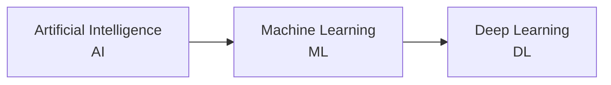
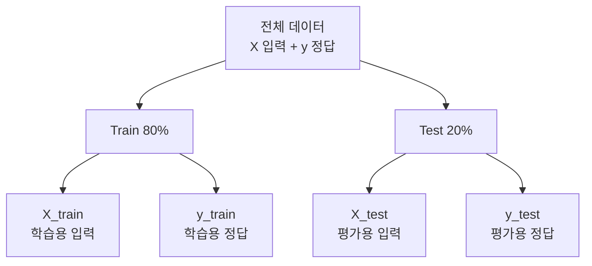
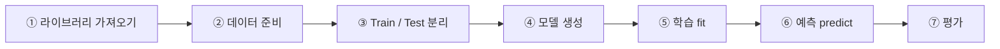
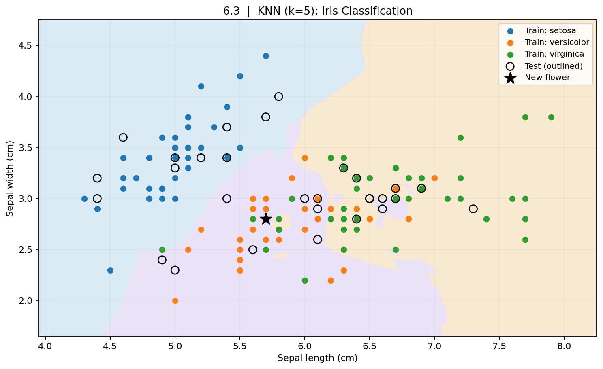
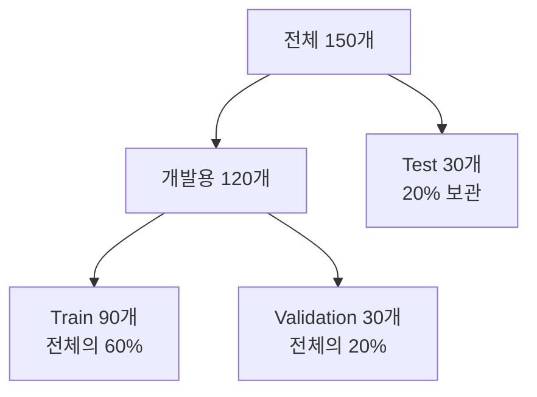
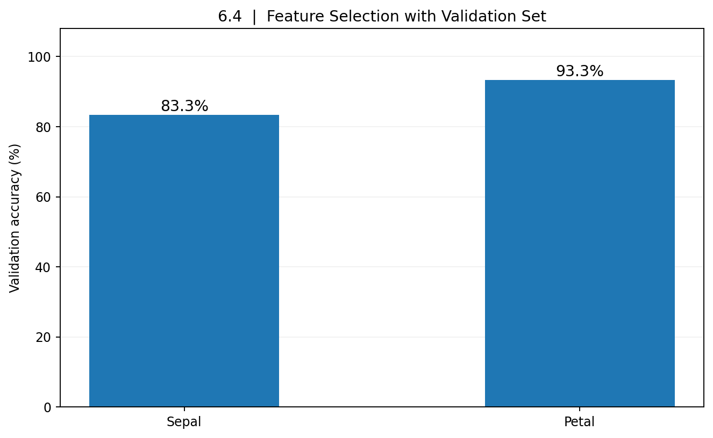

# Chapter 06. Artificial Intelligence & Machine Learning

**Week 07 · Python Intermediate · Google Colab**

인공지능의 기본 개념을 살펴보고, Python으로 머신러닝 모델을 **생성·학습·예측·평가**하는 방법을 익힙니다. 처음 접하는 학습자를 위해 각 코드가 필요한 이유와 실행 순서를 단계별로 설명합니다. 결측치 처리·특징 스케일링·데이터 증강 등 전처리의 상세한 구현은 별도의 Data Processing 과정에서 다룹니다.

## Contents

| 구분 | 주제 | 세부내용 |
|:---|:---|:---|
| [6.1](#61-introduction-to-artificial-intelligence) | Introduction to Artificial Intelligence | AI·ML·DL의 관계, 규칙 기반 분류 |
| [6.2](#62-how-machine-learning-works) | How Machine Learning Works | Feature·Target, 데이터 분할, 모델 생성·학습, 선형 회귀 |
| [6.3](#63-classification--prediction) | Classification & Prediction | KNN 붓꽃 분류, 회귀·분류 구분, 모델 선택 |
| [6.4](#64-model-evaluation--applications) | Model Evaluation & Applications | MAE·Accuracy·혼동행렬, Train/Validation/Test, 특징 비교 |
| [Summary](#summary) | 요약 | 모델링 순서·핵심 용어 |
| [Quiz](#quiz) | 퀴즈 | 개념·코드 분석 |
| [Exercise](#exercise) | 연습 문제 | 모델 생성·예측·평가 실습 |

## Getting Started — Google Colab

### 1. 실행 환경 준비

1. [Google Colab](https://colab.research.google.com/)에서 새 노트를 엽니다.
2. 아래 명령을 **첫 번째 코드 셀**에 입력한 뒤 `Shift + Enter`로 실행합니다. 이미 설치된 라이브러리는 그대로 사용해도 됩니다.

```python
%pip install -q numpy matplotlib scikit-learn
```

| 라이브러리 | 사용 목적 |
|:---|:---|
| `numpy` | 배열과 수치 계산 |
| `matplotlib` | 학습 데이터·예측 결과 시각화 |
| `scikit-learn` | 모델, 데이터 분리, 평가 지표, 예제 데이터셋 |

설치 여부 확인:

```python
import sklearn
import numpy
import matplotlib
print("scikit-learn:", sklearn.__version__)
print("NumPy:", numpy.__version__)
print("Matplotlib:", matplotlib.__version__)
```

> `%pip`은 현재 Notebook 실행 환경에 라이브러리를 설치합니다. 설치나 업데이트 후 재시작이 안내되면 Colab 런타임을 재시작하세요. 이번 주차의 실습은 **CPU만으로 실행 가능**하며 GPU가 필요하지 않습니다.

### 2. 실습 방법

**방법 A — 통합 Notebook(권장):** ZIP 안의 `Week07_Chapter06.ipynb`를 Colab의 **파일 → 노트 업로드**로 엽니다. 코드를 위에서부터 실행하면 되며, 별도로 Python 파일을 올릴 필요가 없습니다.

**방법 B — Python 파일 실행:** `Week-07.zip`을 Colab에 업로드한 뒤 압축을 해제합니다.

```python
from google.colab import files
files.upload()  # Week-07.zip 선택

!unzip -oq Week-07.zip -d /content
%cd /content/Week-07
%run practice/6_2_linear_regression.py
```

다른 실습을 실행할 때는 `%run` 뒤의 파일명을 변경합니다. 그래프는 화면에 표시되며 `assets/`에도 저장됩니다. **원본 코드를 수정하지 않고 결과만 확인하려면 Notebook이 더 편리합니다.**

GitHub에 자료가 업로드된 상태라면 다음과 같이 Week-07 폴더만 내려받을 수도 있습니다.

```python
!git clone --depth 1 --filter=blob:none --sparse https://github.com/JSeong2024/MYPAUL-PYTHONEDU.git /content/MYPAUL-PYTHONEDU
!git -C /content/MYPAUL-PYTHONEDU sparse-checkout set Classroom/PYTHON-2026-09/Intermediate/Lecture/Week-07
%cd /content/MYPAUL-PYTHONEDU/Classroom/PYTHON-2026-09/Intermediate/Lecture/Week-07
```

> Notebook에서 여러 Chapter의 코드를 연속 실행하면 `X`, `y`, `model` 등의 변수에 새로운 값이 저장됩니다. 각 Chapter를 실습할 때는 해당 코드 셀을 순서대로 실행하세요. Colab 런타임이 초기화되면 임시 파일이 사라질 수 있으므로 필요한 결과는 다운로드하여 보관하세요.

### 3. 배포 폴더

```text
Week-07/
├── README.md
├── Week07_Chapter06.ipynb
├── practice/
│   ├── 6_1_rule_based.py
│   ├── 6_2_linear_regression.py
│   ├── 6_3_iris_classification.py
│   ├── 6_4_model_evaluation.py
│   ├── exercise_01_regression.py
│   ├── exercise_02_classification.py
│   └── exercise_05_pipeline.py
└── assets/
    ├── 6_2_linear_regression.png
    ├── 6_3_iris_knn.png
    ├── 6_4_feature_comparison.png
    └── 6_4_confusion_matrix.png
```

---

## 6.1. Introduction to Artificial Intelligence

### 6.1.1. 인공지능이란?

**인공지능(Artificial Intelligence, AI)**  은 컴퓨터가 인식·예측·언어 처리·의사결정 지원과 같은 작업을 수행하도록 만드는 기술 전반입니다. 사람이 규칙을 작성하는 방식부터 데이터를 학습하는 방식까지 포함합니다. 다만 AI가 사람처럼 모든 상황을 이해하거나 언제나 정확하게 판단한다는 뜻은 아닙니다.

| 활용 사례 | 입력 | 수행하는 작업 |
|:---|:---|:---|
| 스팸 필터 | 이메일 제목·본문 | 스팸 여부 분류 |
| 콘텐츠 추천 | 시청·구매 기록 | 선호 가능성이 높은 콘텐츠 제안 |
| 음성 인식 | 음성 신호 | 말소리를 문자로 변환 |
| 이미지 인식 | 사진 | 사물이나 장면 구분 |
| 생성형 AI | 질문·지시문 | 새로운 텍스트·이미지 등 생성 |

### 6.1.2. AI·ML·DL의 관계



위 그림은 기술의 **포함 관계**를 나타냅니다.

| 구분 | 기본 개념 | 예시 |
|:---|:---|:---|
| **AI** | 지능적인 작업을 수행하도록 하는 기술 전반 | 규칙 기반 판단, 머신러닝 |
| **ML** | 데이터에서 패턴을 학습하여 예측에 활용 | 시험 점수 예측, 붓꽃 분류 |
| **DL** | 여러 층의 신경망을 이용하는 머신러닝 | 이미지·음성 인식, 언어 모델 |

생성형 AI는 새로운 콘텐츠를 생성하는 작업을 가리키며, 현대의 대표적인 생성형 모델은 주로 딥러닝을 사용합니다.

### 6.1.3. 규칙 기반 방식과 머신러닝의 차이

| 비교 | 규칙 기반 프로그램 | 머신러닝 프로그램 |
|:---|:---|:---|
| 판단 기준 | 개발자가 조건을 작성 | 데이터에서 관계를 학습 |
| 수정 방법 | 조건 추가·변경 | 학습 데이터, 특징, 모델 등을 변경 |
| 장점 | 작동 기준이 명확함 | 데이터에 나타나는 복잡한 패턴을 활용할 수 있음 |
| 한계 | 예외 상황마다 규칙 관리 필요 | 데이터 품질과 학습 범위의 영향 받음 |

**Coding Practice — 키워드로 메시지 분류**

```python
def classify_message(message):
    keywords = ["무료", "당첨", "광고"]
    for word in keywords:
        if word in message:
            return "광고 의심"
    return "일반 메시지"

for message in ["오늘 수업 자료를 공유합니다.",
                "무료 쿠폰에 당첨되셨습니다.",
                "무료 공개 강의 안내입니다."]:
    print(message, "→", classify_message(message))
```

출력:

```text
오늘 수업 자료를 공유합니다. → 일반 메시지
무료 쿠폰에 당첨되셨습니다. → 광고 의심
무료 공개 강의 안내입니다. → 광고 의심
```

세 번째 문장은 정상적인 강의 안내일 수도 있지만 `무료`라는 단어 때문에 광고 의심으로 분류됩니다. **해당 코드는 머신러닝 모델이 아니라 사람이 작성한 규칙을 실행하는 프로그램**입니다. 조건과 일치하지 않는 문장이라도 실제로는 광고일 수 있습니다. 이처럼 정해진 키워드만 검사하는 방식은 문맥과 예외 상황을 처리하는 데 한계가 있습니다.

실습 파일: [`practice/6_1_rule_based.py`](practice/6_1_rule_based.py)

---

## 6.2. How Machine Learning Works

### 6.2.1. 어떤 문제를 예측할 것인가?

이번에는 **공부 시간으로 시험 점수를 예측하는 회귀(Regression)**  모델을 구현합니다. 아래 수치는 구조를 설명하기 위한 가상 데이터입니다.

| 공부 시간(시간) | 실제 점수(점) |
|---:|---:|
| 1 | 42 |
| 2 | 48 |
| 3 | 53 |
| 4 | 57 |
| 5 | 62 |
| 6 | 70 |
| 7 | 74 |
| 8 | 77 |
| 9 | 84 |
| 10 | 89 |

모델은 기존 데이터에서 공부 시간과 점수의 관계를 학습하고, **6.5시간**이라는 새로운 입력의 점수를 계산합니다. 예측값은 실제 성적을 보장하지 않습니다.

### 6.2.2. Feature, Target, Prediction

| 용어 | 코드 표기 | 의미 | 이번 실습 |
|:---|:---:|:---|:---|
| **Feature**(특징) | `X` | 예측에 사용하는 입력 | 공부 시간 |
| **Target**(정답) | `y` | 학습에 사용하는 실제 결과 | 시험 점수 |
| **Model**(모델) | `model` | 관계를 학습하고 예측하는 객체 | 선형 회귀 모델 |
| **Prediction**(예측값) | `predictions` | 모델이 계산한 결과 | 예상 점수 |

입력과 정답을 함께 제공하는 방법을 **지도 학습(Supervised Learning)** 이라고 합니다. 회귀는 연속적인 숫자를 예측하고, 분류는 정해진 종류를 구분합니다.

**배열의 형태를 먼저 확인합니다.** `scikit-learn`의 지도 학습 모델은 일반적으로 `X`에 **행(데이터 개수) × 열(특징 개수)** 형태의 입력을 받습니다. `y`에는 각 행에 대응하는 정답을 둡니다. 아래 세 개 데이터는 구조 설명을 위한 작은 예시이며, 뒤의 모델 학습에서는 10개 데이터를 사용합니다.

```python
X = [[1], [2], [3]]  # 입력 3개 × 특징 1개

y = [42, 48, 53]     # 각 입력의 정답 3개
```

- `X`의 **한 행**은 하나의 데이터입니다. `[[1], [2], [3]]`은 학생 3명의 공부 시간을 나타냅니다.
- `X`의 **열**은 특징을 나타냅니다. 이번 예제는 공부 시간 한 가지만 사용하므로 열이 1개입니다.
- `y`는 각 행의 정답입니다. `X[0]`의 `[1]`과 `y[0]`의 `42`는 서로 대응합니다.
- `predict([[6.5]])`처럼 이중 대괄호를 사용하는 이유는 **1개 데이터 × 1개 특징**의 2차원 형태로 입력하기 위해서입니다.

### 6.2.3. Train과 Test를 나누는 이유

모델이 학습에 사용한 자료에서 잘 맞는다고 해서 처음 보는 자료에서도 잘 맞는 것은 아닙니다. 따라서 데이터를 **학습용(Train)** 과 **테스트용(Test)** 으로 나눕니다.



| 변수 | 저장할 값 | 어디에 사용하나요? |
|:---|:---|:---|
| `X_train` | 학습용 공부 시간 | `model.fit()`의 입력 |
| `y_train` | 학습용 실제 점수 | `model.fit()`의 정답 |
| `X_test` | 학습에 사용하지 않은 공부 시간 | `model.predict()`의 입력 |
| `y_test` | 테스트 입력에 대응하는 실제 점수 | 예측값과 비교하여 평가 |

즉, **입력과 정답 2종류를 각각 Train과 Test로 나누기 때문에 변수가 네 개**입니다. 같은 학생의 입력과 정답은 한 쌍으로 유지되어야 하며, `train_test_split()`이 이 대응 관계를 보존합니다.

```python
from sklearn.model_selection import train_test_split

# 전체 10개 데이터 (앞서 살펴본 공부 시간과 실제 점수)
X = [[1], [2], [3], [4], [5],
     [6], [7], [8], [9], [10]]
y = [42, 48, 53, 57, 62, 70, 74, 77, 84, 89]

X_train, X_test, y_train, y_test = train_test_split(
    X, y, test_size=0.2, random_state=42
)
print(len(X_train), len(X_test))  # 8, 2
```

- `test_size=0.2`: 전체의 20%를 Test로 보관합니다. 항상 80:20으로 나누어야 한다는 뜻은 아닙니다.
- `random_state=42`: 무작위 분할 결과를 다시 실행해도 같게 만드는 설정입니다. `42`는 임의로 정한 숫자입니다.
- **중요:** `fit()`에는 `X_test`와 `y_test`를 전달하지 않습니다. `predict()`에도 정답인 `y_test`를 전달하지 않습니다. 테스트 데이터의 정답은 **예측이 끝난 뒤 비교할 때만** 사용합니다.

### 6.2.4. 모델링의 기본 순서

`scikit-learn`에서는 알고리즘마다 세부 원리는 달라도 **모델을 생성하고, `fit()`으로 학습하고, `predict()`로 예측하는 사용 방법이 대부분 동일**합니다.



| 단계 | 대표 코드 | 정확한 의미 |
|:---|:---|:---|
| ① 가져오기 | `from sklearn.linear_model import LinearRegression` | 사용할 모델의 **클래스**를 Python에 불러옴 |
| ② 데이터 준비 | `X = ...` / `y = ...` | 입력 특징과 실제 정답 준비 |
| ③ 데이터 분리 | `train_test_split(X, y, ...)` | 학습과 평가를 위한 데이터 분리 |
| ④ 모델 생성 | `model = LinearRegression()` | **아직 학습되지 않은 모델 객체** 생성 |
| ⑤ 모델 학습 | `model.fit(X_train, y_train)` | 학습용 입력과 정답을 사용해 관계 학습 |
| ⑥ 예측 | `predictions = model.predict(X_test)` | 학습하지 않은 입력의 결과 계산 |
| ⑦ 평가 | `mean_absolute_error(y_test, predictions)` | 실제 정답과 예측값을 비교 |

`import`와 `model = ...`은 서로 다른 단계입니다. **`import`는 도구를 가져오는 작업, `model = LinearRegression()`은 해당 도구로 모델 객체를 생성하는 작업**입니다. 이 과정은 인터넷에서 이미 학습된 모델을 다운로드하는 것이 아닙니다.

`model`은 학습 상태를 저장해 두고 다음 단계에서 다시 사용하는 **변수 이름**입니다. 새 모델을 만들 때는 `model = LinearRegression()`처럼 괄호를 붙이고, 준비한 입력과 정답을 학습시킬 때는 `model.fit(X_train, y_train)`을 실행합니다. 학습이 끝난 뒤에는 `model.predict(...)`로 별도의 입력을 예측합니다. **모델 생성·학습·예측은 서로 다른 작업**이므로 실행 순서를 구분해야 합니다.

또한 **모델을 생성했다고 학습이 끝나는 것은 아닙니다.** `fit()`을 호출한 뒤에야 학습한 관계로 예측할 수 있습니다.

> 실제 업무에는 데이터 전처리, 특징 설계, 설정값 조정, 재평가 등이 더해집니다. 이번 수업은 이미 준비된 데이터를 사용하므로 결측치 처리·데이터 증강 등은 구현하지 않습니다. 다만 모델 평가에 필요한 데이터 분리 원칙은 그대로 적용합니다.

### 6.2.5. Linear Regression — 첫 모델 완성하기

**선형 회귀(Linear Regression)** 는 입력과 결과의 관계를 직선으로 나타내는 회귀 모델입니다. 직선의 기울기와 절편을 데이터에서 학습합니다.

```math
\hat{y} = ax + b
```

| 기호 | 의미 |
|:---:|:---|
| `x` | 공부 시간(입력) |
| `ŷ` | 모델이 계산한 예상 점수 |
| `a` | 공부 시간이 1시간 증가할 때 직선의 예상 점수 변화량(기울기) |
| `b` | 공부 시간이 0시간일 때 직선의 수학적 값(절편) |

선형 회귀는 실제값과 예측값의 **오차 제곱합이 작아지는 직선**을 찾습니다. 절편은 실제로 공부를 전혀 하지 않은 학생의 점수를 확정하는 값이 아닙니다.

다음은 처음부터 끝까지 실행할 수 있는 **한 개의 완성된 코드**입니다. 번호를 따라 실행 흐름을 확인하세요.

```python
# ① 필요한 클래스·함수 가져오기
from sklearn.linear_model import LinearRegression
from sklearn.model_selection import train_test_split
from sklearn.metrics import mean_absolute_error

# ② 데이터 준비: 공부 시간(X)과 실제 점수(y)
X = [[1], [2], [3], [4], [5],
     [6], [7], [8], [9], [10]]
y = [42, 48, 53, 57, 62, 70, 74, 77, 84, 89]

# ③ 학습용 8개 / 테스트용 2개로 분리
X_train, X_test, y_train, y_test = train_test_split(
    X, y, test_size=0.2, random_state=42
)

# ④ 선형 회귀 모델 생성 — 아직 학습 전
model = LinearRegression()

# ⑤ 입력·정답을 사용해 학습
model.fit(X_train, y_train)

# ⑥ 처음 보는 테스트 입력으로 예측
predictions = model.predict(X_test)

# ⑦ 실제 정답과 비교하여 평균 절대 오차(MAE) 계산
mae = mean_absolute_error(y_test, predictions)
print(f"테스트 MAE: {mae:.2f}점")

# ⑧ 별도의 새로운 공부 시간을 입력해 예측
hours = 6.5
new_prediction = model.predict([[hours]])[0]
print(f"공부 시간 {hours}시간 → 예상 점수 {new_prediction:.1f}점")
```

**실행 결과**

```text
테스트 MAE: 0.50점
공부 시간 6.5시간 → 예상 점수 70.7점
```

`MAE(Mean Absolute Error)`는 실제 점수와 예측 점수의 차이를 절댓값으로 계산한 뒤 평균 낸 값입니다. 작을수록 평균 오차가 작습니다. 다만 **테스트 데이터가 2개뿐**이므로 여기서 계산한 MAE를 일반적인 성능 보장으로 해석하면 안 됩니다. 평가 지표는 6.4에서 다시 다룹니다.

**자주 혼동하는 부분**

- `model = LinearRegression()`은 새 모델 생성, `model.fit(...)`은 학습입니다.
- `mean_absolute_error(y_test, predictions)`은 정답과 예측값 **두 배열**을 비교합니다. 평가값이 작을수록 이 예제의 평균 예측 오차가 작다는 뜻입니다. 반대로 `predict()`에 정답을 넣어 채점하지는 않습니다.
- `model.predict(X_test)`는 **평가용 데이터 여러 개**를 예측하며, 결과 배열의 길이는 `X_test`와 같습니다.
- `model.predict([[6.5]])`는 **새 데이터 한 개**의 결과를 예측하며, 반환값은 배열이므로 `[0]`으로 첫 번째 값을 꺼냅니다.
- `model.coef_`, `model.intercept_`는 학습 후 결정된 기울기·절편입니다. 필요할 때만 확인하면 됩니다.

**실행 결과 시각화**


*그림 6-1. 학습 데이터 8개, 테스트 데이터 2개, 학습된 직선, 새 입력 6.5시간의 예측 결과. 제공한 실습 파일을 실행해 생성한 그래프입니다.*

그래프 생성과 결과별 출력이 포함된 전체 코드: [`practice/6_2_linear_regression.py`](practice/6_2_linear_regression.py)

**확인 활동:** `hours` 값을 `3`, `9`, `20`으로 바꿔 보세요. 특히 학습 범위인 1~10시간 밖에서 얻은 예측은 왜 주의해야 할지 설명해 보세요.

---

## 6.3. Classification & Prediction

### 6.3.1. 회귀와 분류

| 구분 | 회귀(Regression) | 분류(Classification) |
|:---|:---|:---|
| 예측 대상 | 연속적인 수치 | 정해진 범주 |
| 질문 예 | 공부 시간에 따른 예상 점수 | 측정값에 따른 꽃의 품종 |
| 결과 예 | `70.7` | `versicolor` |
| 대표 모델 | `LinearRegression` | `KNeighborsClassifier`, `DecisionTreeClassifier` |

**모델을 선택하기 전에 무엇을 예측할지 먼저 정해야 합니다.** 같은 데이터라도 예측하려는 목표(`y`)가 연속 수치인지 범주인지에 따라 접근 방식이 달라집니다. 예를 들어 상품의 무게·온도 등 측정값으로 **예상 가격**을 계산한다면 회귀이고, 측정값으로 **정상/불량 여부**를 구분한다면 분류입니다. 이때 어떤 측정값을 입력 특징(`X`)으로 사용할지도 함께 정해야 합니다.

### 6.3.2. KNN의 기본 원리

**K-최근접 이웃(K-Nearest Neighbors, KNN)** 은 새 데이터와 측정값이 가까운 학습 사례 `K`개를 찾아, 그 사례의 정답을 참고해 분류하는 모델입니다. `n_neighbors=5`라면 가까운 사례 다섯 개를 참고합니다.

선형 회귀는 `fit()`을 통해 직선의 계수를 구하지만, KNN 분류기는 **학습 데이터를 보관하고 새로운 값을 예측할 때 이웃과의 거리를 계산**합니다. 따라서 같은 `fit()`을 사용해도 내부 작동 방식이 다릅니다.

입력 특징의 단위와 크기가 크게 다르면 거리 계산에 영향을 줍니다. 특징의 스케일을 조정하는 전처리는 Data Processing 과정에서 별도로 학습합니다.

### 6.3.3. Iris Dataset — 데이터 이해

`scikit-learn`의 Iris 데이터셋에는 **붓꽃 150개의 측정값과 품종 정답**이 있습니다. 각 품종이 50개씩 포함되어 있으며, 측정 특징은 다음 네 가지입니다.

| 특징 | 의미 | 코드 열 번호 |
|:---|:---|:---:|
| Sepal Length | 꽃받침 길이(cm) | 0 |
| Sepal Width | 꽃받침 너비(cm) | 1 |
| Petal Length | 꽃잎 길이(cm) | 2 |
| Petal Width | 꽃잎 너비(cm) | 3 |

품종(Target)은 `0=setosa`, `1=versicolor`, `2=virginica`입니다. 이번 실습에서는 **꽃받침 길이와 너비 두 특징만 사용**합니다. 2차원 그래프에서 분류 영역을 이해하기 위한 선택입니다. **이 모델이 학습한 범주는 붓꽃 세 품종뿐**입니다. 전혀 다른 꽃을 입력해도 세 품종 중 하나를 출력할 수 있으므로, 분류 이름이 출력되었다는 사실만으로 결과를 신뢰해서는 안 됩니다.

### 6.3.4. Coding Practice — KNN으로 품종 분류

6.2와 **동일한 순서**로 코드를 작성합니다. 달라지는 것은 데이터, 모델 클래스, 평가 지표입니다.

```python
# ① 필요한 데이터셋·모델·함수 가져오기
from sklearn.datasets import load_iris
from sklearn.model_selection import train_test_split
from sklearn.neighbors import KNeighborsClassifier
from sklearn.metrics import accuracy_score

# ② 입력 특징(X)과 정답(y) 준비
iris = load_iris()
X = iris.data[:, :2]   # 꽃받침 길이·너비, 2개 열만 선택
y = iris.target        # 품종 번호 0, 1, 2

# ③ Train 80% / Test 20% 분리
X_train, X_test, y_train, y_test = train_test_split(
    X, y, test_size=0.2, random_state=42, stratify=y
)

# ④ KNN 분류기 생성
model = KNeighborsClassifier(n_neighbors=5)

# ⑤ 학습용 꽃 측정값과 품종 제공
model.fit(X_train, y_train)

# ⑥ 테스트용 꽃의 품종 예측
predictions = model.predict(X_test)

# ⑦ 실제 품종과 비교해 정확도 평가
accuracy = accuracy_score(y_test, predictions)
print(f"테스트 정확도: {accuracy:.3f}")

# ⑧ 새로운 꽃 한 개 예측
new_flower = [[5.7, 2.8]]  # 꽃받침 길이, 너비(cm)
predicted_class = model.predict(new_flower)[0]
print("예상 품종:", iris.target_names[predicted_class])
```

**실행 결과**

```text
테스트 정확도: 0.767
예상 품종: versicolor
```

**처음 보는 코드 설명**

| 코드 | 의미 |
|:---|:---|
| `load_iris()` | 별도 CSV 다운로드 없이 붓꽃 데이터셋 불러오기 |
| `iris.data[:, :2]` | 모든 행(`:`)에서 앞의 두 열(`:2`)을 선택 |
| `iris.target` | 각 붓꽃에 대응하는 품종 번호 |
| `stratify=y` | Train·Test에 세 품종이 비슷한 비율로 포함되도록 분할 |
| `KNeighborsClassifier(n_neighbors=5)` | 가까운 학습 사례 다섯 개를 이용하는 분류기 생성 |
| `accuracy_score(y_test, predictions)` | 실제 정답과 예측 결과가 일치한 비율 계산 |
| `iris.target_names[...]` | 예측 번호를 사람이 읽는 품종 이름으로 변환 |

`new_flower`의 `[[5.7, 2.8]]`은 **붓꽃 한 개(행 1개)에 입력 특징 두 개(열 2개)** 를 제공한다는 뜻입니다. 6.2의 `[[6.5]]`와 형태는 같지만 사용한 특징 수가 다릅니다.

**실행 결과 시각화**



*그림 6-2. 배경은 모델이 선택하는 품종 영역입니다. 점은 학습에 사용한 붓꽃이고, 검은 테두리는 테스트 사례입니다. 별표는 새로운 입력입니다.*

현재 설정에서는 **테스트 30개 중 23개를 맞혀 76.7%**  정확도가 나왔습니다. 꽃받침의 측정값만으로는 `versicolor`와 `virginica` 일부를 구분하기 어렵습니다.

실습 코드 및 그래프 생성: [`practice/6_3_iris_classification.py`](practice/6_3_iris_classification.py)

**확인 활동:** `n_neighbors`를 `1`, `5`, `9`로 바꾸고 분류 영역과 정확도를 비교해 보세요. 다만 **Test 결과를 반복해서 비교해 최적의 K를 정하는 것은 권장하지 않습니다.** 적절한 설정을 고르는 방법은 6.4에서 다룹니다.

### 6.3.5. 상황에 따른 모델 선택

어떤 모델이 항상 가장 좋은 것은 아닙니다. 먼저 **예측 대상과 데이터 특성**을 확인한 뒤 모델을 선택하고, 같은 평가 조건에서 성능을 비교해야 합니다.

| 문제 | 시작하기 좋은 모델 | 선택 이유 및 주의점 |
|:---|:---|:---|
| 시험 점수·가격 등 숫자 예측 | `LinearRegression()` | 선형적인 관계를 확인할 수 있고 결과 해석이 쉬움. 비선형 관계에서는 부적절할 수 있음 |
| 측정값으로 품종·종류 분류 | `KNeighborsClassifier()` | 비슷한 사례끼리 가까운 문제에서 직관적. 거리와 특징 크기의 영향을 받음 |
| 조건에 따라 종류 분류 | `DecisionTreeClassifier()` | 분기 조건을 시각화하기 쉬움. 나무가 너무 복잡해지면 과적합 가능 |
| 복잡한 표 형태 데이터 분류 | `RandomForestClassifier()` | 여러 나무의 판단을 결합하는 방법. 간단한 단일 나무보다 해석이 어려울 수 있음 |

이 표는 **학습을 시작할 때 참고할 대표적인 모델**을 소개한 것입니다. 실제 문제에서는 단순한 모델을 먼저 기준으로 삼고, 필요한 경우 검증 성능을 비교하여 변경합니다.

**의사결정나무(Decision Tree)**는 입력 특징을 기준으로 조건을 반복해서 나누는 분류 모델입니다. 예를 들어 꽃잎 길이가 특정 값보다 작은지 질문을 나누어 품종을 구분할 수 있습니다. 이후 Exercise 05에서는 KNN 대신 이 모델을 사용하지만, **데이터 준비 → 분리 → 모델 생성 → `fit()` → `predict()` → 평가** 순서는 변하지 않습니다.

```python
# 6.3의 X_train / y_train / X_test를 준비한 상태에서 실행
from sklearn.tree import DecisionTreeClassifier

model = DecisionTreeClassifier(random_state=42)  # 모델 객체 생성
model.fit(X_train, y_train)                       # 학습
predictions = model.predict(X_test)               # 분류 예측
```

`random_state=42`는 이 모델에서 무작위성이 사용되는 경우 결과를 재현하기 위한 설정입니다. 의사결정나무의 분기 계산을 직접 구현할 필요는 없습니다.

---

## 6.4. Model Evaluation & Applications

### 6.4.1. 왜 평가가 필요한가?

모델을 실행했다고 해서 예측 결과가 정확하다고 단정할 수 없습니다. **성능 평가(Evaluation)** 는 모델의 예측값과 실제 정답을 비교하는 작업입니다. 회귀와 분류는 출력 형태가 다르므로 평가 지표도 달라집니다.

| 문제 유형 | 대표 평가 지표 | 의미 |
|:---|:---|:---|
| 회귀 | MAE(Mean Absolute Error) | 실제값과 예측값의 차이를 절댓값으로 평균 |
| 분류 | Accuracy(정확도) | 평가 데이터 중 맞힌 비율 |
| 분류 | Confusion Matrix(혼동행렬) | 실제 종류와 예측 종류의 조합별 개수 |

**회귀: MAE**

```math
\mathrm{MAE}=\frac{1}{n}\sum_{i=1}^{n}|y_i-\hat{y}_i|
```

실제 점수가 70점·80점이고 예측이 68점·83점이라면 오차는 각각 2점·3점이므로 MAE는 **2.5점**입니다. 낮을수록 평균 오차가 작습니다.

**분류: Accuracy**

```math
\mathrm{Accuracy}=\frac{N_{\mathrm{correct}}}{N_{\mathrm{total}}}
```

여기서 `N_correct`는 정답 수, `N_total`은 평가 데이터 수입니다. 30개 중 23개를 맞혔다면 `23 / 30 ≈ 0.767`, 즉 **76.7%** 입니다.

정확도만으로 모든 상황을 평가할 수는 없습니다. 예를 들어 전체 이메일 중 스팸이 1%인 경우, 모든 이메일을 정상으로 예측해도 정확도가 99%가 될 수 있습니다. 어떤 종류의 오류가 발생했는지도 확인해야 합니다.

### 6.4.2. 혼동행렬 — 어떤 종류를 잘못 예측했는가?

혼동행렬(Confusion Matrix)은 **행에 실제 정답, 열에 모델의 예측 결과**를 놓고 개수를 기록한 표입니다. 대각선에는 정답을 맞힌 개수가 나타납니다.

예를 들어 아래 행렬은 총 30개 중 29개를 맞힌 사례입니다.

| 실제값 ↓ / 예측값 → | setosa | versicolor | virginica |
|:---|---:|---:|---:|
| setosa | **10** | 0 | 0 |
| versicolor | 0 | **9** | 1 |
| virginica | 0 | 0 | **10** |

- 대각선의 `10 + 9 + 10 = 29`는 정답을 맞힌 개수입니다.
- `versicolor` 1개를 `virginica`로 예측한 오류가 있습니다.
- 위 표는 뒤의 **6.4.4 최종 테스트 결과**와 일치합니다. 6.3에서 꽃받침 특징으로 얻은 23/30 결과와는 다른 실험입니다.

### 6.4.3. Validation 데이터는 언제 필요한가?

앞에서 Train/Test로 분리하는 방법을 배웠습니다. 그런데 서로 다른 모델이나 `n_neighbors`와 같은 설정값을 비교할 때 테스트 정확도를 반복해서 확인하면, **선택 과정 자체가 테스트 데이터에 맞춰질 수 있습니다.**

이때 사용하는 것이 **Validation(검증)**  데이터입니다.

| 데이터 | 사용하는 시점 | 역할 |
|:---|:---|:---|
| **Train** | 모델 개발 중 | `fit()`으로 학습 |
| **Validation** | 모델 개발 중 | 특징·모델·설정값 비교 및 선택 |
| **Test** | 모델 선택이 끝난 뒤 | 최종 성능을 한 번 평가 |



세 종류를 모두 사용할 경우 `X_train`, `y_train`, `X_val`, `y_val`, `X_test`, `y_test`의 **여섯 변수**가 생깁니다. 전체 기준 60:20:20은 이해를 돕기 위한 예시이며, 유일한 분할 비율은 아닙니다.

`n_neighbors`처럼 모델을 만들 때 지정하는 설정값을 **하이퍼파라미터(Hyperparameter)**라고 합니다. 이 값은 `fit()`이 데이터에서 직접 계산하는 가중치나 계수와 구별됩니다. 예를 들어 KNN에서 K=1, 3, 5를 **Validation 정확도**로 비교하여 하나를 선택한 뒤, 그 선택 결과를 최종 **Test 정확도**로 확인합니다. Exercise 02에서도 같은 순서를 따릅니다.

```python
from sklearn.model_selection import train_test_split
from sklearn.datasets import load_iris

iris = load_iris()
X, y = iris.data, iris.target

# ① 전체 20%는 최종 테스트용으로 보관
X_dev, X_test, y_dev, y_test = train_test_split(
    X, y, test_size=0.2, random_state=42, stratify=y
)

# ② 개발용 80% 안에서 25%를 검증용으로 분리
X_train, X_val, y_train, y_val = train_test_split(
    X_dev, y_dev, test_size=0.25, random_state=42, stratify=y_dev
)
print(len(X_train), len(X_val), len(X_test))
```

출력: `90 30 30`입니다. 두 번째 `test_size=0.25`는 **전체의 25%가 아니라 개발용 120개 중 25%** 를 의미합니다.

### 6.4.4. Coding Practice — 특징 선택과 최종 평가

이번에는 **모델(KNN, K=5)을 고정**하고 입력 특징만 바꿉니다. 같은 Train·Validation 분할에서 두 후보를 비교하여 테스트 데이터에 영향을 주지 않고 특징을 선택합니다.

**Step A — Validation으로 후보 비교**

```python
from sklearn.neighbors import KNeighborsClassifier
from sklearn.metrics import accuracy_score, confusion_matrix

feature_sets = {
    "Sepal": [0, 1],  # 꽃받침 길이·너비
    "Petal": [2, 3],  # 꽃잎 길이·너비
}

scores = {}
for name, cols in feature_sets.items():
    candidate = KNeighborsClassifier(n_neighbors=5)
    candidate.fit(X_train[:, cols], y_train)
    val_pred = candidate.predict(X_val[:, cols])
    scores[name] = accuracy_score(y_val, val_pred)
    print(f"{name} Validation Accuracy: {scores[name]:.3f}")
```

**실행 결과**

```text
Sepal Validation Accuracy: 0.833
Petal Validation Accuracy: 0.933
```

현재 분할에서는 꽃잎 길이·너비를 사용했을 때 검증 정확도가 더 높습니다. 이 결과만으로 모든 상황에서 꽃잎이 더 좋다고 결론 내리지는 않습니다.



*그림 6-3. 같은 KNN 모델과 같은 검증 데이터에서 입력 특징만 바꿔 비교한 결과입니다.*

**Step B — 선택을 마친 뒤 최종 테스트**

```python
# 검증에서 선택한 꽃잎 길이·너비를 사용
best_cols = [2, 3]

# 개발용 데이터 전체(Train+Validation)로 다시 학습
final_model = KNeighborsClassifier(n_neighbors=5)
final_model.fit(X_dev[:, best_cols], y_dev)

# 지금까지 보관한 Test로 최종 평가
final_pred = final_model.predict(X_test[:, best_cols])
print("Final Test Accuracy:", round(accuracy_score(y_test, final_pred), 3))
print(confusion_matrix(y_test, final_pred))
```

**실행 결과**

```text
Final Test Accuracy: 0.967
[[10  0  0]
 [ 0  9  1]
 [ 0  0 10]]
```


*그림 6-4. 꽃잎 특징으로 학습한 최종 모델의 테스트 혼동행렬. 테스트 30개 중 29개 정답입니다.*

**6.3과 6.4를 비교할 때의 주의점:** 6.3은 꽃받침 특징과 Train/Test 분할을 사용했고, 6.4는 꽃잎 특징을 선택하는 Validation 절차를 거쳤습니다. 결과가 76.7%에서 96.7%로 달라졌지만, 이는 학습 조건이 달라진 두 실험이며 모든 문제에서 같은 수준의 향상을 보장하지 않습니다.

전체 평가·그래프 생성: [`practice/6_4_model_evaluation.py`](practice/6_4_model_evaluation.py)

### 6.4.5. 평가할 때 기억할 원칙

- **학습·평가의 구분:** 테스트 정답을 학습에 사용하지 않습니다.
- **데이터 누수(Data Leakage):** 학습 때 알 수 없어야 할 정보가 모델 개발에 미리 반영되는 상황을 피합니다. 예를 들어 테스트 데이터를 보고 특징이나 설정값을 고르는 것이 문제입니다. Test 정확도를 여러 번 확인하면서 가장 높은 값을 고르면 그 결과가 새 데이터에서의 성능보다 낙관적일 수 있습니다.
- **전처리 범위:** 실제 모델 개발에서는 결측치 처리, 변환 기준 학습, 스케일 조정 등이 필요할 수 있습니다. 이러한 과정은 Data Processing에서 다루되, 학습 데이터만으로 기준을 정한 뒤 다른 데이터에 적용한다는 원칙은 기억합니다.
- **작은 데이터셋:** 몇 개의 정답률 수치만으로 다른 상황에서의 성능을 보장할 수 없습니다.

**선택 학습 — 교차 검증(Cross-Validation):** 데이터를 여러 부분으로 나누어 학습과 검증을 반복하는 방법입니다. 데이터가 적을 때 모델 선택을 더 안정적으로 수행하는 데 도움이 됩니다. 자세한 구현은 [scikit-learn Cross-Validation 문서](https://scikit-learn.org/stable/modules/cross_validation.html)를 참고하세요.

---

## References

- [Google Colab](https://colab.research.google.com/)
- [scikit-learn — Getting Started](https://scikit-learn.org/stable/getting_started.html)
- [scikit-learn — `train_test_split`](https://scikit-learn.org/stable/modules/generated/sklearn.model_selection.train_test_split.html)
- [scikit-learn — `LinearRegression`](https://scikit-learn.org/stable/modules/generated/sklearn.linear_model.LinearRegression.html)
- [scikit-learn — `KNeighborsClassifier`](https://scikit-learn.org/stable/modules/generated/sklearn.neighbors.KNeighborsClassifier.html)
- [scikit-learn — Iris Dataset](https://scikit-learn.org/stable/datasets/toy_dataset.html#iris-dataset)
- [scikit-learn — Model Evaluation](https://scikit-learn.org/stable/modules/model_evaluation.html)
- [scikit-learn — Data Leakage / Common Pitfalls](https://scikit-learn.org/stable/common_pitfalls.html)
- [Matplotlib](https://matplotlib.org/stable/)

---

## Summary

| 핵심 개념 | 정리 |
|:---|:---|
| **AI → ML → DL** | 인공지능 안에 머신러닝이, 머신러닝 안에 딥러닝이 포함됨 |
| **Feature / Target** | 모델의 입력 특징 `X` / 실제 정답 `y` |
| **회귀 / 분류** | 연속적인 숫자 예측 / 정해진 종류 구분 |
| **모델 클래스 / 모델 객체** | `LinearRegression`은 클래스, `LinearRegression()`은 새 모델 객체 생성 |
| **`fit()` / `predict()`** | 학습용 데이터로 모델 학습 / 입력값으로 결과 예측 |
| **Train / Validation / Test** | 모델 학습 / 후보 비교·선택 / 선택 후 최종 평가 |
| **MAE / Accuracy** | 회귀 평균 절대 오차 / 분류 정답률 |
| **Confusion Matrix** | 어떤 정답을 어떤 종류로 예측했는지 나타낸 표 |
| **Data Leakage** | 평가용 정보가 모델 개발에 부적절하게 반영되는 문제 |

**Chapter 06의 모델링 순서**

```text
무엇을 예측할지 정의 → 라이브러리 가져오기 → X·y 준비
→ 데이터 분리 → 모델 객체 생성 → fit() 학습
→ predict() 예측 → 실제 정답과 비교하여 평가
→ 필요하면 Validation으로 모델 수정 → Test 최종 평가
```

처음에는 **`from ... import ...`, `model = ...()`, `model.fit(...)`, `model.predict(...)`** 네 줄의 차이를 정확하게 이해하는 것이 중요합니다. 이후 다른 모델을 사용하더라도 이 기본 구조를 활용할 수 있습니다.

---

## Quiz

### 객관식

**1. Machine Learning에 대한 설명으로 가장 적절한 것을 고르시오.**
- ① 모든 판단 규칙을 사람이 직접 작성하는 방법만을 의미한다.
- ② 데이터의 패턴을 학습하여 새로운 입력을 예측하는 방법을 포함한다.
- ③ 어떤 데이터에 대해서도 100% 정확도를 보장한다.
- ④ GPU가 없으면 실행할 수 없다.

**2. 다음 중 `model = LinearRegression()`이 수행하는 작업을 고르시오.**
- ① 이미 학습한 결과를 평가한다.
- ② 모델에 새로운 정답을 입력한다.
- ③ 아직 학습하지 않은 선형 회귀 모델 객체를 생성한다.
- ④ GitHub에서 사전 학습 가중치를 내려받는다.

**3. `train_test_split(X, y, test_size=0.2)`에 대한 설명으로 올바른 것을 고르시오.**
- ① 전체 데이터를 20개로 줄인다.
- ② 전체 데이터의 20%를 테스트용으로 분리한다.
- ③ 20번 학습한다.
- ④ 평가 정확도가 20%가 되도록 설정한다.

**4. 붓꽃처럼 종류를 구분할 때 사용할 수 있는 모델을 고르시오.**
- ① `LinearRegression()`
- ② `KNeighborsClassifier()`
- ③ `mean_absolute_error()`
- ④ `train_test_split()`

### 단답형 및 코드 분석

**5. 다음 코드의 두 줄이 각각 수행하는 작업을 설명하시오.**

```python
model.fit(X_train, y_train)
predictions = model.predict(X_test)
```

**6. 입력 `X`와 정답 `y`를 분리한 뒤 `X_train`, `X_test`, `y_train`, `y_test` 네 변수로 나누는 이유를 설명하시오.**

**7. `[[6.5]]`와 `[6.5]`가 `scikit-learn`의 입력 형태에서 어떻게 다른지 설명하시오.**

**8. 전체 30개 중 24개를 정확히 분류했다면 Accuracy를 백분율로 계산하시오.**

**9. Validation 데이터를 사용하는 목적과 Test 데이터를 마지막까지 별도로 보관하는 이유를 설명하시오.**

**10. 동일한 KNN 모델에서 꽃받침 특징과 꽃잎 특징을 선택했을 때 결과가 달라질 수 있는 이유를 설명하시오.**

### OX

**11.** `model = KNeighborsClassifier(n_neighbors=5)`를 실행하면 테스트 정답까지 자동으로 학습한다. `( O / X )`

**12.** 분류 모델의 `predict(X_test)`에는 평가 정답인 `y_test`를 함께 전달해야 한다. `( O / X )`

**13.** 혼동행렬에서 대각선은 실제 정답과 모델의 예측이 일치한 개수를 나타낸다. `( O / X )`

**14.** 테스트 결과를 반복해서 확인하며 모델을 선택하면 최종 성능을 과대평가할 위험이 있다. `( O / X )`

---

## Exercise

### Exercise 01 — 이동 시간 예측 (Regression)

실습 파일: [`practice/exercise_01_regression.py`](practice/exercise_01_regression.py)

가상의 이동 거리(km)와 소요 시간(분) 데이터를 사용해 선형 회귀 모델을 학습합니다. 파일에는 기본 데이터 분리와 평가 코드가 준비되어 있습니다.

1. 모델을 생성·학습한 뒤 **7km의 예상 소요 시간**을 확인하세요.
2. `mean_absolute_error()`의 결과가 무엇을 뜻하는지 설명하세요.
3. 입력을 9km로 바꿔 예측하고, 학습 범위 밖의 예측 결과를 조심해야 하는 이유를 작성하세요.

### Exercise 02 — KNN 이웃 수 비교 (Classification)

실습 파일: [`practice/exercise_02_classification.py`](practice/exercise_02_classification.py)

1. 검증 데이터로 `n_neighbors = 1, 3, 5, 7`의 정확도를 비교하세요.
2. 가장 높은 Validation 정확도의 K를 선택하고, 개발용 데이터로 다시 학습한 뒤 Test 정확도를 확인하세요.
3. Validation 결과가 좋아도 Test 결과가 같지 않을 수 있는 이유를 설명하세요.

| K | Validation Accuracy |
|---:|---:|
| 1 | 직접 기록 |
| 3 | 직접 기록 |
| 5 | 직접 기록 |
| 7 | 직접 기록 |

### Exercise 03 — 예측 결과의 신뢰성

다음 상황의 예측을 바로 신뢰하기 어려운 이유를 각각 두 가지 작성하시오.

- **상황 A:** 공부 시간 1~10시간으로 학습한 점수 모델에 24시간을 입력한 경우
- **상황 B:** 꽃받침 측정값만 사용한 KNN 모델이 처음 보는 낯선 꽃을 `virginica`로 분류한 경우

### Exercise 04 — 모델 선택 보고

두 가지 상황에 적절한 모델 유형(회귀/분류)을 고르고 선택 이유를 설명하시오.

1. 학생의 출석 일수에 따른 최종 성적을 수치로 예측
2. 상품의 측정 정보로 불량/정상 여부 구분

각 상황에 대해 **입력 특징, 예측 대상, 평가 지표**를 한 줄씩 작성하시오.

### Exercise 05 — 모델 학습과 평가 완성하기

실습 파일: [`practice/exercise_05_pipeline.py`](practice/exercise_05_pipeline.py)

의사결정나무(`DecisionTreeClassifier`)를 이용한 빈칸 완성형 실습입니다. 코드에는 `TODO 1~4`가 준비되어 있으며, **`None`으로 표시된 부분을 올바른 값이나 변수로 바꾼 다음 실행**합니다.

1. 테스트용 데이터 비율을 20%로 설정하시오.
2. `fit()`에 학습용 입력과 정답을 지정하시오.
3. `predict()`에 테스트용 입력을 지정하시오.
4. Accuracy와 Confusion Matrix에 사용할 실제 정답을 지정하시오.
5. 출력한 혼동행렬의 대각선 합계와 정확도의 관계를 설명하시오.

> 학습을 위한 문제이므로 `exercise_05_pipeline.py`는 미완성 상태입니다. `TODO`를 채우기 전에는 해당 위치를 알려주는 안내 메시지가 출력됩니다. 6.2와 6.3의 모델링 순서를 참고하세요.
