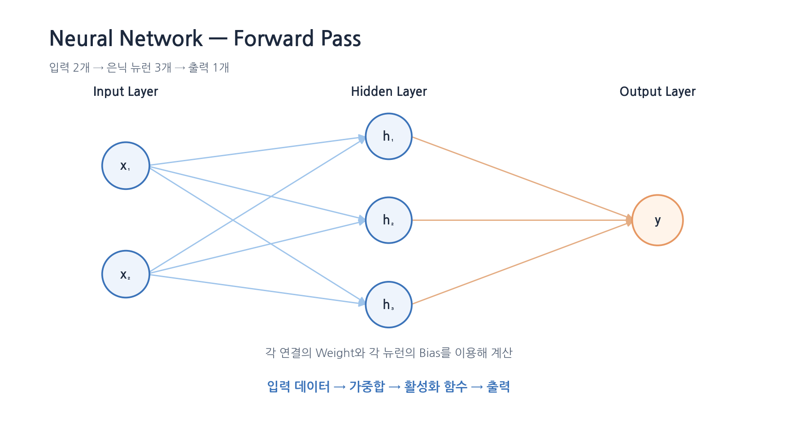
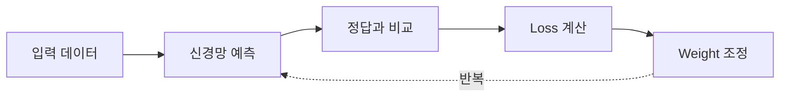

# Chapter 07. Deep Learning & Generative AI

**Week 08 · Python Intermediate · Google Colab**

Week-07에서 배운 머신러닝을 인공신경망으로 확장하고, 딥러닝 모델이 이미지와 텍스트를 처리하는 과정을 실습합니다.

## Contents

| 구분 | 주제 | 세부내용 |
|:---|:---|:---|
| [7.1](#71-introduction-to-deep-learning) | Introduction to Deep Learning | Neural Network 구조, Neuron·Weight·Activation Function |
| [7.2](#72-neural-networks--model-training) | Neural Networks & Model Training | PyTorch 손글씨 숫자 인식(Digits Dataset), Epoch·Loss·Accuracy |
| [7.3](#73-computer-vision--image-recognition) | Computer Vision & Image Recognition | CNN, Pre-trained MobileNetV3로 Image Classification |
| [7.4](#74-generative-ai--large-language-models) | Generative AI & Large Language Models | Token·Transformer·Prompt, SLM(Small Language Model) 텍스트 생성 |
| [Summary](#summary) | 요약 | Custom-trained Model과 Pre-trained Model 비교 |
| [Quiz](#quiz) | 퀴즈 | 주요 개념 및 코드 분석 |
| [Exercise](#exercise) | 연습 문제 | Hyperparameter·실험 조건 변경 및 결과 해석 |

## Getting Started — Google Colab

### 1. 실행 환경과 라이브러리 설치

1. [Google Colab](https://colab.research.google.com/)에서 **새 노트**를 만드세요.
2. 첫 번째 코드 셀에 다음 명령을 입력한 뒤 실행하세요.
3. PyTorch 설치 여부를 확인한 뒤 해당 Chapter의 코드를 실행하세요.

```python
%pip install -q numpy matplotlib scikit-learn pillow transformers
```

Colab에는 `torch`, `torchvision`이 이미 설치된 경우가 많으므로 재설치하기 전에 먼저 설치 여부를 확인하세요.

```python
import torch
import torchvision
import sklearn
import transformers

print("PyTorch:", torch.__version__)
print("TorchVision:", torchvision.__version__)
print("scikit-learn:", sklearn.__version__)
print("Transformers:", transformers.__version__)
print("GPU 사용 가능:", torch.cuda.is_available())
```

`torch` 또는 `torchvision`이 설치되어 있지 않다면 **별도의 셀**에서 아래 명령을 실행하세요. 두 패키지는 서로 호환되는 버전을 사용하는 것이 중요합니다.

```python
%pip install -q torch torchvision
```

- `%pip`: 현재 Notebook 환경에 Python 패키지를 설치하는 명령입니다. `!pip install`도 사용 가능하지만 Notebook에서는 `%pip`을 권장합니다.
- 패키지 설치 중 런타임 재시작 안내가 나타나면 런타임을 재시작한 뒤 처음부터 셀을 다시 실행하세요.
- 7.1~7.2는 CPU로 실습할 수 있습니다. 7.3의 이미지 모델과 7.4의 언어 모델은 처음 실행할 때 가중치를 내려받아야 합니다. 다운로드 속도와 메모리 사용량에 유의하세요.
- 7.4에서 텍스트 생성이 느리다면 **런타임 → 런타임 유형 변경 → 하드웨어 가속기(GPU)** 사용을 검토하세요. 무료 Colab에서 GPU 할당은 보장되지 않습니다. `torch.cuda.is_available()`이 `False`여도 CPU 실습은 가능합니다.
- Colab에서 다운로드한 파일은 런타임이 초기화되면 사라질 수 있습니다. 필요한 결과는 Google Drive나 로컬 PC에 따로 보관하세요.

### 2. 실습 실행 방법

**방법 A — Notebook 파일 실행 (권장)**

ZIP을 해제한 뒤 `Week08_Chapter07.ipynb`를 Colab의 **파일 → 노트 업로드**에서 열고, 위에서부터 셀을 순서대로 실행하세요. 실습 코드는 Notebook에 포함되어 있어 `practice/` 파일을 별도로 업로드할 필요가 없습니다.

**방법 B — GitHub 또는 ZIP의 Python 파일 실행**

배포된 `Week-08.zip`을 Colab에 업로드한 뒤 압축을 해제하세요.

```python
from google.colab import files
files.upload()  # Week-08.zip 선택

!unzip -oq Week-08.zip -d /content
%cd /content/Week-08

%run practice/7_2_digits_training.py
```

`%run` 뒤의 파일명을 바꾸어 다른 Chapter를 실행할 수 있습니다. 7.2는 Loss와 예측 이미지, 7.3은 사진과 Top-5 점수를 비교하는 그래프를 실행 시 `assets/`에 저장합니다. 7.3·7.4는 최초 실행 시 모델 다운로드가 필요합니다.

GitHub에 자료를 올린 뒤에는 다음 명령으로 Week-08만 내려받아 실행할 수도 있습니다.

```python
!git clone --depth 1 --filter=blob:none --sparse https://github.com/JSeong2024/MYPAUL-PYTHONEDU.git /content/MYPAUL-PYTHONEDU
!git -C /content/MYPAUL-PYTHONEDU sparse-checkout set Classroom/PYTHON-2026-09/Intermediate/Lecture/Week-08
%cd /content/MYPAUL-PYTHONEDU/Classroom/PYTHON-2026-09/Intermediate/Lecture/Week-08
```

> 아래 Git 명령은 Week-08을 GitHub에 업로드한 뒤 사용할 수 있습니다. Notebook에서 여러 Chapter를 연속으로 실행하면 `model` 같은 변수명이 덮어쓰일 수 있으므로, 해당 Chapter의 코드를 처음부터 다시 실행하거나 제공된 독립 실행 파일을 사용하세요.

### 3. 폴더 구성

```text
Week-08/
├── README.md
├── Week08_Chapter07.ipynb        # Colab 업로드용 통합 Notebook
├── practice/
│   ├── 7_1_neural_network.py
│   ├── 7_2_digits_training.py
│   ├── 7_3_image_recognition.py
│   ├── 7_4_text_generation.py
│   ├── exercise_01_digits.py
│   └── exercise_02_prompt.py
└── assets/
    ├── 7_1_neural_network.png
    ├── 7_2_training_curve.png
    ├── 7_2_digits_predictions.png
    ├── 7_3_inference_flow.png
    └── 7_4_prompt_flow.png
```

---

## 7.1. Introduction to Deep Learning

### 7.1.1. 머신러닝과 딥러닝의 차이

Week-07에서는 선형 회귀(Linear Regression)와 KNN을 이용해 점수를 예측하고 붓꽃 품종을 분류했습니다. **딥러닝(Deep Learning)** 역시 데이터를 학습하는 머신러닝(Machine Learning)의 한 분야이지만, 여러 층의 **인공신경망(Artificial Neural Network)** 을 이용한다는 점에서 특징적입니다.

| 항목 | 전통적인 머신러닝 실습(Week-07) | 딥러닝 실습(Week-08) |
|:---|:---|:---|
| 대표 모델 | Linear Regression, KNN | 다층 신경망(MLP), CNN, Transformer 기반 모델 |
| 입력 특징 | 사람이 선택한 Feature를 주로 활용 | 여러 층을 통해 유용한 표현을 스스로 학습 |
| 학습 방식 | 알고리즘에 따라 다양한 방식 사용 | Loss를 기준으로 신경망 Weight를 반복 조정 |
| 예시 | 붓꽃 측정값으로 품종 구분 | 이미지의 픽셀에서 숫자·사물 구분 |

머신러닝과 딥러닝이 반드시 대체 관계인 것은 아닙니다. 데이터의 양, 문제의 종류, 실행 비용에 따라 간단한 모델이 더 적절한 경우도 있습니다.

### 7.1.2. 인공신경망의 구조



*그림 7-1. 두 개 입력을 세 개 은닉 뉴런으로 처리한 뒤 하나의 결과를 출력하는 신경망 구조.*

| 구성 | 의미 | 예시 |
|:---|:---|:---|
| **Input Layer**(입력층) | 원본 데이터를 모델에 전달하는 부분 | 공부 시간, 수면 시간 |
| **Hidden Layer**(은닉층) | 입력을 조합·변환하여 특징을 학습하는 층 | 여러 신호의 조합 |
| **Output Layer**(출력층) | 문제에 필요한 최종 결과를 출력하는 층 | 예측 점수, 숫자 0~9의 점수 |
| **Weight**(가중치) | 각 입력 신호가 결과에 얼마나 영향을 주는지 조정하는 값 | `W` |
| **Bias**(편향) | 가중합을 이동시키는 추가 값 | `b` |

신경망의 한 뉴런(Neuron)은 입력에 가중치(Weight)를 곱하고 편향(Bias)을 더한 뒤, 활성화 함수(Activation Function)를 적용하는 식으로 생각할 수 있습니다.

```math
z = w_1x_1 + w_2x_2 + b
```

```math
a = \mathrm{ReLU}(z) = \max(0,z)
```

- `z`: 가중합으로 계산한 값
- `ReLU`: 음수 입력을 0으로 바꾸고 양수 입력은 유지하는 대표적인 활성화 함수(Activation Function)
- `a`: 다음 층에 전달하는 출력

모든 뉴런이 ReLU를 사용하는 것은 아니며, 출력층에서는 문제에 맞는 다른 계산을 사용할 수 있습니다. **가중치(Weight)의 값을 데이터로 조정하는 것이 학습의 핵심**입니다.

### 7.1.3. Coding Practice — 신경망의 순전파

**순전파(Forward Pass)** 는 데이터가 입력층(Input Layer)에서 은닉층(Hidden Layer)을 거쳐 출력층(Output Layer)으로 전달되는 계산 과정입니다. 아래 코드는 학습 전, 정해진 가중치로 계산만 수행하는 실습입니다.

```python
import numpy as np

x = np.array([0.6, 0.8])
W1 = np.array([[0.4, -0.3, 0.7], [0.2, 0.6, -0.1]])
b1 = np.array([0.1, 0.0, 0.2])
W2 = np.array([[0.5], [-0.4], [0.8]])
b2 = np.array([0.1])

z = x @ W1 + b1
hidden = np.maximum(z, 0)  # ReLU
output = hidden @ W2 + b2

print("입력:", x)
print("은닉층 가중합:", np.round(z, 3))
print("은닉층 ReLU 출력:", np.round(hidden, 3))
print("최종 출력:", np.round(output, 3))
```

**실행 결과**

```text
입력: [0.6 0.8]
은닉층 가중합: [0.5  0.3  0.54]
은닉층 ReLU 출력: [0.5  0.3  0.54]
최종 출력: [0.662]
```

`@`는 NumPy의 행렬 곱셈 연산자입니다. 고등학교 수학에서 배우는 '행렬' 개념을 아직 몰라도 괜찮으며, 여기서는 **여러 입력값에 각각의 가중치를 한꺼번에 곱해서 더해주는 편리한 계산 기호**라고 이해하면 충분합니다. 이 예제의 가중치는 임의로 정했으므로 출력값 `0.662`에는 실제 성적이나 확률이라는 의미가 없습니다. 다음 Chapter에서는 신경망이 가중치를 조정하며 학습하는 과정을 살펴봅니다.

전체 코드: [`practice/7_1_neural_network.py`](practice/7_1_neural_network.py)

---

## 7.2. Neural Networks & Model Training

### 7.2.1. 신경망은 어떻게 학습할까?

처음 생성한 신경망의 가중치는 적절한 예측을 보장하지 않습니다. 실제 정답과 모델의 예측을 비교하고, 잘못된 정도를 줄이도록 가중치를 조금씩 조정하는 과정을 반복합니다.



| 용어 | 설명 | 코드에서 확인할 요소 |
|:---|:---|:---|
| **Epoch** | 전체 학습 데이터를 한 번 사용하는 학습 주기 | `for epoch in range(EPOCHS)` |
| **Batch** | 데이터를 한 번에 처리하는 작은 묶음 | `batch_size=64` |
| **Loss**(손실) | 예측과 정답이 얼마나 다른지 계산한 값 | `CrossEntropyLoss()` |
| **Optimizer**(최적화 알고리즘) | Loss가 감소하도록 가중치를 갱신하는 방법 | `Adam(...)` |
| **Learning Rate**(학습률) | 가중치를 조정할 때의 이동 크기 | `lr=0.01` |

손실(Loss)은 모델이 학습 방향을 결정하는 기준입니다. **학습 손실(`Train Loss`)이 감소했다고 해서 처음 보는 데이터에 대한 평가 정확도(`Test Accuracy`)도 반드시 높아지는 것은 아닙니다.** 따라서 Week-07과 마찬가지로 학습용(`Train`)과 평가용(`Test`) 데이터를 분리해 확인합니다.

### 7.2.2. 실습 데이터 — 손글씨 숫자

`scikit-learn`에 포함된 `load_digits()` 데이터셋을 활용합니다. 데이터는 **8×8 픽셀로 이루어진 손글씨 숫자 이미지 1,797개**이며, 정답은 0~9의 숫자입니다.

| 항목 | 값 |
|:---|:---|
| 이미지 크기 | 8 × 8 픽셀 |
| Feature(`X`) | 픽셀값 64개 |
| Target / Label(`y`) | 숫자 0~9 |
| 전체 데이터 | 1,797개 |
| 데이터 분할 | Train 80% / Test 20% |
| 모델 구조 | 64 → 64 → 10 |

이미지는 2차원이지만 간단한 신경망에 입력하기 위해 픽셀값 64개를 한 줄로 펼쳐 사용합니다. 이 방식은 **다층 퍼셉트론(MLP)** 실습이며, 7.3에서 소개할 CNN과는 다른 구조입니다.

### 7.2.3. Coding Practice — PyTorch 숫자 분류 모델

아래 코드는 학습과 정확도 확인을 위한 핵심 구현입니다. 학습 곡선과 실제 숫자 이미지의 시각화 코드는 전체 실습 파일에 포함되어 있습니다.

```python
import numpy as np
import torch
from torch import nn
from torch.utils.data import DataLoader, TensorDataset
from sklearn.datasets import load_digits
from sklearn.model_selection import train_test_split

torch.manual_seed(42)
EPOCHS = 15
HIDDEN_UNITS = 64

digits = load_digits()
X = (digits.data / 16.0).astype(np.float32)
y = digits.target.astype(np.int64)

X_train, X_test, y_train, y_test = train_test_split(
    X, y, test_size=0.2, random_state=42, stratify=y
)

loader = DataLoader(
    TensorDataset(torch.from_numpy(X_train), torch.from_numpy(y_train)),
    batch_size=64, shuffle=True
)

model = nn.Sequential(
    nn.Linear(64, HIDDEN_UNITS),
    nn.ReLU(),
    nn.Linear(HIDDEN_UNITS, 10)
)
loss_fn = nn.CrossEntropyLoss()
optimizer = torch.optim.Adam(model.parameters(), lr=0.01)

for epoch in range(EPOCHS):
    model.train()
    for features, labels in loader:
        optimizer.zero_grad()
        outputs = model(features)
        loss = loss_fn(outputs, labels)
        loss.backward()
        optimizer.step()

model.eval()
with torch.no_grad():
    predictions = model(torch.from_numpy(X_test)).argmax(dim=1).numpy()

accuracy = (predictions == y_test).mean()
print(f"Test Accuracy: {accuracy:.1%}")
```

**주요 코드 분석**

| 코드 | 역할 |
|:---|:---|
| `nn.Linear(64, HIDDEN_UNITS)` | 64개 픽셀 입력을 설정한 개수의 은닉 노드로 변환 |
| `nn.ReLU()` | 신경망에 비선형 변환 적용 |
| `nn.Linear(64, 10)` | 숫자 0~9에 대한 출력 점수 10개 계산 |
| `loss.backward()` | 손실(Loss)을 기준으로 가중치에 대한 기울기(수정 방향) 계산 |
| `optimizer.step()` | 계산된 기울기를 활용해 가중치 갱신 |
| `model.eval()` | 평가 모드로 전환 |
| `torch.no_grad()` | 평가 중 불필요한 기울기 계산 비활성화 |

출력층의 10개 값은 **각 숫자에 대한 원시 점수(날것의 점수, `logit`)** 이며, 가장 큰 값을 가진 숫자를 예측 결과로 선택합니다. 아직 확률(0~100%)로 변환하기 전의 값이므로 이 점수들을 바로 확률이라고 해석하면 안 됩니다.

### 7.2.4. 학습 결과 시각화

**실제 Python 실행 결과 — Epoch와 Loss**


*그림 7-2. 제공한 `7_2_digits_training.py`를 CPU에서 실행하여 기록한 학습 Loss. 그림의 값은 실행환경에 따라 달라질 수 있습니다.*

**실제 Python 실행 결과 — 숫자 인식**


*그림 7-3. 테스트용 손글씨 숫자의 실제 정답(`True`)과 모델의 예측(`Pred`)을 비교한 결과. 서로 다르면 `*`로 표시.*

실습 파일을 지정된 설정으로 실행한 결과, **테스트 360개 중 349개를 맞혀 96.9%의 정확도(Test Accuracy)** 를 기록했습니다. 데이터 분할, 난수 설정, 실행 환경 또는 학습 코드가 바뀌면 결과도 달라질 수 있습니다. 여기서 중요한 것은 높은 정확도 수치 자체보다 **학습되지 않은 테스트 이미지로 성능을 확인했다는 사실**입니다.

전체 코드 및 이미지 출력: [`practice/7_2_digits_training.py`](practice/7_2_digits_training.py)

**확인 활동:** `EPOCHS=5`와 `EPOCHS=15`를 비교하고, 학습 횟수가 달라졌을 때 Loss와 테스트 정확도가 어떻게 바뀌는지 기록해 보세요. README의 핵심 코드는 최종 정확도만 출력하며, 매 Epoch의 Loss 그래프는 전체 실습 파일에서 확인할 수 있습니다.

---

## 7.3. Computer Vision & Image Recognition

### 7.3.1. 컴퓨터는 이미지를 어떻게 처리할까?

**컴퓨터 비전(Computer Vision)** 은 사진과 영상에서 필요한 정보를 추출하고 이해하도록 만드는 인공지능 분야입니다. 사물 분류, 제품 불량 검출, 의료 영상 분석 등 다양한 작업에 활용됩니다.

디지털 이미지는 픽셀(Pixel)의 배열로 표현됩니다. 컬러 이미지는 일반적으로 빨강(R), 초록(G), 파랑(B) 채널을 포함합니다.

| 용어 | 의미 |
|:---|:---|
| **Pixel** | 이미지의 가장 작은 기본 단위 |
| **Channel** | 이미지 색 정보를 나타내는 값의 종류(RGB 등) |
| **CNN** | 이미지에서 공간적인 특징을 추출하는 데 널리 활용되는 합성곱 신경망 |
| **Image Classification** | 입력 이미지에 대해 사물의 종류를 예측하는 작업 |
| **Pre-trained Model** | 대규모 데이터로 미리 학습된 모델 |
| **Inference** | 학습된 모델을 이용해 새 데이터를 예측하는 과정 |

7.2에서는 8×8 이미지를 펼친 다음 일반적인 신경망에 입력합니다. 반면 CNN은 이미지의 **주변 픽셀 관계와 위치에 따른 특징**을 활용하는 구조입니다. 이미지의 선, 무늬, 형태처럼 시각적 특징을 효과적으로 처리하기 위해 사용됩니다.

### 7.3.2. 사전 학습 모델을 활용하는 이유

대규모 사진 데이터로 이미지 분류 모델을 처음부터 학습시키려면 많은 데이터와 연산 자원이 필요합니다. 이번에는 **MobileNetV3-Small**의 사전 학습(Pre-trained) 가중치를 불러와, 모델을 다시 학습하지 않고 사진을 분류합니다.


*그림 7-4. 사전 학습(Pre-trained) 이미지 모델의 추론 과정(개념도).* 

이미지는 모델이 기대하는 크기와 값의 범위로 전처리한 다음 입력해야 합니다. `weights.transforms()`는 해당 가중치에 맞는 이미지 변환을 제공합니다. 또한 `model.eval()`을 적용하여 추론 상태로 전환하고, `torch.inference_mode()`로 기울기 계산을 생략합니다.

### 7.3.3. Coding Practice — 사진 속 사물 분류

처음에는 PyTorch Hub의 **공개 강아지 예제 사진**을 사용합니다. 모델 가중치 및 샘플 사진 다운로드에 인터넷 연결이 필요합니다.

```python
from pathlib import Path
from urllib.request import urlretrieve

import torch
from PIL import Image
from torchvision.models import mobilenet_v3_small, MobileNet_V3_Small_Weights

sample_path = Path("sample_dog.jpg")
if not sample_path.exists():
    urlretrieve(
        "https://raw.githubusercontent.com/pytorch/hub/master/images/dog.jpg",
        sample_path
    )

image = Image.open(sample_path).convert("RGB")
weights = MobileNet_V3_Small_Weights.DEFAULT
model = mobilenet_v3_small(weights=weights)
model.eval()

image_tensor = weights.transforms()(image).unsqueeze(0)
with torch.inference_mode():
    scores = model(image_tensor).softmax(dim=1)[0]
    top_scores, top_ids = torch.topk(scores, 5)

classes = weights.meta["categories"]
for index, score in zip(top_ids.tolist(), top_scores.tolist()):
    print(f"{classes[index]}: {score:.1%}")
```

**주요 코드 분석**

| 코드 | 의미 |
|:---|:---|
| `mobilenet_v3_small(weights=weights)` | Pre-trained 가중치를 적용하여 CNN 모델 로드 |
| `weights.transforms()` | 해당 모델에 필요한 이미지 전처리 수행 |
| `unsqueeze(0)` | 한 장의 이미지에 배치 차원 추가 |
| `model.eval()` | 모델을 추론(Inference) 모드로 설정 |
| `softmax(dim=1)` | 출력 점수를 클래스별 확률 분포로 변환 |
| `torch.topk(..., 5)` | 가장 큰 점수 다섯 개 추출 |

실행 결과에는 **영어 클래스 이름과 점수**가 출력됩니다. 점수는 해당 모델의 출력 분포이며, 현실에서 무조건 정답일 확률이라고 단정할 수 없습니다. 모델이 구분할 수 있는 범주는 사전 학습 시 사용된 클래스에 한정됩니다.

**학생 사진으로 실습하기**

전체 실습 파일 [`practice/7_3_image_recognition.py`](practice/7_3_image_recognition.py)에서 `UPLOAD_OWN_IMAGE = True`로 변경하면 Colab의 파일 업로드 기능으로 다른 사진을 입력할 수 있습니다. 실행하면 입력 사진과 상위 5개 예측 결과를 나란히 그린 **`assets/7_3_image_prediction.png`를 생성**합니다.

**실행 결과 확인:** 모델이 출력한 Top-5 클래스 이름과 Softmax 점수를 실제 사진과 비교해 보세요. README에 표시한 그림 7-4는 개념도이며 **실제 모델 추론 결과는 아닙니다.** 모델 가중치를 내려받아 실행할 수 있는 Colab에서 결과 이미지를 직접 생성하도록 구성했습니다.

> 개인정보가 포함된 얼굴 사진, 타인의 비공개 사진, 저작권이나 공유 문제가 있는 이미지 등은 수업 실습에 사용하지 마세요. 이미지 품질, 피사체, 배경에 따라 예측 결과가 달라질 수 있습니다.

---

## 7.4. Generative AI & Large Language Models

### 7.4.1. 분류 AI와 생성형 AI

앞선 이미지 분류 모델은 입력에 대해 **정해진 종류 중 하나를 고르는 작업**을 수행합니다. 반면 **생성형 AI(Generative AI)** 는 학습한 데이터의 패턴을 바탕으로 새로운 텍스트·이미지·음성 등을 만들어 내는 데 사용됩니다.

| 구분 | 이미지 분류 AI (Classification) | 텍스트 생성형 AI (Generative AI) |
|:---|:---|:---|
| 입력 | 사진 | 질문이나 지시문(Prompt) |
| 출력 | 사물 이름과 점수 | 새롭게 생성된 문장 |
| 주요 역할 | 주어진 대상을 구분 | 문맥에 이어질 내용을 생성 |
| 모델 예 | MobileNetV3 | Transformer 기반 언어 모델 |

**대규모 언어 모델(Large Language Model, LLM)** 은 많은 텍스트를 학습하여 문맥에 맞는 다음 토큰을 예측하는 방식 등으로 언어를 처리합니다. 현대 언어 모델의 핵심 구조로 널리 쓰이는 것이 **Transformer**입니다.

### 7.4.2. Token, Prompt, Transformer

| 개념 | 의미 |
|:---|:---|
| **Token** | 모델이 텍스트를 처리하는 기본 단위(단어 전체·일부·기호 등) |
| **Tokenizer** | 문장을 토큰 단위의 숫자 ID로 변환하는 도구 |
| **Prompt** | 모델에 전달하는 질문·조건·지시문 |
| **Transformer** | Attention 등의 구조를 이용해 입력 요소 간의 관계를 처리하는 신경망 구조 |
| **Text Generation** | 지금까지의 문맥을 참고하여 다음 토큰을 이어 생성하는 작업 |

언어 모델은 보통 입력 문장을 토큰으로 변환하고, 이전 문맥에 따른 다음 토큰의 점수를 계산합니다. 다음 토큰을 선택한 뒤 이를 다시 문맥에 덧붙이는 과정을 반복하여 문장을 생성합니다.


여기서 생성형 AI가 문장을 자연스럽게 작성한다는 사실과 **그 내용이 실제로 사실이라는 것**은 서로 다른 문제입니다. 모델은 질문에 잘못된 정보로 답하거나 확신하는 표현을 사용할 수 있습니다.


*그림 7-5. 입력 문장을 Tokenizer로 변환한 뒤 사전 학습 언어 모델에서 생성 결과를 얻는 과정*

### 7.4.3. Coding Practice — 소형 언어 모델 사용하기

Hugging Face의 **SmolLM2-135M-Instruct**를 사용합니다. 약 1억 3,500만 개의 매개변수를 가진 공개 소형 언어 모델(Small Language Model, SLM)이며, 대규모 상용 서비스와 달리 **수업에서 동작 원리를 살펴보기 위한 모델**입니다. 이 모델은 주로 영어를 이해·생성하도록 학습되었으므로 영어 프롬프트를 사용합니다.

```python
import torch
from transformers import AutoTokenizer, AutoModelForCausalLM

MODEL_ID = "HuggingFaceTB/SmolLM2-135M-Instruct"
PROMPT = "List three simple ways to save electricity at home. Keep each tip short."
device = "cuda" if torch.cuda.is_available() else "cpu"

tokenizer = AutoTokenizer.from_pretrained(MODEL_ID)
model = AutoModelForCausalLM.from_pretrained(MODEL_ID).to(device)
model.eval()

messages = [{"role": "user", "content": PROMPT}]
input_ids = tokenizer.apply_chat_template(
    messages,
    tokenize=True,
    add_generation_prompt=True,
    return_tensors="pt",
).to(device)

with torch.inference_mode():
    generated_ids = model.generate(
        input_ids,
        max_new_tokens=70,
        do_sample=False,
        pad_token_id=tokenizer.eos_token_id,
    )

new_ids = generated_ids[0][input_ids.shape[-1]:]
answer = tokenizer.decode(new_ids, skip_special_tokens=True)
print("Prompt:", PROMPT)
print("Generated Text:\n", answer)
```

**주요 코드 분석**

| 코드 | 역할 |
|:---|:---|
| `AutoTokenizer.from_pretrained()` | 모델에 맞는 Tokenizer 로드 |
| `AutoModelForCausalLM.from_pretrained()` | 다음 토큰 생성용 Pre-trained 모델 로드 |
| `apply_chat_template()` | 사용자 메시지를 모델이 학습한 대화 입력 형식으로 변환 |
| `max_new_tokens=70` | 새로 생성할 토큰의 최대 개수 지정 |
| `do_sample=False` | 가장 점수가 높은 후보를 우선 선택하는 결정적 생성 방식 사용 |
| `tokenizer.decode()` | 생성된 토큰 ID를 사람이 읽는 문자로 변환 |

`max_new_tokens`는 **단어 수나 글자 수가 아니라 토큰(Token) 개수**를 지정합니다. 또한 모델이 생성한 문장의 길이와 내용은 입력, 생성 설정, 모델 버전에 따라 달라질 수 있으므로, README에 특정 문장을 정답처럼 고정하지 않습니다.

전체 코드: [`practice/7_4_text_generation.py`](practice/7_4_text_generation.py)

### 7.4.4. Prompt를 바꾸면 어떤 차이가 있을까?

아래 세 문장을 번갈아 입력하고, 출력의 길이와 표현 방식을 비교해 보세요. 실제 출력 문장은 모델·버전·설정에 따라 달라지므로, 예시 답변을 미리 정하지 않고 **Colab에서 생성된 문장을 직접 기록**하도록 합니다.

| Prompt | 비교할 내용 |
|:---|:---|
| `Explain recycling in one short sentence.` | 짧은 설명 |
| `Explain recycling to an eight-year-old child in two short sentences.` | 대상 수준을 지정한 설명 |
| `Give three examples of recycling at school. Use bullet points.` | 형식을 지정한 목록 |

프롬프트(Prompt)에는 **목적, 대상, 길이, 출력 형식**을 구체적으로 제시할 수 있습니다. 다만 구체적인 지시가 항상 원하는 결과를 보장하는 것은 아니며, 특히 소형 언어 모델은 지시를 놓치거나 부정확하게 답할 수 있습니다.

| 비교 항목 | 생성 결과에서 확인할 내용 |
|:---|:---|
| 문장 길이 | 요청한 문장 수와 `max_new_tokens` 제한을 지키는가? |
| 대상 수준 | 어린이를 대상으로 했을 때 표현이 더 쉬워지는가? |
| 출력 형식 | 글머리 기호 등 요청한 형식을 사용하는가? |
| 사실성 | 틀린 설명이나 어색한 표현이 있는가? |

반복 실험용 파일 [`practice/exercise_02_prompt.py`](practice/exercise_02_prompt.py)는 모델을 한 번 로드한 뒤 세 가지 프롬프트를 `30`토큰과 `70`토큰 제한에서 각각 실행합니다.

**생성형 AI 활용 시 점검할 사항**

- **사실성:** 생성한 설명과 수치가 정확한지 근거 확인 필요
- **개인정보:** 비공개 정보, 실명·연락처 등 민감한 정보 입력에 주의
- **저작권:** 생성 결과를 공개·재사용하기 전에 출처와 사용 조건 확인
- **사용 목적:** 학습 보조 및 초안 작성에는 활용하되 중요한 판단은 사람이 검토

### References

- [PyTorch — 공식 문서](https://pytorch.org/docs/stable/index.html)
- [scikit-learn — Digits Dataset](https://scikit-learn.org/stable/modules/generated/sklearn.datasets.load_digits.html)
- [TorchVision — MobileNet V3](https://docs.pytorch.org/vision/stable/models/mobilenetv3.html)
- [TorchVision — MobileNetV3 모델 가중치 및 전처리](https://docs.pytorch.org/vision/stable/models/mobilenetv3.html)
- [Hugging Face — SmolLM2-135M-Instruct 모델 카드](https://huggingface.co/HuggingFaceTB/SmolLM2-135M-Instruct)
- [Hugging Face — Transformers 문서](https://huggingface.co/docs/transformers/index)
- [Google Colab — FAQ](https://research.google.com/colaboratory/faq.html)

---

## Summary

| 핵심 개념 | 정리 |
|:---|:---|
| **Deep Learning** | 여러 층의 신경망(Neural Network)을 이용하여 데이터의 패턴을 학습하는 머신러닝 분야 |
| **Neural Network** | Input Layer(입력층)·Hidden Layer(은닉층)·Output Layer(출력층) 등으로 이루어진 계산 구조 |
| **Weight / Bias** | 신경망이 학습 과정에서 조정하는 가중치(Weight)와 편향(Bias) |
| **Epoch / Loss** | 학습 반복 단위(Epoch) / 예측 오류(Loss)를 나타내는 학습 기준 |
| **PyTorch** | 신경망의 구성, 학습, 예측을 위한 Python 라이브러리 |
| **CNN** | 이미지의 공간적 특징을 활용하는 합성곱 신경망 |
| **Pre-trained Model** | 대규모 데이터로 미리 학습된 가중치를 활용하는 모델 |
| **Generative AI** | 문장·이미지 등 새로운 콘텐츠를 생성하는 AI |
| **Token / Prompt** | 언어 모델의 텍스트 처리 단위(Token) / 모델에 전달하는 지시·질문(Prompt) |
| **Transformer** | Attention 등의 구조로 문맥 내 요소 간 관계를 처리하는 모델 구조 |


| 구분 | 7.2 — 숫자 분류 (Custom-trained Model) | 7.3, 7.4 — 이미지·텍스트 모델 (Pre-trained Model) |
|:---|:---|:---|
| 모델 준비 | 작은 신경망 직접 생성 | 공개 사전 학습 모델 불러오기 |
| 학습 단계 | `fit()`과 비슷한 역할을 PyTorch 학습 반복문으로 직접 구현 | 추가 학습 없이 추론(Inference)만 수행 |
| 데이터 | 8×8 손글씨 숫자 | 이미지 또는 사용자 Prompt |
| 결과 확인 | Test Accuracy와 Train Loss | 분류 결과(Label/점수)와 생성 텍스트 |

직접 학습하는 모델(Custom-trained Model)과 사전 학습 모델(Pre-trained Model)을 활용하는 방법은 목적이 다릅니다. 실제 개발에서는 문제, 데이터, 연산 자원에 따라 적절한 방식을 선택합니다.

## Quiz

**Q1.** Deep Learning(딥러닝)이 Machine Learning(머신러닝)에 포함되는 이유를 한 문장으로 설명하시오.

**Q2.** 인공신경망(Neural Network)에서 **입력층(Input Layer), 은닉층(Hidden Layer), 출력층(Output Layer)** 이 맡는 역할을 각각 설명하시오.

**Q3.** PyTorch 코드에서 `nn.Linear(64, 10)`의 `64`와 `10`이 뜻하는 바를 각각 설명하시오.
```python
nn.Linear(64, 10)
```

**Q4.** 딥러닝 학습 과정에서 `loss.backward()`와 `optimizer.step()`은 각각 어떤 역할을 수행하는지 설명하시오.

**Q5.** 학습 손실(`Train Loss`)이 계속 감소하면 평가 정확도(`Test Accuracy`)도 반드시 증가하는지 판단하고, 그 이유를 설명하시오.

**Q6.** 다음 중 `model.eval()`을 사용해야 하는 상황으로 가장 적절한 것을 고르시오.
- ① 모델의 가중치(Weight)를 처음 생성할 때
- ② 학습이 끝나고 새로운 이미지에 대해 예측할 때
- ③ 새로운 데이터셋을 인터넷에서 다운로드할 때

**Q7.** 사전 학습 모델(Pre-trained Model)을 사용했을 때의 장점을 한 가지 작성하시오.

**Q8.** 생성형 AI의 `max_new_tokens=70`이 새 문장을 70글자로 제한한다는 설명의 옳고 그름을 판단하고, 그 이유를 설명하시오.

**Q9.** 이미지 분류 모델(Image Classification)의 출력 결과와 언어 생성 모델(LLM)의 출력 결과는 형태가 어떻게 다른지 비교하여 설명하시오.

**Q10.** 생성형 AI가 작성한 문장을 별도의 사실 확인(Fact-check) 없이 그대로 사용하면 안 되는 이유를 설명하시오.

---

## Exercise

### Exercise 01 — 손글씨 숫자 모델 실험 (Neural Network Training)

실습 파일: [`practice/exercise_01_digits.py`](practice/exercise_01_digits.py) *(원본 코드: `practice/7_2_digits_training.py`)*

실습 파일에는 다섯 가지 비교 조건이 준비되어 있습니다. 파일을 실행하면 각 조건에서 모델을 새로 학습하고 결과를 표 형식으로 출력합니다. `experiments` 목록을 수정하면 추가 실험도 가능합니다.

1. `exercise_01_digits.py`를 실행하여 `EPOCHS = 5, 15, 30` 조건의 결과를 확인합니다. *(은닉층 노드 수는 64로 고정)*
2. 각 조건의 마지막 학습 손실(`Train Loss`)과 테스트 정확도(`Test Accuracy`)를 아래 표에 기록합니다.
3. `EPOCHS = 15`에서 은닉층 노드 수(`HIDDEN_UNITS`)를 `16`, `128`로 변경한 결과를 비교합니다.
4. 학습 횟수와 노드 수가 늘어나면 평가 정확도도 항상 높아지는지 분석하고, 두 지표가 다른 방향으로 움직일 수 있는 이유를 설명해 보세요.

| 실험 조건 (고정 조건) | Train Loss | Test Accuracy |
|:---|:---:|:---:|
| `EPOCHS = 5` (`HIDDEN_UNITS = 64`) | 직접 기록 | 직접 기록 |
| `EPOCHS = 15` (`HIDDEN_UNITS = 64`) | 직접 기록 | 직접 기록 |
| `EPOCHS = 30` (`HIDDEN_UNITS = 64`) | 직접 기록 | 직접 기록 |
| `HIDDEN_UNITS = 16` (`EPOCHS = 15`) | 직접 기록 | 직접 기록 |
| `HIDDEN_UNITS = 128` (`EPOCHS = 15`) | 직접 기록 | 직접 기록 |

> **Point:** 학습 중 오차(`Train Loss`)가 줄어드는 것과 처음 보는 데이터에 대한 실제 실력(`Test Accuracy`)이 높아지는 것은 구별해서 확인해야 합니다.

---

### Exercise 02 — 사전 학습 모델로 사진 분류 결과 비교 (Image Classification)

실습 파일: [`practice/7_3_image_recognition.py`](practice/7_3_image_recognition.py)

1. 기본 예제 사진으로 모델을 실행하여 예측 결과 상위 5개(Top-5)와 확률 점수를 확인합니다.
2. `UPLOAD_OWN_IMAGE = True`로 변경하고, 수업에 사용해도 되는 다른 사물 사진을 업로드하여 실행합니다.
3. 두 사진의 상위 5개 예측 이름(Label)과 확률 점수를 비교해 봅니다.
4. 모델의 예측 결과가 실제 사물과 다르다면, 어떤 요인(예: 배경, 각도, 학습 데이터에 없는 물건 등)이 영향을 주었을지 분석해 봅니다.

> **Point:** 사전 학습 모델(MobileNetV3)이 미리 배운 정답 목록(범주)과 입력 사진의 촬영 조건은 예측 결과에 큰 영향을 줍니다.

---

### Exercise 03 — Prompt 설계와 텍스트 생성 결과 비교 (LLM)

실습 파일: [`practice/exercise_02_prompt.py`](practice/exercise_02_prompt.py) — 모델을 한 번 로드한 뒤 프롬프트와 토큰 상한을 바꿔 출력합니다.

1. `exercise_02_prompt.py`를 실행하여 아래 세 프롬프트에 대한 응답을 생성합니다.
2. 생성된 텍스트의 **길이, 형식, 설명 수준**을 비교합니다.
3. `MAX_NEW_TOKENS`를 `30`과 `70`으로 바꾸었을 때 결과가 어떻게 달라지는지 확인합니다.
4. 모델이 지시한 조건(문장 수, 글머리 기호 등)을 지키지 못한 사례를 기록합니다.

```text
Explain recycling in one short sentence.
Explain recycling to an eight-year-old child in two short sentences.
Give three examples of recycling at school. Use bullet points.
```

> **Point:** 입력 지시(`Prompt`)와 출력 결과 사이의 관계를 비교해 보세요. AI가 만든 문장이 매끄럽고 자연스럽더라도 내용이 100% 정확하다고 단정해서는 안 됩니다.
