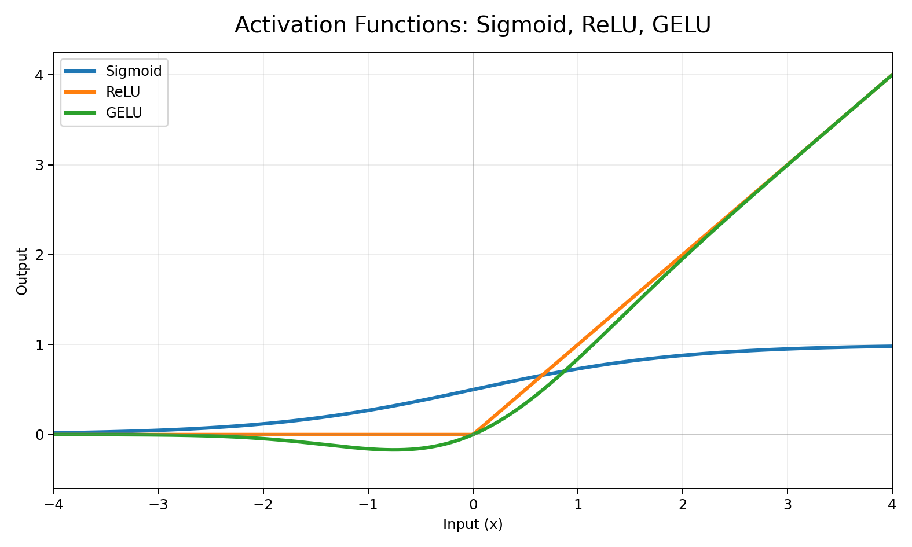
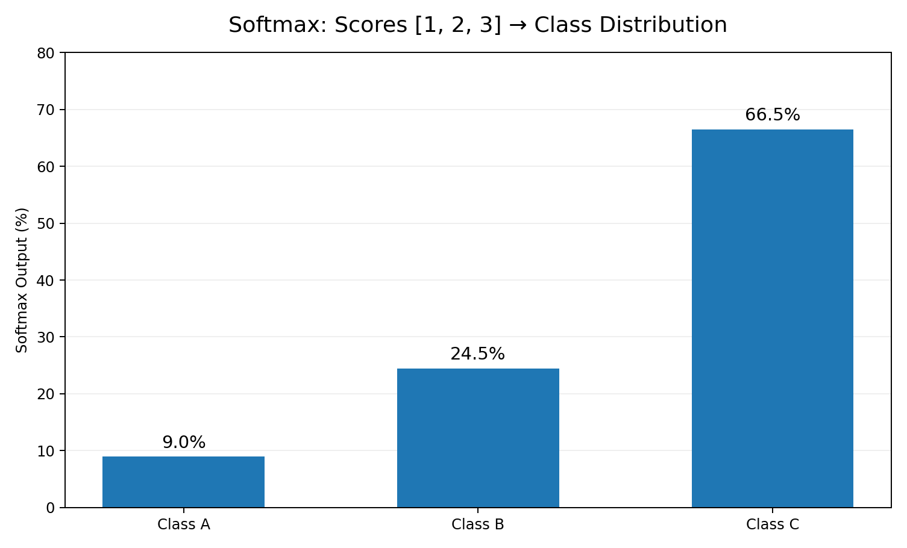
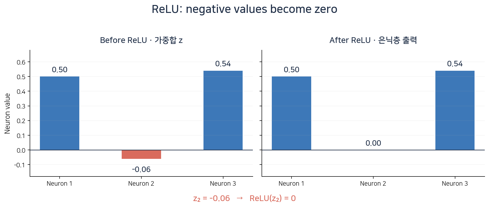
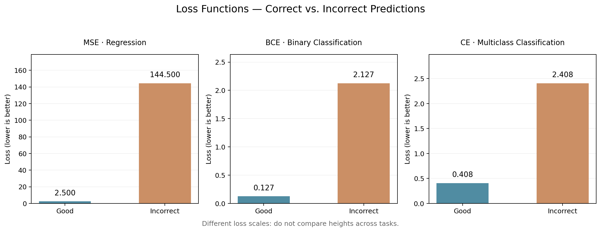
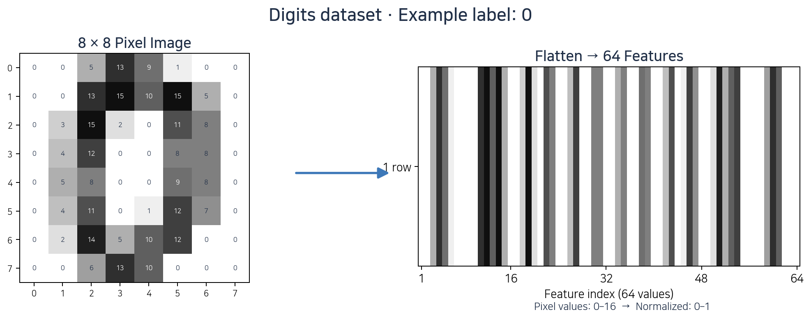
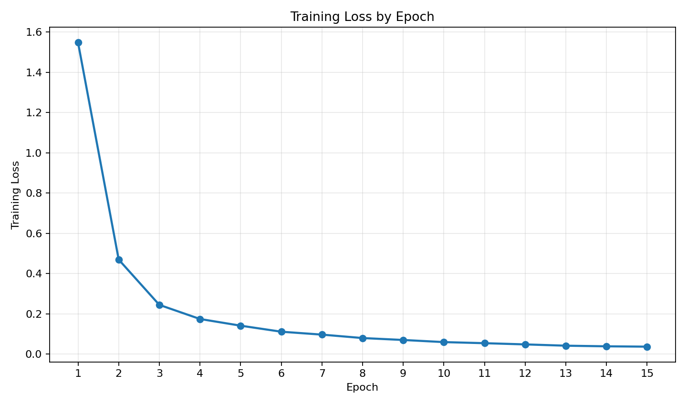
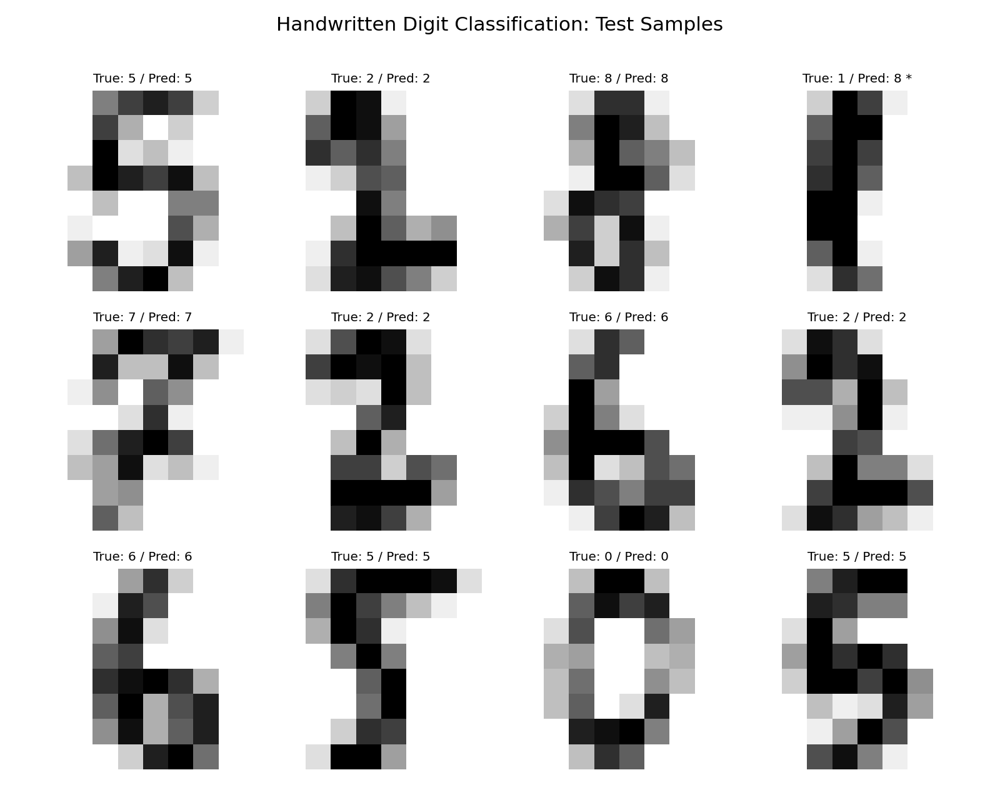
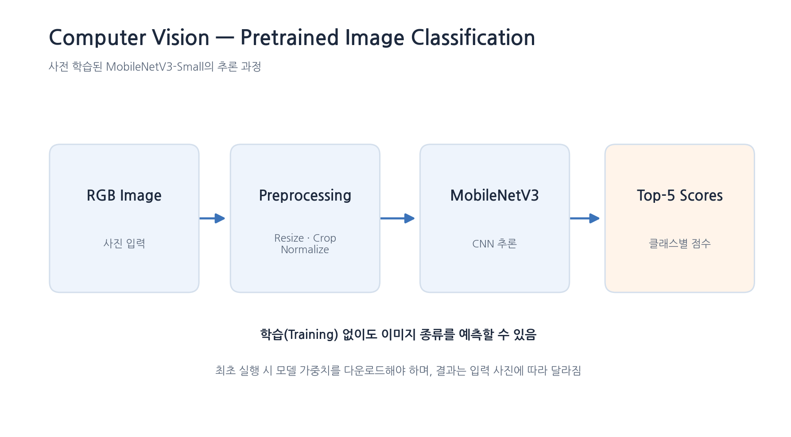
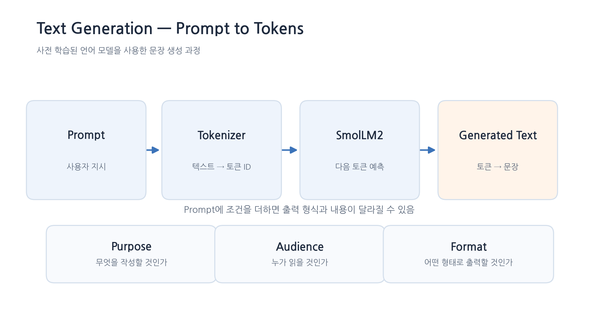

# Chapter 07. Deep Learning & Generative AI

**Week 08 · Python Intermediate · Google Colab**

Week-07에서 배운 머신러닝을 인공신경망으로 확장하고, 딥러닝 모델이 이미지와 텍스트를 처리하는 과정을 실습합니다.

## Contents

| 구분 | 주제 | 세부내용 |
|:---|:---|:---|
| [7.1](#71-introduction-to-deep-learning) | Introduction to Deep Learning | Neural Network 구조, Neuron·Weight·Sigmoid·ReLU·Softmax·GELU |
| [7.2](#72-neural-networks--model-training) | Neural Networks & Model Training | MSE·BCE·Cross-Entropy, PyTorch 손글씨 숫자 인식, Epoch·Accuracy |
| [7.3](#73-computer-vision--image-recognition) | Computer Vision & Image Recognition | CNN, Pre-trained MobileNetV3로 Image Classification |
| [7.4](#74-generative-ai--large-language-models) | Generative AI & Large Language Models | Token·Transformer·Prompt, SLM(Small Language Model) 텍스트 생성 |
| [Summary](#summary) | 요약 | 활성화 함수·손실 함수·학습과 추론 비교 |
| [Quiz](#quiz) | 퀴즈 | 활성화 함수·손실 함수·코드 분석 |
| [Exercise](#exercise) | 연습 문제 | Loss·Hyperparameter·Prompt 실험과 결과 해석 |

## Getting Started — Google Colab

### 1. 실행 환경과 라이브러리 설치

1. [Google Colab](https://colab.research.google.com/)에서 **새 노트**를 만드세요.
2. 첫 번째 코드 셀에 다음 명령을 입력한 뒤 실행하세요.
3. PyTorch 설치 여부를 확인한 뒤 해당 Chapter의 코드를 실행하세요.

```python
%pip install -q numpy matplotlib scikit-learn pillow transformers
```

Colab에는 `torch`, `torchvision`이 이미 설치된 경우가 많으므로 재설치하기 전에 먼저 설치 여부를 확인하세요.

```python
import torch
import torchvision
import sklearn
import transformers

print("PyTorch:", torch.__version__)
print("TorchVision:", torchvision.__version__)
print("scikit-learn:", sklearn.__version__)
print("Transformers:", transformers.__version__)
print("GPU 사용 가능:", torch.cuda.is_available())
```

`torch` 또는 `torchvision`이 설치되어 있지 않다면 **별도의 셀**에서 아래 명령을 실행하세요. 두 패키지는 서로 호환되는 버전을 사용하는 것이 중요합니다.

```python
%pip install -q torch torchvision
```

- `%pip`: 현재 Notebook 환경에 Python 패키지를 설치하는 명령입니다. `!pip install`도 사용 가능하지만 Notebook에서는 `%pip`을 권장합니다.
- 패키지 설치 중 런타임 재시작 안내가 나타나면 런타임을 재시작한 뒤 처음부터 셀을 다시 실행하세요.
- 7.1~7.2는 CPU로 실습할 수 있습니다. 7.3의 이미지 모델과 7.4의 언어 모델은 처음 실행할 때 가중치를 내려받아야 합니다. 다운로드 속도와 메모리 사용량에 유의하세요.
- 7.4에서 텍스트 생성이 느리다면 **런타임 → 런타임 유형 변경 → 하드웨어 가속기(GPU)**  사용을 검토하세요. 무료 Colab에서 GPU 할당은 보장되지 않습니다. `torch.cuda.is_available()`이 `False`여도 CPU 실습은 가능합니다.
- Colab에서 다운로드한 파일은 런타임이 초기화되면 사라질 수 있습니다. 필요한 결과는 Google Drive나 로컬 PC에 따로 보관하세요.

### 2. 실습 실행 방법

**방법 A — Notebook 파일 실행 (권장)** 

ZIP을 해제한 뒤 `Week08_Chapter07.ipynb`를 Colab의 **파일 → 노트 업로드**에서 열고, 위에서부터 셀을 순서대로 실행하세요. 실습 코드는 Notebook에 포함되어 있어 `practice/` 파일을 별도로 업로드할 필요가 없습니다.

**방법 B — GitHub 또는 ZIP의 Python 파일 실행**

배포된 `Week-08.zip`을 Colab에 업로드한 뒤 압축을 해제하세요.

```python
from google.colab import files
files.upload()  # Week-08.zip 선택

!unzip -oq Week-08.zip -d /content
%cd /content/Week-08

%run practice/7_2_digits_training.py
```

`%run` 뒤의 파일명을 바꾸어 다른 Chapter를 실행할 수 있습니다. 7.2는 Loss와 예측 이미지, 7.3은 사진과 Top-5 점수를 비교하는 그래프를 실행 시 `assets/`에 저장합니다. 7.3·7.4는 최초 실행 시 모델 다운로드가 필요합니다.

GitHub에 자료를 올린 뒤에는 다음 명령으로 Week-08만 내려받아 실행할 수도 있습니다.

```python
!git clone --depth 1 --filter=blob:none --sparse https://github.com/JSeong2024/MYPAUL-PYTHONEDU.git /content/MYPAUL-PYTHONEDU
!git -C /content/MYPAUL-PYTHONEDU sparse-checkout set Classroom/PYTHON-2026-09/Intermediate/Lecture/Week-08
%cd /content/MYPAUL-PYTHONEDU/Classroom/PYTHON-2026-09/Intermediate/Lecture/Week-08
```

> 아래 Git 명령은 Week-08을 GitHub에 업로드한 뒤 사용할 수 있습니다. Notebook에서 여러 Chapter를 연속으로 실행하면 `model` 같은 변수명이 덮어쓰일 수 있으므로, 해당 Chapter의 코드를 처음부터 다시 실행하거나 제공된 독립 실행 파일을 사용하세요.

### 3. 폴더 구성

```text
Week-08/
├── README.md
├── Week08_Chapter07.ipynb        # Google Colab 통합 Notebook
├── practice/
│   ├── 7_1_activation_functions.py
│   ├── 7_1_neural_network.py
│   ├── 7_2_loss_functions.py
│   ├── 7_2_digits_training.py
│   ├── 7_3_image_recognition.py
│   ├── 7_4_text_generation.py
│   ├── exercise_01_digits.py
│   ├── exercise_02_losses.py
│   └── exercise_04_prompt.py
└── assets/
    ├── 7_1_neural_network.png
    ├── 7_1_activation_curves.png
    ├── 7_1_softmax_example.png
    ├── 7_1_relu_comparison.png
    ├── 7_2_digit_pixels.png
    ├── 7_2_loss_comparison.png
    ├── 7_2_training_curve.png
    ├── 7_2_digits_predictions.png
    ├── 7_3_inference_flow.png
    └── 7_4_prompt_flow.png
```

---

## 7.1. Introduction to Deep Learning

### 7.1.1. 머신러닝과 딥러닝의 차이

Week-07에서는 선형 회귀(Linear Regression)와 KNN을 이용해 점수를 예측하고 붓꽃 품종을 분류했습니다. **딥러닝(Deep Learning)**  역시 데이터를 학습하는 머신러닝(Machine Learning)의 한 분야이지만, 여러 층의 **인공신경망(Artificial Neural Network)**  을 이용한다는 점에서 특징적입니다.

| 항목 | 전통적인 머신러닝 실습(Week-07) | 딥러닝 실습(Week-08) |
|:---|:---|:---|
| 대표 모델 | Linear Regression, KNN | 다층 신경망(MLP), CNN, Transformer 기반 모델 |
| 입력 특징 | 사람이 선택한 Feature를 주로 활용 | 여러 층을 통해 유용한 표현을 스스로 학습 |
| 학습 방식 | 알고리즘에 따라 다양한 방식 사용 | Loss를 기준으로 신경망 Weight를 반복 조정 |
| 예시 | 붓꽃 측정값으로 품종 구분 | 이미지의 픽셀에서 숫자·사물 구분 |

머신러닝과 딥러닝이 반드시 대체 관계인 것은 아닙니다. 데이터의 양, 문제의 종류, 실행 비용에 따라 간단한 모델이 더 적절한 경우도 있습니다.

### 7.1.2. 인공신경망의 구조


*그림 7-1. 두 개 입력을 세 개 은닉 뉴런으로 처리한 뒤 하나의 결과를 출력하는 신경망 구조. 이해를 위한 개념도입니다.*

| 구성 | 의미 | 예시 |
|:---|:---|:---|
| **Input Layer**(입력층) | 원본 데이터를 모델에 전달하는 부분 | 공부 시간, 수면 시간 |
| **Hidden Layer**(은닉층) | 입력을 조합·변환하여 특징을 학습하는 층 | 여러 신호의 조합 |
| **Output Layer**(출력층) | 문제에 필요한 최종 결과를 출력하는 층 | 예측 점수, 숫자 0~9의 점수 |
| **Weight**(가중치) | 각 입력 신호가 결과에 얼마나 영향을 주는지 조정하는 값 | `W` |
| **Bias**(편향) | 가중합을 이동시키는 추가 값 | `b` |

신경망의 한 뉴런(Neuron)은 입력에 가중치(Weight)를 곱하고 편향(Bias)을 더한 뒤, 활성화 함수(Activation Function)를 적용하는 식으로 생각할 수 있습니다.

```math
z = w_1x_1 + w_2x_2 + b
```

```math
a = f(z)
```

- `z`: 입력값에 가중치와 편향을 적용한 가중합
- `f`: 계산 결과를 변환하는 활성화 함수(예: ReLU, GELU)
- `a`: 활성화 함수 적용 후 다음 층에 전달하는 값

어떤 활성화 함수를 선택하느냐에 따라 출력 형태가 달라집니다. 이어서 대표적인 네 가지 함수를 비교합니다. **가중치와 편향을 데이터로 조정하는 과정은 7.2에서 학습합니다.**

### 7.1.3. Activation Functions — 활성화 함수

**활성화 함수(Activation Function)** 는 뉴런에서 계산한 값을 다음 층으로 전달하기 전에 변환하는 함수입니다. 대표적인 목적은 신경망에 **비선형성(Nonlinearity)** 을 추가하는 것입니다. 가중합만 계산하는 층을 여러 개 연결하면 전체가 하나의 선형 변환으로 정리되므로, 복잡한 패턴을 표현하는 데 한계가 있습니다. 활성화 함수는 이 한계를 줄여 줍니다.

모든 활성화 함수가 같은 역할을 하는 것은 아닙니다. **은닉층에서는 ReLU나 GELU**, **분류 결과를 해석하는 출력 단계에서는 Sigmoid나 Softmax**를 사용하는 경우가 많습니다. 어떤 함수를 사용할지는 모델 구조와 학습 목적에 따라 달라집니다.

> **핵심 구분:** 이진 분류에서는 Sigmoid로 하나의 출력 점수를 해석할 수 있고, 서로 배타적인 여러 클래스 중 하나를 고르는 분류에서는 Softmax로 클래스별 점수를 비교할 수 있습니다. 반면 ReLU와 GELU는 주로 은닉층의 비선형 변환에 사용됩니다.

| 함수 | 핵심 역할 | 주요 활용 | 출력의 특징 |
|:---|:---|:---|:---|
| **Sigmoid** | 하나의 입력값을 0~1 사이로 변환 | 이진 분류의 출력 해석 | 0과 1에 가까워지지만 정확히 도달하지 않음 |
| **ReLU** | 음수를 0으로, 양수를 그대로 전달 | 신경망 은닉층 | 계산이 단순하고 양수 영역에서 기울기가 유지됨 |
| **Softmax** | 여러 점수를 합이 1인 분포로 변환 | 다중 분류의 출력 해석 | 모든 출력이 0~1 사이, 전체 합은 1 |
| **GELU** | 입력값을 부드럽고 연속적으로 변환 | 일부 현대적인 신경망·Transformer | 음수도 작은 값으로 남을 수 있음 |

#### ① Sigmoid — 이진 분류의 출력

Sigmoid는 하나의 숫자를 **0과 1 사이의 값**으로 변환합니다. 입력이 0이면 0.5이며, 입력이 커질수록 1에, 작아질수록 0에 가까워집니다.

```math
\sigma(x)=\frac{1}{1+e^{-x}}
```

예를 들어 `x = -2, 0, 2`일 때 출력은 각각 약 `0.119, 0.500, 0.881`입니다. 이진 분류에서는 모델의 원시 출력(Logit)을 확률 형태로 해석할 때 사용할 수 있습니다. 다만 숫자가 0~1 사이라는 이유만으로 실제 정답일 확률이 정확하게 보정되었다고 단정할 수는 없습니다.

**주의:** 입력의 절댓값이 매우 크면 출력이 0이나 1에 가까워지고, 기울기도 작아질 수 있습니다. 이 때문에 깊은 은닉층에서 무조건 Sigmoid를 사용하지는 않습니다.

#### ② ReLU — 은닉층에서 자주 사용하는 함수

ReLU(Rectified Linear Unit)는 음수를 0으로 변경하고, **0보다 큰 값은 그대로 출력**합니다.

```math
\mathrm{ReLU}(x)=\max(0,x)
```

예: `ReLU(-2) = 0`, `ReLU(0) = 0`, `ReLU(2) = 2`.

계산이 간단하고 양수 영역에서 입력값이 커져도 출력이 눌리지 않아 널리 사용됩니다. 단, 어떤 뉴런이 계속 음수 값만 받으면 출력이 0으로 유지되어 학습이 어려워질 수 있습니다. 이를 흔히 *Dying ReLU* 문제라고 부릅니다.

**7.1.4 순전파 실습에서는 ReLU로 은닉 뉴런의 `-0.06`이 `0`으로 바뀌는 과정을 확인합니다.**

#### ③ Softmax — 여러 클래스의 점수를 비교

Softmax는 **여러 개의 점수(Logits)** 를 한꺼번에 입력받아, 합이 1이 되도록 변환합니다. Sigmoid처럼 숫자 하나를 독립적으로 변환하는 방식과는 다릅니다.

```math
\mathrm{Softmax}(z)_i=\frac{e^{z_i}}{\sum_{j=1}^{K}e^{z_j}}
```

- `z_i`: `i`번째 클래스의 원시 점수(Logit)
- `K`: 클래스의 총개수
- `e`: 자연상수. 각 점수를 양수로 변환하는 지수 함수에 사용

예를 들어 세 클래스의 원시 점수가 `[1, 2, 3]`이라면 Softmax 결과는 약 `[0.090, 0.245, 0.665]`이며, **세 값을 더하면 1**입니다. 가장 큰 점수를 얻은 세 번째 클래스가 예측 결과가 됩니다.

7.2의 손글씨 숫자 분류에서는 출력층이 **숫자 0~9에 대한 원시 점수 10개**를 만듭니다. `nn.CrossEntropyLoss()`는 학습에 필요한 Softmax 관련 계산을 내부적으로 처리하므로, **손실 함수에 전달하기 전에 Softmax를 별도로 적용하지 않습니다.** 예측 결과를 사람에게 분포로 보여줄 때는 Softmax를 사용할 수 있습니다.

#### ④ GELU — 부드러운 비선형 변환

GELU(Gaussian Error Linear Unit)는 ReLU처럼 비선형성을 추가하지만, 입력값을 갑자기 0으로 자르지 않고 **부드럽게 변환**합니다. 일부 음수 입력도 작은 음수 값으로 남습니다.

```math
\mathrm{GELU}(x)=x\,\Phi(x)
```

여기서 `Φ(x)`는 **표준정규분포의 누적분포함수**로, 입력 `x` 이하의 값이 나타날 확률을 뜻합니다. 해당 확률의 자세한 계산 과정까지 외울 필요는 없습니다. 핵심은 **입력값에 따라 통과하는 정도가 부드럽게 달라진다는 점**입니다.

예: `GELU(-1) ≈ -0.159`, `GELU(0) = 0`, `GELU(1) ≈ 0.841`.

GELU는 2016년에 제안된 함수이며, **최근에 새로 등장한 함수라기보다는 현대적인 Transformer 모델에서도 널리 활용되는 함수**라고 이해하는 것이 정확합니다. 모든 Transformer가 GELU를 사용하는 것은 아닙니다.

#### Coding Practice — 네 가지 함수 비교

아래 코드는 **Sigmoid·ReLU·GELU를 같은 입력값에 적용**하고, **Softmax는 세 클래스의 점수를 함께 변환**합니다. Colab에서 그대로 실행할 수 있으며 별도의 학습 과정은 없습니다.

```python
import torch
import torch.nn.functional as F

values = torch.tensor([-1.0, 0.0, 1.0])
print("Sigmoid:", torch.sigmoid(values).round(decimals=3))
print("ReLU:   ", F.relu(values).round(decimals=3))
print("GELU:   ", F.gelu(values).round(decimals=3))

logits = torch.tensor([1.0, 2.0, 3.0])
probs = F.softmax(logits, dim=0)
print("Softmax:", probs.round(decimals=3))
print("합계:   ", probs.sum().item())
```

**실행 결과** (반올림한 값)

```text
Sigmoid: tensor([0.2690, 0.5000, 0.7310])
ReLU:    tensor([0., 0., 1.])
GELU:    tensor([-0.1590, 0.0000, 0.8410])
Softmax: tensor([0.0900, 0.2450, 0.6650])
합계:    1.0
```

**함수별 출력 곡선**



*그림 7-2. 같은 입력값에 세 활성화 함수를 적용한 결과입니다. Sigmoid는 0~1 사이의 S자 곡선, ReLU는 음수 구간에서 0, GELU는 음수 구간에서도 부드럽게 변하는 형태입니다.*

**Softmax 출력 분포**



*그림 7-3. 세 클래스의 원시 점수 `[1, 2, 3]`을 합이 1인 값으로 변환한 결과입니다. 출력은 모델이 계산한 분포이며, 실제 정답일 가능성을 보장하는 수치는 아닙니다.*

그래프 생성 및 전체 코드: [`practice/7_1_activation_functions.py`](practice/7_1_activation_functions.py)

**확인 활동:** 위 코드의 `logits`를 `[3, 2, 1]`로 변경하고 가장 높은 Softmax 값을 가진 클래스가 어떻게 바뀌는지 확인해 보세요. 또 `values`의 `-1.0`을 `-3.0`으로 바꾼 뒤 ReLU와 GELU의 차이를 비교해 보세요.

---

### 7.1.4. Coding Practice — 신경망의 순전파

**순전파(Forward Pass)** 는 입력값이 가중치와 편향을 거쳐 최종 출력으로 계산되는 과정입니다. 이번에는 **입력 2개 → 은닉 뉴런 3개 → 출력 1개**인 작은 신경망을 NumPy로 구현합니다. 아직 데이터를 학습하지 않고, 미리 지정한 숫자로 계산 과정만 확인합니다.

**코드에서 사용할 값**

| 변수 | 역할 | 크기 | 의미 |
|:---|:---|:---:|:---|
| `x` | 입력 데이터 | 2개 | 첫 번째 입력 0.6, 두 번째 입력 0.8 |
| `W1` | 첫 번째 가중치 | 2×3 | 입력 2개와 은닉 뉴런 3개를 연결하는 숫자 |
| `b1` | 첫 번째 편향 | 3개 | 각 은닉 뉴런에 하나씩 더하는 숫자 |
| `z` | 은닉층 가중합 | 3개 | ReLU 적용 전 계산 결과 |
| `hidden` | 은닉층 출력 | 3개 | `z`에 ReLU를 적용한 결과 |
| `W2`·`b2` | 출력층 가중치·편향 | 3×1·1개 | 은닉층의 값 3개로 최종 출력 1개 계산 |
| `output` | 최종 결과 | 1개 | 출력층에서 계산한 숫자. 실제 예측값이나 확률은 아님 |

**첫 번째 은닉 뉴런 계산 예시**

첫 번째 은닉 뉴런에는 입력값 `0.6`, `0.8`이 전달됩니다. 각 입력에 가중치 `0.4`, `0.2`를 곱하고 편향 `0.1`을 더합니다.

```math
z_1 = 0.6 \times 0.4 + 0.8 \times 0.2 + 0.1 = 0.5
```

두 번째 은닉 뉴런은 같은 계산으로 `-0.06`을 얻습니다. ReLU는 음수를 0으로 변경하므로, **적용 전후에 값이 달라지는 부분**을 확인할 수 있습니다.

**실행 코드**

```python
import numpy as np

# 입력값 두 개
x = np.array([0.6, 0.8])

# 입력 2개 → 은닉 뉴런 3개
W1 = np.array([[0.4, -0.9, 0.7],
               [0.2,  0.6, -0.1]])
b1 = np.array([0.1, 0.0, 0.2])

# 은닉 뉴런 3개 → 출력 1개
W2 = np.array([[0.5], [-0.4], [0.8]])
b2 = np.array([0.1])

# 순전파: 가중합 → ReLU → 최종 출력
z = x @ W1 + b1
hidden = np.maximum(z, 0)  # ReLU
output = hidden @ W2 + b2

print("입력:", x)
print("은닉층 가중합:", np.round(z, 3))
print("은닉층 ReLU 출력:", np.round(hidden, 3))
print("최종 출력:", np.round(output, 3))
```

**실행 결과**

```text
입력: [0.6 0.8]
은닉층 가중합: [ 0.5  -0.06  0.54]
은닉층 ReLU 출력: [0.5  0.   0.54]
최종 출력: [0.782]
```



*그림 7-4. 실제 코드에서 계산한 은닉 뉴런 3개의 값. 두 번째 값이 ReLU에 의해 -0.06에서 0으로 바뀝니다.*

**주요 연산자와 함수**

| 코드 | 설명 |
|:---|:---|
| `np.array([...])` | 여러 숫자를 NumPy 배열로 묶어 연산에 사용합니다. |
| `x @ W1` | `@`는 행렬 곱셈입니다. 두 입력값에 각 뉴런의 가중치를 곱해 합산합니다. |
| `+ b1` | 은닉 뉴런마다 편향을 더합니다. |
| `np.maximum(z, 0)` | 배열의 각 원소와 0을 비교해 큰 값을 남깁니다. ReLU 계산입니다. |
| `np.round(z, 3)` | 출력값을 소수점 셋째 자리까지 반올림해 표시합니다. 학습 값 자체는 바꾸지 않습니다. |

**계산 흐름:** `x` → `x @ W1 + b1` → `ReLU` → `hidden @ W2 + b2` → `output`. 출력층에는 ReLU를 적용하지 않았으므로 마지막 결과는 가중합 그대로입니다. 이 예제의 가중치와 편향은 사람이 지정한 값이며, **학습을 통해 결정한 값이 아닙니다.** 다음 Chapter에서는 모델이 데이터를 보고 가중치를 조정하는 방법을 살펴봅니다.

**확인 활동:** `W1`의 `-0.9`를 `-0.3`으로 바꾼 뒤 두 번째 은닉 뉴런의 `z`와 `hidden`이 어떻게 달라지는지 확인해 보세요.

전체 실행 코드: [`practice/7_1_neural_network.py`](practice/7_1_neural_network.py)

---

## 7.2. Neural Networks & Model Training

### 7.2.1. 신경망은 어떻게 학습할까?

처음 생성한 신경망의 가중치는 적절한 예측을 보장하지 않습니다. 실제 정답과 모델의 예측을 비교하고, 잘못된 정도를 줄이도록 가중치를 조금씩 조정하는 과정을 반복합니다.


| 용어 | 설명 | 코드에서 확인할 요소 |
|:---|:---|:---|
| **Epoch** | 전체 학습 데이터를 한 번 사용하는 학습 주기 | `for epoch in range(EPOCHS)` |
| **Batch** | 데이터를 한 번에 처리하는 작은 묶음 | `batch_size=64` |
| **Loss**(손실) | 예측과 정답이 얼마나 다른지 계산한 값 | `CrossEntropyLoss()` |
| **Optimizer**(최적화 알고리즘) | Loss가 감소하도록 가중치를 갱신하는 방법 | `Adam(...)` |
| **Learning Rate**(학습률) | 가중치를 조정할 때의 이동 크기 | `lr=0.01` |

손실(Loss)은 예측과 정답의 차이를 수치로 계산한 값입니다. 모델은 각 Batch에 대해 **예측 → 손실 계산 → 기울기 계산 → 가중치 수정**을 수행합니다. 이를 모든 Batch에서 반복하면 한 Epoch가 완료됩니다.

학습 손실(`Train Loss`)이 감소하더라도 처음 보는 데이터에 대한 정확도(`Test Accuracy`)가 반드시 높아지지는 않습니다. 따라서 Week-07과 마찬가지로 학습 데이터와 평가 데이터를 구분합니다. 기울기는 가중치를 어느 방향으로 얼마나 바꿀지 판단할 때 쓰는 값이며, 계산 방법을 직접 유도하지는 않습니다.

### 7.2.2. Loss Functions — 손실 함수

**손실 함수(Loss Function)** 는 모델의 예측 결과와 실제 정답의 차이를 숫자로 계산합니다. 학습에서는 손실을 줄이는 방향으로 Weight와 Bias를 갱신합니다. **출력층의 형태와 손실 함수는 문제의 유형에 따라 선택**하며, 특정 활성화 함수와 반드시 1:1로 대응하는 것은 아닙니다.

| 문제 유형 | 출력의 의미 | 대표 손실 함수 | PyTorch에서 사용하는 함수 |
|:---|:---|:---|:---|
| **회귀(Regression)**  | 시험 점수·가격처럼 연속된 숫자 | **MSE**(평균 제곱 오차) | `nn.MSELoss()` |
| **이진 분류(Binary Classification)**  | 0 또는 1에 해당하는 두 결과 | **BCE**(이진 교차 엔트로피) | `nn.BCEWithLogitsLoss()` |
| **다중 클래스 분류(Multiclass Classification)**  | 여러 클래스 가운데 하나 | **Cross-Entropy**(교차 엔트로피) | `nn.CrossEntropyLoss()` |

회귀에서는 출력층을 주로 **Linear(별도 활성화 없음)** 로 사용합니다. 이진 분류는 Sigmoid를 이용해 출력 점수(Logit)를 0~1 사이 값으로 해석할 수 있습니다. 다중 클래스 분류는 Softmax로 클래스별 점수를 합이 1인 분포로 나타낼 수 있습니다. 이 관계는 대표적인 구성 방식이며, 문제의 조건에 따라 다른 선택도 가능합니다.

#### ① MSE — Mean Squared Error

MSE는 **실제값과 예측값의 차이를 제곱하여 평균**한 값입니다. 차이가 커질수록 제곱 오차가 빠르게 증가하므로 큰 예측 오류에 민감합니다.

```math
\mathrm{MSE}=\frac{1}{N}\sum_{i=1}^{N}(y_i-\hat{y}_i)^2
```

- `N`: 평가하는 데이터의 개수
- `y_i`: 실제 정답, `ŷ_i`: 모델의 예측값

**계산 예시:** 실제 점수가 `[80, 90]`, 예측 점수가 `[78, 91]`이면 제곱 오차는 `[4, 1]`이므로 **MSE는 2.5**입니다. 예측이 `[65, 98]`로 바뀌면 **MSE는 144.5**로 증가합니다. 손실의 단위는 원래 값의 단위를 제곱한 형태이며, Accuracy처럼 정답률(%)을 나타내지는 않습니다.

#### ② Binary Cross-Entropy — BCE

BCE는 **두 가지 결과 중 정답에 부여한 확률**이 얼마나 적절한지 측정합니다. 정답이 `1`인데 모델이 `1`의 가능성을 매우 낮게 예측하면 손실이 커집니다.

```math
\mathrm{BCE}=-[y\log(p)+(1-y)\log(1-p)]
```

- `y`: 실제 정답(0 또는 1)
- `p`: 정답 `1`에 대한 모델의 예측 확률(Sigmoid 출력)
- `log`: 자연로그

**계산 예시:** 정답이 `1`일 때 Sigmoid 출력이 약 `0.881`이면 BCE는 약 **0.127**, 출력이 약 `0.119`이면 BCE는 약 **2.127**입니다. 모델이 정답에 낮은 확률을 부여할수록 손실이 커집니다.

> **PyTorch 사용 시 주의:** `nn.BCEWithLogitsLoss()`는 **Sigmoid 변환과 BCE 계산을 결합**한 함수입니다. 손실을 계산할 때는 Sigmoid 전의 **Logit**을 바로 전달합니다. Sigmoid를 먼저 적용한 값을 다시 이 함수에 넣지 않습니다. 정답은 입력 Logit과 같은 형태의 실수형 `0` 또는 `1`을 사용합니다.

#### ③ Cross-Entropy — 다중 클래스 분류 손실

Cross-Entropy는 여러 클래스 중 **실제 정답 클래스에 부여한 확률**을 기준으로 손실을 계산합니다. 정답 클래스의 예측 확률이 높아질수록 손실은 0에 가까워집니다. 하나의 데이터에서 정답 클래스가 하나인 경우 다음과 같이 표현할 수 있습니다.

```math
L=-\log(p_{\mathrm{correct}})
```

- `p_correct`: Softmax 출력 중 실제 정답 클래스에 해당하는 값

**계산 예시:** 정답 클래스가 세 번째(인덱스 `2`)일 때 Logit `[1, 2, 3]`을 Softmax로 변환하면 정답 클래스 확률이 약 `0.665`이고 손실은 약 **0.408**입니다. Logit이 `[3, 2, 1]`이면 정답 클래스 확률이 약 `0.090`으로 낮아지고 손실은 약 **2.408**입니다.

> **PyTorch 사용 시 주의:** `nn.CrossEntropyLoss()`는 **원시 출력 점수(Logits)** 와 실제 정답의 **클래스 인덱스**를 입력받아 계산합니다. 내부적으로 LogSoftmax에 해당하는 연산을 처리하므로 학습 코드에서 **Softmax를 먼저 적용하지 않습니다.** 7.2.4의 숫자 분류 모델이 이 방식입니다. 일반적인 다음 토큰 예측 언어 모델의 학습에도 Cross-Entropy가 사용되지만, 7.4의 예제는 사전 학습 모델의 **추론**이므로 Loss를 직접 계산하지 않습니다.

#### Coding Practice — 손실 함수별 계산 결과 비교

같은 문제에서 정답에 가까운 예측과 잘못된 예측을 입력하고 손실값이 어떻게 달라지는지 확인합니다. **서로 다른 손실 함수의 수치 크기를 직접 비교하는 활동은 아닙니다.**

```python
import torch
from torch import nn

# 회귀: 실제 점수 [80, 90]
actual = torch.tensor([80.0, 90.0])
mse = nn.MSELoss()
print("MSE:", round(mse(torch.tensor([78.0, 91.0]), actual).item(), 3))

# 이진 분류: 정답 1, Logit 2.0 → Sigmoid 약 0.881
bce = nn.BCEWithLogitsLoss()
print("BCE:", round(bce(torch.tensor([2.0]), torch.tensor([1.0])).item(), 3))

# 다중 클래스: 정답 클래스 인덱스 2, Logit 세 개
ce = nn.CrossEntropyLoss()
logits = torch.tensor([[1.0, 2.0, 3.0]])
print("CE:", round(ce(logits, torch.tensor([2])).item(), 3))
```

**실행 결과**

```text
MSE: 2.5
BCE: 0.127
CE: 0.408
```

**정답에 가까운 예측과 잘못된 예측의 손실 비교**



*그림 7-5. 세 손실 함수의 동일 문제 내 비교 결과. 각 그래프는 서로 다른 데이터와 축 범위를 사용하므로, 함수 사이의 막대 높이를 직접 비교해서는 안 됩니다.*

전체 실행 코드 및 그래프 생성: [`practice/7_2_loss_functions.py`](practice/7_2_loss_functions.py)

**확인 활동:** MSE에서는 예측값을 바꾸고, BCE에서는 Logit의 부호를 바꾸고, Cross-Entropy에서는 클래스 점수의 순서를 바꾸어 손실을 비교해 보세요.

---

### 7.2.3. 실습 데이터 — 손글씨 숫자

`scikit-learn`에 포함된 `load_digits()` 데이터셋을 활용합니다. 데이터는 **8×8 픽셀로 이루어진 손글씨 숫자 이미지 1,797개**이며, 정답은 0~9의 숫자입니다.

| 항목 | 값 |
|:---|:---|
| 이미지 크기 | 8 × 8 픽셀 |
| Feature(`X`) | 픽셀값 64개 |
| Target / Label(`y`) | 숫자 0~9 |
| 전체 데이터 | 1,797개 |
| 데이터 분할 | Train 80% / Test 20% |
| 모델 구조 | 64 → 64 → 10 |

이미지는 8행×8열이지만, 이번 신경망에서는 픽셀 64개를 한 줄로 펼쳐 입력합니다. 따라서 첫 번째 층은 `nn.Linear(64, ...)`로 시작합니다. 이 구조는 **다층 퍼셉트론(MLP)** 이며, 이미지의 공간적 배치를 활용하는 CNN과 구별됩니다.

또한 원본 픽셀값은 `0~16` 범위입니다. `digits.data / 16.0`은 각 값을 **0~1 범위로 정규화**하여 신경망에 입력하기 쉽게 조정합니다. `.astype(np.float32)`는 계산에 사용할 실수 자료형으로 변환하는 작업입니다.



*그림 7-6. 실제 Digits 데이터셋의 숫자 한 장(8×8)과 이를 펼친 64개 픽셀값의 관계.*

### 7.2.4. Coding Practice — PyTorch 숫자 분류 모델

아래 코드는 학습과 정확도 확인을 위한 핵심 구현입니다. 학습 곡선과 실제 숫자 이미지의 시각화 코드는 전체 실습 파일에 포함되어 있습니다.

```python
import numpy as np
import torch
from torch import nn
from torch.utils.data import DataLoader, TensorDataset
from sklearn.datasets import load_digits
from sklearn.model_selection import train_test_split

torch.manual_seed(42)
EPOCHS = 15
HIDDEN_UNITS = 64

digits = load_digits()
X = (digits.data / 16.0).astype(np.float32)
y = digits.target.astype(np.int64)

X_train, X_test, y_train, y_test = train_test_split(
    X, y, test_size=0.2, random_state=42, stratify=y
)

loader = DataLoader(
    TensorDataset(torch.from_numpy(X_train), torch.from_numpy(y_train)),
    batch_size=64, shuffle=True
)

model = nn.Sequential(
    nn.Linear(64, HIDDEN_UNITS),
    nn.ReLU(),
    nn.Linear(HIDDEN_UNITS, 10)
)
loss_fn = nn.CrossEntropyLoss()
optimizer = torch.optim.Adam(model.parameters(), lr=0.01)

for epoch in range(EPOCHS):
    model.train()
    for features, labels in loader:
        optimizer.zero_grad()
        outputs = model(features)
        loss = loss_fn(outputs, labels)
        loss.backward()
        optimizer.step()

model.eval()
with torch.no_grad():
    predictions = model(torch.from_numpy(X_test)).argmax(dim=1).numpy()

accuracy = (predictions == y_test).mean()
print(f"Test Accuracy: {accuracy:.1%}")
```

**코드 흐름 분석**

| 단계 | 코드 | 역할 |
|:---:|:---|:---|
| 1 | `TensorDataset(...)` | 입력 특징과 정답을 서로 대응하는 데이터 묶음으로 만듭니다. |
| 2 | `DataLoader(..., batch_size=64)` | 64개씩 Batch를 꺼내고 매 Epoch마다 순서를 섞습니다. |
| 3 | `nn.Linear(64, HIDDEN_UNITS)` | 한 이미지의 64개 픽셀값을 은닉층으로 전달합니다. |
| 4 | `nn.ReLU()` | 은닉층 출력에 비선형 변환을 적용합니다. |
| 5 | `nn.Linear(HIDDEN_UNITS, 10)` | 각 숫자 0~9에 대한 점수 10개를 계산합니다. |
| 6 | `nn.CrossEntropyLoss()` | 점수 10개와 실제 숫자 정답을 비교하여 Loss를 계산합니다. |
| 7 | `torch.optim.Adam(..., lr=0.01)` | 계산된 기울기를 활용해 가중치를 갱신하는 알고리즘을 설정합니다. |

**한 Batch에서 반복하는 다섯 줄**

| 코드 | 동작 |
|:---|:---|
| `optimizer.zero_grad()` | 이전 Batch에서 누적된 기울기를 초기화합니다. |
| `outputs = model(features)` | 현재 Batch의 숫자 이미지를 예측합니다. |
| `loss = loss_fn(outputs, labels)` | 예측 점수와 정답의 차이를 계산합니다. |
| `loss.backward()` | Loss를 줄이는 데 필요한 기울기를 계산합니다. |
| `optimizer.step()` | 계산된 기울기를 사용하여 모델의 가중치를 갱신합니다. |

출력층의 값 10개는 숫자별 **원시 점수(Logit)** 입니다. 가장 큰 점수의 위치를 `argmax(dim=1)`로 선택하면 예측 숫자가 됩니다. `CrossEntropyLoss()`는 Logit을 직접 받으므로 **손실 계산 전에 Softmax를 별도로 적용하지 않습니다.**

학습이 끝나면 `model.eval()`로 평가 모드로 전환하고, `torch.no_grad()`로 평가 시 기울기 계산을 생략합니다. `stratify=y`는 숫자 0~9의 비율이 학습용·테스트용에 비슷하게 유지되도록 데이터를 분리합니다.

### 7.2.5. 학습 결과 시각화

**실제 Python 실행 결과 — Epoch와 Loss**



*그림 7-7. 제공한 `7_2_digits_training.py`를 CPU에서 실행하여 기록한 학습 Loss입니다. 그림의 값은 이번 실행 환경에서 얻은 결과이며, 환경에 따라 달라질 수 있습니다.*

**실제 Python 실행 결과 — 숫자 인식**



*그림 7-8. 테스트용 손글씨 숫자의 실제 정답(`True`)과 모델의 예측(`Pred`)을 비교한 결과입니다. 서로 다르면 `*`로 표시합니다.*

실습 파일을 지정된 설정으로 실행한 결과, **테스트 360개 중 349개를 맞혀 96.9%의 정확도(Test Accuracy)**  를 기록했습니다. 데이터 분할, 난수 설정, 실행 환경 또는 학습 코드가 바뀌면 결과도 달라질 수 있습니다. 여기서 중요한 것은 높은 정확도 수치 자체보다 **학습되지 않은 테스트 이미지로 성능을 확인했다는 사실**입니다.

전체 코드 및 이미지 출력: [`practice/7_2_digits_training.py`](practice/7_2_digits_training.py)

**확인 활동:** 학습 과정을 이해하기 위해 `EPOCHS=5`와 `EPOCHS=15`의 Loss·정확도를 관찰해 보세요. **모델 설정을 비교하여 최적안을 고르는 활동**은 아래 Exercise 01에서 Validation 데이터로 진행합니다. README의 핵심 코드는 최종 정확도만 출력하며, 매 Epoch의 Loss 그래프는 전체 실습 파일에서 확인할 수 있습니다.

---

## 7.3. Computer Vision & Image Recognition

### 7.3.1. 컴퓨터는 이미지를 어떻게 처리할까?

**컴퓨터 비전(Computer Vision)**  은 사진과 영상에서 필요한 정보를 추출하고 이해하도록 만드는 인공지능 분야입니다. 사물 분류, 제품 불량 검출, 의료 영상 분석 등 다양한 작업에 활용됩니다.

디지털 이미지는 픽셀(Pixel)의 배열로 표현됩니다. 컬러 이미지는 일반적으로 빨강(R), 초록(G), 파랑(B) 채널을 포함합니다.

| 용어 | 의미 |
|:---|:---|
| **Pixel** | 이미지의 가장 작은 기본 단위 |
| **Channel** | 이미지 색 정보를 나타내는 값의 종류(RGB 등) |
| **CNN** | 이미지에서 공간적인 특징을 추출하는 데 널리 활용되는 합성곱 신경망 |
| **Image Classification** | 입력 이미지에 대해 사물의 종류를 예측하는 작업 |
| **Pre-trained Model** | 대규모 데이터로 미리 학습된 모델 |
| **Inference** | 학습된 모델을 이용해 새 데이터를 예측하는 과정 |

7.2에서는 8×8 이미지를 펼친 다음 일반적인 신경망에 입력합니다. 반면 CNN은 이미지의 **주변 픽셀 관계와 위치에 따른 특징**을 활용하는 구조입니다. 이미지의 선, 무늬, 형태처럼 시각적 특징을 효과적으로 처리하기 위해 사용됩니다.

### 7.3.2. 사전 학습 모델을 활용하는 이유

대규모 사진 데이터로 이미지 분류 모델을 처음부터 학습시키려면 많은 데이터와 연산 자원이 필요합니다. 이번에는 **MobileNetV3-Small**의 사전 학습(Pre-trained) 가중치를 불러와, 모델을 다시 학습하지 않고 사진을 분류합니다.



*그림 7-9. 사전 학습(Pre-trained) 이미지 모델의 추론 과정(개념도).* 

이미지는 모델이 요구하는 형태로 변환한 뒤 입력해야 합니다. `weights.transforms()`는 이미지 크기 조정, 중앙 영역 자르기, 텐서 변환 및 정규화를 해당 가중치의 설정에 맞게 수행합니다. **색상 채널 3개×높이 224×너비 224** 형태의 이미지 텐서에 `unsqueeze(0)`으로 Batch 차원 1개를 추가하면 입력 형태는 `(1, 3, 224, 224)`가 됩니다.

이후 `model.eval()`로 추론 모드를 설정하고, `torch.inference_mode()`로 기울기 계산을 생략합니다. 7.2와 달리 가중치를 갱신하지 않으므로 `backward()`나 `optimizer.step()`은 사용하지 않습니다.

### 7.3.3. Coding Practice — 사진 속 사물 분류

처음에는 PyTorch Hub의 **공개 강아지 예제 사진**을 사용합니다. 모델 가중치 및 샘플 사진 다운로드에 인터넷 연결이 필요합니다.

```python
from pathlib import Path
from urllib.request import urlretrieve

import torch
from PIL import Image
from torchvision.models import mobilenet_v3_small, MobileNet_V3_Small_Weights

sample_path = Path("sample_dog.jpg")
if not sample_path.exists():
    urlretrieve(
        "https://raw.githubusercontent.com/pytorch/hub/master/images/dog.jpg",
        sample_path
    )

image = Image.open(sample_path).convert("RGB")
weights = MobileNet_V3_Small_Weights.DEFAULT
model = mobilenet_v3_small(weights=weights)
model.eval()

image_tensor = weights.transforms()(image).unsqueeze(0)
with torch.inference_mode():
    scores = model(image_tensor).softmax(dim=1)[0]
    top_scores, top_ids = torch.topk(scores, 5)

classes = weights.meta["categories"]
for index, score in zip(top_ids.tolist(), top_scores.tolist()):
    print(f"{classes[index]}: {score:.1%}")
```

**학습과 추론의 차이:** 이 실습은 이미 학습된 모델에서 분류 결과를 출력하기 위한 추론 과정이므로 Softmax로 분포를 표시합니다. Cross-Entropy 손실과 가중치 갱신은 수행하지 않습니다.

**주요 코드 분석**

| 코드 | 의미 |
|:---|:---|
| `mobilenet_v3_small(weights=weights)` | Pre-trained 가중치를 적용하여 CNN 모델 로드 |
| `weights.transforms()` | 해당 모델에 필요한 이미지 전처리 수행 |
| `unsqueeze(0)` | 한 장의 이미지에 배치 차원 추가 |
| `model.eval()` | 모델을 추론(Inference) 모드로 설정 |
| `softmax(dim=1)` | 출력 점수를 클래스별 확률 분포로 변환 |
| `torch.topk(..., 5)` | 가장 큰 점수 다섯 개 추출 |

실행 결과에는 **영어 클래스 이름과 Softmax 점수**가 출력됩니다. `softmax(dim=1)`는 모델의 출력값을 합이 1인 점수 분포로 바꾸며, `torch.topk(..., 5)`는 이 중 높은 점수 5개를 선택합니다. 다만 점수가 90%라고 해서 **실제로 정답일 확률이 90%라고 보장되는 것은 아닙니다.** 또한 이번 모델은 사전 학습된 ImageNet 분류 범주 안에서만 이름을 선택합니다.

**학생 사진으로 실습하기**

전체 실습 파일 [`practice/7_3_image_recognition.py`](practice/7_3_image_recognition.py)에서 `UPLOAD_OWN_IMAGE = True`로 변경하면 Colab의 파일 업로드 기능으로 다른 사진을 입력할 수 있습니다. 실행하면 입력 사진과 상위 5개 예측 결과를 나란히 그린 **`assets/7_3_image_prediction.png`를 생성**합니다.

**실행 결과 확인:** 모델이 출력한 Top-5 클래스 이름과 Softmax 점수를 실제 사진과 비교해 보세요. README에 표시한 그림 7-9는 개념도이며 **실제 모델 추론 결과는 아닙니다.** 모델 가중치를 내려받아 실행할 수 있는 Colab에서 결과 이미지를 직접 생성하도록 구성했습니다.

> 개인정보가 포함된 얼굴 사진, 타인의 비공개 사진, 저작권이나 공유 문제가 있는 이미지 등은 수업 실습에 사용하지 마세요. 이미지 품질, 피사체, 배경에 따라 예측 결과가 달라질 수 있습니다.

---

## 7.4. Generative AI & Large Language Models

### 7.4.1. 분류 AI와 생성형 AI

앞선 이미지 분류 모델은 입력에 대해 **정해진 종류 중 하나를 고르는 작업**을 수행합니다. 반면 **생성형 AI(Generative AI)**  는 학습한 데이터의 패턴을 바탕으로 새로운 텍스트·이미지·음성 등을 만들어 내는 데 사용됩니다.

| 구분 | 이미지 분류 AI (Classification) | 텍스트 생성형 AI (Generative AI) |
|:---|:---|:---|
| 입력 | 사진 | 질문이나 지시문(Prompt) |
| 출력 | 사물 이름과 점수 | 새롭게 생성된 문장 |
| 주요 역할 | 주어진 대상을 구분 | 문맥에 이어질 내용을 생성 |
| 모델 예 | MobileNetV3 | Transformer 기반 언어 모델 |

**대규모 언어 모델(Large Language Model, LLM)**  은 많은 텍스트를 학습하여 문맥에 맞는 다음 토큰을 예측하는 방식 등으로 언어를 처리합니다. 현대 언어 모델의 핵심 구조로 널리 쓰이는 것이 **Transformer**입니다.

### 7.4.2. Token, Prompt, Transformer

| 개념 | 의미 |
|:---|:---|
| **Token** | 모델이 텍스트를 처리하는 기본 단위(단어 전체·일부·기호 등) |
| **Tokenizer** | 문장을 토큰 단위의 숫자 ID로 변환하는 도구 |
| **Prompt** | 모델에 전달하는 질문·조건·지시문 |
| **Transformer** | Attention 등의 구조를 이용해 입력 요소 간의 관계를 처리하는 신경망 구조 |
| **Text Generation** | 지금까지의 문맥을 참고하여 다음 토큰을 이어 생성하는 작업 |

언어 모델은 보통 입력 문장을 토큰으로 변환하고, 이전 문맥에 따른 다음 토큰의 점수를 계산합니다. 다음 토큰을 선택한 뒤 이를 다시 문맥에 덧붙이는 과정을 반복하여 문장을 생성합니다.


여기서 생성형 AI가 문장을 자연스럽게 작성한다는 사실과 **그 내용이 실제로 사실이라는 것**은 서로 다른 문제입니다. 모델은 질문에 잘못된 정보로 답하거나 확신하는 표현을 사용할 수 있습니다.



*그림 7-10. 입력 문장을 Tokenizer로 변환한 뒤 사전 학습 언어 모델에서 생성 결과를 얻는 과정입니다. 개념을 설명하기 위한 도식입니다.*

### 7.4.3. Coding Practice — 소형 언어 모델 사용하기

Hugging Face의 **SmolLM2-135M-Instruct**를 사용합니다. 약 1억 3,500만 개의 매개변수를 가진 공개 소형 언어 모델(Small Language Model, SLM)이며, 대규모 상용 서비스와 달리 **수업에서 동작 원리를 살펴보기 위한 모델**입니다. 이 모델은 주로 영어를 이해·생성하도록 학습되었으므로 영어 프롬프트를 사용합니다.

```python
import torch
from transformers import AutoTokenizer, AutoModelForCausalLM

MODEL_ID = "HuggingFaceTB/SmolLM2-135M-Instruct"
PROMPT = "List three simple ways to save electricity at home. Keep each tip short."
device = "cuda" if torch.cuda.is_available() else "cpu"

tokenizer = AutoTokenizer.from_pretrained(MODEL_ID)
model = AutoModelForCausalLM.from_pretrained(MODEL_ID).to(device)
model.eval()

messages = [{"role": "user", "content": PROMPT}]
input_ids = tokenizer.apply_chat_template(
    messages,
    tokenize=True,
    add_generation_prompt=True,
    return_tensors="pt",
).to(device)

with torch.inference_mode():
    generated_ids = model.generate(
        input_ids,
        max_new_tokens=70,
        do_sample=False,
        pad_token_id=tokenizer.eos_token_id,
    )

new_ids = generated_ids[0][input_ids.shape[-1]:]
answer = tokenizer.decode(new_ids, skip_special_tokens=True)
print("Prompt:", PROMPT)
print("Generated Text:\n", answer)
```

**주요 코드 분석**

| 코드 | 역할 |
|:---|:---|
| `AutoTokenizer.from_pretrained()` | 모델에 맞는 Tokenizer 로드 |
| `AutoModelForCausalLM.from_pretrained()` | 다음 토큰 생성용 Pre-trained 모델 로드 |
| `apply_chat_template()` | 사용자 메시지를 모델이 학습한 대화 입력 형식으로 변환 |
| `max_new_tokens=70` | 새로 생성할 토큰의 최대 개수 지정 |
| `do_sample=False` | 가장 점수가 높은 후보를 우선 선택하는 결정적 생성 방식 사용 |
| `tokenizer.decode()` | 생성된 토큰 ID를 사람이 읽는 문자로 변환 |

`input_ids`는 프롬프트를 숫자 토큰 ID로 변환한 결과입니다. `generated_ids`에는 **입력 토큰과 새로 생성된 토큰**이 함께 담깁니다. 아래 두 줄은 입력 부분을 제외하고 새로 생성한 결과만 문자로 복원합니다.

```python
new_ids = generated_ids[0][input_ids.shape[-1]:]  # 입력 길이만큼 앞부분 제외
answer = tokenizer.decode(new_ids, skip_special_tokens=True)  # ID → 텍스트
```

`max_new_tokens`는 **글자 수나 단어 수가 아니라 새 토큰의 최대 개수**입니다. `do_sample=False`는 매 단계에서 가장 높은 점수의 후보를 선택하는 방식입니다. 자연스러운 출력이더라도 사실 검증은 별도로 필요하며, README에는 특정 생성 문장을 정답으로 고정하지 않습니다.

전체 코드: [`practice/7_4_text_generation.py`](practice/7_4_text_generation.py)

### 7.4.4. Prompt를 바꾸면 어떤 차이가 있을까?

아래 세 문장을 번갈아 입력하고, 출력의 길이와 표현 방식을 비교해 보세요. 실제 출력 문장은 모델·버전·설정에 따라 달라지므로, 예시 답변을 미리 정하지 않고 **Colab에서 생성된 문장을 직접 기록**하도록 합니다.

| Prompt | 비교할 내용 |
|:---|:---|
| `Explain recycling in one short sentence.` | 짧은 설명 |
| `Explain recycling to an eight-year-old child in two short sentences.` | 대상 수준을 지정한 설명 |
| `Give three examples of recycling at school. Use bullet points.` | 형식을 지정한 목록 |

프롬프트(Prompt)에는 **목적, 대상, 길이, 출력 형식**을 구체적으로 제시할 수 있습니다. 다만 구체적인 지시가 항상 원하는 결과를 보장하는 것은 아니며, 특히 소형 언어 모델은 지시를 놓치거나 부정확하게 답할 수 있습니다.

| 비교 항목 | 생성 결과에서 확인할 내용 |
|:---|:---|
| 문장 길이 | 요청한 문장 수와 `max_new_tokens` 제한을 지키는가? |
| 대상 수준 | 어린이를 대상으로 했을 때 표현이 더 쉬워지는가? |
| 출력 형식 | 글머리 기호 등 요청한 형식을 사용하는가? |
| 사실성 | 틀린 설명이나 어색한 표현이 있는가? |

반복 실험용 파일 [`practice/exercise_04_prompt.py`](practice/exercise_04_prompt.py)는 모델을 한 번 로드한 뒤 세 가지 프롬프트를 `30`토큰과 `70`토큰 제한에서 각각 실행합니다.

**생성형 AI 활용 시 점검할 사항**

- **사실성:** 생성한 설명과 수치가 정확한지 근거 확인 필요
- **개인정보:** 비공개 정보, 실명·연락처 등 민감한 정보 입력에 주의
- **저작권:** 생성 결과를 공개·재사용하기 전에 출처와 사용 조건 확인
- **사용 목적:** 학습 보조 및 초안 작성에는 활용하되 중요한 판단은 사람이 검토

### References

- [PyTorch — Activation Functions (Sigmoid, ReLU, Softmax, GELU)](https://docs.pytorch.org/docs/stable/nn.html#non-linear-activations-weighted-sum-nonlinearity)
- [GELU 원 논문 (Hendrycks & Gimpel, 2016)](https://arxiv.org/abs/1606.08415)

- [PyTorch — MSELoss](https://docs.pytorch.org/docs/stable/generated/torch.nn.MSELoss.html)
- [PyTorch — BCEWithLogitsLoss](https://docs.pytorch.org/docs/stable/generated/torch.nn.BCEWithLogitsLoss.html)
- [PyTorch — CrossEntropyLoss](https://docs.pytorch.org/docs/stable/generated/torch.nn.CrossEntropyLoss.html)
- [PyTorch — 공식 문서](https://pytorch.org/docs/stable/index.html)
- [scikit-learn — Digits Dataset](https://scikit-learn.org/stable/modules/generated/sklearn.datasets.load_digits.html)
- [TorchVision — MobileNet V3](https://docs.pytorch.org/vision/stable/models/mobilenetv3.html)
- [Hugging Face — SmolLM2-135M-Instruct 모델 카드](https://huggingface.co/HuggingFaceTB/SmolLM2-135M-Instruct)
- [Hugging Face — Transformers 문서](https://huggingface.co/docs/transformers/index)
- [Google Colab — FAQ](https://research.google.com/colaboratory/faq.html)

---

## Summary

| 핵심 개념 | 정리 |
|:---|:---|
| **Deep Learning** | 여러 층의 신경망(Neural Network)을 이용하여 데이터의 패턴을 학습하는 머신러닝 분야 |
| **Neural Network** | Input Layer(입력층)·Hidden Layer(은닉층)·Output Layer(출력층) 등으로 이루어진 계산 구조 |
| **Weight / Bias** | 신경망이 학습 과정에서 조정하는 가중치(Weight)와 편향(Bias) |
| **Activation Functions** | Sigmoid·ReLU·Softmax·GELU로 중간 표현이나 출력 점수를 변환하는 함수 |
| **Epoch / Loss** | 전체 학습 데이터를 한 번 사용하는 단위(Epoch) / 예측과 정답의 차이를 수치로 나타낸 값(Loss) |
| **MSE / BCE / Cross-Entropy** | 회귀 / 이진 분류 / 다중 클래스 분류에 주로 사용하는 손실 함수 |
| **Logit** | Sigmoid·Softmax로 변환하기 전의 모델 원시 출력 점수 |
| **PyTorch** | 신경망의 구성, 학습, 예측을 위한 Python 라이브러리 |
| **CNN** | 이미지의 공간적 특징을 활용하는 합성곱 신경망 |
| **Pre-trained Model** | 대규모 데이터로 미리 학습된 가중치를 활용하는 모델 |
| **Generative AI** | 문장·이미지 등 새로운 콘텐츠를 생성하는 AI |
| **Token / Prompt** | 언어 모델의 텍스트 처리 단위(Token) / 모델에 전달하는 지시·질문(Prompt) |
| **Transformer** | Attention 등의 구조로 문맥 내 요소 간 관계를 처리하는 모델 구조 |


| 구분 | 7.2 — 숫자 분류 (Custom-trained Model) | 7.3, 7.4 — 이미지·텍스트 모델 (Pre-trained Model) |
|:---|:---|:---|
| 모델 준비 | 작은 신경망 직접 생성 | 공개 사전 학습 모델 불러오기 |
| 학습 단계 | `fit()`과 비슷한 역할을 PyTorch 학습 반복문으로 직접 구현 | 추가 학습 없이 추론(Inference)만 수행 |
| 데이터 | 8×8 손글씨 숫자 | 이미지 또는 사용자 Prompt |
| 결과 확인 | Test Accuracy와 Train Loss | 분류 결과(Label/점수)와 생성 텍스트 |

직접 학습하는 모델(Custom-trained Model)과 사전 학습 모델(Pre-trained Model)을 활용하는 방법은 목적이 다릅니다. 실제 개발에서는 문제, 데이터, 연산 자원에 따라 적절한 방식을 선택합니다.

## Quiz

**Q1.** Deep Learning(딥러닝)이 Machine Learning(머신러닝)에 포함되는 이유를 한 문장으로 설명하시오.

**Q2.** 인공신경망(Neural Network)에서 **입력층(Input Layer), 은닉층(Hidden Layer), 출력층(Output Layer)**  이 맡는 역할을 각각 설명하시오.

**Q3.** PyTorch 코드에서 `nn.Linear(64, 10)`의 `64`와 `10`이 뜻하는 바를 각각 설명하시오.
```python
nn.Linear(64, 10)
```

**Q4.** 딥러닝 학습 과정에서 `loss.backward()`와 `optimizer.step()`은 각각 어떤 역할을 수행하는지 설명하시오.

**Q5.** 회귀·이진 분류·다중 클래스 분류에서 주로 사용하는 손실 함수의 이름을 각각 작성하시오.

**Q6.** 다음 PyTorch 코드에서 `nn.CrossEntropyLoss()`를 사용하기 전에 `Softmax`를 적용하지 않는 이유를 설명하시오.

```python
logits = model(features)
loss = nn.CrossEntropyLoss()(logits, labels)
```

**Q7.** 학습 손실(`Train Loss`)이 계속 감소하면 평가 정확도(`Test Accuracy`)도 반드시 증가하는지 판단하고, 그 이유를 설명하시오.

**Q8.** 다음 중 `model.eval()`을 사용해야 하는 상황으로 가장 적절한 것을 고르시오.
- ① 모델의 가중치(Weight)를 처음 생성할 때
- ② 학습이 끝나고 새로운 이미지에 대해 예측할 때
- ③ 새로운 데이터셋을 인터넷에서 다운로드할 때

**Q9.** 사전 학습 모델(Pre-trained Model)을 사용했을 때의 장점을 한 가지 작성하시오.

**Q10.** 생성형 AI의 `max_new_tokens=70`이 새 문장을 70글자로 제한한다는 설명의 옳고 그름을 판단하고, 그 이유를 설명하시오.

**Q11.** 이미지 분류 모델(Image Classification)의 출력 결과와 언어 생성 모델(LLM)의 출력 결과는 형태가 어떻게 다른지 비교하여 설명하시오.

**Q12.** 생성형 AI가 작성한 문장을 별도의 사실 확인(Fact-check) 없이 그대로 사용하면 안 되는 이유를 설명하시오.

---

## Exercise

### Exercise 01 — 손글씨 숫자 모델 실험 (Neural Network Training)

실습 파일: [`practice/exercise_01_digits.py`](practice/exercise_01_digits.py) *(기본 학습 코드: `practice/7_2_digits_training.py`)*

이번에는 Week-07에서 배운 모델 평가 원칙을 적용합니다. 데이터는 **Train 60% / Validation 20% / Test 20%** 로 나눕니다. 다섯 가지 후보 설정을 **Validation Accuracy**로 비교하고 가장 높은 설정을 선택합니다. 선택이 끝나면 Train+Validation 데이터로 다시 학습한 뒤 **Test 데이터를 한 번만 사용**하여 최종 정확도를 구합니다.

1. `exercise_01_digits.py`를 실행하여 `EPOCHS = 5, 15, 30`을 비교하세요. 은닉층 노드 수는 64로 고정합니다.
2. 각 조건의 마지막 학습 손실(`Train Loss`)과 검증 정확도(`Validation Accuracy`)를 아래 표에 기록하세요.
3. `EPOCHS = 15`인 상태에서 `HIDDEN_UNITS = 16, 128`의 결과도 비교하세요.
4. 선택된 설정과 마지막에 출력되는 **최종 Test Accuracy**를 확인하고, 학습 조건을 늘린다고 정확도가 항상 높아지지 않는 이유를 설명해 보세요.

| 실험 조건 (고정 조건) | Train Loss | Validation Accuracy |
|:---|:---:|:---:|
| `EPOCHS = 5` (`HIDDEN_UNITS = 64`) | 직접 기록 | 직접 기록 |
| `EPOCHS = 15` (`HIDDEN_UNITS = 64`) | 직접 기록 | 직접 기록 |
| `EPOCHS = 30` (`HIDDEN_UNITS = 64`) | 직접 기록 | 직접 기록 |
| `HIDDEN_UNITS = 16` (`EPOCHS = 15`) | 직접 기록 | 직접 기록 |
| `HIDDEN_UNITS = 128` (`EPOCHS = 15`) | 직접 기록 | 직접 기록 |

> **Point:** Validation 데이터는 설정을 **선택**하는 데, Test 데이터는 선택이 끝난 모델을 **최종 평가**하는 데 사용합니다. 여러 후보의 Test Accuracy를 보고 설정을 고르면 평가가 지나치게 낙관적일 수 있습니다.

---

### Exercise 02 — 손실 함수의 출력 비교 (Loss Functions)

실습 파일: [`practice/exercise_02_losses.py`](practice/exercise_02_losses.py)

1. 회귀 문제에서 정답 `[80, 90]`에 대한 예측값을 바꾸고 MSE의 변화를 확인하세요.
2. 이진 분류에서 정답이 `1`일 때 Logit을 `2.0`과 `-2.0`으로 바꾸어 Sigmoid 출력과 BCE 손실을 기록하세요.
3. 다중 클래스 분류에서 정답 인덱스 `2`에 대해 Logit `[1, 2, 3]`과 `[3, 2, 1]`을 비교하세요.
4. 세 실습 각각에서 정답에 가까운 예측이 손실에 어떤 영향을 주는지 설명하세요.

| 문제 유형 | 변경할 입력 | 관찰할 값 |
|:---|:---|:---|
| 회귀 | `predicted_scores` | `MSE` |
| 이진 분류 | `logit_binary` | `Sigmoid 출력`, `BCE` |
| 다중 클래스 분류 | `logits` | `Softmax 출력`, `Cross-Entropy` |

> **Point:** 손실은 **같은 문제에서 서로 다른 예측의 결과**를 비교하는 데 사용합니다. MSE·BCE·Cross-Entropy의 수치는 각각 다른 기준에서 계산되므로 서로 절댓값을 비교하지 않습니다.

---

### Exercise 03 — 사전 학습 모델로 사진 분류 결과 비교 (Image Classification)

실습 파일: [`practice/7_3_image_recognition.py`](practice/7_3_image_recognition.py)

1. 기본 예제 사진으로 모델을 실행하여 예측 결과 상위 5개(Top-5)와 확률 점수를 확인합니다.
2. `UPLOAD_OWN_IMAGE = True`로 변경하고, 수업에 사용해도 되는 다른 사물 사진을 업로드하여 실행합니다.
3. 두 사진의 상위 5개 예측 이름(Label)과 확률 점수를 비교해 봅니다.
4. 모델의 예측 결과가 실제 사물과 다르다면, 어떤 요인(예: 배경, 각도, 학습 데이터에 없는 물건 등)이 영향을 주었을지 분석해 봅니다.

> **Point:** 사전 학습 모델(MobileNetV3)이 미리 배운 정답 목록(범주)과 입력 사진의 촬영 조건은 예측 결과에 큰 영향을 줍니다.

---

### Exercise 04 — Prompt 설계와 텍스트 생성 결과 비교 (LLM)

실습 파일: [`practice/exercise_04_prompt.py`](practice/exercise_04_prompt.py) — 모델을 한 번 로드한 뒤 프롬프트와 토큰 상한을 바꿔 출력합니다.

1. `exercise_04_prompt.py`를 실행하여 아래 세 프롬프트에 대한 응답을 생성합니다.
2. 생성된 텍스트의 **길이, 형식, 설명 수준**을 비교합니다.
3. `MAX_NEW_TOKENS`를 `30`과 `70`으로 바꾸었을 때 결과가 어떻게 달라지는지 확인합니다.
4. 모델이 지시한 조건(문장 수, 글머리 기호 등)을 지키지 못한 사례를 기록합니다.

```text
Explain recycling in one short sentence.
Explain recycling to an eight-year-old child in two short sentences.
Give three examples of recycling at school. Use bullet points.
```

> **Point:** 입력 지시(`Prompt`)와 출력 결과 사이의 관계를 비교해 보세요. AI가 만든 문장이 매끄럽고 자연스럽더라도 내용이 100% 정확하다고 단정해서는 안 됩니다.
