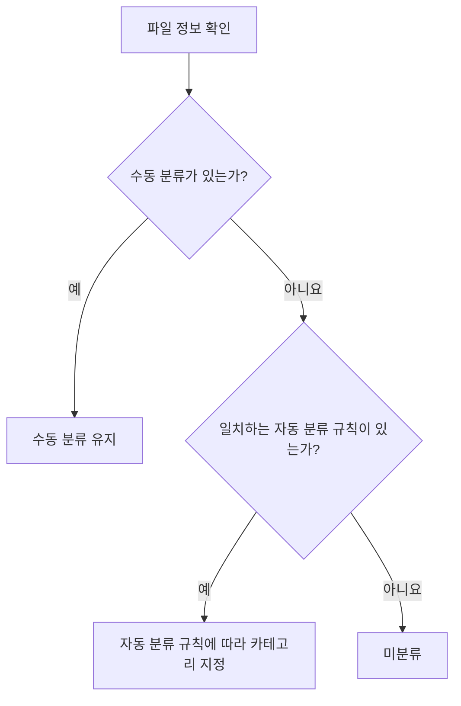

# Mini Project — File Manager

컴퓨터를 사용하다 보면 다운로드한 수업 자료, 과제, 이미지, 문서 등이 여러 폴더에 쌓이게 됩니다. 파일 이름만으로는 어떤 용도의 자료인지 알아보기 어려울 때도 있고, 서로 다른 폴더에 같은 이름의 파일이 저장되어 있는 경우도 있습니다. 필요한 파일을 찾을 때마다 폴더를 직접 열어 확인하는 작업은 시간이 지날수록 번거로워집니다.

이번 프로젝트에서는 **특정 폴더에 저장된 파일을 탐색하고, 파일명·확장자·메모 등의 정보를 활용해 파일을 분류하고 검색**할 수 있는 **파일 관리 프로그램**(**File Manager**)을 제작합니다. 파일을 실제로 옮기지 않고도 카테고리를 통해 자료를 정리할 수 있으며, 반복되는 분류 작업은 **사용자가 설정한 규칙에 따라 자동으로 처리**합니다.

앞서 학습한 `Automation_Programs.md`의 데이터 처리 및 파일 입출력 개념과 `Tkinter_Guide.md`의 GUI 프로그래밍 개념을 종합적으로 활용하는 프로젝트입니다. 아래의 요구사항을 분석한 뒤 필요한 데이터의 구조, 처리 함수, 화면 배치, 이벤트 연결 및 저장 방식을 직접 설계하세요.

## 1. Overview

### 1.1 프로젝트 목표

사용자가 지정한 폴더의 파일을 하나의 화면에서 조회하고, 검색·분류·메모 기능으로 관리할 수 있는 데스크톱 프로그램을 완성합니다. 특히 사용자가 직접 지정한 분류 규칙을 여러 파일에 일관되게 적용하는 자동화 기능이 프로젝트의 핵심입니다.

이번 프로젝트를 통해 다음 내용을 종합적으로 학습합니다.

- 파일 시스템과 경로를 활용한 로컬 파일 탐색
- 자료구조를 활용한 파일 정보 및 관리 데이터의 구성
- 문자열 정규화, 검색, 필터링 및 조건에 따른 자동 분류
- 파일 입출력을 활용한 데이터 저장 및 복원
- GUI 위젯과 이벤트를 활용한 데이터 처리 기능의 연결
- 예외 상황 및 데이터 손실을 고려한 프로그램 설계와 테스트

### 1.2 관리 대상과 범위

파일 관리 프로그램은 사용자가 선택한 루트 폴더와 그 하위 폴더에 존재하는 파일을 대상으로 동작합니다. 파일의 이름, 확장자, 저장 위치와 사용자가 작성한 메모를 활용하므로, 모든 파일의 내부 내용을 읽거나 분석할 필요는 없습니다.

카테고리는 파일을 실제로 이동시키는 폴더가 아니라 프로그램 내부에서 파일을 구분하기 위한 **논리적 분류**입니다. 예를 들어 `보고서.pdf`를 `수업 자료` 카테고리로 지정하더라도 원본 파일의 저장 위치와 내용은 그대로 유지됩니다.

## 2. Specifications

### 2.1 기본 사양

<table align="center">
<thead>
<tr>
<th align="center">구분</th>
<th align="center">사양</th>
</tr>
</thead>
<tbody>
<tr>
<td align="center">프로젝트명</td>
<td align="center">File Manager</td>
</tr>
<tr>
<td align="center">실행 환경</td>
<td align="center">로컬 데스크톱 환경 (Windows 기준)</td>
</tr>
<tr>
<td align="center">개발 언어</td>
<td align="center">Python</td>
</tr>
<tr>
<td align="center">GUI</td>
<td align="center">Tkinter 및 ttk</td>
</tr>
<tr>
<td align="center">관리 대상</td>
<td align="center">사용자가 선택한 폴더의 파일과 하위 폴더의 파일</td>
</tr>
<tr>
<td align="center">주요 기능</td>
<td align="center">파일 탐색, 검색 및 필터링, 메모, 카테고리, 자동 분류, 저장 및 복원</td>
</tr>
<tr>
<td align="center">화면 구성</td>
<td align="center">기본 창 하나를 중심으로 구성. 필요한 경우 보조 대화상자 사용 가능</td>
</tr>
<tr>
<td align="center">데이터 저장</td>
<td align="center">프로그램에서 별도로 관리하는 로컬 저장 데이터</td>
</tr>
</tbody>
</table>

GUI 디자인의 복잡성보다는 요구한 기능이 올바르게 동작하는지, 여러 기능이 서로 연결되어 있는지에 중점을 둡니다. 기본 위젯으로 구성한 단순한 화면이어도 충분합니다.

### 2.2 관리할 정보

프로그램에서 사용하는 정보는 파일 시스템으로부터 확인할 수 있는 정보와 사용자가 프로그램에서 직접 관리하는 정보로 구분합니다.

<table align="center">
<thead>
<tr>
<th align="center">구분</th>
<th align="center">정보</th>
<th align="center">설명</th>
</tr>
</thead>
<tbody>
<tr>
<td align="center">파일 정보</td>
<td align="center">파일명</td>
<td align="center">확장자를 포함한 파일의 이름</td>
</tr>
<tr>
<td align="center">파일 정보</td>
<td align="center">확장자</td>
<td align="center">파일 형식을 구분하는 정보. 확장자가 없는 파일도 존재함</td>
</tr>
<tr>
<td align="center">파일 정보</td>
<td align="center">저장 위치</td>
<td align="center">파일이 실제로 저장된 경로</td>
</tr>
<tr>
<td align="center">관리 정보</td>
<td align="center">메모</td>
<td align="center">사용자가 파일에 대해 작성한 설명</td>
</tr>
<tr>
<td align="center">관리 정보</td>
<td align="center">카테고리</td>
<td align="center">프로그램 내부에서 지정한 파일의 분류</td>
</tr>
<tr>
<td align="center">관리 정보</td>
<td align="center">자동 분류 규칙</td>
<td align="center">조건에 맞는 파일을 특정 카테고리로 분류하기 위한 설정</td>
</tr>
<tr>
<td align="center">설정 정보</td>
<td align="center">탐색 범위</td>
<td align="center">루트 폴더, 최대 탐색 파일 수 등</td>
</tr>
</tbody>
</table>

서로 다른 폴더에 같은 이름의 파일이 존재할 수 있으므로 파일명만으로 파일을 식별하지 않습니다. 전체 경로 또는 루트 폴더와 상대 경로의 조합 등 서로 다른 파일을 구별할 수 있는 정보를 사용하세요. 자료구조와 저장 데이터의 구체적인 형식은 직접 결정합니다.

## 3. Functional Requirements

### 3.1 폴더 선택 및 파일 탐색

프로그램은 사용자가 관리할 루트 폴더를 직접 선택할 수 있도록 합니다. 컴퓨터 전체를 탐색하는 대신 선택한 폴더를 기준으로 그 내부의 파일과 하위 폴더의 파일을 조사합니다.

<table align="center">
<thead>
<tr>
<th align="center">기능</th>
<th align="center">요구사항</th>
</tr>
</thead>
<tbody>
<tr>
<td align="center">폴더 선택</td>
<td align="center">사용자가 관리할 루트 폴더를 지정할 수 있어야 합니다.</td>
</tr>
<tr>
<td align="center">하위 폴더 탐색</td>
<td align="center">루트 폴더 바로 아래뿐 아니라 하위 폴더 내부의 파일도 탐색합니다.</td>
</tr>
<tr>
<td align="center">탐색 상한</td>
<td align="center">한 번의 탐색에서 수집할 최대 파일 수를 사용자가 설정할 수 있어야 합니다.</td>
</tr>
<tr>
<td align="center">파일 목록</td>
<td align="center">탐색한 파일의 이름, 확장자, 저장 위치 및 관리 정보를 화면에서 확인할 수 있어야 합니다.</td>
</tr>
<tr>
<td align="center">새로고침</td>
<td align="center">파일이 추가되거나 삭제된 경우 다시 탐색하여 목록을 갱신할 수 있어야 합니다.</td>
</tr>
<tr>
<td align="center">탐색 상태</td>
<td align="center">현재 관리 중인 폴더와 수집한 파일 수를 확인할 수 있어야 합니다. <br> 상한에 도달하면 일부 파일만 조회되었을 수 있음을 안내합니다.</td>
</tr>
</tbody>
</table>

최대 파일 수는 양의 정수로 설정하며, 화면에 보이는 파일 수만 제한하는 것이 아니라 실제 탐색 과정에서 수집하는 파일 수를 제한해야 합니다. 이 상한은 검색 및 필터를 적용하기 전의 파일 목록을 기준으로 합니다. 처음 실행할 때 사용할 기본 상한은 직접 결정하세요.

폴더 선택을 취소한 경우 기존 폴더와 파일 목록을 유지합니다. 새로고침 시 현재 파일 목록을 실제 탐색 결과와 일치하도록 갱신하며, 동일한 파일이 중복해서 추가되지 않도록 합니다. 접근할 수 없는 폴더나 탐색 도중 사라진 파일은 적절히 처리하고, 가능한 경우 나머지 탐색을 계속합니다.

> **주의:** 탐색 대상으로 지정하지 않은 폴더나 드라이브까지 조사하지 않습니다. 연결된 다른 폴더(예: 심볼릭 링크, 정션)를 따라 탐색 범위가 확장되거나 같은 폴더를 반복해서 조사하는 상황도 방지해야 합니다. 해당 연결을 따라가는 기능은 필수가 아닙니다.

### 3.2 검색 및 필터링

탐색한 파일 중 사용자가 원하는 파일을 빠르게 찾아볼 수 있도록 검색과 필터 기능을 제공합니다. 검색 및 필터링은 현재 수집한 파일 목록을 대상으로 하며, 파일을 삭제하거나 분류 데이터를 변경하는 작업이 아닙니다.

<table align="center">
<thead>
<tr>
<th align="center">기능</th>
<th align="center">요구사항</th>
</tr>
</thead>
<tbody>
<tr>
<td align="center">검색</td>
<td align="center">파일명 또는 메모에 검색어가 포함된 파일을 표시합니다.</td>
</tr>
<tr>
<td align="center">확장자 필터</td>
<td align="center">사용자가 선택한 확장자를 가진 파일만 표시합니다.</td>
</tr>
<tr>
<td align="center">카테고리 필터</td>
<td align="center">선택한 카테고리에 속한 파일만 표시합니다. <code>미분류</code> 파일도 조회할 수 있어야 합니다.</td>
</tr>
<tr>
<td align="center">조건 조합</td>
<td align="center">검색어, 확장자, 카테고리 조건을 함께 사용할 수 있어야 합니다.</td>
</tr>
<tr>
<td align="center">조건 해제</td>
<td align="center">검색어와 필터를 초기화하면 현재 탐색한 전체 파일 목록이 다시 표시됩니다.</td>
</tr>
</tbody>
</table>

영문 대소문자의 차이를 구분하지 않고 검색하며, 검색어의 앞뒤 공백은 제거합니다. 검색어가 비어 있으면 검색 조건을 적용하지 않습니다. 확장자 역시 대소문자를 구분하지 않으며 `.PDF`와 `.pdf`는 동일한 형식으로 처리합니다. 확장자가 없는 파일도 정상적인 목록 항목으로 관리합니다.

검색은 파일명과 메모 중 어느 하나에 검색어가 포함되면 해당 파일을 찾을 수 있어야 합니다. 확장자나 카테고리 필터가 함께 지정되었다면 검색 조건과 지정된 모든 필터 조건을 만족하는 파일만 표시합니다. 결과가 없는 경우에는 빈 목록 또는 적절한 안내를 표시하세요.

### 3.3 메모 관리

파일명만으로 용도를 파악하기 어려운 파일에 사용자가 직접 설명을 작성할 수 있도록 메모 기능을 제공합니다.

- 선택한 파일에 메모를 작성하고, 기존 메모를 수정하거나 지울 수 있어야 합니다.
- 메모는 원본 파일의 내용이나 메타데이터에 기록하지 않고 프로그램에서 별도로 관리합니다.
- 메모가 없는 파일도 정상적으로 조회하고 분류할 수 있어야 합니다.
- 메모를 수정한 뒤에는 변경된 내용을 검색과 자동 분류에 사용할 수 있어야 합니다.
- 프로그램을 종료하고 다시 실행해도 저장된 메모를 확인할 수 있어야 합니다.

서로 다른 경로에 동일한 파일명이 존재하더라도 각 파일의 메모는 별도로 관리합니다. 원본 파일이 삭제된 것이 확인되면 해당 파일의 메모도 관리 데이터에서 정리합니다. 다만 검색 결과에서 숨겨졌거나 탐색 상한, 접근 권한 등의 이유로 이번 탐색에서 발견되지 않은 파일을 삭제된 것으로 판단해서는 안 됩니다.

새로운 파일을 발견했다고 해서 반드시 메모를 작성할 필요는 없습니다. 새 파일에 메모 작성 여부를 묻는 기능은 추가로 구현할 수 있습니다.

### 3.4 카테고리 관리

카테고리는 여러 파일을 목적이나 종류에 따라 묶어 관리하기 위한 분류 단위입니다. 기본적으로 분류가 지정되지 않은 파일은 `미분류`에서 관리합니다.

<table align="center">
<thead>
<tr>
<th align="center">기능</th>
<th align="center">요구사항</th>
</tr>
</thead>
<tbody>
<tr>
<td align="center">카테고리 추가</td>
<td align="center">사용자가 필요한 카테고리를 직접 생성할 수 있어야 합니다.</td>
</tr>
<tr>
<td align="center">카테고리 삭제</td>
<td align="center">사용자가 만든 카테고리를 삭제할 수 있어야 합니다.</td>
</tr>
<tr>
<td align="center">수동 분류</td>
<td align="center">선택한 파일을 사용자가 지정한 카테고리로 변경할 수 있어야 합니다.</td>
</tr>
<tr>
<td align="center">분류 해제</td>
<td align="center">직접 지정한 분류를 해제하고 자동 분류 결과 또는 미분류 상태로 돌아갈 수 있어야 합니다.</td>
</tr>
<tr>
<td align="center">미분류</td>
<td align="center">수동 분류가 없고 적용할 자동 분류 규칙도 없는 파일을 관리합니다.</td>
</tr>
</tbody>
</table>

필수 구현 범위에서는 파일 하나가 한 번에 하나의 카테고리에 속하는 것으로 구성합니다. 빈 이름이나 동일한 이름의 카테고리를 추가하지 않도록 검사하고, 기본 항목인 `미분류`는 사용자가 삭제하지 못하도록 합니다. `전체 파일` 항목은 모든 카테고리의 파일을 조회하기 위한 기능으로, 일반 카테고리와 구별합니다.

카테고리를 삭제하더라도 연결된 원본 파일과 메모는 삭제되지 않아야 합니다. 삭제한 카테고리를 가리키는 분류 정보 및 자동 분류 규칙은 정리하거나 유효한 상태로 변경합니다. 다른 유효한 자동 분류 규칙이 적용되지 않는 파일은 `미분류`로 표시합니다.

### 3.5 자동 분류 규칙

파일을 하나씩 직접 분류하지 않아도 사용자가 등록한 조건에 따라 카테고리를 자동으로 지정할 수 있도록 구현합니다. 자동 분류의 기준은 **파일명, 확장자, 메모**의 세 가지입니다.

#### 규칙의 구성

자동 분류 규칙은 검사할 기준, 비교할 값, 조건을 만족했을 때 지정할 카테고리로 구성합니다. 아래 표는 사용자가 설정할 수 있는 규칙의 예시입니다.

<table align="center">
<thead>
<tr>
<th align="center">기준</th>
<th align="center">비교할 값</th>
<th align="center">지정할 카테고리</th>
</tr>
</thead>
<tbody>
<tr>
<td align="center">파일명</td>
<td align="center">회의록</td>
<td align="center">회의 자료</td>
</tr>
<tr>
<td align="center">확장자</td>
<td align="center">pdf</td>
<td align="center">문서</td>
</tr>
<tr>
<td align="center">메모</td>
<td align="center">세금계산서</td>
<td align="center">회계</td>
</tr>
</tbody>
</table>

파일명과 메모는 지정한 문구의 포함 여부(부분 일치)를 검사합니다. 확장자는 전체 확장자가 일치하는지 검사하며, 앞의 마침표 유무와 영문 대소문자 차이는 구분하지 않습니다. 예를 들어 `pdf` 규칙은 `보고서.PDF`에 적용되지만, 파일명에 `pdf`라는 문구가 포함되어 있을 뿐 확장자가 `.txt`인 파일에는 적용되지 않습니다.

#### 규칙 관리 및 적용

<table align="center">
<thead>
<tr>
<th align="center">기능</th>
<th align="center">요구사항</th>
</tr>
</thead>
<tbody>
<tr>
<td align="center">규칙 추가</td>
<td align="center">사용자가 분류 기준, 비교할 값, 카테고리를 선택하여 규칙을 등록할 수 있어야 합니다.</td>
</tr>
<tr>
<td align="center">규칙 수정·삭제</td>
<td align="center">등록한 규칙을 변경하거나 제거할 수 있어야 합니다.</td>
</tr>
<tr>
<td align="center">자동 분류</td>
<td align="center">현재 파일 목록에 규칙을 적용하고 조건을 만족하는 파일의 분류를 갱신합니다.</td>
</tr>
<tr>
<td align="center">변경 반영</td>
<td align="center">새로 발견한 파일이나 메모·규칙이 변경된 파일에도 자동 분류 결과를 갱신할 수 있어야 합니다.</td>
</tr>
<tr>
<td align="center">규칙 검증</td>
<td align="center">비교할 값이 비어 있거나 존재하지 않는 카테고리를 대상으로 하는 규칙은 등록하지 않습니다.</td>
</tr>
</tbody>
</table>

파일을 탐색하거나 새로고침할 때 자동 분류 규칙을 적용합니다. 메모나 규칙을 변경했을 때는 즉시 재평가하거나 별도의 자동 분류 실행 버튼을 통해 현재 목록에 반영할 수 있도록 구성합니다. 적용 방식과 실행 시점은 사용자에게 명확해야 합니다.

#### 분류 우선순위

사용자가 파일의 카테고리를 직접 지정한 경우에는 자동 분류가 해당 수동 분류를 덮어쓰지 않도록 합니다. 수동 분류가 없는 파일에 대해서는 자동 분류 규칙을 적용하며, 조건을 만족하는 규칙이 없으면 `미분류`로 표시합니다.



<p align="center"><em>그림 1. 파일 분류의 기본 처리 흐름.</em></p>

하나의 파일이 여러 자동 분류 규칙을 동시에 만족할 수 있습니다. 예를 들어 `회의록.pdf`는 파일명에 대한 규칙과 확장자에 대한 규칙을 모두 만족합니다. 이때 어떤 규칙을 우선 적용할지는 직접 설계하세요. 규칙을 등록한 순서나 기준별 우선순위 등 일관된 기준을 정하고, 동일한 파일과 동일한 규칙을 입력했을 때 동일한 분류 결과가 나오도록 합니다.

> 자동 분류는 원본 파일을 실제 카테고리 폴더로 이동하거나 이름을 변경하는 기능이 아닙니다. 프로그램 내부에서 관리하는 분류 정보만 변경합니다.

### 3.6 데이터 저장 및 복원

프로그램에서 입력한 메모, 카테고리, 분류 규칙 등이 종료 후 사라지지 않도록 로컬에 저장하고, 프로그램을 다시 실행하면 불러올 수 있어야 합니다.

<table align="center">
<thead>
<tr>
<th align="center">저장 대상</th>
<th align="center">복원 후 요구사항</th>
</tr>
</thead>
<tbody>
<tr>
<td align="center">루트 폴더 및 탐색 상한</td>
<td align="center">이전에 관리하던 폴더와 설정을 확인할 수 있어야 합니다.</td>
</tr>
<tr>
<td align="center">파일별 메모</td>
<td align="center">동일한 파일에 기존 메모가 표시되어야 합니다.</td>
</tr>
<tr>
<td align="center">사용자 카테고리</td>
<td align="center">사용자가 추가한 카테고리를 다시 사용할 수 있어야 합니다.</td>
</tr>
<tr>
<td align="center">수동 분류 정보</td>
<td align="center">파일을 다시 탐색해도 직접 지정한 카테고리가 유지되어야 합니다.</td>
</tr>
<tr>
<td align="center">자동 분류 규칙</td>
<td align="center">등록한 규칙과 규칙 간 우선순위가 유지되어야 합니다.</td>
</tr>
</tbody>
</table>

앞서 학습한 JSON 형식을 활용할 수 있으며, 다른 로컬 저장 방식을 선택해도 무방합니다. 저장할 데이터의 구조와 파일 이름, 저장 시점(변경 시 자동 저장 또는 저장 버튼 등)은 직접 결정하세요. 자동 분류 결과 자체는 저장하거나 재탐색할 때 다시 계산할 수 있습니다.

저장된 파일 목록이 실제 파일 시스템의 최신 상태라고 가정하지 않습니다. 프로그램 시작 시 또는 새로고침 시 실제 파일을 다시 조사할 수 있어야 합니다. 루트 폴더를 변경하더라도 다른 폴더에 있는 파일의 메모와 수동 분류가 섞이거나 이전에 저장한 정보가 불필요하게 사라지지 않도록 관리합니다.

프로그램에서 생성한 관리 데이터 파일은 가능하면 탐색 대상과 분리하여 보관합니다. 관리 데이터가 탐색 대상 폴더 내부에 존재한다면 해당 데이터 파일이 일반 관리 대상에 포함되지 않도록 처리하세요.

### 3.7 예외 처리 및 원본 파일 보호

실행 환경이나 사용자 입력에 따라 발생할 수 있는 문제를 고려하여 정상적인 프로그램 사용이 중단되지 않도록 합니다.

<table align="center">
<thead>
<tr>
<th align="center">상황</th>
<th align="center">요구사항</th>
</tr>
</thead>
<tbody>
<tr>
<td align="center">폴더 미선택·선택 취소</td>
<td align="center">불필요한 탐색을 실행하지 않고 이전 상태를 유지합니다.</td>
</tr>
<tr>
<td align="center">존재하지 않거나 접근할 수 없는 폴더</td>
<td align="center">사용자에게 안내하고 유효한 폴더를 다시 선택할 수 있도록 합니다.</td>
</tr>
<tr>
<td align="center">탐색 상한의 잘못된 입력</td>
<td align="center">설정을 적용하지 않고 양의 정수 입력을 안내합니다.</td>
</tr>
<tr>
<td align="center">파일 미선택</td>
<td align="center">메모 작성이나 수동 분류 등 선택이 필요한 기능을 실행하지 않습니다.</td>
</tr>
<tr>
<td align="center">파일 삭제 또는 이동</td>
<td align="center">존재하지 않는 파일을 계속 현재 파일 목록에 표시하지 않도록 새로고침에서 반영합니다.</td>
</tr>
<tr>
<td align="center">빈 검색 결과</td>
<td align="center">빈 목록을 표시하고 다른 조건으로 다시 검색할 수 있도록 합니다.</td>
</tr>
<tr>
<td align="center">잘못된 카테고리·규칙 입력</td>
<td align="center">유효하지 않은 정보를 등록하지 않고 안내합니다.</td>
</tr>
<tr>
<td align="center">저장 파일 없음</td>
<td align="center">처음 실행하는 정상적인 상태로 처리합니다.</td>
</tr>
<tr>
<td align="center">저장 데이터 손상·읽기 실패</td>
<td align="center">오류를 안내하고 기존 데이터를 자동으로 덮어쓰지 않습니다.</td>
</tr>
<tr>
<td align="center">저장 실패</td>
<td align="center">저장 성공으로 표시하지 않고 사용자에게 실패 사실을 안내합니다.</td>
</tr>
</tbody>
</table>

**기본 구현에서는 원본 파일의 이동, 이름 변경, 내용 수정 및 실제 삭제 기능을 구현하지 않습니다.** 카테고리 삭제나 메모 삭제는 프로그램의 관리 정보에만 영향을 미쳐야 합니다. 파일을 직접 삭제하는 기능을 추가로 구현한다면 카테고리 삭제와 명확히 구분하고, 삭제 대상을 확인할 수 있는 절차를 마련해야 합니다.

## 4. User Interface (UI)

### 4.1 화면 구성

프로그램은 기본 창 하나를 중심으로 구성하며, 사용자가 파일 목록을 조회하고 선택한 파일의 정보를 확인하면서 필요한 작업을 수행할 수 있어야 합니다.

<table align="center">
<thead>
<tr>
<th align="center">화면 영역</th>
<th align="center">표시 정보 및 기능</th>
</tr>
</thead>
<tbody>
<tr>
<td align="center">폴더 및 탐색 설정</td>
<td align="center">관리 폴더, 폴더 선택, 최대 파일 수, 새로고침</td>
</tr>
<tr>
<td align="center">검색 및 필터</td>
<td align="center">파일명·메모 검색, 확장자 선택, 카테고리 선택, 조건 초기화</td>
</tr>
<tr>
<td align="center">파일 목록</td>
<td align="center">파일명, 확장자, 카테고리, 파일 위치 등</td>
</tr>
<tr>
<td align="center">파일 상세 정보</td>
<td align="center">선택한 파일의 경로, 메모 조회 및 편집, 수동 분류</td>
</tr>
<tr>
<td align="center">관리 기능</td>
<td align="center">카테고리 추가·삭제, 자동 분류 규칙 관리</td>
</tr>
<tr>
<td align="center">상태 표시</td>
<td align="center">현재 탐색 결과의 파일 수, 표시 중인 파일 수, 안내 메시지 등</td>
</tr>
</tbody>
</table>

파일 위치나 메모처럼 길어질 수 있는 정보는 반드시 목록의 한 열에 모두 표시할 필요는 없습니다. 파일을 선택했을 때 상세 영역에서 확인할 수 있도록 구성해도 됩니다. 카테고리나 규칙을 관리하는 화면은 기본 창에 포함하거나 별도의 작은 대화상자로 구성할 수 있습니다.

### 4.2 화면 설계 및 위젯 선택

앞서 학습한 `Entry`, `Button`, `Combobox`, `Treeview`, `Listbox`, `Text`, `Scrollbar`, `messagebox`, `filedialog` 등의 위젯을 활용할 수 있습니다. 모든 위젯을 사용할 필요는 없으며, 각 기능에 적합한 위젯과 배치 방식을 선택하세요.

파일을 선택하면 해당 파일에 대한 정보가 표시되어야 하며, 메모 편집 및 수동 분류 대상도 선택한 파일과 일치해야 합니다. 검색이나 새로고침으로 기존 선택 항목이 화면에서 사라지면 더 이상 해당 항목을 편집하지 않도록 선택 상태를 갱신합니다.

> 화면의 크기, 배치, 색상, 버튼 위치 및 세부 디자인은 자유롭게 결정합니다. 별도의 플로팅 독, 다중 창 시스템, 화려한 애니메이션 등은 이번 프로젝트의 필수 요구사항에 포함되지 않습니다.

## 5. Additional Features (선택)

필수 기능을 모두 구현하고 충분히 검증했다면 프로그램의 활용도를 높이기 위한 기능을 자유롭게 추가할 수 있습니다.

- 파일명, 수정 날짜, 파일 크기 등을 기준으로 목록 정렬
- 선택한 파일 또는 파일이 저장된 폴더 열기
- 여러 파일을 선택하여 카테고리를 한꺼번에 지정하는 기능
- 카테고리 이름 변경 및 하위 카테고리 관리
- 자주 사용하는 파일을 등록하는 즐겨찾기 기능
- 파일 목록 또는 분류 결과를 CSV 보고서로 내보내는 기능
- 새로운 파일이 추가되었을 때 메모 작성 여부를 묻는 기능
- 저장 데이터의 백업 및 복원, 탐색 중 진행 상태 표시

파일 내용 분석, AI 연동, 캘린더, 실행 파일(EXE) 제작은 필수 범위가 아닙니다. 추가 기능은 기본 기능의 안정성과 데이터 보존을 해치지 않는 범위에서 구현하세요.

## 6. Test & Verification

### 6.1 테스트 데이터

실제 개인 파일이나 중요한 수업 자료를 대상으로 바로 테스트하지 않고, 별도의 실습 폴더를 만든 뒤 테스트를 진행합니다. 아래는 파일 탐색, 검색 및 분류 기능을 검증하기 위한 폴더 구성 예시입니다.

```text
sample_files/
├── 과학/
│   ├── 과학_수행평가.txt
│   └── 자료_042.txt
├── 동아리/
│   ├── 자료_042.txt
│   ├── 회의록.pdf
│   └── 준비물.csv
├── 회계/
│   └── 영수증.PDF
├── 이미지/
│   └── 사진.png
└── README
```

각 파일의 내부 내용은 탐색 및 분류에 영향을 주지 않습니다. 테스트를 위해 빈 파일을 만들어 사용해도 됩니다. 단, 파일 열기 기능을 별도로 테스트할 때는 해당 형식에 맞는 정상 파일을 사용하세요.

다음과 같이 카테고리와 메모를 등록한 후 자동 분류 기능을 테스트할 수 있습니다.

<table align="center">
<thead>
<tr>
<th align="center">파일 경로 (sample_files 기준)</th>
<th align="center">작성할 메모</th>
</tr>
</thead>
<tbody>
<tr>
<td align="center">과학/자료_042.txt</td>
<td align="center">과학 발표 준비</td>
</tr>
<tr>
<td align="center">동아리/자료_042.txt</td>
<td align="center">동아리 회의 자료</td>
</tr>
<tr>
<td align="center">회계/영수증.PDF</td>
<td align="center">세금계산서 확인 필요</td>
</tr>
</tbody>
</table>

카테고리 `회의 자료`, `문서`, `회계`를 생성하고 3.5절의 예시 규칙 세 개를 등록합니다. 각 테스트에서 변경한 메모와 분류 상태가 다음 테스트에 영향을 줄 수 있으므로 필요한 경우 초기 상태를 다시 설정하세요.

### 6.2 기능 검증

<table align="center">
<thead>
<tr>
<th align="center">번호</th>
<th align="center">테스트 조건</th>
<th align="center">예상 결과</th>
</tr>
</thead>
<tbody>
<tr>
<td align="center">1</td>
<td align="center">sample_files 폴더 선택, 탐색 상한 20</td>
<td align="center">하위 폴더를 포함한 파일 8개 조회</td>
</tr>
<tr>
<td align="center">2</td>
<td align="center">탐색 상한을 3으로 변경한 뒤 새로고침</td>
<td align="center">최대 3개의 파일 수집, 상한 도달 안내</td>
</tr>
<tr>
<td align="center">3</td>
<td align="center">상한을 20으로 복구한 뒤 <code>자료_042</code> 검색</td>
<td align="center">서로 다른 경로의 파일 2개 조회</td>
</tr>
<tr>
<td align="center">4</td>
<td align="center"><code>과학 발표</code> 검색</td>
<td align="center">과학/자료_042.txt 한 개 조회</td>
</tr>
<tr>
<td align="center">5</td>
<td align="center">PDF 확장자 필터 적용 (검색어와 다른 필터 해제)</td>
<td align="center">회의록.pdf와 영수증.PDF 두 개 조회</td>
</tr>
<tr>
<td align="center">6</td>
<td align="center"><code>세금계산서</code> 검색과 PDF 필터 동시 적용</td>
<td align="center">회계/영수증.PDF 한 개 조회</td>
</tr>
<tr>
<td align="center">7</td>
<td align="center">검색어와 필터 초기화</td>
<td align="center">현재 탐색한 전체 파일 목록 표시</td>
</tr>
<tr>
<td align="center">8</td>
<td align="center">회의록.pdf에 파일명 규칙만 적용</td>
<td align="center"><code>회의 자료</code> 카테고리로 분류</td>
</tr>
<tr>
<td align="center">9</td>
<td align="center">영수증.PDF에 확장자 규칙만 적용</td>
<td align="center"><code>문서</code> 카테고리로 분류</td>
</tr>
<tr>
<td align="center">10</td>
<td align="center">영수증.PDF에 메모 규칙만 적용</td>
<td align="center"><code>회계</code> 카테고리로 분류</td>
</tr>
<tr>
<td align="center">11</td>
<td align="center">세 가지 예시 규칙을 모두 적용</td>
<td align="center">여러 규칙과 일치하는 파일은 설계한 우선순위에 따라 분류</td>
</tr>
<tr>
<td align="center">12</td>
<td align="center">회의록.pdf를 수동으로 <code>회계</code>에 지정한 뒤 자동 분류 실행</td>
<td align="center">직접 지정한 <code>회계</code> 분류 유지</td>
</tr>
<tr>
<td align="center">13</td>
<td align="center">회의록.pdf의 수동 분류 해제</td>
<td align="center">유효한 자동 분류 규칙에 따라 다시 분류</td>
</tr>
<tr>
<td align="center">14</td>
<td align="center">규칙을 만족하지 않는 README 조회</td>
<td align="center"><code>미분류</code>로 표시</td>
</tr>
<tr>
<td align="center">15</td>
<td align="center">카테고리 삭제</td>
<td align="center">해당 카테고리 관련 정보 정리, 원본 파일과 메모 유지</td>
</tr>
<tr>
<td align="center">16</td>
<td align="center">메모 변경 또는 규칙 삭제 후 자동 분류 갱신</td>
<td align="center">변경된 조건에 따라 분류 결과 갱신</td>
</tr>
<tr>
<td align="center">17</td>
<td align="center">폴더 안에 파일 추가 후 새로고침</td>
<td align="center">추가된 파일이 목록에 표시됨 (상한 이내)</td>
</tr>
<tr>
<td align="center">18</td>
<td align="center">테스트 파일을 탐색기에서 삭제한 뒤 새로고침</td>
<td align="center">해당 파일이 현재 목록에서 제거되고 삭제가 확인된 파일의 메모 정리</td>
</tr>
<tr>
<td align="center">19</td>
<td align="center">폴더 선택 취소</td>
<td align="center">기존 관리 폴더 및 목록 유지</td>
</tr>
<tr>
<td align="center">20</td>
<td align="center">프로그램 저장 후 종료 및 재실행</td>
<td align="center">메모, 카테고리, 수동 분류, 규칙 및 설정 유지</td>
</tr>
<tr>
<td align="center">21</td>
<td align="center">손상된 관리 데이터 파일로 실행 (테스트용 복사본 사용)</td>
<td align="center">오류 안내, 손상된 파일을 자동으로 덮어쓰지 않음</td>
</tr>
</tbody>
</table>

추가로 아래의 상황도 확인해 보세요.

- 빈 폴더 탐색, 공백만 있는 검색어, 잘못된 탐색 상한, 파일 미선택 상태의 편집 요청
- 확장자가 없는 파일, 같은 이름의 파일에 서로 다른 메모 저장, 중복 카테고리 또는 빈 규칙 등록
- 검색 및 탐색 상한 변경 시 보이지 않는 파일의 메모가 유지되는지 여부
- 다른 루트 폴더로 변경한 뒤 이전 폴더를 다시 선택했을 때 저장된 정보가 유지되는지 여부
- 메모 및 카테고리 변경 전후에 원본 파일의 경로와 내용이 그대로 유지되는지 여부
- 저장 권한이 없는 위치 등 저장 실패 상황에서 성공 메시지를 표시하지 않는지 여부

위 테스트는 기본 기능의 확인 기준입니다. 자신이 설계한 규칙 우선순위나 추가 기능에 맞는 테스트도 별도로 구성하세요.

## 7. Evaluation

### 7.1 평가 기준

평가는 화면의 화려함보다는 요구사항을 충족하는 기능의 정확성, 데이터 처리 방식, 프로그램의 안정성을 중심으로 진행합니다.

<table align="center">
<thead>
<tr>
<th align="center">평가 항목</th>
<th align="center">평가 내용</th>
</tr>
</thead>
<tbody>
<tr>
<td align="center">파일 탐색</td>
<td align="center">폴더 선택, 하위 폴더 탐색, 탐색 상한 및 목록 갱신의 정확성</td>
</tr>
<tr>
<td align="center">검색 및 필터</td>
<td align="center">파일명·메모 검색, 확장자·카테고리 필터 및 조건 조합의 정확성</td>
</tr>
<tr>
<td align="center">메모 및 카테고리</td>
<td align="center">파일별 메모, 수동 분류, 카테고리 추가·삭제, 미분류 처리</td>
</tr>
<tr>
<td align="center">자동 분류</td>
<td align="center">세 가지 기준의 규칙 관리, 수동 분류 보호 및 충돌 처리의 일관성</td>
</tr>
<tr>
<td align="center">저장 및 복원</td>
<td align="center">관리 데이터의 영구 저장, 재실행 시 복원 및 파일 식별의 정확성</td>
</tr>
<tr>
<td align="center">GUI 및 코드 구성</td>
<td align="center">위젯과 처리 기능의 연결, 조작 편의성, 역할에 따른 코드 구성</td>
</tr>
<tr>
<td align="center">예외 처리 및 검증</td>
<td align="center">잘못된 입력 대응, 파일 보호, 예외 상황과 정상 상황의 테스트</td>
</tr>
</tbody>
</table>

추가 기능의 수나 시각적인 디자인만으로 기본 기능의 누락을 대체할 수 없습니다. 동일한 요구사항을 충족한다면 서로 다른 자료구조, 함수 구성, 저장 방식 및 화면 디자인을 사용해도 됩니다.

### 7.2 제출 자료

프로그램의 실행과 기능 검증이 가능하도록 다음 자료를 준비하세요.

- 작성한 Python 소스 파일 전체 및 실행에 필요한 리소스
- 실행 방법, 구현한 기능, 자동 분류 우선순위 및 데이터 저장 방식을 설명한 `README.md`
- 테스트용 파일 및 폴더 또는 해당 테스트 데이터를 만드는 방법
- 주요 기능의 실행 화면과 테스트 결과 (미구현 기능이나 확인된 문제도 함께 기록)

외부 라이브러리를 추가로 사용했다면 설치 방법을 안내합니다. 실제 개인 파일이나 개인 정보가 포함된 메모 및 저장 데이터는 제출하지 않습니다. 프로젝트 폴더를 압축해 제출하며, 별도의 실행 파일(EXE) 제작은 요구하지 않습니다.

## 8. Reference

- [`Automation_Programs.md`](Automation_Programs.md) — 자료구조, 파일 시스템과 경로, 파일 입출력, 예외 처리 및 자동화 프로그램의 설계
- [`Tkinter_Guide.md`](Tkinter_Guide.md) — 기본 위젯, 레이아웃, 이벤트 처리, Treeview, Filedialog 및 데이터 처리 함수와 GUI 연결
- [Python 공식 문서 — pathlib](https://docs.python.org/ko/3/library/pathlib.html)
- [Python 공식 문서 — os](https://docs.python.org/ko/3/library/os.html)
- [Python 공식 문서 — json](https://docs.python.org/ko/3/library/json.html)
- [Python 공식 문서 — tkinter](https://docs.python.org/ko/3/library/tkinter.html)
- [Python 공식 문서 — tkinter.ttk](https://docs.python.org/ko/3/library/tkinter.ttk.html)
- [Python 공식 문서 — tkinter.filedialog](https://docs.python.org/ko/3/library/dialog.html#module-tkinter.filedialog)

강사가 제공하는 FileManager_Qt는 파일 관리 프로그램의 기능과 사용 흐름을 참고하기 위한 예시입니다. 해당 프로그램의 Qt 기반 디자인, 플로팅 독, 캘린더, AI 비서 등의 전체 기능을 동일하게 구현할 필요는 없습니다. 이번 프로젝트에서는 위에 명시한 기본 사양과 필수 요구사항을 기준으로 자신만의 프로그램을 완성하세요.
