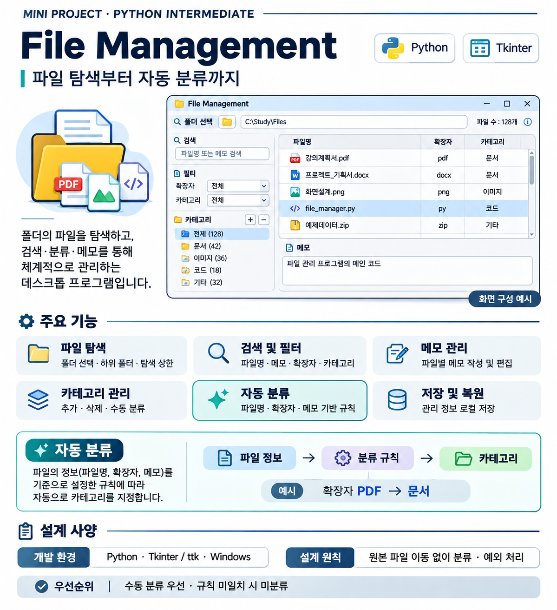

# Week 09 — Automation & GUI Programming

Python을 활용한 자동화 프로그램의 개념과 GUI 프로그래밍을 학습하고, 이를 바탕으로 파일 관리 프로그램을 구현합니다.

## Learning Materials

<table align="center">
  <thead>
    <tr>
      <th align="center">순서</th>
      <th align="center">학습자료</th>
      <th align="center">주요 내용</th>
    </tr>
  </thead>
  <tbody>
    <tr>
      <td align="center">01</td>
      <td align="center"><a href="./Automation_Programs.md"><strong>Automation Programs</strong></a></td>
      <td align="center">자동화 프로그램의 개념과 원리 자료구조, 데이터 처리, 파일 입출력, 예외 처리</td>
    </tr>
    <tr>
      <td align="center">02</td>
      <td align="center"><a href="./Tkinter_Guide.md"><strong>Tkinter Guide</strong></a></td>
      <td align="center">Tkinter를 활용한 GUI 프로그래밍 기본 위젯, 레이아웃, 이벤트 처리</td>
    </tr>
    <tr>
      <td align="center">03</td>
      <td align="center"><a href="./Project_Guide.md"><strong>Project Guide</strong></a></td>
      <td align="center">Mini Project — File Management 파일 탐색, 검색, 자동 분류, 데이터 저장 및 복원</td>
    </tr>
  </tbody>
</table>

위 순서대로 학습한 뒤 프로젝트 가이드의 요구사항에 따라 파일 관리 프로그램을 설계하고 구현하세요.

## Mini Project — File Management

  

---

[← Lecture 목록](../)

  

