# Tkinter를 활용한 GUI 프로그래밍

앞서 자동화 프로그램에서는 터미널에 명령을 입력하거나 처리 결과를 문자로 확인했습니다. 같은 프로그램에 입력창과 버튼, 결과를 표시하는 표가 있다면 사용자는 명령어를 알지 못해도 필요한 기능을 실행할 수 있습니다. 이처럼 화면에 표시된 요소로 프로그램을 조작하는 인터페이스를 GUI(Graphical User Interface)라고 합니다.

이 자료에서는 Python의 Tkinter를 사용하여 창을 만들고, 사용자 입력과 이벤트에 따라 프로그램이 동작하도록 구성합니다. 이전에 학습한 데이터 처리 함수와 GUI를 연결하는 방법도 다룹니다.

## 1. GUI 프로그래밍

### 1.1 CLI와 GUI

CLI(Command-Line Interface)는 문자로 명령을 입력하고 결과를 확인하는 인터페이스입니다. GUI는 창, 버튼, 메뉴 등 화면에 표시되는 요소를 통해 프로그램을 조작하는 인터페이스입니다.

| 구분 | CLI | GUI |
|---|---|---|
| 사용자 입력 | 명령어, 텍스트 입력 | 버튼 클릭, 키보드 입력, 항목 선택 |
| 결과 표시 | 터미널의 텍스트 | 레이블, 표, 대화상자 등 |
| 활용 사례 | 명령줄 도구, 서버 관리, 배치 처리 | 데스크톱 앱, 계산기, 파일 관리자 |

GUI를 사용하더라도 프로그램의 계산이나 데이터 처리 원리는 달라지지 않습니다. 예를 들어 대여 가능 수량을 계산하는 함수는 터미널에서 호출할 수도 있고 버튼을 클릭했을 때 호출할 수도 있습니다.

### 1.2 이벤트 기반 프로그래밍 (Event-Driven Programming)

GUI 프로그램은 창을 띄운 뒤 사용자의 입력을 기다립니다. 버튼 클릭, 키보드 입력, 항목 선택과 같이 프로그램이 감지할 수 있는 사건을 **이벤트(Event)** 라고 합니다. 이벤트에 대응하여 호출되도록 등록한 함수를 콜백(Callback)이라고 합니다.

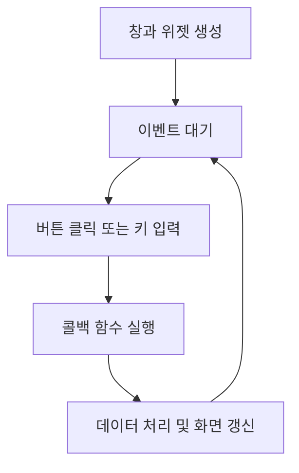

<p align="center"><em>그림 1. 이벤트 기반 GUI 프로그램의 실행 흐름.</em></p>

Tkinter의 `mainloop()`는 이벤트를 기다리고 처리하는 반복 과정(Event Loop)을 시작합니다. 콜백 함수가 종료되면 이벤트 루프가 다음 입력을 처리합니다. 콜백에서 시간이 오래 걸리는 작업을 실행하면 그동안 화면 갱신과 입력 처리가 지연될 수 있습니다.

### 1.3 Tkinter와 ttk

Tkinter는 Tcl/Tk를 기반으로 하는 Python의 표준 GUI 인터페이스입니다. `tkinter.ttk`는 테마에 따라 외관이 달라지는 위젯을 제공합니다. `Treeview`, `Combobox` 등은 ttk에서 제공하는 위젯입니다.

공식 Python Windows 설치 프로그램에서는 일반적으로 Tcl/Tk가 함께 설치됩니다. 터미널에서 다음 명령을 실행하여 Tkinter 사용 가능 여부를 확인합니다.

```bash
python -m tkinter
```

Windows에서 Python 실행 명령이 `py`라면 `py -m tkinter`를 사용합니다. 테스트 창이 표시되면 Tkinter를 사용할 수 있습니다. `ModuleNotFoundError`가 발생하면 사용 중인 Python에 Tcl/Tk 지원이 설치되어 있는지 확인하세요. 화면을 사용할 수 없는 서버나 일부 온라인 실행 환경에서는 Tkinter가 설치되어 있어도 창을 띄울 수 없습니다.

이번 자료의 코드는 로컬 데스크톱 환경에서 실행합니다. 예제 파일명을 `tkinter.py`로 지정하면 표준 모듈과 이름이 충돌할 수 있으므로 다른 파일명을 사용하세요.

### 1.4 예제 실행 방법

VS Code에서 예제를 저장할 폴더를 열고, 새 Python 파일을 만듭니다. 예를 들어 2.1의 코드를 `window_example.py`에 저장한 다음 터미널에서 실행하세요.

```bash
python window_example.py
```

창이 표시되면 성공적으로 실행된 것입니다. GUI 프로그램은 창을 닫을 때까지 터미널이 실행 상태로 남아 있는 것이 정상입니다. 창의 닫기 버튼을 눌러 종료한 뒤 코드를 수정하고 다시 실행할 수 있습니다.

Tkinter의 실행 화면은 운영체제, 화면 배율 및 시스템 테마에 따라 다르게 표시될 수 있습니다. 위젯의 배치와 동작을 중심으로 확인하세요.

## 2. 기본 위젯 (Widgets)

위젯(Widget)은 창 안에서 사용자 인터페이스를 구성하는 요소입니다. 버튼, 입력창, 레이블 등이 대표적인 위젯입니다. 아래 예제들은 각각 독립된 Python 파일에 저장하여 실행할 수 있습니다.

### 2.1 Window

가장 먼저 프로그램의 기본 창을 생성합니다. Tkinter의 기본 구조는 모듈 불러오기, 창 생성, 위젯 생성 및 배치, 이벤트 루프 실행 순서로 이루어집니다. 아래 예제에는 아직 위젯을 넣지 않았으므로 내용이 비어 있는 창이 표시됩니다.

```python
import tkinter as tk

root = tk.Tk()
root.title("My First GUI")
root.geometry("360x200")
root.minsize(280, 160)

root.mainloop()
```

<p align="center">
  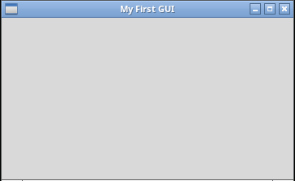<br>
  <em>그림 2. 기본 창 생성 결과 (360 × 200).</em>
</p>

| 코드 | 역할 |
|---|---|
| `tk.Tk()` | 프로그램의 기본 창 생성 |
| `title()` | 창 제목 설정 |
| `geometry()` | 초기 창 크기 설정 (너비 × 높이) |
| `minsize()` | 창의 최소 크기 설정 |
| `mainloop()` | 이벤트 루프 실행 |

`import tkinter as tk`에서 `tk`는 모듈의 별칭입니다. 이후 `tk.Tk()`처럼 모듈 이름 대신 별칭을 사용할 수 있습니다. `root`는 생성한 창 객체를 참조하는 변수이며, 이름은 자유롭게 지정할 수 있습니다.

`geometry("360x200")`의 값은 창 내부 영역의 너비와 높이를 픽셀 단위로 지정하는 문자열입니다. 운영체제의 제목 표시줄과 테두리는 별도로 표시됩니다. `mainloop()` 이후에는 창이 사용자 입력을 기다리며, 창이 닫히면 실행이 끝납니다. 예제마다 `mainloop()`를 마지막에 작성하는 이유입니다.

일반적인 Tkinter 프로그램에서는 `Tk()`로 기본 창을 한 번 생성합니다. 별도의 창이 필요하면 `Toplevel`을 사용할 수 있습니다.

### 2.2 Label과 Button

`Label`은 텍스트나 이미지를 표시하며, `Button`은 사용자가 클릭하여 기능을 실행할 수 있는 위젯입니다.

```python
import tkinter as tk
from tkinter import ttk


def change_message():
    label.config(text="버튼을 눌렀습니다.")


root = tk.Tk()
root.title("Label & Button")
root.geometry("320x150")

label = ttk.Label(root, text="버튼을 눌러 보세요.")
label.pack(pady=20)

button = ttk.Button(root, text="확인", command=change_message)
button.pack()

root.mainloop()
```

<table align="center">
  <tr>
    <td align="center" valign="top">
      <br>
      <em>그림 3. 버튼을 누르기 전.</em>
    </td>
    <td align="center" valign="top">
      <br>
      <em>그림 4. 확인 버튼을 누른 뒤.</em>
    </td>
  </tr>
</table>

`ttk.Label(root, ...)`에서 `root`는 위젯이 배치될 부모(Parent)입니다. `pack()`은 위젯을 화면에 배치하며, `pady`는 위젯 위아래의 여백을 지정합니다.

버튼을 클릭하면 `command`에 지정한 함수가 실행되고, `config()`를 통해 기존 레이블의 텍스트가 변경됩니다.

| 코드 | 실행 시점과 역할 |
|---|---|
| `from tkinter import ttk` | 테마를 지원하는 위젯 모듈 불러오기 |
| `def change_message():` | 버튼을 눌렀을 때 실행할 함수 정의 |
| `ttk.Label(root, text=...)` | 기본 창을 부모로 하는 레이블 생성 |
| `label.pack(pady=20)` | 레이블을 화면에 배치하고 위아래 여백 지정 |
| `ttk.Button(root, text="확인", command=change_message)` | 버튼의 표시 문구와 실행할 함수 지정 |
| `button.pack()` | 버튼 배치 |
| `label.config(text=...)` | 이미 생성한 레이블의 속성 변경 |

함수를 정의한 시점에는 내부 코드가 실행되지 않습니다. 버튼을 클릭했을 때는 `label`이 이미 생성되어 있으므로 콜백에서 사용할 수 있습니다. `command=change_message()`처럼 괄호를 붙이면 버튼을 누르기 전에 함수가 호출되므로 주의하세요.

위젯을 생성했더라도 `pack()`이나 `grid()` 등으로 배치하지 않으면 화면에 표시되지 않습니다. 위 예제의 레이블과 버튼은 생성과 배치를 별도의 문장으로 작성했습니다.

### 2.3 Entry와 Text

`Entry`는 한 줄의 문자열을 입력할 때 사용합니다. `Text`는 여러 줄의 문자열을 입력하거나 표시할 때 사용합니다.

```python
import tkinter as tk
from tkinter import ttk


def show_input():
    title = entry.get()
    body = text.get("1.0", "end-1c")
    result.config(text=f"{title}: {len(body)}자")


root = tk.Tk()
root.title("문자 수 확인")

entry = ttk.Entry(root, width=30)
entry.pack(padx=12, pady=8)
entry.insert(0, "제목")

text = tk.Text(root, width=30, height=5)
text.pack(padx=12, pady=8)

result = ttk.Label(root, text="")
result.pack(pady=4)

ttk.Button(root, text="문자 수 확인", command=show_input).pack(pady=8)

root.mainloop()
```

<p align="center">
  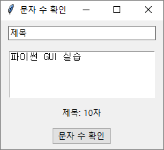<br>
  <em>그림 5. 본문에 파이썬 GUI 실습을 입력한 뒤 문자 수 확인.</em>
</p>

| 동작 | Entry | Text |
|---|---|---|
| 읽기 | `entry.get()` | `text.get("1.0", "end-1c")` |
| 삽입 | `entry.insert(0, "내용")` | `text.insert("1.0", "내용")` |
| 전체 삭제 | `entry.delete(0, "end")` | `text.delete("1.0", "end")` |

위 화면에서는 제목 입력창을 그대로 두고 여러 줄 입력창에 `파이썬 GUI 실습`을 입력한 뒤 버튼을 클릭했습니다. `entry.get()`으로 제목을, `text.get()`으로 본문을 읽고, `len(body)`로 공백을 포함한 문자열의 길이를 계산합니다. 입력값은 위젯을 생성할 때가 아니라 버튼을 누를 때 읽어야 현재 입력이 반영됩니다.

`Entry`의 인덱스는 0부터 시작합니다. `Text`의 `"1.0"`은 첫 번째 줄의 첫 번째 문자 위치를 의미합니다. `Text` 위젯은 내용의 끝에 줄바꿈 문자 하나를 유지하므로 `"end-1c"`를 사용하면 그 줄바꿈을 제외하고 내용을 읽을 수 있습니다.

### 2.4 Checkbutton과 Radiobutton

`Checkbutton`은 항목을 독립적으로 선택하거나 해제할 때 사용합니다. `Radiobutton`은 여러 선택지 중 하나를 선택할 때 사용합니다.

```python
import tkinter as tk
from tkinter import ttk


def show_options():
    result.config(text=f"용지: {size.get()} / 양면: {duplex.get()}")


root = tk.Tk()
root.title("인쇄 옵션")

duplex = tk.BooleanVar(root, value=False)
size = tk.StringVar(root, value="A4")

ttk.Checkbutton(root, text="양면 인쇄", variable=duplex).pack(anchor="w")
ttk.Radiobutton(root, text="A4", variable=size, value="A4").pack(anchor="w")
ttk.Radiobutton(root, text="A3", variable=size, value="A3").pack(anchor="w")

ttk.Button(root, text="선택 확인", command=show_options).pack(pady=8)
result = ttk.Label(root, text="")
result.pack(padx=12, pady=8)

root.mainloop()
```

<p align="center">
  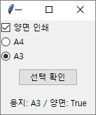<br>
  <em>그림 6. A3 용지와 양면 인쇄 선택 결과.</em>
</p>

`variable`에 연결된 값은 위젯의 선택 상태와 함께 변경됩니다. 같은 변수를 공유하는 `Radiobutton`은 각 버튼의 `value`가 서로 다르면 한 번에 하나만 선택됩니다. 이때 `BooleanVar`와 `StringVar`의 자세한 사용법은 4.3에서 다룹니다.

### 2.5 Combobox

`ttk.Combobox`는 드롭다운 목록에서 값을 선택할 수 있는 위젯입니다. `state="readonly"`로 설정하면 목록에 없는 값을 직접 입력할 수 없습니다.

```python
import tkinter as tk
from tkinter import ttk


def show_choice():
    result.config(text=f"선택: {subject.get()}")


root = tk.Tk()
root.title("과목 선택")

subject = ttk.Combobox(
    root, values=["수학", "과학", "정보"], state="readonly"
)
subject.current(0)
subject.pack(padx=12, pady=8)

ttk.Button(root, text="확인", command=show_choice).pack()
result = ttk.Label(root, text="")
result.pack(padx=12, pady=8)

root.mainloop()
```

<p align="center">
  <br>
  <em>그림 7. 정보 과목 선택 후 확인.</em>
</p>

`current(0)`은 첫 번째 항목을 선택합니다. `get()`으로 현재 값을 읽으며, `subject["values"]`를 변경하면 선택 가능한 목록을 갱신할 수 있습니다. 목록을 변경한 뒤 기존 선택값이 여전히 유효한지도 확인해야 합니다.

### 기본 위젯 정리

| 필요한 기능 | 사용할 위젯 | 자주 사용하는 옵션·메서드 |
|---|---|---|
| 안내 또는 결과 표시 | `ttk.Label` | `text`, `config()` |
| 기능 실행 | `ttk.Button` | `text`, `command` |
| 한 줄 입력 | `ttk.Entry` | `width`, `get()`, `insert()`, `delete()` |
| 여러 줄 입력 | `tk.Text` | `width`, `height`, `get()` |
| 여러 선택지 중 하나 선택 | `ttk.Combobox`, `ttk.Radiobutton` | `values`, `variable`, `get()` |
| 선택 여부 | `ttk.Checkbutton` | `variable` |

창에 표시할 내용이나 입력 방식에 따라 위젯을 선택합니다. 기본 창을 생성하고 Label, Button, Entry를 배치한 뒤 클릭에 따라 화면의 값이 바뀌는 과정을 이해했다면 다음 단원으로 넘어가세요.

## 3. 레이아웃 구성 (Layout)

Tkinter에서는 위젯을 생성하는 것과 화면에 배치하는 것이 별개의 작업입니다. `pack()`, `grid()`, `place()`는 위젯의 배치를 관리하는 지오메트리 매니저(Geometry Manager)입니다.

### 3.1 Pack

`pack()`은 위젯을 부모 영역의 위, 아래, 왼쪽, 오른쪽에 순서대로 배치합니다.

```python
import tkinter as tk
from tkinter import ttk

root = tk.Tk()
root.title("Pack")
root.geometry("360x180")

ttk.Label(root, text="공지사항").pack(side="top", pady=8)
ttk.Label(root, text="내용 영역", relief="solid").pack(
    fill="both", expand=True, padx=10, pady=4
)
ttk.Button(root, text="닫기", command=root.destroy).pack(side="bottom", pady=8)

root.mainloop()
```

<p align="center">
  <br>
  <em>그림 8. pack()으로 배치한 제목, 내용 영역, 닫기 버튼.</em>
</p>

| 옵션 | 설명 |
|---|---|
| `side` | 배치할 방향 (`top`, `bottom`, `left`, `right`) |
| `fill` | 할당된 영역을 채우는 방향 (`x`, `y`, `both`) |
| `expand` | 남은 공간을 위젯의 배치 영역에 할당할지 여부 |
| `padx`, `pady` | 위젯 바깥의 가로·세로 여백 |

`expand=True`는 여유 공간을 배치 영역에 할당하고, `fill="both"`는 위젯 자체가 할당된 영역을 채우도록 합니다.

### 3.2 Grid

`grid()`는 위젯을 행(Row)과 열(Column)로 나누어 배치합니다. 입력 폼처럼 여러 요소를 정렬할 때 적합합니다. 다음 예제의 배치는 아래와 같습니다. 행과 열의 번호는 0부터 시작합니다.

| 행 | 열 0 | 열 1 |
|---|---|---|
| 0 | 이름 Label | 이름 Entry |
| 1 | 학번 Label | 학번 Entry |
| 2 | 초기화 Button (두 열에 걸쳐 배치) | |

```python
import tkinter as tk
from tkinter import ttk

root = tk.Tk()
root.title("Grid")
root.geometry("360x160")


def clear_inputs():
    name.delete(0, "end")
    student_id.delete(0, "end")

ttk.Label(root, text="이름").grid(row=0, column=0, padx=10, pady=8, sticky="w")
name = ttk.Entry(root)
name.grid(row=0, column=1, padx=10, pady=8, sticky="ew")

ttk.Label(root, text="학번").grid(row=1, column=0, padx=10, pady=8, sticky="w")
student_id = ttk.Entry(root)
student_id.grid(row=1, column=1, padx=10, pady=8, sticky="ew")

ttk.Button(root, text="초기화", command=clear_inputs).grid(
    row=2, column=0, columnspan=2, pady=8
)

root.columnconfigure(1, weight=1)
root.mainloop()
```

<p align="center">
  <br>
  <em>그림 9. grid()로 배치한 이름과 학번 입력 폼.</em>
</p>

| 옵션 | 설명 |
|---|---|
| `row`, `column` | 행과 열 번호 (0부터 시작) |
| `rowspan`, `columnspan` | 차지할 행·열의 개수 |
| `sticky` | 셀 내부의 정렬 및 확장 방향 (`n`, `s`, `e`, `w`) |
| `padx`, `pady` | 위젯 바깥의 여백 |

`columnconfigure(1, weight=1)`은 창의 너비가 늘어날 때 두 번째 열이 여유 공간을 받도록 설정합니다. `sticky="ew"`는 해당 셀의 좌우 방향을 채우도록 합니다. 초기화 버튼을 클릭하면 `clear_inputs()`가 두 입력창의 내용을 삭제합니다.

### 3.3 Place

`place()`는 부모 영역을 기준으로 좌표를 지정해 위젯을 배치합니다.

```python
import tkinter as tk
from tkinter import ttk

root = tk.Tk()
root.title("Place")
root.geometry("320x180")

ttk.Label(root, text="고정 위치").place(x=12, y=12)
ttk.Label(root, text="중앙").place(relx=0.5, rely=0.5, anchor="center")

root.mainloop()
```

<p align="center">
  <br>
  <em>그림 10. place()의 절대 위치와 상대 위치.</em>
</p>

`x`, `y`는 픽셀 단위의 위치이며, `relx`, `rely`는 부모 영역에 대한 상대 위치입니다. `anchor="center"`는 위젯의 중심을 지정한 위치에 맞춥니다. 고정 좌표만 사용하면 창 크기나 글꼴이 달라졌을 때 위젯이 겹치거나 잘릴 수 있습니다. 일반적인 입력 폼과 목록은 `pack()`이나 `grid()`로 구성하는 편이 관리하기 쉽습니다.

### 3.4 Frame

`Frame`은 여러 위젯을 묶는 컨테이너입니다. 화면을 입력 영역, 결과 영역, 버튼 영역 등으로 나누어 구성할 수 있습니다.

```python
import tkinter as tk
from tkinter import ttk

root = tk.Tk()
root.title("Frame")
root.geometry("360x200")

form = ttk.Frame(root, padding=10)
form.pack(fill="x")

ttk.Label(form, text="이름").grid(row=0, column=0, padx=(0, 8))
ttk.Entry(form).grid(row=0, column=1, sticky="ew")
form.columnconfigure(1, weight=1)

footer = ttk.Frame(root, padding=10)
footer.pack(side="bottom", fill="x")
ttk.Button(footer, text="닫기", command=root.destroy).pack(side="right")

root.mainloop()
```

<p align="center">
  <br>
  <em>그림 11. Frame으로 나눈 입력 영역과 버튼 영역.</em>
</p>

**같은 부모 안에서 `pack()`과 `grid()`를 혼용하지 않습니다.** 위 예제에서는 `root`의 직접적인 자식인 `form`, `footer`를 `pack()`으로 배치합니다. `form` 내부에서는 `grid()`, `footer` 내부에서는 `pack()`을 사용하므로 충돌하지 않습니다.

위젯 객체를 이후에 사용하려면 생성과 배치를 두 문장으로 나누어 작성합니다. `entry = ttk.Entry(root).pack()`에서 `entry`에는 위젯이 아니라 `pack()`의 반환값인 `None`이 저장됩니다.

## 4. 이벤트와 데이터 처리

### 4.1 Command와 Callback

버튼의 `command`에는 실행 결과가 아니라 호출할 함수를 전달합니다.

```python
import tkinter as tk
from tkinter import ttk


def greet(name):
    result.config(text=f"안녕하세요, {name}!")


root = tk.Tk()
root.title("Callback")
result = ttk.Label(root, text="")
result.pack(padx=12, pady=8)

ttk.Button(root, text="인사", command=lambda: greet("민지")).pack(pady=8)
root.mainloop()
```

<p align="center">
  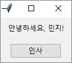<br>
  <em>그림 12. 인사 버튼 클릭 후 레이블 변경.</em>
</p>

| 작성 방법 | 동작 |
|---|---|
| `command=show_result` | 클릭 시 `show_result()` 호출 |
| `command=show_result()` | 버튼을 생성하는 시점에 함수를 즉시 호출하고 반환값을 전달 |
| `command=lambda: greet("민지")` | 클릭 시 지정한 인수를 전달하여 함수 호출 |

첫 번째 형태는 인수 없이 호출할 수 있는 함수에 사용합니다. 인수를 전달해야 하는 경우 `lambda` 또는 별도의 콜백 함수를 사용할 수 있습니다. `lambda: greet("민지")`는 인수 없이 호출할 수 있는 함수를 생성하며, 이 함수가 호출될 때 `greet("민지")`가 실행됩니다.

### 4.2 이벤트 바인딩 (bind)

`bind()`를 사용하면 버튼 클릭뿐 아니라 키보드 입력, 마우스 동작 등 다양한 이벤트에 함수를 연결할 수 있습니다.

```python
import tkinter as tk
from tkinter import ttk


def show_message(event):
    result.config(text=f"입력: {entry.get()}")


root = tk.Tk()
root.title("Event Binding")
entry = ttk.Entry(root, width=30)
entry.pack(padx=12, pady=8)
entry.bind("<Return>", show_message)
entry.focus_set()

result = ttk.Label(root, text="Enter 키를 눌러 보세요.")
result.pack(padx=12, pady=8)

root.mainloop()
```

<p align="center">
  <br>
  <em>그림 13. Python 입력 후 Enter 키를 누른 결과.</em>
</p>

`bind()`로 연결한 함수에는 이벤트 객체가 전달됩니다. 이벤트 객체에서 발생한 키, 마우스 좌표, 이벤트가 발생한 위젯 등의 정보를 확인할 수 있습니다.

| 이벤트 | 발생 조건 |
|---|---|
| `<Return>` | Enter 키 입력 |
| `<KeyRelease>` | 키를 놓았을 때 |
| `<Button-1>` | 마우스 왼쪽 버튼 누름 |
| `<Double-Button-1>` | 마우스 왼쪽 버튼 더블클릭 |
| `<<ComboboxSelected>>` | 사용자가 Combobox 항목 선택 |
| `<<TreeviewSelect>>` | Treeview 선택 항목 변경 |

같은 함수를 `command`와 `bind()`에서 모두 호출해야 한다면 `event=None`과 같은 기본 매개변수를 사용하거나, 이벤트 처리 함수에서 공통 함수를 호출하도록 구성할 수 있습니다.

### 4.3 Tkinter 변수

`StringVar`, `IntVar`, `DoubleVar`, `BooleanVar`는 위젯과 값을 연결하기 위한 Tkinter 변수 클래스입니다. 일반 Python 변수와 달리 `textvariable` 또는 `variable`을 통해 연결된 위젯에 값의 변경이 반영됩니다.

```python
import tkinter as tk
from tkinter import ttk

root = tk.Tk()
root.title("StringVar")

message = tk.StringVar(root, value="안녕하세요")
ttk.Entry(root, textvariable=message).pack(padx=12, pady=8)
ttk.Label(root, textvariable=message).pack(padx=12, pady=8)
ttk.Button(root, text="초기화", command=lambda: message.set("")).pack(pady=8)

root.mainloop()
```

<table align="center">
  <tr>
    <td align="center" valign="top">
      <br>
      <em>그림 14. StringVar의 초기값.</em>
    </td>
    <td align="center" valign="top">
      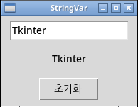<br>
      <em>그림 15. 입력창 변경 시 레이블에 반영된 값.</em>
    </td>
  </tr>
</table>

입력창과 레이블이 같은 `StringVar`를 참조하므로 입력창의 내용이 바뀌면 레이블도 갱신됩니다. Tkinter 변수는 `get()`과 `set()`으로 값을 읽거나 변경합니다. 숫자 입력창에서도 `StringVar`를 사용한 뒤 `int()` 또는 `float()`로 변환하면 빈 입력이나 잘못된 문자열을 직접 검사할 수 있습니다.

### 4.4 데이터 처리 함수와 GUI 분리

입력창에서 읽은 값은 처리 함수에 전달하고, 반환된 결과를 화면에 표시할 수 있습니다. 예를 들어 가격 계산 함수는 Tkinter 위젯을 참조하지 않아도 동작합니다.

```python
import tkinter as tk
from tkinter import ttk, messagebox


def calculate_total(price, quantity):
    return price * quantity


def show_total():
    try:
        price = int(price_entry.get())
        quantity = int(quantity_entry.get())
    except ValueError:
        result.config(text="합계: —")
        messagebox.showerror("입력 오류", "가격과 수량은 정수로 입력하세요.", parent=root)
        return

    if price < 0 or quantity < 1:
        result.config(text="합계: —")
        messagebox.showerror("입력 오류", "가격은 0 이상, 수량은 1 이상이어야 합니다.", parent=root)
        return

    total = calculate_total(price, quantity)
    result.config(text=f"합계: {total:,}원")


root = tk.Tk()
root.title("금액 계산")

ttk.Label(root, text="가격").pack()
price_entry = ttk.Entry(root)
price_entry.pack(padx=12, pady=4)

ttk.Label(root, text="수량").pack()
quantity_entry = ttk.Entry(root)
quantity_entry.pack(padx=12, pady=4)

ttk.Button(root, text="계산", command=show_total).pack(pady=8)
result = ttk.Label(root, text="합계: —")
result.pack(pady=8)

root.mainloop()
```

<p align="center">
  <br>
  <em>그림 16. 가격 1500원, 수량 3개 입력 후 계산 결과.</em>
</p>

위 예제에서 `show_total()`은 GUI 입력 조회, 유효성 검사, 결과 표시를 담당합니다. `calculate_total()`은 계산만 담당하므로 터미널 프로그램이나 다른 GUI에서도 사용할 수 있습니다. 계산 결과는 입력값을 검증한 뒤 갱신합니다. 입력 오류가 발생하면 이전 계산 결과를 지워 현재 입력의 결과로 오인하지 않도록 합니다.

#### 콜백에서 변수 읽기와 변경

`main()` 안에서 콜백 함수를 정의하면 콜백은 바깥 함수의 변수를 읽을 수 있습니다. 다만 바깥 함수의 변수에 새로운 값을 대입하려면 `nonlocal`을 사용해야 합니다. `nonlocal`을 지정하지 않고 대입하면 콜백 내부의 지역 변수로 처리됩니다.

```python
import tkinter as tk
from tkinter import ttk


def main():
    root = tk.Tk()
    root.title("클릭 횟수")
    count = 0
    result = ttk.Label(root, text="0회")
    result.pack(padx=12, pady=8)

    def increase():
        nonlocal count
        count += 1
        result.config(text=f"{count}회")

    ttk.Button(root, text="증가", command=increase).pack(pady=8)
    root.mainloop()


if __name__ == "__main__":
    main()
```

<table align="center">
  <tr>
    <td align="center" valign="top">
      <br>
      <em>그림 17. 초기 클릭 횟수.</em>
    </td>
    <td align="center" valign="top">
      <br>
      <em>그림 18. 증가 버튼을 세 번 누른 결과.</em>
    </td>
  </tr>
</table>

이 예제에서는 버튼을 누를 때마다 `count`가 1씩 증가합니다. 바깥 함수의 리스트에 `append()`를 호출하거나 딕셔너리의 항목을 수정하는 것은 변수 자체에 새 객체를 대입하는 작업이 아니므로 `nonlocal`이 필요하지 않습니다.

## 5. 주요 응용 위젯

### 5.1 Listbox

`Listbox`는 여러 문자열을 목록으로 표시할 때 사용합니다. 선택된 항목의 인덱스를 확인하거나 항목을 추가·삭제할 수 있습니다.

```python
import tkinter as tk
from tkinter import ttk


def show_selection():
    selected = subjects.curselection()
    if not selected:
        result.config(text="과목을 선택하세요.")
        return
    result.config(text=f"선택: {subjects.get(selected[0])}")


root = tk.Tk()
root.title("Listbox")
subjects = tk.Listbox(root, height=4, selectmode="browse")
subjects.pack(padx=12, pady=8)

for subject in ["수학", "과학", "정보"]:
    subjects.insert("end", subject)

ttk.Button(root, text="선택 확인", command=show_selection).pack()
result = ttk.Label(root, text="")
result.pack(padx=12, pady=8)

root.mainloop()
```

<p align="center">
  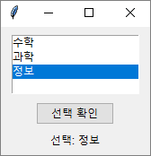<br>
  <em>그림 19. Listbox에서 정보 과목을 선택한 결과.</em>
</p>

`curselection()`은 선택된 항목의 인덱스를 튜플로 반환합니다. 선택된 항목이 없으면 빈 튜플을 반환하므로 인덱스에 접근하기 전에 선택 여부를 확인합니다.

### 5.2 Treeview

`ttk.Treeview`는 계층 구조나 여러 열로 이루어진 표를 표시할 수 있습니다. `show="headings"`를 지정하면 기본 트리 열(`#0`)을 숨기고 표 형태로 표시합니다.

다음 예제에서는 측정 기록을 표에 표시하고 세로 스크롤바를 연결합니다. 스크롤바의 연결 방식은 5.3에서 설명합니다.

```python
import tkinter as tk
from tkinter import ttk

root = tk.Tk()
root.title("측정 기록")
root.geometry("360x200")

frame = ttk.Frame(root, padding=10)
frame.pack(fill="both", expand=True)

tree = ttk.Treeview(frame, columns=("time", "temperature"), show="headings", height=5)
tree.heading("time", text="측정 시각")
tree.heading("temperature", text="온도 (℃)")
tree.column("time", width=140, anchor="center")
tree.column("temperature", width=120, anchor="e")

scrollbar = ttk.Scrollbar(frame, orient="vertical", command=tree.yview)
tree.configure(yscrollcommand=scrollbar.set)

tree.pack(side="left", fill="both", expand=True)
scrollbar.pack(side="right", fill="y")

for hour in range(9, 19):
    tree.insert("", "end", values=(f"{hour:02d}:00", 20 + hour % 5))

root.mainloop()
```

<p align="center">
  <br>
  <em>그림 20. Treeview와 세로 스크롤바.</em>
</p>

| 메서드 | 역할 |
|---|---|
| `heading(column, text=...)` | 열 제목 지정 |
| `column(column, width=..., anchor=...)` | 열의 너비와 정렬 지정 |
| `insert("", "end", values=...)` | 최상위 목록의 끝에 행 삽입 |
| `selection()` | 선택된 행의 ID를 튜플로 반환 |
| `item(row_id, "values")` | 해당 행의 표시값 조회 |
| `get_children()` | 최상위 행 ID 목록 조회 |
| `delete(row_id)` | 해당 행 삭제 |

Treeview의 행 ID와 화면에 표시되는 값은 서로 다릅니다. `selection()`의 결과가 비어 있는 경우도 처리해야 합니다. Treeview는 표시용 위젯이므로 원본 데이터는 별도의 Python 자료구조로 관리하는 것이 좋습니다. 표시값을 읽어 원본 숫자 자료형이 그대로 유지된다고 가정하지 않습니다.

### 5.3 Scrollbar

`Scrollbar`는 표시 영역을 벗어나는 목록이나 텍스트를 스크롤할 때 사용합니다. 5.2의 실행 화면 오른쪽에는 세로 스크롤바가 있습니다. 스크롤바를 아래로 움직이면 처음 화면에 보이지 않았던 측정 기록도 조회할 수 있습니다. 5.2의 예제에서는 스크롤바와 Treeview의 상태를 양방향으로 연결했습니다.

스크롤바의 `command=tree.yview`는 스크롤바의 이동을 표에 반영합니다. `yscrollcommand=scrollbar.set`은 표의 표시 위치를 스크롤바에 반영합니다. 두 설정을 함께 사용합니다.

### 5.4 Messagebox

`messagebox`는 안내, 오류, 확인 등의 대화상자를 제공합니다.

```python
import tkinter as tk
from tkinter import ttk, messagebox


def confirm_reset():
    if messagebox.askyesno("확인", "화면을 초기화할까요?", parent=root):
        result.config(text="초기화되었습니다.")


root = tk.Tk()
root.title("Messagebox")
result = ttk.Label(root, text="작업 결과")
result.pack(padx=12, pady=8)
ttk.Button(root, text="초기화", command=confirm_reset).pack(pady=8)
root.mainloop()
```

<table align="center">
  <tr>
    <td align="center" valign="top">
      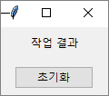<br>
      <em>그림 21. Messagebox 예제의 기본 창.</em>
    </td>
    <td align="center" valign="top">
      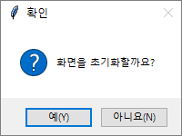<br>
      <em>그림 22. 초기화 버튼을 누르면 표시되는 확인 대화상자.</em>
    </td>
  </tr>
</table>

| 함수 | 역할 |
|---|---|
| `showinfo()` | 일반 안내 |
| `showwarning()` | 경고 안내 |
| `showerror()` | 오류 안내 |
| `askyesno()` | 예/아니요 선택 (`True` 또는 `False` 반환) |

`parent`는 대화상자가 속할 부모 창을 지정합니다.

### 5.5 Filedialog

`filedialog`는 운영체제의 파일 또는 폴더 선택 대화상자를 표시합니다. 선택 결과로 경로를 반환하며, 파일 탐색이나 데이터 처리를 자동으로 수행하지는 않습니다.

```python
import tkinter as tk
from tkinter import ttk, filedialog


def choose_file():
    path = filedialog.askopenfilename(
        parent=root, title="데이터 파일 선택",
        filetypes=[("CSV 파일", "*.csv"), ("모든 파일", "*")]
    )
    if path:
        result.set(path)


root = tk.Tk()
root.title("Filedialog")
result = tk.StringVar(root, value="")
ttk.Button(root, text="파일 선택", command=choose_file).pack(pady=8)
ttk.Entry(root, textvariable=result, state="readonly", width=45).pack(padx=12, pady=8)
root.mainloop()
```

<p align="center">
  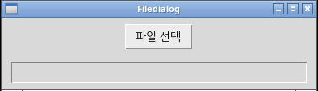<br>
  <em>그림 23. 파일 선택 예제의 기본 창.</em>
</p>

<p align="center">
  <br>
  <em>그림 24. 파일 선택 버튼을 눌렀을 때의 대화상자.</em>
</p>

| 함수 | 선택 대상 |
|---|---|
| `askopenfilename()` | 열 파일 |
| `asksaveasfilename()` | 저장할 파일 경로 |
| `askdirectory()` | 폴더 |

위 세 함수에서 사용자가 선택을 취소하면 빈 문자열(`""`)이 반환됩니다. 선택 취소 여부는 경로를 `Path` 객체로 변환하기 전에 확인합니다. `Path("")`는 현재 디렉터리를 나타내기 때문입니다. 반환된 경로를 이용한 실제 파일 읽기와 저장은 별도로 작성해야 합니다. 파일 입출력과 예외 처리는 `Automation_Programs.md`를 참고하세요.

> **참고:** `filetypes`는 대화상자에서 표시하는 파일 종류를 제한하는 설정입니다. 선택한 파일의 실제 데이터 형식이 올바르다는 것을 보장하지는 않습니다.

## 6. Example — GUI 기반 성적 조회 프로그램

### 6.1 요구사항 및 처리 절차

학생의 학번과 과목별 점수를 표에 표시하고, 학생을 선택하면 평균 점수를 확인할 수 있는 프로그램입니다. 이번 예제에서는 성적 데이터를 Python 리스트와 튜플로 관리합니다.

| 기능 | 요구사항 |
|---|---|
| 성적 목록 | 학번, 이름, 수학 점수, 정보 점수 표시 |
| 학생 선택 | 표에서 한 명 선택 |
| 평균 계산 | 선택한 학생의 두 과목 점수의 산술 평균 계산 |
| 결과 표시 | 학생의 이름과 평균을 소수점 첫째 자리까지 표시 |
| 선택 해제 | 선택 상태와 결과 표시 초기화 |
| 예외 상황 | 학생을 선택하지 않고 조회하면 안내 |

프로그램을 실행하면 성적 목록이 표시됩니다. 사용자가 학생을 선택하고 조회 버튼을 누르면 선택된 행의 ID를 이용해 원본 데이터를 찾습니다. 평균은 별도의 계산 함수에서 구하고 결과를 레이블에 표시합니다.

### 6.2 입력 데이터

| 학번 | 이름 | 수학 | 정보 |
|---|---|---:|---:|
| S101 | 민지 | 90 | 85 |
| S102 | 지우 | 75 | 95 |
| S103 | 하나 | 88 | 92 |
| S104 | 서준 | 80 | 77 |

학번은 중복되지 않으며 점수는 0 이상 100 이하의 정수라고 가정합니다.

### 6.3 전체 코드

아래 코드를 `grade_viewer.py`로 저장합니다.

```python
import tkinter as tk
from tkinter import ttk, messagebox


STUDENTS = [
    ("S101", "민지", 90, 85),
    ("S102", "지우", 75, 95),
    ("S103", "하나", 88, 92),
    ("S104", "서준", 80, 77),
]


def calculate_average(math_score, info_score):
    return (math_score + info_score) / 2


def main():
    root = tk.Tk()
    root.title("성적 조회")
    root.geometry("520x320")
    root.minsize(440, 260)

    students_by_id = {student[0]: student for student in STUDENTS}

    def show_average():
        selected = tree.selection()
        if not selected:
            messagebox.showwarning("학생 선택", "학생을 먼저 선택하세요.", parent=root)
            return

        student_id = selected[0]
        _, name, math_score, info_score = students_by_id[student_id]
        average = calculate_average(math_score, info_score)
        result.set(f"{name} 학생의 평균: {average:.1f}점")

    def clear_selection():
        selected = tree.selection()
        if selected:
            tree.selection_remove(*selected)
        result.set("학생을 선택한 뒤 평균 조회를 누르세요.")

    def on_selection(event):
        result.set("평균 조회를 누르세요." if tree.selection() else
                   "학생을 선택한 뒤 평균 조회를 누르세요.")

    container = ttk.Frame(root, padding=12)
    container.pack(fill="both", expand=True)

    ttk.Label(container, text="학생 성적 목록").pack(anchor="w", pady=(0, 8))

    table_frame = ttk.Frame(container)
    table_frame.pack(fill="both", expand=True)

    columns = ("id", "name", "math", "info")
    tree = ttk.Treeview(
        table_frame, columns=columns, show="headings", selectmode="browse", height=6
    )

    for column, label in zip(columns, ("학번", "이름", "수학", "정보")):
        tree.heading(column, text=label)
        tree.column(column, width=100, minwidth=60, anchor="center")

    scrollbar = ttk.Scrollbar(table_frame, orient="vertical", command=tree.yview)
    tree.configure(yscrollcommand=scrollbar.set)
    scrollbar.pack(side="right", fill="y")
    tree.pack(side="left", fill="both", expand=True)

    for student in STUDENTS:
        tree.insert("", "end", iid=student[0], values=student)

    result = tk.StringVar(root, value="학생을 선택한 뒤 평균 조회를 누르세요.")
    ttk.Label(container, textvariable=result).pack(anchor="w", pady=12)

    buttons = ttk.Frame(container)
    buttons.pack(fill="x")
    ttk.Button(buttons, text="평균 조회", command=show_average).pack(side="left")
    ttk.Button(buttons, text="선택 해제", command=clear_selection).pack(side="left", padx=8)
    ttk.Button(buttons, text="닫기", command=root.destroy).pack(side="right")

    tree.bind("<<TreeviewSelect>>", on_selection)
    root.mainloop()


if __name__ == "__main__":
    main()
```

### 6.4 코드 분석

#### 원본 데이터와 표시 데이터

`STUDENTS`는 학생별 성적을 튜플로 관리하는 리스트입니다. `students_by_id`는 학번으로 학생 정보를 조회할 수 있도록 구성한 딕셔너리입니다. 다음 표현은 리스트의 각 학생 정보를 학번을 키로 하는 딕셔너리로 변환합니다.

```python
students_by_id = {student[0]: student for student in STUDENTS}
```

이 문법은 딕셔너리 컴프리헨션(Dictionary Comprehension)입니다. 일반적인 반복문으로도 같은 결과를 만들 수 있습니다.

```python
students_by_id = {}
for student in STUDENTS:
    students_by_id[student[0]] = student
```

두 코드 조각은 전체 코드의 `STUDENTS`가 정의된 상태에서 사용합니다.

`tree.insert()`의 `iid`에는 학번을 지정했습니다. `iid`는 Treeview에서 행을 구분하는 고유 ID이며, 같은 ID를 중복하여 삽입할 수 없습니다. 사용자가 선택한 행의 ID와 원본 데이터의 학번을 연결해 점수를 찾습니다.

#### 위젯과 화면 배치

전체 화면은 제목, 성적 표, 결과 레이블, 버튼 영역으로 구성됩니다. 표를 포함한 `table_frame`은 창 크기에 따라 확장되고 버튼 영역은 표 아래에 배치됩니다.

`zip()`은 열 이름과 표시 제목을 차례대로 묶습니다. 예를 들어 첫 번째 반복에서 `column`은 `"id"`, `label`은 `"학번"`입니다.

#### 이벤트와 콜백

평균 조회 버튼을 클릭하면 `show_average()`가 실행됩니다. 선택 항목이 없으면 경고 대화상자를 표시하고 `return`으로 함수를 종료합니다. 학생이 선택되어 있다면 딕셔너리에서 원본 데이터를 찾아 `calculate_average()`를 호출합니다.

평균 계산 함수는 Tkinter를 사용하지 않으므로 별도로 검증할 수 있습니다. `main()` 안에 정의한 콜백은 같은 함수 안의 위젯과 변수를 참조합니다. 이 예제의 버튼과 선택 이벤트에 연결한 콜백은 위젯 생성 후 사용자 입력을 처리할 때 호출됩니다.

`<<TreeviewSelect>>` 이벤트는 선택 항목이 바뀔 때 발생합니다. 이전 학생의 평균이 새로 선택한 학생의 결과처럼 보이지 않도록 결과 레이블을 갱신합니다. `tree.selection_remove(*selected)`에서 `*`는 튜플에 들어 있는 행 ID들을 개별 인수로 전달합니다.

### 6.5 실행 결과 및 검증

터미널에서 `grade_viewer.py`가 있는 폴더로 이동한 뒤 실행합니다.

```bash
python grade_viewer.py
```

Windows에서 필요한 경우 `py grade_viewer.py`를 사용합니다. 창이 표시되면 민지의 행을 선택하고 평균 조회 버튼을 눌러 보세요.

<p align="center">
  <br>
  <em>그림 25. 민지 학생 선택 후 평균 조회 실행 화면.</em>
</p>

다음은 결과 영역의 예상 표시값입니다.

```text
민지 학생의 평균: 87.5점
```

| 테스트 조건 | 예상 결과 |
|---|---|
| 프로그램 실행 | 학생 4명의 성적 표시 |
| 민지 선택 후 평균 조회 | 87.5점 |
| 지우 선택 후 평균 조회 | 85.0점 |
| 하나 선택 후 평균 조회 | 90.0점 |
| 서준 선택 후 평균 조회 | 78.5점 |
| 조회 후 다른 학생 선택 | 이전 평균 대신 조회 안내 표시 |
| 선택 해제 후 평균 조회 | 학생 선택 안내 대화상자 |
| 창의 크기 변경 | 표 영역이 창의 크기에 맞춰 조정 |

같은 폴더에서 다음 명령을 실행하면 GUI 창을 띄우지 않고 평균 계산 함수의 결과를 확인할 수 있습니다.

```bash
python -c "from grade_viewer import calculate_average; print(calculate_average(90, 85))"
```

출력은 `87.5`입니다. `if __name__ == "__main__":` 조건으로 직접 실행과 모듈 불러오기를 구분하므로, 함수만 가져올 때 창이 생성되지 않습니다.

## 7. Practice

다음 실습에서는 요구사항에 맞춰 GUI를 설계하고 구현합니다. Solutions에는 Quiz의 정답만 제시합니다. 시작 코드의 `TODO`는 직접 작성해야 하는 부분이며, `raise NotImplementedError`가 포함된 함수는 해당 문장을 필요한 코드로 교체한 뒤 실행하세요. 예제의 위젯 사용법은 참고할 수 있지만 화면 구성과 이벤트 처리 방식은 직접 결정합니다.

### 7.1 Practice 01 — 단위 변환 프로그램

사용자가 길이를 입력하고 변환 방향을 선택하면 결과를 표시하는 프로그램을 작성하세요.

#### 구현 조건

1. 길이를 입력할 수 있는 입력창을 제공합니다. 0 이상의 유한한 실수를 허용합니다.
2. `m → cm`, `cm → m`, `km → m`, `m → km`의 네 가지 변환 방향 중 하나를 선택할 수 있어야 합니다.
3. 변환 버튼을 클릭하거나 입력창에서 Enter 키를 누르면 계산합니다. 결과는 소수점 셋째 자리까지 표시하고 변환된 단위를 함께 표시합니다.
4. 빈 입력, 숫자가 아닌 입력, 음수, `NaN`, 무한대 또는 계산 결과가 무한대인 경우에는 오류를 안내합니다. 실패 시 이전 계산 결과를 지웁니다.
5. 초기화 버튼으로 입력값과 결과를 지우고 변환 방향을 `m → cm`으로 되돌립니다.

| 변환 방향 | 변환식 |
|---|---|
| m → cm | 입력값 × 100 |
| cm → m | 입력값 ÷ 100 |
| km → m | 입력값 × 1,000 |
| m → km | 입력값 ÷ 1,000 |

<p align="center">
  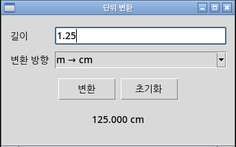<br>
  <em>그림 26. 단위 변환 프로그램의 완성 화면 예시.</em>
</p>

위 이미지는 구현 예시입니다. 요구 기능을 충족한다면 위젯의 배치와 크기는 달라도 됩니다.

#### STEP 01. 화면 및 프로그램 설계

입력창, 변환 방향 선택, 변환 버튼, 초기화 버튼, 결과 레이블을 배치하세요. 각 위젯이 어떤 데이터를 입력하거나 표시하는지 정리합니다. 창의 크기, 제목과 레이아웃은 자유롭게 결정합니다.

#### STEP 02. 단위 변환 함수 구현

GUI와 별도로 동작하는 변환 함수를 작성하세요. `direction`은 표에 표시된 네 가지 문자열 중 하나이며, `value`는 숫자로 변환된 입력값입니다. 반환값은 `(변환 결과, 단위)` 형태의 튜플로 구성합니다. 지원하지 않는 변환 방향이나 허용되지 않는 숫자는 `ValueError`로 처리합니다.

`math.isfinite(value)`는 값이 유한한 수이면 `True`, 무한대 또는 NaN이면 `False`를 반환합니다. 입력값뿐 아니라 계산 결과에도 같은 검사를 적용하세요. 예를 들어 유한한 실수 `1e308`에 `1000`을 곱하면 부동소수점 연산 결과가 무한대가 될 수 있습니다.

```python
import math


def convert_length(value, direction):
    # TODO: 유효한 값과 변환 방향인지 확인
    # TODO: 선택한 방향에 따라 계산하고 결과와 단위 반환
    raise NotImplementedError
```

#### STEP 03. 위젯과 이벤트 연결

다음 구조를 참고해 입력창과 방향 선택 위젯, 결과 레이블을 생성하세요. 변환 버튼과 Enter 키에 같은 처리 기능을 연결하고, 초기화 버튼의 동작도 구현합니다.

```python
import tkinter as tk
from tkinter import ttk, messagebox

DIRECTIONS = ["m → cm", "cm → m", "km → m", "m → km"]


def main():
    root = tk.Tk()
    root.title("단위 변환")

    # TODO: 입력값, 변환 방향 및 결과를 관리할 위젯이나 변수 생성

    def on_convert(event=None):
        # TODO: 입력 조회 및 숫자 변환
        # TODO: convert_length() 호출, 결과 표시 및 오류 처리
        raise NotImplementedError

    def on_reset():
        # TODO: 입력, 변환 방향 및 결과 초기화
        raise NotImplementedError

    # TODO: 위젯 배치와 command, bind 연결
    root.mainloop()


if __name__ == "__main__":
    main()
```

STEP 02의 변환 함수와 STEP 03의 GUI를 같은 파일에 작성하거나, 별도 모듈로 나누어 불러올 수 있습니다.

#### STEP 04. 실행 및 테스트

| 입력값 | 변환 방향 | 예상 결과 |
|---|---|---|
| `1.25` | m → cm | 125.000 cm |
| `250` | cm → m | 2.500 m |
| `0.75` | km → m | 750.000 m |
| `1500` | m → km | 1.500 km |
| `0` | m → cm | 0.000 cm |
| `-1`, 빈 문자열, `abc` | 임의 선택 | 오류 안내, 결과 지우기 |
| `nan`, `inf`, `1e309` | 임의 선택 | 오류 안내, 결과 지우기 |
| `1e308` | km → m | 계산 결과 범위 오류 안내, 결과 지우기 |

Enter 키로 변환한 결과가 버튼을 클릭한 결과와 동일한지 확인하세요. 정상 계산 직후 잘못된 값을 입력했을 때 이전 결과가 지워지는지, 초기화 버튼을 누르면 입력과 결과가 비워지고 기본 방향이 선택되는지도 검증합니다.

### 7.2 Practice 02 — 실습실 교구 관리 프로그램의 GUI 구현

`Automation_Programs.md`의 Practice 02에서 작성한 교구 대여 관리 프로그램에 GUI를 추가하세요. 이전 실습의 데이터 처리 함수를 재사용하고, 사용자 인터페이스를 통해 교구별 재고를 확인하거나 대여·반납할 수 있도록 구성합니다.

이번 실습에서는 미리 준비된 전체 기록을 한 번에 처리하는 대신, 사용자가 GUI에서 대여 또는 반납 기록을 한 건씩 입력합니다. 이전 프로그램의 명령줄 메뉴는 사용하지 않습니다.

#### 초기 데이터

```python
initial_stock = {"자": 3, "가위": 4}
```

품목별 초기 수량은 대여·반납의 상한으로 사용합니다. 이전 실습에서 사용한 `equipment_stock.json`과 저장 데이터가 섞이지 않도록 별도의 실습 폴더를 사용하세요. 파일명은 `equipment_gui_stock.json`으로 지정합니다.

#### 구현 조건

| 기능 | 요구사항 |
|---|---|
| 재고 표시 | 품목명과 현재 대여 가능 수량을 표 또는 목록에 표시 |
| 입력 | 품목, 대여·반납 구분, 수량을 선택하거나 입력 |
| 기록 처리 | 사용자 요청 한 건을 검사하고 유효하면 현재 재고에 반영 |
| 화면 갱신 | 정상 처리 직후 현재 재고와 처리 결과를 화면에 표시 |
| 오류 처리 | 빈 수량, 정수가 아닌 값, 0 이하의 수량, 재고 부족 및 초기 재고 초과 등을 안내하고 현재 재고 유지 |
| 저장 | 저장 버튼을 누르면 현재 재고를 JSON으로 저장 |
| 복원 | 프로그램 시작 시 저장된 재고를 불러옴. 파일이 없으면 초기 재고 사용 |
| 잘못된 저장 파일 | 오류를 안내하고 편집 및 저장을 중단. 기존 파일을 덮어쓰지 않음 |

저장 버튼을 누르기 전의 변경 사항은 메모리에만 존재합니다. 종료 후 유지하려는 변경 사항은 저장해야 합니다. 파일을 저장하는 데 실패하면 성공 메시지를 표시하지 않습니다. `w` 모드로 저장하던 중 오류가 발생하면 기존 파일이 손상될 수 있습니다. 이번 실습에서는 백업이나 임시 파일을 이용한 저장까지 요구하지 않습니다. 품목 추가·삭제나 여러 건의 일괄 처리 기능은 이번 실습의 필수 범위에 포함하지 않습니다.

<p align="center">
  <br>
  <em>그림 27. 실습실 교구 관리 프로그램의 초기 화면 예시.</em>
</p>

<p align="center">
  <br>
  <em>그림 28. 가위 2개 대여 후 재고가 갱신된 화면 예시.</em>
</p>

위 화면은 기능 확인을 위한 예시이며 동일한 디자인을 요구하지 않습니다.

#### STEP 01. 기존 처리 함수 확인

이전 실습에서 작성한 아래 함수들을 확인하세요. 함수가 아직 완성되지 않았다면 먼저 `Automation_Programs.md`의 Practice 02를 완료합니다.

| 함수 | 역할 |
|---|---|
| `apply_records(initial_stock, current_stock, records)` | 기록 목록을 처리하고 새 재고 딕셔너리와 제외 기록 목록 반환 |
| `load_stock(path, initial_stock)` | 저장 파일에서 재고 조회 및 검증. 파일이 없으면 초기 재고 반환 |
| `save_stock(path, stock)` | 현재 재고를 JSON으로 저장 |

기존 실습의 함수 정의를 활용하되 기존 `main()`의 터미널 입력과 출력은 사용하지 않습니다. 함수 정의를 별도 모듈에 저장할 경우 파일명은 직접 결정합니다. `load_stock()`과 `save_stock()`은 `pathlib.Path` 객체를 경로 인수로 사용합니다. 모듈을 불러올 때 이전 실습의 메뉴가 자동으로 실행되지 않는지도 확인하세요.

#### STEP 02. 화면 설계 및 위젯 구성

프로그램에 필요한 위젯을 선정하고 입력 영역, 재고 표시 영역, 결과 및 버튼 영역을 구성하세요. 저장된 데이터가 잘못되었을 때는 오류 안내 후 창을 닫거나, 편집과 저장을 비활성화한 상태로 창을 유지할 수 있습니다. 품목과 대여·반납 구분은 Combobox 등의 선택 위젯을 사용할 수 있습니다. 재고 목록은 Treeview 또는 Listbox를 사용합니다.

#### STEP 03. 초기 데이터 조회 및 화면 갱신

저장 파일을 불러오는 기능과 재고 목록을 갱신하는 함수를 작성하세요. 저장된 재고가 유효하지 않으면 프로그램에서 재고를 변경하거나 저장할 수 없도록 처리합니다.

```python
def refresh_stock_view():
    # TODO: 현재 재고를 표 또는 목록에 표시
    # TODO: 갱신할 때 기존 행이 중복되지 않도록 처리
    raise NotImplementedError
```

위 함수는 GUI를 구성하는 함수 안에 정의하거나 위젯 및 재고를 매개변수로 전달하는 형태로 변경할 수 있습니다.

#### STEP 04. 대여·반납 이벤트 구현

사용자가 선택한 품목과 동작, 수량을 읽어 기존 처리 함수에 전달하세요. 기존 처리 함수에는 `(품목, 동작, 수량)` 튜플 한 개를 포함하는 리스트를 전달합니다. 새로운 재고와 제외 기록을 반환받은 뒤 결과에 따라 화면을 갱신하거나 오류를 표시합니다.

```python
def on_apply():
    # TODO: 사용자 입력 조회 및 수량 변환
    # TODO: 기존 재고 처리 함수 호출
    # TODO: 처리 성공 여부에 따라 현재 재고와 결과 표시 갱신
    raise NotImplementedError
```

처리가 거부된 경우 화면의 재고 값과 실제 재고 데이터가 모두 변경되지 않아야 합니다. 콜백에서 재고를 새 딕셔너리로 교체한다면 4.4의 변수 범위 설명을 참고하세요.

#### STEP 05. 저장 기능 및 프로그램 통합

기존 저장 함수를 저장 버튼에 연결하세요. 저장 실패 시 오류 안내를 표시합니다. 프로그램을 처음 실행할 때의 재고 조회와 잘못된 저장 파일에 대한 대응도 구현합니다.

```python
def on_save():
    # TODO: 현재 재고 저장 및 예외 처리
    # TODO: 저장 성공 또는 실패 안내
    raise NotImplementedError
```

STEP 03~05의 코드 조각을 포함하여 전체 프로그램을 완성합니다. 함수의 배치, 변수의 관리 방법, 위젯 생성 순서 및 이벤트 연결 방식은 직접 설계하세요. 새 프로그램은 `equipment_gui.py` 등으로 저장할 수 있습니다.

#### STEP 06. 실행 및 테스트

첫 번째 테스트는 저장 파일이 없는 상태에서 진행하세요. 아래 순서대로 대여·반납을 실행한 뒤 표 또는 목록에 표시되는 수량을 확인합니다.

| 순서 | 사용자 동작 | 가위 | 자 | 예상 처리 결과 |
|---:|---|---:|---:|---|
| 1 | 프로그램 실행 | 4 | 3 | 초기 재고 표시 |
| 2 | 가위 2개 대여 | 2 | 3 | 정상 처리 |
| 3 | 자 4개 대여 | 2 | 3 | 재고 부족 |
| 4 | 가위 1개 반납 | 3 | 3 | 정상 처리 |
| 5 | 자 1개 반납 | 3 | 3 | 초기 재고 초과 |
| 6 | 자 1개 대여 | 3 | 2 | 정상 처리 |
| 7 | 가위 수량 `abc` 입력 | 3 | 2 | 정수 입력 안내 |
| 8 | 저장 버튼 클릭 | 3 | 2 | 저장 완료 |
| 9 | 프로그램 종료 후 재실행 | 3 | 2 | 저장 재고 복원 |

저장된 JSON 데이터는 다음과 같아야 합니다. 키의 순서와 들여쓰기는 달라도 됩니다.

```json
{
    "가위": 3,
    "자": 2
}
```

추가로 수량이 `0` 또는 음수일 때의 거부 처리, 저장 전 종료 후 재실행 시 이전에 저장한 수량의 복원, 저장 실패 시 오류 안내를 확인하세요. 저장 파일에 잘못된 JSON 문자열이나 초기 재고 범위를 벗어나는 수량을 넣은 테스트용 파일을 준비하여 실행해 보세요. 오류가 발생했을 때 기존 저장 파일을 그대로 유지하는지 확인합니다. 정상적인 저장 파일은 별도로 복사해 두고 테스트하세요.

#### 추가 과제 (선택)

- 저장되지 않은 변경 사항이 있는 상태에서 창을 닫으면 확인 대화상자를 표시합니다.
- 현재 재고가 0인 품목을 별도로 표시합니다.
- 처리 결과를 화면의 기록 목록에 표시합니다.

## 8. Summary

- GUI 프로그램은 이벤트 루프에서 사용자 입력을 기다리고, 이벤트에 연결된 콜백 함수로 기능을 실행합니다.
- `Tk()`로 기본 창을 생성하고 `mainloop()`로 이벤트 처리를 시작합니다. 위젯은 부모 위젯을 지정하여 생성합니다.
- `pack()`, `grid()`, `place()`는 위젯을 배치하는 방식입니다. 같은 부모의 자식 위젯에는 `pack()`과 `grid()`를 혼용하지 않습니다.
- `command`에는 호출할 함수를 전달하며, `bind()`에 연결된 함수는 이벤트 객체를 전달받습니다.
- Tkinter 변수는 `get()`과 `set()`으로 읽고 변경하며, 연결된 위젯에 값이 반영됩니다.
- 중첩 함수에서 바깥 함수의 변수에 새로운 값을 대입할 때는 `nonlocal`을 사용할 수 있습니다.
- 입력값을 처리하는 함수와 화면을 갱신하는 기능을 분리하면 기존 코드를 재사용하고 개별 기능을 테스트할 수 있습니다.
- Treeview는 표 형태의 데이터를 표시할 수 있습니다. 선택된 행과 원본 데이터의 관계를 관리해야 합니다.
- Messagebox는 안내와 오류를 표시하고, Filedialog는 사용자가 선택한 경로를 반환합니다. 실제 파일 처리는 별도로 구현합니다.

## 9. Quiz

### 문제 1.

다음 중 Tkinter의 `mainloop()`에 대한 설명으로 가장 적절한 것을 고르세요.

A. 모든 버튼의 콜백 함수를 한 번씩 실행하고 종료합니다.  
B. 사용자 입력과 화면 갱신 등의 이벤트를 기다리고 처리합니다.  
C. 프로그램의 모든 변수 값을 JSON 파일로 자동 저장합니다.  
D. 위젯의 위치를 임의로 지정하고 창을 종료합니다.

### 문제 2.

다음 코드에서 버튼을 클릭했을 때 `show_result()`가 실행되도록 빈칸을 채우세요.

```python
button = ttk.Button(root, text="조회", command=____)
```

`command=show_result()`로 작성한 경우에는 언제 함수가 호출되는지도 설명하세요. `show_result`는 인수 없이 호출할 수 있는 함수입니다.

### 문제 3.

다음 코드에서는 입력창의 내용을 읽으려 할 때 오류가 발생합니다. 원인을 설명하고 첫 번째 줄을 위젯 생성과 배치의 두 문장으로 수정하세요.

```python
entry = ttk.Entry(root).pack()
print(entry.get())
```

### 문제 4.

다음 코드에서 같은 부모에 사용된 레이아웃의 문제점을 설명하세요. 서로 다른 부모를 사용하여 `pack()`과 `grid()`를 함께 사용할 수 있는 방법도 서술하세요.

```python
label = ttk.Label(root, text="이름")
label.pack()
entry = ttk.Entry(root)
entry.grid(row=0, column=1)
```

### 문제 5.

다음 코드가 실행되어 화면이 갱신된 뒤 레이블에 표시되는 문자열을 적으세요. `root`는 이미 생성되어 있습니다.

```python
message = tk.StringVar(root, value="대기 중")
label = ttk.Label(root, textvariable=message)
label.pack()
message.set("처리 완료")
```

### 문제 6.

다음 이벤트 연결 코드에서 `show_message`가 전달받아야 할 매개변수를 빈칸에 작성하세요. 이후 해당 함수가 호출되는 시점을 설명하세요.

```python
def show_message(____):
    print("입력 확인")


entry.bind("<Return>", show_message)
```

### 문제 7.

다음 코드에서 Treeview에 아무 행도 선택되어 있지 않을 때 발생할 수 있는 문제를 설명하세요. 선택 여부를 확인하기 위해 사용할 수 있는 조건식도 작성하세요.

```python
selected = tree.selection()
row_id = selected[0]
print(tree.item(row_id, "values"))
```

### 문제 8.

파일 선택 대화상자에서 사용자가 취소 버튼을 눌렀습니다. `filedialog.askopenfilename()`의 반환값은 무엇이며, 파일 읽기 기능에서는 이를 어떻게 처리해야 하나요?

### 문제 9.

GUI 기반 상품 가격 계산 프로그램에서 입력창의 값을 읽고 결과를 표시하는 콜백 함수와 상품 가격을 계산하는 함수가 있습니다. 두 함수의 역할을 분리하면 어떤 장점이 있는지 한 가지 이상 설명하세요.

## 10. Solutions

### 문제 1.

<details>
<summary>정답 및 해설 보기</summary>

**정답: B**

`mainloop()`는 이벤트 루프를 시작하여 사용자 입력과 화면 갱신 등을 처리합니다. 등록된 이벤트가 발생하면 해당 콜백을 실행합니다.

</details>

### 문제 2.

<details>
<summary>정답 및 해설 보기</summary>

**정답: `show_result`**

`command=show_result`는 함수 객체를 전달하므로 버튼 클릭 시 함수가 호출됩니다. `command=show_result()`는 버튼을 생성할 때 함수를 즉시 호출하고 그 반환값을 `command`에 전달합니다.

</details>

### 문제 3.

<details>
<summary>정답 및 해설 보기</summary>

`pack()`의 반환값은 `None`입니다. 따라서 `entry`에 위젯 객체가 저장되지 않고 `entry.get()`에서 `AttributeError`가 발생합니다.

```python
entry = ttk.Entry(root)
entry.pack()
```

수정한 두 문장으로 위젯을 생성·배치한 뒤 기존 `print(entry.get())`를 실행할 수 있습니다.

</details>

### 문제 4.

<details>
<summary>정답 및 해설 보기</summary>

두 위젯의 부모가 모두 `root`인데 하나는 `pack()`, 다른 하나는 `grid()`로 배치하고 있습니다. 같은 부모의 자식 위젯에 두 배치 방식을 혼용하면 `TclError`가 발생합니다.

예를 들어 `root`에는 Frame을 `pack()`으로 배치하고, 그 Frame 내부의 위젯들은 `grid()`로 배치할 수 있습니다.

</details>

### 문제 5.

<details>
<summary>정답 및 해설 보기</summary>

**정답: 처리 완료**

레이블의 `textvariable`이 `message`를 참조하고 있으므로 `set()`으로 값을 변경하면 레이블의 텍스트에 반영됩니다.

</details>

### 문제 6.

<details>
<summary>정답 및 해설 보기</summary>

**정답 예시: `event`**

`bind()`로 연결한 콜백에는 이벤트 객체가 전달됩니다. 입력창에 키보드 포커스가 있는 상태에서 Enter 키를 누르면 함수가 호출됩니다. 매개변수의 이름은 `event`가 아니어도 됩니다.

</details>

### 문제 7.

<details>
<summary>정답 및 해설 보기</summary>

선택된 행이 없으면 `selection()`은 빈 튜플을 반환합니다. 이 상태에서 `selected[0]`에 접근하면 `IndexError`가 발생합니다.

`if not selected:`로 빈 튜플인지 검사하거나 `if selected:`로 선택된 항목이 있는지 확인한 뒤 처리할 수 있습니다.

</details>

### 문제 8.

<details>
<summary>정답 및 해설 보기</summary>

**정답: 빈 문자열 (`""`)**

파일을 선택하지 않았으므로 파일 읽기를 실행하지 않고 이전 상태를 유지합니다. 반환된 문자열을 `Path` 객체로 변환하기 전에 `if not path:` 등의 조건으로 취소 여부를 확인합니다.

</details>

### 문제 9.

<details>
<summary>정답 및 해설 보기</summary>

가격 계산 함수가 위젯을 직접 참조하지 않으면 터미널 프로그램이나 다른 화면에서도 재사용할 수 있습니다. 또한 GUI를 실행하지 않고 함수에 테스트 값을 전달해 계산 결과를 검증할 수 있습니다. 콜백 함수는 사용자 입력을 읽어 처리 함수에 전달하고 반환된 결과를 화면에 표시하는 역할을 담당합니다.

</details>

## 11. Reference

- [Python 표준 라이브러리 — tkinter](https://docs.python.org/ko/3/library/tkinter.html)
- [Python 표준 라이브러리 — tkinter.ttk](https://docs.python.org/ko/3/library/tkinter.ttk.html)
- [Python 표준 라이브러리 — tkinter.messagebox](https://docs.python.org/ko/3/library/tkinter.messagebox.html)
- [Python 표준 라이브러리 — tkinter.filedialog 및 대화상자](https://docs.python.org/ko/3/library/dialog.html)
- [Python 표준 라이브러리 — math.isfinite](https://docs.python.org/ko/3/library/math.html#math.isfinite)
- [TkDocs Tutorial (영문)](https://tkdocs.com/tutorial/)
