# Tkinter를 활용한 GUI 프로그래밍

앞서 작성한 자동화 프로그램에서는 터미널에 명령어를 직접 입력하고 처리 결과를 텍스트로 확인했습니다. 만약 같은 프로그램에 입력창과 실행 버튼, 그리고 결과를 보여 주는 깔끔한 표가 갖추어져 있다면 어떨까요? 사용자는 복잡한 명령어를 외우지 않고도 마우스 클릭만으로 원하는 기능을 손쉽게 실행할 수 있습니다. 이처럼 화면에 배치된 그래픽 요소를 통해 프로그램을 조작하는 사용자 인터페이스를 **GUI**(**Graphical User Interface**)라고 합니다.

이 자료에서는 Python 표준 라이브러리인 **Tkinter**를 사용해 프로그램 창을 만들고, 사용자의 입력과 버튼 클릭 같은 이벤트에 반응해 동작하는 화면을 구성합니다. 또한, 이전 단원에서 작성한 데이터 처리 함수들을 GUI 화면과 자연스럽게 연결하는 방법도 함께 다룹니다.

## 1. GUI 프로그래밍

### 1.1 CLI와 GUI

사용자 인터페이스는 조작 방식에 따라 크게 CLI와 GUI로 나뉩니다.

* **CLI(Command-Line Interface):** 터미널이나 명령 프롬프트 환경에서 사용자가 텍스트 명령어를 직접 입력하고 결과를 문자로 확인하는 인터페이스입니다.
* **GUI(Graphical User Interface):** 프로그램 창, 버튼, 입력창, 메뉴 등 화면에 시각적으로 표시되는 그래픽 요소를 통해 프로그램을 직관적으로 조작하는 인터페이스입니다.

<table align="center" style="margin-left: auto; margin-right: auto;">
<thead>
<tr>
<th align="center" style="text-align: center;">구분</th>
<th align="center" style="text-align: center;">CLI</th>
<th align="center" style="text-align: center;">GUI</th>
</tr>
</thead>
<tbody>
<tr>
<td align="center" style="text-align: center;"><strong>사용자 입력</strong></td>
<td align="center" style="text-align: center;">명령어, 텍스트 직접 입력</td>
<td align="center" style="text-align: center;">버튼 클릭, 입력창 작성, 목록 선택</td>
</tr>
<tr>
<td align="center" style="text-align: center;"><strong>결과 표시</strong></td>
<td align="center" style="text-align: center;">터미널 화면의 텍스트 출력</td>
<td align="center" style="text-align: center;">레이블, 데이터 표, 알림 대화상자 등</td>
</tr>
<tr>
<td align="center" style="text-align: center;"><strong>주요 활용 사례</strong></td>
<td align="center" style="text-align: center;">명령줄 도구, 서버 관리, 자동화 배치 작업</td>
<td align="center" style="text-align: center;">데스크톱 앱, 계산기, 파일 관리자</td>
</tr>
</tbody>
</table>

> 실행 화면이 GUI로 바뀌더라도 프로그램 내부의 계산이나 데이터 처리 로직은 달라지지 않습니다. 예를 들어 교구의 대여 가능 수량을 계산하는 핵심 함수는 터미널에서 호출할 수도 있고, GUI 화면의 버튼을 클릭했을 때 호출해 결과를 표에 띄울 수도 있습니다.


### 1.2 이벤트 기반 프로그래밍 (Event-Driven Programming)

일반적인 순차 실행 방식의 프로그램은 정해진 처리 절차에 따라 코드를 실행합니다. 반면 GUI 프로그램은 창을 생성한 뒤 사용자의 입력을 기다리며, 이벤트가 발생할 때마다 연결된 기능을 실행하는 방식으로 구성되는 경우가 많습니다. 이때 버튼 클릭, 키보드 입력, 메뉴 선택처럼 프로그램이 감지할 수 있는 모든 동작을 **이벤트**(**Event**)라고 합니다. 그리고 특정 이벤트가 발생했을 때 자동으로 호출되도록 연결해 둔 함수를 **콜백**(**Callback**)이라고 합니다.

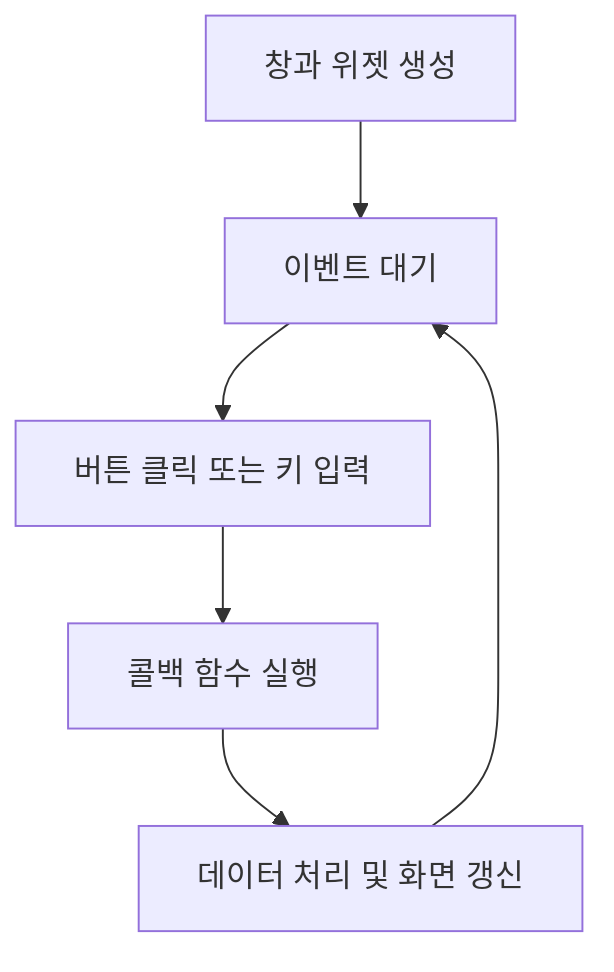

<p align="center"><em>그림 1. 이벤트 기반 GUI 프로그램의 실행 흐름</em></p>

Tkinter의 `mainloop()` 메서드는 사용자 입력과 화면 갱신 등의 이벤트를 지속적으로 처리하는 **이벤트 루프**(**Event Loop**)를 시작합니다. 이벤트가 발생해 콜백 함수가 실행되고 종료되면, 이벤트 루프는 다시 대기 상태로 돌아가 다음 입력을 기다립니다.

> **주의:** 콜백 함수 내부에서 시간이 오래 걸리는 작업을 직접 실행하면, 해당 작업이 끝날 때까지 이벤트 루프가 멈추어 화면이 굳거나(응답 없음) 다른 입력 처리가 지연될 수 있습니다.

### 1.3 Tkinter와 ttk

**Tkinter**는 Tcl/Tk GUI 툴킷을 기반으로 동작하는 Python 표준 라이브러리입니다. 함께 제공되는 `tkinter.ttk` 모듈을 사용하면 현재 사용 중인 운영체제의 테마에 맞춰 더 현대적이고 세련된 외관을 갖춘 위젯들을 사용할 수 있습니다. 표 데이터를 표시하는 `Treeview`나 드롭다운 목록을 만드는 `Combobox` 등이 대표적인 `ttk` 위젯입니다.

Windows용 공식 Python 설치 프로그램에는 일반적으로 Tcl/Tk가 기본으로 포함되어 있습니다. 터미널에서 다음 명령을 실행해 현재 환경에서 Tkinter를 바로 사용할 수 있는지 확인해 보세요.

```bash
python -m tkinter
```

Windows 환경에서 Python 실행 명령어로 `py`를 사용하는 경우에는 `py -m tkinter`를 입력합니다. 실행 후 작은 테스트 창이 화면에 나타나면 Tkinter를 정상적으로 사용할 수 있는 상태입니다.

* 만약 `ModuleNotFoundError`가 발생한다면 사용 중인 Python 환경에 Tcl/Tk 지원 패키지가 설치되어 있는지 확인해야 합니다.
* 화면 출력이 불가능한 원격 서버나 일부 웹 기반 온라인 실행 환경에서는 Tkinter가 설치되어 있더라도 GUI 창을 띄울 수 없습니다.

> 해당 학습자료의 모든 예제는 로컬 데스크톱 환경에서 실행해야 합니다. 실습 파일 이름을 `tkinter.py`로 저장하면 Python 표준 라이브러리 이름과 충돌해 오류가 발생하므로 반드시 다른 파일명을 사용하세요.

### 1.4 예제 실행 방법

VS Code 등의 편집기에서 실습 예제를 저장할 폴더를 열고, 새 Python 파일을 만듭니다. 예를 들어 이어지는 2.1절의 코드를 `window_example.py`로 저장한 뒤 터미널에서 다음 명령으로 실행하세요.

```bash
python window_example.py
```

화면에 프로그램 창이 나타나면 성공적으로 실행된 것입니다. GUI 프로그램은 사용자가 창을 닫기 전까지 이벤트 루프가 계속 동작하므로, 터미널이 실행 중인 상태로 유지되는 것이 정상입니다. 코드를 수정하려면 먼저 실행 중인 창의 닫기(`X`) 버튼을 눌러 프로그램을 종료한 뒤 다시 실행하세요.

> Tkinter로 만든 창과 위젯의 세부적인 모양은 사용 중인 운영체제(Windows, macOS 등), 화면 배율, 시스템 테마 설정에 따라 조금씩 다르게 보일 수 있습니다. 외관의 미세한 차이보다는 위젯이 의도한 위치에 배치되는지와 기능이 정상 동작하는지를 중심으로 확인하세요.

## 2. 기본 위젯 (Widgets)

**위젯**(**Widget**)은 프로그램 창 안에서 사용자 인터페이스를 구성하는 개별 요소입니다. 버튼, 입력창, 레이블 등이 대표적인 위젯에 해당합니다. 이어지는 예제들은 각각 독립된 Python 파일에 저장하여 바로 실행해 볼 수 있습니다.

### 2.1 Window

가장 먼저 프로그램의 바탕이 되는 기본 창을 생성합니다. Tkinter 프로그램은 일반적으로 **모듈 불러오기 → 기본 창 생성 → 위젯 생성 및 배치 → 이벤트 루프 실행** 순서로 구성합니다. 아래 예제에는 아직 위젯을 추가하지 않았으므로 내용이 비어 있는 창만 화면에 나타납니다.

```python
import tkinter as tk

root = tk.Tk()
root.title("My First GUI")
root.geometry("360x200")
root.minsize(280, 160)

root.mainloop()
```

<p align="center">
  <br>
  <em>그림 2. 기본 창 생성 결과 (360 × 200)</em>
</p>

<table align="center" style="margin-left: auto; margin-right: auto;">
<thead>
<tr>
<th align="center" style="text-align: center;">코드</th>
<th align="center" style="text-align: center;">역할</th>
</tr>
</thead>
<tbody>
<tr>
<td align="center" style="text-align: center;"><code>tk.Tk()</code></td>
<td align="center" style="text-align: center;">프로그램의 기본 창 생성</td>
</tr>
<tr>
<td align="center" style="text-align: center;"><code>title()</code></td>
<td align="center" style="text-align: center;">창 상단의 제목 설정</td>
</tr>
<tr>
<td align="center" style="text-align: center;"><code>geometry()</code></td>
<td align="center" style="text-align: center;">초기 창 크기 설정 (<code>"너비x높이"</code>)</td>
</tr>
<tr>
<td align="center" style="text-align: center;"><code>minsize()</code></td>
<td align="center" style="text-align: center;">창을 줄일 수 있는 최소 크기 설정</td>
</tr>
<tr>
<td align="center" style="text-align: center;"><code>mainloop()</code></td>
<td align="center" style="text-align: center;">이벤트 루프 실행 및 사용자 입력 대기</td>
</tr>
</tbody>
</table>

`import tkinter as tk`에서 `tk`는 모듈 이름을 짧게 줄여 부르기 위한 별칭입니다. 별칭을 지정해 두면 이후 `tk.Tk()`처럼 간결하게 코드를 작성할 수 있습니다. `root`는 생성된 기본 창 객체를 가리키는 변수로, 관례적으로 `root`를 많이 사용하지만 원하는 다른 이름을 써도 무방합니다.

`geometry("360x200")`에 전달하는 문자열은 창 내부 작업 영역의 너비와 높이를 픽셀(px) 단위로 지정하며, 운영체제가 그리는 상단 제목 표시줄과 외곽 테두리는 이 크기에 포함되지 않고 별도로 표시됩니다. 코드 마지막에 호출하는 `mainloop()`는 창이 화면에 유지되면서 사용자 입력을 기다리도록 만들며, 사용자가 창을 닫으면 실행이 종료됩니다. 모든 GUI 예제의 맨 마지막에 `mainloop()`를 작성하는 이유가 바로 여기에 있습니다.

> 일반적인 Tkinter 프로그램에서는 `tk.Tk()`를 한 번만 호출해 기본 창을 만듭니다. 만약 프로그램 실행 중 팝업이나 설정 창 같은 별도의 보조 창이 추가로 필요하다면 `tk.Toplevel()`을 사용해야 합니다.

### 2.2 Label과 Button

`Label`은 화면에 텍스트나 이미지를 표시하는 위젯이며, `Button`은 사용자가 클릭하여 지정된 기능을 실행할 수 있도록 돕는 위젯입니다.

```python
import tkinter as tk
from tkinter import ttk


def change_message():
    label.config(text="버튼을 눌렀습니다.")


root = tk.Tk()
root.title("Label & Button")
root.geometry("320x150")

label = ttk.Label(root, text="버튼을 눌러 보세요.")
label.pack(pady=20)

button = ttk.Button(root, text="확인", command=change_message)
button.pack()

root.mainloop()
```

<p align="center">
  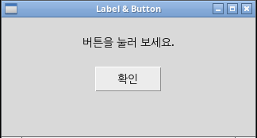
  &nbsp;&nbsp;
  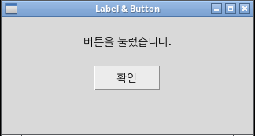
  <br>
  <em>그림 3. 버튼 클릭 전(좌)과 클릭 후(우)</em>
</p>

`ttk.Label(root, ...)`에서 첫 번째 인수로 전달한 `root`는 해당 위젯이 놓일 **부모**(**Parent**) 컨테이너를 의미합니다. 이어서 호출하는 `pack()`은 위젯을 창 안에 실제로 배치하는 메서드이며, `pady` 옵션은 위젯의 위아래 바깥 여백을 픽셀 단위로 지정합니다.

사용자가 버튼을 클릭하면 `command` 옵션에 연결된 콜백 함수가 실행되고, 함수 내부의 `config()` 메서드를 통해 기존 레이블의 텍스트가 새로운 문구로 바뀝니다.

<table align="center" style="margin-left: auto; margin-right: auto;">
<thead>
<tr>
<th align="center" style="text-align: center;">코드</th>
<th align="center" style="text-align: center;">실행 시점과 역할</th>
</tr>
</thead>
<tbody>
<tr>
<td align="center" style="text-align: center;"><code>from tkinter import ttk</code></td>
<td align="center" style="text-align: center;">운영체제 테마를 지원하는 <code>ttk</code> 위젯 모듈 불러오기</td>
</tr>
<tr>
<td align="center" style="text-align: center;"><code>def change_message():</code></td>
<td align="center" style="text-align: center;">버튼 클릭 시 실행할 콜백 함수 정의</td>
</tr>
<tr>
<td align="center" style="text-align: center;"><code>ttk.Label(root, text=...)</code></td>
<td align="center" style="text-align: center;">기본 창(<code>root</code>)을 부모로 하는 레이블 생성</td>
</tr>
<tr>
<td align="center" style="text-align: center;"><code>label.pack(pady=20)</code></td>
<td align="center" style="text-align: center;">레이블을 화면에 배치하고 위아래 여백 지정</td>
</tr>
<tr>
<td align="center" style="text-align: center;"><code>ttk.Button(root, text="확인", command=change_message)</code></td>
<td align="center" style="text-align: center;">버튼의 표시 문구와 클릭 시 실행할 함수 연결</td>
</tr>
<tr>
<td align="center" style="text-align: center;"><code>button.pack()</code></td>
<td align="center" style="text-align: center;">버튼을 화면에 배치</td>
</tr>
<tr>
<td align="center" style="text-align: center;"><code>label.config(text=...)</code></td>
<td align="center" style="text-align: center;">이미 생성된 레이블의 속성(텍스트) 변경</td>
</tr>
</tbody>
</table>

함수를 `def`로 정의하는 시점에는 내부 코드가 바로 실행되지 않으며, 이후 사용자가 실제로 버튼을 클릭할 때는 `label` 객체가 이미 생성되어 있으므로 콜백 함수 안에서 문제없이 제어할 수 있습니다.

> **주의:** `command=change_message()`처럼 함수 이름 뒤에 괄호를 붙이면 버튼을 누르기도 전에 함수가 즉시 호출되어 버립니다. 반드시 괄호 없이 함수 이름(`command=change_message`)만 전달해야 합니다.

또한 위젯 객체를 생성했더라도 `pack()`이나 `grid()` 같은 배치 메서드를 호출하지 않으면 화면에 나타나지 않습니다. 위 예제에서는 추후 `label.config()` 등으로 위젯을 다시 참조해 제어할 수 있도록, 위젯 생성(`label = ...`)과 배치(`label.pack()`)를 별도의 줄로 나누어 작성했습니다.

### 2.3 Entry와 Text

`Entry`는 한 줄짜리 짧은 문자열을 입력받을 때 사용하는 위젯이며, `Text`는 여러 줄의 긴 문자열을 입력하거나 표시할 때 사용하는 위젯입니다.

```python
import tkinter as tk
from tkinter import ttk


def show_input():
    title = entry.get()
    body = text.get("1.0", "end-1c")
    result.config(text=f"{title}: {len(body)}자")


root = tk.Tk()
root.title("문자 수 확인")

entry = ttk.Entry(root, width=30)
entry.pack(padx=12, pady=8)
entry.insert(0, "제목")

text = tk.Text(root, width=30, height=5)
text.pack(padx=12, pady=8)

result = ttk.Label(root, text="")
result.pack(pady=4)

ttk.Button(root, text="문자 수 확인", command=show_input).pack(pady=8)

root.mainloop()
```

<p align="center">
  <br>
  <em>그림 4. 본문에 파이썬 GUI 실습을 입력한 뒤 문자 수 확인</em>
</p>

<table align="center" style="margin-left: auto; margin-right: auto;">
<thead>
<tr>
<th align="center" style="text-align: center;">동작</th>
<th align="center" style="text-align: center;">Entry</th>
<th align="center" style="text-align: center;">Text</th>
</tr>
</thead>
<tbody>
<tr>
<td align="center" style="text-align: center;"><strong>읽기</strong></td>
<td align="center" style="text-align: center;"><code>entry.get()</code></td>
<td align="center" style="text-align: center;"><code>text.get("1.0", "end-1c")</code></td>
</tr>
<tr>
<td align="center" style="text-align: center;"><strong>삽입</strong></td>
<td align="center" style="text-align: center;"><code>entry.insert(0, "내용")</code></td>
<td align="center" style="text-align: center;"><code>text.insert("1.0", "내용")</code></td>
</tr>
<tr>
<td align="center" style="text-align: center;"><strong>전체 삭제</strong></td>
<td align="center" style="text-align: center;"><code>entry.delete(0, "end")</code></td>
<td align="center" style="text-align: center;"><code>text.delete("1.0", "end")</code></td>
</tr>
</tbody>
</table>

위 실행 화면에서는 제목 입력창의 기본 문구(`제목`)를 그대로 둔 채 여러 줄 입력창에 `파이썬 GUI 실습`을 입력하고 버튼을 클릭했습니다. 콜백 함수 안에서 `entry.get()`으로 제목을, `text.get()`으로 본문을 읽어 온 뒤 `len(body)`로 공백을 포함한 전체 글자 수를 계산합니다. 사용자 입력값은 위젯을 처음 생성할 때가 아니라, 버튼을 클릭하는 시점(콜백 함수 내부)에 읽어야 사용자가 새로 작성한 최신 내용이 정확히 반영됩니다.

<p align="center">
  
</p>

> **인덱스 표기 규칙:** 한 줄 입력창인 `Entry`는 문자 위치 **인덱스**(**Index**)가 `0`부터 시작하는 정수를 사용합니다. 반면 여러 줄을 다루는 `Text`는 `"줄번호.칸번호"` 형태의 문자열을 사용하며, `"1.0"`은 첫 번째 줄(`1`)의 첫 번째 문자 위치(`0`)를 뜻합니다. 또한 `Text` 위젯은 내부적으로 텍스트 맨 끝에 줄바꿈 문자(`\n`) 하나를 자동으로 유지하므로, 끝 위치를 `"end-1c"`(마지막에서 한 글자 앞)로 지정해야 불필요한 줄바꿈을 제외하고 순수 입력 내용만 읽어 올 수 있습니다.

### 2.4 Checkbutton과 Radiobutton

`Checkbutton`은 여러 옵션을 각각 독립적으로 선택하거나 해제할 때 사용하며, `Radiobutton`은 주어진 여러 선택지 중 한 번에 하나의 항목만 선택할 수 있도록 구성할 때 사용합니다.

```python
import tkinter as tk
from tkinter import ttk


def show_options():
    result.config(text=f"용지: {size.get()} / 양면: {duplex.get()}")


root = tk.Tk()
root.title("인쇄 옵션")

duplex = tk.BooleanVar(root, value=False)
size = tk.StringVar(root, value="A4")

ttk.Checkbutton(root, text="양면 인쇄", variable=duplex).pack(anchor="w")
ttk.Radiobutton(root, text="A4", variable=size, value="A4").pack(anchor="w")
ttk.Radiobutton(root, text="A3", variable=size, value="A3").pack(anchor="w")

ttk.Button(root, text="선택 확인", command=show_options).pack(pady=8)
result = ttk.Label(root, text="")
result.pack(padx=12, pady=8)

root.mainloop()
```

<p align="center">
  <br>
  <em>그림 5. A3 용지와 양면 인쇄 선택 결과</em>
</p>

위젯의 `variable` 옵션에 제어 변수를 연결해 두면 사용자가 화면에서 옵션을 선택하거나 해제할 때마다 변수에 저장된 값도 자동으로 함께 바뀝니다. 특히 같은 제어 변수(`size`)를 공유하는 여러 `Radiobutton`은 각 버튼마다 서로 다른 `value`를 지정하면 한 번에 하나만 배타적으로 선택되도록 동작합니다. 이때 사용하는 `BooleanVar`와 `StringVar` 같은 제어 변수의 자세한 활용법은 4.3절에서 다룹니다.

### 2.5 Combobox

`ttk.Combobox`는 **드롭다운**(**Dropdown**) 목록에서 원하는 값을 선택할 수 있는 **위젯**(**Widget**)입니다. 옵션을 `state="readonly"`로 설정하면 사용자가 목록에 없는 값을 직접 입력하지 못하도록 제한할 수 있습니다.

```python
import tkinter as tk
from tkinter import ttk


def show_choice():
    result.config(text=f"선택: {subject.get()}")


root = tk.Tk()
root.title("과목 선택")

subject = ttk.Combobox(
    root, values=["수학", "과학", "정보"], state="readonly"
)
subject.current(0)
subject.pack(padx=12, pady=8)

ttk.Button(root, text="확인", command=show_choice).pack()
result = ttk.Label(root, text="")
result.pack(padx=12, pady=8)

root.mainloop()
```

<p align="center">
  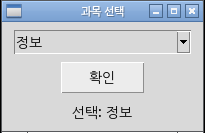<br>
  <em>그림 6. 정보 과목 선택 후 확인.</em>
</p>

`current(0)`을 호출하면 목록의 첫 번째 항목이 기본값으로 선택되며, 현재 선택된 값은 `get()` 메서드로 읽어올 수 있습니다. 또한 `subject["values"]` 값을 수정하면 선택 가능한 목록을 동적으로 갱신할 수 있습니다.

> 목록(`values`)을 동적으로 변경한 뒤에는 기존에 선택되어 있던 값이 새 목록에도 여전히 유효한지 반드시 확인해야 합니다.

### 기본 위젯 정리

지금까지 배운 기본 위젯의 핵심 기능을 표로 정리했습니다. 화면에 표시할 내용이나 사용자의 입력 방식에 맞추어 적절한 위젯을 선택해 보세요.

<table align="center" style="margin-left: auto; margin-right: auto;">
<thead>
<tr>
<th align="center" style="text-align: center;">필요한 기능</th>
<th align="center" style="text-align: center;">사용할 위젯</th>
<th align="center" style="text-align: center;">자주 사용하는 옵션·메서드</th>
</tr>
</thead>
<tbody>
<tr>
<td align="center" style="text-align: center;">안내 또는 결과 표시</td>
<td align="center" style="text-align: center;"><code>ttk.Label</code></td>
<td align="center" style="text-align: center;"><code>text</code>, <code>config()</code></td>
</tr>
<tr>
<td align="center" style="text-align: center;">기능 실행</td>
<td align="center" style="text-align: center;"><code>ttk.Button</code></td>
<td align="center" style="text-align: center;"><code>text</code>, <code>command</code></td>
</tr>
<tr>
<td align="center" style="text-align: center;">한 줄 입력</td>
<td align="center" style="text-align: center;"><code>ttk.Entry</code></td>
<td align="center" style="text-align: center;"><code>width</code>, <code>get()</code>, <code>insert()</code>, <code>delete()</code></td>
</tr>
<tr>
<td align="center" style="text-align: center;">여러 줄 입력</td>
<td align="center" style="text-align: center;"><code>tk.Text</code></td>
<td align="center" style="text-align: center;"><code>width</code>, <code>height</code>, <code>get()</code></td>
</tr>
<tr>
<td align="center" style="text-align: center;">드롭다운 목록에서 항목 선택</td>
<td align="center" style="text-align: center;"><code>ttk.Combobox</code></td>
<td align="center" style="text-align: center;"><code>values</code>, <code>state</code>, <code>current()</code>, <code>get()</code></td>
</tr>
<tr>
<td align="center" style="text-align: center;">여러 선택지 중 하나 선택</td>
<td align="center" style="text-align: center;"><code>ttk.Radiobutton</code></td>
<td align="center" style="text-align: center;"><code>text</code>, <code>variable</code>, <code>value</code></td>
</tr>
<tr>
<td align="center" style="text-align: center;">선택 여부</td>
<td align="center" style="text-align: center;"><code>ttk.Checkbutton</code></td>
<td align="center" style="text-align: center;"><code>text</code>, <code>variable</code></td>
</tr>
</tbody>
</table>

기본 창을 생성하고 `Label`, `Button`, `Entry` 등의 위젯을 배치한 뒤, 클릭 이벤트에 따라 화면의 값이 바뀌는 흐름을 충분히 이해했다면 다음 단원으로 넘어가세요.

## 3. 레이아웃 구성 (Layout)

Tkinter에서는 위젯을 생성하는 과정과 실제 화면에 배치하는 과정이 분리되어 있습니다. `pack()`, `grid()`, `place()`는 위젯의 위치와 크기를 관리하는 **지오메트리 매니저**(**Geometry Manager**)입니다.

### 3.1 Pack

`pack()`은 위젯을 부모 영역의 위, 아래, 왼쪽, 오른쪽 방향을 기준으로 순서대로 쌓아 배치합니다.

```python
import tkinter as tk
from tkinter import ttk

root = tk.Tk()
root.title("Pack")
root.geometry("360x180")

ttk.Label(root, text="공지사항").pack(side="top", pady=8)
ttk.Label(root, text="내용 영역", relief="solid").pack(
    fill="both", expand=True, padx=10, pady=4
)
ttk.Button(root, text="닫기", command=root.destroy).pack(side="bottom", pady=8)

root.mainloop()
```

<p align="center">
  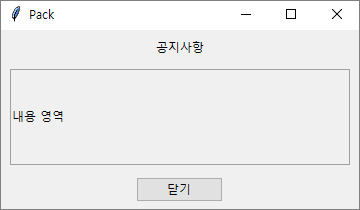<br>
  <em>그림 7. pack()으로 배치한 제목, 내용 영역, 닫기 버튼.</em>
</p>

<table align="center" style="margin-left: auto; margin-right: auto;">
<thead>
<tr>
<th align="center" style="text-align: center;">옵션</th>
<th align="center" style="text-align: center;">설명</th>
</tr>
</thead>
<tbody>
<tr>
<td align="center" style="text-align: center;"><code>side</code></td>
<td align="center" style="text-align: center;">배치할 방향 (<code>top</code>, <code>bottom</code>, <code>left</code>, <code>right</code>)</td>
</tr>
<tr>
<td align="center" style="text-align: center;"><code>fill</code></td>
<td align="center" style="text-align: center;">할당된 영역을 채우는 방향 (<code>x</code>, <code>y</code>, <code>both</code>)</td>
</tr>
<tr>
<td align="center" style="text-align: center;"><code>expand</code></td>
<td align="center" style="text-align: center;">남은 공간을 위젯의 배치 영역에 할당할지 여부</td>
</tr>
<tr>
<td align="center" style="text-align: center;"><code>padx</code>, <code>pady</code></td>
<td align="center" style="text-align: center;">위젯 바깥의 가로·세로 여백</td>
</tr>
</tbody>
</table>

`expand=True` 옵션은 창 내부의 여유 공간을 해당 위젯의 배치 영역으로 할당하며, `fill="both"` 옵션은 위젯 자체가 할당된 영역을 가로와 세로 방향으로 가득 채우도록 만듭니다.

### 3.2 Grid

`grid()`는 화면을 **행**(**Row**)과 **열**(**Column**)로 이루어진 격자 형태로 나누어 위젯을 배치합니다. 회원가입이나 설문지와 같은 입력 폼의 여러 요소를 깔끔하게 정렬할 때 매우 적합합니다.

다음 예제의 배치 구조는 아래 표와 같으며, 행과 열의 번호는 모두 `0`부터 시작합니다.

<table align="center" style="margin-left: auto; margin-right: auto;">
<thead>
<tr>
<th align="center" style="text-align: center;">행</th>
<th align="center" style="text-align: center;">열 0</th>
<th align="center" style="text-align: center;">열 1</th>
</tr>
</thead>
<tbody>
<tr>
<td align="center" style="text-align: center;">0</td>
<td align="center" style="text-align: center;">이름 Label</td>
<td align="center" style="text-align: center;">이름 Entry</td>
</tr>
<tr>
<td align="center" style="text-align: center;">1</td>
<td align="center" style="text-align: center;">학번 Label</td>
<td align="center" style="text-align: center;">학번 Entry</td>
</tr>
<tr>
<td align="center" style="text-align: center;">2</td>
<td align="center" style="text-align: center;">초기화 Button (두 열에 걸쳐 배치)</td>
<td align="center" style="text-align: center;"></td>
</tr>
</tbody>
</table>

```python
import tkinter as tk
from tkinter import ttk

root = tk.Tk()
root.title("Grid")
root.geometry("360x160")


def clear_inputs():
    name.delete(0, "end")
    student_id.delete(0, "end")

ttk.Label(root, text="이름").grid(row=0, column=0, padx=10, pady=8, sticky="w")
name = ttk.Entry(root)
name.grid(row=0, column=1, padx=10, pady=8, sticky="ew")

ttk.Label(root, text="학번").grid(row=1, column=0, padx=10, pady=8, sticky="w")
student_id = ttk.Entry(root)
student_id.grid(row=1, column=1, padx=10, pady=8, sticky="ew")

ttk.Button(root, text="초기화", command=clear_inputs).grid(
    row=2, column=0, columnspan=2, pady=8
)

root.columnconfigure(1, weight=1)
root.mainloop()
```

<p align="center">
  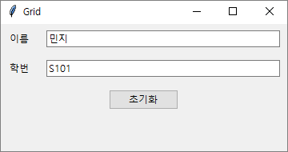<br>
  <em>그림 8. grid()로 배치한 이름과 학번 입력 폼.</em>
</p>

<table align="center" style="margin-left: auto; margin-right: auto;">
<thead>
<tr>
<th align="center" style="text-align: center;">옵션</th>
<th align="center" style="text-align: center;">설명</th>
</tr>
</thead>
<tbody>
<tr>
<td align="center" style="text-align: center;"><code>row</code>, <code>column</code></td>
<td align="center" style="text-align: center;">행과 열 번호 (0부터 시작)</td>
</tr>
<tr>
<td align="center" style="text-align: center;"><code>rowspan</code>, <code>columnspan</code></td>
<td align="center" style="text-align: center;">차지할 행·열의 개수</td>
</tr>
<tr>
<td align="center" style="text-align: center;"><code>sticky</code></td>
<td align="center" style="text-align: center;">셀 내부의 정렬 및 확장 방향 (<code>n</code>, <code>s</code>, <code>e</code>, <code>w</code>)</td>
</tr>
<tr>
<td align="center" style="text-align: center;"><code>padx</code>, <code>pady</code></td>
<td align="center" style="text-align: center;">위젯 바깥의 여백</td>
</tr>
</tbody>
</table>

`columnconfigure(1, weight=1)`을 설정하면 창의 너비가 늘어날 때 두 번째 열(열 1)이 여유 공간을 비율에 맞게 차지합니다. 여기에 `sticky="ew"` 옵션을 함께 지정하면 입력창이 해당 셀의 좌우(동·서 방향) 너비를 가득 채우도록 확장됩니다. 실행 후 **초기화** 버튼을 클릭하면 `clear_inputs()` 함수가 호출되어 두 입력창의 내용이 모두 지워집니다.

### 3.3 Place

`place()`는 부모 영역을 기준으로 직접 좌표를 지정해 위젯을 배치하는 방식입니다.

```python
import tkinter as tk
from tkinter import ttk

root = tk.Tk()
root.title("Place")
root.geometry("320x180")

ttk.Label(root, text="고정 위치").place(x=12, y=12)
ttk.Label(root, text="중앙").place(relx=0.5, rely=0.5, anchor="center")

root.mainloop()
```

<p align="center">
  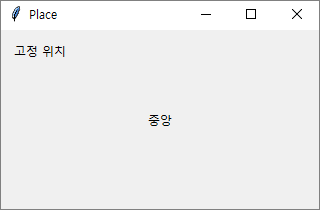<br>
  <em>그림 9. place()의 절대 위치와 상대 위치.</em>
</p>

`x`, `y`는 픽셀 단위의 절대 위치이며, `relx`, `rely`는 부모 영역의 크기를 `0.0`에서 `1.0` 사이의 비율로 계산한 상대 위치입니다. 여기에 `anchor="center"` 옵션을 지정하면 위젯의 정중앙을 해당 좌표에 맞추어 배치합니다.

> 고정 좌표(`x`, `y`)만 사용하면 창 크기나 운영체제별 글꼴 설정이 달라졌을 때 위젯이 서로 겹치거나 화면 밖으로 잘릴 수 있습니다. 따라서 일반적인 입력 폼이나 목록 화면은 `pack()`이나 `grid()`로 구성하는 것이 훨씬 관리하기 쉽습니다.

### 3.4 Frame

`Frame`은 여러 위젯을 하나의 그룹으로 묶어 주는 **컨테이너**(**Container**) 위젯입니다. 화면을 입력 영역, 결과 영역, 버튼 영역 등으로 논리적으로 나누어 깔끔하게 구성할 수 있습니다.

```python
import tkinter as tk
from tkinter import ttk

root = tk.Tk()
root.title("Frame")
root.geometry("360x200")

form = ttk.Frame(root, padding=10)
form.pack(fill="x")

ttk.Label(form, text="이름").grid(row=0, column=0, padx=(0, 8))
ttk.Entry(form).grid(row=0, column=1, sticky="ew")
form.columnconfigure(1, weight=1)

footer = ttk.Frame(root, padding=10)
footer.pack(side="bottom", fill="x")
ttk.Button(footer, text="닫기", command=root.destroy).pack(side="right")

root.mainloop()
```

<p align="center">
  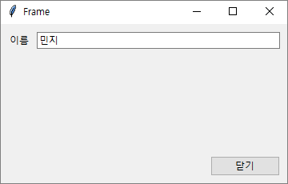<br>
  <em>그림 10. Frame으로 나눈 입력 영역과 버튼 영역.</em>
</p>

> **주의:** **같은 부모 위젯 안에서는 `pack()`과 `grid()`를 절대 혼용하지 않습니다.** 위 예제에서는 부모 창인 `root`의 직접적인 자식(`form`, `footer`)은 모두 `pack()`으로 배치했습니다. 그리고 `form` 내부에서는 `grid()`만 사용하고, `footer` 내부에서는 `pack()`만 사용했기 때문에 레이아웃 충돌이 발생하지 않습니다.

생성한 위젯 객체를 이후 코드에서 다시 참조하여 값을 읽거나 수정하려면, 위젯 생성과 배치 코드를 반드시 두 문장으로 나누어 작성해야 합니다. 만약 `entry = ttk.Entry(root).pack()`처럼 한 줄로 이어서 작성하면, `entry` 변수에는 위젯 객체가 아니라 `pack()` 메서드의 반환값인 `None`이 저장되므로 주의하세요.

## 4. 이벤트와 데이터 처리

### 4.1 Command와 Callback

버튼의 `command` 옵션에는 함수의 실행 결과가 아니라, 버튼을 클릭했을 때 호출할 함수 자체(**콜백**(**Callback**))를 전달합니다.

```python
import tkinter as tk
from tkinter import ttk


def greet(name):
    result.config(text=f"안녕하세요, {name}!")


root = tk.Tk()
root.title("Callback")
result = ttk.Label(root, text="")
result.pack(padx=12, pady=8)

ttk.Button(root, text="인사", command=lambda: greet("민지")).pack(pady=8)
root.mainloop()
```

<p align="center">
  <br>
  <em>그림 11. 인사 버튼 클릭 후 레이블 변경.</em>
</p>

<table align="center" style="margin-left: auto; margin-right: auto;">
<thead>
<tr>
<th align="center" style="text-align: center;">작성 방법</th>
<th align="center" style="text-align: center;">동작</th>
</tr>
</thead>
<tbody>
<tr>
<td align="center" style="text-align: center;"><code>command=show_result</code></td>
<td align="center" style="text-align: center;">클릭 시 <code>show_result()</code> 호출</td>
</tr>
<tr>
<td align="center" style="text-align: center;"><code>command=show_result()</code></td>
<td align="center" style="text-align: center;">버튼을 생성하는 시점에 함수를 즉시 호출하고 반환값을 전달</td>
</tr>
<tr>
<td align="center" style="text-align: center;"><code>command=lambda: greet("민지")</code></td>
<td align="center" style="text-align: center;">클릭 시 지정한 인수를 전달하여 함수 호출</td>
</tr>
</tbody>
</table>

`command=show_result`와 같이 함수 이름만 전달하는 방식은 인수 없이 호출할 수 있는 함수에 사용합니다. 반면 `greet("민지")`처럼 인수를 전달해야 하는 경우에는 **람다**(**Lambda**) 표현식이나 별도의 보조 함수를 활용합니다. `lambda: greet("민지")`는 인수 없이 호출할 수 있는 이름 없는 함수를 생성하며, 버튼을 클릭해 이 함수가 호출될 때 비로소 내부의 `greet("민지")`가 실행됩니다.

> **주의:** `command=show_result()`처럼 함수 이름 뒤에 괄호 `()`를 붙이면 버튼을 클릭할 때가 아니라 버튼을 생성하는 순간에 함수가 즉시 실행되므로 주의하세요.

### 4.2 이벤트 바인딩 (bind)

`bind()` 메서드를 사용하면 단순한 버튼 클릭뿐만 아니라 키보드 입력, 마우스 동작, 위젯 상태 변화 등 다양한 **이벤트**(**Event**)에 원하는 함수를 연결할 수 있습니다.

```python
import tkinter as tk
from tkinter import ttk


def show_message(event):
    result.config(text=f"입력: {entry.get()}")


root = tk.Tk()
root.title("Event Binding")
entry = ttk.Entry(root, width=30)
entry.pack(padx=12, pady=8)
entry.bind("<Return>", show_message)
entry.focus_set()

result = ttk.Label(root, text="Enter 키를 눌러 보세요.")
result.pack(padx=12, pady=8)

root.mainloop()
```

<p align="center">
  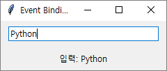<br>
  <em>그림 12. Python 입력 후 Enter 키를 누른 결과.</em>
</p>

`bind()`로 연결한 함수가 호출될 때는 발생한 이벤트 정보를 담은 **이벤트 객체**(**Event Object**)가 첫 번째 인수로 자동 전달됩니다. 함수 내부에서 이 이벤트 객체를 활용하면 눌린 키의 종류, 마우스 좌표, 이벤트가 발생한 대상 위젯 등의 세부 정보를 확인할 수 있습니다.

<table align="center" style="margin-left: auto; margin-right: auto;">
<thead>
<tr>
<th align="center" style="text-align: center;">이벤트</th>
<th align="center" style="text-align: center;">발생 조건</th>
</tr>
</thead>
<tbody>
<tr>
<td align="center" style="text-align: center;"><code>&lt;Return&gt;</code></td>
<td align="center" style="text-align: center;">Enter 키 입력</td>
</tr>
<tr>
<td align="center" style="text-align: center;"><code>&lt;KeyRelease&gt;</code></td>
<td align="center" style="text-align: center;">키를 놓았을 때</td>
</tr>
<tr>
<td align="center" style="text-align: center;"><code>&lt;Button-1&gt;</code></td>
<td align="center" style="text-align: center;">마우스 왼쪽 버튼 누름</td>
</tr>
<tr>
<td align="center" style="text-align: center;"><code>&lt;Double-Button-1&gt;</code></td>
<td align="center" style="text-align: center;">마우스 왼쪽 버튼 더블클릭</td>
</tr>
<tr>
<td align="center" style="text-align: center;"><code>&lt;&lt;ComboboxSelected&gt;&gt;</code></td>
<td align="center" style="text-align: center;">사용자가 Combobox 항목 선택</td>
</tr>
<tr>
<td align="center" style="text-align: center;"><code>&lt;&lt;TreeviewSelect&gt;&gt;</code></td>
<td align="center" style="text-align: center;">Treeview 선택 항목 변경</td>
</tr>
</tbody>
</table>

> 버튼 클릭(`command`)과 키보드 입력(`bind()`)에서 동일한 함수를 함께 호출해야 한다면, `def show_message(event=None):`처럼 매개변수에 기본값 `None`을 지정하거나 이벤트 처리 함수 내부에서 공통 기능 함수를 호출하도록 구성하면 편리합니다.

### 4.3 Tkinter 변수

`StringVar`, `IntVar`, `DoubleVar`, `BooleanVar`는 위젯과 데이터를 실시간으로 연결하기 위한 **제어 변수**(**Control Variable**) 클래스입니다. 일반 Python 변수와 달리 위젯의 `textvariable` 또는 `variable` 옵션에 연결해 두면, 변수 값이 바뀔 때 연결된 위젯의 화면 표시도 자동으로 동기화됩니다.

```python
import tkinter as tk
from tkinter import ttk

root = tk.Tk()
root.title("StringVar")

message = tk.StringVar(root, value="안녕하세요")
ttk.Entry(root, textvariable=message).pack(padx=12, pady=8)
ttk.Label(root, textvariable=message).pack(padx=12, pady=8)
ttk.Button(root, text="초기화", command=lambda: message.set("")).pack(pady=8)

root.mainloop()
```

<p align="center">
  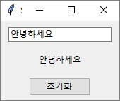
  &nbsp;&nbsp;
  
  <br>
  <em>그림 13. StringVar의 초기값(좌)과 입력창 변경 후 레이블에 반영된 값(우).</em>
</p>

위 코드에서는 입력창(`Entry`)과 레이블(`Label`)이 동일한 `StringVar` 객체를 참조하므로, 입력창에 글자를 입력하면 레이블의 텍스트도 즉시 함께 갱신됩니다. Tkinter 변수의 값을 읽거나 수정할 때는 일반 대입 연산자 대신 반드시 `get()`과 `set()` 메서드를 사용합니다.

> 숫자를 입력받는 `Entry` 위젯에서도 `IntVar`나 `DoubleVar` 대신 `StringVar`를 연결하는 편이 안전합니다. 입력값을 문자열로 먼저 받아온 뒤 `int()`나 `float()`로 변환하면, 사용자가 입력창을 비워 두거나 문자를 잘못 입력했을 때 발생하는 예외를 직접 검사하고 처리할 수 있기 때문입니다.

### 4.4 데이터 처리 함수와 GUI 분리

프로그램의 유지보수성을 높이려면 입력창에서 읽어온 값을 순수한 데이터 처리 함수에 전달하고, 반환된 결과만 받아 화면에 표시하는 구조로 작성하는 것이 좋습니다. 예를 들어 금액을 계산하는 함수는 Tkinter 위젯을 직접 참조하지 않아도 독립적으로 동작할 수 있습니다.

```python
import tkinter as tk
from tkinter import ttk, messagebox


def calculate_total(price, quantity):
    return price * quantity


def show_total():
    try:
        price = int(price_entry.get())
        quantity = int(quantity_entry.get())
    except ValueError:
        result.config(text="합계: —")
        messagebox.showerror("입력 오류", "가격과 수량은 정수로 입력하세요.", parent=root)
        return

    if price < 0 or quantity < 1:
        result.config(text="합계: —")
        messagebox.showerror("입력 오류", "가격은 0 이상, 수량은 1 이상이어야 합니다.", parent=root)
        return

    total = calculate_total(price, quantity)
    result.config(text=f"합계: {total:,}원")


root = tk.Tk()
root.title("금액 계산")

ttk.Label(root, text="가격").pack()
price_entry = ttk.Entry(root)
price_entry.pack(padx=12, pady=4)

ttk.Label(root, text="수량").pack()
quantity_entry = ttk.Entry(root)
quantity_entry.pack(padx=12, pady=4)

ttk.Button(root, text="계산", command=show_total).pack(pady=8)
result = ttk.Label(root, text="합계: —")
result.pack(pady=8)

root.mainloop()
```

<p align="center">
  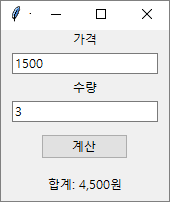<br>
  <em>그림 14. 가격 1500원, 수량 3개 입력 후 계산 결과.</em>
</p>

위 예제에서 `show_total()` 함수는 GUI 입력창의 값을 읽어와 **유효성 검사**(**Validation**)를 수행하고 결과를 화면에 표시하는 역할을 맡습니다. 반면 `calculate_total()` 함수는 오직 금액 계산 로직만 담당하므로, 코드 수정 없이 터미널 기반 프로그램이나 다른 GUI 환경에서도 그대로 재사용할 수 있습니다.

> **주의:** 계산 결과는 모든 입력값의 유효성 검사를 통과한 뒤에만 화면에 표시해야 합니다. 만약 입력 오류가 발생했다면 이전 계산 결과를 기본값(`합계: —`)으로 초기화하여, 사용자가 과거 결과를 현재 입력의 계산 결과로 오인하지 않도록 처리하세요.

#### 콜백에서 변수 읽기와 변경

`main()` 함수 내부에 콜백 함수를 중첩하여 정의하면, 콜백 함수는 바깥 함수(`main()`)에 선언된 변수를 자유롭게 읽을 수 있습니다. 다만 바깥 함수의 변수에 새로운 값을 대입하여 수정하려면 반드시 `nonlocal` 키워드를 선언해야 합니다. 만약 `nonlocal`을 지정하지 않고 값을 대입하면, 파이썬은 이를 바깥 변수가 아닌 콜백 내부의 새로운 **지역 변수**(**Local Variable**)로 취급하므로 주의해야 합니다.

```python
import tkinter as tk
from tkinter import ttk


def main():
    root = tk.Tk()
    root.title("클릭 횟수")
    count = 0
    result = ttk.Label(root, text="0회")
    result.pack(padx=12, pady=8)

    def increase():
        nonlocal count
        count += 1
        result.config(text=f"{count}회")

    ttk.Button(root, text="증가", command=increase).pack(pady=8)
    root.mainloop()


if __name__ == "__main__":
    main()
```

<p align="center">
  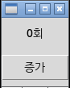
  &nbsp;&nbsp;
  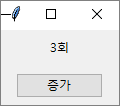
  <br>
  <em>그림 15. 초기 클릭 횟수(좌)와 증가 버튼을 세 번 누른 결과(우).</em>
</p>

위 예제에서는 **증가** 버튼을 누를 때마다 `nonlocal`로 연결된 `count` 변수의 값이 1씩 증가하며 레이블에 반영됩니다.

> 바깥 함수에 정의된 리스트에 `append()` 메서드로 요소를 추가하거나 딕셔너리의 특정 키 값을 수정하는 작업은 변수 자체에 새로운 객체를 재할당(대입)하는 것이 아니므로 `nonlocal` 선언이 필요하지 않습니다.

## 5. 주요 응용 위젯

### 5.1 Listbox

`Listbox`는 여러 개의 문자열 항목을 세로 목록 형태로 나열해 보여 줄 때 사용하는 위젯입니다. 사용자가 선택한 항목의 **인덱스**(**Index**) 위치를 확인하거나, 코드에서 동적으로 항목을 추가 및 삭제할 수 있습니다.

```python
import tkinter as tk
from tkinter import ttk


def show_selection():
    selected = subjects.curselection()
    if not selected:
        result.config(text="과목을 선택하세요.")
        return
    result.config(text=f"선택: {subjects.get(selected[0])}")


root = tk.Tk()
root.title("Listbox")
subjects = tk.Listbox(root, height=4, selectmode="browse")
subjects.pack(padx=12, pady=8)

for subject in ["수학", "과학", "정보"]:
    subjects.insert("end", subject)

ttk.Button(root, text="선택 확인", command=show_selection).pack()
result = ttk.Label(root, text="")
result.pack(padx=12, pady=8)

root.mainloop()
```

<p align="center">
  <br>
  <em>그림 16. Listbox에서 정보 과목을 선택한 결과.</em>
</p>

`curselection()` 메서드는 현재 선택된 항목들의 인덱스를 **튜플**(**Tuple**) 형태로 반환합니다. 만약 아무 항목도 선택되지 않은 상태라면 빈 튜플 `()`을 반환하므로, `selected[0]`처럼 인덱스에 직접 접근하기 전에 반드시 `if not selected:`와 같은 조건문으로 선택 여부를 먼저 확인해야 합니다.

### 5.2 Treeview

`ttk.Treeview`는 계층적인 트리 구조나 여러 열로 이루어진 표 데이터를 깔끔하게 표시할 때 사용하는 위젯입니다. 생성 시 `show="headings"` 옵션을 지정하면 기본으로 제공되는 트리 열(`#0`)을 숨기고 일반 표 형태로만 화면에 표시합니다.

다음 예제에서는 시간대별 측정 기록을 표에 표시하고, 목록을 위아래로 탐색할 수 있도록 세로 스크롤바를 함께 연결합니다. 스크롤바의 구체적인 연결 원리는 이어지는 5.3절에서 자세히 설명합니다.

```python
import tkinter as tk
from tkinter import ttk

root = tk.Tk()
root.title("측정 기록")
root.geometry("360x200")

frame = ttk.Frame(root, padding=10)
frame.pack(fill="both", expand=True)

tree = ttk.Treeview(frame, columns=("time", "temperature"), show="headings", height=5)
tree.heading("time", text="측정 시각")
tree.heading("temperature", text="온도 (℃)")
tree.column("time", width=140, anchor="center")
tree.column("temperature", width=120, anchor="e")

scrollbar = ttk.Scrollbar(frame, orient="vertical", command=tree.yview)
tree.configure(yscrollcommand=scrollbar.set)

tree.pack(side="left", fill="both", expand=True)
scrollbar.pack(side="right", fill="y")

for hour in range(9, 19):
    tree.insert("", "end", values=(f"{hour:02d}:00", 20 + hour % 5))

root.mainloop()
```

<p align="center">
  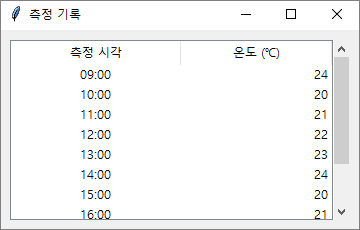<br>
  <em>그림 17. Treeview와 세로 스크롤바.</em>
</p>

<table align="center" style="margin-left: auto; margin-right: auto;">
<thead>
<tr>
<th align="center" style="text-align: center;">메서드</th>
<th align="center" style="text-align: center;">역할</th>
</tr>
</thead>
<tbody>
<tr>
<td align="center" style="text-align: center;"><code>heading(column, text=...)</code></td>
<td align="center" style="text-align: center;">열 제목 지정</td>
</tr>
<tr>
<td align="center" style="text-align: center;"><code>column(column, width=..., anchor=...)</code></td>
<td align="center" style="text-align: center;">열의 너비와 정렬 지정</td>
</tr>
<tr>
<td align="center" style="text-align: center;"><code>insert("", "end", values=...)</code></td>
<td align="center" style="text-align: center;">최상위 목록의 끝에 행 삽입</td>
</tr>
<tr>
<td align="center" style="text-align: center;"><code>selection()</code></td>
<td align="center" style="text-align: center;">선택된 행의 ID를 튜플로 반환</td>
</tr>
<tr>
<td align="center" style="text-align: center;"><code>item(row_id, "values")</code></td>
<td align="center" style="text-align: center;">해당 행의 표시값 조회</td>
</tr>
<tr>
<td align="center" style="text-align: center;"><code>get_children()</code></td>
<td align="center" style="text-align: center;">최상위 행 ID 목록 조회</td>
</tr>
<tr>
<td align="center" style="text-align: center;"><code>delete(row_id)</code></td>
<td align="center" style="text-align: center;">해당 행 삭제</td>
</tr>
</tbody>
</table>

`Treeview`가 내부적으로 각 행을 식별하기 위해 부여하는 **행 ID**(**Row ID**)와 실제 화면에 표시되는 값(`values`)은 서로 다릅니다. 또한 사용자가 아무 행도 선택하지 않았을 때 `selection()`이 빈 튜플을 반환하는 경우도 예외 없이 처리해야 합니다.

> `Treeview`는 어디까지나 데이터를 화면에 보여 주는 표시용 위젯입니다. 따라서 원본 데이터는 리스트나 딕셔너리 같은 별도의 Python **자료구조**(**Data Structure**)로 관리하는 것이 좋습니다. 위젯에서 화면 표시값을 다시 읽어올 때는 문자열 등으로 변환되어 있을 수 있으므로, 처음 삽입한 숫자 자료형이 그대로 유지된다고 가정하지 않도록 주의하세요.

### 5.3 Scrollbar

`Scrollbar`는 위젯의 표시 영역을 벗어나는 긴 목록이나 텍스트를 위아래 또는 좌우로 스크롤할 때 사용합니다. 5.2절의 실행 화면 오른쪽에는 세로 스크롤바가 배치되어 있어, 스크롤바를 아래로 드래그하면 처음 화면에 보이지 않던 측정 기록도 모두 조회할 수 있습니다.

5.2절의 예제에서는 스크롤바와 `Treeview`의 상태를 양방향으로 동기화하여 연결했습니다. 스크롤바의 `command=tree.yview` 옵션은 사용자가 스크롤바를 움직일 때 그 이동 비율을 표의 세로 화면에 반영하며, 반대로 `Treeview`의 `yscrollcommand=scrollbar.set` 옵션은 표 내부가 스크롤될 때 현재 표시 위치를 스크롤바 막대 크기에 반영합니다. 두 위젯이 서로 자연스럽게 연동되도록 이 두 설정을 항상 함께 작성해야 합니다.

### 5.4 Messagebox

`messagebox`는 사용자에게 안내, 경고, 오류 메시지를 알리거나 간단한 선택을 확인받을 때 사용하는 **대화상자**(**Dialog**) 모듈입니다.

```python
import tkinter as tk
from tkinter import ttk, messagebox


def confirm_reset():
    if messagebox.askyesno("확인", "화면을 초기화할까요?", parent=root):
        result.config(text="초기화되었습니다.")


root = tk.Tk()
root.title("Messagebox")
result = ttk.Label(root, text="작업 결과")
result.pack(padx=12, pady=8)
ttk.Button(root, text="초기화", command=confirm_reset).pack(pady=8)
root.mainloop()
```

<p align="center">
  
  &nbsp;&nbsp;
  
  <br>
  <em>그림 18. Messagebox 예제의 기본 창(좌)과 초기화 확인 대화상자(우).</em>
</p>

<table align="center" style="margin-left: auto; margin-right: auto;">
<thead>
<tr>
<th align="center" style="text-align: center;">함수</th>
<th align="center" style="text-align: center;">역할</th>
</tr>
</thead>
<tbody>
<tr>
<td align="center" style="text-align: center;"><code>showinfo()</code></td>
<td align="center" style="text-align: center;">일반 안내</td>
</tr>
<tr>
<td align="center" style="text-align: center;"><code>showwarning()</code></td>
<td align="center" style="text-align: center;">경고 안내</td>
</tr>
<tr>
<td align="center" style="text-align: center;"><code>showerror()</code></td>
<td align="center" style="text-align: center;">오류 안내</td>
</tr>
<tr>
<td align="center" style="text-align: center;"><code>askyesno()</code></td>
<td align="center" style="text-align: center;">예/아니요 선택 (<code>True</code> 또는 <code>False</code> 반환)</td>
</tr>
</tbody>
</table>

함수를 호출할 때 `parent` 옵션을 지정하면 대화상자가 속할 부모 창을 명확하게 설정할 수 있으며, 대화상자가 해당 부모 창보다 앞에 표시되도록 관리할 수 있습니다.

### 5.5 Filedialog

`filedialog`는 운영체제 기본의 파일 또는 폴더 선택 대화상자를 띄워 주는 모듈입니다. 사용자가 선택한 대상의 **경로**(**Path**)를 문자열로 반환해 줄 뿐, 실제 파일을 열거나 데이터를 처리하는 작업은 자동으로 수행하지 않습니다.

```python
import tkinter as tk
from tkinter import ttk, filedialog


def choose_file():
    path = filedialog.askopenfilename(
        parent=root, title="데이터 파일 선택",
        filetypes=[("CSV 파일", "*.csv"), ("모든 파일", "*")]
    )
    if path:
        result.set(path)


root = tk.Tk()
root.title("Filedialog")
result = tk.StringVar(root, value="")
ttk.Button(root, text="파일 선택", command=choose_file).pack(pady=8)
ttk.Entry(root, textvariable=result, state="readonly", width=45).pack(padx=12, pady=8)
root.mainloop()
```

<p align="center">
  <br>
  <em>그림 19. 파일 선택 예제의 기본 창.</em>
</p>

<p align="center">
  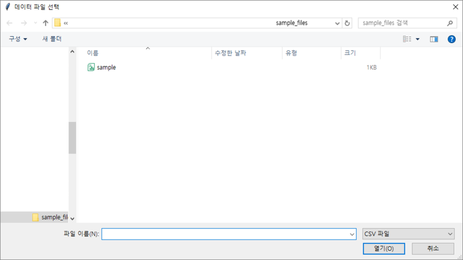<br>
  <em>그림 20. 파일 선택 버튼을 눌렀을 때의 대화상자.</em>
</p>

<table align="center" style="margin-left: auto; margin-right: auto;">
<thead>
<tr>
<th align="center" style="text-align: center;">함수</th>
<th align="center" style="text-align: center;">선택 대상</th>
</tr>
</thead>
<tbody>
<tr>
<td align="center" style="text-align: center;"><code>askopenfilename()</code></td>
<td align="center" style="text-align: center;">열 파일</td>
</tr>
<tr>
<td align="center" style="text-align: center;"><code>asksaveasfilename()</code></td>
<td align="center" style="text-align: center;">저장할 파일 경로</td>
</tr>
<tr>
<td align="center" style="text-align: center;"><code>askdirectory()</code></td>
<td align="center" style="text-align: center;">폴더</td>
</tr>
</tbody>
</table>

위 세 함수는 사용자가 대화상자에서 선택을 취소하고 닫으면 빈 문자열(`""`)을 반환합니다. 따라서 `if path:`와 같은 조건문으로 선택 취소 여부를 먼저 확인한 뒤에 `Path` 객체로 변환하거나 파일 처리를 진행해야 합니다. 만약 빈 문자열을 그대로 `Path("")`로 변환하면 현재 작업 디렉터리를 가리키게 되어 의도치 않은 동작이 발생할 수 있습니다.

반환된 경로를 이용해 실제 파일을 읽고 저장하는 코드는 별도로 작성해야 하며, 구체적인 파일 입출력과 예외 처리 방법은 `Automation_Programs.md`를 참고하세요.

> `filetypes` 옵션은 대화상자 화면에 표시할 파일 확장자를 걸러 주는 시각적 필터일 뿐입니다. 사용자가 선택한 파일의 내부 데이터 형식이 실제로 올바른지까지 보장해 주지는 않으므로, 파일을 읽을 때 별도의 형식 검증을 수행해야 합니다.

## 6. Example — GUI 기반 성적 조회 프로그램

### 6.1 요구사항 및 처리 절차

이번 절에서는 학생들의 학번과 과목별 점수를 표 형태로 화면에 보여 주고, 특정 학생을 선택했을 때 평균 점수를 계산해 확인하는 프로그램을 만들어 보겠습니다. 이번 예제에서는 원본 성적 데이터를 Python의 **리스트**(**List**)와 **튜플**(**Tuple**) 자료구조로 관리합니다.

<table align="center" style="margin-left: auto; margin-right: auto;">
<thead>
<tr>
<th align="center" style="text-align: center;">기능</th>
<th align="center" style="text-align: center;">요구사항</th>
</tr>
</thead>
<tbody>
<tr>
<td align="center" style="text-align: center;">성적 목록</td>
<td align="center" style="text-align: center;">학번, 이름, 수학 점수, 정보 점수 표시</td>
</tr>
<tr>
<td align="center" style="text-align: center;">학생 선택</td>
<td align="center" style="text-align: center;">표에서 한 명 선택</td>
</tr>
<tr>
<td align="center" style="text-align: center;">평균 계산</td>
<td align="center" style="text-align: center;">선택한 학생의 두 과목 점수의 산술 평균 계산</td>
</tr>
<tr>
<td align="center" style="text-align: center;">결과 표시</td>
<td align="center" style="text-align: center;">학생의 이름과 평균을 소수점 첫째 자리까지 표시</td>
</tr>
<tr>
<td align="center" style="text-align: center;">선택 해제</td>
<td align="center" style="text-align: center;">선택 상태와 결과 표시 초기화</td>
</tr>
<tr>
<td align="center" style="text-align: center;">예외 상황</td>
<td align="center" style="text-align: center;">학생을 선택하지 않고 조회하면 안내</td>
</tr>
</tbody>
</table>

프로그램을 실행하면 화면의 표에 전체 성적 목록이 먼저 표시됩니다. 사용자가 목록에서 학생 한 명을 클릭한 뒤 조회 버튼을 누르면, 선택된 행의 **ID**를 기준으로 원본 데이터에서 해당 학생 정보를 찾아옵니다. 이후 별도로 분리해 둔 계산 함수에서 두 과목의 평균 점수를 구하고, 그 결과를 하단 레이블에 깔끔하게 표시합니다.

### 6.2 입력 데이터

예제에서 사용할 샘플 성적 데이터는 다음과 같습니다.

<table align="center" style="margin-left: auto; margin-right: auto;">
<thead>
<tr>
<th align="center" style="text-align: center;">학번</th>
<th align="center" style="text-align: center;">이름</th>
<th align="center" style="text-align: center;">수학</th>
<th align="center" style="text-align: center;">정보</th>
</tr>
</thead>
<tbody>
<tr>
<td align="center" style="text-align: center;">S101</td>
<td align="center" style="text-align: center;">민지</td>
<td align="center" style="text-align: center;">90</td>
<td align="center" style="text-align: center;">85</td>
</tr>
<tr>
<td align="center" style="text-align: center;">S102</td>
<td align="center" style="text-align: center;">지우</td>
<td align="center" style="text-align: center;">75</td>
<td align="center" style="text-align: center;">95</td>
</tr>
<tr>
<td align="center" style="text-align: center;">S103</td>
<td align="center" style="text-align: center;">하나</td>
<td align="center" style="text-align: center;">88</td>
<td align="center" style="text-align: center;">92</td>
</tr>
<tr>
<td align="center" style="text-align: center;">S104</td>
<td align="center" style="text-align: center;">서준</td>
<td align="center" style="text-align: center;">80</td>
<td align="center" style="text-align: center;">77</td>
</tr>
</tbody>
</table>

> 각 학생의 학번은 서로 중복되지 않는 고유한 값이며, 모든 과목의 점수는 `0` 이상 `100` 이하의 정수로 입력된다고 가정합니다.

### 6.3 전체 코드

앞서 정리한 요구사항을 바탕으로 완성한 전체 코드는 다음과 같습니다. 아래 코드를 작성한 뒤 `grade_viewer.py` 파일로 저장하세요.

```python
import tkinter as tk
from tkinter import ttk, messagebox


STUDENTS = [
    ("S101", "민지", 90, 85),
    ("S102", "지우", 75, 95),
    ("S103", "하나", 88, 92),
    ("S104", "서준", 80, 77),
]


def calculate_average(math_score, info_score):
    return (math_score + info_score) / 2


def main():
    root = tk.Tk()
    root.title("성적 조회")
    root.geometry("520x320")
    root.minsize(440, 260)

    students_by_id = {student[0]: student for student in STUDENTS}

    def show_average():
        selected = tree.selection()
        if not selected:
            messagebox.showwarning("학생 선택", "학생을 먼저 선택하세요.", parent=root)
            return

        student_id = selected[0]
        _, name, math_score, info_score = students_by_id[student_id]
        average = calculate_average(math_score, info_score)
        result.set(f"{name} 학생의 평균: {average:.1f}점")

    def clear_selection():
        selected = tree.selection()
        if selected:
            tree.selection_remove(*selected)
        result.set("학생을 선택한 뒤 평균 조회를 누르세요.")

    def on_selection(event):
        result.set("평균 조회를 누르세요." if tree.selection() else
                   "학생을 선택한 뒤 평균 조회를 누르세요.")

    container = ttk.Frame(root, padding=12)
    container.pack(fill="both", expand=True)

    ttk.Label(container, text="학생 성적 목록").pack(anchor="w", pady=(0, 8))

    table_frame = ttk.Frame(container)
    table_frame.pack(fill="both", expand=True)

    columns = ("id", "name", "math", "info")
    tree = ttk.Treeview(
        table_frame, columns=columns, show="headings", selectmode="browse", height=6
    )

    for column, label in zip(columns, ("학번", "이름", "수학", "정보")):
        tree.heading(column, text=label)
        tree.column(column, width=100, minwidth=60, anchor="center")

    scrollbar = ttk.Scrollbar(table_frame, orient="vertical", command=tree.yview)
    tree.configure(yscrollcommand=scrollbar.set)
    scrollbar.pack(side="right", fill="y")
    tree.pack(side="left", fill="both", expand=True)

    for student in STUDENTS:
        tree.insert("", "end", iid=student[0], values=student)

    result = tk.StringVar(root, value="학생을 선택한 뒤 평균 조회를 누르세요.")
    ttk.Label(container, textvariable=result).pack(anchor="w", pady=12)

    buttons = ttk.Frame(container)
    buttons.pack(fill="x")
    ttk.Button(buttons, text="평균 조회", command=show_average).pack(side="left")
    ttk.Button(buttons, text="선택 해제", command=clear_selection).pack(side="left", padx=8)
    ttk.Button(buttons, text="닫기", command=root.destroy).pack(side="right")

    tree.bind("<<TreeviewSelect>>", on_selection)
    root.mainloop()


if __name__ == "__main__":
    main()
```

### 6.4 코드 분석

#### 원본 데이터와 표시 데이터

`STUDENTS`는 각 학생의 성적을 튜플 형태로 묶어 관리하는 리스트입니다. `students_by_id`는 학번만으로 특정 학생의 정보를 빠르게 조회할 수 있도록 재구성한 딕셔너리입니다. 아래 코드는 리스트에 담긴 각 학생 정보를 학번을 키(Key)로 하는 딕셔너리로 변환합니다.

```python
students_by_id = {student[0]: student for student in STUDENTS}
```

이 문법은 **딕셔너리 컴프리헨션**(**Dictionary Comprehension**)입니다. 일반적인 `for` 반복문을 사용해도 다음과 같이 완전히 동일한 결과를 만들 수 있습니다.

```python
students_by_id = {}
for student in STUDENTS:
    students_by_id[student[0]] = student
```

> 위 두 코드 조각은 전체 코드에서 `STUDENTS` 리스트가 미리 정의된 상태에서 실행해야 정상 동작합니다.

또한 `tree.insert()` 메서드의 `iid` 옵션에는 각 학생의 학번을 지정했습니다. `iid`는 `Treeview` 내부에서 각 행을 고유하게 구분하기 위한 식별자이며, 같은 ID를 중복하여 삽입할 수 없습니다. 이렇게 설정해 두면 사용자가 화면에서 선택한 행의 ID를 그대로 원본 데이터의 학번과 연결해 점수를 쉽게 찾아올 수 있습니다.

#### 위젯과 화면 배치

전체 화면은 상단 제목, 중앙 성적 표, 결과 레이블, 하단 버튼 영역의 순서로 구성됩니다. 성적 표를 감싸고 있는 `table_frame`은 창 크기가 변할 때 함께 확장되도록 설정했으며, 버튼 영역은 표 아래쪽에 고정 배치했습니다.

표의 열을 설정할 때 사용한 `zip()` 함수는 영문 열 이름(`columns`)과 화면에 표시할 한글 제목을 순서대로 짝지어 줍니다. 예를 들어 첫 번째 반복에서는 `column`에 `"id"`가, `label`에는 `"학번"`이 할당되어 제목과 정렬을 한 번에 지정할 수 있습니다.

#### 이벤트와 콜백

**평균 조회** 버튼을 클릭하면 콜백 함수인 `show_average()`가 실행됩니다. 만약 선택된 항목이 없다면 경고 대화상자를 띄운 뒤 `return` 문으로 함수를 즉시 종료합니다. 반대로 학생이 선택되어 있다면 딕셔너리에서 해당 학생의 원본 데이터를 찾아 `calculate_average()` 함수를 호출합니다.

평균을 계산하는 `calculate_average()` 함수는 Tkinter 위젯을 직접 사용하지 않으므로 GUI와 독립적으로 동작하며 별도로 검증하기 쉽습니다. 한편 `main()` 함수 내부에 정의된 콜백 함수들은 같은 함수 안에 선언된 위젯과 제어 변수를 참조합니다. 이 예제의 버튼과 선택 이벤트에 연결한 콜백들은 모든 위젯이 생성된 이후에 사용자의 입력을 처리할 때 호출됩니다.

`<<TreeviewSelect>>` 이벤트는 표에서 사용자가 선택한 행이 바뀔 때마다 자동으로 발생합니다. 이때 `on_selection()` 함수가 실행되어 이전 학생의 평균 점수가 새로 선택한 학생의 결과처럼 보이지 않도록 안내 문구로 레이블을 초기화합니다. 또한 선택을 해제할 때 사용한 `tree.selection_remove(*selected)` 코드에서 별표(`*`) 연산자는 튜플에 들어 있는 행 ID들을 개별 인수로 풀어서(언패킹) 전달하는 역할을 합니다.

### 6.5 실행 결과 및 검증

터미널에서 `grade_viewer.py` 파일이 저장된 폴더로 이동한 뒤 다음 명령어를 입력해 프로그램을 실행합니다.

```bash
python grade_viewer.py
```

Windows 환경에서 필요에 따라 `py grade_viewer.py` 명령어를 사용할 수도 있습니다. 실행 창이 나타나면 표에서 **민지** 학생의 행을 선택한 뒤 **평균 조회** 버튼을 눌러 보세요.

<p align="center">
  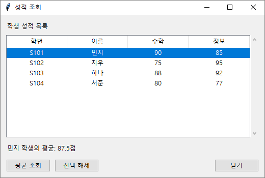<br>
  <em>그림 21. 민지 학생 선택 후 평균 조회 실행 화면.</em>
</p>

버튼을 누르면 하단 결과 영역에 다음과 같은 문구가 표시됩니다.

```text
민지 학생의 평균: 87.5점
```

프로그램의 모든 기능이 요구사항대로 동작하는지 아래의 테스트 항목을 따라 하나씩 확인해 보세요.

<table align="center" style="margin-left: auto; margin-right: auto;">
<thead>
<tr>
<th align="center" style="text-align: center;">테스트 조건</th>
<th align="center" style="text-align: center;">예상 결과</th>
</tr>
</thead>
<tbody>
<tr>
<td align="center" style="text-align: center;">프로그램 실행</td>
<td align="center" style="text-align: center;">학생 4명의 성적 표시</td>
</tr>
<tr>
<td align="center" style="text-align: center;">민지 선택 후 평균 조회</td>
<td align="center" style="text-align: center;">87.5점</td>
</tr>
<tr>
<td align="center" style="text-align: center;">지우 선택 후 평균 조회</td>
<td align="center" style="text-align: center;">85.0점</td>
</tr>
<tr>
<td align="center" style="text-align: center;">하나 선택 후 평균 조회</td>
<td align="center" style="text-align: center;">90.0점</td>
</tr>
<tr>
<td align="center" style="text-align: center;">서준 선택 후 평균 조회</td>
<td align="center" style="text-align: center;">78.5점</td>
</tr>
<tr>
<td align="center" style="text-align: center;">조회 후 다른 학생 선택</td>
<td align="center" style="text-align: center;">이전 평균 대신 조회 안내 표시</td>
</tr>
<tr>
<td align="center" style="text-align: center;">선택 해제 후 평균 조회</td>
<td align="center" style="text-align: center;">학생 선택 안내 대화상자</td>
</tr>
<tr>
<td align="center" style="text-align: center;">창의 크기 변경</td>
<td align="center" style="text-align: center;">표 영역이 창의 크기에 맞춰 조정</td>
</tr>
</tbody>
</table>

같은 폴더에서 아래 명령어를 실행하면 GUI 창을 띄우지 않고도 평균 계산 함수만 따로 불러와 결과를 검증할 수 있습니다.

```bash
python -c "from grade_viewer import calculate_average; print(calculate_average(90, 85))"
```

명령어를 실행하면 터미널에 `87.5`가 출력됩니다. 코드 하단에 작성한 `if __name__ == "__main__":` 조건문이 파일을 직접 실행할 때와 다른 코드에서 모듈로 불러올 때를 구분해 주므로, 이처럼 계산 함수만 가져다 쓸 때는 불필요하게 GUI 창이 열리지 않습니다.

## 7. Practice

이번 실습에서는 앞서 배운 위젯과 레이아웃, 이벤트 처리 기법을 바탕으로 주어진 요구사항에 맞춰 GUI 프로그램을 직접 설계하고 구현해 봅니다.

> 뒤이어 나오는 Solutions(정답 및 해설)에는 **Quiz**의 정답만 제시됩니다. 각 실습 코드의 `TODO` 주석은 학습자가 직접 작성해야 하는 부분이며, `raise NotImplementedError`가 포함된 함수는 해당 문장을 지우고 필요한 동작 코드로 교체한 뒤 실행하세요. 앞선 예제의 위젯 사용법을 참고하되, 구체적인 화면 배치와 이벤트 처리 방식은 자유롭게 결정할 수 있습니다.

### 7.1 Practice 01 — 단위 변환 프로그램

사용자가 길이 값을 입력하고 원하는 변환 방향을 선택하면 계산 결과를 화면에 표시하는 단위 변환 프로그램을 작성하세요.

#### 구현 조건

1. 길이를 입력할 수 있는 입력창을 제공합니다. 이때 `0` 이상의 유한한 실수만 허용합니다.
2. `m → cm`, `cm → m`, `km → m`, `m → km`의 네 가지 변환 방향 중 하나를 선택할 수 있어야 합니다.
3. **변환** 버튼을 클릭하거나 입력창에서 `Enter` 키를 누르면 단위 변환을 계산합니다. 계산 결과는 소수점 셋째 자리까지 표시하고 변환된 단위를 함께 나타냅니다.
4. 빈 입력, 숫자가 아닌 문자열, 음수, `NaN`, 무한대(`inf`)를 입력했거나 계산 결과 자체가 무한대가 되는 경우에는 오류 메시지를 안내합니다. 변환에 실패하면 이전에 표시된 계산 결과는 반드시 지웁니다.
5. **초기화** 버튼을 누르면 입력값과 결과 표시를 지우고, 선택된 변환 방향을 기본값인 `m → cm`으로 되돌립니다.

<table align="center" style="margin-left: auto; margin-right: auto;">
<thead>
<tr>
<th align="center" style="text-align: center;">변환 방향</th>
<th align="center" style="text-align: center;">변환식</th>
</tr>
</thead>
<tbody>
<tr>
<td align="center" style="text-align: center;">m → cm</td>
<td align="center" style="text-align: center;">입력값 × 100</td>
</tr>
<tr>
<td align="center" style="text-align: center;">cm → m</td>
<td align="center" style="text-align: center;">입력값 ÷ 100</td>
</tr>
<tr>
<td align="center" style="text-align: center;">km → m</td>
<td align="center" style="text-align: center;">입력값 × 1,000</td>
</tr>
<tr>
<td align="center" style="text-align: center;">m → km</td>
<td align="center" style="text-align: center;">입력값 ÷ 1,000</td>
</tr>
</tbody>
</table>

<p align="center">
  <br>
  <em>그림 22. 단위 변환 프로그램의 완성 화면 예시.</em>
</p>

> 위 이미지는 이해를 돕기 위한 구현 예시입니다. 제시된 모든 요구 기능을 충족한다면 위젯의 배치 구조나 창 크기는 다르게 구성해도 괜찮습니다.

#### STEP 01. 화면 및 프로그램 설계

프로그램에 필요한 입력창, 변환 방향 선택 위젯, **변환** 버튼, **초기화** 버튼, 결과 레이블을 화면에 배치하세요. 본격적인 코딩에 앞서 각 위젯이 어떤 데이터를 입력받거나 화면에 표시할지 미리 정리해 봅니다. 창의 크기, 제목, 전체 레이아웃은 자유롭게 결정하세요.

#### STEP 02. 단위 변환 함수 구현

GUI 코드와 독립적으로 동작하는 순수 단위 변환 함수를 작성하세요. 매개변수 `direction`에는 위 표에 제시된 네 가지 변환 방향 문자열 중 하나가 전달되며, `value`에는 숫자로 변환된 입력값이 전달됩니다. 함수는 계산을 마친 뒤 `(변환 결과, 단위)` 형태의 **튜플**(**Tuple**)을 반환해야 하며, 지원하지 않는 변환 방향이거나 허용 범위를 벗어난 숫자가 들어오면 `ValueError` 예외를 발생시켜 처리합니다.

> **주의:** `math.isfinite(value)` 함수는 값이 유한한 수일 때만 `True`를 반환하고, 무한대(`inf`)나 `NaN`일 때는 `False`를 반환합니다. 입력값뿐만 아니라 곱셈 연산 후의 계산 결과에도 반드시 동일한 검사를 적용하세요. 예를 들어 유한한 실수인 `1e308`에 `1000`을 곱하면 **부동소수점**(**Floating-point**) 연산 한계로 인해 계산 결과가 무한대가 될 수 있습니다.

```python
import math


def convert_length(value, direction):
    # TODO: 유효한 값과 변환 방향인지 확인
    # TODO: 선택한 방향에 따라 계산하고 결과와 단위 반환
    raise NotImplementedError
```

#### STEP 03. 위젯과 이벤트 연결

아래 시작 코드 구조를 참고하여 입력창, 변환 방향 선택 위젯, 결과 레이블을 생성하세요. **변환** 버튼 클릭과 입력창의 `Enter` 키 입력에 동일한 변환 처리 함수가 실행되도록 연결하고, **초기화** 버튼의 동작도 함께 구현합니다.

```python
import tkinter as tk
from tkinter import ttk, messagebox

DIRECTIONS = ["m → cm", "cm → m", "km → m", "m → km"]


def main():
    root = tk.Tk()
    root.title("단위 변환")

    # TODO: 입력값, 변환 방향 및 결과를 관리할 위젯이나 변수 생성

    def on_convert(event=None):
        # TODO: 입력 조회 및 숫자 변환
        # TODO: convert_length() 호출, 결과 표시 및 오류 처리
        raise NotImplementedError

    def on_reset():
        # TODO: 입력, 변환 방향 및 결과 초기화
        raise NotImplementedError

    # TODO: 위젯 배치와 command, bind 연결
    root.mainloop()


if __name__ == "__main__":
    main()
```

> STEP 02에서 작성한 변환 함수와 STEP 03의 GUI 코드는 한 파일 안에 함께 작성해도 되고, 별도의 모듈 파일로 분리한 뒤 `import`하여 불러와도 좋습니다.

#### STEP 04. 실행 및 테스트

프로그램을 완성한 뒤에는 아래 표에 제시된 다양한 입력값과 변환 방향을 대입해 모든 기능이 예상대로 동작하는지 꼼꼼히 확인해 보세요.

<table align="center" style="margin-left: auto; margin-right: auto;">
<thead>
<tr>
<th align="center" style="text-align: center;">입력값</th>
<th align="center" style="text-align: center;">변환 방향</th>
<th align="center" style="text-align: center;">예상 결과</th>
</tr>
</thead>
<tbody>
<tr>
<td align="center" style="text-align: center;"><code>1.25</code></td>
<td align="center" style="text-align: center;">m → cm</td>
<td align="center" style="text-align: center;">125.000 cm</td>
</tr>
<tr>
<td align="center" style="text-align: center;"><code>250</code></td>
<td align="center" style="text-align: center;">cm → m</td>
<td align="center" style="text-align: center;">2.500 m</td>
</tr>
<tr>
<td align="center" style="text-align: center;"><code>0.75</code></td>
<td align="center" style="text-align: center;">km → m</td>
<td align="center" style="text-align: center;">750.000 m</td>
</tr>
<tr>
<td align="center" style="text-align: center;"><code>1500</code></td>
<td align="center" style="text-align: center;">m → km</td>
<td align="center" style="text-align: center;">1.500 km</td>
</tr>
<tr>
<td align="center" style="text-align: center;"><code>0</code></td>
<td align="center" style="text-align: center;">m → cm</td>
<td align="center" style="text-align: center;">0.000 cm</td>
</tr>
<tr>
<td align="center" style="text-align: center;"><code>-1</code>, 빈 문자열, <code>abc</code></td>
<td align="center" style="text-align: center;">임의 선택</td>
<td align="center" style="text-align: center;">오류 안내, 결과 지우기</td>
</tr>
<tr>
<td align="center" style="text-align: center;"><code>nan</code>, <code>inf</code>, <code>1e309</code></td>
<td align="center" style="text-align: center;">임의 선택</td>
<td align="center" style="text-align: center;">오류 안내, 결과 지우기</td>
</tr>
<tr>
<td align="center" style="text-align: center;"><code>1e308</code></td>
<td align="center" style="text-align: center;">km → m</td>
<td align="center" style="text-align: center;">계산 결과 범위 오류 안내, 결과 지우기</td>
</tr>
</tbody>
</table>

정상적인 값의 변환 확인뿐만 아니라 다음 동작들도 반드시 함께 검증해야 합니다.

* **입력 방식 일관성:** 입력창에서 `Enter` 키를 눌러 변환한 결과가 **변환** 버튼을 마우스로 클릭한 결과와 동일하게 동작하는지 확인합니다.
* **오류 발생 시 화면 초기화:** 정상적인 계산이 완료된 직후 잘못된 값을 입력했을 때, 이전에 표시되던 계산 결과가 깨끗이 지워지는지 확인합니다.
* **초기화 기능 검증:** **초기화** 버튼을 눌렀을 때 입력창과 결과 레이블이 모두 비워지고, 변환 방향이 기본값(`m → cm`)으로 되돌아가는지 점검합니다.

### 7.2 Practice 02 — 실습실 교구 관리 프로그램의 GUI 구현

`Automation_Programs.md`의 Practice 02에서 작성했던 교구 대여 관리 프로그램에 GUI 화면을 결합해 보세요. 기존 실습에서 구현한 데이터 처리 및 파일 입출력 함수를 그대로 재사용하되, 사용자가 그래픽 화면을 통해 교구별 재고를 한눈에 확인하고 대여·반납을 처리할 수 있도록 구성합니다.

이번 실습에서는 미리 준비된 전체 기록 목록을 일괄 처리하는 대신, 사용자가 GUI 입력창에서 대여 또는 반납 기록을 한 건씩 직접 입력하여 실시간으로 반영합니다. 따라서 이전 프로그램의 터미널 명령줄 메뉴는 사용하지 않습니다.

#### 초기 데이터

```python
initial_stock = {"자": 3, "가위": 4}
```

품목별 초기 수량은 각 교구의 최대 보유량(대여·반납의 상한 기준)으로 사용됩니다.

> **주의:** 이전 실습에서 사용한 `equipment_stock.json` 파일과 데이터가 서로 섞이지 않도록 반드시 별도의 실습 폴더를 만들어 작업하세요. 이번 GUI 버전의 저장 파일명은 `equipment_gui_stock.json`으로 지정합니다.

#### 구현 조건

<table align="center" style="margin-left: auto; margin-right: auto;">
<thead>
<tr>
<th align="center" style="text-align: center;">기능</th>
<th align="center" style="text-align: center;">요구사항</th>
</tr>
</thead>
<tbody>
<tr>
<td align="center" style="text-align: center;">재고 표시</td>
<td align="center" style="text-align: center;">품목명과 현재 대여 가능 수량을 표 또는 목록에 표시</td>
</tr>
<tr>
<td align="center" style="text-align: center;">입력</td>
<td align="center" style="text-align: center;">품목, 대여·반납 구분, 수량을 선택하거나 입력</td>
</tr>
<tr>
<td align="center" style="text-align: center;">기록 처리</td>
<td align="center" style="text-align: center;">사용자 요청 한 건을 검사하고 유효하면 현재 재고에 반영</td>
</tr>
<tr>
<td align="center" style="text-align: center;">화면 갱신</td>
<td align="center" style="text-align: center;">정상 처리 직후 현재 재고와 처리 결과를 화면에 표시</td>
</tr>
<tr>
<td align="center" style="text-align: center;">오류 처리</td>
<td align="center" style="text-align: center;">빈 수량, 정수가 아닌 값, 0 이하의 수량, 재고 부족 및 초기 재고 초과 등을 안내하고 현재 재고 유지</td>
</tr>
<tr>
<td align="center" style="text-align: center;">저장</td>
<td align="center" style="text-align: center;">저장 버튼을 누르면 현재 재고를 JSON으로 저장</td>
</tr>
<tr>
<td align="center" style="text-align: center;">복원</td>
<td align="center" style="text-align: center;">프로그램 시작 시 저장된 재고를 불러옴. 파일이 없으면 초기 재고 사용</td>
</tr>
<tr>
<td align="center" style="text-align: center;">잘못된 저장 파일</td>
<td align="center" style="text-align: center;">오류를 안내하고 편집 및 저장을 중단. 기존 파일을 덮어쓰지 않음</td>
</tr>
</tbody>
</table>

> **참고:**
> * **메모리 상태와 저장 시점:** **저장** 버튼을 누르기 전까지 변경된 재고 내역은 프로그램 메모리 상에만 임시로 존재합니다. 프로그램을 종료한 뒤에도 변경 사항을 유지하려면 반드시 저장 버튼을 눌러 파일에 기록해야 합니다.
> * **저장 실패 시 예외 처리:** 파일 저장 중 오류가 발생하면 성공 메시지를 표시해서는 안 됩니다. 기존 파일을 쓰기(`"w"`) 모드로 열면 기존 내용이 지워집니다. 이후 데이터를 기록하는 과정에서 오류가 발생하면 기존 데이터가 손실되거나 파일이 손상될 수 있습니다. 다만 이번 실습에서는 백업 생성이나 임시 파일을 활용한 안전한 덮어쓰기 기법까지는 요구하지 않습니다.
> * **구현 범위 제한:** 새로운 품목 추가·삭제 기능이나 여러 건의 기록을 한 번에 일괄 처리하는 기능은 이번 실습의 필수 구현 범위에 포함되지 않습니다.

<p align="center">
  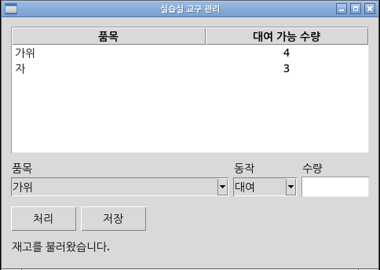<br>
  <em>그림 23. 실습실 교구 관리 프로그램의 초기 화면 예시.</em>
</p>

<p align="center">
  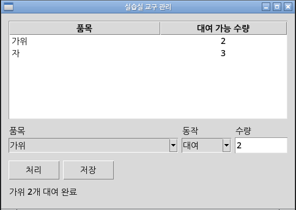<br>
  <em>그림 24. 가위 2개 대여 후 재고가 갱신된 화면 예시.</em>
</p>

> 위 두 이미지는 핵심 동작을 확인하기 위한 구현 예시입니다. 요구사항의 모든 기능을 정상적으로 수행한다면 화면 배치나 디자인 구성은 자유롭게 설계해도 좋습니다.

#### STEP 01. 기존 처리 함수 확인

본격적인 GUI 구성에 앞서 이전 실습에서 작성했던 아래 세 가지 핵심 함수를 점검하세요. 만약 해당 함수들이 아직 완성되지 않았다면 `Automation_Programs.md`의 Practice 02를 먼저 완료한 뒤 진행합니다.

<table align="center" style="margin-left: auto; margin-right: auto;">
<thead>
<tr>
<th align="center" style="text-align: center;">함수</th>
<th align="center" style="text-align: center;">역할</th>
</tr>
</thead>
<tbody>
<tr>
<td align="center" style="text-align: center;"><code>apply_records(initial_stock, current_stock, records)</code></td>
<td align="center" style="text-align: center;">기록 목록을 처리하고 새 재고 딕셔너리와 제외 기록 목록 반환</td>
</tr>
<tr>
<td align="center" style="text-align: center;"><code>load_stock(path, initial_stock)</code></td>
<td align="center" style="text-align: center;">저장 파일에서 재고 조회 및 검증. 파일이 없으면 초기 재고 반환</td>
</tr>
<tr>
<td align="center" style="text-align: center;"><code>save_stock(path, stock)</code></td>
<td align="center" style="text-align: center;">현재 재고를 JSON으로 저장</td>
</tr>
</tbody>
</table>

기존 실습의 핵심 함수 정의는 그대로 가져와 활용하되, 이전 `main()` 함수에 있던 터미널 입출력 코드는 사용하지 않습니다. 함수들을 별도의 모듈 파일로 분리해 저장할 경우 모듈 파일명은 자유롭게 정할 수 있습니다.

> **주의:** `load_stock()`과 `save_stock()` 함수는 경로 인수로 문자열이 아닌 `pathlib.Path` 객체를 전달받도록 작성해야 합니다. 또한 별도 모듈에서 함수를 `import`해 불러올 때 이전 실습의 터미널 메뉴가 자동으로 실행되지 않도록 `if __name__ == "__main__":` 구문이 올바르게 적용되어 있는지 반드시 확인하세요.

#### STEP 02. 화면 설계 및 위젯 구성

프로그램에 필요한 위젯을 선정하고 **입력 영역**, **재고 표시 영역**, **결과 및 버튼 영역**으로 화면을 구성하세요. 품목과 대여·반납 구분은 `ttk.Combobox` 등의 선택 위젯을 활용하고, 현재 재고 목록은 `ttk.Treeview` 또는 `tk.Listbox` 위젯을 사용해 표시합니다.

> 저장된 데이터 파일이 손상되었거나 유효하지 않을 때는 오류 안내 대화상자를 띄운 뒤 프로그램 창을 곧바로 닫거나, 모든 입력 및 저장 버튼을 비활성화(`state="disabled"`)한 상태로 창을 유지하여 사용자가 잘못된 데이터를 덮어쓰지 못하도록 처리하세요.

#### STEP 03. 초기 데이터 조회 및 화면 갱신

저장 파일에서 기존 재고를 불러오는 기능과 현재 재고 상태를 화면 목록에 반영하는 함수를 작성하세요. 저장된 재고 파일이 유효하지 않다면 프로그램에서 재고를 수정하거나 다시 저장할 수 없도록 차단해야 합니다.

```python
def refresh_stock_view():
    # TODO: 현재 재고를 표 또는 목록에 표시
    # TODO: 갱신할 때 기존 행이 중복되지 않도록 처리
    raise NotImplementedError
```

> 위 `refresh_stock_view()` 함수는 GUI를 구성하는 `main()` 함수 내부에 중첩하여 정의하거나, 대상 위젯과 재고 딕셔너리를 매개변수로 전달받는 독립적인 함수 형태로 변경해 작성할 수 있습니다.

#### STEP 04. 대여·반납 이벤트 구현

사용자가 화면에서 선택한 품목과 대여·반납 구분, 입력한 수량을 읽어와 기존 데이터 처리 함수(`apply_records()`)에 전달하세요. 기존 함수는 기록 목록을 리스트 형태로 받으므로, `(품목, 동작, 수량)` **튜플**(**Tuple**) 한 개를 담은 리스트를 인수로 전달하면 됩니다. 이후 반환받은 새 재고와 제외 기록 목록을 확인하여 정상 처리 시 화면을 갱신하고, 거부되었을 때는 오류 안내를 표시합니다.

```python
def on_apply():
    # TODO: 사용자 입력 조회 및 수량 변환
    # TODO: 기존 재고 처리 함수 호출
    # TODO: 처리 성공 여부에 따라 현재 재고와 결과 표시 갱신
    raise NotImplementedError
```

> **주의:** 요청 처리가 거부된 경우에는 화면에 표시된 재고 수량과 메모리 상의 실제 재고 데이터가 모두 기존 상태 그대로 유지되어야 합니다. 또한 콜백 함수 내부에서 현재 재고 변수를 새로운 딕셔너리 객체로 재할당(교체)한다면, 앞서 4.4절에서 다룬 **변수 범위**(**Variable Scope**)와 `nonlocal` 선언 규칙을 참고하세요.

#### STEP 05. 저장 기능 및 프로그램 통합

기존에 작성한 파일 저장 함수(`save_stock()`)를 GUI의 **저장** 버튼에 연결하고, 저장 과정에서 오류가 발생할 경우 예외를 처리해 오류 안내 대화상자를 표시하세요. 아울러 프로그램을 처음 실행할 때 저장된 재고를 불러오는 로직과 잘못된 저장 파일을 만났을 때의 대응 절차도 함께 구현합니다.

```python
def on_save():
    # TODO: 현재 재고 저장 및 예외 처리
    # TODO: 저장 성공 또는 실패 안내
    raise NotImplementedError
```

STEP 03부터 STEP 05까지의 코드 조각을 모두 하나로 통합하여 전체 프로그램을 완성하세요. 함수의 배치 위치, 상태 변수의 관리 방법, 위젯 생성 순서 및 이벤트 연결 방식은 직접 설계합니다. 완성된 파일은 `equipment_gui.py` 등의 이름으로 저장할 수 있습니다.

#### STEP 06. 실행 및 테스트

첫 번째 테스트는 기존 저장 파일(`equipment_gui_stock.json`)이 없는 깨끗한 상태에서 시작하세요. 아래 표에 제시된 순서대로 대여와 반납을 실행하면서 표 또는 목록에 표시되는 수량이 정확히 일치하는지 확인합니다.

<table align="center" style="margin-left: auto; margin-right: auto;">
<thead>
<tr>
<th align="center" style="text-align: center;">순서</th>
<th align="center" style="text-align: center;">사용자 동작</th>
<th align="center" style="text-align: center;">가위</th>
<th align="center" style="text-align: center;">자</th>
<th align="center" style="text-align: center;">예상 처리 결과</th>
</tr>
</thead>
<tbody>
<tr>
<td align="center" style="text-align: center;">1</td>
<td align="center" style="text-align: center;">프로그램 실행</td>
<td align="center" style="text-align: center;">4</td>
<td align="center" style="text-align: center;">3</td>
<td align="center" style="text-align: center;">초기 재고 표시</td>
</tr>
<tr>
<td align="center" style="text-align: center;">2</td>
<td align="center" style="text-align: center;">가위 2개 대여</td>
<td align="center" style="text-align: center;">2</td>
<td align="center" style="text-align: center;">3</td>
<td align="center" style="text-align: center;">정상 처리</td>
</tr>
<tr>
<td align="center" style="text-align: center;">3</td>
<td align="center" style="text-align: center;">자 4개 대여</td>
<td align="center" style="text-align: center;">2</td>
<td align="center" style="text-align: center;">3</td>
<td align="center" style="text-align: center;">재고 부족</td>
</tr>
<tr>
<td align="center" style="text-align: center;">4</td>
<td align="center" style="text-align: center;">가위 1개 반납</td>
<td align="center" style="text-align: center;">3</td>
<td align="center" style="text-align: center;">3</td>
<td align="center" style="text-align: center;">정상 처리</td>
</tr>
<tr>
<td align="center" style="text-align: center;">5</td>
<td align="center" style="text-align: center;">자 1개 반납</td>
<td align="center" style="text-align: center;">3</td>
<td align="center" style="text-align: center;">3</td>
<td align="center" style="text-align: center;">초기 재고 초과</td>
</tr>
<tr>
<td align="center" style="text-align: center;">6</td>
<td align="center" style="text-align: center;">자 1개 대여</td>
<td align="center" style="text-align: center;">3</td>
<td align="center" style="text-align: center;">2</td>
<td align="center" style="text-align: center;">정상 처리</td>
</tr>
<tr>
<td align="center" style="text-align: center;">7</td>
<td align="center" style="text-align: center;">가위 수량 <code>abc</code> 입력</td>
<td align="center" style="text-align: center;">3</td>
<td align="center" style="text-align: center;">2</td>
<td align="center" style="text-align: center;">정수 입력 안내</td>
</tr>
<tr>
<td align="center" style="text-align: center;">8</td>
<td align="center" style="text-align: center;">저장 버튼 클릭</td>
<td align="center" style="text-align: center;">3</td>
<td align="center" style="text-align: center;">2</td>
<td align="center" style="text-align: center;">저장 완료</td>
</tr>
<tr>
<td align="center" style="text-align: center;">9</td>
<td align="center" style="text-align: center;">프로그램 종료 후 재실행</td>
<td align="center" style="text-align: center;">3</td>
<td align="center" style="text-align: center;">2</td>
<td align="center" style="text-align: center;">저장 재고 복원</td>
</tr>
</tbody>
</table>

8번 단계까지 마친 뒤 생성된 JSON 파일(`equipment_gui_stock.json`)을 열어 보면 아래와 같은 데이터가 저장되어 있어야 합니다. (키의 순서나 들여쓰기 간격은 달라도 무방합니다.)

```json
{
    "가위": 3,
    "자": 2
}
```

기본 시나리오 외에도 다음과 같은 예외 상황을 추가로 점검해 보세요.

* **잘못된 수량 거부:** 수량에 `0`이나 음수를 입력했을 때 요청이 정상적으로 거부되는지 확인합니다.
* **미저장 종료 및 복원:** 재고를 변경한 뒤 **저장** 버튼을 누르지 않고 창을 닫았다가 재실행했을 때, 이전에 마지막으로 저장했던 재고 수량이 그대로 복원되는지 확인합니다.
* **저장 실패 시 오류 안내:** 별도의 테스트용 폴더에서 저장 파일이 없는 상태로 프로그램을 실행한 뒤, 저장 파일과 같은 이름(`equipment_gui_stock.json`)의 폴더를 만들어 파일을 기록할 수 없는 상황을 준비하세요. 저장 버튼을 눌렀을 때 오류를 안내하고 성공 메시지를 표시하지 않는지 확인합니다.
* **손상된 저장 파일 대응:** 정상적인 저장 파일을 별도로 백업해 둔 뒤, 테스트용 파일에 잘못된 JSON 문법이나 초기 재고 범위를 벗어나는 수량을 직접 적어 넣고 프로그램을 실행해 보세요. 이때 오류 안내가 표시되고 기존 저장 파일을 함부로 덮어쓰지 않고 그대로 유지하는지 검증합니다.

#### 추가 과제 (선택)

기본 기능을 모두 완성했다면 아래의 확장 기능도 직접 구현해 보세요.

* **미저장 종료 경고:** 저장되지 않은 변경 사항이 남아 있는 상태에서 창을 닫으려 할 때 확인 대화상자(`messagebox.askyesno()`)를 띄워 사용자 의사를 묻습니다.
* **품절 품목 강조:** 현재 대여 가능 재고가 `0`이 된 품목을 표나 목록에서 별도의 색상이나 문구로 구분해 표시합니다.
* **처리 이력 로그:** 사용자가 실행한 대여·반납 처리 결과 내역을 화면 하단의 `Listbox`나 `Treeview` 기록 목록에 누적하여 표시합니다.

## 8. Summary

이번 단원에서 배운 Tkinter GUI 프로그래밍의 핵심 개념을 정리합니다.

- **이벤트 기반 실행 구조:** GUI 프로그램은 **이벤트 루프**(**Event Loop**) 상태에서 사용자의 입력을 기다리다가, 특정 이벤트가 발생하면 미리 연결된 **콜백**(**Callback**) 함수를 호출해 기능을 실행합니다.
- **기본 창과 위젯 생성:** `tk.Tk()`로 최상위 기본 창을 생성하고 `mainloop()` 메서드를 호출해 이벤트 처리를 시작합니다. 기본 창 내부에 배치할 위젯은 일반적으로 자신이 속할 부모 위젯을 첫 번째 인수로 전달하여 생성합니다.
- **레이아웃 배치 관리자:** `pack()`, `grid()`, `place()`는 화면에 위젯을 배치하는 **지오메트리 매니저**(**Geometry Manager**)입니다. 레이아웃 충돌을 방지하려면 같은 부모 위젯 안의 자식 위젯들에게 `pack()`과 `grid()`를 절대 혼용하지 않아야 합니다.
- **이벤트 연결 방식:** 버튼의 `command` 옵션에는 실행할 함수 자체를 전달하며, `bind()` 메서드로 연결한 이벤트 처리 함수에는 발생한 이벤트 정보를 담은 **이벤트 객체**(**Event Object**)가 자동으로 전달됩니다.
- **제어 변수 활용:** `StringVar`와 같은 Tkinter **제어 변수**(**Control Variable**)는 `get()`과 `set()` 메서드로 값을 읽고 수정하며, 값이 바뀔 때마다 연결된 위젯의 화면 표시도 자동으로 동기화됩니다.
- **바깥 변수 수정과 `nonlocal`:** 중첩 함수 내부에서 바깥 함수에 선언된 변수에 새로운 값을 재할당(대입)할 때는 `nonlocal` 키워드를 선언해야 합니다.
- **데이터 처리와 GUI의 분리:** 순수 계산이나 데이터 검증 함수와 화면을 갱신하는 GUI 코드를 분리해 작성하면, 기존 로직을 다른 프로그램에서 재사용하거나 독립적으로 테스트하기가 훨씬 쉬워집니다.
- **표 데이터 표시 (`Treeview`):** `ttk.Treeview` 위젯을 사용하면 여러 열로 이루어진 표 데이터를 깔끔하게 보여 줄 수 있습니다. 이때 화면에 표시된 행의 고유 ID(`iid`)와 실제 원본 데이터의 관계를 체계적으로 연결해 관리해야 합니다.
- **대화상자 모듈 활용:** `messagebox`는 사용자에게 안내·경고·오류 메시지나 확인 대화상자를 표시하며, `filedialog`는 사용자가 선택한 파일 또는 폴더의 경로 문자열을 반환합니다. 반환된 경로를 이용한 실제 파일 읽기와 쓰기 처리는 별도의 코드로 직접 구현해야 합니다.

## 9. Quiz

### 문제 1.

다음 중 Tkinter의 `mainloop()`에 대한 설명으로 가장 적절한 것을 고르세요.

A. 모든 버튼의 콜백 함수를 한 번씩 실행하고 종료합니다.  
B. 사용자 입력과 화면 갱신 등의 이벤트를 기다리고 처리합니다.  
C. 프로그램의 모든 변수 값을 JSON 파일로 자동 저장합니다.  
D. 위젯의 위치를 임의로 지정하고 창을 종료합니다.

### 문제 2.

다음 코드에서 버튼을 클릭했을 때 `show_result()`가 실행되도록 빈칸을 채우세요. (단, `show_result`는 인수 없이 호출할 수 있는 함수입니다.)

```python
button = ttk.Button(root, text="조회", command=____)
```

아울러 `command=show_result()`처럼 함수 이름 뒤에 괄호를 붙여 작성한 경우에는 함수가 언제 호출되는지도 함께 설명하세요.

### 문제 3.

다음 코드를 실행하면 입력창의 내용을 읽어오려 할 때 오류가 발생합니다. 오류가 발생하는 원인을 설명하고, 첫 번째 줄을 위젯 생성과 배치의 두 문장으로 올바르게 수정하세요.

```python
entry = ttk.Entry(root).pack()
print(entry.get())
```

### 문제 4.

다음 코드에서 같은 부모 위젯(`root`)에 적용된 레이아웃 배치 방식의 문제점을 설명하세요. 또한 서로 다른 부모 컨테이너를 활용하여 `pack()`과 `grid()`를 충돌 없이 함께 사용할 수 있는 방법도 서술하세요.

```python
label = ttk.Label(root, text="이름")
label.pack()
entry = ttk.Entry(root)
entry.grid(row=0, column=1)
```

### 문제 5.

다음 코드가 실행되어 화면이 갱신된 뒤, 최종적으로 레이블(`label`)에 표시되는 문자열을 적으세요. (단, `root` 창은 이미 생성되어 있다고 가정합니다.)

```python
message = tk.StringVar(root, value="대기 중")
label = ttk.Label(root, textvariable=message)
label.pack()
message.set("처리 완료")
```

### 문제 6.

다음 이벤트 바인딩 코드에서 `show_message` 함수가 자동으로 전달받아야 할 매개변수를 빈칸에 작성하세요. 이후 해당 콜백 함수가 어느 시점에 호출되는지도 설명하세요.

```python
def show_message(____):
    print("입력 확인")


entry.bind("<Return>", show_message)
```

### 문제 7.

다음 코드에서 `Treeview` 표에 아무 행도 선택되어 있지 않을 때 발생할 수 있는 문제를 설명하세요. 또한 인덱스에 접근하기 전에 행 선택 여부를 미리 확인하기 위해 사용할 수 있는 조건식도 작성하세요.

```python
selected = tree.selection()
row_id = selected[0]
print(tree.item(row_id, "values"))
```

### 문제 8.

파일 선택 대화상자에서 사용자가 **취소** 버튼을 눌렀습니다. 이때 `filedialog.askopenfilename()` 함수의 반환값은 무엇이며, 이어지는 파일 읽기 기능에서는 이 반환값을 어떻게 처리해야 안전한지 설명하세요.

### 문제 9.

GUI 기반 상품 가격 계산 프로그램에서 입력창의 값을 읽고 결과를 화면에 표시하는 **콜백**(**Callback**) 함수와 순수하게 상품 가격을 계산하는 함수가 나뉘어 있습니다. 이처럼 두 함수의 역할을 분리하여 작성하면 어떤 장점이 있는지 한 가지 이상 설명하세요.

## 10. Solutions

### 문제 1.

<details>
<summary>정답 및 해설 보기</summary>

**정답: B**

`mainloop()`는 프로그램의 **이벤트 루프**(**Event Loop**)를 시작하여 사용자의 키보드·마우스 입력과 화면 갱신 요청을 지속적으로 기다리고 처리합니다. 등록된 이벤트가 발생하면 그에 연결된 **콜백**(**Callback**) 함수를 실행합니다.

</details>

### 문제 2.

<details>
<summary>정답 및 해설 보기</summary>

**정답: `show_result`**

`command=show_result`처럼 함수 이름만 작성하면 함수 객체 자체가 전달되므로, 사용자가 버튼을 클릭할 때 비로소 해당 함수가 호출됩니다. 반면 `command=show_result()`처럼 괄호를 함께 작성하면 버튼을 생성하는 시점에 함수가 즉시 실행되고, 그 함수의 반환값이 `command` 옵션에 전달되므로 주의해야 합니다.

</details>

### 문제 3.

<details>
<summary>정답 및 해설 보기</summary>

`pack()` 메서드의 반환값은 `None`입니다. 따라서 `entry = ttk.Entry(root).pack()`처럼 한 줄로 작성하면 `entry` 변수에 위젯 객체가 아닌 `None`이 저장되어, 다음 줄에서 `entry.get()`을 호출할 때 `AttributeError`가 발생합니다.

```python
entry = ttk.Entry(root)
entry.pack()
```

위와 같이 위젯 생성과 배치 코드를 두 문장으로 나누어 작성해야 `entry`에 입력창 위젯 객체가 올바르게 저장되며, 이후 `print(entry.get())`도 정상적으로 실행됩니다.

</details>

### 문제 4.

<details>
<summary>정답 및 해설 보기</summary>

`label`과 `entry`의 부모 위젯이 모두 `root`로 동일한데, 하나는 `pack()`으로 배치하고 다른 하나는 `grid()`로 배치하고 있습니다. 같은 부모 컨테이너 안의 자식 위젯들에게 두 배치 관리자를 혼용하면 레이아웃 계산 충돌로 인해 `TclError`가 발생합니다.

이 문제를 해결하려면 `Frame` 위젯을 활용해 부모 영역을 분리해야 합니다. 예를 들어 부모 창(`root`)에는 여러 개의 `Frame`을 `pack()`으로 배치하고, 각 `Frame` 내부의 자식 위젯들은 `grid()`로 배치하면 서로 충돌 없이 두 방식을 함께 사용할 수 있습니다.

</details>

### 문제 5.

<details>
<summary>정답 및 해설 보기</summary>

**정답: 처리 완료**

레이블의 `textvariable` 옵션이 `StringVar` 객체인 `message`를 참조하고 있으므로, `message.set("처리 완료")`를 호출해 변수 값을 변경하면 연결된 레이블의 화면 텍스트도 자동으로 갱신됩니다.

</details>

### 문제 6.

<details>
<summary>정답 및 해설 보기</summary>

**정답 예시: `event`**

`bind()` 메서드로 연결한 콜백 함수가 호출될 때는 발생한 이벤트 정보를 담은 **이벤트 객체**(**Event Object**)가 첫 번째 인수로 자동 전달됩니다. 이 함수는 입력창(`entry`)에 키보드 포커스가 맞춰진 상태에서 사용자가 `Enter` 키를 누르는 시점에 호출됩니다.

> 관례적으로 매개변수 이름을 `event`로 많이 사용하지만, 문법적으로는 다른 변수 이름을 사용해도 무방합니다.

</details>

### 문제 7.

<details>
<summary>정답 및 해설 보기</summary>

`Treeview` 표에서 선택된 행이 전혀 없으면 `tree.selection()`은 빈 튜플 `()`을 반환합니다. 이 상태에서 바로 `selected[0]`에 접근하려 하면 범위를 벗어난 참조로 인해 `IndexError`가 발생합니다.

따라서 인덱스에 접근하기 전에 `if not selected:` 조건식으로 빈 튜플인지 먼저 검사해 함수를 종료하거나, `if selected:` 조건문 내부에서만 선택된 행을 처리하도록 작성해야 안전합니다.

```python
selected = tree.selection()

if selected:
    row_id = selected[0]
    print(tree.item(row_id, "values"))
else:
    print("선택된 행이 없습니다.")
```

</details>

### 문제 8.

<details>
<summary>정답 및 해설 보기</summary>

**정답: 빈 문자열 (`""`)**

사용자가 파일 선택을 취소했으므로 실제 파일 읽기 작업을 실행하지 않고 이전 화면 상태를 그대로 유지해야 합니다. 반환된 문자열을 `Path` 객체로 변환하기 전에 반드시 `if not path:`와 같은 조건문으로 취소 여부를 먼저 확인해야 합니다. 만약 빈 문자열을 그대로 `Path("")`로 변환하면 현재 작업 디렉터리를 가리키게 되어 오류가 발생할 수 있습니다.

</details>

### 문제 9.

<details>
<summary>정답 및 해설 보기</summary>

상품 가격 계산 함수가 Tkinter 위젯을 직접 참조하지 않고 순수한 값만 전달받아 계산하도록 분리하면, 동일한 계산 로직을 터미널 프로그램이나 다른 GUI 화면에서도 코드 수정 없이 그대로 재사용할 수 있습니다. 

또한 GUI 창을 띄워 직접 버튼을 클릭해 보지 않고도, 함수에 다양한 테스트 입력값을 전달해 계산 결과가 정확한지 독립적으로 검증할 수 있어 유지보수와 테스트가 훨씬 수월해집니다. 이때 콜백 함수는 화면 입력창에서 값을 읽어 처리 함수에 전달하고, 반환된 결과를 다시 화면 레이블에 표시하는 중개 역할만 깔끔하게 담당하게 됩니다.

</details>

## 11. Reference

- [Python 표준 라이브러리 — tkinter](https://docs.python.org/ko/3/library/tkinter.html)
- [Python 표준 라이브러리 — tkinter.ttk](https://docs.python.org/ko/3/library/tkinter.ttk.html)
- [Python 표준 라이브러리 — tkinter.messagebox](https://docs.python.org/ko/3/library/tkinter.messagebox.html)
- [Python 표준 라이브러리 — tkinter.filedialog 및 대화상자](https://docs.python.org/ko/3/library/dialog.html)
- [Python 표준 라이브러리 — math.isfinite](https://docs.python.org/ko/3/library/math.html#math.isfinite)
- [TkDocs Tutorial (영문)](https://tkdocs.com/tutorial/)
