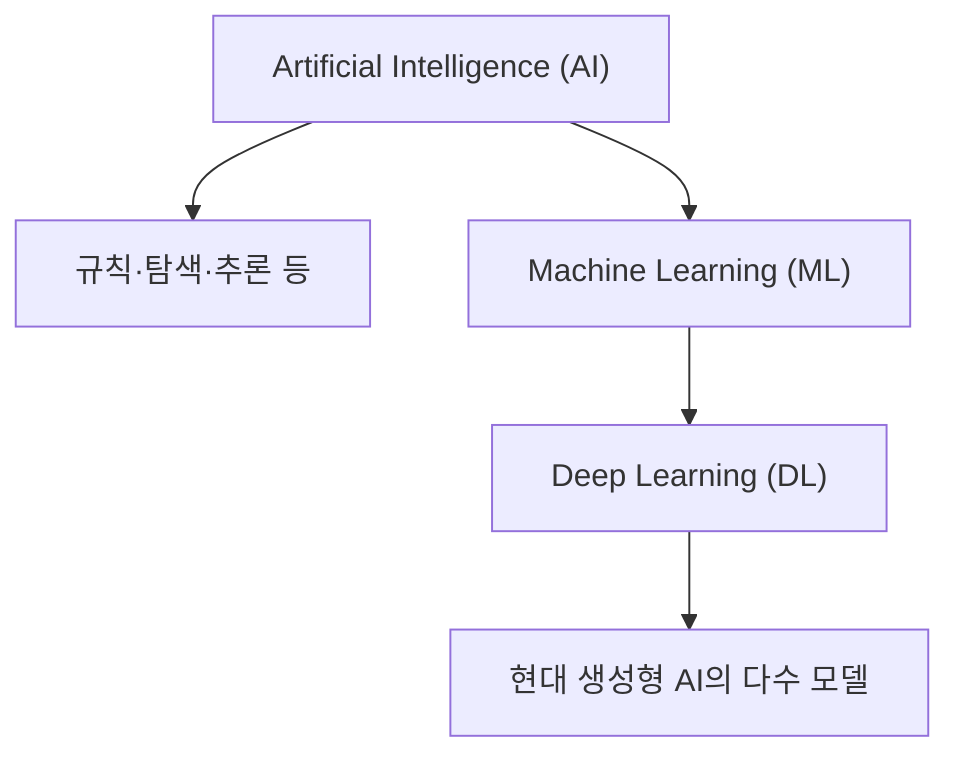
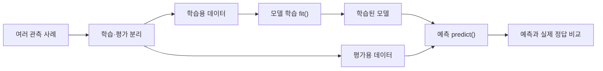
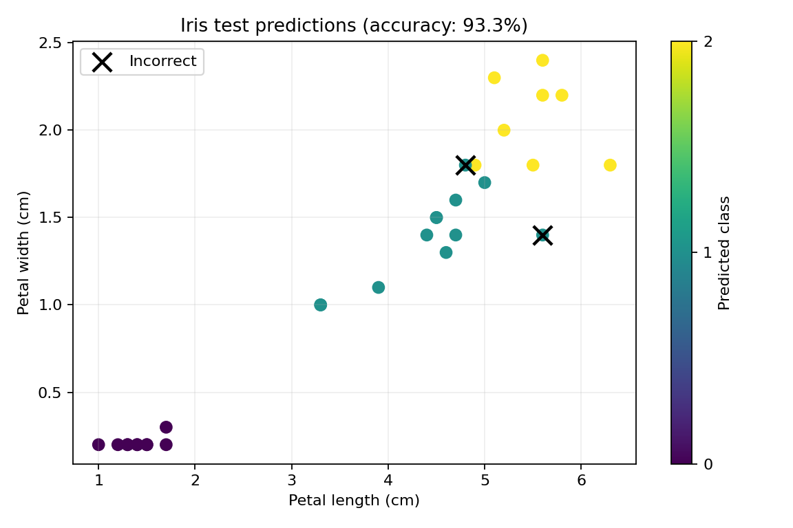

# Chapter 01. Introduction to Artificial Intelligence

인공지능(Artificial Intelligence, AI)은 무엇을 할 수 있고, 어떤 원리로 결과를 만들어 낼까요? 이번 Chapter에서는 **AI와 일반 자동화의 차이**, **머신러닝·딥러닝·생성형 AI의 관계**, **데이터를 사용해 학습하고 새로운 입력을 예측하는 흐름**을 이해합니다. 실제 분류 모델을 실행한 뒤, 모델이 틀리거나 사람의 검토가 필요한 상황도 살펴봅니다.

- **학습 환경:** Google Colab(기본), VS Code 또는 Jupyter Notebook(로컬)
- **실습 언어:** Python 3.11 이상 권장
- **주요 도구:** NumPy, Pandas, Matplotlib, scikit-learn
- **실습 데이터:** 교육용 가상 날씨·센서 자료, scikit-learn 내장 붓꽃·손글씨 숫자 데이터셋

<details>
<summary><strong>선행 학습 목록</strong></summary>

- [Python 기초 정리](../../PythonGuide/) — 변수, 함수, 조건문, 반복문
- [Data Processing](../../Data_Processing/) — NumPy 배열, Pandas DataFrame(선택)
- [Data Visualization](../../Data_Visualization/) — 그래프 읽기와 해석(선택)

</details>

<a id="contents"></a>
## Contents

| Section | Topic |
|:---:|---|
| [1.1](#section-1-1) | **Learning Goals & Getting Started** — 학습 목표와 실습 환경 |
| [1.2](#section-1-2) | **What Is Artificial Intelligence?** — 인공지능의 개념과 범위 |
| [1.3](#section-1-3) | **Rule-Based Systems & Machine Learning** — 규칙과 학습의 차이 |
| [1.4](#section-1-4) | **AI, ML, DL & Generative AI** — 주요 기술의 관계 |
| [1.5](#section-1-5) | **Data, Training & Inference** — 특징·정답·모델·예측 |
| [1.6](#section-1-6) | **AI Tasks & Real-World Applications** — 분류·예측·추천·생성 |
| [1.7](#section-1-7) | **Limitations & Responsible AI** — 오류·편향·개인정보·검토 |
| [1.8](#section-1-8) | **Examples** — Python 분류 예제와 결과 해석 |
| [1.9](#section-1-9) | **Coding Practice** — 기초 구현과 응용 연습 |
| [1.10](#section-1-10) | **Mini Projects** — 날씨 판단과 붓꽃 분류 |
| [1.11](#section-1-11) | **Advanced Projects** — 드문 사건과 손글씨 검토 |
| [1.12](#section-1-12) | **Quiz** — 개념·사례·코드 분석 |
| [1.13](#section-1-13) | **Summary** — 핵심 개념 정리 |
| [1.14](#section-1-14) | **References** — 공식 참고 문서 |

---

<a id="section-1-1"></a>
## 1.1. Learning Goals & Getting Started

### 학습 목표

이번 Chapter를 마친 뒤 다음 질문에 답할 수 있어야 합니다.

1. 같은 일을 자동으로 수행해도, 모든 프로그램을 AI라고 부르지 않는 이유는 무엇인가요?
2. AI, 머신러닝(ML), 딥러닝(DL), 생성형 AI는 어떻게 연결되어 있나요?
3. 데이터의 특징(Feature), 정답(Label), 학습(Training), 예측(Inference)은 각각 어떤 역할을 하나요?
4. 모델의 정확도가 높아도 중요한 사건을 놓칠 수 있는 이유는 무엇인가요?
5. AI의 결과를 사람이 확인해야 하는 상황은 어떤 경우인가요?

### 실행 준비

[Google Colab](https://colab.research.google.com/)에서는 [`Chapter_01_Introduction_to_AI.ipynb`](./notebooks/Chapter_01_Introduction_to_AI.ipynb)를 업로드하여 코드 셀을 순서대로 실행할 수 있습니다. 로컬에서는 `.py` 예제를 실행할 수 있습니다. **GPU를 선택할 필요는 없습니다.**

`Chapter-01/` 폴더를 기준으로 다음 명령을 사용합니다.

```bash
python -m pip install -r requirements.txt
python examples/01_nearest_example.py
```

**참고:** Colab은 Notebook에 필요한 라이브러리를 이미 제공할 수 있습니다. 설치가 필요한 경우에는 노트북에서 `%pip install ...`을 사용하면 됩니다. Colab의 실행 파일은 런타임 종료 후 사라질 수 있으므로 작성한 Notebook과 결과물을 별도로 보관하세요.

### 이번 Chapter에서 다루는 데이터

| 데이터 | 내용 | 출처 |
|---|---|:---:|
| 날씨 선택 기록 | 강수 확률과 풍속에 따른 가상 우산 선택 100건 | 실습용 합성 데이터 |
| 붓꽃(Iris) | 4개 측정값과 3개 품종을 가진 150개 샘플 | scikit-learn 내장 데이터 |
| 센서 기록 | 일반 360건, 드문 사건 40건 | 실습용 합성 데이터 |
| 손글씨 숫자(Digits) | 8×8 픽셀 손글씨 숫자 1,797개 | scikit-learn 내장 데이터 |

가상 데이터는 실제 사람의 행동이나 실제 시스템의 발생률을 나타내지 않습니다. 파일의 세부 정의는 [`data/README.md`](./data/README.md)에서 확인할 수 있습니다.

---

<a id="section-1-2"></a>
## 1.2. What Is Artificial Intelligence?

### AI는 무엇인가요?

친구의 손글씨를 보고 숫자를 알아맞히거나, 사진에서 고양이를 찾고, 문장의 다음 말을 자연스럽게 이어 쓰는 일은 사람에게도 판단이 필요합니다. AI는 이런 **인식·예측·언어 이해·의사결정처럼 지능적인 처리가 요구되는 작업**을 컴퓨터가 수행하도록 만드는 기술 분야입니다.

AI가 실제 사람처럼 생각한다는 뜻은 아닙니다. 보통은 주어진 문제에 맞는 입력을 받아 정해진 절차나 학습된 모델을 통해 결과를 계산합니다.

| 예시 | 입력 | 프로그램의 결과 |
|---|---|---|
| 사진 속 동물 분류 | 이미지 | 개·고양이 등 품종 또는 종류 |
| 음성 인식 | 소리 | 글자로 변환한 문장 |
| 교통량 예측 | 과거 교통량과 시간 | 다음 시간의 예상 차량 수 |
| 글 생성 | 질문과 앞선 문장 | 이어지는 문장 |
| 콘텐츠 추천 | 시청·선택 이력 | 관심을 가질 만한 항목 |

### 자동화와 AI는 같은 뜻인가요?

아닙니다. 자동화(Automation)는 사람이 반복하던 작업을 프로그램이 대신 수행하도록 만드는 것을 말합니다. 예를 들어 매일 오후 5시에 컴퓨터를 종료하는 타이머는 자동화 프로그램이지만, 스스로 패턴을 학습하지는 않습니다.

AI도 자동화에 사용될 수 있지만, **자동으로 움직인다는 사실만으로 AI라고 판단할 수는 없습니다.** 어떤 정보를 사용해 어떻게 판단하는지가 중요합니다.

### 약한 AI와 범용 AI

- **특정 목적 AI(Narrow AI):** 사진 분류, 음성 인식처럼 주어진 작업에 초점을 둔 시스템입니다.
- **범용 인공지능(Artificial General Intelligence, AGI):** 다양한 지적 작업을 폭넓게 수행하는 시스템을 논의할 때 사용하는 개념입니다. 정의와 도달 기준에는 논쟁이 있으며, 특정 서비스의 광고 문구만으로 범용 AI라고 단정할 수 없습니다.

이번 과정은 실제 구현과 평가가 가능한 **특정 목적 AI 시스템**을 중심으로 학습합니다.

---

<a id="section-1-3"></a>
## 1.3. Rule-Based Systems & Machine Learning

### 사람이 규칙을 직접 작성하는 방법

우산을 준비해야 할 상황을 단순화해 보겠습니다.

> 강수 확률이 60% 이상이면 우산을 준비한다.

이 규칙은 프로그래머가 직접 결정합니다.

```python
rain_probability = 70

if rain_probability >= 60:
    print("우산 준비")
else:
    print("우산 없이 이동")
```

이 프로그램은 값에 따라 다른 결과를 만들지만, 실행할수록 새로운 규칙을 자동으로 학습하지는 않습니다. 임계값인 `60`을 바꾸려면 사람이 수정해야 합니다.

### 데이터에서 판단 기준을 학습하는 방법

반면 여러 날의 강수 확률·풍속과 사람들이 실제로 우산을 선택했는지 기록한 데이터가 있다면, **머신러닝(Machine Learning, ML)** 모델이 사례들의 패턴을 참고하여 새로운 입력을 분류하도록 만들 수 있습니다.

| 방식 | 판단 기준의 출처 | 장점 | 주의점 |
|---|---|---|---|
| 규칙 기반 | 사람이 직접 지정한 조건 | 단순한 규칙을 이해하고 설명하기 쉽습니다. | 복잡한 예외마다 규칙을 추가해야 할 수 있습니다. |
| 머신러닝 | 과거 데이터에 나타난 패턴 | 많은 특징 사이의 관계를 활용할 수 있습니다. | 데이터 품질과 학습 범위에 영향을 받습니다. |

**어느 방식이 무조건 더 좋다고 말할 수는 없습니다.** 규칙이 명확하고 반드시 지켜야 하는 작업은 규칙 기반이 더 적절할 수 있고, 단순한 규칙으로 표현하기 어려운 패턴은 머신러닝으로 다뤄볼 수 있습니다.

> **핵심 구분:** 규칙 기반 프로그램은 사람이 판단 규칙을 명시합니다. 머신러닝은 학습 데이터를 이용해 판단에 필요한 관계 또는 모델의 내부 상태를 결정합니다. KNN처럼 학습 사례를 저장하고 비교하는 모델도 있습니다.

---

<a id="section-1-4"></a>
## 1.4. AI, ML, DL & Generative AI

서로 비슷해 보이지만 다음 용어는 범위와 방법이 다릅니다.

| 개념 | 의미 | 예시 |
|---|---|---|
| **Artificial Intelligence (AI)** | 지능적인 작업을 수행하는 컴퓨터 시스템을 연구·개발하는 분야 | 탐색·추론·이미지 인식 |
| **Machine Learning (ML)** | 데이터에서 패턴을 학습하여 예측이나 판단에 이용하는 AI의 접근 방식 | 붓꽃 분류, 수요 예측 |
| **Deep Learning (DL)** | 여러 층의 인공신경망을 활용하는 머신러닝의 접근 방식 | 복잡한 이미지·음성 인식 |
| **Generative AI** | 텍스트·이미지·소리 등 새로운 내용을 생성하는 모델과 응용 | 문장 생성, 이미지 생성 |



**관계를 읽는 방법:** 딥러닝은 머신러닝에 속하고, 머신러닝은 AI의 한 접근 방식입니다. 현대의 많은 생성형 AI는 딥러닝을 사용하지만, **생성형 AI라는 목적과 딥러닝이라는 구현 방법이 완전히 같은 개념은 아닙니다.** 딥러닝을 쓰는 모든 모델이 생성형 모델인 것도 아닙니다.

### 분류 모델과 생성 모델의 차이

- **분류(Classification):** 입력을 미리 정한 범주 중 하나로 판단합니다. 예를 들어 사진을 보고 `고양이`라고 예측합니다.
- **생성(Generation):** 학습한 패턴을 활용해 새로운 문장·이미지 등을 만들어 냅니다. 예를 들어 `고양이가 우주선을 타는 이야기`라는 입력으로 문장을 생성합니다.

생성 결과가 자연스럽거나 그럴듯하더라도 실제 사실과 일치한다고 보장되지는 않습니다. 학습 방법·생성 목적·평가 기준을 구분해야 합니다.

---

<a id="section-1-5"></a>
## 1.5. Data, Training & Inference

### AI가 다루는 데이터의 구조

붓꽃을 구분하는 모델을 예로 들어보겠습니다.

| 꽃잎 길이 (cm) | 꽃잎 너비 (cm) | 품종 |
|---:|---:|---|
| 1.4 | 0.2 | A |
| 4.5 | 1.5 | B |
| 5.9 | 2.1 | C |

이 표에서 꽃잎의 길이·너비는 모델이 판단에 사용하는 **특징(Feature)**이고, 품종은 알아맞혀야 할 **정답 또는 레이블(Label)**입니다. 각 행은 하나의 관측 사례(Sample)입니다.

- **특징 `X`:** 모델에 입력하는 관측값입니다.
- **정답 `y`:** 학습 예제에서 주어지는 목표값입니다. 모든 AI 학습 방식이 반드시 정답 레이블을 요구하는 것은 아닙니다.
- **모델(Model):** 입력에서 결과를 계산하는 규칙과 그에 필요한 상태를 가진 프로그램입니다.

### 학습과 예측의 흐름



1. **데이터 준비:** 입력 특징과 정답을 정리합니다.
2. **학습(Training):** 모델이 학습용 자료의 패턴을 이용하도록 합니다.
3. **추론(Inference):** 학습된 모델에 새로운 입력을 전달하고 결과를 얻습니다.
4. **평가(Evaluation):** 모델이 학습에 사용하지 않은 평가용 자료에서도 잘 작동하는지 확인합니다.

`fit()`과 `predict()`는 scikit-learn에서 사용하는 대표적인 함수 이름입니다. 구체적인 학습 방법과 손실 함수는 Chapter 02~04에서 자세히 다룹니다.

### 왜 데이터를 나누나요?

문제집을 통째로 외운 뒤 **똑같은 문제**만 풀면 높은 점수를 얻을 수 있습니다. 하지만 처음 보는 문제를 풀 수 있는지는 확인하기 어렵습니다. AI 모델도 마찬가지입니다. 학습에 사용한 데이터로만 점수를 계산하면 실제 예측 능력을 과대평가할 수 있습니다.

```python
from sklearn.model_selection import train_test_split

X_train, X_test, y_train, y_test = train_test_split(
    X, y, test_size=0.2, random_state=42, stratify=y
)
```

여기서 `X`, `y`는 미리 준비된 입력·정답 배열을 의미합니다. `test_size=0.2`는 20%를 평가에 사용한다는 뜻이고, `random_state=42`는 데이터를 나누는 난수 조건을 고정합니다. `stratify=y`는 분류 문제에서 클래스 비율을 비슷하게 유지하기 위한 옵션입니다.

**주의:** 평가 데이터를 학습이나 전처리 설정 결정에 미리 사용하면 **데이터 누출(Data Leakage)**이 발생할 수 있습니다. 이 때문에 예제에서는 `StandardScaler`와 모델을 하나의 Pipeline으로 연결하고, 학습 데이터에만 `fit()`을 적용합니다.

### 간단한 거리 계산

비슷한 입력을 찾는 방법부터 살펴보겠습니다. 두 개의 특징을 가진 점 `a`, `b` 사이의 유클리드 거리는 다음과 같습니다.

$$
\mathrm{Distance}(a,b) = \sqrt{(a_1-b_1)^2 + (a_2-b_2)^2}
$$

- $a_1$, $a_2$: 첫 번째 사례의 특징값
- $b_1$, $b_2$: 두 번째 사례의 특징값

예를 들어 $(2, 1)$과 $(4, 3)$의 거리는 $\sqrt{(2-4)^2+(1-3)^2}=\sqrt{8}\approx2.83$입니다. 두 점의 거리가 가깝다고 해서 정답도 항상 같다는 뜻은 아니지만, 가까운 사례를 참고하는 분류 방식의 출발점이 됩니다.

---

<a id="section-1-6"></a>
## 1.6. AI Tasks & Real-World Applications

AI를 설계할 때는 어떤 모델을 쓸지보다 **무엇을 입력받아 어떤 결과를 얻을지**부터 정의해야 합니다.

| 문제 유형 | 입력 예시 | 결과 예시 | 확인할 점 |
|---|---|---|---|
| **Classification** | 고양이·강아지 사진 | `cat` / `dog` | 정답 범주의 정의 |
| **Regression** | 시간·기온·이전 전력 사용량 | 다음 시간의 예상 사용량 | 단위와 오차 크기 |
| **Recommendation** | 관심사·시청 기록 | 추천할 영상 목록 | 추천 기준과 다양성 |
| **Recognition** | 음성·손글씨 | 인식한 단어·숫자 | 잘못 인식할 가능성 |
| **Generation** | 문장·그림 요청 | 새 글·이미지 | 사실성, 출처, 권리 |

같은 입력이라도 목표가 바뀌면 다른 문제가 됩니다. 예를 들어 기온 데이터를 보고 `더움/보통/추움` 중 하나를 정하면 분류, 다음 시간의 기온을 숫자로 예측하면 회귀입니다.

### AI가 실제로 사용되는 곳

- **일상생활:** 사진 정리, 번역, 음성 입력, 검색과 추천
- **교육:** 학습 자료 검색, 개별 학습 수준에 맞춘 예제 제공
- **제조·운영:** 센서 이상 징후 탐색, 설비 상태 예측
- **교통:** 이동량 예측, 도로·운행 정보 분석
- **창작:** 문장 초안, 이미지·음악 등 콘텐츠 생성

AI의 사용 여부는 새로운 기술이라는 이유만으로 정하면 안 됩니다. **문제가 명확하고, 입력·출력·평가 방식이 정의되어 있어야** 실제로 도움이 되는지 판단할 수 있습니다.

---

<a id="section-1-7"></a>
## 1.7. Limitations & Responsible AI

AI가 틀릴 수 있다는 사실은 프로그램이 고장 났다는 뜻과 다릅니다. **입력에서 정답을 추정하는 과정 자체에 불확실성**이 있을 수 있습니다.

### ① 데이터에 따른 한계

모델은 실제 세계의 모든 경우를 학습하지 않습니다. 특정 계절의 날씨만 모았다면 다른 계절에서 판단이 달라질 수 있고, 밝은 곳에서 촬영한 사진만 학습했다면 어두운 사진에서 실수가 늘어날 수 있습니다. 학습 자료의 구성이 한쪽으로 치우쳤다면 편향된 결과가 나타날 수 있습니다.

### ② 지표에 따른 착시

100건 중 90건이 일반, 10건이 드문 사건인 데이터에서 모두 `일반`이라고 답하면 정확도는 90%입니다.

$$
\mathrm{Accuracy}=\frac{N_{\mathrm{correct}}}{N_{\mathrm{total}}} \times 100\%
$$

- $N_{\mathrm{correct}}$: 정답을 맞힌 관측 수
- $N_{\mathrm{total}}$: 전체 평가 관측 수

그러나 이 방법은 **드문 사건 10건을 모두 놓칩니다.** 따라서 어떤 종류의 오류가 중요한지에 따라 다른 지표도 함께 확인해야 합니다. 실제 드문 사건 중 얼마나 찾았는지는 다음과 같이 표현합니다.

$$
\mathrm{Rare\ Event\ Recall}=\frac{N_{\mathrm{rare,detected}}}{N_{\mathrm{rare,actual}}}
$$

- $N_{\mathrm{rare,detected}}$: 실제 드문 사건 중 찾아낸 수
- $N_{\mathrm{rare,actual}}$: 실제 드문 사건 전체 수

실제 드문 사건이 0건이면 이 비율은 계산할 수 없으므로 **자료 없음**과 0%를 구별해야 합니다. 정확도·재현율 등의 정식 계산과 모델 평가 방법은 Chapter 04에서 학습합니다.

### ③ 생성 결과의 사실성

생성형 AI가 자신 있게 답하더라도 존재하지 않는 자료를 인용하거나 틀린 숫자를 제시할 수 있습니다. 이를 흔히 **환각(Hallucination)** 문제라고 부릅니다. 결과가 자연스럽다는 이유만으로 정확하다고 판단하지 않고, 중요한 내용은 근거 자료와 대조해야 합니다.

### ④ 개인정보와 사람의 책임

실제 개인정보나 비밀번호를 허가 없이 모델·외부 서비스에 입력해서는 안 됩니다. 모델을 사용할 때는 학습 데이터의 사용 권한, 결과의 공정성, 오류가 발생했을 때의 책임도 검토해야 합니다. 특히 사람의 안전·권리 등에 영향을 줄 수 있는 판단에서는 사람의 감독과 검토가 중요합니다.

**모델의 출력은 최종 결론이 아니라 검토가 필요한 근거 중 하나**일 수 있습니다.

---

<a id="section-1-8"></a>
## 1.8. Examples

### Example 01 — 가장 가까운 사례로 분류하기

네 개의 참고 사례 중 새로운 점과 거리가 가장 가까운 사례의 정답을 선택합니다. 다음 코드는 복잡한 모델을 학습하기 전에 **특징값을 비교한다는 의미**를 이해하는 예제입니다.

**실행 코드:** [`01_nearest_example.py`](./examples/01_nearest_example.py)

```python
import numpy as np

samples = np.array([[2, 1], [3, 2], [7, 7], [8, 6]], dtype=float)
labels = np.array(["A", "A", "B", "B"])
query = np.array([4, 3], dtype=float)

distances = np.linalg.norm(samples - query, axis=1)
nearest = np.argmin(distances)

print(labels[nearest])  # A
```

`np.linalg.norm()`으로 모든 거리, `np.argmin()`으로 가장 짧은 거리의 위치를 구합니다. 가까운 자료 하나가 정답이라고 보장할 수는 없습니다. 이후 KNN 분류기는 여러 가까운 이웃을 함께 참고합니다.

### Example 02 — 규칙 기반과 학습 기반 비교

같은 날씨 자료를 사용해 `강수 확률 60% 이상`이라는 사람이 정한 규칙과 데이터를 학습한 모델을 비교합니다.

**실행 코드:** [`02_rule_vs_learning.py`](./examples/02_rule_vs_learning.py)

```bash
python examples/02_rule_vs_learning.py
```

이 예제는 평가용 데이터 25건을 사용합니다. 기본 자료에서 규칙 기반 정확도는 **84.0%**, 학습 모델은 **96.0%**입니다. 이 결과는 가상 데이터와 고정된 분할에서 나온 것이므로 학습 방식이 언제나 더 우수하다는 의미는 아닙니다.

### Example 03 — 첫 번째 붓꽃 분류 모델

scikit-learn의 내장 데이터를 이용해 붓꽃 품종을 분류합니다. 새로운 환경에서도 같은 흐름으로 실행할 수 있도록 특징 표준화와 분류 모델을 하나의 Pipeline으로 연결합니다.

**실행 코드:** [`03_iris_classification.py`](./examples/03_iris_classification.py)

```python
from sklearn.datasets import load_iris
from sklearn.model_selection import train_test_split
from sklearn.neighbors import KNeighborsClassifier
from sklearn.pipeline import make_pipeline
from sklearn.preprocessing import StandardScaler

iris = load_iris()
X_train, X_test, y_train, y_test = train_test_split(
    iris.data, iris.target,
    test_size=0.2, random_state=42, stratify=iris.target,
)

model = make_pipeline(StandardScaler(), KNeighborsClassifier(n_neighbors=5))
model.fit(X_train, y_train)
predictions = model.predict(X_test)

print((predictions == y_test).mean())  # 약 0.933
```

처음에는 `fit()`으로 학습하고 `predict()`로 새로운 입력에 대한 결과를 계산한다는 점만 기억해도 충분합니다. `n_neighbors=5`는 가까운 사례 다섯 개를 참고한다는 뜻입니다.



그림은 평가 자료의 꽃잎 길이·너비와 예측한 품종을 보여줍니다. `×`는 잘못 분류한 사례입니다. 그래프는 특징 두 개만 보여주지만 **실제 모델에는 네 가지 측정값이 모두 입력됩니다.**

<details>
<summary><strong>예제 실행 결과 해설</strong></summary>

기본 분할에서는 평가용 붓꽃 **30개 중 28개를 정확히 분류**하여 정확도는 약 93.3%입니다. 두 개의 오분류 사례가 존재하며, 일부 품종은 측정값이 비슷해 구분이 어려울 수 있습니다. 이 수치만으로 다른 지역·측정 장비·품종에서도 같은 결과가 나온다고 단정할 수 없습니다.

</details>

---

<a id="section-1-9"></a>
## 1.9. Coding Practice

실습 코드는 [`exercises/`](./exercises/)에 있으며, 모범답안은 [`solutions/`](./solutions/)에 분리되어 있습니다. 처음에는 정답 파일을 열지 않고 직접 완성해 보세요.

### Practice 01 — 가장 가까운 사례 찾기

[`exercises/01_nearest_neighbor.py`](./exercises/01_nearest_neighbor.py)의 `predict_one()`을 완성합니다. 참고 점 세 개 중 `query = [5, 5]`와 가장 가까운 점의 정답을 반환해야 합니다.

**예상 출력:** `B`

<details>
<summary><strong>정답 및 해설</strong></summary>

```python
distances = np.linalg.norm(samples - query, axis=1)
return str(labels[int(np.argmin(distances))])
```

거리의 최솟값 자체가 아니라 **그 거리를 가진 사례의 인덱스**로 정답을 선택합니다. 전체 정답 파일은 [`practice_01_nearest_neighbor.py`](./solutions/practice_01_nearest_neighbor.py)에 있습니다.

</details>

### Practice 02 — 정확도와 드문 사건 재현율

[`exercises/02_accuracy_and_recall.py`](./exercises/02_accuracy_and_recall.py)를 완성합니다. 정답이 `[0, 0, 1, 0, 1, 0]`, 예측이 `[0, 0, 0, 0, 1, 0]`인 경우 전체 정확도와 드문 사건(1)의 재현율을 각각 구합니다.

**예상 출력:** `(0.8333..., 0.5)`

<details>
<summary><strong>정답 및 해설</strong></summary>

```python
accuracy = float(np.mean(y_true == y_pred))
positive = y_true == 1
rare_recall = float(np.mean(y_pred[positive] == 1)) if positive.any() else None
return accuracy, rare_recall
```

전체 6개 중 5개를 맞혔지만, 실제 드문 사건 2개 중에는 1개만 찾아냈습니다. 실제 드문 사건이 하나도 없는 경우 재현율을 0%로 단정하지 않고 `None`으로 반환합니다. 전체 코드는 [`practice_02_accuracy_and_recall.py`](./solutions/practice_02_accuracy_and_recall.py)에 있습니다.

</details>

### Practice 03 — 검토 대상 표시하기

[`exercises/03_review_gate.py`](./exercises/03_review_gate.py)를 완성합니다. 투표 비율이 `[1.0, 0.8, 0.6, 0.4]`, 기준이 `0.8`이라면 기준 미만인 위치만 `True`로 반환합니다.

**예상 출력:** `[False, False, True, True]`

<details>
<summary><strong>정답 및 해설</strong></summary>

```python
return np.asarray(votes, dtype=float) < threshold
```

기준보다 **작은 경우만** 검토합니다. 따라서 0.8과 같은 값은 자동 처리 대상입니다. 실습 정답은 [`practice_03_review_gate.py`](./solutions/practice_03_review_gate.py)에서 확인할 수 있습니다.

</details>

### Practice 04 — 어떤 기술이 필요한지 판단하기

도서관에서 다음 두 기능을 요청했습니다.

- 매일 오전 9시에 열람실 조명을 켜는 기능
- 책의 대출 이력을 분석해 다음에 관심을 가질 책을 추천하는 기능

두 기능에 꼭 같은 기술이 필요한지 설명하고, 먼저 구현할 방법을 제안하세요.

<details>
<summary><strong>정답 및 해설</strong></summary>

첫 번째 기능은 정해진 시간에 명령을 수행하는 **규칙 기반 자동화**로 충분합니다. 두 번째는 이용 이력과 책의 정보를 바탕으로 **추천 모델**을 검토할 수 있습니다. 다만 개인정보 보호와 최소한의 데이터 수집 원칙이 필요하고, 간단한 인기 도서 목록만으로도 요구를 충족할 수 있는지 먼저 확인해야 합니다.

</details>

### Practice 05 — AI의 판단 결과 점검하기

새로운 이미지를 분류한 프로그램이 `고양이, 90%`라는 결과를 출력했습니다. 이 결과를 실제 고양이가 존재할 **확률이 정확히 90%**라는 뜻으로 바로 해석해도 될까요? 그 이유를 설명하세요.

<details>
<summary><strong>정답 및 해설</strong></summary>

바로 그렇게 해석할 수는 없습니다. 출력값은 모델의 계산 방식에서 얻어진 점수나 확률 추정치일 수 있으며, **실제 사건의 빈도와 일치하도록 보정되어 있는지** 확인해야 합니다. 입력 이미지가 학습 데이터와 크게 다르다면 높은 점수를 내더라도 오분류할 수 있습니다.

</details>

---

<a id="section-1-10"></a>
## 1.10. Mini Projects

Mini Project에서는 기본 분류 모델을 실행하고 결과를 직접 해석합니다. 프로젝트별 README에 입력 데이터, 구현 단계, 힌트, 테스트 시나리오가 정리되어 있습니다.

| 프로젝트 | 핵심 목표 | 자료 |
|---|---|---|
| **Mini 01 — Rule-Based vs Learning-Based Weather Decision** | 날씨 판단 규칙과 데이터 기반 분류를 같은 평가 자료로 비교 | [프로젝트 README](./projects/mini_01_weather_decision/README.md) · [결과 그림](./figures/mini_01_weather_decision.png) |
| **Mini 02 — Iris Classification Explorer** | 꽃의 측정값으로 품종을 분류하고 오분류 사례를 확인 | [프로젝트 README](./projects/mini_02_iris_explorer/README.md) · [결과 그림](./figures/mini_02_iris_confusion.png) |

모범 구현은 각각 `solutions/mini_01_weather_decision.py`, `solutions/mini_02_iris_explorer.py`에서 확인할 수 있습니다. 실습 코드는 각 프로젝트 폴더의 `starter.py`에 있습니다.

---

<a id="section-1-11"></a>
## 1.11. Advanced Projects

Advanced Project는 단순히 정답을 맞히는 것을 넘어 **어떤 오류가 발생하고, 자동으로 처리해도 되는지**를 살펴봅니다. 아직 배우지 않은 모델의 수학적 세부 원리는 코드와 함께 간단하게 소개합니다.

| 프로젝트 | 핵심 목표 | 자료 |
|---|---|---|
| **Advanced 01 — Rare Event Detection & Misleading Accuracy** | 정확도는 높아도 드문 사건을 놓칠 수 있는 문제 분석 | [프로젝트 README](./projects/advanced_01_rare_event/README.md) · [결과 그림](./figures/advanced_01_rare_event.png) |
| **Advanced 02 — Handwritten Digit Recognition & Human Review** | 손글씨 숫자 분류 후 불확실한 사례를 사람의 확인 대상으로 분리 | [프로젝트 README](./projects/advanced_02_digit_review/README.md) · [결과 그림](./figures/advanced_02_digit_review.png) |

프로젝트별 STEP과 필요할 때만 제공하는 코드 힌트는 각 README에 있습니다. 모범답안은 `solutions/`에 분리했습니다.

---

<a id="section-1-12"></a>
## 1.12. Quiz — AI Fundamentals & Reasoning

Chapter 01의 핵심 개념을 실제 상황에 적용하는 문제입니다. 정답은 각 문항의 **정답 및 해설**을 펼쳐 확인할 수 있습니다.

### 객관식

**Q01. 규칙 기반 자동화와 머신러닝의 차이**

학교 방송실에서 매일 8시 50분에 종을 울리는 프로그램을 만들었습니다. 이 프로그램에 대한 설명으로 가장 적절한 것은 무엇인가요?

- **A.** 정해진 시간에 실행되므로 반드시 머신러닝 모델입니다.
- **B.** 시간을 입력받아 동작하므로 생성형 AI입니다.
- **C.** 정해진 조건을 수행하는 자동화이며, 데이터로 규칙을 학습한다는 근거는 없습니다.
- **D.** 반복 실행하면 실행 시각을 스스로 학습하여 바꿉니다.

<details>
<summary><strong>정답 및 해설</strong></summary>

**정답: C**

정해진 시간이 되면 명령을 수행하는 프로그램은 규칙 기반 자동화의 예시입니다. 반복 실행하거나 조건문을 사용한다는 사실만으로 머신러닝이라고 할 수는 없습니다. 머신러닝은 과거 데이터에서 판단 기준을 학습하도록 설계하는 방법입니다.

</details>

**Q02. AI·ML·DL의 관계**

다음 설명 중 가장 적절한 것은 무엇인가요?

- **A.** 모든 AI 시스템은 딥러닝을 사용합니다.
- **B.** 딥러닝은 머신러닝의 한 방식이고, 머신러닝은 AI의 한 접근 방식입니다.
- **C.** 머신러닝과 딥러닝은 AI와 전혀 관계없는 기술입니다.
- **D.** 생성형 AI와 딥러닝은 항상 정확히 같은 범위입니다.

<details>
<summary><strong>정답 및 해설</strong></summary>

**정답: B**

AI는 넓은 기술 분야이고, 머신러닝은 그 안에서 데이터를 활용하는 접근 방식입니다. 딥러닝은 머신러닝의 방법 중 하나입니다. 현대 생성형 AI의 많은 모델이 딥러닝을 사용하지만, 생성이라는 작업의 목표와 딥러닝이라는 구현 방법은 구별해야 합니다.

</details>

**Q03. 입력과 결과로 문제 유형 구분하기**

최근 일주일간의 기온·습도를 입력하여 **다음 날 기온을 섭씨 숫자 하나로 예측**하려고 합니다. 이 작업의 유형으로 가장 적절한 것은 무엇인가요?

- **A.** Classification
- **B.** Regression
- **C.** Image Generation
- **D.** Clustering

<details>
<summary><strong>정답 및 해설</strong></summary>

**정답: B**

결과가 연속적인 수치인 기온(°C)이므로 회귀(Regression) 문제입니다. `추움/보통/더움`처럼 범주 중 하나를 선택한다면 분류(Classification) 문제에 해당할 수 있습니다. **같은 입력 데이터라도 출력 목표가 바뀌면 문제 유형이 달라집니다.**

</details>

**Q04. 특징과 정답**

손글씨 숫자를 분류하는 데이터셋에 이미지와 실제 숫자(0~9)가 함께 저장되어 있습니다. 가장 적절한 설명은 무엇인가요?

- **A.** 이미지 정보는 특징, 실제 숫자는 레이블입니다.
- **B.** 실제 숫자만 특징이고 이미지가 레이블입니다.
- **C.** 이미지와 숫자 모두 항상 레이블로 사용해야 합니다.
- **D.** 학습 데이터에는 정답이 반드시 없어야 합니다.

<details>
<summary><strong>정답 및 해설</strong></summary>

**정답: A**

이미지의 픽셀값은 모델에 입력하는 특징(Feature)이고, 그 이미지가 나타내는 실제 숫자는 정답 레이블(Label)입니다. 단, 레이블이 없는 자료로 학습하는 방법도 존재하므로 모든 머신러닝에 정답이 필요하다는 뜻은 아닙니다.

</details>

**Q05. 드문 사건에서의 정확도**

센서 기록 200개 중 정상 190개, 드문 사건 10개가 있습니다. 모든 관측을 정상이라고 분류하는 모델에 대한 설명으로 맞는 것은 무엇인가요?

- **A.** 정확도는 95%이지만 드문 사건 재현율은 0%입니다.
- **B.** 정확도와 드문 사건 재현율이 모두 95%입니다.
- **C.** 정확도는 5%, 드문 사건 재현율은 100%입니다.
- **D.** 클래스별 건수가 주어져도 정확도를 계산할 수 없습니다.

<details>
<summary><strong>정답 및 해설</strong></summary>

**정답: A**

전체 200개 중 정상 190개만 맞히므로 정확도는 $190/200\times100=95\%$입니다. 드문 사건 10개는 한 건도 찾아내지 못하므로 드문 사건 재현율은 $0/10=0\%$입니다. **전체 정확도만으로 중요한 사건을 얼마나 놓쳤는지 판단할 수 없습니다.**

</details>

**Q06. 생성형 AI 결과의 검증**

텍스트 생성 모델이 존재하지 않는 책 제목을 실제 참고 문헌처럼 제시했습니다. 이때 가장 적절한 대응은 무엇인가요?

- **A.** 자연스러운 문장이므로 원문을 확인하지 않고 인용합니다.
- **B.** 같은 질문을 반복하여 가장 자주 나온 제목을 사실로 인정합니다.
- **C.** 답변을 출력하는 데 성공했으므로 검증할 필요가 없습니다.
- **D.** 실제 서지 정보와 출처를 별도로 확인하고 검증되지 않은 인용은 제외합니다.

<details>
<summary><strong>정답 및 해설</strong></summary>

**정답: D**

생성형 AI는 사실과 다른 내용을 그럴듯하게 표현할 수 있습니다. 같은 답변이 반복되어도 그 자체가 근거가 되지는 않으므로, 중요한 정보는 **독립적으로 확인 가능한 원자료**와 비교해야 합니다.

</details>

### 주관식

**Q07. 항상 머신러닝을 사용해야 할까요?**

건물의 출입문을 매일 오후 10시에 자동으로 잠그는 기능을 개발합니다. 이 문제에 머신러닝 모델을 반드시 사용해야 하는지 설명하세요.

<details>
<summary><strong>정답 및 해설</strong></summary>

**모범답안:** 단순하게 정해진 시각에 출입문을 잠그는 기능이라면 규칙 기반 자동화가 더 적절합니다. 작동 조건이 명확하고 결과를 쉽게 검증할 수 있기 때문입니다. 모델을 학습한다고 해서 기능이 반드시 좋아지는 것은 아니며, 안전을 위한 오류 처리와 수동 해제 절차를 별도로 고려해야 합니다.

</details>

**Q08. 학습과 추론 구별하기**

다양한 고양이·강아지 이미지를 이용해 분류 모델을 준비한 뒤, 새로운 사진 한 장을 입력했습니다. 어느 부분이 학습이고 어느 부분이 추론인지 설명하세요.

<details>
<summary><strong>정답 및 해설</strong></summary>

**모범답안:** 여러 사진과 그에 대응하는 정답을 이용해 모델이 분류에 필요한 패턴을 익히는 과정은 **학습(Training)** 입니다. 학습을 마친 모델에 새로운 사진을 입력하고 고양이인지 강아지인지 결과를 얻는 과정은 **추론(Inference)** 입니다. 새로운 사진을 예측하는 순간 그 사진의 정답을 모델이 이미 알고 있다고 가정해서는 안 됩니다.

</details>

**Q09. 데이터의 대표성이 중요한 이유**

낮에 촬영한 도로 사진만으로 학습한 모델을 밤에도 사용하려고 합니다. 예상되는 문제와 확인해야 할 사항을 설명하세요.

<details>
<summary><strong>정답 및 해설</strong></summary>

**모범답안:** 밤에는 조명·그림자·노이즈가 달라져 학습한 이미지와 입력 조건이 달라집니다. 따라서 실제 밤 사진에서 오류가 증가할 수 있습니다. **주간과 야간 데이터를 분리해 평가**하고, 야간 자료가 충분히 포함되었는지 확인해야 합니다. 도로 안전과 관련된 결과라면 추가 검증과 사람의 감독도 필요합니다.

</details>

**Q10. AI의 출력값을 이해하기**

모델이 사진에 대해 `cat: 0.9`라는 점수를 출력했습니다. 이것만으로 고양이일 실제 확률이 반드시 90%라고 말할 수 있을까요? 이유를 설명하세요.

<details>
<summary><strong>정답 및 해설</strong></summary>

**모범답안:** 반드시 그렇게 말할 수는 없습니다. 이 값은 모델이 계산한 점수나 확률 추정치일 수 있으며, 실제 정답 빈도와 일치하는지 확인하려면 **확률 보정(Calibration)** 등 별도의 검증이 필요합니다. 또한 학습에 사용하지 않은 환경에서 모델이 높은 점수를 내더라도 오분류할 수 있습니다.

</details>

### 코드 분석

**Q11. 가장 가까운 사례의 정답**

다음 코드의 출력값과 그 이유를 설명하세요.

```python
import numpy as np

distances = np.array([3.4, 1.2, 2.1])
labels = np.array(["A", "B", "C"])

print(labels[np.argmin(distances)])
```

<details>
<summary><strong>정답 및 해설</strong></summary>

**정답:** `B`

`np.argmin(distances)`는 배열에서 최솟값이 있는 **인덱스 1**을 반환합니다. 따라서 `labels[1]`의 값인 `"B"`가 출력됩니다. 최솟값인 `1.2`가 아니라 위치 정보인 `1`을 이용해 해당 사례의 정답을 선택한다는 점이 중요합니다.

</details>

**Q12. 평가 데이터를 학습에 사용한 코드**

다음 코드는 학습용과 평가용 데이터를 이미 나눈 상태에서 작성되었습니다. 어떤 문제가 있는지 설명하고, 핵심 코드를 수정하세요.

```python
model.fit(X, y)
predictions = model.predict(X_test)
accuracy = (predictions == y_test).mean()
```

<details>
<summary><strong>정답 및 해설</strong></summary>

**문제 원인:** 전체 자료 `X`, `y`에 평가용 사례가 포함되어 있다면 모델이 평가할 데이터를 미리 학습합니다. 이 경우 평가 정확도가 실제 새로운 자료에 대한 성능보다 높게 나타날 수 있습니다.

**수정 코드**

```python
model.fit(X_train, y_train)
predictions = model.predict(X_test)
accuracy = (predictions == y_test).mean()
```

평가 데이터는 모델 학습뿐 아니라 데이터에 맞춘 전처리 기준을 정할 때도 사용하지 않아야 합니다. 새로운 데이터를 얼마나 잘 분류하는지 평가하려면 학습·평가의 역할을 분리해야 합니다.

</details>

---

<a id="section-1-13"></a>
## 1.13. Summary

| 개념 | 핵심 내용 |
|---|---|
| **Artificial Intelligence** | 인식·예측·추론·생성 등 지능적인 작업을 수행하는 컴퓨터 시스템의 기술 분야 |
| **Automation** | 작업을 자동 실행하는 방식이며, 모든 자동화가 머신러닝을 사용하지는 않음 |
| **Machine Learning** | 데이터의 패턴을 이용해 예측·판단에 필요한 관계를 학습하는 방법 |
| **Deep Learning** | 인공신경망의 여러 층을 활용하는 머신러닝의 한 방식 |
| **Generative AI** | 새로운 텍스트·이미지 등을 생성하는 모델과 응용 |
| **Feature / Label** | 모델에 전달하는 입력 정보 / 학습 예제의 정답 |
| **Training / Inference** | 데이터를 이용한 모델 학습 / 새로운 입력에 대한 결과 생성 |
| **Evaluation** | 학습과 구분된 자료를 사용해 예측의 품질을 점검하는 과정 |
| **Limitations** | 데이터 편향, 드문 사건 누락, 예측 오류, 검증되지 않은 생성 결과 |
| **Human Review** | 중요한 결정이나 불확실한 사례를 사람이 추가 확인하는 절차 |

다음 Chapter에서는 머신러닝을 구성하는 특징·레이블·모델·손실 함수 등을 더 자세히 살펴보고, 학습 데이터가 실제 예측으로 연결되는 과정을 단계적으로 구현합니다.

### 실행 및 테스트

`Chapter-01/` 폴더에서 다음 명령을 실행할 수 있습니다.

```bash
python -m pip install -r requirements.txt
python examples/01_nearest_example.py
python examples/02_rule_vs_learning.py
python examples/03_iris_classification.py
python -m unittest discover -s tests -v
```

모든 모범 구현도 `python solutions/파일명.py` 형태로 실행할 수 있습니다. PNG는 `outputs/`에 생성되며, 예시 결과 그림은 `figures/`에 따로 포함되어 있습니다.

---

<a id="section-1-14"></a>
## 1.14. References

### 공식 참고 문서

- [Google Colab](https://colab.research.google.com/)
- [Google Colab — FAQ](https://research.google.com/colaboratory/faq.html?hl=ko)
- [Python Documentation](https://docs.python.org/3/)
- [NumPy Documentation](https://numpy.org/doc/stable/)
- [scikit-learn — Getting Started](https://scikit-learn.org/stable/getting_started.html)
- [scikit-learn — Supervised Learning](https://scikit-learn.org/stable/supervised_learning.html)
- [scikit-learn — train_test_split](https://scikit-learn.org/stable/modules/generated/sklearn.model_selection.train_test_split.html)
- [scikit-learn — KNeighborsClassifier](https://scikit-learn.org/stable/modules/generated/sklearn.neighbors.KNeighborsClassifier.html)
- [scikit-learn — load_iris](https://scikit-learn.org/stable/modules/generated/sklearn.datasets.load_iris.html)
- [scikit-learn — load_digits](https://scikit-learn.org/stable/modules/generated/sklearn.datasets.load_digits.html)
- [scikit-learn — Model Evaluation](https://scikit-learn.org/stable/modules/model_evaluation.html)
- [NIST — AI Risk Management Framework](https://www.nist.gov/itl/ai-risk-management-framework)

---

[← AI 목차](../README.md) · [Contents](#contents)
