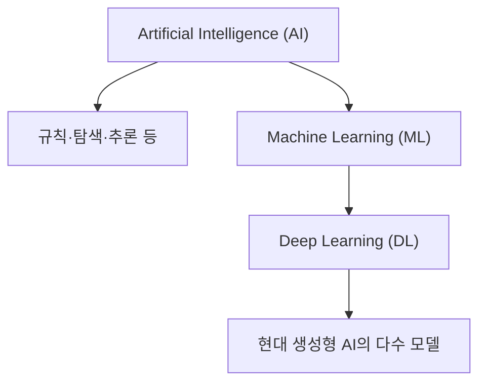
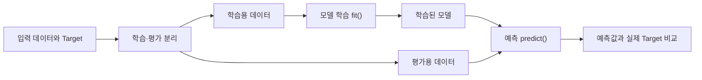

# Chapter 01. Introduction to Artificial Intelligence

인공지능(Artificial Intelligence, AI)은 인식·추론·예측 등 지능적인 작업을 컴퓨터가 수행하도록 연구하는 분야입니다. Chapter 01에서는 규칙 기반 자동화와 머신러닝(Machine Learning, ML)의 차이, 딥러닝(Deep Learning, DL)과 생성형 AI(Generative AI)의 관계를 살펴봅니다. 분류 모델을 직접 실행하며 학습·예측·평가의 흐름과 결과 해석의 한계를 확인합니다.

- **학습 환경:** Google Colab(기본), VS Code 또는 Jupyter Notebook(로컬)
- **실습 언어:** Python 3.11 이상 권장
- **주요 도구:** NumPy, Pandas, Matplotlib, scikit-learn
- **실습 데이터:** 실습용 합성 데이터(Synthetic Data), scikit-learn 내장 붓꽃·손글씨 숫자 데이터셋

<details>
<summary><strong>선행 학습 목록</strong></summary>

- [Python 기초 정리](../../PythonGuide/) — 변수, 함수, 조건문, 반복문
- [Data Processing](../../Data_Processing/) — NumPy 배열, Pandas DataFrame(선택)
- [Data Visualization](../../Data_Visualization/) — 그래프 읽기와 해석(선택)

</details>

<a id="contents"></a>
## Contents

| Section | Topic |
|:---:|---|
| [1.1](#section-1-1) | **Learning Goals & Getting Started** — 학습 목표와 실습 환경 |
| [1.2](#section-1-2) | **What Is Artificial Intelligence?** — 인공지능의 개념과 범위 |
| [1.3](#section-1-3) | **Rule-Based Systems & Machine Learning** — 규칙과 학습의 차이 |
| [1.4](#section-1-4) | **AI, ML, DL & Generative AI** — 주요 기술의 관계 |
| [1.5](#section-1-5) | **Data, Training & Inference** — 특성·타깃·모델·예측 |
| [1.6](#section-1-6) | **AI Tasks & Real-World Applications** — 분류·예측·추천·생성 |
| [1.7](#section-1-7) | **Limitations & Responsible AI** — 오류·편향·개인정보·검토 |
| [1.8](#section-1-8) | **Examples** — Python 분류 예제와 결과 해석 |
| [1.9](#section-1-9) | **Coding Practice** — 기초 구현과 응용 연습 |
| [1.10](#section-1-10) | **Mini Projects** — 날씨 판단과 붓꽃 분류 |
| [1.11](#section-1-11) | **Advanced Projects** — 드문 사건과 손글씨 검토 |
| [1.12](#section-1-12) | **Quiz** — 개념·사례·코드 분석 |
| [1.13](#section-1-13) | **Summary** — 핵심 개념 정리 |
| [1.14](#section-1-14) | **References** — 공식 참고 문서 |

---

<a id="section-1-1"></a>
## 1.1. Learning Goals & Getting Started

### 학습 목표

학습을 마치면 다음 내용을 설명할 수 있습니다.

1. 자동화 프로그램과 ML 모델의 차이
2. AI, ML, DL, Generative AI의 범위와 관계
3. 입력 데이터·Target·Training·Inference의 역할
4. Accuracy가 높아도 특정 사건을 놓칠 수 있는 이유
5. AI의 예측 결과에 추가 검토가 필요한 상황

### 실행 준비

[Google Colab](https://colab.research.google.com/)에서는 [`Chapter_01_Introduction_to_AI.ipynb`](./notebooks/Chapter_01_Introduction_to_AI.ipynb)를 업로드하여 코드 셀을 순서대로 실행할 수 있습니다. VS Code나 Jupyter Notebook에서도 동일한 예제를 실행할 수 있습니다. Chapter 01의 실습에는 GPU가 필요하지 않습니다.

`Chapter-01/` 폴더를 기준으로 다음 명령을 사용합니다.

```bash
python -m pip install -r requirements.txt
python examples/01_nearest_example.py
```

Colab에 필요한 패키지가 없다면 Notebook에서 `%pip install 패키지명`을 실행합니다. 런타임을 종료하면 세션 파일이 삭제될 수 있으므로 Notebook과 결과물은 별도로 저장해야 합니다.

### 이번 Chapter에서 다루는 데이터

| 데이터 | 내용 | 출처 |
|---|---|:---:|
| 날씨 선택 기록 | 강수 확률과 풍속에 따른 우산 선택 여부 100건 | 실습용 합성 데이터 |
| 붓꽃(Iris) | 4개 측정값과 3개 품종을 가진 150개 샘플 | scikit-learn 내장 데이터 |
| 센서 기록 | 일반 360건, 드문 사건 40건 | 실습용 합성 데이터 |
| 손글씨 숫자(Digits) | 8×8 픽셀 손글씨 숫자 1,797개 | scikit-learn 내장 데이터 |

날씨·센서 기록은 실습용 합성 데이터로, 실제 사람의 행동이나 운영 통계를 나타내지 않습니다. 데이터 생성 방법과 각 열의 정의는 [`data/README.md`](./data/README.md)에 정리했습니다.

---

<a id="section-1-2"></a>
## 1.2. What Is Artificial Intelligence?

### AI의 범위

AI는 이미지 인식, 음성 처리, 예측, 의사결정처럼 지능적인 처리가 필요한 작업을 컴퓨터로 수행하는 기술을 다룹니다. 입력 이미지를 분류하거나 문장을 생성하는 시스템이 대표적인 예입니다.

AI 시스템이 사람과 같은 방식으로 사고한다는 뜻은 아닙니다. 문제에 따라 사람이 작성한 규칙이나 학습된 모델로 결과를 계산합니다.

| 예시 | 입력 | 프로그램의 결과 |
|---|---|---|
| 사진 속 동물 분류 | 이미지 | 개·고양이 등 동물의 종류 |
| 음성 인식 | 소리 | 글자로 변환한 문장 |
| 교통량 예측 | 과거 교통량과 시간 | 다음 시간의 예상 차량 수 |
| 글 생성 | 질문과 앞선 문장 | 이어지는 문장 |
| 콘텐츠 추천 | 시청·선택 이력 | 관심을 가질 만한 항목 |

### 자동화와 AI의 차이

자동화(Automation)는 정해진 절차에 따라 작업을 수행하는 방식입니다. 매일 오후 5시에 컴퓨터를 종료하는 타이머가 그 예입니다. AI도 자동화에 활용될 수 있지만, 작업이 자동으로 실행된다는 사실만으로 AI라고 분류할 수는 없습니다. 판단 기준을 사람이 직접 정했는지, 모델이 데이터를 이용해 학습했는지 등을 구분해야 합니다.

### 약한 AI와 범용 AI

- **특정 목적 AI(Narrow AI):** 사진 분류, 음성 인식처럼 주어진 작업에 초점을 둔 시스템입니다.
- **범용 인공지능(Artificial General Intelligence, AGI):** 다양한 지적 작업을 폭넓게 수행하는 시스템을 논의할 때 사용하는 개념입니다. 정의와 도달 기준에는 논쟁이 있으며, 특정 서비스의 광고 문구만으로 범용 AI라고 단정할 수 없습니다.

이 과정에서는 구현과 평가가 가능한 Narrow AI를 중심으로 다룹니다.

---

<a id="section-1-3"></a>
## 1.3. Rule-Based Systems & Machine Learning

### 사람이 규칙을 직접 작성하는 방법

강수 확률만으로 우산 선택 여부를 결정하는 간단한 규칙을 가정합니다.

> 강수 확률이 60% 이상이면 우산을 준비한다.

임계값은 프로그래머가 지정합니다.

```python
rain_probability = 70

if rain_probability >= 60:
    print("우산 준비")
else:
    print("우산 없이 이동")
```

프로그램은 입력값에 따라 결과를 바꾸지만 실행 경험을 학습하지는 않습니다. 임계값 `60`을 조정하려면 코드를 수정해야 합니다.

### 데이터에서 판단 기준을 학습하는 방법

반면 강수 확률·풍속과 우산 선택 여부로 구성된 실습용 합성 데이터가 있다면, **ML 모델** 은 데이터에 나타난 패턴을 학습하여 새로운 날씨 조건에서 우산 선택 여부를 예측할 수 있습니다.

| 방식 | 판단 기준의 출처 | 장점 | 주의점 |
|---|---|---|---|
| 규칙 기반 | 사람이 직접 지정한 조건 | 단순한 규칙을 이해하고 설명하기 쉽습니다. | 복잡한 예외마다 규칙을 추가해야 할 수 있습니다. |
| ML | 학습 데이터에 나타난 패턴 | 여러 입력 변수 사이의 관계를 활용할 수 있습니다. | 데이터 품질과 학습 범위에 영향을 받습니다. |

규칙이 명확한 작업은 단순한 조건문만으로도 처리할 수 있습니다. 반면 여러 입력 변수 사이의 관계가 복잡하다면 ML을 검토할 수 있습니다. 작업의 특성과 검증 비용에 따라 적절한 방법이 달라집니다.

> 규칙 기반 프로그램은 사람이 판단 조건을 작성합니다. ML은 데이터에 나타난 관계를 이용해 예측 방법을 구성하며, KNN처럼 학습 사례를 저장하고 새 입력과 비교하는 모델도 있습니다.

---

<a id="section-1-4"></a>
## 1.4. AI, ML, DL & Generative AI

AI·ML·DL은 기술적 범위를, Generative AI는 주로 모델의 생성 목적을 나타냅니다.

| 개념 | 의미 | 예시 |
|---|---|---|
| **Artificial Intelligence (AI)** | 지능적인 작업을 수행하는 컴퓨터 시스템을 연구·개발하는 분야 | 탐색·추론·이미지 인식 |
| **Machine Learning (ML)** | 데이터에서 패턴을 학습하여 예측이나 판단에 이용하는 AI의 접근 방식 | 붓꽃 분류, 수요 예측 |
| **Deep Learning (DL)** | 여러 층의 인공신경망을 활용하는 ML의 접근 방식 | 복잡한 이미지·음성 인식 |
| **Generative AI** | 텍스트·이미지·소리 등 새로운 내용을 생성하는 모델과 응용 | 문장 생성, 이미지 생성 |



DL은 ML에 속하고, ML은 AI의 한 접근 방식입니다. 현대의 Generative AI 모델 대부분은 DL을 활용하지만, 생성이라는 목적과 DL이라는 구현 방식은 다른 개념입니다. DL 모델이 모두 콘텐츠를 생성하는 것은 아닙니다.

### 분류 모델과 생성 모델의 차이

- **분류(Classification):** 입력을 미리 정한 범주 중 하나로 판단합니다. 예를 들어 사진을 보고 `고양이`라고 예측합니다.
- **생성(Generation):** 학습한 패턴을 활용해 새로운 문장·이미지 등을 만들어 냅니다. 예를 들어 `고양이가 우주선을 타는 이야기`라는 입력으로 문장을 생성합니다.

생성된 내용이 자연스럽더라도 정확성이 보장되지는 않으므로 별도의 검증이 필요합니다.

---

<a id="section-1-5"></a>
## 1.5. Data, Training & Inference

### AI가 다루는 데이터의 구조

붓꽃을 구분하는 모델을 예로 들어보겠습니다.

| 꽃잎 길이 (cm) | 꽃잎 너비 (cm) | 품종 |
|---:|---:|---|
| 1.4 | 0.2 | A |
| 4.5 | 1.5 | B |
| 5.9 | 2.1 | C |

꽃잎 길이와 너비는 품종을 예측하는 데 사용하는 **특성(Feature)** 이고, 품종은 ** 타깃(Target)** 입니다. Classification에서 범주를 나타내는 Target은 ** 레이블(Label)** 이라고도 부릅니다. 표의 각 행은 하나의 ** 샘플(Sample)** 입니다.

- **입력 데이터(Input Data, `X`):** 모델에 전달되는 데이터입니다. 각 Sample은 하나 이상의 Feature로 구성됩니다.
- **Target (`y`):** 모델이 예측하도록 설정된 값입니다. Classification에서는 범주를 나타내는 Label을 사용하고, ** 회귀(Regression)** 에서는 연속적인 수치를 예측합니다. 단, 모든 ML 학습에 Target이 필요한 것은 아닙니다.
- **모델(Model):** 학습 데이터에서 패턴을 학습하고, 새로운 입력에 대한 예측이나 판단을 수행하는 수학적 함수 또는 시스템입니다.

### 학습과 예측의 흐름



1. **데이터 준비:** 입력 데이터의 Feature와 예측 대상인 Target을 구분합니다.
2. **학습(Training):** 학습 데이터에서 패턴을 찾아 모델을 학습시킵니다.
3. **추론(Inference):** 학습된 모델에 새로운 입력을 전달해 예측 결과를 얻습니다.
4. **평가(Evaluation):** 학습에 사용하지 않은 평가 데이터로 모델의 예측 성능을 확인합니다.

`fit()`과 `predict()`는 scikit-learn에서 사용하는 대표적인 함수 이름입니다. 구체적인 학습 방법과 손실 함수는 Chapter 02~04에서 자세히 다룹니다.

### 왜 데이터를 나누나요?

학습에 사용한 데이터로 모델을 평가하면 새로운 입력에 대한 성능을 과대평가할 수 있습니다. 따라서 학습 데이터와 평가 데이터를 분리하고, 평가용 자료는 학습에 사용하지 않습니다.

```python
from sklearn.model_selection import train_test_split

X_train, X_test, y_train, y_test = train_test_split(
    X, y, test_size=0.2, random_state=42, stratify=y
)
```

여기서 `X`는 입력 데이터, `y`는 각 Sample에 대응하는 Target입니다. `test_size=0.2`는 전체 데이터의 20%를 테스트용으로 분리한다는 뜻이고, `random_state=42`는 데이터 분할에 사용되는 난수 조건을 고정합니다. `stratify=y`는 Classification에서 클래스 비율을 비슷하게 유지하는 옵션입니다.

평가 데이터를 모델 학습이나 전처리 기준 설정에 미리 사용하면 **데이터 누출(Data Leakage)** 이 발생할 수 있습니다. 예제에서는 `StandardScaler`와 모델을 Pipeline으로 연결해 학습 데이터에 대해서만 `fit()`을 수행합니다.

### 간단한 거리 계산

두 개의 Feature로 표현된 점 $a$, $b$ 사이의 유클리드 거리(Euclidean Distance)는 다음과 같습니다.

$$
\mathrm{Distance}(a,b) = \sqrt{(a_1-b_1)^2 + (a_2-b_2)^2}
$$

- $a_1$, $a_2$: 첫 번째 Sample의 두 Feature 값
- $b_1$, $b_2$: 두 번째 Sample의 두 Feature 값

예를 들어 $(2, 1)$과 $(4, 3)$의 거리는 $\sqrt{(2-4)^2+(1-3)^2}=\sqrt{8}\approx2.83$입니다. 두 점 사이의 거리가 가깝다고 해서 Label까지 반드시 같은 것은 아니지만, 가까운 Sample을 이용하는 분류 방식의 기본 아이디어를 보여줍니다.

---

<a id="section-1-6"></a>
## 1.6. AI Tasks & Real-World Applications

AI 모델을 설계할 때는 사용할 알고리즘보다 입력과 예측 대상을 먼저 정의해야 합니다.

| 문제 유형 | 입력 예시 | 결과 예시 | 확인할 점 |
|---|---|---|---|
| **Classification** | 고양이·강아지 사진 | `cat` / `dog` | 정답 범주의 정의 |
| **Regression** | 시간·기온·이전 전력 사용량 | 다음 시간의 예상 사용량 | 단위와 오차 크기 |
| **Recommendation** | 관심사·시청 기록 | 추천할 영상 목록 | 추천 기준과 다양성 |
| **Recognition** | 음성·손글씨 | 인식한 단어·숫자 | 잘못 인식할 가능성 |
| **Generation** | 문장·그림 요청 | 새 글·이미지 | 사실성, 출처, 권리 |

같은 입력 데이터라도 예측 대상이 달라지면 문제 유형도 달라집니다. 예를 들어 기온 데이터로 `더움/보통/추움` 중 하나를 예측한다면 Classification, 다음 시간의 기온을 수치로 예측한다면 Regression입니다.

### AI가 실제로 사용되는 곳

- **일상생활:** 사진 정리, 번역, 음성 입력, 검색과 추천
- **교육:** 학습 자료 검색, 개별 학습 수준에 맞춘 예제 제공
- **제조·운영:** 센서 이상 징후 탐색, 설비 상태 예측
- **교통:** 이동량 예측, 도로·운행 정보 분석
- **창작:** 문장 초안, 이미지·음악 등 콘텐츠 생성

AI 적용 여부는 문제의 특성, 입력 데이터, 평가 기준을 바탕으로 판단합니다.

---

<a id="section-1-7"></a>
## 1.7. Limitations & Responsible AI

모델이 정상적으로 실행되더라도 예측은 틀릴 수 있습니다. 학습 범위 밖의 입력이나 구분하기 어려운 사례에서는 특히 오류가 발생하기 쉽습니다.

### ① 데이터에 따른 한계

학습 데이터가 특정 조건에 치우쳐 있으면 다른 환경에서 성능이 떨어질 수 있습니다. 예를 들어 낮에 촬영한 사진만 학습했다면 야간 사진의 분류 오류가 늘어날 수 있습니다.

### ② 지표에 따른 착시

100건 중 90건이 일반, 10건이 드문 사건인 데이터에서 모든 사례를 `일반`이라고 예측하면 **정확도(Accuracy)** 는 90%입니다.

$$
\mathrm{Accuracy}=\frac{N_{\mathrm{correct}}}{N_{\mathrm{total}}} \times 100\%
$$

- $N_{\mathrm{correct}}$: 정확히 분류한 Sample 수
- $N_{\mathrm{total}}$: 전체 평가 Sample 수

그런데 드문 사건 10건은 모두 놓칩니다. 전체 Accuracy만으로는 특정 클래스에서의 성능을 알 수 없으므로, 실제 드문 사건을 얼마나 찾아냈는지 **재현율(Recall)** 도 계산해야 합니다.

$$
\mathrm{Rare\ Event\ Recall}=\frac{N_{\mathrm{rare,detected}}}{N_{\mathrm{rare,actual}}}
$$

- $N_{\mathrm{rare,detected}}$: 실제 드문 사건 중 찾아낸 수
- $N_{\mathrm{rare,actual}}$: 실제 드문 사건 전체 수

실제 드문 사건이 없으면 Recall은 계산할 수 없습니다. 이 경우는 0%가 아니라 **자료 없음** 으로 구분합니다. 지표의 자세한 해석은 Chapter 04에서 다룹니다.

### ③ 생성 결과의 사실성

생성형 AI가 자신 있게 답하더라도 존재하지 않는 자료를 인용하거나 틀린 숫자를 제시할 수 있습니다. 이를 흔히 **환각(Hallucination)** 문제라고 부릅니다. 결과가 자연스럽다는 이유만으로 정확하다고 판단하지 않고, 중요한 내용은 근거 자료와 대조해야 합니다.

### ④ 개인정보와 사람의 책임

실제 개인정보나 비밀번호를 허가 없이 모델·외부 서비스에 입력해서는 안 됩니다. 모델을 사용할 때는 학습 데이터의 사용 권한, 결과의 공정성, 오류가 발생했을 때의 책임도 검토해야 합니다. 특히 사람의 안전·권리 등에 영향을 줄 수 있는 판단에서는 사람의 감독과 검토가 중요합니다.

중요한 판단에서는 모델의 출력을 최종 결론으로 사용하기 전에 근거와 오류 가능성을 확인해야 합니다.

---

<a id="section-1-8"></a>
## 1.8. Examples

### Example 01 — 가장 가까운 사례로 분류하기

새 입력에 가장 가까운 학습 샘플을 찾고, 해당 Label을 예측 결과로 사용합니다. 이 예제는 두 Feature로 표현된 샘플과 새 입력 사이의 거리 계산을 보여줍니다.

**실행 코드:** [`01_nearest_example.py`](./examples/01_nearest_example.py)

```python
import numpy as np

samples = np.array([[2, 1], [3, 2], [7, 7], [8, 6]], dtype=float)
labels = np.array(["A", "A", "B", "B"])
query = np.array([4, 3], dtype=float)

distances = np.linalg.norm(samples - query, axis=1)
nearest = np.argmin(distances)

print(labels[nearest])  # A
```

`np.linalg.norm()`은 각 샘플과 새 입력 사이의 거리를 계산하고, `np.argmin()`은 가장 짧은 거리의 인덱스를 반환합니다. **최근접 이웃(K-Nearest Neighbors, KNN)** 분류기는 여러 이웃을 이용해 Label을 예측합니다.

### Example 02 — 규칙 기반과 학습 기반 비교

같은 날씨 자료를 사용해 `강수 확률 60% 이상`이라는 사람이 정한 규칙과 데이터를 학습한 모델을 비교합니다.

**실행 코드:** [`02_rule_vs_learning.py`](./examples/02_rule_vs_learning.py)

```bash
python examples/02_rule_vs_learning.py
```

평가 데이터 25건에서 규칙 기반 방식은 84.0%, 학습 모델은 96.0%의 Accuracy를 보였습니다. 이는 고정된 합성 데이터와 분할 조건에서 얻은 결과이며, 다른 데이터에서도 동일한 순위가 유지되는 것은 아닙니다.

### Example 03 — 첫 번째 붓꽃 분류 모델

scikit-learn의 Iris 데이터셋으로 품종을 분류합니다. **표준화(Standardization)** 와 KNN을 Pipeline으로 연결해 학습 데이터에서 계산한 변환 기준을 평가 데이터에 적용합니다.

**실행 코드:** [`03_iris_classification.py`](./examples/03_iris_classification.py)

```python
from sklearn.datasets import load_iris
from sklearn.model_selection import train_test_split
from sklearn.neighbors import KNeighborsClassifier
from sklearn.pipeline import make_pipeline
from sklearn.preprocessing import StandardScaler

iris = load_iris()
X_train, X_test, y_train, y_test = train_test_split(
    iris.data, iris.target,
    test_size=0.2, random_state=42, stratify=iris.target,
)

model = make_pipeline(StandardScaler(), KNeighborsClassifier(n_neighbors=5))
model.fit(X_train, y_train)
predictions = model.predict(X_test)

print((predictions == y_test).mean())  # 약 0.933
```

`fit()`은 모델 학습, `predict()`는 예측에 사용합니다. `n_neighbors=5`는 가장 가까운 샘플 다섯 개를 참고하도록 지정한 값입니다.


그림은 평가 데이터의 꽃잎 길이·너비와 예측 품종을 보여줍니다. `×`는 잘못 분류한 Sample입니다. 그래프에는 두 Feature만 표시되지만 **실제 모델에는 네 가지 측정값이 모두 입력됩니다.**

<details>
<summary><strong>예제 실행 결과 해설</strong></summary>

평가 데이터 30개 중 28개를 정확히 분류해 Accuracy는 약 93.3%였습니다. 오분류는 2건이며, 두 품종 사이에 유사한 측정값이 나타날 수 있습니다. 다른 환경에서의 성능을 판단하려면 별도의 평가가 필요합니다.

</details>

---

<a id="section-1-9"></a>
## 1.9. Coding Practice

실습용 코드는 [`exercises/`](./exercises/)에, 모범답안은 [`solutions/`](./solutions/)에 있습니다.

### Practice 01 — 가장 가까운 사례 찾기

[`exercises/01_nearest_neighbor.py`](./exercises/01_nearest_neighbor.py)의 `predict_one()`을 완성합니다. 참고 점 세 개 중 `query = [5, 5]`와 가장 가까운 Sample의 Label을 반환해야 합니다.

**예상 출력:** `B`

<details>
<summary><strong>정답 및 해설</strong></summary>

```python
distances = np.linalg.norm(samples - query, axis=1)
return str(labels[int(np.argmin(distances))])
```

거리의 최솟값이 아니라 최솟값의 인덱스로 Label을 선택합니다. 전체 코드는 [`practice_01_nearest_neighbor.py`](./solutions/practice_01_nearest_neighbor.py)에 있습니다.

</details>

### Practice 02 — 정확도와 드문 사건 재현율

[`exercises/02_accuracy_and_recall.py`](./exercises/02_accuracy_and_recall.py)를 완성합니다. 정답이 `[0, 0, 1, 0, 1, 0]`, 예측이 `[0, 0, 0, 0, 1, 0]`인 경우 전체 정확도와 드문 사건(1)의 재현율을 각각 구합니다.

**예상 출력:** `(0.8333..., 0.5)`

<details>
<summary><strong>정답 및 해설</strong></summary>

```python
accuracy = float(np.mean(y_true == y_pred))
positive = y_true == 1
rare_recall = float(np.mean(y_pred[positive] == 1)) if positive.any() else None
return accuracy, rare_recall
```

전체 6개 중 5개를 맞혔지만, 실제 드문 사건 2개 중에는 1개만 찾아냈습니다. 실제 드문 사건이 하나도 없는 경우 재현율을 0%로 단정하지 않고 `None`으로 반환합니다. 전체 코드는 [`practice_02_accuracy_and_recall.py`](./solutions/practice_02_accuracy_and_recall.py)에 있습니다.

</details>

### Practice 03 — 검토 대상 표시하기

[`exercises/03_review_gate.py`](./exercises/03_review_gate.py)를 완성합니다. 투표 비율이 `[1.0, 0.8, 0.6, 0.4]`, 기준이 `0.8`이라면 기준 미만인 위치만 `True`로 반환합니다.

**예상 출력:** `[False, False, True, True]`

<details>
<summary><strong>정답 및 해설</strong></summary>

```python
return np.asarray(votes, dtype=float) < threshold
```

기준 미만의 값만 검토 대상으로 표시하므로 0.8은 자동 처리 대상입니다. 전체 코드는 [`practice_03_review_gate.py`](./solutions/practice_03_review_gate.py)에 있습니다.

</details>

### Practice 04 — 어떤 기술이 필요한지 판단하기

도서관에서 다음 두 기능을 요청했습니다.

- 매일 오전 9시에 열람실 조명을 켜는 기능
- 책의 대출 이력을 분석해 다음에 관심을 가질 책을 추천하는 기능

두 기능에 꼭 같은 기술이 필요한지 설명하고, 먼저 구현할 방법을 제안하세요.

<details>
<summary><strong>정답 및 해설</strong></summary>

첫 번째 기능은 정해진 시각에 명령을 수행하는 규칙 기반 자동화로 구현할 수 있습니다. 두 번째 기능은 대출 이력과 도서 정보를 이용하는 추천 모델을 검토할 수 있습니다. 추천이 필요한 수준과 개인정보 수집 범위도 함께 판단해야 합니다.

</details>

### Practice 05 — AI의 판단 결과 점검하기

새로운 이미지를 분류한 프로그램이 `고양이, 90%`라는 결과를 출력했습니다. 이 결과를 실제 고양이가 존재할 **확률이 정확히 90%** 라는 뜻으로 바로 해석해도 될까요? 그 이유를 설명하세요.

<details>
<summary><strong>정답 및 해설</strong></summary>

바로 그렇게 해석할 수는 없습니다. 출력값은 모델의 계산 방식에서 얻어진 점수나 확률 추정치일 수 있으며, **실제 사건의 빈도와 일치하도록 보정되어 있는지** 확인해야 합니다. 입력 이미지가 학습 데이터와 크게 다르다면 높은 점수를 내더라도 오분류할 수 있습니다.

</details>

---

<a id="section-1-10"></a>
## 1.10. Mini Projects

Mini Project에서는 분류 모델을 구현하고 동일한 조건에서 결과를 비교합니다. 프로젝트별 요구사항은 각 README에 정리했습니다.

| 프로젝트 | 핵심 목표 | 자료 |
|---|---|---|
| **Mini 01 — Rule-Based vs Learning-Based Weather Decision** | 날씨 판단 규칙과 데이터 기반 분류를 같은 평가 자료로 비교 | [프로젝트 README](./projects/mini_01_weather_decision/README.md) · [결과 그림](./figures/mini_01_weather_decision.png) |
| **Mini 02 — Iris Classification Explorer** | 꽃의 측정값으로 품종을 분류하고 오분류 사례를 확인 | [프로젝트 README](./projects/mini_02_iris_explorer/README.md) · [결과 그림](./figures/mini_02_iris_confusion.png) |

모범 구현은 각각 `solutions/mini_01_weather_decision.py`, `solutions/mini_02_iris_explorer.py`에서 확인할 수 있습니다. 실습 코드는 각 프로젝트 폴더의 `starter.py`에 있습니다.

---

<a id="section-1-11"></a>
## 1.11. Advanced Projects

Advanced Project에서는 특정 클래스의 오분류와 자동 처리 기준을 분석합니다. 모델의 세부 수학적 원리는 후속 Chapter에서 다룹니다.

| 프로젝트 | 핵심 목표 | 자료 |
|---|---|---|
| **Advanced 01 — Rare Event Detection & Misleading Accuracy** | 정확도는 높아도 드문 사건을 놓칠 수 있는 문제 분석 | [프로젝트 README](./projects/advanced_01_rare_event/README.md) · [결과 그림](./figures/advanced_01_rare_event.png) |
| **Advanced 02 — Handwritten Digit Recognition & Human Review** | 손글씨 숫자 분류 후 불확실한 사례를 사람의 확인 대상으로 분리 | [프로젝트 README](./projects/advanced_02_digit_review/README.md) · [결과 그림](./figures/advanced_02_digit_review.png) |

구현 단계와 테스트 시나리오는 프로젝트별 README에, 모범 구현은 `solutions/`에 있습니다.

---

<a id="section-1-12"></a>
## 1.12. Quiz — AI Fundamentals & Reasoning

개념·코드·결과 해석을 확인하는 문제입니다. 정답은 각 문항의 접이식 해설에서 확인할 수 있습니다.

### 객관식

**Q01. 규칙 기반 자동화와 ML의 차이**

학교 방송실에서 매일 8시 50분에 종을 울리는 프로그램을 만들었습니다. 이 프로그램에 대한 설명으로 가장 적절한 것은 무엇인가요?

- **A.** 정해진 시간에 실행되므로 반드시 ML 모델입니다.
- **B.** 시간을 입력받아 동작하므로 생성형 AI입니다.
- **C.** 정해진 조건을 수행하는 자동화이며, 데이터로 규칙을 학습한다는 근거는 없습니다.
- **D.** 반복 실행하면 실행 시각을 스스로 학습하여 바꿉니다.

<details>
<summary><strong>정답 및 해설</strong></summary>

**정답: C**

정해진 시간에 실행하는 프로그램은 규칙 기반 자동화입니다. 반복 실행과 조건문 사용만으로 ML이라고 볼 수는 없습니다.

</details>

**Q02. AI·ML·DL의 관계**

다음 설명 중 가장 적절한 것은 무엇인가요?

- **A.** 모든 AI 시스템은 DL을 사용합니다.
- **B.** DL은 ML의 한 방식이고, ML은 AI의 한 접근 방식입니다.
- **C.** ML과 DL은 AI와 전혀 관계없는 기술입니다.
- **D.** Generative AI와 DL은 항상 정확히 같은 범위입니다.

<details>
<summary><strong>정답 및 해설</strong></summary>

**정답: B**

ML은 AI의 한 접근 방식이고, DL은 ML의 한 방법입니다. Generative AI는 생성 목적을 나타내므로 DL과 범위가 일치하지 않습니다.

</details>

**Q03. 입력과 결과로 문제 유형 구분하기**

최근 일주일간의 기온·습도를 입력하여 **다음 날 기온을 섭씨 숫자 하나로 예측** 하려고 합니다. 이 작업의 유형으로 가장 적절한 것은 무엇인가요?

- **A.** Classification
- **B.** Regression
- **C.** Image Generation
- **D.** Clustering

<details>
<summary><strong>정답 및 해설</strong></summary>

**정답: B**

예측 대상이 연속적인 수치인 기온(°C)이므로 Regression 문제입니다. `추움/보통/더움` 중 하나를 예측한다면 Classification 문제에 해당합니다. **같은 입력 데이터라도 출력 목표가 바뀌면 문제 유형이 달라집니다.**

</details>

**Q04. Feature와 Label**

손글씨 숫자를 분류하는 데이터셋에 이미지와 실제 숫자(0~9)가 함께 저장되어 있습니다. 가장 적절한 설명은 무엇인가요?

- **A.** 이미지의 픽셀값은 Feature이고, 실제 숫자는 Label입니다.
- **B.** 실제 숫자는 Feature이고, 이미지의 픽셀값은 Label입니다.
- **C.** 이미지의 픽셀값과 실제 숫자를 모두 Label로 설정해야 합니다.
- **D.** 모든 ML 학습에서는 Label을 사용하지 않습니다.

<details>
<summary><strong>정답 및 해설</strong></summary>

**정답: A**

이미지의 픽셀값이 Feature이고, 이미지가 나타내는 숫자는 Target이자 분류 Label입니다. 비지도학습처럼 Label 없이 학습하는 방식도 있습니다.

</details>

**Q05. 드문 사건에서의 정확도**

센서 기록 200개 중 정상 190개, 드문 사건 10개가 있습니다. 모든 관측을 정상이라고 분류하는 모델에 대한 설명으로 맞는 것은 무엇인가요?

- **A.** 정확도는 95%이지만 드문 사건 재현율은 0%입니다.
- **B.** 정확도와 드문 사건 재현율이 모두 95%입니다.
- **C.** 정확도는 5%, 드문 사건 재현율은 100%입니다.
- **D.** 클래스별 건수가 주어져도 정확도를 계산할 수 없습니다.

<details>
<summary><strong>정답 및 해설</strong></summary>

**정답: A**

전체 200개 중 정상 190개만 맞히므로 정확도는 $190/200\times100=95\%$입니다. 드문 사건 10개는 한 건도 찾아내지 못하므로 드문 사건 재현율은 $0/10=0\%$입니다. **전체 정확도만으로 중요한 사건을 얼마나 놓쳤는지 판단할 수 없습니다.**

</details>

**Q06. 생성형 AI 결과의 검증**

텍스트 생성 모델이 존재하지 않는 책 제목을 실제 참고 문헌처럼 제시했습니다. 이때 가장 적절한 대응은 무엇인가요?

- **A.** 자연스러운 문장이므로 원문을 확인하지 않고 인용합니다.
- **B.** 같은 질문을 반복하여 가장 자주 나온 제목을 사실로 인정합니다.
- **C.** 답변을 출력하는 데 성공했으므로 검증할 필요가 없습니다.
- **D.** 실제 서지 정보와 출처를 별도로 확인하고 검증되지 않은 인용은 제외합니다.

<details>
<summary><strong>정답 및 해설</strong></summary>

**정답: D**

Generative AI는 존재하지 않는 자료를 사실처럼 제시할 수 있습니다. 동일한 답변이 반복되더라도 신뢰성을 입증하는 것은 아니므로, 실제 서지 정보와 대조해야 합니다.

</details>

### 주관식

**Q07. KNN에서 Feature의 단위가 다른 경우**

새 입력과 학습 샘플 사이의 유클리드 거리를 이용해 분류합니다. Feature A는 0~1 범위, Feature B는 0~10,000 범위일 때 발생할 수 있는 문제와 개선 방법을 설명하세요.

<details>
<summary><strong>정답 및 해설</strong></summary>

**모범답안:** 별도 변환 없이 거리를 계산하면 값의 범위가 큰 Feature B가 거리 계산에 더 큰 영향을 줄 수 있습니다. `StandardScaler` 등으로 특성의 스케일을 맞춘 뒤 분류 결과를 비교할 수 있습니다. 이때 변환 기준은 학습 데이터에서만 계산하고 평가 데이터에는 같은 기준을 적용해야 합니다.

</details>

**Q08. 학습과 추론 구별하기**

다양한 고양이·강아지 이미지를 이용해 분류 모델을 준비한 뒤, 새로운 사진 한 장을 입력했습니다. 어느 부분이 학습이고 어느 부분이 추론인지 설명하세요.

<details>
<summary><strong>정답 및 해설</strong></summary>

**모범답안:** 여러 사진과 각각의 Label을 이용해 모델을 학습시키는 단계가 Training에 해당합니다. 학습된 모델에 새로운 사진을 입력해 고양이인지 강아지인지 예측하는 단계는 Inference입니다. 새로운 사진을 예측할 때 모델이 해당 사진의 Label을 미리 알고 있다고 가정해서는 안 됩니다.

</details>

**Q09. 데이터의 대표성이 중요한 이유**

낮에 촬영한 도로 사진만으로 학습한 모델을 밤에도 사용하려고 합니다. 예상되는 문제와 확인해야 할 사항을 설명하세요.

<details>
<summary><strong>정답 및 해설</strong></summary>

**모범답안:** 밤에는 조명·그림자·노이즈가 달라져 학습한 이미지와 입력 조건이 달라집니다. 따라서 실제 밤 사진에서 오류가 증가할 수 있습니다. 주간과 야간 데이터를 각각 평가하고, 야간 촬영 조건이 학습 데이터에 충분히 포함되어 있는지 확인해야 합니다.

</details>

**Q10. AI의 출력값을 이해하기**

모델이 사진에 대해 `cat: 0.9`라는 점수를 출력했습니다. 이것만으로 고양이일 실제 확률이 반드시 90%라고 말할 수 있을까요? 이유를 설명하세요.

<details>
<summary><strong>정답 및 해설</strong></summary>

**모범답안:** 반드시 그렇게 말할 수는 없습니다. 출력값은 모델의 점수 또는 확률 추정치일 수 있습니다. 실제 발생 비율과 잘 맞는지 판단하려면 확률 보정(Calibration) 등 별도의 평가가 필요합니다.

</details>

### 코드 분석

**Q11. 가장 가까운 Sample의 Label**

다음 코드의 출력값과 그 이유를 설명하세요.

```python
import numpy as np

distances = np.array([3.4, 1.2, 2.1])
labels = np.array(["A", "B", "C"])

print(labels[np.argmin(distances)])
```

<details>
<summary><strong>정답 및 해설</strong></summary>

**정답:** `B`

`np.argmin(distances)`는 배열에서 최솟값이 있는 **인덱스 1** 을 반환합니다. 따라서 `labels[1]`의 값인 `"B"`가 출력됩니다. 최솟값인 `1.2`가 아니라 위치 정보인 `1`을 이용해 해당 사례의 정답을 선택한다는 점이 중요합니다.

</details>

**Q12. 평가 데이터를 학습에 사용한 코드**

다음 코드는 학습용과 평가용 데이터를 이미 나눈 상태에서 작성되었습니다. 어떤 문제가 있는지 설명하고, 핵심 코드를 수정하세요.

```python
model.fit(X, y)
predictions = model.predict(X_test)
accuracy = (predictions == y_test).mean()
```

<details>
<summary><strong>정답 및 해설</strong></summary>

**문제 원인:** 전체 자료 `X`, `y`에 평가용 사례가 포함되어 있다면 모델이 평가할 데이터를 미리 학습합니다. 따라서 평가 결과가 새로운 데이터에 대한 성능을 과대평가할 수 있습니다.

**수정 코드**

```python
model.fit(X_train, y_train)
predictions = model.predict(X_test)
accuracy = (predictions == y_test).mean()
```

평가 데이터는 모델 학습뿐 아니라 데이터에 맞춘 전처리 기준을 정할 때도 사용하지 않아야 합니다. 새로운 데이터를 얼마나 잘 분류하는지 평가하려면 학습·평가의 역할을 분리해야 합니다.

</details>

---

<a id="section-1-13"></a>
## 1.13. Summary

| 개념 | 핵심 내용 |
|---|---|
| **Artificial Intelligence** | 인식·예측·추론·생성 등 지능적인 작업을 수행하는 컴퓨터 시스템의 기술 분야 |
| **Automation** | 작업을 자동 실행하는 방식이며, 모든 자동화에 ML이 필요한 것은 아님 |
| **Machine Learning** | 데이터의 패턴을 이용해 예측·판단에 필요한 관계를 학습하는 방법 |
| **Deep Learning** | 인공신경망의 여러 층을 활용하는 ML의 한 방식 |
| **Generative AI** | 새로운 텍스트·이미지 등을 생성하는 모델과 응용 |
| **Feature** | 모델이 예측에 활용하는 입력 데이터의 특성 |
| **Target / Label** | 예측하도록 설정된 값 / Classification에서 범주를 나타내는 레이블 |
| **Training / Inference** | 데이터를 이용한 모델 학습 / 새로운 입력에 대한 결과 생성 |
| **Evaluation** | 학습과 구분된 자료를 사용해 예측의 품질을 점검하는 과정 |
| **Limitations** | 데이터 편향, 드문 사건 누락, 예측 오류, 검증되지 않은 생성 결과 |
| **Human Review** | 중요한 결정이나 불확실한 사례를 사람이 추가 확인하는 절차 |

Chapter 02에서는 Feature·Target·Label을 바탕으로 모델과 손실 함수의 역할을 살펴봅니다.

### 실행 및 테스트

`Chapter-01/` 폴더에서 다음 명령을 실행할 수 있습니다.

```bash
python -m pip install -r requirements.txt
python examples/01_nearest_example.py
python examples/02_rule_vs_learning.py
python examples/03_iris_classification.py
python -m unittest discover -s tests -v
```

모범 구현은 `python solutions/파일명.py`로 실행합니다. 생성된 PNG는 `outputs/`에 저장되며, 문서에 사용한 예시 그림은 `figures/`에 있습니다.

---

<a id="section-1-14"></a>
## 1.14. References

### 공식 참고 문서

- [Google Colab](https://colab.research.google.com/)
- [Google Colab — FAQ](https://research.google.com/colaboratory/faq.html?hl=ko)
- [Python Documentation](https://docs.python.org/3/)
- [NumPy Documentation](https://numpy.org/doc/stable/)
- [scikit-learn — Getting Started](https://scikit-learn.org/stable/getting_started.html)
- [scikit-learn — Supervised Learning](https://scikit-learn.org/stable/supervised_learning.html)
- [scikit-learn — train_test_split](https://scikit-learn.org/stable/modules/generated/sklearn.model_selection.train_test_split.html)
- [scikit-learn — KNeighborsClassifier](https://scikit-learn.org/stable/modules/generated/sklearn.neighbors.KNeighborsClassifier.html)
- [scikit-learn — load_iris](https://scikit-learn.org/stable/modules/generated/sklearn.datasets.load_iris.html)
- [scikit-learn — load_digits](https://scikit-learn.org/stable/modules/generated/sklearn.datasets.load_digits.html)
- [scikit-learn — Model Evaluation](https://scikit-learn.org/stable/modules/model_evaluation.html)
- [NIST — AI Risk Management Framework](https://www.nist.gov/itl/ai-risk-management-framework)

---

[← AI 목차](../README.md) · [Contents](#contents)
