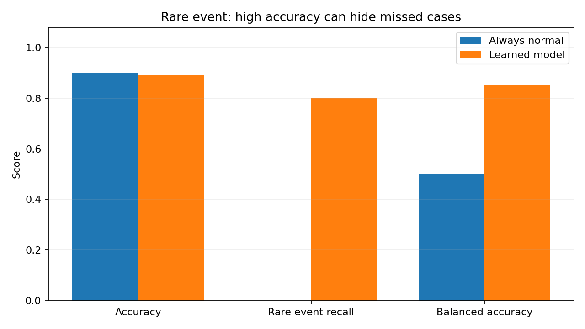

[← Chapter 01](../../README.md) · [Advanced Projects](../../README.md#section-1-11)

# Advanced Project 01. Rare Event Detection & Misleading Accuracy

## 문제 상황

센서 기록의 약 10%가 드문 사건에 해당합니다. 모든 입력을 정상으로 분류해도 높은 Accuracy를 얻을 수 있지만, 정작 드문 사건은 놓치게 됩니다. 두 모델을 비교해 Accuracy만으로 판단하기 어려운 이유를 분석하세요.

## 입력 데이터와 평가 지표

[`rare_events.csv`](../../data/rare_events.csv)는 400건의 **실습용 합성 데이터** 입니다. 실제 안전·의료·금융 분야의 사건 발생률을 나타내지 않습니다.

| 열 | 의미 |
|---|---|
| `record_id` | 샘플 식별자 |
| `sensor_a`, `sensor_b` | 수치형 입력 특성(Feature) |
| `is_rare_event` | 사건 여부를 나타내는 레이블(Label): 0 또는 1 |

- **정확도(Accuracy):** 전체 평가 샘플 중 올바르게 분류한 비율
- **재현율(Recall):** 실제 드문 사건 중 모델이 찾아낸 비율
- **균형 정확도(Balanced Accuracy):** 각 클래스 Recall의 평균

지표의 상세한 정의는 Chapter 04에서 다룹니다. 이 과제에서는 각 지표가 보여주는 정보의 차이를 비교합니다.

## 구현 STEP

1. **Input Validation:** 필수 열, 결측값, 중복 ID, 센서값의 유한성, 0/1 Label을 검사합니다.
2. **Class Distribution:** 정상·드문 사건의 건수와 비율을 계산합니다.
3. **Train/Test Split:** 75:25 층화 분할을 적용합니다.
4. **Baseline:** 모든 평가 샘플을 정상(0)으로 분류하는 기준 모델을 작성합니다.
5. **Learning Model:** `StandardScaler`와 `LogisticRegression(class_weight="balanced")`를 연결합니다.
6. **Metric Comparison:** 동일한 평가 데이터에서 Accuracy·Recall·Balanced Accuracy를 계산합니다.
7. **Visualization:** 지표 비교 그래프를 만들고 결과를 해석합니다.

<details>
<summary><strong>코드 힌트 — 드문 사건 Recall</strong></summary>

```python
rare_recall = recall_score(y_test, predicted, pos_label=1, zero_division=0)
```

실제 드문 사건이 없으면 Recall의 분모가 0이 됩니다. 제공 데이터에서는 평가 데이터에 드문 사건이 존재합니다.

</details>

<details>
<summary><strong>코드 힌트 — Balanced Accuracy</strong></summary>

```python
score = balanced_accuracy_score(y_test, predicted)
```

</details>

## 실행 및 결과

`Chapter-01/`에서 실행합니다.

```bash
python projects/advanced_01_rare_event/starter.py
python solutions/advanced_01_rare_event.py
```

평가 데이터 100건(드문 사건 10건)에서 기준 모델은 Accuracy 90.0%, Recall 0.0%입니다. 학습 모델은 예시 실행에서 Accuracy 89.0%, Recall 80.0%를 기록했습니다. 어느 모델을 선택할지는 오분류 비용에 따라 달라집니다.



## 테스트 시나리오

- `record_id` 중복·누락, 센서의 `NaN`·무한대 입력 시 검증 실패해야 합니다.
- 기준 모델의 드문 사건 Recall은 0%입니다.
- 모든 지표는 동일한 평가 데이터를 기준으로 계산해야 합니다.
- 정상 기록을 일부 제거하면 기존 Accuracy가 그대로 유지된다고 가정하지 않습니다.
- 결과에는 평가 건수와 지표 정의가 포함되어야 합니다.

**완료 기준:** Accuracy와 Recall의 차이를 수치와 그래프로 설명합니다.

---

[← Chapter 01](../../README.md) · [Contents](../../README.md#contents)
