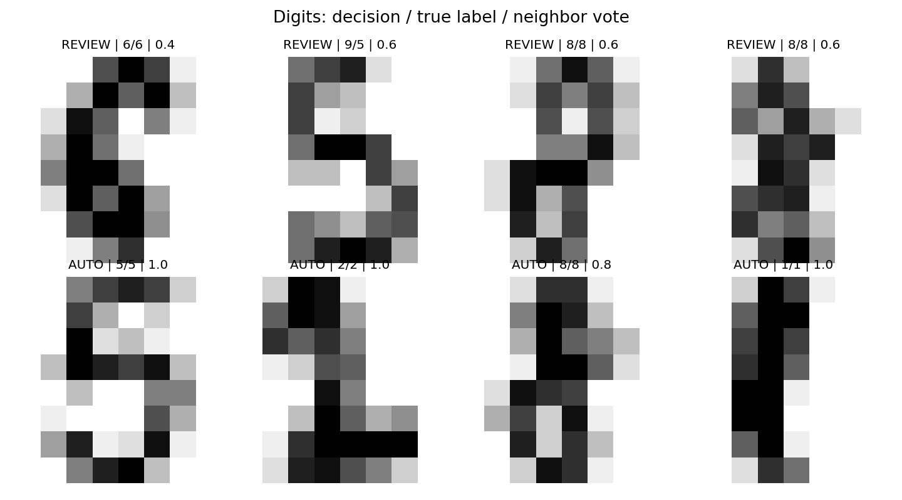

[← Chapter 01](../../README.md) · [Advanced Projects](../../README.md#section-1-11)

# Advanced Project 02. Handwritten Digit Recognition & Human Review

## 문제 상황

손글씨 숫자 이미지를 분류하고, 예측이 불확실한 샘플을 사람의 검토 대상으로 표시합니다. 검토 기준을 바꿨을 때 자동 처리 비중과 성능이 어떻게 달라지는지 분석하세요.

## 데이터와 검토 기준

`sklearn.datasets.load_digits()`는 1,797개의 손글씨 숫자 이미지를 제공합니다. 각 이미지는 8×8 픽셀, 즉 64개 입력 특성(Feature)으로 표현됩니다. 별도의 데이터 다운로드는 필요하지 않습니다.

KNN의 `predict_proba()`가 반환한 값은 가까운 이웃 다섯 개의 투표 비율에 해당합니다. 이 비율의 최댓값이 0.8 이상이면 자동 처리하고, 0.8 미만이면 검토 대상으로 분류합니다. 투표 비율을 실제 정답 확률과 동일하게 해석하지 않도록 주의합니다.

| 상태 | 조건 | 처리 |
|---|---|---|
| `AUTO` | 가장 높은 투표 비율 ≥ 0.8 | 예측 Label 자동 표시 |
| `REVIEW` | 가장 높은 투표 비율 < 0.8 | 사람의 확인 대상으로 표시 |

## 구현 STEP

1. **Data Inspection:** 이미지 수, Feature 수, 레이블(Label) 종류, 배열 형태를 확인합니다.
2. **Data Split:** 학습 80%, 평가 20%로 층화 분할한 뒤 `StandardScaler`와 KNN(이웃 5개)을 학습합니다.
3. **Prediction:** 평가 데이터의 예측 Label과 실제 Label을 비교합니다.
4. **Review Gate:** `predict_proba()`의 행별 최댓값이 기준 미만이면 `REVIEW`로 표시합니다.
5. **Metrics:** 전체 Accuracy, 자동 처리 Accuracy, 자동 처리·검토 건수를 계산합니다.
6. **Visualization:** 자동 처리와 사람 검토 사례를 나란히 표시합니다.
7. **Scenario Check:** 기준을 0.6·0.8·1.0으로 바꾸어 검토 건수 변화를 비교합니다.

<details>
<summary><strong>코드 힌트 — 검토 대상</strong></summary>

```python
votes = model.predict_proba(x_test).max(axis=1)
review_mask = votes < threshold
```

</details>

<details>
<summary><strong>코드 힌트 — 자동 처리 대상이 없을 때</strong></summary>

```python
auto_accuracy = (
    accuracy_score(y_test[~review_mask], predicted[~review_mask])
    if (~review_mask).any() else None
)
```

자동 처리 샘플이 없다면 Accuracy는 0%가 아니라 **자료 없음** 입니다.

</details>

## 실행 및 결과

`Chapter-01/`에서 다음 명령을 실행합니다.

```bash
python projects/advanced_02_digit_review/starter.py
python solutions/advanced_02_digit_review.py
```

기준 0.8에서 평가 360건 중 346건은 자동 처리, 14건은 검토 대상으로 분리됩니다. 전체 Accuracy는 약 96.4%, 자동 처리 대상의 Accuracy는 약 98.8%입니다. 다만 검토 대상으로 표시된 사례가 오분류 사례와 정확히 일치하는 것은 아닙니다.



## 테스트 시나리오

- `AUTO`와 `REVIEW`를 합하면 평가 데이터 수와 같아야 합니다.
- 기준을 높여도 `REVIEW` 건수가 줄어들어서는 안 됩니다.
- 기준 -0.1 또는 1.1은 유효하지 않은 입력으로 처리해야 합니다.
- 실제 Label은 평가 단계에서만 사용합니다. 새로운 입력의 정답을 미리 알 수 없기 때문입니다.
- 투표 비율이 높아도 오분류가 발생할 수 있습니다.

**완료 기준:** 자동 처리·검토 기준과 그 한계를 설명하고, 임계값 변화에 따른 결과를 제시합니다.

---

[← Chapter 01](../../README.md) · [Contents](../../README.md#contents)
