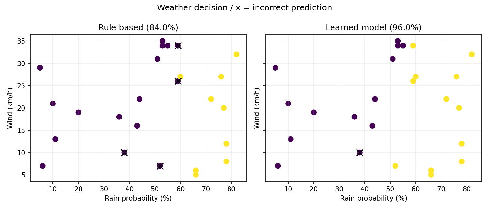

[← Chapter 01](../../README.md) · [Mini Projects](../../README.md#section-1-10)

# Mini Project 01. Rule-Based vs Learning-Based Weather Decision

## 문제 상황

날씨 정보를 보고 우산을 챙길지 추천하는 프로그램을 개발합니다. 첫 번째 프로그램은 사람이 지정한 규칙을 사용하고, 두 번째 프로그램은 과거 선택 데이터를 참고하여 분류합니다. **두 방법의 결과가 다를 수 있는 이유**를 비교하는 것이 목표입니다.

## 입력 데이터

[`weather_choices.csv`](../../data/weather_choices.csv)는 교육용 가상 데이터이며, 실제 기상 예측이나 안전 안내에 사용할 수 없습니다.

| 열 | 의미 | 값의 범위 |
|---|---|---|
| `case_id` | 사례 식별자 | 중복 없는 문자열 |
| `rain_probability_pct` | 강수 확률 | 0~100 (%) |
| `wind_speed_kmh` | 풍속 | 0 이상의 수치 (km/h) |
| `umbrella_chosen` | 가상 선택 기록 | 0: 미선택, 1: 선택 |

한 행은 **한 번의 선택 사례**를 의미합니다. `umbrella_chosen`은 미래의 정답이나 반드시 따라야 할 안전 기준이 아닙니다.

## 구현 STEP

1. **Data Inspection:** 각 열과 입력 행 수를 확인하고, 누락·중복·범위 밖 값을 검사합니다.
2. **Rule-Based Decision:** 강수 확률이 60% 이상이면 우산을 선택하는 규칙을 구현합니다.
3. **Train/Test Split:** 두 수치형 특징을 이용해 75%를 학습용, 25%를 평가용으로 나눕니다. `random_state=42`, `stratify=y`를 적용합니다.
4. **Learned Decision:** `StandardScaler`와 `KNeighborsClassifier(n_neighbors=5)`를 연결하여 학습합니다.
5. **Comparison:** 같은 평가 데이터에서 정확도를 계산하고 예측이 틀린 지점을 산점도에 표시합니다.
6. **Interpretation:** 어느 방식이 유리했는지와 그 결과만으로 일반화할 수 없는 이유를 설명합니다.

<details>
<summary><strong>코드 힌트 — 학습 데이터 분할</strong></summary>

```python
x_train, x_test, y_train, y_test = train_test_split(
    x, y, test_size=0.25, random_state=42, stratify=y
)
```

</details>

## 실행 및 결과

`Chapter-01/` 폴더에서 시작합니다.

```bash
python projects/mini_01_weather_decision/starter.py
```

`starter.py`는 직접 완성할 파일이므로 처음에는 `NotImplementedError`가 발생합니다. 비교를 위한 모범 구현은 [`solutions/mini_01_weather_decision.py`](../../solutions/mini_01_weather_decision.py)에 있습니다.

```bash
python solutions/mini_01_weather_decision.py
```

기본 데이터에서 규칙 기반은 **21/25 (84.0%)**, 학습 기반은 **24/25 (96.0%)**입니다. 결과는 `outputs/mini_01_weather_decision.png`에 저장됩니다. 이 수치는 해당 가상 데이터와 고정된 분할에만 해당합니다.



## 테스트 시나리오

- 유효 데이터에서 두 방식의 정답률이 0~1 범위인지 확인합니다.
- `case_id`를 중복시키거나 강수 확률을 101로 바꾸면 검증 오류가 발생해야 합니다.
- 동일한 데이터와 분할 조건에서 결과가 반복 재현되는지 확인합니다.
- 풍속이 같고 강수 확률만 다른 사례를 추가하면 결과가 반드시 같다고 가정해서는 안 됩니다.

**완료 기준:** 규칙과 학습 방식의 차이를 설명하고, 동일한 평가 데이터에서 비교한 결과와 한계를 제시합니다.

---

[← Chapter 01](../../README.md) · [Contents](../../README.md#contents)
