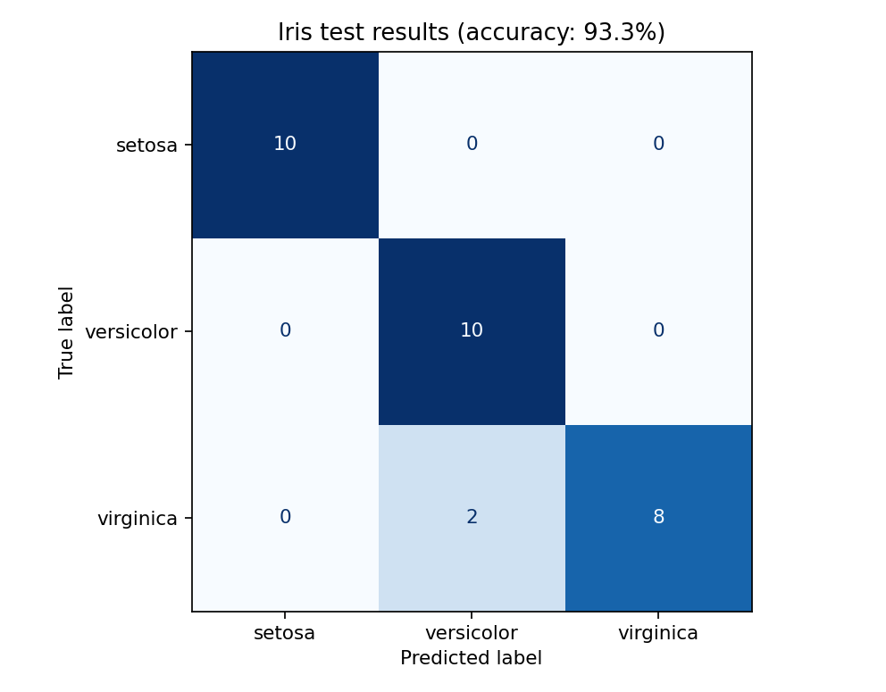

[← Chapter 01](../../README.md) · [Mini Projects](../../README.md#section-1-10)

# Mini Project 02. Iris Classification Explorer

## 문제 상황

꽃받침과 꽃잎의 길이·너비를 측정한 자료로 붓꽃의 종류를 예측합니다. **모델이 학습한 데이터와 평가에 사용하는 데이터를 구분하는 이유**를 실제 결과로 확인하세요.

## 입력 데이터

`sklearn.datasets.load_iris()`는 **150개 샘플, 4개 수치형 특징, 3개 품종**으로 구성된 내장 데이터셋입니다. 인터넷에서 파일을 다운로드할 필요가 없습니다. 측정 단위는 센티미터(cm)입니다.

| 입력 | 의미 |
|---|---|
| `X` | 꽃받침 길이·너비, 꽃잎 길이·너비 |
| `y` | 품종을 나타내는 0, 1, 2 |

## 구현 STEP

1. **Data Inspection:** 샘플 수, 특징 수, 품종별 샘플 수를 출력합니다.
2. **Data Split:** 학습 80%와 평가 20%로 분리합니다. `random_state=42`, `stratify=y`를 사용합니다.
3. **Training:** `StandardScaler`와 `KNeighborsClassifier(n_neighbors=5)`를 학습 데이터에만 적용합니다.
4. **Prediction:** 평가용 데이터 30개의 예측과 실제 정답을 비교합니다.
5. **Visualization:** 품종별 오분류 건수를 혼동행렬(Confusion Matrix)로 표현합니다.
6. **Interpretation:** 한 번의 평가 결과가 모든 환경에서 같은 성능을 보장하지 않는 이유를 설명합니다.

<details>
<summary><strong>코드 힌트 — 모델 구성</strong></summary>

```python
model = make_pipeline(StandardScaler(), KNeighborsClassifier(n_neighbors=5))
model.fit(x_train, y_train)
```

</details>

## 실행 및 결과

`Chapter-01/`에서 실행합니다.

```bash
python projects/mini_02_iris_explorer/starter.py
python solutions/mini_02_iris_explorer.py
```

`starter.py`는 미완성 실습 코드입니다. 모범 구현은 기본 분할에서 **평가 30건 중 28건을 정확하게 분류**합니다. 결과 그림은 `outputs/mini_02_iris_confusion.png`입니다.



## 테스트 시나리오

- 학습 데이터와 평가 데이터의 샘플 수 합계가 150인지 확인합니다.
- 혼동행렬의 모든 값의 합계가 평가 데이터 수 30과 같은지 확인합니다.
- 가까운 이웃의 수 `k`를 0으로 바꾸면 잘못된 설정으로 판정해야 합니다.
- 오분류가 0건이어도 모델이 절대로 틀리지 않는다고 해석하지 않습니다.

**완료 기준:** 학습·예측·평가의 구분, 정확도, 혼동행렬의 의미를 설명할 수 있습니다.

---

[← Chapter 01](../../README.md) · [Contents](../../README.md#contents)
