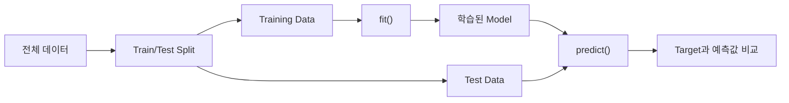
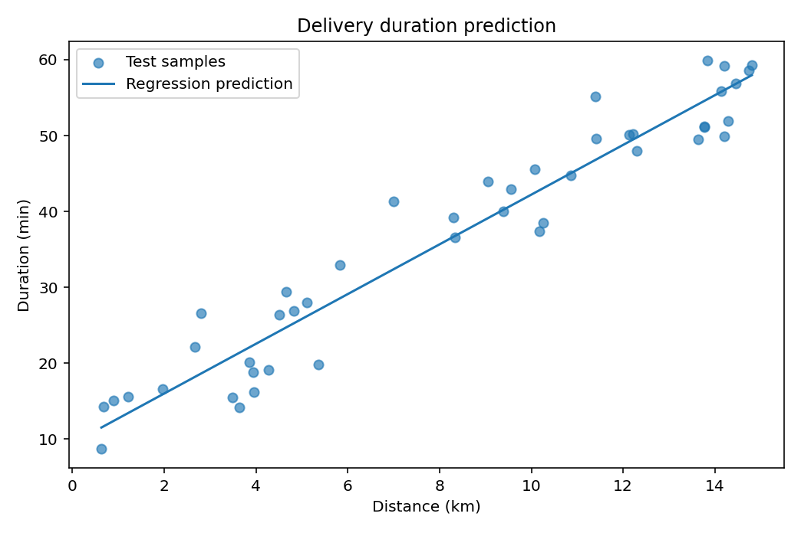

# Chapter 02. Machine Learning Fundamentals

Machine Learning 모델은 입력 데이터에서 일정한 관계를 학습하고 새로운 입력에 대한 예측값을 계산합니다. Chapter 02에서는 **데이터 구조, Linear Regression, Loss Function, Gradient Descent** 를 연결하여 모델이 학습되는 과정을 살펴봅니다. Feature Scaling과 Data Leakage 사례를 통해 코드가 실행되는 것과 올바르게 학습하는 것의 차이도 확인합니다.

- **학습 환경:** Google Colab(기본), VS Code 또는 Jupyter Notebook(로컬)
- **실습 언어:** Python 3.11 이상 권장
- **주요 도구:** NumPy, Pandas, Matplotlib, scikit-learn
- **실습 데이터:** 실습용 합성 데이터(Synthetic Data)

<details>
<summary><strong>선행 학습 목록</strong></summary>

- [Chapter 01. Introduction to Artificial Intelligence](../Chapter-01/README.md) — 머신러닝 개념, 학습과 추론, 예측 결과 해석
- [Python 기초 정리](../../PythonGuide/) — 함수, 반복문, 리스트
- [Data Processing](../../Data_Processing/) — NumPy 배열, Pandas DataFrame(선택)

</details>

<a id="contents"></a>
## Contents

| Section | Topic |
|:---:|---|
| [2.1](#section-2-1) | **Learning Goals & Getting Started** — 학습 목표와 실행 환경 |
| [2.2](#section-2-2) | **Data Structure & Terminology** — Sample, Feature, Target, 데이터 구조 |
| [2.3](#section-2-3) | **Problems, Models & Parameters** — 회귀, 분류, 매개변수와 하이퍼파라미터 |
| [2.4](#section-2-4) | **Training, Testing & Prediction** — 학습·예측·평가 흐름 |
| [2.5](#section-2-5) | **Baseline & Linear Regression** — 기준 모델과 선형 모델 |
| [2.6](#section-2-6) | **Loss Functions** — Error, MAE, MSE, RMSE |
| [2.7](#section-2-7) | **Gradient Descent** — 기울기 계산과 매개변수 갱신 |
| [2.8](#section-2-8) | **Feature Scaling & Pipeline** — 데이터 변환과 처리 순서 |
| [2.9](#section-2-9) | **Generalization & Data Leakage** — 새로운 데이터에서의 성능과 누출 |
| [2.10](#section-2-10) | **Examples** — Python 실행 예제 |
| [2.11](#section-2-11) | **Coding Practice** — 직접 구현하는 연습문제 |
| [2.12](#section-2-12) | **Mini Projects** — 배송 시간 예측과 Gradient Descent |
| [2.13](#section-2-13) | **Advanced Projects** — Feature Scaling과 Data Leakage |
| [2.14](#section-2-14) | **Quiz** — 개념·수식·코드 분석 |
| [2.15](#section-2-15) | **Summary** — 핵심 개념 정리 |
| [2.16](#section-2-16) | **References** — 공식 참고 문서 |

---

<a id="section-2-1"></a>
## 2.1. Learning Goals & Getting Started

### 학습 목표

학습을 마치면 다음 내용을 설명하고 구현할 수 있습니다.

1. Sample, Feature, Target의 역할과 `X`, `y`의 배열 구조
2. Baseline과 Linear Regression의 차이, 회귀 계수의 의미
3. 예측 Error와 Loss의 관계, MAE·MSE의 계산
4. Gradient Descent가 모델의 매개변수를 갱신하는 과정
5. Feature Scaling, Train/Test 분리, Data Leakage를 고려한 학습 절차

### 실행 준비

[Google Colab](https://colab.research.google.com/)에서는 [`Chapter_02_Machine_Learning_Fundamentals.ipynb`](./notebooks/Chapter_02_Machine_Learning_Fundamentals.ipynb)를 업로드해 실행할 수 있습니다. Notebook은 별도 CSV 업로드 없이 주요 예제를 실행하도록 구성했습니다. 로컬에서는 `.py` 파일과 프로젝트를 실행할 수 있습니다. 이번 Chapter는 GPU가 필요하지 않습니다.

`Chapter-02/` 폴더에서 실행:

```bash
python -m pip install -r requirements.txt
python examples/01_data_shapes.py
python examples/02_first_regression.py
python -m unittest discover -s tests -v
```

### 실습 데이터

| 데이터 | 내용 | 출처 |
|---|---|---|
| 배송 소요 시간 | 거리·경유지·시간 180건 | 실습용 합성 데이터 |
| 센서 신호 | 진동·조도·이상 상태 240건 | 실습용 합성 데이터 |
| 건물 전력 사용량 | 기온·면적·재실 인원·사용량 320건 | 실습용 합성 데이터 |

각 열의 정의와 생성 방법은 [`data/README.md`](./data/README.md)에 있습니다. 실제 배송·전력·장비 운영 데이터를 분석한 결과로 해석해서는 안 됩니다.

---

<a id="section-2-2"></a>
## 2.2. Data Structure & Terminology

### Sample, Feature, Target

머신러닝에 사용하는 표 형식 데이터는 보통 **샘플(Sample)** 을 행으로, ** 특성(Feature)** 을 열로 배치합니다. 학습 과정에서 모델이 예측하도록 주어진 값은 ** 타깃(Target)** 이라고 합니다. 분류 문제에서 범주를 나타내는 Target은 ** 레이블(Label)** 이라는 용어도 사용합니다.

다음 표는 배송 시간을 예측하기 위한 간단한 예시입니다.

| 배송 거리 (km) | 경유지 수 | 소요 시간 (분) |
|---:|---:|---:|
| 2 | 1 | 9 |
| 4 | 0 | 17 |
| 6 | 2 | 27 |

거리와 경유지 수는 Feature, 소요 시간은 Target입니다. 각 행은 하나의 Sample에 해당합니다. 표의 세 행은 데이터 구조를 설명하기 위한 예시이며, 아래 CSV의 처음 세 행과 같지는 않습니다.

### 입력 배열 `X`와 Target 배열 `y`

일반적으로 `X`는 Feature를 담은 2차원 배열, `y`는 Target을 담은 1차원 배열입니다.

$$
X=\begin{bmatrix}2&1\\4&0\\6&2\end{bmatrix},\qquad
y=\begin{bmatrix}9\\17\\27\end{bmatrix}
$$

- $X\in\mathbb{R}^{n\times d}$: Sample 수 $n$, Feature 수 $d$인 입력 배열
- $y\in\mathbb{R}^{n}$: 각 Sample에 대응하는 Target 배열
- $X_{ij}$: $i$번째 Sample의 $j$번째 Feature 값

```python
import numpy as np

X = np.array([[2, 1], [4, 0], [6, 2]], dtype=float)
y = np.array([9, 17, 27], dtype=float)

print(X.shape)  # (3, 2)
print(y.shape)  # (3,)
```

하나의 Feature만 사용하더라도 scikit-learn에서는 `X`를 보통 `(n_samples, 1)` 형태의 **2차원 입력 배열** 로 전달합니다. 반면 Target의 형태는 모델의 문제 유형에 따라 달라질 수 있으며, 이 Chapter의 예제는 1차원 `y`를 사용합니다.

---

<a id="section-2-3"></a>
## 2.3. Problems, Models & Parameters

### 학습 문제의 구분

결과가 연속적인 수치인 예측은 **회귀(Regression)**, 미리 정한 범주 중 하나를 선택하는 예측은 ** 분류(Classification)** 라고 합니다.

| 문제 | 입력 | 예측 결과 | 유형 |
|---|---|---|---|
| 배송 소요 시간 | 거리·경유지 수 | 25.4분 | Regression |
| 센서 이상 판단 | 진동·조도 | 정상 / 이상 | Classification |
| 건물 전력 사용량 | 기온·면적·인원 | 210.7kWh | Regression |

두 문제 모두 Feature와 Target의 관계를 학습할 수 있지만, 출력의 형태와 사용할 모델·Loss는 서로 다릅니다. Classification 알고리즘은 Chapter 03에서 더 자세히 다룹니다.

### 모델과 매개변수

**모델(Model)** 은 입력에서 예측값을 계산하는 수학적 함수 또는 학습된 시스템입니다. 가장 단순한 선형 모델은 다음과 같습니다.

$$
\hat{y}=wx+b
$$

- $x$: 입력 Feature 값
- $w$: 입력에 곱하는 **가중치(Weight)**
- $b$: 입력이 0일 때의 예측값을 결정하는 **편향 또는 절편(Bias / Intercept)**
- $\hat{y}$: 모델이 계산한 예측값(Prediction)

모델이 데이터로부터 결정하는 $w$, $b$를 **매개변수(Parameter)** 라고 합니다. Feature가 두 개 이상인 선형 모델에서는 다음과 같이 확장됩니다.

$$
\hat{y}=w_1x_1+w_2x_2+\cdots+w_dx_d+b
$$

여기서 $w_j$는 다른 Feature를 고정했을 때 $x_j$의 변화가 예측에 미치는 선형 효과를 나타냅니다. 이것만으로 실제 원인·결과 관계가 입증되지는 않습니다.

### Parameter와 Hyperparameter

**하이퍼파라미터(Hyperparameter)** 는 모델 학습 전에 사용자가 정하는 설정값입니다.

| 구분 | 예시 | 결정 방식 |
|---|---|---|
| Parameter | Linear Regression의 `coef_`, `intercept_` | 학습 데이터에서 계산 |
| Hyperparameter | KNN의 `n_neighbors`, Gradient Descent의 Learning Rate | 학습 절차를 설정할 때 지정 |

일부 하이퍼파라미터는 별도의 검증 절차로 선택할 수 있습니다. 이때 평가용 Test Set을 반복해서 사용하면 성능 추정이 낙관적으로 변할 수 있습니다. 검증과 튜닝의 상세한 방법은 Chapter 04에서 다룹니다.

---

<a id="section-2-4"></a>
## 2.4. Training, Testing & Prediction

### 모델을 학습하는 순서

**학습(Training)** 은 데이터에서 모델의 Parameter를 결정하는 과정입니다. 학습된 모델을 새로운 입력에 적용하는 과정은 ** 추론(Inference)** 이라고 하며, 그 결과를 Prediction이라고 합니다.



모델이 학습 데이터에만 잘 맞는지, 새로운 입력에도 적절하게 작동하는지는 별도로 확인해야 합니다.

```python
from sklearn.model_selection import train_test_split

X_train, X_test, y_train, y_test = train_test_split(
    X, y, test_size=0.25, random_state=42
)
```

- `test_size=0.25`: 전체 데이터의 25%를 Test Set으로 사용
- `random_state=42`: 분할 과정의 난수 상태를 고정하여 결과를 재현
- `X_train`, `y_train`: 모델 학습에 사용하는 입력·Target
- `X_test`, `y_test`: 학습되지 않은 Sample을 대상으로 예측을 확인하는 데이터

`train_test_split()`을 사용하기 전에 `X`, `y`가 준비되어 있어야 합니다. 데이터가 시간 순서나 동일 인물·장비별로 연관되어 있다면 단순 Random Split이 적절하지 않을 수 있습니다. 이런 분할 방식의 선택은 Chapter 04에서 다룹니다.

### 실습용 데이터와 실제 운영 데이터

제공된 합성 데이터에는 학습 원리 확인을 위해 명확한 관계가 포함되어 있습니다. 실제 운영에서는 환경 변화, 누락·오류, 데이터 수집 방식의 차이로 인해 결과가 달라질 수 있습니다.

---

<a id="section-2-5"></a>
## 2.5. Baseline & Linear Regression

### Baseline의 역할

새 모델을 만들었다고 해서 바로 좋은 모델이라고 할 수는 없습니다. **기준 모델(Baseline Model)** 과 비교하면 복잡한 학습 과정이 실제로 필요한지 확인하기 쉽습니다.

배송 시간 예측에서는 Training Data의 평균 시간만 출력하는 Baseline을 사용할 수 있습니다.

$$
\hat{y}_{\mathrm{baseline}}=\frac{1}{n_{\mathrm{train}}}
\sum_{i=1}^{n_{\mathrm{train}}}y_i
$$

이 Baseline은 배송 거리를 보지 않고 항상 같은 값을 출력합니다. 반면 Linear Regression은 Feature에 따라 예측값을 바꿉니다.

### Linear Regression

**선형 회귀(Linear Regression)** 는 입력 Feature와 Target의 관계를 선형식으로 표현합니다.

$$
\widehat{\mathrm{Duration}} = w\cdot\mathrm{Distance}+b
$$

`distance_km`만 사용한 실습 결과의 기울기는 약 3.28분/km입니다. 모델이 예측하는 배송 시간은 거리가 1km 증가할 때 약 3.28분 늘어납니다. 경유지 수처럼 다른 변수가 모델에 포함되지 않았으므로, 기울기를 배송 거리의 실제 인과 효과로 해석해서는 안 됩니다.

```python
from sklearn.dummy import DummyRegressor
from sklearn.linear_model import LinearRegression
from sklearn.metrics import mean_absolute_error

baseline = DummyRegressor(strategy="mean").fit(X_train, y_train)
model = LinearRegression().fit(X_train, y_train)

baseline_mae = mean_absolute_error(y_test, baseline.predict(X_test))
linear_mae = mean_absolute_error(y_test, model.predict(X_test))
```

위 코드는 `X_train`, `X_test`, `y_train`, `y_test`가 미리 준비된 상태를 가정합니다. 실제 전체 실행 코드는 [Example 02](#section-2-10)에서 확인할 수 있습니다.

---

<a id="section-2-6"></a>
## 2.6. Loss Functions

### Prediction Error와 Loss

예측값과 실제 Target의 차이를 **오차(Error)** 라고 합니다. Sample별 오차는 다음과 같이 나타낼 수 있습니다.

$$
e_i=\hat{y}_i-y_i
$$

오차를 여러 Sample에 걸쳐 집계해 모델의 예측 품질을 수치화하는 함수가 **손실 함수(Loss Function)** 입니다. 학습 과정에서는 모델이 최소화할 기준을 정하는 데 사용하며, 평가에서도 같은 계산을 지표로 사용할 수 있습니다.

### Mean Absolute Error (MAE)

**평균 절대 오차(Mean Absolute Error, MAE)** 는 각 오차의 절댓값을 평균합니다.

$$
\mathrm{MAE}=\frac{1}{n}\sum_{i=1}^{n}|y_i-\hat{y}_i|
$$

MAE는 Target과 같은 단위를 사용합니다. 배송 시간에서 MAE가 3분이라면, 각 예측의 절대 오차가 평균 3분이라는 의미입니다.

### Mean Squared Error (MSE)

**평균 제곱 오차(Mean Squared Error, MSE)** 는 각 오차를 제곱한 뒤 평균합니다.

$$
\mathrm{MSE}=\frac{1}{n}\sum_{i=1}^{n}(y_i-\hat{y}_i)^2
$$

MSE는 큰 오차에 상대적으로 더 큰 불이익을 줍니다. 단위가 Target 단위의 제곱이라는 점에도 유의해야 합니다.

### Root Mean Squared Error (RMSE)

**평균 제곱근 오차(Root Mean Squared Error, RMSE)** 는 MSE에 제곱근을 적용합니다.

$$
\mathrm{RMSE}=\sqrt{\mathrm{MSE}}
$$

RMSE는 다시 Target과 같은 단위를 사용합니다. 일반적으로 동일한 데이터에서 RMSE는 MAE 이상이지만, 어떤 지표를 사용할지는 문제에서 중요한 오차의 형태에 따라 정해야 합니다.

### 계산 예제

실제 Target이 `[3, 5, 7]`, 예측값이 `[2, 7, 8]`이라면 오차는 `[-1, 2, 1]`입니다.

$$
\mathrm{MAE}=\frac{1+2+1}{3}=\frac{4}{3}\approx1.333
$$

$$
\mathrm{MSE}=\frac{1^2+2^2+1^2}{3}=2
$$

$$
\mathrm{RMSE}=\sqrt{2}\approx1.414
$$

```python
import numpy as np

y_true = np.array([3, 5, 7], dtype=float)
y_pred = np.array([2, 7, 8], dtype=float)
errors = y_pred - y_true

print(f"MAE: {np.mean(np.abs(errors)):.3f}")
print(f"MSE: {np.mean(errors ** 2):.3f}")
print(f"RMSE: {np.sqrt(np.mean(errors ** 2)):.3f}")
```

분류 문제에서는 다른 Loss를 사용할 수 있습니다. 회귀·분류에서 자주 사용하는 지표의 해석은 Chapter 04에서 자세히 다룹니다.

---

<a id="section-2-7"></a>
## 2.7. Gradient Descent

### Loss를 줄이는 방향

Linear Regression의 예측은 $\hat{y}=wx+b$입니다. 처음에 $w=0$, $b=0$으로 시작했다면 대부분의 실제 Target과 차이가 있을 것입니다. **경사하강법(Gradient Descent)** 은 Loss가 감소하는 방향으로 Parameter를 조금씩 조정하는 방법입니다.

MSE를 학습 목표로 사용하면 다음과 같습니다.

$$
L(w,b)=\frac{1}{n}\sum_{i=1}^{n}(wx_i+b-y_i)^2
$$

기울기는 Parameter를 조금 바꿀 때 Loss가 얼마나 변하는지를 나타냅니다.

$$
\frac{\partial L}{\partial w}=\frac{2}{n}
\sum_{i=1}^{n}(wx_i+b-y_i)x_i
$$

$$
\frac{\partial L}{\partial b}=\frac{2}{n}
\sum_{i=1}^{n}(wx_i+b-y_i)
$$

### Parameter Update

**학습률(Learning Rate)** $\alpha$를 이용해 기울기의 반대 방향으로 갱신합니다.

$$
w_{\mathrm{new}}=w_{\mathrm{old}}-\alpha\frac{\partial L}{\partial w}
$$

$$
b_{\mathrm{new}}=b_{\mathrm{old}}-\alpha\frac{\partial L}{\partial b}
$$

Learning Rate가 너무 작으면 학습이 느릴 수 있고, 너무 크면 Loss가 진동하거나 발산할 수 있습니다.

### 첫 번째 업데이트 직접 계산

입력 $x=[0,1,2,3]$, Target $y=[1,3,5,7]$, 초기값 $w=b=0$, Learning Rate $\alpha=0.02$라고 가정합니다.

$$
L(0,0)=\frac{1^2+3^2+5^2+7^2}{4}=21
$$

초기 예측은 모두 0이므로 예측 오차는 `[-1, -3, -5, -7]`입니다.

$$
\frac{\partial L}{\partial w}
=\frac{2}{4}\left[0(-1)+1(-3)+2(-5)+3(-7)\right]=-17
$$

$$
\frac{\partial L}{\partial b}
=\frac{2}{4}(-1-3-5-7)=-8
$$

따라서 한 번의 갱신 후 Parameter는 다음과 같습니다.

$$
w_{\mathrm{new}}=0-0.02(-17)=0.34,\qquad
b_{\mathrm{new}}=0-0.02(-8)=0.16
$$

갱신 후 MSE는 약 14.533으로 줄어듭니다. 이번 결과는 해당 초기값과 Learning Rate에서의 **첫 번째 업데이트** 이며, 모든 갱신이 언제나 Loss를 줄인다는 뜻은 아닙니다.

```python
import numpy as np

x = np.array([0., 1., 2., 3.])
y = np.array([1., 3., 5., 7.])
w, b = 0.0, 0.0
learning_rate = 0.02

error = w * x + b - y
grad_w = 2 * np.mean(error * x)
grad_b = 2 * np.mean(error)

w -= learning_rate * grad_w
b -= learning_rate * grad_b
print(w, b)  # 0.34 0.16
```

이 계산을 여러 번 반복하면 Loss를 줄이는 방향으로 Parameter가 조정됩니다. Mini Project 02에서 전체 반복 과정을 구현합니다.

---

<a id="section-2-8"></a>
## 2.8. Feature Scaling & Pipeline

### Feature의 단위가 다른 경우

진동은 0~4mm/s, 조도는 100~12,000lx 범위일 수 있습니다. 두 Feature를 그대로 거리 계산에 넣으면 조도의 숫자 차이가 진동의 차이보다 훨씬 크게 반영됩니다.

**표준화(Standardization)** 는 각 Feature를 평균 0, 표준편차 1에 가까운 분포로 변환합니다.

$$
z=\frac{x-\mu_{\mathrm{train}}}{\sigma_{\mathrm{train}}}
$$

- $x$: 원래 Feature 값
- $\mu_{\mathrm{train}}$: Training Data에서 계산한 해당 Feature의 평균
- $\sigma_{\mathrm{train}}$: Training Data에서 계산한 해당 Feature의 표준편차
- $z$: 변환한 Feature 값

Feature Scaling이 필요한 정도는 모델에 따라 달라집니다. KNN처럼 거리에 의존하는 모델에서는 중요하지만, 모든 모델에 무조건 같은 변환을 적용해야 하는 것은 아닙니다.

### Pipeline으로 처리 순서 고정

**파이프라인(Pipeline)** 은 전처리와 모델을 연결해 같은 순서로 실행합니다.

```python
from sklearn.neighbors import KNeighborsClassifier
from sklearn.pipeline import make_pipeline
from sklearn.preprocessing import StandardScaler

model = make_pipeline(
    StandardScaler(),
    KNeighborsClassifier(n_neighbors=7),
)
model.fit(X_train, y_train)
predictions = model.predict(X_test)
```

`fit()`을 호출하면 `StandardScaler`는 Training Data에서 평균과 표준편차를 계산하고, `predict()`는 그 기준으로 새로운 입력을 변환합니다. 학습 데이터와 평가 데이터에 서로 다른 변환 기준을 사용하지 않아야 합니다.

`X_train`, `X_test`는 이 코드 앞에서 나누어야 합니다. 전체 데이터를 미리 표준화한 뒤 나누면 Test Set의 정보가 전처리 설정에 반영될 수 있습니다.

---

<a id="section-2-9"></a>
## 2.9. Generalization & Data Leakage

### 새로운 데이터에 대한 예측

**일반화(Generalization)** 는 학습에 사용하지 않은 데이터에서도 모델이 적절하게 예측하는 능력입니다. Training Data에서의 Loss가 낮아도 처음 보는 Sample에서 오차가 커질 수 있습니다.

학습 데이터에 지나치게 맞춰 새로운 데이터에서 성능이 저하되는 현상은 **과적합(Overfitting)** 이라고 합니다. 반대로 단순한 모델이 데이터에 있는 중요한 관계조차 충분히 표현하지 못하면 ** 과소적합(Underfitting)** 이 발생할 수 있습니다.

모델 복잡도와 평가 지표의 상세한 분석은 Chapter 04에서 다룹니다. 여기서는 **학습 과정에서 Test Set을 분리하고, 예측 시점에 얻을 수 있는 Feature만 사용한다** 는 기본 원칙을 확인합니다.

### Data Leakage

**데이터 누출(Data Leakage)** 은 모델이 학습·평가 과정에서 원래 사용할 수 없어야 할 정보를 이용하는 문제입니다.

| 사례 | 문제점 | 올바른 처리 |
|---|---|---|
| 전체 데이터를 Standardization한 뒤 Train/Test로 분리 | Test Set의 평균·표준편차가 학습 전처리에 반영됨 | 먼저 분리한 뒤 Training Data로 `fit()` |
| 예측할 시점보다 나중에 생성된 계량값을 Feature에 추가 | 실제 예측 시점에는 그 값을 알 수 없음 | Feature의 생성 시점 확인 및 제외 |
| 같은 장비·사용자의 사실상 동일한 기록이 Train/Test에 함께 포함 | 독립적인 평가가 어려울 수 있음 | 그룹 단위 분할 등 문제에 맞는 방법 선택 |

Data Leakage가 있다고 해서 반드시 모든 점수가 비정상적으로 높게 나타나는 것은 아닙니다. 하지만 평가 결과를 신뢰하기 어려워지므로, 모델을 비교하기 전에 데이터의 역할과 가용 시점을 점검해야 합니다.

---

<a id="section-2-10"></a>
## 2.10. Examples

### Example 01 — Sample과 Feature의 형태

입력 데이터가 행과 열로 어떻게 구성되는지 확인합니다.

**실행 코드:** [`01_data_shapes.py`](./examples/01_data_shapes.py)

```bash
python examples/01_data_shapes.py
```

출력의 `X shape: (3, 2)`는 Sample 3개와 Feature 2개를 의미합니다. `y shape: (3,)`는 세 Sample에 대응하는 Target을 뜻합니다.

### Example 02 — 첫 번째 Linear Regression

배송 거리만 사용해 소요 시간을 예측합니다. 평균 Baseline을 준비하고 동일한 Test Set에서 두 모델의 MAE를 비교합니다.

**실행 코드:** [`02_first_regression.py`](./examples/02_first_regression.py)

```bash
python examples/02_first_regression.py
```

고정된 데이터에서 Baseline MAE는 약 **14.11분**, Linear Regression MAE는 약 **3.39분** 입니다. 결과 그림은 `outputs/example_02_regression.png`에 저장됩니다.



### Example 03 — Loss와 Gradient의 첫 업데이트

MSE의 기울기를 계산하고 두 Parameter를 한 번 갱신합니다.

**실행 코드:** [`03_loss_and_gradient.py`](./examples/03_loss_and_gradient.py)

```bash
python examples/03_loss_and_gradient.py
```

출력에서 `dw=-17.00`, `db=-8.00`은 손실을 계산한 시점의 기울기입니다. 갱신 후 `w=0.34`, `b=0.16`이 되며, MSE는 21에서 약 14.533으로 감소합니다.

### Example 04 — StandardScaler + KNN

센서 신호 데이터로 Feature Scaling의 효과를 비교합니다.

**실행 코드:** [`04_scaling_pipeline.py`](./examples/04_scaling_pipeline.py)

```bash
python examples/04_scaling_pipeline.py
```

Accuracy는 변환 전 **35.0%**, 변환 후 **96.7%** 입니다. 합성 데이터에서 조도와 진동의 수치 범위가 크게 다르도록 설계했기 때문에 나타난 차이입니다. 일반적인 모든 문제에서 Scaling만으로 이런 개선이 발생하는 것은 아닙니다.

---

<a id="section-2-11"></a>
## 2.11. Coding Practice

실습 코드는 [`exercises/`](./exercises/), 모범 구현은 [`solutions/`](./solutions/)에 있습니다. 코드 작성 문제와 개념 해석 문제를 함께 구성했습니다.

### Practice 01 — MAE와 MSE 직접 구현하기

[`exercises/01_loss_metrics.py`](./exercises/01_loss_metrics.py)의 `calculate_errors()`를 완성하세요. 실제 Target `[3, 5, 7]`과 예측 `[2, 7, 8]`에 대한 두 지표를 반환해야 합니다.

**예상 출력:** `(1.3333..., 2.0)`

<details>
<summary><strong>정답 및 해설</strong></summary>

```python
errors = predicted - actual
mae = float(np.mean(np.abs(errors)))
mse = float(np.mean(errors ** 2))
return mae, mse
```

MAE는 오차의 절댓값 평균, MSE는 오차 제곱의 평균입니다. 각각의 계산에 사용하는 단위도 다릅니다. 전체 코드와 입력 검사는 [`practice_01_loss_metrics.py`](./solutions/practice_01_loss_metrics.py)에 있습니다.

</details>

### Practice 02 — 여러 Feature의 선형 예측

[`exercises/02_linear_predict.py`](./exercises/02_linear_predict.py)에서 `predict_linear()`를 구현하세요. 입력은 두 Sample `[[2, 1], [4, 0]]`, Weight는 `[3, 2]`, Bias는 `1`입니다.

**예상 출력:** `[9. 13.]`

<details>
<summary><strong>정답 및 해설</strong></summary>

```python
return X @ weights + float(bias)
```

첫 번째 Sample은 $2\times3+1\times2+1=9$, 두 번째는 $4\times3+0\times2+1=13$입니다. 행렬곱 `@`는 모든 Sample의 선형 결합을 한 번에 계산합니다. 전체 코드는 [`practice_02_linear_predict.py`](./solutions/practice_02_linear_predict.py)에 있습니다.

</details>

### Practice 03 — Gradient Descent 한 단계

[`exercises/03_gradient_step.py`](./exercises/03_gradient_step.py)를 완성하세요. `x=[0,1,2,3]`, `y=[1,3,5,7]`, 초기 `weight=bias=0`, Learning Rate `0.02`를 사용합니다.

**예상 출력:** `(0.34, 0.16)`

<details>
<summary><strong>정답 및 해설</strong></summary>

```python
error = weight * x + bias - y
grad_weight = 2.0 * float(np.mean(error * x))
grad_bias = 2.0 * float(np.mean(error))
return (
    weight - learning_rate * grad_weight,
    bias - learning_rate * grad_bias,
)
```

기울기는 각각 -17, -8입니다. 계산한 Gradient의 부호가 음수이므로 값을 빼는 갱신식에서는 매개변수가 증가합니다. 전체 코드는 [`practice_03_gradient_step.py`](./solutions/practice_03_gradient_step.py)에 있습니다.

</details>

### Practice 04 — Baseline이 필요한 이유

모델 A의 MAE가 8분이고, 학습 데이터 평균만 출력하는 Baseline의 MAE가 5분입니다. 모델 A를 복잡한 모델이라는 이유로 선택해도 될까요? 필요한 추가 확인 사항을 두 가지 이상 설명하세요.

<details>
<summary><strong>정답 및 해설</strong></summary>

같은 Test Set에서 계산한 값이라면 Baseline의 MAE가 더 낮으므로 모델 A가 더 좋은 예측을 제공한다고 볼 근거가 없습니다. 데이터 분할이 동일한지, Target의 분포가 치우쳐 있는지, 모델 A의 전처리와 학습 절차가 올바른지 점검해야 합니다. 서로 다른 테스트 조건에서 얻은 MAE는 그대로 비교할 수 없습니다.

</details>

### Practice 05 — 예측 시점의 Feature 판단

건물 에너지 예측 모델에 `temperature_c`, `floor_area_m2`, `meter_finalized_kwh`가 제공되었습니다. 예측 시점에 어떤 Feature를 제외해야 하며, 그 이유는 무엇인가요?

<details>
<summary><strong>정답 및 해설</strong></summary>

측정 종료 후 확정되는 `meter_finalized_kwh`는 예측 시점에 사용할 수 없으므로 제외합니다. 값이 Target과 가깝다는 이유로 학습에 포함하면 Data Leakage가 발생합니다. 나머지 Feature 역시 실제 운영 시점에 확보 가능한지 확인한 뒤 사용해야 합니다.

</details>

---

<a id="section-2-12"></a>
## 2.12. Mini Projects

| 프로젝트 | 핵심 목표 | 자료 |
|---|---|---|
| **Mini 01 — Delivery Time Prediction** | Baseline과 Linear Regression의 MAE 비교, 회귀 계수 해석 | [프로젝트 README](./projects/mini_01_delivery_regression/README.md) · [결과 그림](./figures/mini_01_delivery_regression.png) |
| **Mini 02 — Linear Regression with Gradient Descent** | NumPy로 MSE 기울기와 학습 반복 구현 | [프로젝트 README](./projects/mini_02_gradient_descent/README.md) · [Loss 곡선](./figures/mini_02_gradient_descent.png) |

각 프로젝트에는 구현 순서, 코드 힌트, 테스트 시나리오가 있습니다. Starter Code는 프로젝트 폴더, 모범 구현은 [`solutions/`](./solutions/)에 있습니다.

---

<a id="section-2-13"></a>
## 2.13. Advanced Projects

| 프로젝트 | 핵심 목표 | 자료 |
|---|---|---|
| **Advanced 01 — Feature Scaling & Distance-Based Models** | Feature 단위가 KNN의 거리와 Prediction에 미치는 영향 분석 | [프로젝트 README](./projects/advanced_01_scaling_knn/README.md) · [결과 그림](./figures/advanced_01_scaling_knn.png) |
| **Advanced 02 — Data Leakage Audit** | 예측 시점에 얻을 수 없는 Feature를 찾아 평가 오차의 착시 분석 | [프로젝트 README](./projects/advanced_02_leakage_audit/README.md) · [결과 그림](./figures/advanced_02_leakage_audit.png) |

Advanced 01은 Classification을 활용하지만 핵심은 KNN 알고리즘 자체보다 **Feature Scaling** 입니다. Advanced 02는 최저 MAE 모델을 고르는 문제가 아니라, 실제 예측에 사용할 수 있는 Feature를 결정하는 문제입니다.

---

<a id="section-2-14"></a>
## 2.14. Quiz — Machine Learning Fundamentals

각 문항의 정답과 해설은 접어서 표시했습니다.

### 객관식

**Q01. 입력 배열의 형태**

100개 Sample에 각각 4개 Feature가 있을 때 `X.shape`로 가장 적절한 것은 무엇인가요?

- **A.** `(4, 100)`
- **B.** `(100, 4)`
- **C.** `(100,)`
- **D.** `(4,)`

<details>
<summary><strong>정답 및 해설</strong></summary>

**정답: B**

표 형식의 `X`는 일반적으로 행이 Sample, 열이 Feature입니다. 따라서 `(n_samples, n_features)`는 `(100, 4)`입니다. `(100,)`는 이 Chapter의 1차원 Target 배열 `y`에 가까운 형태입니다.

</details>

**Q02. 모델 Parameter**

다음 중 `LinearRegression`을 학습한 뒤 데이터로부터 결정되는 Parameter는 무엇인가요?

- **A.** `test_size`
- **B.** `random_state`
- **C.** `coef_`
- **D.** `n_neighbors`

<details>
<summary><strong>정답 및 해설</strong></summary>

**정답: C**

`coef_`는 학습된 선형 모델의 Weight입니다. `test_size`와 `random_state`는 데이터 분할에 사용하는 설정이고, `n_neighbors`는 KNN의 Hyperparameter입니다.

</details>

**Q03. MAE와 MSE의 차이**

동일한 Sample에서 큰 오차에 더 높은 가중을 주는 효과가 있는 지표는 무엇인가요?

- **A.** MAE와 MSE는 언제나 같습니다.
- **B.** MSE는 오차를 제곱하므로 큰 오차에 상대적으로 민감합니다.
- **C.** MAE는 오차의 부호를 그대로 더합니다.
- **D.** MSE는 단위가 원래 Target과 항상 같습니다.

<details>
<summary><strong>정답 및 해설</strong></summary>

**정답: B**

MSE는 오차를 제곱하므로 크기가 큰 오차의 기여도가 상대적으로 커집니다. MAE는 절댓값을 취하므로 부호가 상쇄되지 않으며, MSE는 Target 단위의 제곱을 사용합니다.

</details>

**Q04. Gradient Descent의 갱신 방향**

현재 $w=1$, $\alpha=0.1$, $\partial L/\partial w=3$일 때 한 번 갱신한 $w$는 무엇인가요?

- **A.** 1.3
- **B.** 0.7
- **C.** 3.0
- **D.** -2.0

<details>
<summary><strong>정답 및 해설</strong></summary>

**정답: B**

$w_{\mathrm{new}}=1-0.1\times3=0.7$입니다. Gradient Descent는 기울기를 그대로 더하지 않고 학습률을 곱해 뺍니다.

</details>

**Q05. Feature Scaling**

단위가 다른 두 Feature로 KNN을 학습할 때 가장 적절한 설명은 무엇인가요?

- **A.** 큰 숫자를 가진 Feature가 항상 중요한 변수이므로 Scaling하면 안 됩니다.
- **B.** StandardScaler는 Test Set의 통계량으로 학습해야 합니다.
- **C.** 거리는 Feature의 수치 범위에 영향을 받으므로 Scaling을 검토해야 합니다.
- **D.** Scaling을 하면 모든 모델의 Accuracy가 반드시 증가합니다.

<details>
<summary><strong>정답 및 해설</strong></summary>

**정답: C**

KNN의 거리 계산은 Feature의 수치 범위에 영향을 받습니다. Scaling이 도움이 되는지는 데이터와 모델에 따라 달라지며, 전처리 통계량은 Training Data에서만 학습해야 합니다.

</details>

**Q06. Data Leakage 판단**

다음 중 실제 예측에 사용할 수 없는 정보를 학습에 포함한 사례는 무엇인가요?

- **A.** 예측 전에 확인한 건물 면적
- **B.** 예측 전에 관측한 기온
- **C.** 예측 전에 정한 학습률
- **D.** 예측 대상 시간대가 끝난 뒤 확정된 소비량

<details>
<summary><strong>정답 및 해설</strong></summary>

**정답: D**

D는 예측 시점보다 나중에 얻는 정보입니다. Target을 예측하기 위한 Feature에 이런 값을 포함하면 실제 사용할 수 없는 관계를 학습하게 됩니다. 다른 항목도 구체적인 수집 시점을 확인해야 하지만, 설명상 D가 명확한 누출입니다.

</details>

### 주관식

**Q07. Baseline과 모델 비교**

같은 Test Set에서 평균 Baseline의 MAE가 14분, Linear Regression의 MAE가 3.4분으로 나타났습니다. 이 결과에서 말할 수 있는 사실과 말할 수 없는 사실을 각각 하나씩 설명하세요.

<details>
<summary><strong>정답 및 해설</strong></summary>

**모범답안:** 제공된 Test Set에서는 Linear Regression의 평균 절대 오차가 Baseline보다 낮았습니다. 하지만 이 결과만으로 모든 지역과 기간에서 같은 성능이 보장되거나, 배송 거리가 배송 시간의 유일한 원인이라고 단정할 수는 없습니다. 입력 Feature와 평가 조건이 달라지면 결과도 달라질 수 있습니다.

</details>

**Q08. Underfitting과 Overfitting**

Training Data에서는 오차가 거의 없지만 새로운 Test Set에서는 오차가 크게 증가하는 모델이 있습니다. 어떤 문제를 의심해야 하며, 왜 Training Data의 결과만으로 판단하면 안 될까요?

<details>
<summary><strong>정답 및 해설</strong></summary>

**모범답안:** Training Data에 지나치게 맞춘 Overfitting을 의심할 수 있습니다. 학습에 사용한 Sample만 잘 예측하는 것과 새로운 Sample을 잘 예측하는 것은 다릅니다. 데이터 분할과 전처리 누출 여부도 함께 확인해야 합니다.

</details>

**Q09. 실험 설계**

두 모델 중 어떤 것이 좋은지 비교하려고 합니다. 모델 A와 B가 서로 다른 Test Set으로 평가되었다면 어떤 문제가 생길 수 있고, 어떻게 비교 조건을 고쳐야 할까요?

<details>
<summary><strong>정답 및 해설</strong></summary>

**모범답안:** Test Set의 난이도나 Target 분포가 다르면 지표 차이를 모델 자체의 차이로 해석하기 어렵습니다. 동일한 Train/Test Split, 같은 지표와 전처리 원칙을 적용해 비교해야 합니다. 학습 과정에서 Test Set을 이용해 모델을 조정하지 않는 것도 중요합니다.

</details>

### 코드 분석

**Q10. 입력 형태 오류**

다음 코드의 문제를 찾아 수정하세요.

```python
import numpy as np
from sklearn.linear_model import LinearRegression

X = np.array([1, 2, 3, 4])
y = np.array([3, 5, 7, 9])
model = LinearRegression().fit(X, y)
```

<details>
<summary><strong>정답 및 해설</strong></summary>

`LinearRegression.fit()`은 Feature 입력을 2차원 배열로 받습니다. `X`가 `(4,)`이므로 다음처럼 수정합니다.

```python
X = np.array([1, 2, 3, 4]).reshape(-1, 1)
model = LinearRegression().fit(X, y)
```

이제 `X.shape`는 `(4, 1)`이며 Sample 4개와 Feature 1개를 뜻합니다.

</details>

**Q11. Gradient 갱신 코드**

다음 코드에서 Loss를 줄이는 기본 Gradient Descent를 의도했다면 무엇을 수정해야 할까요?

```python
weight = weight + learning_rate * grad_weight
bias = bias + learning_rate * grad_bias
```

<details>
<summary><strong>정답 및 해설</strong></summary>

기울기의 반대 방향으로 이동하도록 `+`를 `-`로 수정합니다.

```python
weight = weight - learning_rate * grad_weight
bias = bias - learning_rate * grad_bias
```

올바른 부호를 사용해도 Learning Rate가 지나치게 크면 Loss가 증가할 수 있습니다.

</details>

**Q12. 전처리 순서**

다음 코드가 Test Set 정보 누출을 유발할 수 있는 이유와 수정 방법을 설명하세요.

```python
scaler = StandardScaler()
X_scaled = scaler.fit_transform(X)
X_train, X_test, y_train, y_test = train_test_split(
    X_scaled, y, test_size=0.25, random_state=42
)
```

<details>
<summary><strong>정답 및 해설</strong></summary>

모든 Sample에서 평균과 표준편차를 계산했으므로 Test Set이 전처리 기준에 영향을 줍니다. 먼저 분리한 뒤 Training Data에서만 `fit()`하고, Test Set은 같은 기준으로 `transform()`합니다.

```python
X_train, X_test, y_train, y_test = train_test_split(
    X, y, test_size=0.25, random_state=42
)
scaler = StandardScaler()
X_train = scaler.fit_transform(X_train)
X_test = scaler.transform(X_test)
```

실제 모델 개발에서는 Pipeline으로 변환과 모델을 연결하는 방식을 권장합니다.

</details>

---

<a id="section-2-15"></a>
## 2.15. Summary

| 개념 | 핵심 내용 |
|---|---|
| **Sample / Feature / Target** | 데이터 한 건 / 모델 입력 변수 / 예측할 값 |
| **Regression / Classification** | 연속적인 수치 예측 / 범주 예측 |
| **Parameter / Hyperparameter** | 학습으로 결정되는 값 / 학습 절차를 설정하는 값 |
| **Train/Test Split** | 모델 학습과 새로운 데이터 평가의 역할을 분리하는 과정 |
| **Baseline** | 학습된 모델의 유용성을 비교하기 위한 기준 |
| **Linear Regression** | Feature의 선형 결합으로 수치 Target을 예측하는 모델 |
| **MAE / MSE / RMSE** | 절대 오차 평균 / 제곱 오차 평균 / MSE의 제곱근 |
| **Gradient Descent** | Loss의 기울기를 이용해 Parameter를 갱신하는 방법 |
| **Feature Scaling / Pipeline** | Feature의 수치 범위 변환 / 전처리와 모델의 실행 순서 연결 |
| **Generalization / Data Leakage** | 새로운 입력에서의 예측 능력 / 허용되지 않은 정보 사용 |

Chapter 03에서는 지도학습(Supervised Learning)과 비지도학습(Unsupervised Learning)을 구분하고, Regression·Classification·Clustering 모델의 문제 설정과 학습 방법을 확장합니다.

### 실행 및 테스트

```bash
python examples/01_data_shapes.py
python examples/02_first_regression.py
python examples/03_loss_and_gradient.py
python examples/04_scaling_pipeline.py
python -m unittest discover -s tests -v
```

Mini·Advanced Project의 모범 구현은 `python solutions/파일명.py`로 실행할 수 있습니다. 그래프는 `outputs/`에 저장하고, 예시 그림은 `figures/`에 포함했습니다.

---

<a id="section-2-16"></a>
## 2.16. References

- [NumPy — ndarray.shape](https://numpy.org/doc/stable/reference/generated/numpy.ndarray.shape.html)
- [scikit-learn — Getting Started](https://scikit-learn.org/stable/getting_started.html)
- [scikit-learn — train_test_split](https://scikit-learn.org/stable/modules/generated/sklearn.model_selection.train_test_split.html)
- [scikit-learn — LinearRegression](https://scikit-learn.org/stable/modules/generated/sklearn.linear_model.LinearRegression.html)
- [scikit-learn — DummyRegressor](https://scikit-learn.org/stable/modules/generated/sklearn.dummy.DummyRegressor.html)
- [scikit-learn — Model Evaluation](https://scikit-learn.org/stable/modules/model_evaluation.html)
- [scikit-learn — StandardScaler](https://scikit-learn.org/stable/modules/generated/sklearn.preprocessing.StandardScaler.html)
- [scikit-learn — Pipeline](https://scikit-learn.org/stable/modules/compose.html#pipeline)
- [scikit-learn — Common Pitfalls](https://scikit-learn.org/stable/common_pitfalls.html)
- [scikit-learn — KNeighborsClassifier](https://scikit-learn.org/stable/modules/generated/sklearn.neighbors.KNeighborsClassifier.html)
- [Google Colab](https://colab.research.google.com/)

---

[← AI 목차](../README.md) · [← Chapter 01](../Chapter-01/README.md) · [Contents](#contents)
