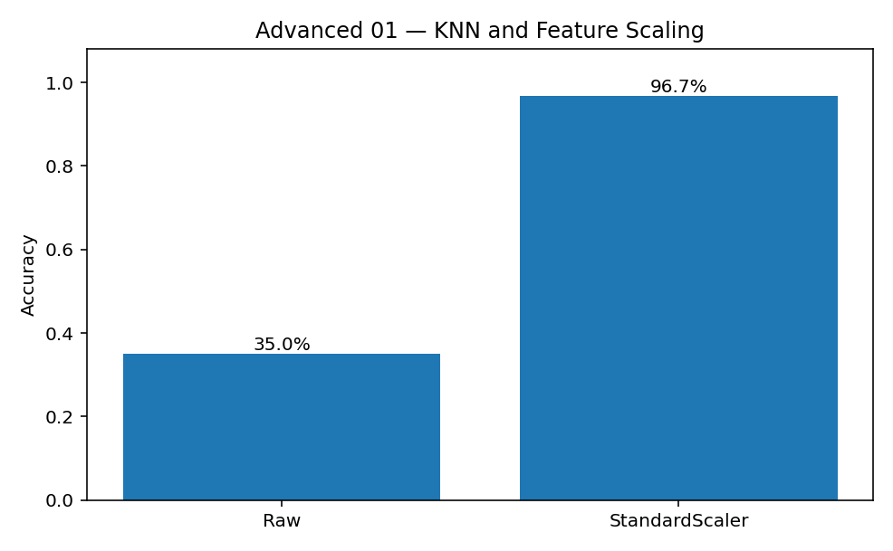

[← Chapter 02](../../README.md) · [Advanced Projects](../../README.md#section-2-13)

# Advanced Project 01. Feature Scaling & Distance-Based Models

## 문제 상황

센서 진동과 주변 조도를 이용해 이상 상태를 분류합니다. 진동은 약 0~4mm/s, 조도는 수백~수만 lx 범위로 측정됩니다. Feature의 단위와 크기를 그대로 사용하면 거리 계산에 어느 변수가 더 크게 작용할까요?

이번 프로젝트에서는 **같은 KNN 모델과 같은 Train/Test Split** 을 사용해 Feature Scaling 전후를 비교합니다. 성능 차이의 원인을 거리 계산에서 확인하는 것이 목표입니다.

## 데이터

[`sensor_signals.csv`](../../data/sensor_signals.csv)는 실습용 합성 데이터 240건입니다. 실제 장비 이상 탐지에 사용할 수 없습니다.

| 열 | 역할 | 단위 |
|---|---|---|
| `sample_id` | 식별자, Feature에서 제외 | 문자열 |
| `vibration_mm_s` | Feature | mm/s |
| `ambient_lux` | Feature | lx |
| `fault_label` | Target / Label | 0: 정상, 1: 이상 |

합성 데이터에서는 진동이 Label과 관련되도록, 조도는 Label과 거의 무관하도록 설계했습니다. 따라서 원래 단위로 KNN을 사용하면 조도의 큰 수치 범위가 거리 계산을 지배할 수 있습니다.

## 거리와 Standardization

두 Sample 사이의 유클리드 거리:

$$
d(a,b)=\sqrt{(a_1-b_1)^2+(a_2-b_2)^2}
$$

예를 들어 진동 차이가 1mm/s이고 조도 차이가 500lx라면, 변환 전 거리는 $\sqrt{1^2+500^2}\approx500.001$입니다. 이 값은 물리적 중요도가 아니라 **서로 다른 단위를 그대로 사용한 계산 결과** 입니다.

Standardization은 학습 데이터의 평균과 표준편차로 각 Feature를 변환합니다.

$$
z = \frac{x-\mu_{\mathrm{train}}}{\sigma_{\mathrm{train}}}
$$

실제로는 학습 데이터에서만 통계량을 계산해야 합니다. 분산이 0인 Feature 등 예외 처리는 `StandardScaler`가 담당합니다.

## 구현 STEP

1. **Validate:** 필수 열·수치 범위·중복 `sample_id`와 Label 유효성을 검사합니다.
2. **Split:** `test_size=0.25`, `random_state=42`, `stratify=y`로 데이터를 한 번만 분리합니다.
3. **Raw KNN:** 원본 Feature로 `KNeighborsClassifier(n_neighbors=7)`을 학습합니다.
4. **Pipeline:** `StandardScaler()`와 같은 KNN을 `make_pipeline()`으로 연결해 학습합니다.
5. **Compare:** 두 모델의 Accuracy와 서로 다르게 분류한 Test Sample 수를 계산합니다.
6. **Explain:** 거리 계산에 영향을 준 단위 차이와 Pipeline의 역할을 설명합니다.

<details>
<summary><strong>코드 힌트 — Pipeline</strong></summary>

```python
scaled_model = make_pipeline(
    StandardScaler(),
    KNeighborsClassifier(n_neighbors=7),
)
scaled_model.fit(X_train, y_train)
scaled_pred = scaled_model.predict(X_test)
```

`Pipeline.fit()`에서 `StandardScaler`는 Train Set에만 맞춰지고, `predict()`에서는 그 기준을 재사용합니다.

</details>

## 예상 결과

기본 데이터에서 Test Set 60건의 Accuracy는 변환 전 **35.0%**, 변환 후 **96.7%** 였습니다. 두 예측의 결과가 다른 샘플은 **39건** 입니다.



이 결과는 Feature의 상대적 단위가 거리 기반 모델에 큰 영향을 줄 수 있음을 보여줍니다. **Scaling이 모든 데이터와 모든 모델의 성능을 반드시 높인다는 뜻은 아닙니다.**

## 실행

```bash
python projects/advanced_01_scaling_knn/starter.py
python solutions/advanced_01_scaling_knn.py
```

## 테스트 시나리오

- `fault_label`이 0·1 이외의 값을 가지면 오류를 발생시킵니다.
- 누락 또는 중복 `sample_id`를 검사합니다.
- 두 모델에 동일한 Test Set을 사용합니다.
- Feature Scaling 기준을 Test Set으로부터 학습하지 않습니다.
- Prediction을 비교할 때 단순히 Accuracy만 비교하지 않고 달라진 예측 건수도 계산합니다.

## 심화 실험

`ambient_lux`를 제거한 KNN을 추가하고 Raw 모델과 비교하세요. Model이 어떤 Feature에 의존하는지, 조도 변수가 꼭 필요한지 검토합니다.

**완료 기준:** Feature의 수치 범위가 거리 계산에 미치는 영향과 Pipeline을 사용한 전처리 순서를 설명합니다.

---
[← Chapter 02](../../README.md) · [Contents](../../README.md#contents)
