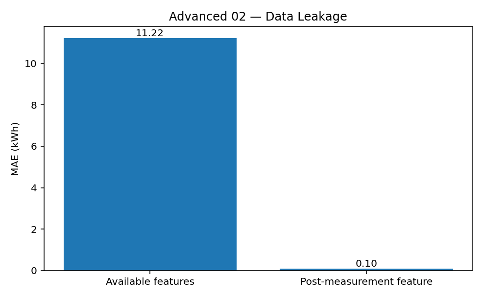

[← Chapter 02](../../README.md) · [Advanced Projects](../../README.md#section-2-13)

# Advanced Project 02. Data Leakage Audit

## 문제 상황

건물의 다음 시간대 전력 사용량을 예측한다고 가정합니다. 입력 데이터에는 기온, 건물 면적, 재실 인원과 함께 **해당 시간대가 끝난 뒤 확정된 계량 값** 이 들어 있습니다.

종료 후 계량 값은 실제 전력 사용량과 매우 유사합니다. 이를 Feature로 사용하면 평가 오차가 비정상적으로 낮아질 수 있지만, **예측 시점에는 얻을 수 없는 정보** 이므로 실사용 모델에는 포함하면 안 됩니다.

## 데이터

[`energy_usage.csv`](../../data/energy_usage.csv)는 실습용 합성 데이터 320건입니다.

| 열 | 수집 시점 | 사용 여부 |
|---|---|---|
| `record_id` | 기록 식별 | Feature 제외 |
| `temperature_c` | 예측 시점에 관측된 기온 | 사용 가능 |
| `floor_area_m2` | 사전 등록된 건물 면적 | 사용 가능 |
| `occupancy` | 예측 시점에 파악된 인원 | 사용 가능 |
| `energy_kwh` | 시간대가 끝나고 확인된 소비량 | Target |
| `meter_finalized_kwh` | 측정 종료 후 확정된 계량 값 | **사용 금지** |

이번 합성 데이터의 변수 관계는 특정 실험을 위한 설정입니다. 실제 전력 수요 예측에 필요한 피처나 측정 절차를 그대로 반영하지는 않습니다.

## 두 가지 Data Leakage

- **Target Leakage:** 예측 시점에 사용할 수 없거나 Target에서 직접 파생된 정보를 Feature로 포함한 경우
- **Train/Test Leakage:** Test Set의 통계량으로 전처리 설정을 학습하거나 Test Set을 이용해 모델을 조정한 경우

두 경우 모두 평가를 왜곡할 수 있습니다. 이번 프로젝트는 **Target Leakage와 예측 시점의 정보 가용성** 을 다룹니다. Train/Test 누출은 비교 실험의 조건을 고정해 방지합니다.

## 구현 STEP

**STEP 1 — Data Validation**

필수 열·중복 `record_id`·결측값·비정상 수치를 확인합니다. 면적·인원·사용량은 양수이고, 인원은 정수여야 합니다.

**STEP 2 — Feature Availability Audit**

Feature별로 언제 얻을 수 있는지 분류합니다. `meter_finalized_kwh`를 실제 예측에 사용하지 않아야 하는 이유를 한 문장으로 기록합니다.

**STEP 3 — Train/Test Split**

`test_size=0.25`, `random_state=42`를 사용하고 **행 인덱스를 한 번만 분리** 합니다. 두 모델에 동일한 Train/Test Sample을 적용하세요.

**STEP 4 — Valid Model**

`temperature_c`, `floor_area_m2`, `occupancy`만으로 `LinearRegression`을 학습합니다.

**STEP 5 — Deliberately Leaked Model**

비교 목적으로만 `meter_finalized_kwh`를 추가한 모델을 학습합니다. 이 모델은 배포용이 아니라 누출 현상을 분석하기 위한 대조군입니다.

**STEP 6 — MAE & Report**

같은 Test Set에서 MAE를 비교하고, 예측 시점에 확보할 수 있는 열만 사용하는 모델을 선택합니다.

<details>
<summary><strong>코드 힌트 — 동일한 행 분할</strong></summary>

```python
indices = np.arange(len(frame))
train_idx, test_idx = train_test_split(
    indices, test_size=0.25, random_state=42
)

valid_features = ["temperature_c", "floor_area_m2", "occupancy"]
leaked_features = valid_features + ["meter_finalized_kwh"]
```

</details>

## 예상 결과

고정된 합성 데이터에서 유효 Feature만 사용한 모델의 MAE는 약 **11.22kWh**, 종료 후 계량 값을 포함한 모델의 MAE는 약 **0.10kWh** 입니다.



후자의 수치가 더 좋아 보이더라도 합법적인 예측 기능이 개선되었다고 해석할 수 없습니다. 종료 후 계량 값이 없으면 그 모델의 입력을 구성할 수 없기 때문입니다. `0.10kWh`는 의도적으로 유사한 값을 생성한 합성 데이터에서만 얻은 결과입니다.

## 실행

```bash
python projects/advanced_02_leakage_audit/starter.py
python solutions/advanced_02_leakage_audit.py
```

## 테스트 시나리오

- `record_id` 중복을 검사합니다.
- 숫자가 아닌 값과 결측값을 오류로 처리합니다.
- `meter_finalized_kwh`가 예측 시점에 사용 불가능하다고 표시되는지 확인합니다.
- 두 모델의 Train/Test Sample을 정확히 일치시킵니다.
- 보고서에서 더 낮은 MAE를 보인 모델을 무조건 선택하지 않습니다.

## 심화 질문

만약 `occupancy`도 예측 시점이 지난 뒤에만 기록된다면 어떻게 해야 할까요? 사용할 수 없는 Feature를 제외하거나, 예측 시점에 확보 가능한 재실 인원 추정치로 바꾸는 방안을 설명하세요.

**완료 기준:** 낮은 평가 오차와 실사용 가능한 예측 모델이 서로 다른 개념임을 설명합니다.

---
[← Chapter 02](../../README.md) · [Contents](../../README.md#contents)
