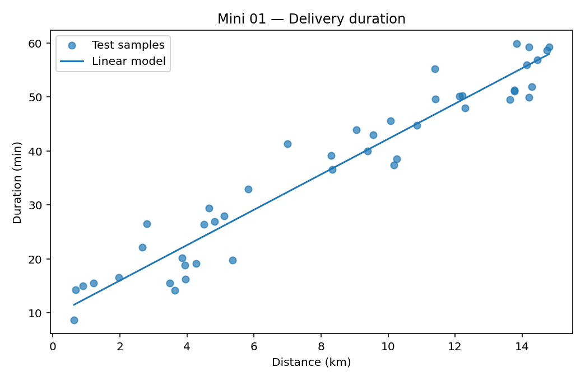

[← Chapter 02](../../README.md) · [Mini Projects](../../README.md#section-2-12)

# Mini Project 01. Delivery Time Prediction

## 문제 상황

배송 거리가 늘어나면 소요 시간도 늘어나는 경향이 있습니다. 하지만 거리만으로 모든 차이를 설명할 수는 없습니다. `delivery_times.csv`에서 배송 거리로 소요 시간을 예측하고, **평균값만 반환하는 Baseline** 과 **Linear Regression** 을 동일한 조건으로 비교하세요.

## 데이터

[`delivery_times.csv`](../../data/delivery_times.csv)는 배송 기록을 모사한 실습용 합성 데이터 180건입니다.

| 열 | 역할 | 단위·범위 |
|---|---|---|
| `order_id` | 식별자(Feature에서 제외) | `D0001` 등 |
| `distance_km` | Feature | km, 양수 |
| `stops` | 추가 Feature(확장 과제) | 0 이상의 정수 |
| `duration_min` | Target | 분, 양수 |

우선 `distance_km`만 모델에 사용합니다. `stops`는 모델에 포함하지 않지만, 같은 거리에서도 시간이 달라지는 이유를 설명할 때 참고할 수 있습니다. 실제 배송 시간이나 서비스 수준을 나타내는 데이터는 아닙니다.

## 구현 STEP

**STEP 1 — Data Inspection**

`order_id`의 중복 여부, 필수 열, 결측값과 수치 범위를 점검합니다. 숫자로 변환할 수 없는 값, 음수 시간은 오류로 처리합니다.

**STEP 2 — Train/Test Split**

`distance_km`를 `X`, `duration_min`을 `y`로 지정합니다. `test_size=0.25`, `random_state=42`로 135건을 학습, 45건을 평가에 사용합니다. 분할을 먼저 수행한 뒤 학습용 Target만으로 Baseline을 계산하세요.

**STEP 3 — Baseline**

학습 데이터의 평균 시간만 예측하는 `DummyRegressor(strategy="mean")`를 준비합니다. 평균값은 학습 데이터에서 계산해야 합니다.

**STEP 4 — Linear Regression**

`LinearRegression()`을 학습하고 Test Set의 소요 시간을 예측합니다. 회귀 계수(`coef_`)와 절편(`intercept_`)의 단위를 함께 해석하세요.

**STEP 5 — Comparison & Visualization**

MAE와 MSE를 계산합니다. Scatter Plot에 실제 Test Sample과 회귀 직선을 함께 표시하고, 두 모델의 MAE를 비교합니다.

**STEP 6 — Interpretation**

Linear Regression이 Baseline보다 얼마나 오류를 줄였는지 설명합니다. 거리만으로 설명되지 않는 차이도 관찰하세요.

<details>
<summary><strong>코드 힌트 — Baseline과 MAE</strong></summary>

```python
from sklearn.dummy import DummyRegressor
from sklearn.linear_model import LinearRegression
from sklearn.metrics import mean_absolute_error

baseline = DummyRegressor(strategy="mean").fit(X_train, y_train)
model = LinearRegression().fit(X_train, y_train)

baseline_mae = mean_absolute_error(y_test, baseline.predict(X_test))
model_mae = mean_absolute_error(y_test, model.predict(X_test))
```

</details>

## 예상 결과와 해석

고정된 데이터 및 분할 조건에서 Baseline의 MAE는 약 **14.11분**, Linear Regression의 MAE는 약 **3.39분** 입니다. Linear Regression의 기울기는 약 **3.28분/km** 입니다.

이 기울기는 이 모델에서 다른 조건을 고려하지 않았을 때 거리가 1km 늘어날수록 예측 시간이 약 3.28분 증가함을 뜻합니다. 반드시 실제 배송 시간의 인과관계를 의미하는 것은 아닙니다.



## 실행

```bash
python projects/mini_01_delivery_regression/starter.py
python solutions/mini_01_delivery_regression.py
```

첫 번째 파일은 구현용 Starter Code입니다. TODO를 완성하기 전에는 `NotImplementedError`가 발생합니다. 두 번째 파일은 모범 구현이며 그림을 `outputs/`에 저장합니다.

## 테스트 시나리오

- `order_id`가 중복되면 검증 오류가 발생하는지 확인합니다.
- `duration_min`에 음수나 결측값이 있는 경우 입력을 거부합니다.
- 학습 데이터와 평가 데이터가 서로 겹치지 않는지 확인합니다.
- 두 모델이 동일한 Test Set을 사용하는지 확인합니다.
- MAE의 단위는 분, MSE의 단위는 분²임을 구별합니다.

## 확장 과제

`stops`를 두 번째 Feature로 추가하고 MAE를 다시 계산하세요. 다중 Feature 모델에서 회귀 계수는 **다른 Feature를 고정했을 때** 해당 값이 1단위 증가하는 경우의 예측 변화량입니다. 확장 결과가 언제나 좋아진다고 가정하지 말고 Test Set에서 확인하세요.

**완료 기준:** Baseline 대비 성능 차이, 회귀 계수의 의미, 거리만 사용했을 때의 한계를 설명합니다.

---
[← Chapter 02](../../README.md) · [Contents](../../README.md#contents)
