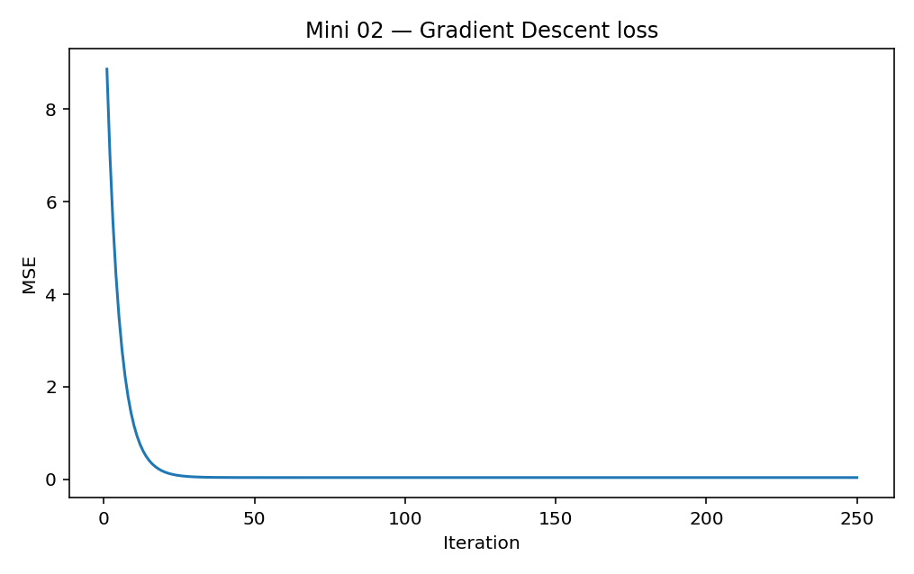

[← Chapter 02](../../README.md) · [Mini Projects](../../README.md#section-2-12)

# Mini Project 02. Linear Regression with Gradient Descent

## 문제 상황

`LinearRegression().fit()`은 짧은 코드만으로 회귀 모델을 학습합니다. 이번 프로젝트에서는 라이브러리의 학습 기능 대신 **NumPy로 Gradient Descent를 직접 구현** 합니다. 매개변수가 어떻게 바뀌는지와 반복 과정에서 MSE가 줄어드는 이유를 확인하세요.

## 입력 데이터

실습용 합성 데이터 41개를 코드에서 생성합니다. `x`는 -2부터 2까지 일정 간격의 수치이고, Target은 선형 관계에 작은 잡음을 추가한 값입니다.

```python
import numpy as np

rng = np.random.default_rng(42)
x = np.linspace(-2, 2, 41)
y = 1.5 * x + 2.8 + rng.normal(0, 0.25, x.size)
```

이 데이터의 생성식을 모델이 미리 아는 것은 아닙니다. 학습 중에는 입력 `x`와 대응하는 Target `y`만 사용합니다.

## 핵심 수식

예측 함수:

$$
\hat{y}_i = wx_i + b
$$

Mean Squared Error:

$$
L(w,b)=\frac{1}{n}\sum_{i=1}^{n}(wx_i+b-y_i)^2
$$

기울기:

$$
\frac{\partial L}{\partial w}=\frac{2}{n}\sum_{i=1}^{n}(wx_i+b-y_i)x_i
$$

$$
\frac{\partial L}{\partial b}=\frac{2}{n}\sum_{i=1}^{n}(wx_i+b-y_i)
$$

매개변수 갱신:

$$
w\leftarrow w-\alpha\frac{\partial L}{\partial w},\qquad
b\leftarrow b-\alpha\frac{\partial L}{\partial b}
$$

여기서 $\alpha$는 Learning Rate입니다. 계산한 기울기의 반대 방향으로 매개변수를 이동하여 Loss를 줄이는 방식입니다.

## 구현 STEP

**STEP 1 — Initialize**

`weight=0`, `bias=0`으로 시작하고 `learning_rate=0.05`, `steps=250`을 사용합니다.

**STEP 2 — Forward Calculation**

현재 매개변수로 모든 Sample을 예측하고 `error = prediction - y`를 계산합니다.

**STEP 3 — Gradient Calculation**

두 기울기를 계산합니다. 합계에 `2/n`을 곱하는 수식은 `2*np.mean(...)`으로 구현할 수 있습니다.

**STEP 4 — Update & Record**

`weight`, `bias`를 갱신한 뒤 **갱신된 매개변수** 로 MSE를 기록합니다. 이 순서를 유지해야 Loss 곡선의 각 점이 해당 반복의 결과를 의미합니다.

**STEP 5 — Compare**

`LinearRegression`의 계수·절편과 비교하고, 두 학습 결과가 가깝게 수렴하는지 확인합니다.

<details>
<summary><strong>코드 힌트 — 갱신 반복문</strong></summary>

```python
for _ in range(steps):
    error = weight * x + bias - y
    grad_weight = 2 * np.mean(error * x)
    grad_bias = 2 * np.mean(error)
    weight -= learning_rate * grad_weight
    bias -= learning_rate * grad_bias
```

이후 갱신된 예측값으로 MSE를 계산하고 `losses`에 추가합니다.

</details>

## 예상 결과와 해석

동일한 난수 시드로 실행하면 최종 계수는 약 `w=1.5247`, 절편은 `b=2.8139`입니다. 시작 Loss 약 `8.86`에서 최종 MSE는 약 `0.0404`로 감소합니다.



Loss가 감소했다고 해서 모든 Learning Rate에서 안전하게 수렴하는 것은 아닙니다. 데이터의 크기와 특성 범위, Learning Rate에 따라 발산하거나 느리게 수렴할 수 있습니다.

## 실행

```bash
python projects/mini_02_gradient_descent/starter.py
python solutions/mini_02_gradient_descent.py
```

## 테스트 시나리오

- 반환된 `weight`, `bias`가 유한한 숫자인지 확인합니다.
- `losses`의 길이가 `steps`와 같은지 확인합니다.
- 최종 Loss가 초기 Loss보다 작은지 확인합니다.
- 최종 계수가 `LinearRegression`의 계수와 가까운지 비교합니다.
- Learning Rate를 `0.01`, `0.05`, `0.2`로 바꾸고 수렴 속도를 관찰합니다. 일부 조건에서는 발산할 수 있으므로 실제 수치를 확인합니다.

**완료 기준:** Gradient 계산·매개변수 갱신·Loss 기록의 관계를 코드와 수식으로 설명합니다.

---
[← Chapter 02](../../README.md) · [Contents](../../README.md#contents)
