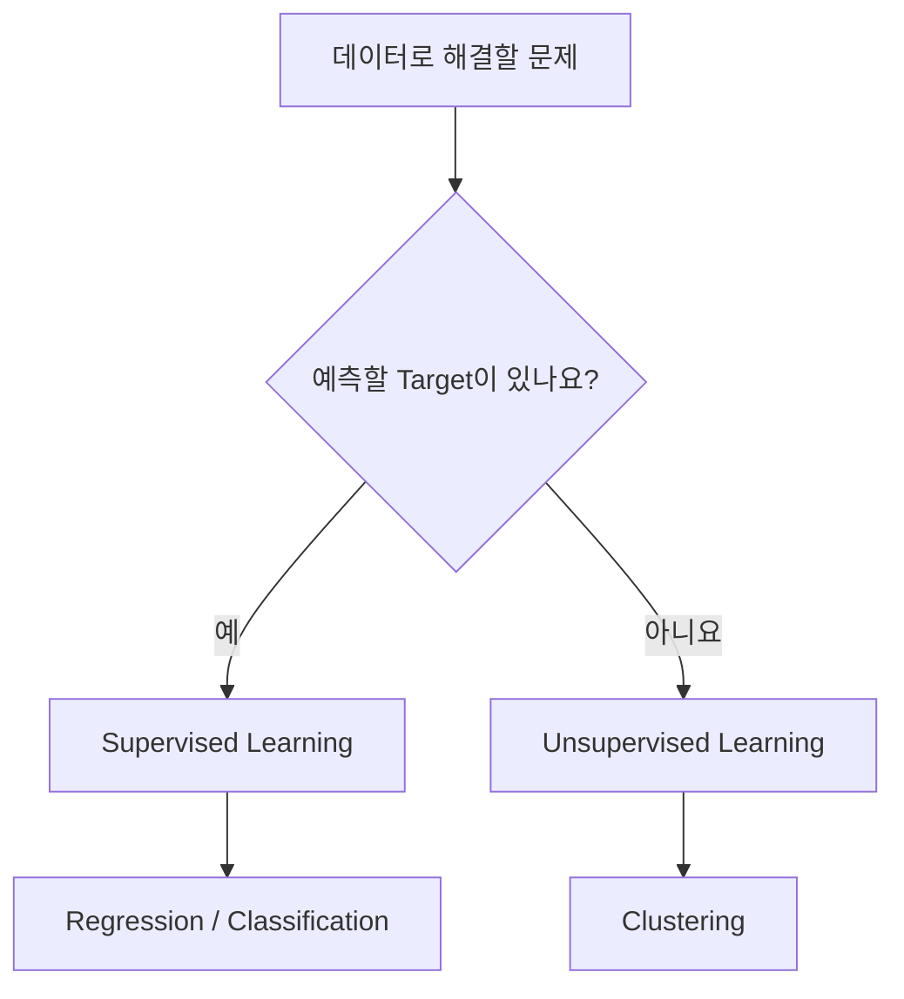
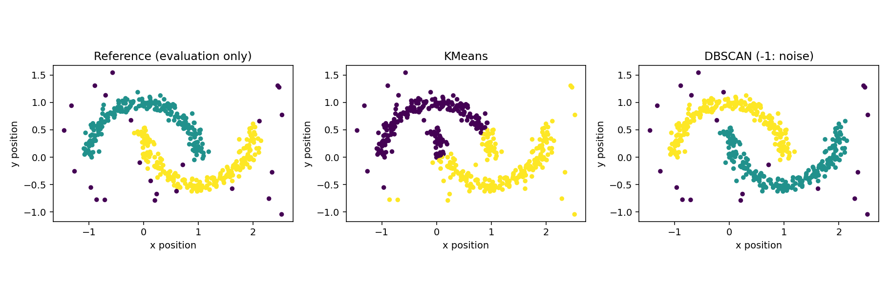

# Chapter 03. Supervised & Unsupervised Learning

머신러닝은 학습 데이터에 어떤 정보가 포함되어 있는지에 따라 접근 방식이 달라집니다. Chapter 03에서는 **지도학습(Supervised Learning)** 과 **비지도학습(Unsupervised Learning)** 을 구분하고, Regression·Classification·Clustering의 대표 알고리즘을 구현합니다. 같은 Feature를 사용하더라도 예측할 Target이 있는지, 데이터의 구조를 탐색하려는지에 따라 결과의 의미가 달라집니다.

- **학습 환경:** Google Colab(기본), VS Code 또는 Jupyter Notebook(로컬)
- **실습 언어:** Python 3.11 이상 권장
- **주요 도구:** NumPy, Pandas, Matplotlib, scikit-learn
- **실습 데이터:** 실습용 합성 데이터(Synthetic Data) 4종

<details>
<summary><strong>선행 학습 목록</strong></summary>

- [Chapter 01. Introduction to Artificial Intelligence](../Chapter-01/README.md) — AI의 범위, Training과 Inference
- [Chapter 02. Machine Learning Fundamentals](../Chapter-02/README.md) — Feature·Target·Sample, Linear Regression, Loss Function, Feature Scaling
- [Data Processing](../../Data_Processing/) — NumPy 배열과 Pandas DataFrame(선택)

</details>

<a id="contents"></a>
## Contents

| Section | Topic |
|:---:|---|
| [3.1](#section-3-1) | **Learning Goals & Getting Started** — 학습 목표와 실행 환경 |
| [3.2](#section-3-2) | **Learning Paradigms** — Supervised와 Unsupervised Learning |
| [3.3](#section-3-3) | **Regression & Classification** — 연속적인 값과 범주 예측 |
| [3.4](#section-3-4) | **Logistic Regression** — 이진 분류와 확률 추정 |
| [3.5](#section-3-5) | **Decision Threshold & Confusion Matrix** — 분류 결과의 해석 |
| [3.6](#section-3-6) | **KMeans Clustering** — 할당·중심 갱신·군집 내 제곱합 |
| [3.7](#section-3-7) | **Feature Scaling & Cluster Profiles** — 군집 결과를 해석하는 방법 |
| [3.8](#section-3-8) | **DBSCAN & Noise** — 밀도 기반 Clustering |
| [3.9](#section-3-9) | **Clusters Are Not Class Labels** — Cluster와 Label의 차이 |
| [3.10](#section-3-10) | **Data Splitting & Evaluation** — 데이터 분리와 평가 |
| [3.11](#section-3-11) | **Examples** — Python 실행 예제 |
| [3.12](#section-3-12) | **Coding Practice** — 직접 구현하는 연습문제 |
| [3.13](#section-3-13) | **Mini Projects** — 문의 분류와 대여소 이용 패턴 분석 |
| [3.14](#section-3-14) | **Advanced Projects** — 학습 방식 비교, 곡선형 군집과 Noise |
| [3.15](#section-3-15) | **Quiz** — 개념·수식·코드 분석 |
| [3.16](#section-3-16) | **Summary** — 핵심 개념 정리 |
| [3.17](#section-3-17) | **References** — 공식 참고 문서 |

---

<a id="section-3-1"></a>
## 3.1. Learning Goals & Getting Started

### 학습 목표

학습을 마치면 다음 내용을 설명하고 구현할 수 있습니다.

1. Supervised Learning과 Unsupervised Learning에서 Target의 역할 구분
2. Regression과 Classification의 출력 차이 및 Logistic Regression의 예측 과정
3. Decision Threshold에 따른 Confusion Matrix의 변화
4. KMeans의 Cluster 할당과 중심 갱신, DBSCAN의 Noise 처리
5. Label과 Cluster ID를 구분한 결과 해석과 올바른 데이터 사용

### 실행 준비

[Google Colab](https://colab.research.google.com/)에서는 [`Chapter_03_Supervised_and_Unsupervised_Learning.ipynb`](./notebooks/Chapter_03_Supervised_and_Unsupervised_Learning.ipynb)를 업로드해 실행할 수 있습니다. Notebook의 핵심 예제는 별도 CSV 업로드 없이 실행되며, 프로젝트의 전체 데이터와 모범 구현은 ZIP에 포함되어 있습니다.

`Chapter-03/` 폴더에서 실행합니다.

```bash
python -m pip install -r requirements.txt
python examples/01_problem_types.py
python examples/02_logistic_classification.py
python -m unittest discover -s tests -v
```

이번 Chapter는 GPU가 필요하지 않습니다.

### 실습 데이터

| 데이터셋 | Sample 수 | Target | 주요 실습 |
|---|---:|---|---|
| [`service_tickets.csv`](./data/service_tickets.csv) | 480 | `urgent` (0/1) | Logistic Regression, Confusion Matrix |
| [`station_patterns.csv`](./data/station_patterns.csv) | 270 | 없음 | KMeans, Cluster Profile |
| [`work_modes.csv`](./data/work_modes.csv) | 540 | `work_mode` (0/1/2) | Classification과 Clustering 비교 |
| [`curved_paths.csv`](./data/curved_paths.csv) | 464 | 학습 Target 없음 | KMeans, DBSCAN, Noise |

네 파일은 모두 실습용 합성 데이터입니다. 열의 정의와 생성 방식은 [`data/README.md`](./data/README.md)에 정리되어 있습니다. `curved_paths.csv`의 `reference_group`은 사후 평가용 참고값으로, Clustering의 입력 Target으로 사용하지 않습니다.

---

<a id="section-3-2"></a>
## 3.2. Learning Paradigms

### Supervised Learning

Supervised Learning은 입력 데이터와 해당 Target을 함께 사용해 예측 관계를 학습하는 방식입니다. Sample 하나를 $(x_i,y_i)$로 나타내면 $x_i$는 입력 Feature, $y_i$는 학습 시 제공되는 Target입니다.

$$
\mathcal{D}_{\mathrm{labeled}}=\{(x_i,y_i)\}_{i=1}^{n}
$$

- $\mathcal{D}_{\mathrm{labeled}}$: Target이 포함된 학습 데이터
- $x_i$: $i$번째 Sample의 Feature 벡터
- $y_i$: 해당 Sample의 Target
- $n$: Sample 수

예를 들어 문의 처리 시간을 비롯한 입력값으로 `긴급/일반`을 예측하려면, 학습 데이터에 이미 분류된 처리 결과가 있어야 합니다. 회귀 문제도 원리는 같습니다. 차이는 Target이 범주인지 연속적인 숫자인지에 있습니다.

### Unsupervised Learning

**비지도학습(Unsupervised Learning)** 은 정답 Label 없이 입력 데이터의 구조나 패턴을 찾습니다.

$$
\mathcal{D}_{\mathrm{unlabeled}}=\{x_i\}_{i=1}^{n}
$$

여기에는 학습 과정에 주어지는 $y_i$가 없습니다. 대여소별 오전·저녁·주말 이용량을 이용해 비슷한 패턴끼리 묶는 Clustering이 대표적인 예입니다.

| 구분 | Supervised Learning | Unsupervised Learning |
|---|---|---|
| 학습 입력 | Feature와 Target | Feature |
| 주요 목적 | 정해진 Target 예측 | 데이터의 구조·패턴 탐색 |
| 대표 작업 | Regression, Classification | Clustering, 차원 축소(Dimensionality Reduction) |
| 예시 | 문의의 긴급 Label 예측 | 대여소의 이용 패턴 그룹화 |

Clustering은 Unsupervised Learning의 한 분야이지, 모든 비지도학습을 뜻하지는 않습니다. 이번 Chapter에서는 Clustering에 초점을 둡니다.



이 구분은 데이터 파일에 Label 열이 실제로 존재하는지만을 뜻하지 않습니다. **그 Label을 학습에 활용하는지**가 핵심입니다. 참고용 Label이 존재하더라도 Clustering 단계에 전달하지 않으면 Unsupervised Learning으로 수행할 수 있습니다.

---

<a id="section-3-3"></a>
## 3.3. Regression & Classification

Supervised Learning의 대표 작업은 **회귀(Regression)** 와 **분류(Classification)** 입니다.

| 작업 | Target | 모델 출력 예시 | 적절한 질문 |
|---|---|---|---|
| Regression | 연속적인 수치 | 배송 시간 24.8분 | 소요 시간이 얼마나 될까요? |
| Classification | 이산적인 범주 | `긴급` | 긴급 처리 대상인가요? |

Chapter 02의 Linear Regression은 수치 예측 모델이었습니다. 이번 Chapter에서는 Target이 범주인 Classification을 본격적으로 다룹니다. 이름에 `Regression`이 포함되어도 **Logistic Regression은 분류에 사용하는 모델**입니다.

### 같은 Feature, 다른 Target

예를 들어 현재 온도와 습도를 입력할 때 목표를 어떻게 정의하느냐에 따라 작업이 달라집니다.

- 다음 시간의 온도(°C)를 숫자로 예측하면 Regression
- 다음 시간이 `고온/보통/저온` 중 무엇인지 예측하면 Classification

범주 Label을 `0`, `1`, `2`처럼 저장하더라도 그 숫자가 연속적인 크기를 뜻하는 것은 아닙니다. 분류 Label을 단순 회귀값처럼 취급하면 문제를 잘못 정의할 수 있습니다.

---

<a id="section-3-4"></a>
## 3.4. Logistic Regression

### 선형 점수에서 확률 추정치로

**로지스틱 회귀(Logistic Regression)** 는 Feature의 선형 결합을 계산한 뒤 Sigmoid 함수를 적용하여 이진 분류의 클래스 1에 대한 확률 추정치를 만듭니다.

$$
z=w_1x_1+\cdots+w_dx_d+b
$$

$$
\sigma(z)=\frac{1}{1+e^{-z}}
$$

$$
\hat{p}=\sigma(z)
$$

- $x_j$: $j$번째 Feature 값
- $w_j$: 학습된 Weight
- $b$: Intercept
- $z$: 선형 결합으로 계산한 Score
- $\hat{p}$: 클래스 1의 확률 추정치

예를 들어 $z=0$이면 Sigmoid의 결과는 $0.5$입니다. $z$가 양수로 커질수록 출력은 1에 가까워지고, 음수로 작아질수록 0에 가까워집니다.

| $z$ | $\sigma(z)$ (약) | 의미 |
|---:|---:|---|
| -2 | 0.119 | 클래스 1로 분류할 근거가 상대적으로 약함 |
| 0 | 0.500 | 기본 Threshold의 경계 |
| 2 | 0.881 | 클래스 1의 추정 확률이 더 높음 |

### Binary Cross-Entropy

Logistic Regression은 일반적인 MSE 기반 Linear Regression과 다른 Loss를 사용합니다. 이진 분류에서 자주 사용하는 **이진 교차 엔트로피(Binary Cross-Entropy, BCE)** 는 다음과 같습니다.

$$
L=-\frac{1}{n}\sum_{i=1}^{n}\left[y_i\log(\hat p_i)+(1-y_i)\log(1-\hat p_i)\right]
$$

- $y_i\in\{0,1\}$: 실제 Label
- $\hat p_i$: 클래스 1의 확률 추정치
- $n$: Sample 수

정답 Label이 1일 때 $\hat p_i$가 0에 가까우면 큰 손실을 받습니다. 반대로 Label이 0일 때 $\hat p_i$가 1에 가까워도 손실이 커집니다. 위 식은 기본적인 BCE이며, scikit-learn의 `LogisticRegression`에는 별도의 정규화(Regularization)가 기본 설정으로 적용됩니다.

### Python 예제

```python
from sklearn.linear_model import LogisticRegression
from sklearn.pipeline import make_pipeline
from sklearn.preprocessing import StandardScaler

model = make_pipeline(
    StandardScaler(),
    LogisticRegression(max_iter=1000, random_state=42),
)
model.fit(X_train, y_train)
predicted = model.predict(X_test)
prob_urgent = model.predict_proba(X_test)[:, 1]
```

`X_train`과 `y_train`은 미리 분리한 학습 데이터입니다. `predict()`는 Label을 반환하고, `predict_proba()`는 각 클래스의 확률 추정치를 반환합니다. **확률 추정치가 0.9라고 해서 실제 사건의 확률이 검증 없이 정확히 90%라고 단정할 수는 없습니다.**

---

<a id="section-3-5"></a>
## 3.5. Decision Threshold & Confusion Matrix

### Decision Threshold

모델의 확률 추정치를 Label로 변환하려면 **분류 임계값(Decision Threshold)** 이 필요합니다. Binary Classification의 일반적인 기본값은 $0.5$입니다.

$$
\hat{y}=\begin{cases}
1 & \text{if } \hat{p}\ge t\\
0 & \text{if } \hat{p}<t
\end{cases}
$$

- $t$: Decision Threshold
- $\hat{p}$: 클래스 1의 확률 추정치
- $\hat{y}$: 최종 예측 Label

예를 들어 추정 확률이 `[0.15, 0.50, 0.81]`이라면 $t=0.5$에서 예측 Label은 `[0, 1, 1]`입니다. $t=0.8$로 높이면 `[0, 0, 1]`로 바뀝니다.

Threshold를 낮추면 일반적으로 더 많은 Sample을 클래스 1로 분류합니다. 그 과정에서 놓치는 양성 사례를 줄일 수도 있지만, 실제 음성을 양성으로 잘못 판단하는 경우가 늘어날 수도 있습니다. 구체적인 Threshold 선택과 Precision·Recall의 관계는 Chapter 04에서 다룹니다.

### Confusion Matrix

**혼동행렬(Confusion Matrix)** 은 실제 Label과 예측 Label을 나누어 집계한 표입니다.

| 실제 \ 예측 | 0 (Negative) | 1 (Positive) |
|---|---:|---:|
| 0 (Negative) | TN | FP |
| 1 (Positive) | FN | TP |

- **TP (True Positive):** 실제 1을 1로 예측
- **TN (True Negative):** 실제 0을 0으로 예측
- **FP (False Positive):** 실제 0을 1로 예측
- **FN (False Negative):** 실제 1을 0으로 예측

예를 들어 아래 결과는 평가 데이터 120건에 대한 실습용 합성 데이터의 결과입니다.

| 실제 \ 예측 | 일반(0) | 긴급(1) |
|---|---:|---:|
| 일반(0) | 41 | 11 |
| 긴급(1) | 9 | 59 |

Accuracy는 $(41+59)/120=0.8333\ldots$, 약 83.3%입니다. 하지만 긴급 문의 9건을 놓쳤다는 사실은 별도로 살펴봐야 합니다. 중요도를 판단할 때는 단일 지표보다 오류의 종류를 함께 확인합니다.

---

<a id="section-3-6"></a>
## 3.6. KMeans Clustering

### 가장 가까운 중심에 할당하기

**K-평균 군집화(KMeans Clustering)** 는 지정한 개수 $K$의 Cluster 중심을 찾고, 각 Sample을 가장 가까운 중심에 할당하는 방법입니다. 학습 과정에서 정답 Label은 사용하지 않습니다.

1. 초기 Cluster 중심 $\mu_1,\ldots,\mu_K$를 정합니다.
2. 각 Sample을 가장 가까운 중심에 할당합니다.
3. 같은 Cluster에 속한 Sample의 평균을 새 중심으로 사용합니다.
4. Cluster 할당 또는 중심 변화가 충분히 작아질 때까지 반복합니다.

### 군집 내 제곱합

KMeans는 아래의 **군집 내 제곱합(Within-Cluster Sum of Squares, WCSS)** 을 줄이는 방향으로 동작합니다. scikit-learn에서는 최종값을 `inertia_`로 확인할 수 있습니다.

$$
J=\sum_{i=1}^{n}\left\|x_i-\mu_{c_i}\right\|_2^2
$$

- $x_i$: $i$번째 Sample의 Feature 벡터
- $\mu_{c_i}$: Sample $i$가 배정된 Cluster의 중심
- $c_i$: Sample $i$의 Cluster ID

예를 들어 1차원 데이터 `[1, 2, 8, 9]`를 `{1, 2}`, `{8, 9}`로 나누면 중심은 각각 $1.5$, $8.5$입니다.

$$
J=(1-1.5)^2+(2-1.5)^2+(8-8.5)^2+(9-8.5)^2=1
$$

KMeans의 최적화 결과는 초기 중심과 $K$에 영향을 받을 수 있습니다. WCSS가 낮다는 사실만으로 현실의 의미 있는 집단을 발견했다고 볼 수는 없습니다.

### NumPy로 할당과 중심 갱신

```python
import numpy as np

X = np.array([[1., 1.], [1., 2.], [7., 7.], [8., 7.]])
centers = np.array([[1., 1.], [8., 8.]])

distance = np.linalg.norm(X[:, None, :] - centers[None, :, :], axis=2)
clusters = np.argmin(distance, axis=1)
new_centers = np.vstack([X[clusters == i].mean(axis=0) for i in range(2)])
print(clusters)     # [0 0 1 1]
print(new_centers)  # [[1.  1.5] [7.5 7. ]]
```

`X[:, None, :]`는 Sample 축을, `centers[None, :, :]`는 중심 축을 확장해 모든 Sample과 중심의 거리를 계산합니다. 이 코드는 KMeans의 한 번의 할당·갱신 단계이며, 전체 알고리즘처럼 수렴할 때까지 반복하지는 않습니다.

---

<a id="section-3-7"></a>
## 3.7. Feature Scaling & Cluster Profiles

### Feature Scaling이 필요한 이유

KMeans는 거리 기반 알고리즘입니다. km와 원처럼 단위나 값의 범위가 크게 다른 Feature를 그대로 사용하면 큰 값의 열이 거리 계산을 지배할 수 있습니다. Chapter 02에서 다룬 **표준화(Standardization)** 는 다음 식으로 표현합니다.

$$
x'_{ij}=\frac{x_{ij}-\mu_j}{s_j}
$$

- $\mu_j$: $j$번째 Feature의 평균
- $s_j$: 해당 Feature의 표준편차(0인 열은 구현 방식에 따라 별도로 처리)

```python
from sklearn.cluster import KMeans
from sklearn.pipeline import make_pipeline
from sklearn.preprocessing import StandardScaler

clusterer = make_pipeline(
    StandardScaler(),
    KMeans(n_clusters=3, n_init=10, random_state=42),
)
cluster_id = clusterer.fit_predict(X)
```

이번 Clustering은 Label이 없는 Feature 데이터의 구조를 탐색하므로 학습에 사용할 $y$를 전달하지 않습니다. `n_clusters=3`은 Cluster의 개수를 **미리 지정**한 값입니다.

### Cluster Profile

Cluster ID만으로는 각 집단의 특징을 알 수 없습니다. 대여소 이용량처럼 해석 가능한 Feature는 원래 단위에서 Cluster별 평균을 비교하는 것이 유용합니다.

| Cluster | 오전 이용량 | 저녁 이용량 | 주말 이용량 | 해석 |
|---:|---:|---:|---:|---|
| 0 | 25.0 | 29.6 | 85.7 | 주말 중심 |
| 1 | 76.6 | 72.9 | 25.4 | 출퇴근 시간 중심 |
| 2 | 49.9 | 52.6 | 52.4 | 비교적 고른 이용 |

위 수치는 제공된 합성 데이터에 KMeans를 적용한 결과입니다. Cluster 0이 언제나 주말 중심을 뜻하는 것은 아닙니다. **Cluster 번호는 임의의 식별자** 이므로 모델을 다시 학습했을 때 다른 번호가 부여될 수 있습니다.

---

<a id="section-3-8"></a>
## 3.8. DBSCAN & Noise

### 밀도 기반 Clustering

KMeans는 중심과의 거리로 Cluster를 나누기 때문에 두 개의 초승달처럼 굽은 형태를 구분하기 어려울 수 있습니다. **밀도 기반 군집화(DBSCAN: Density-Based Spatial Clustering of Applications with Noise)** 는 가까운 점들이 충분히 모인 영역을 연결해 Cluster를 찾습니다.

주요 설정값은 다음과 같습니다.

| 설정 | 의미 |
|---|---|
| `eps` | 한 점의 이웃으로 간주할 최대 거리 |
| `min_samples` | Core Point 판단에 필요한 이웃 Sample의 최소 개수(자기 자신 포함) |
| `-1` | 어느 Cluster에도 속하지 않는 Noise Label |

DBSCAN은 Core Point에서 밀도 연결을 확장하고 주변 Border Point를 Cluster에 포함할 수 있습니다. Cluster 개수를 미리 지정할 필요는 없지만, 데이터의 Scale과 밀도에 따라 결과가 크게 달라집니다.

```python
from sklearn.cluster import DBSCAN
from sklearn.preprocessing import StandardScaler

X_scaled = StandardScaler().fit_transform(X)
cluster_id = DBSCAN(eps=0.23, min_samples=6).fit_predict(X_scaled)
noise_count = (cluster_id == -1).sum()
```

이 예제에서 `eps=0.23`은 **표준화된 Feature 공간의 거리**입니다. 원래 좌표에서 0.23이라는 뜻이 아닙니다.



제공된 곡선형 합성 데이터에서는 DBSCAN이 곡선 구조를 더 잘 구분했습니다. 그러나 밀도가 불균일하거나 Noise가 많을 때는 이 결과가 유지되지 않을 수 있습니다.

---

<a id="section-3-9"></a>
## 3.9. Clusters Are Not Class Labels

Clustering의 결과가 `0`, `1`, `2`라는 숫자로 표시된다고 해서 Classification의 Label `0`, `1`, `2`와 같은 의미는 아닙니다. Classification의 Label은 문제를 정의할 때 정해진 범주이고, Clustering의 ID는 알고리즘이 찾아낸 그룹을 구별하기 위한 번호입니다.

따라서 다음 코드는 올바른 Cluster 평가 방법이 아닙니다.

```python
# 잘못된 비교: Cluster 번호와 Target 번호는 일대일로 대응하지 않을 수 있습니다.
# accuracy_score(true_labels, cluster_ids)
```

참고 Label이 존재한다면 군집의 분할이 얼마나 일치하는지 **조정 랜드 지수(Adjusted Rand Index, ARI)** 같은 지표로 사후 평가할 수 있습니다.

```python
from sklearn.metrics import adjusted_rand_score

ari = adjusted_rand_score(reference_labels, cluster_ids)
```

- ARI는 Cluster ID를 바꾸어도 값이 변하지 않습니다.
- 1은 두 분할이 완전히 일치한다는 뜻이며, 0 부근은 우연한 일치 수준에 가깝습니다. 음수도 가능합니다.
- 값이 낮다고 해서 Clustering 자체가 실패했다고 단정할 수 없습니다. 비교한 Label과 군집의 목적이 서로 다를 수 있습니다.

Advanced 01에서는 같은 Sample에 대해 Classification과 KMeans를 각각 적용합니다. 고정된 데이터에서 Classification Accuracy는 77.8%, Cluster와 실제 Label의 ARI는 0.035였습니다. 두 수치는 동일한 지표가 아니므로 크기를 직접 비교해 알고리즘의 우열을 판단해서는 안 됩니다.

---

<a id="section-3-10"></a>
## 3.10. Data Splitting & Evaluation

### Supervised Learning의 데이터 분리

Classification 모델의 성능을 확인하려면 학습에 사용하지 않은 데이터를 따로 두어야 합니다.

```python
from sklearn.model_selection import train_test_split

X_train, X_test, y_train, y_test = train_test_split(
    X, y, test_size=0.25, stratify=y, random_state=42
)
```

`stratify=y`는 분할 후에도 원래 Class 비율이 대체로 유지되도록 합니다. 특히 특정 Label의 건수가 적을 때 유용하지만, 각 클래스의 샘플이 지나치게 적으면 적용할 수 없습니다.

`StandardScaler`처럼 데이터로부터 평균·표준편차를 계산하는 변환은 Test Set을 참조하지 않은 상태에서 학습해야 합니다. `Pipeline`을 사용하면 전처리와 모델 학습 순서를 함께 관리할 수 있습니다. 단, 동일한 사람·장비의 데이터가 여러 행에 반복되거나 시간의 흐름이 중요한 경우에는 무작위 분할 대신 Group/Time 기반 분할을 검토해야 합니다.

### Unsupervised Learning의 결과 확인

Clustering은 정답 Label 없이 학습하기 때문에 Classification Accuracy처럼 단순한 채점이 불가능합니다. 대신 다음을 확인합니다.

- Cluster별 Sample 수와 Feature 분포
- 원래 단위의 Cluster Profile과 시각화
- 다른 설정값을 사용했을 때 결과가 얼마나 안정적인지
- 참고 Label이 존재한다면 ARI 같은 **사후 비교 지표**

Clustering 자체를 평가하는 방법은 데이터의 목적에 따라 달라집니다. 모델 평가와 Hyperparameter 선택은 Chapter 04에서 더 자세히 다룹니다.

---

<a id="section-3-11"></a>
## 3.11. Examples

### Example 01 — Regression과 Classification 출력 비교

[`01_problem_types.py`](./examples/01_problem_types.py)는 같은 1차원 Feature를 이용해 연속적인 수치와 이진 Label을 각각 예측합니다.

```bash
python examples/01_problem_types.py
```

두 모델은 같은 입력을 받지만 다른 Target을 학습합니다. Linear Regression은 수치를, Logistic Regression은 Class Label과 확률 추정치를 반환합니다.

### Example 02 — Logistic Regression과 Confusion Matrix

[`02_logistic_classification.py`](./examples/02_logistic_classification.py)는 문의 긴급도 합성 데이터를 학습합니다.

```bash
python examples/02_logistic_classification.py
```

Accuracy는 약 83.3%이며, Confusion Matrix는 실제 0·1과 예측 0·1을 나누어 보여줍니다. `predict_proba()`로 얻은 값은 클래스 1의 확률 추정치로, `predict()`의 Label과는 다른 형태입니다.

### Example 03 — KMeans의 한 번의 중심 갱신

[`03_kmeans_iteration.py`](./examples/03_kmeans_iteration.py)는 NumPy로 각 점을 가까운 중심에 할당하고 평균을 계산합니다.

```python
import numpy as np

X = np.array([[1., 1.], [1., 2.], [2., 1.], [7., 7.], [8., 7.], [7., 8.]])
centers = np.array([[1., 1.], [8., 8.]])

distance = np.linalg.norm(X[:, None, :] - centers[None, :, :], axis=2)
labels = np.argmin(distance, axis=1)
updated = np.vstack([X[labels == i].mean(axis=0) for i in range(2)])
print(updated)
```

첫 번째 중심은 `[1.333..., 1.333...]`, 두 번째 중심은 `[7.333..., 7.333...]`로 이동합니다. 중심 갱신이 끝났다고 해서 곧바로 수렴을 보장하지는 않습니다.

### Example 04 — KMeans와 DBSCAN 비교

[`04_kmeans_vs_dbscan.py`](./examples/04_kmeans_vs_dbscan.py)는 같은 좌표 데이터로 두 모델을 실행합니다.

```bash
python examples/04_kmeans_vs_dbscan.py
```

KMeans ARI는 약 0.401, DBSCAN ARI는 약 0.977이었습니다. DBSCAN은 21개 점을 Noise로 분류했습니다. 이 수치는 참고 Label을 사후 비교에 사용한 결과입니다.

---

<a id="section-3-12"></a>
## 3.12. Coding Practice

실습 시작 코드는 [`exercises/`](./exercises/)에, 모범 구현은 [`solutions/`](./solutions/)에 있습니다. `NotImplementedError`는 학습자가 구현할 부분을 표시합니다.

### Practice 01 — Decision Threshold 적용

[`exercises/01_binary_threshold.py`](./exercises/01_binary_threshold.py)의 `predict_labels()`를 완성합니다. 클래스 1의 확률 추정치가 Threshold 이상일 때 1을 반환합니다.

- 입력: `[0.15, 0.50, 0.81]`, `threshold=0.5`
- 예상 결과: `[0, 1, 1]`

<details>
<summary><strong>정답 및 해설</strong></summary>

```python
values = np.asarray(probabilities, dtype=float)
return (values >= threshold).astype(int)
```

`>=`를 사용하므로 정확히 0.5인 값도 클래스 1로 분류합니다. 실습을 완성할 때는 확률값이 0~1 범위인지, NaN·무한대가 없는지 함께 검증합니다. 전체 코드는 [`practice_01_binary_threshold.py`](./solutions/practice_01_binary_threshold.py)에 있습니다.

</details>

### Practice 02 — 가까운 중심 찾기

[`exercises/02_nearest_centroid.py`](./exercises/02_nearest_centroid.py)의 `assign_clusters()`를 완성합니다.

- Sample: `[[0, 1], [9, 9], [2, 2]]`
- 중심: `[[0, 0], [10, 10]]`
- 예상 결과: `[0, 1, 0]`

<details>
<summary><strong>정답 및 해설</strong></summary>

```python
distances = np.linalg.norm(X[:, None, :] - centers[None, :, :], axis=2)
return np.argmin(distances, axis=1)
```

Sample마다 모든 중심까지의 거리를 계산한 뒤 최소 거리의 인덱스를 반환합니다. 거리가 같다면 `np.argmin()`은 먼저 나타난 중심을 선택합니다. 전체 코드는 [`practice_02_nearest_centroid.py`](./solutions/practice_02_nearest_centroid.py)에 있습니다.

</details>

### Practice 03 — Cluster 중심 갱신

[`exercises/03_cluster_means.py`](./exercises/03_cluster_means.py)를 완성합니다.

- Sample: `[[0, 0], [2, 2], [8, 8], [10, 10]]`
- Cluster ID: `[0, 0, 1, 1]`
- 예상 중심: `[[1, 1], [9, 9]]`

<details>
<summary><strong>정답 및 해설</strong></summary>

```python
return np.vstack([X[labels == i].mean(axis=0) for i in range(n_clusters)])
```

각 Cluster에 배정된 Sample의 Feature별 평균을 계산합니다. 비어 있는 Cluster가 있다면 평균을 구할 수 없으므로 별도 예외 처리가 필요합니다. 전체 코드는 [`practice_03_cluster_means.py`](./solutions/practice_03_cluster_means.py)에 있습니다.

</details>

### Practice 04 — 문제 정의에 맞는 학습 방식

서점이 보유한 자료는 다음과 같습니다.

- A: 고객별 구매 이력과 실제 재구매 여부
- B: 고객별 방문 시간과 방문 횟수만 있는 자료

A로 재구매 여부를 예측하는 작업과 B로 이용 유형을 탐색하는 작업에 적절한 학습 방식을 각각 제안하세요.

<details>
<summary><strong>정답 및 해설</strong></summary>

A는 재구매 여부라는 Target이 있으므로 Supervised Classification을 적용할 수 있습니다. B에는 미리 정한 Label이 없으므로 KMeans 같은 Clustering으로 방문 패턴을 탐색할 수 있습니다. 다만 Cluster ID를 곧바로 실제 고객 유형으로 간주하지 않고 각 Cluster의 특징을 확인해야 합니다.

</details>

### Practice 05 — Confusion Matrix 해석

다음 표에서 FP와 FN이 각각 몇 건인지 계산하고, 긴급 문의를 놓친 경우가 어느 칸인지 설명하세요.

| 실제 \ 예측 | 일반(0) | 긴급(1) |
|---|---:|---:|
| 일반(0) | 18 | 2 |
| 긴급(1) | 5 | 15 |

<details>
<summary><strong>정답 및 해설</strong></summary>

FP는 실제 일반인데 긴급으로 예측한 2건, FN은 실제 긴급인데 일반으로 예측한 5건입니다. 전체 Accuracy는 $(18+15)/40=0.825$로 82.5%입니다. 실제 긴급 20건 중 5건을 놓쳤으므로 긴급 클래스 Recall은 $15/20=0.75$입니다. 오류의 비용에 따라 Threshold 조정을 검토할 수 있지만, 무조건 낮추는 것이 정답은 아닙니다.

</details>

---

<a id="section-3-13"></a>
## 3.13. Mini Projects

| 프로젝트 | 핵심 목표 | 자료 |
|---|---|---|
| **Mini 01 — Service Ticket Classification** | Logistic Regression으로 문의의 긴급 Label 예측 및 오분류 분석 | [프로젝트 README](./projects/mini_01_ticket_classification/README.md) · [결과 그림](./figures/mini_01_ticket_classification.png) |
| **Mini 02 — Station Usage Clustering** | 정답 Label 없는 대여소 데이터에서 KMeans와 Cluster Profile 분석 | [프로젝트 README](./projects/mini_02_station_clustering/README.md) · [결과 그림](./figures/mini_02_station_clustering.png) |

각 프로젝트에는 입력 데이터 설명, 구현 STEP, Starter Code, 모범 구현, 테스트 시나리오가 포함되어 있습니다. 모범 구현은 `solutions/`에 있습니다.

---

<a id="section-3-14"></a>
## 3.14. Advanced Projects

| 프로젝트 | 핵심 목표 | 자료 |
|---|---|---|
| **Advanced 01 — Classification vs. Clustering** | 동일한 Feature에서 Classification Label과 Cluster ID의 의미 비교 | [프로젝트 README](./projects/advanced_01_classification_vs_clustering/README.md) · [결과 그림](./figures/advanced_01_classification_vs_clustering.png) |
| **Advanced 02 — Non-Convex Clusters & Noise** | 곡선형 데이터에서 KMeans와 DBSCAN의 차이 및 Noise 분석 | [프로젝트 README](./projects/advanced_02_density_clustering/README.md) · [결과 그림](./figures/advanced_02_density_clustering.png) |

Advanced 01은 ARI를 **사후 평가에만** 사용하며, Advanced 02는 `eps`를 변경하는 실험을 포함합니다. Cluster 수와 Noise의 정의가 모델마다 어떻게 다른지 확인합니다.

---

<a id="section-3-15"></a>
## 3.15. Quiz — Supervised & Unsupervised Learning

### 객관식

**Q01. Target의 역할**

어떤 데이터셋에는 고객의 구매 횟수와 재방문 여부가 함께 기록되어 있습니다. 재방문 여부를 예측하려는 경우 가장 적절한 설명은 무엇인가요?

- **A.** 구매 횟수와 재방문 여부 모두 Cluster ID입니다.
- **B.** 구매 횟수는 Feature, 재방문 여부는 Target입니다.
- **C.** 재방문 여부가 존재하므로 Unsupervised Learning만 가능합니다.
- **D.** 학습에 Target이 있더라도 모델에 제공하면 안 됩니다.

<details>
<summary><strong>정답 및 해설</strong></summary>

**정답: B**

예측할 값을 재방문 여부로 정했다면 해당 값이 Target입니다. 구매 횟수는 예측에 활용하는 Feature이며, 이런 형태의 문제는 Supervised Classification입니다. A는 Cluster ID와 Label을 혼동했고, C·D는 Target을 이용한 지도학습의 정의와 맞지 않습니다.

</details>

**Q02. Logistic Regression의 출력**

이진 Logistic Regression에서 `predict_proba(X)`에 대한 설명으로 맞는 것은 무엇인가요?

- **A.** 예측된 연속적인 매출액만 반환합니다.
- **B.** 각 Sample이 각 클래스에 속할 확률 추정치를 반환합니다.
- **C.** 학습 데이터의 Target을 수정합니다.
- **D.** Cluster 중심을 반환합니다.

<details>
<summary><strong>정답 및 해설</strong></summary>

**정답: B**

`predict_proba()`는 각 클래스에 대한 확률 추정치를 반환합니다. 일반적인 이진 분류에서는 한 행에 클래스 0·1의 추정치가 들어갑니다. 이 값이 실제 확률과 얼마나 일치하는지 별도 검증 없이 확정할 수는 없습니다.

</details>

**Q03. Decision Threshold**

클래스 1의 추정 확률이 `[0.2, 0.5, 0.7]`일 때 Threshold를 0.6으로 설정하면 예측 Label은 무엇인가요?

- **A.** `[0, 0, 1]`
- **B.** `[0, 1, 1]`
- **C.** `[1, 1, 0]`
- **D.** `[1, 0, 0]`

<details>
<summary><strong>정답 및 해설</strong></summary>

**정답: A**

0.6 이상인 값은 0.7 하나뿐입니다. Threshold를 0.5로 적용하면 `[0, 1, 1]`이지만 0.6에서는 `[0, 0, 1]`이 됩니다.

</details>

**Q04. Cluster ID의 의미**

KMeans가 네 개의 Cluster에 0·1·2·3이라는 번호를 부여했습니다. 가장 정확한 해석은 무엇인가요?

- **A.** 3번 Cluster가 언제나 가장 중요합니다.
- **B.** 각 번호는 실제 Target Label에 일대일로 대응합니다.
- **C.** 번호는 구분용 식별자이며, 의미는 Cluster Profile 등으로 확인해야 합니다.
- **D.** Cluster ID는 샘플마다 매번 새 번호로 증가합니다.

<details>
<summary><strong>정답 및 해설</strong></summary>

**정답: C**

KMeans의 Cluster ID는 군집을 구분하기 위한 번호입니다. 모델 실행 조건에 따라 번호가 바뀔 수 있으며, 번호 자체에 등급이나 정답 Label의 의미가 없습니다. Cluster를 설명하려면 Feature 분포와 실제 문제 맥락을 살펴봐야 합니다.

</details>

**Q05. DBSCAN의 Noise**

DBSCAN에서 예측 결과가 `-1`인 Sample은 무엇을 의미하나요?

- **A.** Class 1의 반대 정답
- **B.** 어떤 Cluster에도 할당되지 않은 Noise
- **C.** 반드시 입력 오류인 행
- **D.** KMeans가 계산한 가장 먼 중심

<details>
<summary><strong>정답 및 해설</strong></summary>

**정답: B**

DBSCAN은 밀도 조건을 만족하지 않는 Sample을 Noise로 분류할 수 있으며 `-1`로 표시합니다. 실제 운영에서 이상 징후인지 여부는 별도의 검토가 필요합니다. `-1`이라는 값이 곧바로 잘못된 데이터나 범죄·장애를 뜻하지는 않습니다.

</details>

**Q06. KMeans의 WCSS**

군집 내 제곱합(WCSS)에 관한 설명 중 적절한 것은 무엇인가요?

- **A.** 작은 값일수록 언제나 실제 세상의 집단을 정확하게 찾은 것입니다.
- **B.** 모든 Cluster에 반드시 같은 수의 Sample이 있어야 합니다.
- **C.** Sample과 자신이 속한 Cluster 중심 사이의 제곱거리 합입니다.
- **D.** 계산에 반드시 정답 Label이 필요합니다.

<details>
<summary><strong>정답 및 해설</strong></summary>

**정답: C**

WCSS는 Sample과 Cluster 중심의 거리를 제곱하여 합한 값입니다. KMeans가 줄이려는 목적함수이지만, 작은 값만으로 Cluster의 실제 의미나 적절한 개수를 확정할 수는 없습니다. Label은 학습에 필요하지 않습니다.

</details>

### 주관식

**Q07. 같은 데이터에서 서로 다른 학습 방식**

설문 데이터에 구매 금액과 방문 빈도가 있고, 고객 유형을 나타내는 Label은 없습니다. 방문 패턴을 분석하는 방법을 제안하고, 결과에 붙은 Cluster ID를 어떻게 해석해야 하는지 설명하세요.

<details>
<summary><strong>정답 및 해설</strong></summary>

**모범답안:** 구매 금액과 방문 빈도를 Feature로 사용하여 KMeans 같은 Clustering을 적용할 수 있습니다. Cluster별 평균 구매 금액·방문 빈도를 비교해 패턴을 해석합니다. 이 과정에서는 Target Label이 없으며, 번호 자체가 고객 등급을 뜻하지 않습니다. 또한 값의 Scale이 다르면 표준화가 필요할 수 있습니다.

</details>

**Q08. Logistic Regression이라는 이름**

Logistic Regression이 이름과 달리 주로 Classification 모델로 사용되는 이유를 설명하세요.

<details>
<summary><strong>정답 및 해설</strong></summary>

**모범답안:** Logistic Regression은 Feature의 선형 결합에 Sigmoid를 적용해 클래스 1의 확률 추정치를 계산합니다. 이 추정치에 Threshold를 적용하여 범주 Label을 예측하므로, 연속적인 수치를 직접 예측하는 Linear Regression과 목적이 다릅니다. 모델 이름에 Regression이 들어가도 문제 유형은 Classification입니다.

</details>

**Q09. Feature Scaling이 군집에 영향을 미치는 이유**

KMeans에 거리(km)와 매출액(원)을 그대로 입력했습니다. 왜 결과가 특정 Feature에 치우칠 수 있는지 설명하세요.

<details>
<summary><strong>정답 및 해설</strong></summary>

**모범답안:** KMeans는 Feature 공간에서 거리로 Sample을 비교합니다. 매출액의 수치 범위가 거리보다 훨씬 크면 매출액의 차이가 전체 거리에 큰 영향을 줄 수 있습니다. StandardScaler 등의 변환을 검토하되, 변환이 각 Feature의 의미를 완전히 같게 만드는 것은 아닙니다.

</details>

**Q10. Accuracy와 ARI의 차이**

Classification Accuracy가 80%, Clustering ARI가 0.1이라는 결과를 얻었습니다. 두 숫자만 비교하여 Classification이 더 좋은 알고리즘이라고 말할 수 있을까요?

<details>
<summary><strong>정답 및 해설</strong></summary>

**모범답안:** 직접 비교할 수 없습니다. Accuracy는 실제 Target에 대한 예측 비율을 나타내고, ARI는 두 군집 분할이 어느 정도 일치하는지 비교하는 지표입니다. 분류 모델은 Target을 학습했지만 Clustering은 Label을 사용하지 않았으므로 해결한 문제 자체가 다릅니다. 각각의 목적과 평가 기준을 먼저 확인해야 합니다.

</details>

### 코드 분석

**Q11. Sigmoid 계산**

다음 코드의 출력과 계산 원리를 설명하세요.

```python
import numpy as np

z = np.array([-2.0, 0.0, 2.0])
p = 1 / (1 + np.exp(-z))
print(np.round(p, 3))
```

<details>
<summary><strong>정답 및 해설</strong></summary>

**정답:** `[0.119 0.5   0.881]`

Sigmoid는 실수 입력을 0과 1 사이 값으로 변환합니다. $z=0$이면 $1/(1+1)=0.5$이고, $z=-2$에서는 약 0.119, $z=2$에서는 약 0.881입니다. 이 값 자체가 반드시 잘 보정된 현실 확률인 것은 아닙니다.

</details>

**Q12. KMeans에서 Target 누출**

다음 코드는 Target이 포함된 데이터로 Clustering을 수행합니다. 문제와 수정 방법을 설명하세요.

```python
X = df[["morning_activity", "remote_activity", "evening_activity", "work_mode"]]
clusters = KMeans(n_clusters=3, n_init=10, random_state=42).fit_predict(X)
```

<details>
<summary><strong>정답 및 해설</strong></summary>

**문제:** `work_mode`는 Target입니다. 이를 Feature에 포함하면 Target의 숫자 자체가 거리 계산에 반영되어, Label을 모르는 상태에서 패턴을 찾는다는 실습 목적이 훼손됩니다.

**수정 코드**

```python
X = df[["morning_activity", "remote_activity", "evening_activity"]]
clusters = KMeans(n_clusters=3, n_init=10, random_state=42).fit_predict(X)
```

이후 필요하다면 `work_mode`를 별도로 보관했다가 ARI 계산에만 사용합니다. Feature의 Scale이 다르면 Pipeline으로 표준화를 적용할 수 있습니다.

</details>

**Q13. Cluster 중심 계산**

다음 코드의 출력을 구하고, 그 의미를 설명하세요.

```python
import numpy as np

X = np.array([[1., 1.], [3., 1.], [8., 8.], [10., 8.]])
labels = np.array([0, 0, 1, 1])
centers = np.vstack([X[labels == i].mean(axis=0) for i in range(2)])
print(centers)
```

<details>
<summary><strong>정답 및 해설</strong></summary>

**정답**

```text
[[2. 1.]
 [9. 8.]]
```

Cluster 0의 두 Sample은 `(1, 1)`과 `(3, 1)`이므로 평균 중심이 `(2, 1)`입니다. Cluster 1은 `(8, 8)`과 `(10, 8)`의 평균인 `(9, 8)`입니다. KMeans는 이런 중심 갱신을 반복하며 WCSS를 줄입니다.

</details>

---

<a id="section-3-16"></a>
## 3.16. Summary

| 개념 | 핵심 내용 |
|---|---|
| **Supervised Learning** | Feature와 Target을 함께 사용하여 새로운 입력의 결과 예측 |
| **Unsupervised Learning** | 정답 Label 없이 데이터의 구조나 패턴 탐색 |
| **Regression** | 연속적인 숫자 Target 예측 |
| **Classification** | 미리 정의한 범주 Target 예측 |
| **Logistic Regression** | 선형 Score와 Sigmoid를 통해 이진 Class 확률 추정 |
| **Decision Threshold** | 확률 추정치를 예측 Label로 변환하는 경계 |
| **Confusion Matrix** | 실제 Label·예측 Label의 조합을 집계한 표 |
| **KMeans** | 지정한 $K$개의 중심을 찾고 거리 기반으로 Sample 할당 |
| **WCSS** | Sample과 할당된 중심 사이의 제곱거리 합 |
| **Cluster Profile** | 군집별 Feature 통계를 사용한 결과 해석 |
| **DBSCAN** | 밀도 연결을 이용해 Cluster를 찾고 Noise를 구분 |
| **ARI** | 두 군집 분할의 일치도를 Label ID 치환과 무관하게 비교 |

Chapter 04에서는 평가 지표를 확장하고, Overfitting·Cross-Validation·Hyperparameter Tuning 등 모델의 성능을 신뢰할 수 있게 검증하는 방법을 다룹니다.

### 실행 및 테스트

```bash
python -m pip install -r requirements.txt
python examples/01_problem_types.py
python examples/02_logistic_classification.py
python examples/03_kmeans_iteration.py
python examples/04_kmeans_vs_dbscan.py
python -m unittest discover -s tests -v
```

프로젝트 모범 구현은 `python solutions/파일명.py`로 실행합니다. 생성된 결과 그림은 `outputs/`에 저장하며, 교재에 사용하는 예시 그림은 `figures/`에 포함되어 있습니다.

---

<a id="section-3-17"></a>
## 3.17. References

### 공식 참고 문서

- [Google Colab](https://colab.research.google.com/)
- [NumPy Documentation](https://numpy.org/doc/stable/)
- [Pandas Documentation](https://pandas.pydata.org/docs/)
- [scikit-learn — Supervised Learning](https://scikit-learn.org/stable/supervised_learning.html)
- [scikit-learn — Unsupervised Learning](https://scikit-learn.org/stable/unsupervised_learning.html)
- [scikit-learn — LogisticRegression](https://scikit-learn.org/stable/modules/generated/sklearn.linear_model.LogisticRegression.html)
- [scikit-learn — KMeans](https://scikit-learn.org/stable/modules/generated/sklearn.cluster.KMeans.html)
- [scikit-learn — DBSCAN](https://scikit-learn.org/stable/modules/generated/sklearn.cluster.DBSCAN.html)
- [scikit-learn — train_test_split](https://scikit-learn.org/stable/modules/generated/sklearn.model_selection.train_test_split.html)
- [scikit-learn — Confusion Matrix](https://scikit-learn.org/stable/modules/generated/sklearn.metrics.confusion_matrix.html)
- [scikit-learn — Adjusted Rand Score](https://scikit-learn.org/stable/modules/generated/sklearn.metrics.adjusted_rand_score.html)
- [scikit-learn — Pipeline](https://scikit-learn.org/stable/modules/compose.html#pipeline)

---

[← Chapter 02](../Chapter-02/README.md) · [AI 목차](../README.md) · [Contents](#contents)
