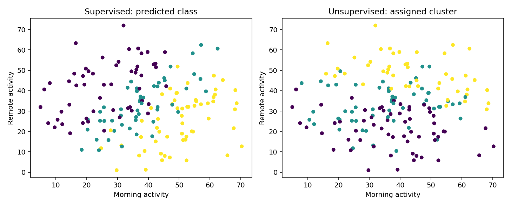

[← Chapter 03](../../README.md) · [Advanced Projects](../../README.md#section-3-14)

# Advanced Project 01. Classification vs. Clustering

## 문제 상황

같은 활동 데이터에서 Supervised Learning과 Unsupervised Learning을 각각 실행합니다. **Classification의 예측 Label** 과 **Clustering이 찾은 Cluster** 가 왜 다른지 비교하는 프로젝트입니다.

분류 모델의 목적은 주어진 Target을 예측하는 것이지만, KMeans의 목적은 Feature 공간에서 서로 가까운 Sample을 묶는 것입니다. 두 알고리즘에 같은 3개의 그룹 수를 사용해도 결과가 같을 필요는 없습니다.

## 입력 데이터

[`work_modes.csv`](../../data/work_modes.csv) — **실습용 합성 데이터** 540건

| 열 | 의미 | 역할 |
|---|---|---|
| `record_id` | 기록 식별자 | 제외 |
| `morning_activity` | 오전 활동량 | Feature |
| `remote_activity` | 원격 활동량 | Feature |
| `evening_activity` | 저녁 활동량 | Feature |
| `work_mode` | 활동 유형 0·1·2 | Classification Target, Clustering에서는 사용하지 않음 |

`work_mode`는 실습을 위해 생성한 범주이며 실제 근무 형태를 분류한 기록이 아닙니다.

## 구현 STEP

1. **Validation:** 결측값, ID 중복, 세 Feature의 유한성, Target의 0·1·2 범위를 확인합니다.
2. **Supervised:** `train_test_split(test_size=0.30, stratify=y, random_state=42)`로 분리합니다.
3. **Classification:** `StandardScaler` + `LogisticRegression(max_iter=1000)`으로 학습하고 Test Set Accuracy를 측정합니다.
4. **Unsupervised:** **Test Set의 입력 Feature만** 사용하여 `StandardScaler` + `KMeans(n_clusters=3, random_state=42, n_init=10)`을 별도로 실행합니다.
5. **Comparison:** Target은 군집화가 끝난 뒤에만 사용하여 Adjusted Rand Index(ARI)를 계산합니다.
6. **Visualization:** 같은 Sample에 대한 예측 Label과 Cluster ID를 나란히 표시합니다.
7. **Interpretation:** Classification Accuracy와 ARI가 서로 다른 질문에 답한다는 점을 설명합니다.

Clustering은 별도의 탐색 분석으로 Test Set의 Feature에서 군집을 찾습니다. **Train/Test 성능 비교를 위한 Clustering 평가 설계가 아님**에 유의합니다.

<details>
<summary><strong>코드 힌트 — 사후 평가</strong></summary>

```python
clusters = clusterer.fit_predict(X_test)
ari = adjusted_rand_score(y_test, clusters)
```

`y_test`는 `fit_predict()`에 전달되지 않습니다. ARI는 Cluster 번호가 임의로 바뀌어도 같은 분할로 평가합니다.

</details>

## 실행 및 결과

```bash
python projects/advanced_01_classification_vs_clustering/starter.py
python solutions/advanced_01_classification_vs_clustering.py
```

모범 구현은 [`solutions/advanced_01_classification_vs_clustering.py`](../../solutions/advanced_01_classification_vs_clustering.py)에 있습니다.

고정된 데이터에서 Classification Accuracy는 **77.8%**, Cluster와 Label의 ARI는 **0.035**였습니다. ARI가 낮다고 해서 Clustering 코드가 오류라는 뜻은 아닙니다. 군집을 나누는 기준과 사전에 정한 Label의 기준이 서로 다를 수 있기 때문입니다.



## 테스트 시나리오

- `record_id`와 `work_mode`를 Cluster Feature로 전달하지 않습니다.
- Supervised 모델은 Train Set만 학습하고 Test Set으로 평가합니다.
- Cluster 번호 0·1·2를 정답 클래스 0·1·2와 직접 비교한 Accuracy를 계산하지 않습니다.
- ARI는 Cluster ID를 임의로 치환해도 값이 같아야 합니다.
- 예측 Label과 Cluster ID의 분포가 같지 않더라도 두 결과를 각각 설명할 수 있어야 합니다.

**완료 기준:** 두 학습 방식의 목적과 평가 방법을 구분하고, 결과 차이에 대한 설명을 제시합니다.

---

[← Chapter 03](../../README.md) · [Contents](../../README.md#contents)
