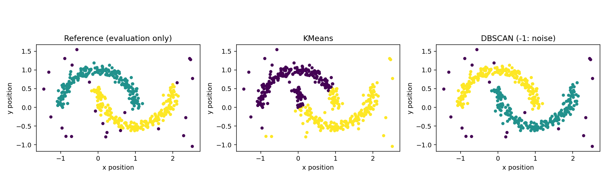

[← Chapter 03](../../README.md) · [Advanced Projects](../../README.md#section-3-14)

# Advanced Project 02. Non-Convex Clusters & Noise

## 문제 상황

두 개의 곡선형 군집과 일부 Noise를 포함한 좌표 데이터를 분석합니다. KMeans는 중심까지의 거리를 바탕으로 모든 Sample을 군집에 할당하지만, **DBSCAN** 은 밀집된 영역을 연결해 Cluster를 찾고 일부 Sample을 Noise(`-1`)로 분류할 수 있습니다.

두 방식의 차이를 시각화하고, 언제 단순한 중심 기반 모델이 부적절한지 분석하세요.

## 입력 데이터

[`curved_paths.csv`](../../data/curved_paths.csv) — **실습용 합성 데이터** 464건

| 열 | 의미 | 역할 |
|---|---|---|
| `point_id` | 좌표 식별자 | 모델에서 제외 |
| `x_position`, `y_position` | 좌표 | Clustering Feature |
| `reference_group` | 생성 시 사용한 참고 그룹(0·1·-1) | 사후 평가에만 사용 |

`reference_group=-1`은 생성 시 별도로 추가한 좌표입니다. DBSCAN이 자동으로 감지한 Noise와 반드시 일치하지 않습니다.

## 구현 STEP

1. **Validation:** 좌표와 참고값의 형식, 중복 ID, NaN 및 무한대 값을 확인합니다.
2. **Scaling:** `StandardScaler`를 사용하여 좌표 두 열의 Scale을 맞춥니다.
3. **KMeans:** `n_clusters=2`, `n_init=10`, `random_state=42`로 Cluster를 계산합니다.
4. **DBSCAN:** `eps=0.23`, `min_samples=6`으로 Cluster와 Noise를 계산합니다. `eps`는 표준화된 좌표 공간의 거리 기준입니다.
5. **Evaluation:** 두 결과 모두 참고 그룹과 비교하여 ARI를 계산합니다. 이때 참고값을 학습에 사용하지 않습니다.
6. **Visualization:** 참고값, KMeans, DBSCAN을 각각 다른 그래프로 배치합니다.
7. **Experiment:** `eps`를 0.10, 0.23, 0.45로 변경하고 Cluster 수·Noise 수를 비교합니다.

<details>
<summary><strong>코드 힌트 — Noise의 처리</strong></summary>

```python
assigned = DBSCAN(eps=0.23, min_samples=6).fit_predict(scaled_X)
noise_count = int((assigned == -1).sum())
cluster_count = len(set(assigned) - {-1})
```

DBSCAN의 `-1`은 Noise를 뜻하며 일반적인 Cluster로 세지 않습니다.

</details>

## 실행 및 결과

```bash
python projects/advanced_02_density_clustering/starter.py
python solutions/advanced_02_density_clustering.py
```

모범 구현은 [`solutions/advanced_02_density_clustering.py`](../../solutions/advanced_02_density_clustering.py)에 있습니다.

| 모델 | ARI | Cluster 수 | Noise 수 |
|---|---:|---:|---:|
| KMeans | 0.401 | 2 | 0 |
| DBSCAN | 0.977 | 2 | 21 |

DBSCAN은 이 데이터에서 두 곡선의 구조를 비교적 잘 구분했습니다. 그러나 모든 데이터에서 DBSCAN이 우수한 것은 아닙니다. 밀도가 크게 다르거나 `eps`가 부적절하면 원하는 Cluster를 찾지 못할 수 있습니다.



## 테스트 시나리오

- `reference_group`을 Clustering 입력에서 제외합니다.
- `n_clusters=2`인 KMeans에는 Noise Label `-1`이 없습니다.
- DBSCAN이 반환한 `-1`은 Cluster 수 계산에서 제외합니다.
- ARI는 Cluster ID 변경에 영향을 받지 않습니다.
- 다른 `eps`로 실행했을 때 결과가 바뀔 수 있음을 확인하고, 선택한 값의 근거를 설명합니다.

**완료 기준:** 두 알고리즘의 군집 정의가 어떻게 다른지 설명하고, 곡선형 구조와 Noise에 대한 결과를 해석합니다.

---

[← Chapter 03](../../README.md) · [Contents](../../README.md#contents)
