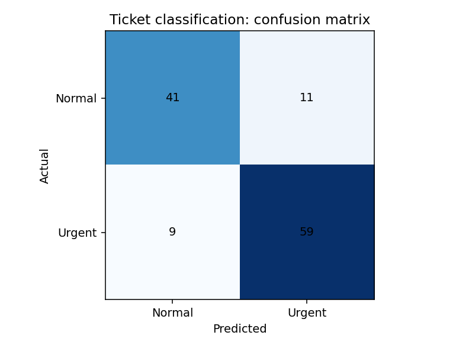

[← Chapter 03](../../README.md) · [Mini Projects](../../README.md#section-3-13)

# Mini Project 01. Service Ticket Classification

## 문제 상황

서비스 문의가 들어왔을 때 긴급 처리 여부(`urgent`)를 분류합니다. 대기 시간, 실패 횟수, 영향을 받는 사용자 수를 Feature로 사용하고, **Logistic Regression** 을 학습한 뒤 오분류를 분석합니다.

이 프로젝트의 Label은 실제 운영 기준이 아니라 **실습용 합성 데이터**에서 생성된 값입니다. 예측 결과를 실제 고객 대응에 적용해서는 안 됩니다.

## 입력 데이터

[`service_tickets.csv`](../../data/service_tickets.csv) — 480건

| 열 | 의미 | 조건 |
|---|---|---|
| `ticket_id` | 문의 식별자 | 중복 없음, 학습 Feature에서 제외 |
| `waiting_hours` | 대기 시간 | 0 이상, 시간 단위 |
| `failed_attempts` | 처리 실패 횟수 | 0 이상 |
| `impacted_users` | 영향을 받는 사용자 수 | 0 이상 |
| `urgent` | Target/Label | 0: 일반, 1: 긴급 |

## 구현 STEP

1. **Data Validation:** 필수 열, 결측값, 중복 ID, Feature의 유한성·음수 여부, Label 값을 검증합니다.
2. **Train/Test Split:** `test_size=0.25`, `random_state=42`, `stratify=y`로 나눕니다.
3. **Pipeline:** `StandardScaler()`와 `LogisticRegression(max_iter=1000, random_state=42)`을 연결합니다.
4. **Prediction:** `predict()`로 Label을, `predict_proba()`로 긴급 클래스의 확률 추정치를 계산합니다.
5. **Evaluation:** Accuracy와 Confusion Matrix를 계산합니다. 정상인데 긴급으로 분류한 경우와 긴급인데 정상으로 분류한 경우를 구별합니다.
6. **Visualization:** 2×2 Confusion Matrix를 PNG로 저장하고 결과를 해석합니다.

<details>
<summary><strong>코드 힌트 — 확률 추정치</strong></summary>

```python
prob_urgent = model.predict_proba(X_test)[:, 1]
```

`[:, 1]`은 클래스 1의 확률 추정치를 선택합니다. 이 값이 실제 사건 확률과 정확히 일치하는지는 별도의 검증이 필요합니다.

</details>

## 실행

```bash
python projects/mini_01_ticket_classification/starter.py
python solutions/mini_01_ticket_classification.py
```

`starter.py`의 `run()`은 직접 구현할 부분입니다. 모범 구현은 [`solutions/mini_01_ticket_classification.py`](../../solutions/mini_01_ticket_classification.py)에 있습니다.

고정된 데이터에서 Accuracy는 **83.3% (100/120)** 였으며, Confusion Matrix는 다음과 같습니다.

| 실제 \ 예측 | 일반 (0) | 긴급 (1) |
|---|---:|---:|
| 일반 (0) | 41 | 11 |
| 긴급 (1) | 9 | 59 |

긴급 문의 9건을 일반으로 분류했습니다. 단일 Accuracy만으로는 이 오류를 확인하기 어렵습니다.



## 테스트 시나리오

- 중복 `ticket_id`와 음수 `waiting_hours`는 입력 오류로 처리합니다.
- Train/Test 분할에서 두 Label의 비율을 대체로 유지합니다.
- `predict_proba()` 값은 0~1 범위이고, 행별 클래스 확률의 합은 1입니다.
- Confusion Matrix의 네 칸 합은 평가 Sample 수 120과 같습니다.
- 동일한 데이터와 시드로 실행할 때 결과가 재현됩니다.

**완료 기준:** 예측 Label, Accuracy, Confusion Matrix, 두 종류의 오분류 의미를 설명할 수 있어야 합니다.

---

[← Chapter 03](../../README.md) · [Contents](../../README.md#contents)
