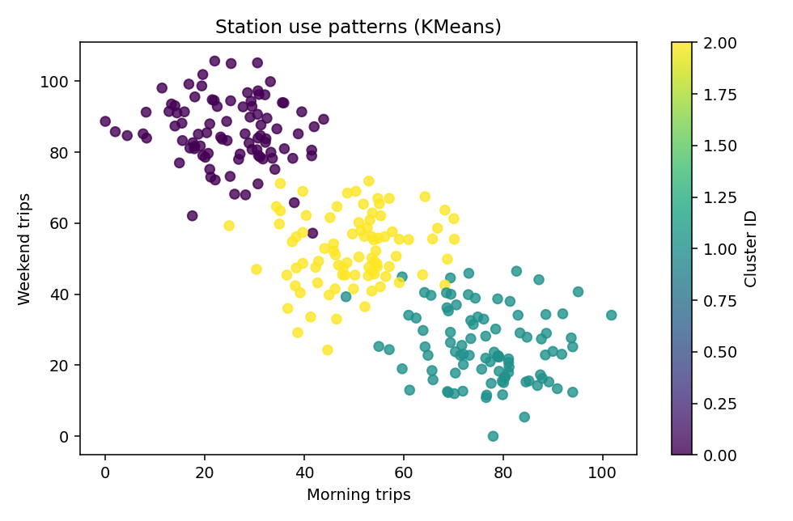

[← Chapter 03](../../README.md) · [Mini Projects](../../README.md#section-3-13)

# Mini Project 02. Station Usage Clustering

## 문제 상황

대여소 270곳의 시간대별 이용 패턴을 **KMeans** 로 군집화합니다. 이 데이터에는 정답 Label이 없습니다. Cluster 번호를 부여한 뒤 각 Cluster의 평균 이용량을 분석하고 특징적인 패턴을 설명하세요.

## 입력 데이터

[`station_patterns.csv`](../../data/station_patterns.csv) — **실습용 합성 데이터** 270건

| 열 | 의미 |
|---|---|
| `station_id` | 대여소 식별자, 학습 Feature에서 제외 |
| `morning_trips` | 오전 시간대 평균 이용량 |
| `evening_trips` | 저녁 시간대 평균 이용량 |
| `weekend_trips` | 주말 평균 이용량 |

세 가지 이용량이 Feature이며 **Target은 없습니다.** CSV에는 실제 대여소나 지역 정보가 포함되지 않습니다.

## 구현 STEP

1. **Inspection:** 필수 열과 중복 ID를 확인하고 이용량이 음수·결측값·무한대인지 검증합니다.
2. **Preprocessing:** 세 Feature를 `StandardScaler()`로 표준화합니다.
3. **Clustering:** `KMeans(n_clusters=3, n_init=10, random_state=42)`로 Cluster를 계산합니다.
4. **Profile:** 각 Cluster의 행 수와 원래 단위에서의 Feature 평균을 계산합니다.
5. **Visualization:** `morning_trips`와 `weekend_trips`를 좌표로 삼고 Cluster ID별로 점을 구분합니다. KMeans는 세 Feature를 모두 사용한다는 점을 기록합니다.
6. **Interpretation:** Profile을 기반으로 Cluster별 이용 패턴을 설명합니다. 번호 0·1·2 자체에 순위나 의미를 부여하지 않습니다.

<details>
<summary><strong>코드 힌트 — 군집별 평균</strong></summary>

```python
result = df.assign(cluster=labels)
profile = result.groupby("cluster")[[
    "morning_trips", "evening_trips", "weekend_trips"
]].mean()
```

평균은 표준화된 값이 아니라 **원래 이용량 단위**로 계산합니다.

</details>

## 실행 및 결과

```bash
python projects/mini_02_station_clustering/starter.py
python solutions/mini_02_station_clustering.py
```

모범 구현은 [`solutions/mini_02_station_clustering.py`](../../solutions/mini_02_station_clustering.py)에 있습니다.

| Cluster | Sample 수 | 오전 평균 | 저녁 평균 | 주말 평균 |
|---:|---:|---:|---:|---:|
| 0 | 91 | 25.0 | 29.6 | 85.7 |
| 1 | 92 | 76.6 | 72.9 | 25.4 |
| 2 | 87 | 49.9 | 52.6 | 52.4 |

이 결과에서 Cluster 0은 주말 중심, Cluster 1은 출퇴근 시간 중심, Cluster 2는 비교적 고르게 이용하는 패턴으로 해석할 수 있습니다. 이는 **제공된 합성 데이터**와 고정된 모델 설정에서 얻은 Profile입니다.



## 테스트 시나리오

- `station_id`가 입력 Feature에 포함되지 않았는지 확인합니다.
- Cluster 수가 3이고 모든 Sample에 Cluster ID가 부여됩니다.
- Cluster별 건수의 합이 270인지 확인합니다.
- Label에 없는 의미를 Cluster 번호 자체에서 추론하지 않습니다.
- `random_state`를 유지하면 같은 데이터에서 결과가 재현됩니다.

**완료 기준:** Label 없이 Cluster를 만들고, 원래 단위의 Profile을 사용해 결과를 해석합니다.

---

[← Chapter 03](../../README.md) · [Contents](../../README.md#contents)
