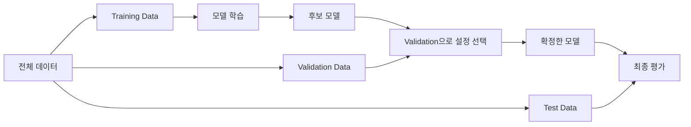
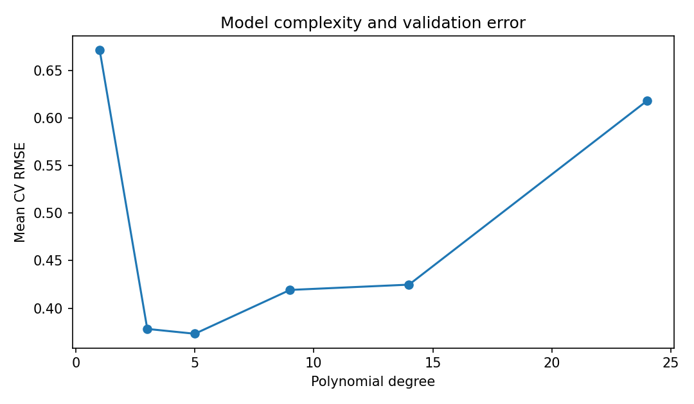

# Chapter 04. Model Evaluation & Optimization

모델을 학습한 뒤에는 예측 결과가 얼마나 정확한지, 어떤 오류가 발생하는지, 새로운 데이터에서도 성능이 유지되는지 확인해야 합니다. Chapter 04에서는 Classification과 Regression의 평가 지표를 계산하고, Overfitting·Cross-Validation·Hyperparameter Tuning을 통해 평가와 모델 선택을 구분합니다. 같은 장비의 반복 기록처럼 서로 연관된 데이터를 잘못 나눴을 때 발생하는 문제도 다룹니다.

- **학습 환경:** Google Colab(기본), VS Code 또는 Jupyter Notebook(로컬)
- **실습 언어:** Python 3.11 이상 권장
- **주요 도구:** NumPy, Pandas, Matplotlib, scikit-learn
- **실습 데이터:** 실습용 합성 데이터(Synthetic Data) 4종

<details>
<summary><strong>선행 학습 목록</strong></summary>

- [Chapter 01. Introduction to Artificial Intelligence](../Chapter-01/README.md) — Training, Inference, 평가의 기본 개념
- [Chapter 02. Machine Learning Fundamentals](../Chapter-02/README.md) — Linear Regression, Loss Function, Feature Scaling
- [Chapter 03. Supervised & Unsupervised Learning](../Chapter-03/README.md) — Classification, Logistic Regression, Clustering
- [Data Processing](../../Data_Processing/) — NumPy 배열과 Pandas DataFrame(선택)

</details>

<a id="contents"></a>
## Contents

| Section | Topic |
|:---:|---|
| [4.1](#section-4-1) | **Learning Goals & Getting Started** — 학습 목표와 실행 환경 |
| [4.2](#section-4-2) | **Evaluation Protocol** — Train·Validation·Test 분리 |
| [4.3](#section-4-3) | **Confusion Matrix & Classification Metrics** — TP·FP·FN·TN과 평가지표 |
| [4.4](#section-4-4) | **Decision Threshold & F-beta Score** — Precision–Recall 관계 |
| [4.5](#section-4-5) | **Regression Metrics** — MAE·MSE·RMSE·R² |
| [4.6](#section-4-6) | **Baselines & Error Analysis** — 비교 기준과 잔차 해석 |
| [4.7](#section-4-7) | **Multiclass & Imbalanced Evaluation** — Macro·Micro·Weighted 평균 |
| [4.8](#section-4-8) | **Underfitting & Overfitting** — 모델 복잡도와 일반화 |
| [4.9](#section-4-9) | **Cross-Validation** — K-Fold와 Stratified K-Fold |
| [4.10](#section-4-10) | **Pipelines & Data Leakage** — 전처리와 데이터 누출 |
| [4.11](#section-4-11) | **Hyperparameter Tuning** — GridSearchCV와 독립적인 Test |
| [4.12](#section-4-12) | **Group-Aware & Temporal Splits** — 평가 목적에 맞는 분할 |
| [4.13](#section-4-13) | **Examples** — Python 실행 예제 |
| [4.14](#section-4-14) | **Coding Practice** — 직접 구현하는 평가 함수 |
| [4.15](#section-4-15) | **Mini Projects** — 분류 성능 분석과 배송 시간 예측 |
| [4.16](#section-4-16) | **Advanced Projects** — Threshold 선택과 Group 누출 점검 |
| [4.17](#section-4-17) | **Quiz** — 개념·수식·코드 분석 |
| [4.18](#section-4-18) | **Summary** — 핵심 내용 정리 |
| [4.19](#section-4-19) | **References** — 공식 참고 문서 |

---

<a id="section-4-1"></a>
## 4.1. Learning Goals & Getting Started

### 학습 목표

이번 Chapter에서는 다음 내용을 학습합니다.

1. Classification과 Regression에서 평가 지표를 선택하는 이유
2. Confusion Matrix로 False Positive와 False Negative를 구분하는 방법
3. Train·Validation·Test를 분리하고 Test Data를 최종 평가에 남겨두는 이유
4. Cross-Validation과 Pipeline을 이용해 모델을 비교하는 방법
5. Hyperparameter Tuning, Group 분할, 오류 분석을 통해 평가 결과를 점검하는 방법

### 실행 준비

Google Colab에서는 [`Chapter_04_Model_Evaluation_and_Optimization.ipynb`](./notebooks/Chapter_04_Model_Evaluation_and_Optimization.ipynb)를 업로드해 실행합니다. Notebook에는 CSV 업로드 없이 실행할 수 있는 핵심 예제를 포함했습니다. 프로젝트 전체 데이터와 모범 구현은 Chapter 폴더에 별도로 있습니다. GPU는 필요하지 않습니다.

로컬에서는 `Chapter-04/` 폴더를 기준으로 실행합니다.

```bash
python -m pip install -r requirements.txt
python examples/01_confusion_metrics.py
python examples/02_regression_metrics.py
python -m unittest discover -s tests -v
```

### 실습 데이터

| 데이터셋 | Sample 수 | 주요 역할 |
|---|---:|---|
| [`incident_alerts.csv`](./data/incident_alerts.csv) | 720 | 사건 Label이 불균형한 Binary Classification |
| [`delivery_times.csv`](./data/delivery_times.csv) | 560 | Regression의 Baseline과 오차 분석 |
| [`curve_measurements.csv`](./data/curve_measurements.csv) | 80 | 모델 복잡도와 Cross-Validation |
| [`device_cycles.csv`](./data/device_cycles.csv) | 600 | 장비 100대의 반복 기록과 Group 분할 |

네 데이터셋 모두 **실습용 합성 데이터** 입니다. 실제 시설 안전이나 배송 운영에 사용하지 않으며, 데이터 생성 방식과 각 열의 의미는 [`data/README.md`](./data/README.md)를 참고할 수 있습니다.

---

<a id="section-4-2"></a>
## 4.2. Evaluation Protocol

### 학습, 선택, 최종 평가의 분리

모델의 성능을 측정하려면 **어떤 데이터로 모델을 학습하고, 어떤 데이터로 모델을 선택했는지** 구분해야 합니다. 일반적인 분할은 다음과 같습니다.

| 데이터 | 역할 | 허용되는 작업 |
|---|---|---|
| **학습 데이터(Training Data)** | 모델 Parameter 학습 | `fit()`, 학습 과정의 전처리 기준 계산 |
| **검증 데이터(Validation Data)** | 모델·Hyperparameter·Threshold 선택 | 후보 비교, 설정 변경 판단 |
| **테스트 데이터(Test Data)** | 선택을 마친 모델의 최종 성능 확인 | 최종 평가, 오류 분석 및 보고 |



Validation에서 더 나은 설정을 발견하면 Training Data로 다시 학습할 수 있습니다. 최종 모델을 학습할 때 Training과 Validation을 합쳐 사용하는 설계도 가능하지만, **Test Data를 설정 선택에 사용해서는 안 됩니다.** Test 결과를 보고 설정을 반복해서 바꾸면 Test에도 간접적으로 맞춰진 모델이 됩니다.

### 무작위 분할이 항상 적절한 것은 아닙니다

`train_test_split()`은 일반적인 독립 Sample을 무작위로 나누는 데 적합합니다. Classification에서 `stratify=y`를 사용하면 클래스의 비율을 비슷하게 유지할 수 있습니다. 그러나 같은 환자·장비·이용자의 반복 기록처럼 Sample 사이에 연결 관계가 있으면, 행 단위 무작위 분할은 성능을 과대평가할 수 있습니다. 이 문제는 4.12절과 Advanced 02에서 다룹니다.

---

<a id="section-4-3"></a>
## 4.3. Confusion Matrix & Classification Metrics

### Confusion Matrix

이진 분류(Binary Classification)는 두 개의 Label 중 하나를 예측합니다. 이번 실습에서는 **양성(Positive)** 을 사건 Label 1, **음성(Negative)** 을 일반 Label 0으로 정합니다.

| 실제 \ 예측 | 음성 (0) | 양성 (1) |
|---|---:|---:|
| 음성 (0) | True Negative (TN) | False Positive (FP) |
| 양성 (1) | False Negative (FN) | True Positive (TP) |

- **TP:** 실제 사건을 사건이라고 예측한 수
- **FP:** 일반 데이터를 사건이라고 잘못 예측한 수
- **FN:** 실제 사건을 일반이라고 잘못 예측한 수
- **TN:** 일반 데이터를 일반이라고 예측한 수

예를 들어 TN=80, FP=5, FN=12, TP=3이라면 전체 100건에서 83건을 맞혔습니다. 그러나 실제 사건은 15건이고, 그중 12건을 놓쳤습니다. 같은 Confusion Matrix에서 서로 다른 성능 지표가 나오는 이유입니다.

### Accuracy

**정확도(Accuracy)** 는 전체 Sample 중 올바르게 예측한 비율입니다.

$$
\mathrm{Accuracy}=\frac{TP+TN}{TP+TN+FP+FN}
$$

위 예시에서는 $83/100=0.83$입니다. Accuracy만으로는 어느 종류의 오류가 발생했는지 알 수 없습니다.

### Precision, Recall, Specificity

**정밀도(Precision)** 는 사건이라고 예측한 것 중 실제 사건의 비율입니다.

$$
\mathrm{Precision}=\frac{TP}{TP+FP}
$$

**재현율(Recall)** 은 실제 사건 중 모델이 찾아낸 비율입니다.

$$
\mathrm{Recall}=\frac{TP}{TP+FN}
$$

**특이도(Specificity)** 는 실제 일반 데이터 중 일반으로 맞힌 비율입니다.

$$
\mathrm{Specificity}=\frac{TN}{TN+FP}
$$

| 지표 | 예시 계산 | 결과 |
|---|---|---:|
| Precision | $3/(3+5)$ | 0.375 |
| Recall | $3/(3+12)$ | 0.200 |
| Specificity | $80/(80+5)$ | 약 0.941 |

Precision은 **사건이라고 예측한 결과의 신뢰성**, Recall은 **실제 사건을 얼마나 놓치지 않았는지** 에 초점을 둡니다. 어떤 지표를 우선할지는 문제의 오류 비용에 따라 달라집니다.

### F1 Score와 Balanced Accuracy

**F1 Score** 는 Precision과 Recall의 조화평균입니다.

$$
F_1=2\frac{\mathrm{Precision}\cdot\mathrm{Recall}}{\mathrm{Precision}+\mathrm{Recall}}
=\frac{2TP}{2TP+FP+FN}
$$

양성·음성을 같은 비중으로 평가하고 싶다면 **균형 정확도(Balanced Accuracy)** 를 사용할 수 있습니다. 이진 분류에서는 다음과 같습니다.

$$
\mathrm{Balanced\ Accuracy}=\frac{\mathrm{Recall}+\mathrm{Specificity}}{2}
$$

불균형 데이터에서 모든 Sample을 음성으로 분류하면 Accuracy는 높게 나올 수 있지만, 두 클래스가 모두 존재한다면 Balanced Accuracy는 0.5입니다.

**계산상 주의:** Precision의 분모($TP+FP$)가 0이면 수학적으로 정의되지 않습니다. Recall 역시 실제 양성이 하나도 없으면 정의되지 않습니다. scikit-learn의 `zero_division=0`은 보고를 위해 0을 반환하도록 지정하는 옵션일 뿐, 실제 측정값이 0이었다는 뜻은 아닙니다.

---

<a id="section-4-4"></a>
## 4.4. Decision Threshold & F-beta Score

### Threshold가 바뀌면 오류도 바뀝니다

Logistic Regression의 `predict_proba()`는 특정 클래스에 대한 확률 추정치를 제공합니다. 이를 예측 Label로 바꾸는 **분류 임계값(Decision Threshold)** 은 일반적인 이진 분류에서 0.5로 설정되지만, 문제의 목적에 따라 조정할 수 있습니다.

$$
\hat{y}=\begin{cases}
1 & \text{if } \hat{p}\ge t \\
0 & \text{otherwise}
\end{cases}
$$

- $\hat{p}$: 클래스 1에 대한 모델의 확률 추정치
- $t$: Decision Threshold
- $\hat{y}$: 최종 예측 Label

예측 점수가 `[0.92, 0.55, 0.40, 0.12]`일 때 Threshold 0.5에서는 `[1, 1, 0, 0]`, Threshold 0.3에서는 `[1, 1, 1, 0]`이 됩니다.

Threshold를 낮추면 일반적으로 양성으로 판단하는 건수가 늘어나 **Recall은 높아지고 Precision은 낮아질 가능성** 이 있습니다. 데이터와 점수 분포에 따라 변화 폭은 다르며, 두 지표가 반드시 일정한 비율로 움직이는 것은 아닙니다.

### F-beta Score

Recall에 더 큰 가중치를 둘 때는 **F-beta Score($F_\beta$)** 를 사용할 수 있습니다.

$$
F_\beta=(1+\beta^2)\frac{\mathrm{Precision}\cdot\mathrm{Recall}}
{\beta^2\mathrm{Precision}+\mathrm{Recall}}
$$

- $\beta=1$: F1 Score
- $\beta>1$: Recall에 더 큰 비중
- $0<\beta<1$: Precision에 더 큰 비중

가령 $\beta=2$인 F2 Score는 Recall을 상대적으로 더 중요하게 다룹니다. 그러나 **F2가 높은 Threshold가 항상 실제 운영 비용을 최소화하는 것은 아닙니다.** 사건 누락의 비용, 잘못된 경보 처리 비용, 후속 검토 인력 등을 함께 고려해야 합니다.

Threshold는 Validation Data로 선택합니다. Test Data는 최종 비교에만 사용합니다. 또한 `predict_proba()` 값이 정확한 실제 사건 확률인지 판단하려면 **확률 보정(Probability Calibration)** 이라는 별도 검증이 필요합니다.

---

<a id="section-4-5"></a>
## 4.5. Regression Metrics

Regression에서는 예측값과 실제 Target의 차이, 즉 **잔차(Residual)** 를 계산합니다.

$$
e_i=y_i-\hat{y}_i
$$

- $y_i$: $i$번째 Sample의 실제 값
- $\hat y_i$: 모델의 예측값
- $e_i$: Residual
- $n$: 평가 Sample 수

### MAE — Mean Absolute Error

**평균 절댓값 오차(Mean Absolute Error, MAE)** 는 오차의 절댓값을 평균한 값입니다.

$$
\mathrm{MAE}=\frac{1}{n}\sum_{i=1}^{n}|y_i-\hat{y}_i|
$$

결과의 단위는 원래 Target과 같습니다. 배송 시간을 분 단위로 예측했다면 MAE도 분 단위입니다.

### MSE — Mean Squared Error

**평균 제곱 오차(Mean Squared Error, MSE)** 는 오차를 제곱해 평균합니다.

$$
\mathrm{MSE}=\frac{1}{n}\sum_{i=1}^{n}(y_i-\hat{y}_i)^2
$$

큰 오차의 영향이 상대적으로 커지고, 결과의 단위는 원래 단위의 제곱입니다. 배송 시간이라면 분²입니다.

### RMSE — Root Mean Squared Error

**평균 제곱근 오차(Root Mean Squared Error, RMSE)** 는 MSE에 제곱근을 적용합니다.

$$
\mathrm{RMSE}=\sqrt{\frac{1}{n}\sum_{i=1}^{n}(y_i-\hat{y}_i)^2}
$$

RMSE는 원래 Target의 단위로 돌아오지만, 큰 오차에 대한 민감도는 MAE보다 높습니다.

### R² — Coefficient of Determination

**결정계수(Coefficient of Determination, R²)** 는 실제 값의 평균만 예측하는 기준과 비교해 오차가 얼마나 줄었는지 나타냅니다.

$$
R^2=1-\frac{\sum_{i=1}^{n}(y_i-\hat{y}_i)^2}
{\sum_{i=1}^{n}(y_i-\bar y)^2}
$$

- $\bar y$: 평가 데이터에서 실제 Target의 평균
- 분자: 모델 예측의 제곱 오차 합
- 분모: 평가 Target의 평균을 예측할 때의 제곱 오차 합

$R^2=1$이면 완전한 예측이고, $R^2=0$이면 평가 데이터 평균을 예측하는 기준과 제곱 오차 합이 같습니다. **$R^2$는 음수가 될 수도 있습니다.** 실제 Target이 모두 같은 상수이면 기본 수식의 분모가 0이므로 통상적인 의미의 R²는 정의되지 않습니다.

### 직접 계산

실제 값이 `[20, 25, 35, 40]`, 예측값이 `[18, 29, 32, 39]`라면 Residual은 `[2, -4, 3, 1]`입니다.

| 지표 | 계산 | 결과 |
|---|---|---:|
| MAE | $(2+4+3+1)/4$ | 2.50 |
| MSE | $(4+16+9+1)/4$ | 7.50 |
| RMSE | $\sqrt{7.5}$ | 약 2.74 |
| R² | $1-30/250$ | 0.88 |

R²만으로는 오차의 실제 크기를 알기 어렵습니다. MAE나 RMSE처럼 Target의 단위와 연결되는 지표를 함께 보고해야 합니다.

---

<a id="section-4-6"></a>
## 4.6. Baselines & Error Analysis

### Baseline이 필요한 이유

모델의 점수를 절대적인 값으로만 보면 개선 효과를 판단하기 어렵습니다. **기준 모델(Baseline)** 과 비교하면 복잡한 모델을 사용할 이유가 있는지 확인할 수 있습니다.

| 작업 | 간단한 Baseline | 비교할 지표 |
|---|---|---|
| 불균형 Classification | 가장 빈도가 높은 Label만 예측 | Accuracy, Recall, Balanced Accuracy |
| Regression | Train Target의 평균 또는 중앙값 예측 | MAE, RMSE, R² |

예를 들어 Majority Baseline의 Accuracy가 86.1%인 데이터에서 학습 모델의 Accuracy가 86.7%라면 숫자만으로 큰 개선이라고 보기 어렵습니다. 실제 사건에 대한 Recall과 FP·FN을 별도로 확인해야 합니다.

### Residual을 확인하는 방법

Regression의 Residual $e_i=y_i-\hat y_i$는 모델이 어디에서 틀렸는지 보여줍니다.

- Residual이 양수이면 실제 값이 예측값보다 큽니다. 소요 시간을 과소 예측한 경우입니다.
- Residual이 음수이면 실제 값이 예측값보다 작습니다. 소요 시간을 과대 예측한 경우입니다.
- 예측값이 커질수록 Residual의 폭이 늘어난다면 오차의 분산이 일정하지 않을 가능성이 있습니다.
- 특정 조건에서 Residual이 한쪽으로 쏠리면 모델이 그 구간의 관계를 충분히 설명하지 못했을 수 있습니다.

Residual Plot은 예측값을 가로축, Residual을 세로축으로 두고 $y=0$을 기준선으로 표시합니다. 이 그래프에 패턴이 보이는지 확인하는 것이 Regression 평가의 출발점입니다.

---

<a id="section-4-7"></a>
## 4.7. Multiclass & Imbalanced Evaluation

두 클래스를 넘는 문제에서는 클래스별 Precision·Recall·F1을 계산할 수 있습니다. 이를 하나의 수치로 요약할 때는 평균 방식에 주의해야 합니다.

| 평균 방식 | 의미 | 적합한 상황 |
|---|---|---|
| **Macro Average** | 클래스별 점수를 동일한 비중으로 평균 | 소수 클래스도 중요할 때 |
| **Weighted Average** | 각 클래스의 Support(실제 Sample 수)에 비례해 평균 | 실제 데이터의 클래스 분포를 반영할 때 |
| **Micro Average** | 클래스별 TP·FP·FN을 먼저 합산해 계산 | 전체 예측 규모의 성능을 볼 때 |

클래스 $k$의 F1을 $F_{1,k}$, 실제 Sample 수를 $n_k$, 총 클래스 수를 $K$라고 하면 다음과 같습니다.

$$
F_{1,\mathrm{macro}}=\frac{1}{K}\sum_{k=1}^{K}F_{1,k}
$$

$$
F_{1,\mathrm{weighted}}=\frac{\sum_{k=1}^{K}n_k F_{1,k}}{\sum_{k=1}^{K}n_k}
$$

단일 Label을 예측하는 Multiclass Classification에서는 **Micro Precision·Micro Recall·Micro F1이 Accuracy와 같습니다.** 반면 클래스 분포가 불균형하면 Macro F1은 Accuracy와 크게 다를 수 있습니다. `classification_report()`에서 Support와 클래스별 점수를 함께 확인합니다.

**ROC-AUC와 PR-AUC:** Threshold를 고정하지 않고 여러 Threshold에서 모델 점수를 비교하는 방법도 있습니다. 특히 사건이 드문 문제에서는 Precision–Recall 곡선과 Average Precision(AP)이 유용할 수 있습니다. 다만 AP와 사다리꼴 적분 방식의 PR-AUC는 계산 정의가 같지 않으며, AUC가 높다고 해서 특정 Threshold의 비용이 자동으로 해결되지는 않습니다.

---

<a id="section-4-8"></a>
## 4.8. Underfitting & Overfitting

### Train Score와 Validation Score

**과소적합(Underfitting)** 은 모델이 데이터의 주요 관계를 충분히 학습하지 못하는 상태이며, **과적합(Overfitting)** 은 학습 데이터에 지나치게 맞춰져 새로운 데이터에서 성능이 떨어지는 현상입니다.

| 상태 | Train Error | Validation Error | 해석 |
|---|---|---|---|
| Underfitting | 높음 | 높음 | 모델의 표현력이 부족하거나 학습이 충분하지 않음 |
| 적절한 복잡도 | 비교적 낮음 | 비교적 낮음 | 학습 데이터 밖에서도 패턴을 설명함 |
| Overfitting | 매우 낮음 | 상대적으로 높음 | 학습 데이터의 잡음까지 학습했을 가능성 |

차수가 1인 Polynomial Regression은 굴곡진 데이터를 충분히 표현하지 못할 수 있습니다. 반대로 차수를 과도하게 높이면 제한된 데이터의 잡음에 맞춰지는 모델이 만들어질 수 있습니다. **Training Error가 가장 낮은 모델이 반드시 좋은 모델은 아닙니다.**

실습에서는 다항식 차수 1·3·5·9·14·24를 비교합니다. 차수가 커질수록 학습 데이터에 맞추기 쉬워지지만, Cross-Validation Error가 계속 감소하지는 않는다는 점을 확인하세요.



---

<a id="section-4-9"></a>
## 4.9. Cross-Validation

### K-Fold Cross-Validation

**교차 검증(Cross-Validation, CV)** 은 데이터를 여러 부분(Fold)으로 나누어 Train과 Validation 역할을 번갈아 맡게 하는 방법입니다. **K-Fold Cross-Validation** 은 데이터를 $K$개 Fold로 나누고, 매 반복에서 하나의 Fold를 검증에 사용합니다.

| 반복 | Fold 1 | Fold 2 | Fold 3 | Fold 4 | Fold 5 |
|---|---|---|---|---|---|
| 1 | Validation | Train | Train | Train | Train |
| 2 | Train | Validation | Train | Train | Train |
| 3 | Train | Train | Validation | Train | Train |
| 4 | Train | Train | Train | Validation | Train |
| 5 | Train | Train | Train | Train | Validation |

Fold별 점수를 $s_1,\dots,s_K$로 표시하면 평균 CV Score는 다음과 같습니다.

$$
\bar{s}_{\mathrm{CV}}=\frac{1}{K}\sum_{k=1}^{K}s_k
$$

CV 평균은 여러 분할에서 얻은 결과를 요약한 값입니다. Fold 간 표준편차를 함께 보면 분할에 따른 변동도 확인할 수 있습니다. 다만 CV 결과는 데이터의 독립성·대표성에 관한 가정이 적절할 때 의미가 있습니다.

### Stratified K-Fold

**층화 K-Fold(Stratified K-Fold)** 는 각 Fold에서 클래스 비율을 가능한 한 비슷하게 유지합니다. Classification, 특히 불균형 데이터에 유용합니다.

```python
from sklearn.model_selection import StratifiedKFold, cross_validate

cv = StratifiedKFold(n_splits=5, shuffle=True, random_state=42)
scores = cross_validate(model, X_train, y_train, cv=cv, scoring="f1")
print(scores["test_score"].mean())
```

위 `model`, `X_train`, `y_train`은 미리 준비한 학습용 데이터와 모델을 의미합니다. CV를 수행할 때도 미리 제외한 **최종 Test Data는 사용하지 않습니다.** 클래스 비율을 유지하는 것만으로 같은 사람이나 장비가 여러 Fold에 섞이는 문제까지 막을 수 있는 것은 아닙니다.

---

<a id="section-4-10"></a>
## 4.10. Pipelines & Data Leakage

**데이터 누출(Data Leakage)** 은 예측 시점에 알 수 없는 정보를 입력 Feature로 사용하거나, 평가 데이터가 학습·전처리·모델 선택에 영향을 주는 문제를 말합니다. 평가 점수가 실제 운영보다 지나치게 높게 나타날 수 있습니다.

### 잘못된 예시

```python
from sklearn.preprocessing import StandardScaler

scaler = StandardScaler()
X_scaled = scaler.fit_transform(X)  # 분할 전에 전체 데이터를 사용함
X_train, X_test, y_train, y_test = train_test_split(X_scaled, y)
```

이 코드는 Test Data의 평균과 표준편차가 Scaling 기준에 반영됩니다. 따라서 CV나 Test에서 기대하는 독립적인 전처리 절차가 아닙니다. 예시에서 `X`, `y`, `train_test_split`은 사전에 준비되었다고 가정합니다.

### 권장 예시

```python
from sklearn.pipeline import make_pipeline
from sklearn.preprocessing import StandardScaler
from sklearn.linear_model import LogisticRegression

X_train, X_test, y_train, y_test = train_test_split(
    X, y, test_size=0.2, stratify=y, random_state=42
)
model = make_pipeline(StandardScaler(), LogisticRegression(max_iter=1000))
model.fit(X_train, y_train)
predictions = model.predict(X_test)
```

Pipeline은 `fit()`이 호출될 때 각 단계가 학습 데이터에 맞게 계산되도록 합니다. `GridSearchCV`와 결합하면 CV의 각 Fold에서도 해당 Fold의 Training 부분만으로 Scaling 기준을 학습합니다.

**Target Leakage** 는 전처리 누출과 다릅니다. 배송 완료 후에야 알 수 있는 `actual_arrival_time`을 배송 출발 시각의 예측 Feature로 넣으면, Test를 잘 나누더라도 운영 시점에 사용할 수 없는 정보를 이용하게 됩니다. 실제 예측 시점에 이용 가능한 열인지 확인해야 합니다.

---

<a id="section-4-11"></a>
## 4.11. Hyperparameter Tuning

### Parameter와 Hyperparameter

- **Parameter:** 모델이 학습 데이터로부터 결정하는 값입니다. Linear Regression의 계수나 Intercept가 대표적입니다.
- **Hyperparameter:** 학습 전에 설정하거나 후보를 비교하는 값입니다. KNN의 `n_neighbors`, Ridge의 `alpha`, 트리의 `max_depth` 등이 해당합니다.

**하이퍼파라미터 탐색(Hyperparameter Tuning)** 은 여러 후보 설정을 비교해 학습 목표에 적합한 설정을 고르는 과정입니다. GridSearchCV는 지정한 후보 조합을 Cross-Validation으로 평가합니다.

```python
from sklearn.model_selection import GridSearchCV, StratifiedKFold
from sklearn.neighbors import KNeighborsClassifier
from sklearn.pipeline import Pipeline
from sklearn.preprocessing import StandardScaler

pipeline = Pipeline([
    ("scaler", StandardScaler()),
    ("knn", KNeighborsClassifier()),
])
search = GridSearchCV(
    pipeline,
    param_grid={
        "knn__n_neighbors": [3, 7, 15, 31],
        "knn__weights": ["uniform", "distance"],
    },
    cv=StratifiedKFold(n_splits=5, shuffle=True, random_state=42),
    scoring="f1",
)
search.fit(X_train, y_train)
print(search.best_params_)
```

`knn__n_neighbors`의 `__`는 Pipeline의 `knn` 단계에 속한 설정을 지정합니다. `best_score_`는 **학습 데이터 내부 CV에서 나온 점수** 이며, 최종 Test Score가 아닙니다. 기본값 `refit=True`에서는 선택된 설정으로 전달된 전체 Training Data를 다시 학습합니다.

많은 후보를 시도할수록 Validation에 맞춰질 가능성도 커집니다. 성능을 엄밀하게 비교해야 한다면 별도 Test Data를 남기고, 필요에 따라 중첩 교차 검증(Nested CV)을 고려할 수 있습니다.

---

<a id="section-4-12"></a>
## 4.12. Group-Aware & Temporal Splits

학습 데이터의 행들이 항상 서로 독립적인 것은 아닙니다. **무엇에 대해 일반화할 것인지** 에 따라 분할 방식을 선택해야 합니다.

| 상황 | 부적절할 수 있는 분할 | 적절한 방법 |
|---|---|---|
| 같은 장비를 여러 번 측정 | 행 단위 Random Split | `GroupShuffleSplit`, `GroupKFold` |
| 한 이용자의 반복 기록 | 이용자 ID가 양쪽에 섞이는 Split | 이용자 ID를 Group으로 분할 |
| 미래의 값을 과거로 예측 | 데이터를 무작위로 섞음 | 시간 순서 기반 분리, `TimeSeriesSplit` |
| 클래스가 불균형한 독립 Sample | 비율이 크게 달라지는 임의 분할 | `StratifiedKFold` |

### GroupKFold

```python
from sklearn.model_selection import GroupKFold

cv = GroupKFold(n_splits=5)
for train_idx, valid_idx in cv.split(X, y, groups=device_ids):
    train_groups = set(device_ids[train_idx])
    valid_groups = set(device_ids[valid_idx])
    assert train_groups.isdisjoint(valid_groups)
```

`device_ids`는 장비 ID 배열입니다. 각 Fold에서 같은 장비가 Training과 Validation에 동시에 포함되지 않는지 확인합니다. GroupKFold는 클래스 비율까지 보장하지는 않으므로, 클래스 불균형과 Group 분할이 함께 중요하다면 `StratifiedGroupKFold` 등의 대안을 검토할 수 있습니다.

### 시간 순서가 있는 데이터

시간의 흐름에 따라 수집한 데이터를 무작위로 섞으면 미래 기록을 이용해 과거를 예측하는 평가가 될 수 있습니다. 시간 순서를 유지하는 분할을 적용하고, 예측 시점보다 이후에 알려지는 값을 Feature에서 제외해야 합니다. 경우에 따라 입력 구간과 평가 구간 사이에 간격(Gap)을 두는 것도 필요합니다.

이 Chapter의 `device_cycles.csv`에는 시간 예측 문제를 구성하지 않았으므로 **Group 분할에만 초점을 맞춥니다.**

---

<a id="section-4-13"></a>
## 4.13. Examples

### Example 01 — Confusion Matrix를 직접 계산하기

**코드:** [`01_confusion_metrics.py`](./examples/01_confusion_metrics.py)

```python
import numpy as np
from sklearn.metrics import confusion_matrix

actual = np.array([0, 0, 0, 0, 1, 1, 1, 1])
predicted = np.array([0, 0, 1, 0, 0, 1, 1, 0])

tn, fp, fn, tp = confusion_matrix(
    actual, predicted, labels=[0, 1]
).ravel()
precision = tp / (tp + fp)
recall = tp / (tp + fn)
print(tn, fp, fn, tp)  # 3 1 2 2
```

TP=2, FP=1, FN=2이므로 Precision은 약 0.667, Recall은 0.5입니다. 실행 파일에는 F1 Score와 scikit-learn 함수 결과를 비교하는 코드도 포함되어 있습니다.

### Example 02 — Regression Metrics 비교

**코드:** [`02_regression_metrics.py`](./examples/02_regression_metrics.py)

```python
import numpy as np

y_true = np.array([20., 25., 35., 40.])
y_pred = np.array([18., 29., 32., 39.])
error = y_true - y_pred
mae = np.abs(error).mean()
rmse = np.sqrt((error ** 2).mean())
print(f"MAE={mae:.2f}, RMSE={rmse:.2f}")  # MAE=2.50, RMSE=2.74
```

이 예제는 MAE·MSE·RMSE·R²를 직접 계산하고 `sklearn.metrics` 결과와 대조합니다. 두 오차 지표 모두 작을수록 좋지만, 해석에 사용하는 단위와 큰 오차에 대한 민감도가 다릅니다.

### Example 03 — 복잡한 모델이 항상 좋을까요?

**코드:** [`03_overfitting_curve.py`](./examples/03_overfitting_curve.py)

```bash
python examples/03_overfitting_curve.py
```

곡선형 합성 데이터에서 다항식 차수별 CV RMSE를 계산합니다. 기본 설정에서 Degree 1의 CV RMSE는 약 **0.671**, Degree 5는 **0.373**, Degree 24는 **0.618** 입니다. 너무 단순하거나 과도하게 복잡한 모델의 Validation Error가 커지는 사례입니다. 가장 낮은 CV RMSE를 기록한 Degree 5를 선택하고 **최종 Test RMSE 0.323** 을 계산합니다.


### Example 04 — GridSearchCV로 모델 설정 비교

**코드:** [`04_grid_search_cv.py`](./examples/04_grid_search_cv.py)

```bash
python examples/04_grid_search_cv.py
```

KNN의 `n_neighbors`와 `weights` 후보를 평가하되, Scaling을 Pipeline 내부에 둡니다. 기본 데이터에서 선택된 후보의 CV F1은 약 0.342, 최종 Test F1은 약 0.071입니다. 드문 사건을 대상으로 한 작은 평가 집합에서는 결과의 변동이 클 수 있습니다. `best_score_`는 Training Data의 5-Fold CV에서 계산한 값이며, Test 점수를 확인한 뒤 같은 데이터에 맞춰 후보를 다시 고르면 독립적인 최종 평가가 되지 않습니다.

---

<a id="section-4-14"></a>
## 4.14. Coding Practice

실습용 파일은 [`exercises/`](./exercises/)에, 모범 구현은 [`solutions/`](./solutions/)에 있습니다. 코드 문제는 각 함수의 반환값과 오류 처리 조건까지 확인해야 합니다.

### Practice 01 — Confusion Matrix의 네 값 구하기

[`exercises/01_confusion_counts.py`](./exercises/01_confusion_counts.py)의 `confusion_counts()`를 구현하세요.

- 입력: `y_true=[0,0,1,1,1]`, `y_pred=[0,1,0,1,1]`
- 출력: `(TN, FP, FN, TP)` 순서
- **예상 출력:** `(1, 1, 1, 2)`
- 길이가 다르거나 Label이 0·1이 아닌 경우 `ValueError`를 발생시킵니다.

<details>
<summary><strong>정답 및 해설</strong></summary>

```python
tn = int(((actual == 0) & (pred == 0)).sum())
fp = int(((actual == 0) & (pred == 1)).sum())
fn = int(((actual == 1) & (pred == 0)).sum())
tp = int(((actual == 1) & (pred == 1)).sum())
return tn, fp, fn, tp
```

배열을 비교하기 전에 길이와 Label을 검증해야 합니다. `TN=1`, `FP=1`, `FN=1`, `TP=2`이며 합계 5는 전체 Sample 수와 같습니다. 전체 코드는 [`practice_01_confusion_counts.py`](./solutions/practice_01_confusion_counts.py)에 있습니다.

</details>

### Practice 02 — Precision, Recall, F1

[`exercises/02_binary_scores.py`](./exercises/02_binary_scores.py)에서 `binary_scores(tp, fp, fn)`을 완성하세요.

- 입력: `tp=8, fp=2, fn=4`
- **예상 출력:** `(0.8, 0.6666..., 0.7272...)`
- 분모가 0이면 해당 지표를 0.0으로 반환하는 실습 규칙을 적용합니다.

<details>
<summary><strong>정답 및 해설</strong></summary>

```python
precision = tp / (tp + fp) if tp + fp else 0.0
recall = tp / (tp + fn) if tp + fn else 0.0
f1 = (2 * precision * recall / (precision + recall)
      if precision + recall else 0.0)
return precision, recall, f1
```

Precision은 $8/10=0.8$, Recall은 $8/12\approx0.667$입니다. F1은 두 비율의 산술평균이 아니라 조화평균입니다. 유효하지 않은 음수·실수 건수는 먼저 거부해야 합니다. 전체 코드는 [`practice_02_binary_scores.py`](./solutions/practice_02_binary_scores.py)에 있습니다.

</details>

### Practice 03 — MAE·MSE·RMSE 직접 구현

[`exercises/03_regression_scores.py`](./exercises/03_regression_scores.py)의 `regression_scores(y_true, y_pred)`를 완성하세요.

- 입력: 실제 값 `[2, 5, 10]`, 예측 값 `[3, 5, 8]`
- **예상 출력:** `(1.0, 1.6666..., 1.2909...)`
- 빈 배열·길이 불일치·비유한 수가 포함되면 `ValueError`를 발생시킵니다.

<details>
<summary><strong>정답 및 해설</strong></summary>

```python
error = actual - predicted
mae = float(np.abs(error).mean())
mse = float(np.mean(error ** 2))
return mae, mse, float(np.sqrt(mse))
```

Residual은 `[-1, 0, 2]`이며 절댓값의 합은 3, 제곱합은 5입니다. 따라서 MAE는 1, MSE는 $5/3$, RMSE는 $\sqrt{5/3}$입니다. 전체 코드는 [`practice_03_regression_scores.py`](./solutions/practice_03_regression_scores.py)에 있습니다.

</details>

### Practice 04 — Threshold에 따른 예측값

[`exercises/04_threshold_predictions.py`](./exercises/04_threshold_predictions.py)를 완성하세요.

- 입력: `scores=[0.2, 0.5, 0.8]`, `threshold=0.5`
- **예상 출력:** `[0, 1, 1]`
- 확률 추정치와 Threshold는 모두 0~1 범위여야 합니다.

<details>
<summary><strong>정답 및 해설</strong></summary>

```python
return (p >= threshold).astype(int)
```

비교 연산자가 `>`가 아니라 `>=`인 이유는 기준값과 같은 점수도 양성으로 분류하도록 정의했기 때문입니다. 배열의 차원과 유효성 검사를 포함한 코드는 [`practice_04_threshold_predictions.py`](./solutions/practice_04_threshold_predictions.py)에 있습니다.

</details>

### Practice 05 — Cross-Validation 방식 선택

같은 학생이 여러 주에 걸쳐 제출한 과제 데이터를 바탕으로, 처음 보는 학생의 학습 결과를 예측하려고 합니다. 행 단위 `StratifiedKFold`만 사용해도 충분할까요? 적절한 평가 방법과 이유를 설명하세요.

<details>
<summary><strong>정답 및 해설</strong></summary>

충분하지 않습니다. 같은 학생의 제출 기록이 Training과 Validation에 동시에 포함되면 학생 고유 패턴을 기억한 모델의 점수가 높게 나올 수 있습니다. 처음 보는 학생에 대한 성능을 평가하려면 `student_id`를 Group으로 지정한 `GroupKFold` 또는 Group Holdout이 적절합니다. Label 비율도 중요하다면 Group 분할 조건과 Stratification을 함께 고려해야 합니다.

</details>

### Practice 06 — 모델 개선 후 성능이 올랐을까요?

모델 A의 Test Accuracy는 88%, 모델 B는 Test Accuracy를 확인하고 `max_depth`를 여러 번 수정한 뒤 91%가 나왔습니다. B가 반드시 우수하다고 결론 내릴 수 있을까요? 개선할 평가 절차를 제안하세요.

<details>
<summary><strong>정답 및 해설</strong></summary>

그렇게 결론 내릴 수 없습니다. Test 결과가 Hyperparameter 선택에 사용되어 독립성이 약해졌기 때문입니다. Training Data 내부의 Validation 또는 Cross-Validation에서 `max_depth`를 선택한 다음, 설정을 고정한 모델을 별도의 Test Data에서 한 번 평가해야 합니다. 분할의 우연에 의한 차이와 평가 Sample 수의 영향도 고려해야 합니다.

</details>

---

<a id="section-4-15"></a>
## 4.15. Mini Projects

| 프로젝트 | 핵심 목표 | 자료 |
|---|---|---|
| **Mini 01 — Alert Classification Metrics** | 불균형 Classification에서 Accuracy·Recall·F1·Balanced Accuracy 비교 | [프로젝트 README](./projects/mini_01_alert_metrics/README.md) · [결과 그림](./figures/mini_01_alert_metrics.png) |
| **Mini 02 — Delivery Time Regression** | Median Baseline과 Ridge Regression의 MAE·RMSE·R² 및 Residual 분석 | [프로젝트 README](./projects/mini_02_eta_regression/README.md) · [결과 그림](./figures/mini_02_eta_regression.png) |

각 프로젝트에는 입력 열의 정의, 구현 STEP, 코드 힌트, Starter Code, 모범 구현, 테스트 조건이 있습니다. 실습용 코드 `starter.py`를 완성한 뒤 `solutions/`의 구현과 결과를 비교할 수 있습니다.

---

<a id="section-4-16"></a>
## 4.16. Advanced Projects

| 프로젝트 | 핵심 목표 | 자료 |
|---|---|---|
| **Advanced 01 — Decision Threshold Selection** | Validation에서 F2 기준 Threshold를 고르고, Test에서 0.5와 비교 | [프로젝트 README](./projects/advanced_01_threshold_selection/README.md) · [결과 그림](./figures/advanced_01_threshold_selection.png) |
| **Advanced 02 — Group-Aware Evaluation Audit** | 반복 측정 데이터를 Random·Group 분할로 평가해 과대평가 원인 분석 | [프로젝트 README](./projects/advanced_02_group_audit/README.md) · [결과 그림](./figures/advanced_02_group_audit.png) |

Advanced 01에서는 Threshold를 낮출 때 Recall이 높아져도 False Positive가 늘어날 수 있습니다. Advanced 02에서는 같은 장비의 정보를 학습과 평가에 공유하는 것이 어떤 착시를 만드는지 확인합니다. **두 프로젝트 모두 좋은 숫자를 얻는 것보다 평가 절차가 타당한지 확인하는 데 목적** 이 있습니다.

---

<a id="section-4-17"></a>
## 4.17. Quiz — Evaluation & Generalization

각 문항의 정답은 `정답 및 해설`을 펼쳐 확인할 수 있습니다.

### 객관식

**Q01. Confusion Matrix 해석**

실제 사건 20건 중 모델이 15건을 찾아냈고, 사건이라고 예측한 25건 중 정답이 15건이었습니다. Precision과 Recall의 조합은 무엇인가요?

- **A.** Precision 75%, Recall 60%
- **B.** Precision 60%, Recall 75%
- **C.** Precision 60%, Recall 60%
- **D.** Precision 75%, Recall 75%

<details>
<summary><strong>정답 및 해설</strong></summary>

**정답: B**

$TP=15$, $TP+FP=25$, $TP+FN=20$입니다. Precision은 $15/25=0.60$, Recall은 $15/20=0.75$입니다. Precision은 예측한 사건 중 실제 사건의 비율, Recall은 실제 사건 중 찾아낸 비율로 서로 다른 분모를 사용합니다.

</details>

**Q02. 높은 Accuracy와 불균형 데이터**

1,000건 중 실제 사건은 30건입니다. 모든 입력을 일반으로 예측하면 어떤 결과가 나오나요?

- **A.** Accuracy 97%, 사건 Recall 0%
- **B.** Accuracy 3%, 사건 Recall 100%
- **C.** Accuracy 97%, 사건 Recall 97%
- **D.** Accuracy 100%, 사건 Recall 0%

<details>
<summary><strong>정답 및 해설</strong></summary>

**정답: A**

일반 970건은 맞히고 사건 30건은 모두 놓치므로 Accuracy는 $970/1000=97\%$, 사건 Recall은 $0/30=0\%$입니다. 데이터가 불균형한 상황에서는 Accuracy와 함께 클래스별 Precision·Recall을 확인해야 합니다.

</details>

**Q03. Regression Error의 단위**

배송 시간을 분 단위로 예측할 때 MAE·MSE·RMSE의 단위에 대한 설명으로 맞는 것은 무엇인가요?

- **A.** 세 지표 모두 분²
- **B.** MAE는 분, MSE는 분², RMSE는 분
- **C.** MAE는 분², MSE와 RMSE는 분
- **D.** 세 지표 모두 단위 없음

<details>
<summary><strong>정답 및 해설</strong></summary>

**정답: B**

MAE는 절댓값 오차의 평균이므로 원래 Target의 단위를 사용합니다. MSE는 제곱 오차라 분²가 되고, RMSE는 제곱근을 취해 다시 분 단위가 됩니다. R²는 단위가 없는 지표입니다.

</details>

**Q04. Cross-Validation과 최종 Test**

`GridSearchCV`에서 `best_score_`가 0.91로 나왔습니다. 이 값에 대한 올바른 해석은 무엇인가요?

- **A.** 독립적인 최종 Test Accuracy가 반드시 91%입니다.
- **B.** 설정 후보를 검증한 CV 점수이므로 별도 Test 평가가 필요합니다.
- **C.** 전체 Dataset을 대상으로 최종 Test를 완료했다는 뜻입니다.
- **D.** 91%보다 낮은 Test Score는 코드 오류라는 뜻입니다.

<details>
<summary><strong>정답 및 해설</strong></summary>

**정답: B**

`best_score_`는 GridSearchCV에서 선택한 후보의 Cross-Validation 점수입니다. 여러 후보 중 가장 좋은 값을 선택하는 과정 자체가 Validation에 맞춰질 수 있으므로, 설정을 고정한 뒤 독립적인 Test Data로 최종 평가해야 합니다.

</details>

**Q05. 그룹 기록의 분할**

하나의 센서 장비에서 하루 100개씩 수집한 데이터가 있습니다. 새로운 장비에서 모델이 작동하는지를 평가하려면 어떤 방법이 적절한가요?

- **A.** 행 단위 무작위 분할만 반복합니다.
- **B.** `device_id`를 Group으로 설정해 장비별로 분리합니다.
- **C.** 같은 장비를 Train과 Test에 반드시 포함합니다.
- **D.** 데이터를 섞은 다음 장비 ID를 Feature에 추가합니다.

<details>
<summary><strong>정답 및 해설</strong></summary>

**정답: B**

새 장비를 대상으로 평가한다면 같은 장비의 기록이 Training과 Test에 겹치지 않아야 합니다. GroupShuffleSplit 또는 GroupKFold로 `device_id`를 기준으로 분할합니다. 단순한 행 분할은 장비 고유 패턴을 기억하는 모델을 과대평가할 수 있습니다.

</details>

**Q06. Threshold를 낮출 때**

양성 클래스의 Threshold를 0.5에서 0.2로 낮췄습니다. 일반적으로 예상할 수 있는 변화는 무엇인가요?

- **A.** 양성으로 예측하는 건수가 줄어듭니다.
- **B.** 실제 양성의 Recall이 반드시 감소합니다.
- **C.** 양성으로 예측하는 건수가 같거나 늘어납니다.
- **D.** Precision이 반드시 증가합니다.

<details>
<summary><strong>정답 및 해설</strong></summary>

**정답: C**

예측 규칙을 $\hat p\ge t$로 정의하면 Threshold를 낮춰 양성에서 음성으로 바뀌는 사례는 없습니다. 따라서 양성으로 예측하는 수는 같거나 증가합니다. Recall은 감소하지 않지만 Precision의 변화는 점수 분포와 정답 구성에 따라 달라집니다. 반드시 감소한다고 단정하는 것 역시 정확하지 않습니다.

</details>

### 주관식

**Q07. F1 Score가 충분하지 않은 상황**

고장 미탐지가 큰 손실을 만드는 시설에서 Precision과 Recall이 서로 다른 두 모델이 있습니다. F1 Score만으로 모델을 고르면 안 되는 이유를 설명하세요.

<details>
<summary><strong>정답 및 해설</strong></summary>

F1은 Precision과 Recall을 동일한 비중으로 결합합니다. 실제 고장 미탐지(FN)의 비용이 불필요한 경보(FP)보다 훨씬 크다면 Recall을 우선하는 기준이 필요할 수 있습니다. F2 Score 같은 보조 지표를 사용하거나 오류 비용을 명시적으로 정의하고 Validation에서 Threshold를 선택해야 합니다. 실제 운영에서는 경보를 처리할 수 있는 인력·시간도 함께 고려해야 합니다.

</details>

**Q08. R²가 음수인 이유**

Regression 모델이 Test Data에서 $R^2=-0.2$를 얻었습니다. 이것이 수학적으로 가능한지, 어떤 의미인지 설명하세요.

<details>
<summary><strong>정답 및 해설</strong></summary>

가능합니다. R²는 $1-\mathrm{SSE}/\mathrm{SST}$로 계산하므로 모델의 제곱 오차 합이 평가 Target 평균 예측의 제곱 오차 합보다 크면 음수가 됩니다. $-0.2$는 해당 Test Data에서 모델이 평가 평균만 예측하는 기준보다 제곱 오차 합이 더 크다는 의미입니다. 예측에 사용 가능한 기준 모델과 함께 MAE·RMSE도 확인해야 합니다.

</details>

**Q09. Underfitting과 Overfitting**

두 모델의 Training·Validation RMSE가 각각 다음과 같을 때 어떤 상태를 의심할 수 있나요?

- 모델 A: Training 12, Validation 13
- 모델 B: Training 1.2, Validation 11

<details>
<summary><strong>정답 및 해설</strong></summary>

**모범답안:** 모델 A는 두 오차가 모두 높으므로 Underfitting이나 Feature 부족을 검토할 수 있습니다. 모델 B는 Training에서는 매우 낮은 오차를 보이지만 Validation에서 오차가 커졌으므로 Overfitting을 의심할 수 있습니다. 다만 수치만으로 원인을 확정할 수는 없으며, 데이터 단위와 Baseline·평가 분포를 함께 확인해야 합니다.

</details>

**Q10. 시간 순서가 있는 데이터**

매일 오전에 다음 날의 전력 사용량을 예측하려고 합니다. 날짜를 섞어 K-Fold를 적용했을 때 어떤 문제가 발생할 수 있고, 어떤 분할이 적절할까요?

<details>
<summary><strong>정답 및 해설</strong></summary>

무작위 분할에서는 미래에 수집된 Sample이 과거 예측의 Training에 포함될 수 있습니다. 실제 사용 시점에서 알 수 없는 정보를 간접적으로 사용한 평가가 될 수 있으므로, 과거 구간으로 학습하고 이후 구간으로 검증하는 시간 순서 분할이 적절합니다. 입력 Feature에도 해당 예측 시점에 사용 가능한 정보만 포함해야 합니다.

</details>

### 코드 분석

**Q11. `zero_division`과 클래스가 없는 경우**

아래 코드에서 `precision_score()`가 0을 출력하는 이유와 해석 시 주의할 점을 설명하세요.

```python
from sklearn.metrics import precision_score

y_true = [0, 0, 1, 1]
y_pred = [0, 0, 0, 0]
print(precision_score(y_true, y_pred, zero_division=0))
```

<details>
<summary><strong>정답 및 해설</strong></summary>

**출력: `0.0`**

양성이라고 예측한 Sample이 없으므로 TP와 FP가 모두 0입니다. Precision의 분모 $TP+FP$가 0이라 수학적으로 값은 정의되지 않습니다. `zero_division=0` 설정이 이를 0으로 반환하도록 지정했습니다. 따라서 이 출력은 실제 측정된 Precision이 0이었다는 뜻과 구분해야 합니다.

</details>

**Q12. Pipeline 없이 전처리한 코드**

다음 코드에서 평가 독립성을 해치는 부분을 찾고 수정 방향을 설명하세요.

```python
scaler = StandardScaler()
X_scaled = scaler.fit_transform(X)
X_train, X_test, y_train, y_test = train_test_split(X_scaled, y)
model.fit(X_train, y_train)
```

<details>
<summary><strong>정답 및 해설</strong></summary>

문제는 `train_test_split()` 전에 전체 `X`로 `StandardScaler.fit_transform()`을 수행한 부분입니다. Test Data의 통계량까지 Scaling에 사용했습니다. 먼저 원본 `X`, `y`를 Train과 Test로 분리한 다음, `make_pipeline(StandardScaler(), 모델)`로 Train Data에만 `fit()`을 호출해야 합니다. CV에서는 Pipeline이 각 Fold의 Training 부분으로 전처리 기준을 학습합니다.

</details>

**Q13. Negative Scoring**

다음 코드가 `[-4.0, -5.0, -6.0]`을 반환했다고 가정합니다. CV MAE 평균은 얼마인가요?

```python
scores = cross_val_score(
    estimator, X_train, y_train,
    cv=3, scoring="neg_mean_absolute_error"
)
print(scores.mean())
```

<details>
<summary><strong>정답 및 해설</strong></summary>

**정답: MAE 평균 5.0**

`neg_mean_absolute_error`는 오차가 작을수록 더 높은 Score가 되도록 MAE의 음수를 반환합니다. 표시된 평균 Score는 -5.0이고, 실제 MAE 평균은 그 부호를 바꾼 5.0입니다. Target이 분 단위라면 MAE도 5분입니다.

</details>

**Q14. Hyperparameter와 재학습**

아래 코드에서 `best_score_`가 무엇이고, `refit=True`일 때 `best_estimator_`가 어떻게 만들어지는지 설명하세요.

```python
search = GridSearchCV(
    pipeline,
    {"knn__n_neighbors": [3, 7, 15]},
    cv=5, scoring="f1", refit=True,
)
search.fit(X_train, y_train)
print(search.best_score_)
```

<details>
<summary><strong>정답 및 해설</strong></summary>

`best_score_`는 Training Data를 5개 Fold로 나눈 Cross-Validation에서 후보를 비교하여 선택한 설정의 평균 F1 점수입니다. `refit=True`이면 선택된 Hyperparameter로 **전체 `X_train`, `y_train`에 다시 학습한 모델** 이 `best_estimator_`에 저장됩니다. 최종 평가는 아직 사용하지 않은 Test Data로 수행해야 합니다.

</details>

---

<a id="section-4-18"></a>
## 4.18. Summary

| 개념 | 핵심 내용 |
|---|---|
| **Evaluation Protocol** | Training으로 학습, Validation으로 선택, Test로 최종 평가 |
| **Confusion Matrix** | TP·FP·FN·TN으로 오류 유형 구분 |
| **Precision / Recall** | 예측 양성의 정확성 / 실제 양성 탐지 비율 |
| **F1 / F-beta** | Precision–Recall을 결합하되 오류 비용에 맞는 기준 선택 |
| **Balanced Accuracy** | 클래스별 Recall의 평균으로 클래스 불균형의 영향을 점검 |
| **MAE / MSE / RMSE** | 절댓값·제곱·제곱근 오차. 단위와 큰 오차 민감도가 다름 |
| **R²** | 평가 평균 예측과 제곱 오차 합 비교. 음수 가능 |
| **Baseline** | 복잡한 모델의 추가 효과를 판단하는 비교 기준 |
| **Overfitting** | Training에 지나치게 맞춰져 Validation에서 성능 저하 |
| **Cross-Validation** | 여러 Fold의 검증 결과로 모델 선택의 변동 확인 |
| **Pipeline / Leakage** | 전처리도 Training Fold에서만 학습하도록 구성 |
| **Hyperparameter Tuning** | CV로 설정 선택, 독립적인 Test로 최종 평가 |
| **Group / Temporal Split** | 같은 그룹의 반복 기록과 미래 정보가 평가에 섞이지 않도록 분리 |

다음 Chapter부터는 PyTorch 기반 Deep Learning으로 넘어갑니다. 여기서 다룬 Training·Validation·Test 구분과 일반화 성능 평가는 신경망에도 그대로 적용됩니다.

### 실행 및 테스트

`Chapter-04/`에서 다음 명령을 실행할 수 있습니다.

```bash
python -m pip install -r requirements.txt
python examples/01_confusion_metrics.py
python examples/02_regression_metrics.py
python examples/03_overfitting_curve.py
python examples/04_grid_search_cv.py
python -m unittest discover -s tests -v
```

전체 모범 구현은 `python solutions/파일명.py` 형식으로 실행합니다. 실행 그래프는 `outputs/`에 생성되며, 예시 그림은 `figures/`에 포함되어 있습니다.

---

<a id="section-4-19"></a>
## 4.19. References

### 공식 참고 문서

- [scikit-learn — Model Evaluation](https://scikit-learn.org/stable/modules/model_evaluation.html)
- [scikit-learn — Precision, Recall & F-measures](https://scikit-learn.org/stable/modules/model_evaluation.html#precision-recall-f-measure-metrics)
- [scikit-learn — Cross-Validation](https://scikit-learn.org/stable/modules/cross_validation.html)
- [scikit-learn — GridSearchCV](https://scikit-learn.org/stable/modules/generated/sklearn.model_selection.GridSearchCV.html)
- [scikit-learn — StratifiedKFold](https://scikit-learn.org/stable/modules/generated/sklearn.model_selection.StratifiedKFold.html)
- [scikit-learn — GroupKFold](https://scikit-learn.org/stable/modules/generated/sklearn.model_selection.GroupKFold.html)
- [scikit-learn — Common Pitfalls and Data Leakage](https://scikit-learn.org/stable/common_pitfalls.html)
- [scikit-learn — Probability Calibration](https://scikit-learn.org/stable/modules/calibration.html)
- [scikit-learn — Pipeline](https://scikit-learn.org/stable/modules/compose.html#pipeline)
- [NumPy Documentation](https://numpy.org/doc/stable/)
- [Matplotlib Documentation](https://matplotlib.org/stable/)

---

[← AI 목차](../README.md) · [Chapter 03](../Chapter-03/README.md) · [Contents](#contents)
