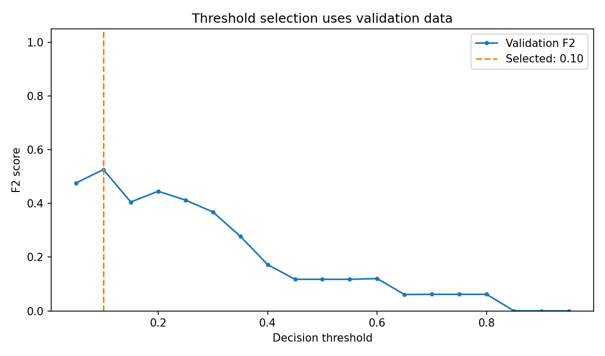

[← Chapter 04](../../README.md) · [Advanced Projects](../../README.md#section-4-16)

# Advanced Project 01. Decision Threshold Selection

## 문제 상황

드문 사건 탐지가 중요한 Classification에서는 기본 Decision Threshold 0.5가 목적에 맞지 않을 수 있습니다. 이번 프로젝트는 **Validation Data만으로 Threshold를 선택하고, 선택을 마친 뒤 Test Data로 성능을 평가** 합니다. 사건 누락에 상대적으로 큰 가중치를 두는 F2 Score를 사용합니다.

Test Data를 확인하며 Threshold를 고르면 그 결과는 더 이상 독립적인 최종 평가가 아닙니다.

## 입력 데이터

[`incident_alerts.csv`](../../data/incident_alerts.csv) — Mini 01과 동일한 실습용 합성 데이터 720건

- Feature: `temperature_c`, `vibration_mm_s`, `current_a`, `operation_hours`
- Target: `flagged`(0/1)
- 식별자: `alert_id`는 Feature에서 제외

## 구현 STEP

1. **Validation:** 입력 오류와 Label 범위를 검사합니다.
2. **Holdout:** `random_state=42`, `stratify=y`로 Test Data 20%를 먼저 분리합니다.
3. **Train/Validation:** 남은 데이터에서 Validation 25%를 분리합니다(`random_state=43`). 전체 기준 Train 60%, Validation 20%, Test 20%입니다.
4. **Model:** Train Data만 사용해 `StandardScaler` + `LogisticRegression(max_iter=2000)`을 학습합니다.
5. **Threshold Search:** Validation의 `predict_proba()` 결과에서 `0.05, 0.10, ..., 0.95`를 평가합니다. **F2 Score 최대화** 기준으로 선택합니다. 동률이면 더 큰 Threshold를 선택합니다.
6. **Final Evaluation:** 선택한 Threshold와 기본값 0.5를 **동일한 Test Data** 에서 비교합니다. Precision·Recall·F2와 Confusion Matrix를 제시합니다.
7. **Visualization:** Validation Threshold별 F2 변화를 표시하고 선택한 기준선을 그립니다.
8. **Interpretation:** FN 감소와 FP 증가의 관계를 설명합니다. 실제 운영 비용이 주어지지 않았으므로 F2가 곧 최적 사업 목표는 아닙니다.

<details>
<summary><strong>코드 힌트 — F2 Score</strong></summary>

```python
from sklearn.metrics import fbeta_score

predicted = (probabilities >= threshold).astype(int)
score = fbeta_score(y_val, predicted, beta=2, zero_division=0)
```

$\beta=2$는 Precision보다 Recall에 상대적으로 더 큰 가중치를 둡니다. 확률 추정치에 `>=`를 사용하는 점을 확인하세요.

</details>

## 실행 및 결과

```bash
python projects/advanced_01_threshold_selection/starter.py
python solutions/advanced_01_threshold_selection.py
```

모범 구현은 [`solutions/advanced_01_threshold_selection.py`](../../solutions/advanced_01_threshold_selection.py)에 있습니다.

기본 데이터에서는 Validation의 F2가 최대인 **Threshold 0.10** 이 선택됩니다.

| Test 기준 | Precision | Recall | F2 |
|---|---:|---:|---:|
| Threshold 0.50 | 50.0% | 5.0% | 6.1% |
| Threshold 0.10 | 24.7% | 90.0% | 58.8% |

Threshold를 낮춘 결과 실제 사건을 더 많이 찾아냈지만, 일반 데이터를 사건이라고 잘못 분류하는 FP도 늘었습니다. 두 수치의 변화는 **제공된 합성 데이터와 선택한 F2 목적 함수** 에 한정됩니다.



## 테스트 시나리오

- Train/Validation/Test 간 행 인덱스가 겹치지 않아야 합니다.
- Validation에서 선택한 Threshold를 바꾸기 위해 Test Label을 읽지 않아야 합니다.
- 확률 추정치에 NaN, 무한대, 음수, 1 초과 값이 있으면 오류를 발생시킵니다.
- 동률 기준과 `>=` 경계 조건을 명시하고 재현 가능한 값을 얻습니다.
- Test의 FP와 FN을 구분해 위험과 운영 비용을 논의합니다.

**완료 기준:** Test Data를 모델·Threshold 결정에 사용하지 않고, 두 Threshold의 Precision–Recall 차이를 비교합니다.

---

[← Chapter 04](../../README.md) · [Contents](../../README.md#contents)
