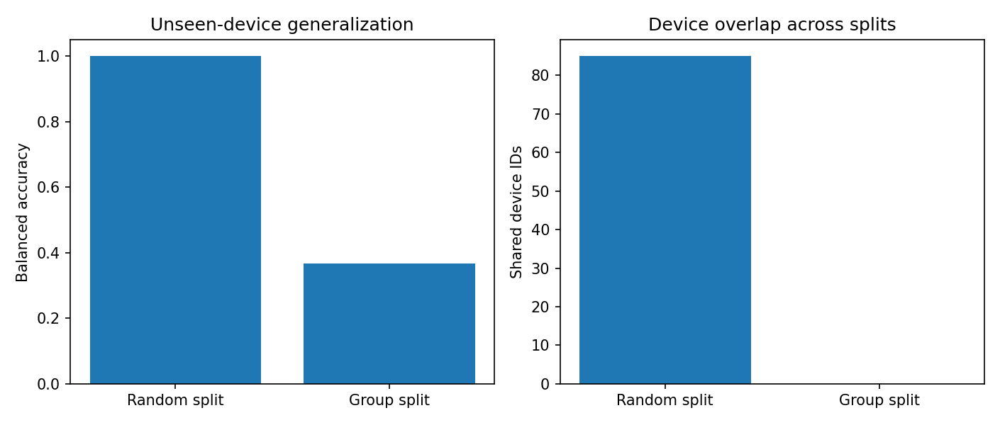

[← Chapter 04](../../README.md) · [Advanced Projects](../../README.md#section-4-16)

# Advanced Project 02. Group-Aware Evaluation Audit

## 문제 상황

한 장비에서 반복 수집한 여러 기록을 각각 독립적인 Sample로 취급하면, Train과 Test에 같은 장비의 데이터가 섞일 수 있습니다. 모델은 장비 고유 신호를 기억하는 것만으로 Test에서 높은 Accuracy를 얻지만, **처음 보는 장비에서는 실패** 할 수 있습니다.

이번 프로젝트는 동일한 데이터를 무작위 행 분할과 장비별 Group 분할로 평가하여 **실제 평가 목표와 Splitter의 관계** 를 확인합니다.

## 입력 데이터

[`device_cycles.csv`](../../data/device_cycles.csv) — 실습용 합성 데이터 600행, 장비 100대 × 측정 6회

| 열 | 의미 | 역할 |
|---|---|---|
| `device_id` | 장비 식별자 | Group 분할 기준, 학습 Feature에서 제외 |
| `cycle_no` | 장비 내 측정 순서 | 메타데이터 |
| `fingerprint_signal` | 장비 고유 식별 신호 | 누출 위험을 실험하기 위해 의도적으로 사용 |
| `temperature_c` | 측정 온도 | 참고 Feature |
| `maintenance_flag` | 장비 단위 Label(0/1) | Classification Target |

`fingerprint_signal`과 장비별 Label의 관계는 인위적으로 생성했습니다. **실제 모델에서는 장비 식별 신호를 일반화 가능한 Feature로 취급하지 않아야 합니다.**

## 구현 STEP

1. **Data Validation:** 필수 열, 결측값, 유한성, 두 Label 범위, 장비 내 Label 일관성을 검증합니다.
2. **Random Split:** `train_test_split(test_size=0.25, random_state=42, stratify=y)`로 행을 나눕니다.
3. **Group Split:** `GroupShuffleSplit(n_splits=1, test_size=0.25, random_state=42)`에 `groups=device_id`를 전달합니다.
4. **Model:** 두 분할 모두 `KNeighborsClassifier(n_neighbors=1)`을 `fingerprint_signal` 하나로 학습합니다. 이 Feature는 **식별 정보 암기 효과** 를 보기 위한 장치입니다.
5. **Overlap Audit:** Train과 Test에서 겹치는 장비 ID 개수를 계산합니다.
6. **Evaluation:** 두 방식의 Accuracy, Balanced Accuracy를 비교합니다.
7. **GroupKFold:** `GroupKFold(n_splits=5)`를 적용해 Train/Test에서 같은 장비가 겹치지 않는 CV 평가를 수행합니다.
8. **Interpretation:** Random Split의 높은 점수를 새로운 장비에 대한 성능으로 해석하면 안 되는 이유를 설명합니다.

<details>
<summary><strong>코드 힌트 — Group 분할</strong></summary>

```python
splitter = GroupShuffleSplit(
    n_splits=1, test_size=0.25, random_state=42
)
train_idx, test_idx = next(splitter.split(X, y, groups=device_ids))
assert set(device_ids[train_idx]).isdisjoint(device_ids[test_idx])
```

</details>

## 실행 및 결과

```bash
python projects/advanced_02_group_audit/starter.py
python solutions/advanced_02_group_audit.py
```

모범 구현은 [`solutions/advanced_02_group_audit.py`](../../solutions/advanced_02_group_audit.py)에 있습니다.

| 분할 방법 | Balanced Accuracy | Train/Test 장비 ID 중복 |
|---|---:|---:|
| Random Split | 100.0% | 85대 |
| Group Split | 36.7% | 0대 |

Random Split의 높은 점수는 같은 장비의 고유 신호를 암기한 효과에 가깝습니다. Group Split에서 성능이 낮아진 것은 **새 장비에 대한 일반화 능력을 별도로 검증해야 한다는 신호** 입니다. 제공 데이터는 의도적으로 장비별 Label을 무작위로 생성했으므로 높은 일반화 성능을 기대하도록 설계되지 않았습니다.



## 테스트 시나리오

- `device_id`가 겹치는 Group Split은 허용하지 않습니다.
- 장비별 `maintenance_flag` 값이 서로 다르면 검증 오류로 처리합니다.
- Random Split과 Group Split의 서로 다른 샘플 구성에 주의합니다.
- GroupKFold의 모든 Fold에서 Train/Test 장비가 겹치지 않아야 합니다.
- `fingerprint_signal`을 넣은 모델의 Test Accuracy가 높더라도 실무에 바로 활용하지 않습니다.

**완료 기준:** 평가 대상이 기존 장비의 새 기록인지, 처음 보는 장비인지에 맞춰 Splitter를 선택합니다.

---

[← Chapter 04](../../README.md) · [Contents](../../README.md#contents)
