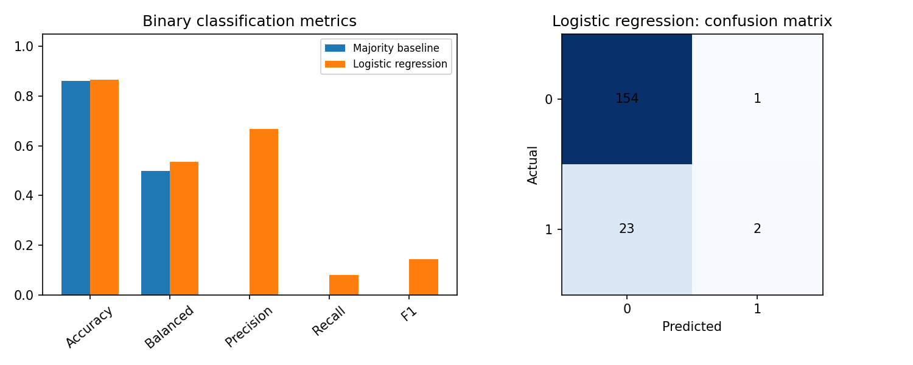

[← Chapter 04](../../README.md) · [Mini Projects](../../README.md#section-4-15)

# Mini Project 01. Alert Classification Metrics

## 문제 상황

센서 기록을 일반 상태(0)와 드문 사건(1)으로 분류합니다. Label 1의 비율이 낮은 데이터에서 모든 입력을 0으로 예측하는 모델과 Logistic Regression을 동일한 Test Data로 평가하세요. **Accuracy가 높다는 이유만으로 사건 탐지 능력이 좋다고 결론 내릴 수 없는 이유** 를 수치로 설명해야 합니다.

## 입력 데이터

[`incident_alerts.csv`](../../data/incident_alerts.csv) — 실습용 합성 데이터 720건

| 열 | 역할 | 내용 |
|---|---|---|
| `alert_id` | 식별자 | 중복 없는 문자 ID, Feature에서 제외 |
| `temperature_c` | Feature | 온도(°C) |
| `vibration_mm_s` | Feature | 진동(mm/s) |
| `current_a` | Feature | 전류(A) |
| `operation_hours` | Feature | 누적 가동 시간(h) |
| `flagged` | Target | 일반 0, 드문 사건 1 |

실제 장비의 이상 여부를 판단하도록 설계된 데이터가 아닙니다.

## 구현 STEP

1. **Validation:** 필수 열·결측값·중복 ID·비유한 수·음수 Feature·Label 범위를 검증합니다.
2. **Train/Test Split:** `test_size=0.25`, `random_state=42`, `stratify=y`로 학습과 테스트를 분리합니다.
3. **Baseline:** `DummyClassifier(strategy="most_frequent")`로 항상 다수 클래스를 예측합니다.
4. **Model:** `StandardScaler`와 `LogisticRegression(max_iter=2000, random_state=42)`을 Pipeline으로 연결해 학습합니다.
5. **Evaluation:** 각 모델의 Confusion Matrix, Accuracy, Balanced Accuracy, Precision, Recall, F1 Score를 계산합니다. Specificity도 함께 비교합니다.
6. **Visualization:** 평가 지표 비교 막대그래프와 Logistic Regression의 Confusion Matrix를 저장합니다.
7. **Interpretation:** False Negative와 False Positive 중 어떤 오류가 실제 문제에서 더 중요한지 논의합니다. 비용 정보가 없으므로 최적 모델을 단정하지 않습니다.

<details>
<summary><strong>코드 힌트 — 클래스가 희소한 경우</strong></summary>

```python
tn, fp, fn, tp = confusion_matrix(
    y_test, predictions, labels=[0, 1]
).ravel()
```

Class 1의 Recall은 `tp / (tp + fn)`입니다. 분모가 0이면 값은 정의되지 않으므로 보고 규칙을 먼저 정해야 합니다. scikit-learn의 `zero_division=0` 설정은 이러한 상황을 계산상 0으로 처리하기 위한 선택입니다.

</details>

## 실행 및 결과

`Chapter-04/`에서 다음 명령을 실행합니다.

```bash
python projects/mini_01_alert_metrics/starter.py
python solutions/mini_01_alert_metrics.py
```

`starter.py`는 미완성 실습 파일입니다. 모범 구현은 [`solutions/mini_01_alert_metrics.py`](../../solutions/mini_01_alert_metrics.py)에 있습니다.

기본 데이터의 Test Set은 **180건**, 그중 사건 Label 1은 **25건** 입니다.

| 모델 | Accuracy | Precision (1) | Recall (1) | F1 (1) |
|---|---:|---:|---:|---:|
| Majority Baseline | 86.1% | 0% | 0% | 0% |
| Logistic Regression | 86.7% | 66.7% | 8.0% | 14.3% |

두 모델의 Accuracy는 비슷하지만, 사건 Label에 대한 예측 결과는 다릅니다. Logistic Regression의 Confusion Matrix에서 FN이 23건이므로, 실제 사건 25건 중 23건을 놓쳤습니다.



## 테스트 시나리오

- `alert_id` 중복, 결측값, 음수 Feature, Label 2가 포함되면 오류가 발생해야 합니다.
- `tn + fp + fn + tp`는 Test Sample 수 180과 같아야 합니다.
- Baseline의 Recall이 0인 상황에서도 Accuracy만 보고 우수하다고 해석하지 않아야 합니다.
- `StandardScaler`는 Pipeline 내부에 두고 Train Data에만 맞춰야 합니다.
- 동일한 데이터와 시드로 반복 실행하면 결과가 재현되어야 합니다.

**완료 기준:** Confusion Matrix를 근거로 Accuracy, Precision, Recall의 차이를 설명합니다.

---

[← Chapter 04](../../README.md) · [Contents](../../README.md#contents)
