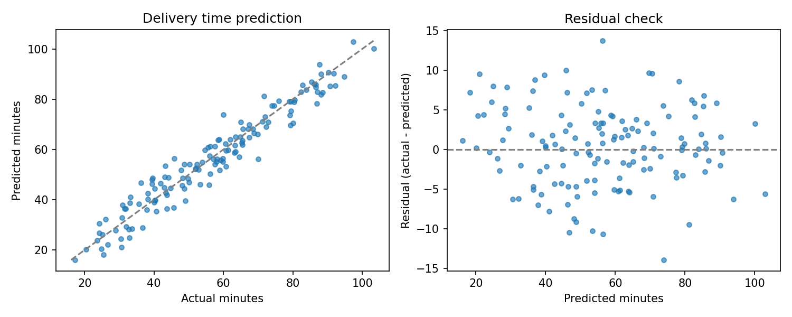

[← Chapter 04](../../README.md) · [Mini Projects](../../README.md#section-4-15)

# Mini Project 02. Delivery Time Regression

## 문제 상황

배송 거리, 경유지 수, 교통 혼잡도를 사용해 배송 소요 시간을 예측합니다. 학습 데이터의 중앙값만 예측하는 Baseline과 Ridge Regression을 비교하고, **오차를 분 단위로 해석** 하세요. 단순히 R²가 높다는 이유로 큰 오차를 무시해서는 안 됩니다.

## 입력 데이터

[`delivery_times.csv`](../../data/delivery_times.csv) — 실습용 합성 데이터 560건

| 열 | 역할 | 내용 |
|---|---|---|
| `delivery_id` | 식별자 | 중복 없는 ID, Feature에서 제외 |
| `distance_km` | Feature | 거리(km) |
| `stop_count` | Feature | 경유지 개수 |
| `traffic_index` | Feature | 합성 혼잡도 지수(0.1~1.0) |
| `actual_minutes` | Target | 소요 시간(분) |

## 구현 STEP

1. **Data Validation:** 필수 열, 중복 ID, 결측값, 수치의 유한성, 거리·경유지·시간의 범위를 검사합니다.
2. **Data Split:** `train_test_split(test_size=0.25, random_state=42)`로 Test Data를 고정합니다.
3. **Baseline:** `DummyRegressor(strategy="median")`으로 Train Target의 중앙값을 예측합니다.
4. **Regression:** `StandardScaler()` + `Ridge(alpha=3.0)` Pipeline으로 모델을 학습합니다.
5. **Evaluation:** 두 모델의 MAE, MSE, RMSE, R²를 비교합니다. 실제 시간과 예측 시간의 단위를 구분합니다.
6. **Cross-Validation:** Train Data에서 5-Fold CV를 수행해 MAE의 평균과 Fold 간 변동을 확인합니다. Test Data는 CV에 사용하지 않습니다.
7. **Visualization:** 실제 시간 대비 예측 시간 산점도와 Residual 그래프를 저장합니다.

<details>
<summary><strong>코드 힌트 — scikit-learn 점수 부호</strong></summary>

```python
scores = cross_validate(
    estimator, X_train, y_train,
    cv=KFold(5, shuffle=True, random_state=42),
    scoring={"mae": "neg_mean_absolute_error"},
)
cv_mae = -scores["test_mae"]
```

scikit-learn은 높은 Score가 더 좋은 결과를 나타내도록 음수 오차를 반환합니다. MAE의 실제 크기를 보고할 때는 부호를 되돌립니다.

</details>

## 실행 및 결과

```bash
python projects/mini_02_eta_regression/starter.py
python solutions/mini_02_eta_regression.py
```

모범 구현은 [`solutions/mini_02_eta_regression.py`](../../solutions/mini_02_eta_regression.py)에 있습니다.

| 모델 | MAE (분) | RMSE (분) | R² |
|---|---:|---:|---:|
| Median Baseline | 16.61 | 20.00 | -0.006 |
| Ridge Regression | 4.02 | 5.04 | 0.936 |

Ridge의 MAE가 약 4.02분이므로 Test Sample에서 절댓값 오차의 평균이 약 4분입니다. RMSE는 큰 오차에 더 민감합니다. Test 성능과 별개로 Train Data의 5-Fold CV MAE 평균은 약 3.91분입니다.



## 테스트 시나리오

- `delivery_id`가 중복되거나 소요 시간이 0 이하라면 오류가 발생해야 합니다.
- 데이터 분할 전 평균·표준편차를 계산해 Test Data가 전처리에 영향을 주지 않도록 합니다.
- MAE와 RMSE는 분 단위이며 MSE는 분² 단위입니다.
- R²는 음수가 될 수 있으므로 0~1 범위로 제한하지 않습니다.
- `Cross-Validation`은 Train Data에서만 수행합니다.

**완료 기준:** Baseline 비교와 Residual 분석을 통해 Regression 모델의 성능을 해석합니다.

---

[← Chapter 04](../../README.md) · [Contents](../../README.md#contents)
