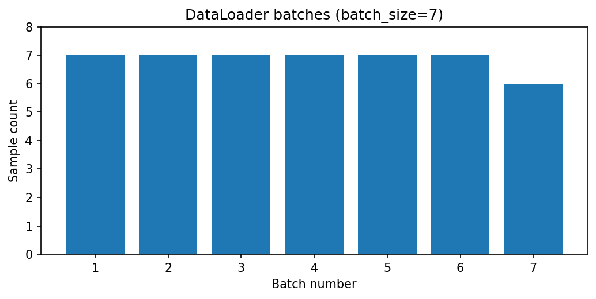

[← Chapter 05](../../README.md) · [Advanced Projects](../../README.md#section-5-14)

# Advanced Project 01. Facility Event Data Pipeline

## 문제 상황

시설의 이상 경보 기록이 CSV 파일로 관리되고 있습니다. 분석 담당자가 이 파일을 모델 학습과 분석 프로그램에서 공통으로 사용할 수 있도록 **Custom Dataset과 DataLoader**를 작성합니다. 이번 단계에서는 신경망을 학습하지 않습니다. 목적은 데이터를 신뢰할 수 있는 Batch 형태로 공급하는 것입니다.

## 입력 데이터

[`facility_events.csv`](../../data/facility_events.csv) — 실습용 합성 데이터, 48개 이벤트

| 열 | 역할 |
|---|---|
| `event_id` | 고유 이벤트 식별자 |
| `zone` | 시설 구역 메타데이터 |
| `hour` | 0~23 사이의 정수 시각 |
| `temperature_c` | 온도(-20~80) |
| `vibration_mm_s` | 진동(0~40) |
| `alert_label` | 경보 Label(0 또는 1) |

모델 입력 Feature의 순서는 `[hour, temperature_c, vibration_mm_s]`로 정합니다. Feature Tensor의 Dtype은 `float32`, Label은 `int64`입니다. `event_id`, `zone`은 Feature에 넣지 않습니다.

## 구현 STEP

1. CSV의 필수 열과 중복 ID, NaN·무한대, 각 Feature의 범위 및 Label을 검증합니다.
2. `FacilityEventDataset(Dataset)` 클래스를 작성하고 `__init__`, `__len__`, `__getitem__`을 구현합니다.
3. `__getitem__`에서 `(features, label, event_id)`를 반환합니다.
4. `DataLoader(batch_size=7, shuffle=False, num_workers=0)`로 전체 48건을 순회합니다.
5. 배치별 평균 온도·진동, Sample 수, 경보 개수를 집계합니다.
6. 원본 `event_id`와 할당된 배치 번호를 기록하고 두 개의 CSV를 저장합니다.

| 파일 | 출력 열 |
|---|---|
| `batch_summary.csv` | `batch_no,sample_count,mean_temperature,mean_vibration,alert_count` |
| `event_assignments.csv` | `event_id,batch_no,alert_label` |

<details>
<summary><strong>코드 힌트 — Dataset과 DataLoader</strong></summary>

```python
class FacilityEventDataset(Dataset):
    def __len__(self):
        return len(self.event_ids)

    def __getitem__(self, index):
        return self.features[index], self.labels[index], self.event_ids[index]

loader = DataLoader(dataset, batch_size=7, shuffle=False, num_workers=0)
```

모델 학습에서 `shuffle=True`가 유용한 경우도 있지만, `event_assignments.csv`의 원본 순서를 보장하려면 이번 출력에서는 `shuffle=False`로 처리합니다.

</details>

## 실행 및 검증

```bash
python projects/advanced_01_custom_dataloader/starter.py
python solutions/advanced_01_custom_dataloader.py
```

48건을 7건씩 나누면 총 7개 Batch가 생성되며 마지막 Batch의 크기는 6입니다.

- `len(dataset) == 48`, 한 Sample의 Feature Shape가 `[3]`인지 검사합니다.
- Sample의 Label은 `int64`, Feature는 `float32`인지 확인합니다.
- 집계된 `sample_count`의 합이 48이고 각 원본 이벤트 ID가 한 번만 출력되어야 합니다.
- [`facility_events_invalid.csv`](../../data/facility_events_invalid.csv)는 온도 결측값을 포함하므로 오류가 발생해야 합니다.
- `num_workers=0`을 기본값으로 두어 Colab·Windows·Notebook에서도 동일한 동작을 확인합니다.



모범 구현: [`solutions/advanced_01_custom_dataloader.py`](../../solutions/advanced_01_custom_dataloader.py)

---

[← Chapter 05](../../README.md) · [Contents](../../README.md#contents)
