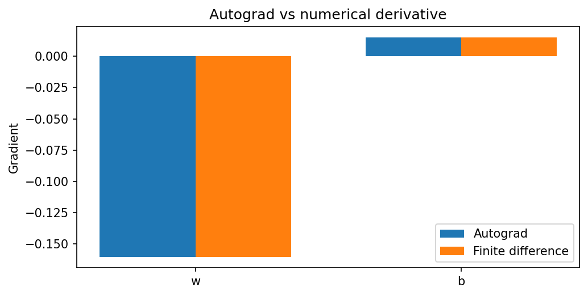

[← Chapter 05](../../README.md) · [Advanced Projects](../../README.md#section-5-14)

# Advanced Project 02. Gradient Audit & Numerical Check

## 문제 상황

복잡한 Tensor 연산의 Gradient가 의도대로 계산되는지 확인하려면 Autograd 결과를 수치 미분과 비교할 수 있습니다. 이번 프로젝트에서는 비선형 함수를 포함하는 작은 계산을 만들고 **중심 차분(Central Difference)** 으로 Gradient를 검증합니다. 이는 실제 모델 개발에서 미분 계산이나 사용자 정의 연산을 점검하는 데 도움이 되는 기초 방법입니다.

## 입력 데이터

[`gradient_audit.csv`](../../data/gradient_audit.csv) — 실습용 합성 데이터 13개 Sample, `input_signal`, `target_value` 열

$$
\hat y_i=\tanh(wx_i+b)
$$

$$
L(w,b)=\frac{1}{n}\sum_i(\hat y_i-y_i)^2+0.05w^2
$$

초기값은 $w=0.45$, $b=-0.15$이며 `float64` 및 CPU에서 계산합니다.

## 수식과 구현 STEP

스칼라 Parameter $\theta$에 대해 중심 차분은 다음과 같습니다.

$$
\frac{\partial L}{\partial\theta}\approx
\frac{L(\theta+\varepsilon)-L(\theta-\varepsilon)}{2\varepsilon}
$$

여기서 $\varepsilon=10^{-6}$입니다. 수치 미분은 유한한 간격을 사용하는 근삿값이므로 Autograd와 완전히 같을 필요는 없습니다.

1. CSV 열, 숫자값, NaN·무한대를 확인합니다.
2. `w`, `b`에 `requires_grad=True`를 설정하고 위 Loss를 계산합니다.
3. `loss.backward()`로 `.grad` 값을 얻습니다.
4. `w`와 `b`에 각각 $+\varepsilon$, $-\varepsilon$을 적용해 수치 Gradient를 계산합니다.
5. 두 결과의 절대오차와 상대오차를 구합니다.
6. 상대오차가 `1e-5` 미만이면 `pass=True`로 기록하고 결과 CSV를 저장합니다.

상대오차는 다음과 같이 계산합니다.

$$
\mathrm{RelativeError}=
\frac{|g_{\mathrm{auto}}-g_{\mathrm{numerical}}|}
{\max(1,|g_{\mathrm{auto}}|,|g_{\mathrm{numerical}}|)}
$$

**출력:** `gradient_audit_report.csv` — `parameter,autograd,finite_difference,absolute_error,relative_error,pass`

<details>
<summary><strong>코드 힌트 — 수치 Gradient</strong></summary>

```python
with torch.no_grad():
    numerical_gradient = (
        loss_fn(w + epsilon, b) - loss_fn(w - epsilon, b)
    ) / (2 * epsilon)
```

이는 `w`에 대한 예시입니다. `b`를 점검할 때에는 `w`를 고정하고 `b`에만 $\pm\varepsilon$을 적용합니다.

</details>

## 실행 및 검증

```bash
python projects/advanced_02_gradient_audit/starter.py
python solutions/advanced_02_gradient_audit.py
```

- 두 Parameter에서 상대오차가 모두 `1e-5` 미만이어야 합니다.
- `epsilon`이 지나치게 작거나 크면 수치 오차가 증가할 수 있습니다.
- `loss_fn()`의 모든 연산은 Gradient를 추적하는 Tensor 연산으로 작성합니다.
- 결과 확인 중 `.detach()`를 사용해야 하는 상황과 Gradient 계산에 사용하면 안 되는 상황을 구분합니다.



모범 구현: [`solutions/advanced_02_gradient_audit.py`](../../solutions/advanced_02_gradient_audit.py)

---

[← Chapter 05](../../README.md) · [Contents](../../README.md#contents)
