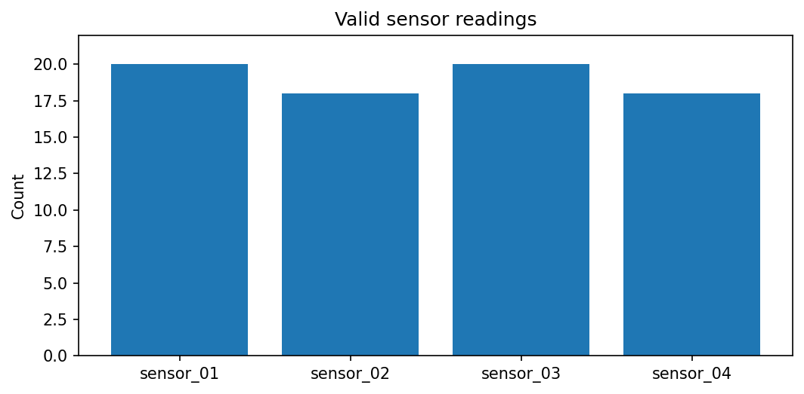

[← Chapter 05](../../README.md) · [Mini Projects](../../README.md#section-5-13)

# Mini Project 01. Sensor Tensor Quality Report

## 문제 상황

4개의 센서가 하루에 한 번 측정한 값을 기록했습니다. 센서마다 보정 계수가 다르며, 측정에 실패한 값은 `-1`로 저장됩니다. NumPy/Pandas로 CSV를 읽고, **Torch Tensor 연산으로 보정과 집계를 한 번에 처리**하는 프로그램을 작성합니다.

## 입력 데이터

[`sensor_readings.csv`](../../data/sensor_readings.csv) — 실습용 합성 데이터, 20일 × 4개 센서

| 열 | 의미 | 규칙 |
|---|---|---|
| `day` | 날짜 대체 식별자 | 중복·결측 불가 |
| `sensor_01`~`sensor_04` | 센서 측정값 | 0 이상, 측정 실패는 정확히 `-1` |

센서별 보정 계수는 `[1.00, 0.98, 1.03, 1.01]`입니다. 원본 `readings`는 `[20,4]`, 보정 계수는 `[4]` Shape입니다.

## 구현 STEP

1. 입력 CSV의 열, 중복 날짜, 숫자 변환, NaN·무한대 및 잘못된 음수값을 검사합니다.
2. 측정값을 `float32` Tensor로 만들고 보정 계수를 Broadcasting으로 곱합니다.
3. 원본 측정값이 `-1`인 위치를 Boolean Mask로 구분합니다. 결측값을 실제 `0` 측정값처럼 평균에 넣지 않습니다.
4. 센서마다 유효 측정 수, 교정 후 평균·최대값, `65` 이상인 유효 측정 수를 계산합니다.
5. `sensor_summary.csv`를 저장합니다. 수치 열 중 평균과 최댓값은 소수점 셋째 자리까지 반올림합니다.

**출력 열:** `sensor_id,valid_count,mean_calibrated,max_calibrated,high_count` (센서 번호 오름차순)

<details>
<summary><strong>코드 힌트 — Mask와 Broadcasting</strong></summary>

```python
valid = readings >= 0
corrected = readings * factors
counts = valid.sum(dim=0)
valid_sum = torch.where(valid, corrected, 0.).sum(dim=0)
mean_values = valid_sum / counts
```

모든 기록이 결측인 센서는 `counts == 0`이므로 평균을 계산하기 전에 오류로 처리합니다.

</details>

## 실행 및 검증

`Chapter-05/` 폴더 기준:

```bash
python projects/mini_01_sensor_tensors/starter.py
python solutions/mini_01_sensor_tensors.py
```

기본 실행 시 `outputs/mini_01/sensor_summary.csv`가 만들어집니다. 출력 파일은 학습용 생성물이므로 GitHub에 올릴 필요가 없습니다.

- 4개 센서가 각각 정확히 한 행씩 출력되는지 확인합니다.
- `sensor_02`, `sensor_04`는 `-1`을 제외하므로 유효 측정 수가 18이어야 합니다.
- 다른 센서는 유효 측정 수가 20입니다.
- `-2`, 중복 `day`, 문자열 값, 전체 결측인 센서를 넣으면 오류를 발생시켜야 합니다.
- 원본 행의 순서가 변경되어도 센서별 요약은 같아야 합니다.



모범 구현: [`solutions/mini_01_sensor_tensors.py`](../../solutions/mini_01_sensor_tensors.py)

---

[← Chapter 05](../../README.md) · [Contents](../../README.md#contents)
