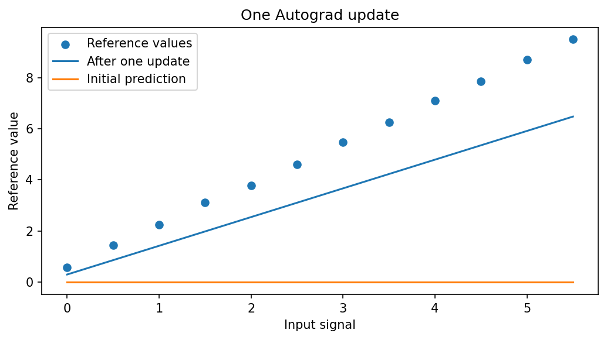

[← Chapter 05](../../README.md) · [Mini Projects](../../README.md#section-5-13)

# Mini Project 02. Autograd Calibration — One Gradient Step

## 문제 상황

한 센서의 원본 신호 `x`를 기준 측정값 `y`에 맞추기 위해 $\hat y=wx+b$라는 보정식을 사용합니다. Chapter 02에서 직접 계산했던 Gradient를 **Autograd로 계산하고, 한 번의 Parameter 갱신을 수행**합니다. 여러 Epoch를 반복하는 Training Loop는 Chapter 07에서 다룹니다.

## 입력 데이터

[`calibration_pairs.csv`](../../data/calibration_pairs.csv) — 실습용 합성 데이터, 12개 Sample

- `input_signal`: 입력 $x$
- `reference_value`: 목표값 $y$

초기 Parameter는 $w=0$, $b=0$이고 기본 학습률은 $\eta=0.03$입니다. 계산 과정의 오차를 줄이기 위해 `torch.float64`를 사용합니다.

## 수식과 구현 STEP

MSE와 Parameter 갱신은 다음과 같습니다.

$$
L(w,b)=\frac1n\sum_{i=1}^n(wx_i+b-y_i)^2
$$

$$
w_{\mathrm{new}}=w-\eta\frac{\partial L}{\partial w},\qquad
b_{\mathrm{new}}=b-\eta\frac{\partial L}{\partial b}
$$

1. CSV의 열과 유한한 숫자값을 확인하고, 서로 다른 `input_signal`이 최소 2개인지 검증합니다.
2. `requires_grad=True`인 스칼라 Tensor `w`, `b`를 생성합니다.
3. 예측값과 MSE를 계산한 다음 `loss.backward()`를 실행합니다.
4. `w.grad`, `b.grad`를 읽고 `torch.no_grad()` 안에서 Parameter를 한 번 갱신합니다.
5. 갱신 후 Loss를 새로 계산하고 `.grad`를 초기화합니다.
6. `gradient_report.csv`와 `loss_report.csv`를 저장합니다.

| 파일 | 열 |
|---|---|
| `gradient_report.csv` | `parameter,before,gradient,after` |
| `loss_report.csv` | `sample_count,learning_rate,loss_before,loss_after` |

<details>
<summary><strong>코드 힌트 — 첫 번째 업데이트</strong></summary>

```python
loss = ((w * x + b - y) ** 2).mean()
loss.backward()
with torch.no_grad():
    w -= learning_rate * w.grad
    b -= learning_rate * b.grad
w.grad = None
b.grad = None
```

`with torch.no_grad()`는 이 갱신 연산을 새로운 미분 그래프에 기록하지 않기 위한 처리입니다.

</details>

## 실행 및 검증

```bash
python projects/mini_02_autograd_calibration/starter.py
python solutions/mini_02_autograd_calibration.py
```

기본 학습률에서 `loss_after`는 `loss_before`보다 작아야 합니다. Gradient를 직접 계산한 수식과 비교해도 됩니다.

- `w`와 `b` 모두 Gradient가 생성되어야 합니다.
- 두 Parameter의 갱신값은 $\theta-\eta\nabla_\theta L$을 따릅니다.
- NaN, 무한대, 동일한 입력 신호만 존재하는 CSV는 오류로 처리합니다.
- `loss.backward()`를 같은 그래프에서 두 번 부르는 대신, 각 계산의 그래프를 새로 만든다는 점을 구분합니다.



모범 구현: [`solutions/mini_02_autograd_calibration.py`](../../solutions/mini_02_autograd_calibration.py)

---

[← Chapter 05](../../README.md) · [Contents](../../README.md#contents)
