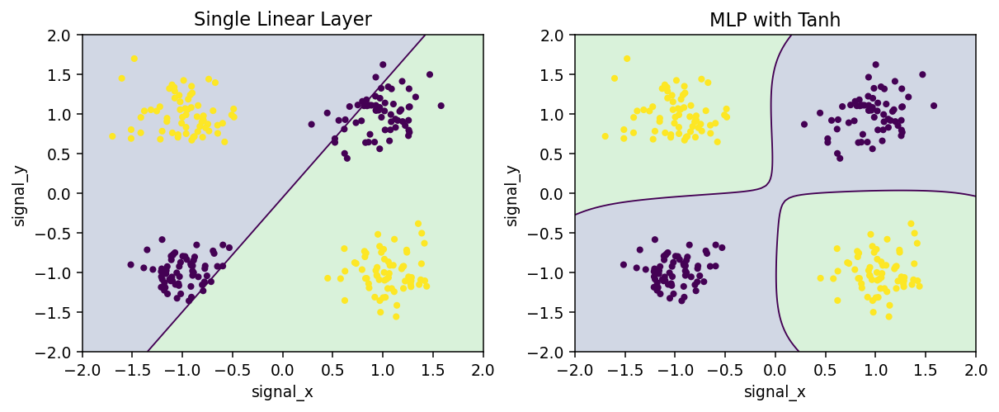

[← AI 목차](../README.md#contents) · [Chapter 05](../Chapter-05/README.md)

# Chapter 06. Neural Networks & Deep Learning

신경망(Neural Network)의 기본 단위인 Neuron부터 은닉층(Hidden Layer), 활성화 함수(Activation Function), 순전파(Forward Propagation), 역전파(Backpropagation)까지 학습합니다. Chapter 05에서 다룬 Tensor·Autograd·DataLoader를 바탕으로 PyTorch의 `nn.Module`을 직접 작성하고 작은 신경망을 학습합니다.

핵심은 신경망을 복잡한 수식으로만 이해하는 것이 아니라 **각 Layer에서 데이터가 어떻게 변하는지, 어떤 코드가 학습에 필요한지, 결과가 이상할 때 무엇부터 확인할지** 익히는 데 있습니다. Chapter 07에서는 Optimizer 선택, 학습률 조정, Regularization, 학습 안정성 및 Training Pipeline을 더 깊이 다룹니다.

- **기준 언어:** Python 3.11 이상 권장
- **주요 라이브러리:** PyTorch, NumPy, Pandas, Matplotlib, scikit-learn
- **권장 환경:** Google Colab(기본), VS Code, Jupyter Notebook
- **선행 내용:** Chapter 02의 Gradient Descent, Chapter 04의 학습·평가 분리, Chapter 05의 Tensor와 Autograd
- **실습 규모:** 모든 필수 프로젝트를 CPU에서 실행 가능

## Contents

| Section | Topic |
|:---:|---|
| [6.1](#section-6-1) | **Learning Goals & Getting Started** — 목표와 환경 준비 |
| [6.2](#section-6-2) | **From Linear Models to Neural Networks** — 신경망이 필요한 이유 |
| [6.3](#section-6-3) | **Neuron & Perceptron** — 가중합, Bias, 논리 게이트 |
| [6.4](#section-6-4) | **Hidden Layers & Nonlinearity** — 다층 구조와 XOR |
| [6.5](#section-6-5) | **Layer Shapes & Parameters** — 입력·출력 차원과 Parameter 수 |
| [6.6](#section-6-6) | **Activation Functions** — ReLU, Sigmoid, Tanh, Softmax |
| [6.7](#section-6-7) | **nn.Module & nn.Sequential** — PyTorch로 모델 작성 |
| [6.8](#section-6-8) | **Forward Propagation** — 데이터 흐름과 Logits |
| [6.9](#section-6-9) | **Loss Functions** — Regression·Binary·Multiclass Loss |
| [6.10](#section-6-10) | **Backpropagation & Chain Rule** — Gradient 계산 원리 |
| [6.11](#section-6-11) | **First Training Loop** — Mini-Batch 학습을 한 번 연결 |
| [6.12](#section-6-12) | **Train, Eval & Inference** — Dropout과 평가 모드 |
| [6.13](#section-6-13) | **Saving & Loading Models** — state_dict와 모델 복원 |
| [6.14](#section-6-14) | **Debugging Neural Networks** — Shape·Loss·Gradient 점검 |
| [6.15](#section-6-15) | **Examples** — 독립 실행 예제 8개 |
| [6.16](#section-6-16) | **Coding Practice** — 직접 구현하는 5문제 |
| [6.17](#section-6-17) | **Mini Projects** — XOR Classification, 비선형 수요 예측 |
| [6.18](#section-6-18) | **Advanced Projects** — 신경망 구조 점검과 모델 전달 |
| [6.19](#section-6-19) | **Quiz** — 개념·계산·코드 분석 |
| [6.20](#section-6-20) | **Summary** — 핵심 내용 정리 |
| [6.21](#section-6-21) | **References** — 공식 참고 문서 |

---

<a id="section-6-1"></a>
## 6.1. Learning Goals & Getting Started

### 학습 목표

이번 Chapter를 마치면 다음 작업을 수행할 수 있어야 합니다.

1. Neuron과 Layer의 입력·출력 계산을 Tensor 연산으로 설명합니다.
2. 단일 Linear Layer와 다층 신경망의 표현 능력 차이를 이해합니다.
3. 활성화 함수의 역할을 구분하고 출력층에 맞는 Loss를 선택합니다.
4. `nn.Module`, `nn.Sequential`, `forward()`로 신경망을 직접 정의합니다.
5. `loss.backward()` 이후 각 Parameter의 Gradient를 확인하고 학습 과정을 연결합니다.
6. `model.train()`, `model.eval()`, `torch.inference_mode()`의 용도를 구분합니다.
7. 모델의 Weight와 전처리 정보를 저장·복원하고 예측 결과를 검증합니다.

### 실행 환경

Chapter 폴더에서 다음 명령어를 실행합니다.

```bash
python -m pip install -r requirements.txt
python examples/02_linear_shapes.py
python examples/07_one_training_loop.py
python -m unittest discover -s tests -v
```

Google Colab에는 PyTorch가 기본 제공되는 경우가 많습니다. 설치된 버전과 Device를 먼저 확인하세요.

```python
import torch
print(torch.__version__)
print(torch.cuda.is_available())
```

PyTorch는 CPU만으로도 이번 Chapter의 필수 예제를 실행할 수 있습니다. CUDA가 필요한 경우 [공식 설치 페이지](https://pytorch.org/get-started/locally/)에서 운영체제와 하드웨어에 맞는 설치 명령을 선택합니다. Notebook은 [`Chapter_06_Neural_Networks_and_Deep_Learning.ipynb`](./notebooks/Chapter_06_Neural_Networks_and_Deep_Learning.ipynb)에 있습니다.

### 실습 데이터

| 데이터 | Sample 수 | 주요 용도 |
|---|---:|---|
| [`xor_signals.csv`](./data/xor_signals.csv) | 256 | 비선형 Decision Boundary |
| [`nonlinear_demand.csv`](./data/nonlinear_demand.csv) | 300 | 비선형 Regression |
| [`triage_signals.csv`](./data/triage_signals.csv) | 360 | Multiclass, 모델 비교·복원 |

모두 **실습용 합성 데이터**이며, [`data/README.md`](./data/README.md)에 생성 규칙을 설명했습니다. 인터넷에서 데이터를 내려받지 않아도 예제와 프로젝트를 실행할 수 있습니다.

---

<a id="section-6-2"></a>
## 6.2. From Linear Models to Neural Networks

Chapter 02에서 Linear Regression은 Feature를 가중합해 예측값을 계산했습니다. Logistic Regression도 입력의 가중합으로 점수를 만들고 Sigmoid로 확률을 추정합니다. 이 방식은 작고 해석하기 쉬우며 많은 문제에서 효과적입니다.

그렇다면 왜 신경망이 필요할까요? 어떤 관계는 하나의 직선이나 평면으로 설명하기 어렵기 때문입니다. 온도에 따른 수요가 특정 구간에서 갑자기 증가하거나, 두 신호가 조합될 때만 경보가 발생하는 경우가 그렇습니다.

신경망은 여러 Linear 연산 사이에 비선형 변환을 배치해 더 다양한 함수 형태를 표현합니다. **Layer를 여러 개 쌓았다는 사실 자체보다, Layer 사이의 비선형 변환이 중요**합니다.

| 비교 | 단일 Linear 모델 | 다층 신경망(MLP) |
|---|---|---|
| 기본 계산 | 하나의 가중합 | 가중합과 비선형 함수를 반복 |
| 표현 가능 관계 | 선형 관계에 적합 | 복잡한 비선형 관계도 표현 가능 |
| 장점 | 단순하고 해석하기 쉬움 | 다양한 패턴을 근사할 수 있음 |
| 주의점 | 비선형 관계를 충분히 설명하지 못할 수 있음 | Parameter 증가, Overfitting, 학습 불안정 가능성 |

신경망이 언제나 더 좋은 것은 아닙니다. 데이터가 적거나 관계가 단순할 때는 Baseline 또는 Linear 모델이 더 안정적일 수 있습니다. 따라서 프로젝트에서도 **단순한 모델을 기준으로 먼저 비교**합니다.

---

<a id="section-6-3"></a>
## 6.3. Neuron & Perceptron

### Neuron의 계산

**뉴런(Neuron)** 은 여러 입력에 Weight를 곱해 더하고 Bias를 더한 값을 활성화 함수에 전달하는 계산 단위입니다.

$$
z=\sum_{j=1}^{d}w_jx_j+b,\qquad a=\phi(z)
$$

- $x_j$: $j$번째 입력 Feature
- $w_j$: 해당 Feature의 Weight
- $b$: Bias
- $z$: 활성화 함수 적용 전의 가중합(Pre-activation)
- $\phi$: Activation Function
- $a$: 출력값(Activation)

예를 들어 입력이 $x=[2,3]$, Weight가 $w=[0.5,-1]$, Bias가 $b=1$이면

$$
z=(2\times0.5)+(3\times-1)+1=-1
$$

ReLU를 적용했다면 $a=\max(0,-1)=0$입니다. `nn.Linear`는 이러한 가중합을 여러 출력 Neuron에 동시에 계산합니다.

```python
import torch

x = torch.tensor([2.0, 3.0])
w = torch.tensor([0.5, -1.0])
b = 1.0
z = torch.dot(x, w) + b
print(z.item())           # -1.0
print(torch.relu(z).item()) # 0.0
```

### Perceptron과 논리 게이트

**퍼셉트론(Perceptron)** 은 가중합과 임계값을 이용해 0 또는 1을 결정하는 고전적인 선형 분류기의 한 형태입니다. Step Function을 사용하면 간단한 논리 게이트를 표현할 수 있습니다.

$$
\mathrm{step}(z)=\begin{cases}1&\text{if }z\ge0\\0&\text{otherwise}\end{cases}
$$

AND 게이트는 $w=[1,1]$, $b=-1.5$로 표현할 수 있습니다.

| 입력 1 | 입력 2 | $z=x_1+x_2-1.5$ | 출력 |
|---:|---:|---:|---:|
| 0 | 0 | -1.5 | 0 |
| 0 | 1 | -0.5 | 0 |
| 1 | 0 | -0.5 | 0 |
| 1 | 1 | 0.5 | 1 |

[Example 01](./examples/01_neuron_and_logic.py)에서는 AND와 OR을 Tensor 연산으로 계산합니다. Step Function은 0을 제외한 구간에서 미분값이 0이므로, 일반적인 Gradient 기반 신경망 학습에는 ReLU·Sigmoid·Tanh처럼 미분 가능한 구간을 가진 함수가 더 적합합니다.

---

<a id="section-6-4"></a>
## 6.4. Hidden Layers & Nonlinearity

### 입력층, 은닉층, 출력층

**다층 퍼셉트론(Multilayer Perceptron, MLP)** 은 입력을 받은 뒤 하나 이상의 Hidden Layer를 거쳐 출력을 계산하는 신경망입니다.

```text
입력 Feature 2개
      ↓
Linear(2, 8) → Tanh
      ↓
Linear(8, 1)
      ↓
예측 Logit 1개
```

입력층은 데이터를 받아들이는 위치이며, Hidden Layer는 중간 표현을 계산합니다. 마지막 Output Layer의 크기는 문제에 따라 달라집니다. Regression이면 보통 연속값 수만큼, 다중 분류라면 Class 수만큼 출력합니다.

### 선형층을 계속 쌓으면 무엇이 달라질까요?

두 Linear 층 사이에 Activation Function이 없다고 가정합니다.

$$
h=W_1x+b_1,\quad y=W_2h+b_2
$$

대입하면

$$
y=(W_2W_1)x+(W_2b_1+b_2)
$$

결국 또 하나의 Linear 변환입니다. 따라서 **Linear Layer만 여러 개 이어도 비선형 표현 능력이 생기지 않습니다.** Hidden Layer 사이에 ReLU나 Tanh를 넣는 이유입니다.

### XOR 문제

XOR은 두 입력이 서로 다를 때만 1을 출력합니다.

| $x_1$ | $x_2$ | XOR |
|---:|---:|---:|
| 0 | 0 | 0 |
| 0 | 1 | 1 |
| 1 | 0 | 1 |
| 1 | 1 | 0 |

이 네 점을 하나의 직선으로 정확히 나눌 수는 없습니다. 그러나 비선형 Hidden Layer를 사용하면 서로 다른 영역을 조합해 구분할 수 있습니다. [Mini Project 01](./projects/mini_01_xor_network/README.md)에서 같은 데이터를 단일 Linear와 MLP에 학습시켜 이 차이를 확인합니다.



---

<a id="section-6-5"></a>
## 6.5. Layer Shapes & Parameters

### nn.Linear의 Weight 방향

PyTorch의 `nn.Linear(in_features, out_features)`는 다음과 같이 계산합니다.

$$
Y=XW^\top+b
$$

Batch Size를 $N$, 입력 Feature 수를 $D$, 출력 Neuron 수를 $O$라 하면 다음 Shape를 갖습니다.

| Tensor | Shape | 역할 |
|---|---|---|
| $X$ | `(N, D)` | Batch 입력 |
| $W$ | `(O, D)` | Weight |
| $b$ | `(O,)` | Bias |
| $Y$ | `(N, O)` | Batch 출력 |

```python
import torch
from torch import nn

layer = nn.Linear(3, 2)
x = torch.tensor([[1., 2., 3.], [4., 5., 6.]])
y = layer(x)

print(layer.weight.shape)  # [2, 3]
print(layer.bias.shape)    # [2]
print(y.shape)             # [2, 2]
print(torch.allclose(y, x @ layer.weight.T + layer.bias))  # True
```

`@`는 행렬곱, `.T`는 2차원 Tensor의 전치를 의미합니다. **Batch Size가 달라져도 Layer의 Weight Shape는 바뀌지 않습니다.**

### Parameter Count

`Linear(D,O)`의 학습 가능한 Parameter 수는 Weight $DO$개와 Bias $O$개를 합해 다음과 같습니다.

$$
P=DO+O=(D+1)O
$$

`Linear(4,6) → ReLU → Linear(6,2)` 구조에서는

$$
P=(4\times6+6)+(6\times2+2)=44
$$

입니다. ReLU에는 학습 가능한 Parameter가 없습니다. `model.parameters()`를 순회해 실제 개수도 확인할 수 있습니다.

```python
model = nn.Sequential(nn.Linear(4,6), nn.ReLU(), nn.Linear(6,2))
print(sum(p.numel() for p in model.parameters()))  # 44
```

---

<a id="section-6-6"></a>
## 6.6. Activation Functions

활성화 함수는 Layer가 출력한 가중합을 변환합니다. 모든 함수가 같은 역할을 하는 것은 아닙니다.

### ReLU

$$
\mathrm{ReLU}(z)=\max(0,z)
$$

음수는 0으로, 양수는 그대로 전달합니다. 계산이 단순해 Hidden Layer에서 자주 사용됩니다. 단, 음수 영역에서는 Gradient가 0이므로 어떤 Neuron이 계속 활성화되지 않는 현상이 나타날 수 있습니다.

### Sigmoid

$$
\sigma(z)=\frac{1}{1+e^{-z}}
$$

출력을 0~1 사이로 변환합니다. Binary Classification의 Logit을 예측 확률로 해석할 때 사용합니다. 큰 양수·음수 영역에서 Gradient가 매우 작아지므로 깊은 Hidden Layer에서는 주로 ReLU 계열을 사용하는 경우가 많습니다.

### Tanh

$$
\tanh(z)=\frac{e^z-e^{-z}}{e^z+e^{-z}}
$$

출력 범위가 -1~1이고 음수도 표현할 수 있습니다. 그러나 입력의 절댓값이 매우 크면 Gradient가 작아지는 포화 구간이 존재합니다.

### Softmax

Class $k$의 Logit을 $z_k$라 하면

$$
\mathrm{Softmax}(z)_k=\frac{e^{z_k}}{\sum_{j=1}^{C}e^{z_j}}
$$

각 클래스의 값을 0~1로 변환하고 한 Sample 내 확률 합을 1로 만듭니다. **Multiclass Classification에서 출력 확률을 확인할 때 사용하지만, `nn.CrossEntropyLoss` 앞에 별도로 적용하지는 않습니다.** 이 Loss 함수는 원본 Logit을 직접 입력받습니다.

| 함수 | 출력 범위 | 대표 용도 |
|---|---|---|
| ReLU | 0 이상 | Hidden Layer |
| Sigmoid | 0~1 | Binary Logit의 확률 변환 |
| Tanh | -1~1 | 중간 표현, 범위 제한 |
| Softmax | Class별 0~1, 합 1 | Multiclass 확률 해석 |

[Example 03](./examples/03_activation_functions.py)에서는 동일한 입력에 여러 활성화 함수를 적용해 결과를 비교합니다.

---

<a id="section-6-7"></a>
## 6.7. nn.Module & nn.Sequential

### nn.Sequential로 간단한 신경망 구성

```python
import torch
from torch import nn

model = nn.Sequential(
    nn.Linear(4, 8),
    nn.ReLU(),
    nn.Linear(8, 3),
)

batch = torch.randn(5, 4)
logits = model(batch)
print(logits.shape)  # torch.Size([5, 3])
```

`Sequential`은 내부 Module을 지정한 순서대로 실행합니다. 특별한 분기나 추가 출력이 없는 신경망에는 코드가 간결하다는 장점이 있습니다.

### nn.Module 클래스로 구조 정의

모델에 입력 검증, 중간값 처리, 여러 경로가 필요한 경우 `nn.Module`을 상속받아 작성합니다.

```python
class SensorNetwork(nn.Module):
    def __init__(self):
        super().__init__()
        self.hidden = nn.Linear(4, 8)
        self.activation = nn.ReLU()
        self.output = nn.Linear(8, 3)

    def forward(self, x):
        if x.ndim != 2 or x.shape[1] != 4:
            raise ValueError("Input Shape must be (N, 4).")
        x = self.activation(self.hidden(x))
        return self.output(x)

network = SensorNetwork()
print(network(torch.randn(5, 4)).shape)  # [5, 3]
```

`__init__()`에서는 사용할 Layer를 등록하고, `forward()`에서는 데이터가 흐르는 순서를 정의합니다. **모델 실행은 `network(x)`로 수행**합니다. `network.forward(x)`를 직접 호출하면 PyTorch가 제공하는 Module 호출 과정의 일부 기능이 우회될 수 있습니다.

등록된 Parameter는 `model.parameters()` 또는 `model.named_parameters()`에서 확인할 수 있습니다. 학습 가능한 Weight는 별도로 Python 리스트에만 넣기보다 `nn.Module`의 속성으로 등록해야 합니다.

---

<a id="section-6-8"></a>
## 6.8. Forward Propagation

**순전파(Forward Propagation)** 는 입력 Batch가 앞 Layer부터 출력 Layer까지 지나며 예측값을 계산하는 과정입니다.

2개의 Feature로 3개 Class를 예측하는 예를 보면

```text
X (32, 2)
   ↓ Linear(2, 8)
H (32, 8)
   ↓ ReLU
A (32, 8)
   ↓ Linear(8, 3)
Logits (32, 3)
```

32는 Batch Size, 3은 Class 개수입니다. 실제 문제에서 Batch Size를 32에서 16으로 바꾸더라도 Weight Shape는 동일합니다.

### Logit과 Prediction

**로짓(Logit)** 은 활성화 함수 또는 Softmax를 적용하기 전의 원시 출력값입니다. 예를 들어 `[2.0, 0.5, -1.0]`은 Class별 확률이 아닙니다. 가장 큰 Logit에 해당하는 Class가 예측 Label이며, `softmax(dim=1)`을 적용하면 Class별 확률을 구할 수 있습니다.

```python
logits = torch.tensor([[2.0, 0.5, -1.0]])
print(logits.argmax(dim=1))
print(torch.softmax(logits, dim=1).sum(dim=1))  # tensor([1.])
```

Softmax 결과가 곧 실제 사건 발생 확률과 정확히 일치한다는 의미는 아닙니다. 확률 보정이 필요한지는 Chapter 04의 평가 원칙에 따라 별도로 판단해야 합니다.

---

<a id="section-6-9"></a>
## 6.9. Loss Functions

Loss Function은 예측값과 Target의 차이를 수치화합니다. 문제의 Target 형식에 맞는 Loss를 사용해야 합니다.

| 문제 | 모델 출력 | Target | Loss |
|---|---|---|---|
| Regression | `(N,1)` 실수 | `(N,1)` 실수 | `nn.MSELoss()` |
| Binary Classification | `(N,)` Logit | `(N,)` 실수 0/1 | `nn.BCEWithLogitsLoss()` |
| Multiclass Classification | `(N,C)` Logits | `(N,)` 정수 Class ID | `nn.CrossEntropyLoss()` |

### Regression — MSE

$$
\mathrm{MSE}=\frac{1}{N}\sum_{i=1}^{N}(y_i-\hat y_i)^2
$$

`MSELoss`의 기본 `reduction='mean'`은 Tensor의 요소 평균을 취합니다. 이번 예제처럼 Sample당 출력 1개일 때 위 수식과 같습니다.

### Binary Classification — BCEWithLogitsLoss

한 Sample의 Logit을 $z$, Target을 $y\in\{0,1\}$로 놓으면

$$
\ell(z,y)=-y\log\sigma(z)-(1-y)\log(1-\sigma(z))
$$

`BCEWithLogitsLoss`는 내부에서 Sigmoid와 Binary Cross-Entropy 계산을 결합해 수치 안정성을 높입니다. 따라서 모델 끝에 Sigmoid를 붙인 뒤 전달하면 의도와 달라집니다.

### Multiclass Classification — CrossEntropyLoss

Class $y$의 Logit이 $z_y$이고 전체 Class가 $C$개이면

$$
\ell(z,y)=-\log\left(\frac{e^{z_y}}{\sum_{j=1}^{C}e^{z_j}}\right)
$$

PyTorch의 `CrossEntropyLoss`는 Softmax에 대응하는 Log-Softmax 계산을 내부에서 처리하므로 원본 Logits가 필요합니다.

```python
from torch import nn
import torch

logits = torch.tensor([[2.0, 0.5, -1.0], [0.1, -0.2, 1.2]])
labels = torch.tensor([0, 2], dtype=torch.int64)
loss = nn.CrossEntropyLoss()(logits, labels)
print(round(loss.item(), 4))
```

Target을 `(N,1)`로 전달하거나, 정수 Label 대신 잘못된 Dtype을 사용하면 Shape 또는 Dtype 오류가 발생할 수 있습니다. `CrossEntropyLoss`는 확률 분포 Target도 지원하지만, **이번 Chapter의 Class ID 실습에서는 `(N,)` 형태의 `int64`를 사용**합니다.

---

<a id="section-6-10"></a>
## 6.10. Backpropagation & Chain Rule

### 왜 역전파가 필요한가요?

신경망은 여러 Layer의 Weight를 동시에 조정해야 합니다. 마지막 Loss가 각 Weight의 변화에 얼마나 민감한지 계산할 수 있어야 학습 방향을 정할 수 있습니다.

**역전파(Backpropagation)** 는 Chain Rule을 이용해 출력에서 입력 방향으로 Gradient를 전달하는 계산 방법입니다. PyTorch에서는 Forward 연산의 Computational Graph를 기록하고, `loss.backward()`가 해당 Graph를 따라 Gradient를 계산합니다.

### 한 개 Neuron의 계산 예제

$$
\hat y=wx+b,\qquad L=(\hat y-y)^2
$$

Chain Rule을 적용하면

$$
\frac{\partial L}{\partial w}=2(\hat y-y)x,
\qquad
\frac{\partial L}{\partial b}=2(\hat y-y)
$$

$x=2$, $w=0.5$, $b=1$, $y=5$이면 $\hat y=2$, $L=9$입니다.

$$
\frac{\partial L}{\partial w}=2(2-5)\times2=-12,\qquad
\frac{\partial L}{\partial b}=2(2-5)=-6
$$

```python
import torch

x = torch.tensor(2.0)
w = torch.tensor(0.5, requires_grad=True)
b = torch.tensor(1.0, requires_grad=True)
target = torch.tensor(5.0)

prediction = w * x + b
loss = (prediction - target) ** 2
loss.backward()
print(w.grad.item())  # -12.0
print(b.grad.item())  # -6.0
```

### 여러 Layer에서는 어떻게 연결될까요?

`Linear → ReLU → Linear → Loss` 구조라면 뒤쪽 Layer에서 구한 Gradient가 ReLU의 미분을 거쳐 앞쪽 Layer로 전달됩니다. 각 Parameter에 대해 모든 미분식을 손으로 구현할 필요는 없지만, **앞 Layer의 Gradient가 뒤 Layer의 계산에도 영향을 받는다는 관계**는 이해해야 합니다.

Autograd는 수식을 대신 계산해 주지만 Loss 선택, 입력 Shape, 모델 구조가 잘못되어 있으면 올바른 목표를 학습해 주지는 않습니다.

---

<a id="section-6-11"></a>
## 6.11. First Training Loop

Chapter 05에서는 한 번의 Gradient 계산을 살펴봤습니다. 이번에는 Batch를 반복해서 처리하는 최소한의 학습 흐름을 확인합니다.

```python
import torch
from torch import nn
from torch.utils.data import DataLoader, TensorDataset

torch.manual_seed(9)
x = torch.linspace(-1, 1, 80).unsqueeze(1)
y = 0.7 * x + 0.2
loader = DataLoader(TensorDataset(x, y), batch_size=16, shuffle=True)

model = nn.Linear(1, 1)
loss_fn = nn.MSELoss()
optimizer = torch.optim.SGD(model.parameters(), lr=0.15)

for epoch in range(30):
    model.train()
    for features, targets in loader:
        optimizer.zero_grad()
        predictions = model(features)
        loss = loss_fn(predictions, targets)
        loss.backward()
        optimizer.step()

model.eval()
with torch.inference_mode():
    print(model(torch.zeros(1, 1)))  # 대략 0.2
```

| 단계 | 역할 |
|---|---|
| `model.train()` | 학습 모드 설정 |
| `optimizer.zero_grad()` | 이전 Gradient 초기화 |
| `model(features)` | Forward Propagation |
| `loss_fn(...)` | Loss 계산 |
| `loss.backward()` | Gradient 계산 |
| `optimizer.step()` | Gradient를 이용해 Parameter 갱신 |
| `model.eval()` | 평가 모드 전환 |
| `torch.inference_mode()` | 추론용 연산 처리 |

`epoch`는 Training Dataset을 한 번 순회하는 단위입니다. Batch Size가 16이고 Sample이 80개라면 한 Epoch에 5개 Batch가 생깁니다. `shuffle=True`는 Batch 구성 순서를 바꾸는 옵션으로, 평가 과정에서는 예측값과 원본 Sample ID가 뒤섞이지 않도록 관리해야 합니다.

위 코드는 학습 흐름을 익히기 위한 최소 예제입니다. **Learning Rate, Momentum, Adam, Scheduler, Early Stopping, Gradient Clipping, 체크포인트를 포함한 본격적인 Training Pipeline은 Chapter 07에서 다룹니다.**

---

<a id="section-6-12"></a>
## 6.12. Train, Eval & Inference

### `train()`과 `eval()`

`model.train()`은 Module을 학습 모드로, `model.eval()`은 평가 모드로 전환합니다. 두 메서드는 특정 Module의 동작을 바꿉니다. 대표적인 예가 Dropout과 Batch Normalization입니다.

- **Dropout** 은 학습 시 일부 Activation을 무작위로 0으로 만들고 나머지 값을 보정합니다. 평가 모드에서는 값을 무작위로 제거하지 않습니다.
- **Batch Normalization** 은 학습 시 Batch 통계를 이용해 동작하고, 설정에 따라 평가 시 누적된 통계량을 활용합니다.

```python
model = nn.Sequential(nn.Linear(3, 8), nn.ReLU(), nn.Dropout(0.5), nn.Linear(8, 2))
model.train()
print(model[2].training)  # True
model.eval()
print(model[2].training)  # False
```

`eval()`을 호출했다고 Gradient 계산이 자동으로 비활성화되는 것은 아닙니다. 추론에는 `torch.inference_mode()` 또는 `torch.no_grad()`를 함께 사용합니다.

```python
model.eval()
with torch.inference_mode():
    logits = model(torch.randn(4, 3))
    probabilities = torch.softmax(logits, dim=1)
```

`inference_mode()`는 Gradient 기록이 불필요한 순수 추론에 적합합니다. 나중에 역전파에 사용할 Tensor가 필요하다면 `no_grad()`와 사용 조건을 구분해야 합니다.

---

<a id="section-6-13"></a>
## 6.13. Saving & Loading Models

학습된 모델을 다른 프로그램에서 사용하려면 Weight와 모델 구조를 일치시켜 복원해야 합니다.

```python
import torch
from torch import nn

model = nn.Sequential(nn.Linear(3, 8), nn.ReLU(), nn.Linear(8, 2))
torch.save(model.state_dict(), 'weights.pt')

restored = nn.Sequential(nn.Linear(3, 8), nn.ReLU(), nn.Linear(8, 2))
state = torch.load('weights.pt', weights_only=True, map_location='cpu')
restored.load_state_dict(state)
restored.eval()
```

`state_dict()`는 등록된 Parameter 및 일부 Buffer 상태를 보관합니다. 모델 구조를 정의한 Python 코드 자체를 저장하는 것은 아닙니다. 따라서 `Linear(3,8)`을 `Linear(3,16)`으로 변경하면 저장된 Weight와 Shape가 맞지 않습니다.

실무에서는 **Weight뿐 아니라 Feature 목록과 순서, Scaling 기준, Label 의미, 라이브러리 버전**을 함께 기록해야 합니다. 특히 입력 Shape가 같아도 Feature 순서가 다르면 예측이 잘못될 수 있습니다.

`torch.load(..., weights_only=True)`는 Weight 복원 시 권장되는 옵션이지만, 외부 파일의 출처를 검증하는 일 자체를 대신하지는 않습니다. [Advanced Project 02](./projects/advanced_02_model_handoff/README.md)에서 이 문제를 구현합니다.

---

<a id="section-6-14"></a>
## 6.14. Debugging Neural Networks

신경망 코드에서 자주 만나는 문제는 수식보다 Shape, Dtype, Loss, 모델 모드에 관한 것입니다.

| 증상 | 우선 확인할 항목 | 점검 방법 |
|---|---|---|
| `mat1 and mat2 shapes cannot be multiplied` | 입력 Feature 수가 `in_features`와 맞는지 | `print(x.shape, layer.weight.shape)` |
| `Expected target size ...` | Classification 출력과 Target Shape | `logits.shape`, `labels.shape` 확인 |
| Loss가 거의 줄지 않음 | Learning Rate, 활성화 포화, Gradient | Batch 하나로 학습, `p.grad` 확인 |
| Loss가 `nan` | 입력 NaN·무한대, 과도한 업데이트 | `torch.isfinite()` 검사 |
| 같은 입력인데 예측이 달라짐 | Dropout, 평가 모드, 난수 | `model.eval()` 확인 |
| 저장 후 예측이 달라짐 | 구조, Weight, Feature 순서, Scaling | 로드 전후 확률 비교 |
| GPU/CPU 관련 오류 | 모델과 입력 Tensor의 Device | `next(model.parameters()).device`, `x.device` |

### Shape부터 출력해 보는 방법

```python
model = nn.Sequential(nn.Linear(4, 8), nn.ReLU(), nn.Linear(8, 3))
x = torch.randn(5, 4)
print('input:', tuple(x.shape))
for layer in model:
    x = layer(x)
    print(type(layer).__name__, tuple(x.shape))
```

오류 메시지에서 `size mismatch`가 나타나면 Layer를 무작정 바꾸기보다 **데이터가 어떤 축을 갖고 들어왔는지**를 먼저 확인합니다. 이미지 모델이나 Sequence 모델에서도 같은 습관이 유용합니다.

### 작은 데이터로 먼저 점검

모델 학습이 실패하면 전체 데이터보다 작은 Batch 하나를 반복해서 학습해 봅니다. 이때도 Loss가 거의 줄지 않는다면 데이터의 난이도보다 코드·Gradient·Loss 설정에 문제가 있을 가능성이 있습니다. 과도하게 작은 데이터에서 학습이 성공했다는 사실은 일반화 성능이 좋다는 증거는 아닙니다.

### 데이터 누출 방지

Chapter 04의 원칙은 PyTorch에서도 그대로 적용됩니다. StandardScaler의 평균·표준편차를 전체 데이터에서 계산하면 Test 정보가 Training 과정에 섞입니다. 모델 성능 비교와 Hyperparameter 선택에는 Validation Data를 사용하고 Test Data는 마지막에 독립적으로 평가합니다.

---

<a id="section-6-15"></a>
## 6.15. Examples

| Example | 파일 | 핵심 내용 |
|---|---|---|
| 01 | [`01_neuron_and_logic.py`](./examples/01_neuron_and_logic.py) | 논리 게이트의 Weight와 Bias |
| 02 | [`02_linear_shapes.py`](./examples/02_linear_shapes.py) | Linear Shape와 행렬곱 |
| 03 | [`03_activation_functions.py`](./examples/03_activation_functions.py) | ReLU·Sigmoid·Tanh 비교 |
| 04 | [`04_modules_forward.py`](./examples/04_modules_forward.py) | Sequential과 Module 작성 |
| 05 | [`05_backpropagation.py`](./examples/05_backpropagation.py) | 직접 미분과 Autograd |
| 06 | [`06_classification_losses.py`](./examples/06_classification_losses.py) | BCEWithLogits와 CrossEntropy |
| 07 | [`07_one_training_loop.py`](./examples/07_one_training_loop.py) | 첫 Training Loop |
| 08 | [`08_train_eval_and_state.py`](./examples/08_train_eval_and_state.py) | 평가 모드와 Weight 복원 |

각 파일은 독립적으로 실행할 수 있습니다.

```bash
python examples/03_activation_functions.py
python examples/05_backpropagation.py
python examples/08_train_eval_and_state.py
```

**코드 결과를 확인할 때:** 난수로 초기화되는 Layer의 Weight나 예측값은 실행 환경에 따라 달라질 수 있습니다. 반면 Tensor Shape, Parameter 수, 직접 계산한 Gradient처럼 구조적으로 결정되는 값은 예시와 일치해야 합니다.

---

<a id="section-6-16"></a>
## 6.16. Coding Practice

학생용 미완성 코드는 `exercises/`, 모범답안은 `solutions/`에 있습니다. 간단한 계산 함수부터 신경망의 한 단계 학습까지 순서대로 구현합니다.

### Practice 01 — Linear Forward 직접 계산

입력 `x`가 `(N,D)`, Weight가 `(O,D)`, Bias가 `(O,)`일 때 `x @ weights.T + bias`를 반환하는 `linear_forward()`를 작성합니다. Shape가 맞지 않으면 `ValueError`를 발생시킵니다.

- 입력 예시: `x=[[1,2]], weights=[[2,3],[-1,1]], bias=[0.5,1]`
- 출력 예시: `[[8.5, 2.0]]`

[`학생용 코드`](./exercises/01_linear_forward.py) · [`모범답안`](./solutions/practice_01_linear_forward.py)

<details>
<summary><strong>정답 및 해설</strong></summary>

두 번째 축의 Feature 수가 동일해야 행렬곱이 가능합니다. Weight를 전치한 후 Bias를 Broadcasting으로 더합니다.

```python
return x @ weights.T + bias
```

</details>

### Practice 02 — Parameter Count

`nn.Module`의 학습 가능한 Parameter 개수를 계산합니다. `requires_grad=False`인 Parameter는 제외합니다.

- `Linear(4,6) → ReLU → Linear(6,2)`: 44개

[`학생용 코드`](./exercises/02_parameters.py) · [`모범답안`](./solutions/practice_02_parameters.py)

<details>
<summary><strong>정답 및 해설</strong></summary>

Weight와 Bias의 모든 원소 수를 더합니다. `sum(p.numel() for p in model.parameters() if p.requires_grad)`를 사용할 수 있습니다.

</details>

### Practice 03 — Activation Selector

`hidden_activation(x, mode)`에서 `mode='relu'`이면 ReLU, `'tanh'`이면 Tanh를 적용합니다. 다른 문자열은 오류로 처리합니다.

[`학생용 코드`](./exercises/03_activation.py) · [`모범답안`](./solutions/practice_03_activation.py)

<details>
<summary><strong>정답 및 해설</strong></summary>

`torch.relu(x)`와 `torch.tanh(x)`를 활용하며, 입력 Tensor의 Shape는 그대로 유지됩니다.

</details>

### Practice 04 — Logits to Predictions

`(N,C)` Shape의 Logit을 받아 `softmax(dim=1)`로 확률을 만들고, `argmax(dim=1)`로 Class ID를 반환합니다. `C < 2`이거나 2차원이 아니면 오류로 처리합니다.

[`학생용 코드`](./exercises/04_logit_predictions.py) · [`모범답안`](./solutions/practice_04_logit_predictions.py)

<details>
<summary><strong>정답 및 해설</strong></summary>

Softmax의 `dim=1`은 Class 방향입니다. `argmax` 결과 Shape는 `(N,)`이 됩니다.

</details>

### Practice 05 — One Gradient Step

`one_step(model,x,y,lr)`를 작성해 MSE를 계산하고, `backward()` 후 Learning Rate에 따라 Parameter를 한 번 갱신합니다. 갱신 전후 Loss를 반환합니다.

[`학생용 코드`](./exercises/05_gradient_step.py) · [`모범답안`](./solutions/practice_05_gradient_step.py)

<details>
<summary><strong>정답 및 해설</strong></summary>

Gradient를 초기화하고 Loss에 대해 `.backward()`를 호출합니다. Parameter를 직접 갱신할 때는 `torch.no_grad()`를 사용합니다. 한 번의 업데이트에서 Loss가 반드시 감소하는 것은 아니므로 Learning Rate와 입력값이 결과에 미치는 영향을 확인해야 합니다.

</details>

---

<a id="section-6-17"></a>
## 6.17. Mini Projects

| 프로젝트 | 목표 | 자료 |
|---|---|---|
| **Mini 01 — XOR Decision Boundary** | 단일 Linear와 MLP의 비선형 표현 능력 비교 | [README](./projects/mini_01_xor_network/README.md) · [결과 그림](./figures/mini_01_xor_boundary.png) |
| **Mini 02 — Nonlinear Demand Estimation** | Linear·MLP의 회귀 성능 비교, RMSE 해석 | [README](./projects/mini_02_non_linear_regression/README.md) · [결과 그림](./figures/mini_02_regression_comparison.png) |

두 프로젝트 모두 Train과 Test Data를 분리한 후 학습합니다. 평가 결과는 모델의 복잡도뿐 아니라 문제의 비선형 구조에 따라 달라집니다. 수식·입출력·모범 구현 경로는 각각의 프로젝트 README에 정리했습니다.

---

<a id="section-6-18"></a>
## 6.18. Advanced Projects

| 프로젝트 | 목표 | 자료 |
|---|---|---|
| **Advanced 01 — Architecture & Shape Audit** | Model Shape, Parameter 수, Multiclass Logits, Macro F1 비교 | [README](./projects/advanced_01_architecture_audit/README.md) · [그림](./figures/advanced_01_architectures.png) |
| **Advanced 02 — Reliable Model Handoff** | Train 기준 Scaling, `state_dict`, 추론 안정성, 모델 복원 | [README](./projects/advanced_02_model_handoff/README.md) · [그림](./figures/advanced_02_handoff.png) |

Advanced 01에서는 네트워크 구조를 바꾸면 Parameter 수와 평가 결과가 어떻게 달라지는지 확인합니다. Advanced 02는 학습된 모델을 다른 프로그램에서도 정확하게 사용하기 위한 입력 검증과 Weight 복원을 다룹니다. 학습된 모델의 Weight만 있으면 언제든 같은 예측이 나온다고 생각하지 않도록, 전처리 정보를 함께 보관합니다.

---

<a id="section-6-19"></a>
## 6.19. Quiz — Neural Networks & Deep Learning

### 객관식

**Q-01.** `nn.Linear(5,3)`의 `weight` Shape는 무엇인가요?

① `(5,3)` ② `(3,5)` ③ `(5,)` ④ `(3,)`

<details><summary><strong>정답 및 해설</strong></summary>

**②**. PyTorch Linear Weight는 `(out_features, in_features)`입니다. 입력 `(N,5)`와 Weight의 전치 `(5,3)`을 곱해 `(N,3)`을 얻습니다.

</details>

**Q-02.** `Linear → Linear → Linear` 사이에 활성화 함수가 없다면 무엇이 맞나요?

① 반드시 비선형 함수가 됩니다. ② 단일 Linear 변환과 동등한 형태로 합칠 수 있습니다. ③ Parameter를 학습할 수 없습니다. ④ 무조건 XOR을 해결합니다.

<details><summary><strong>정답 및 해설</strong></summary>

**②**. 선형(엄밀하게는 Affine) 변환을 합성해도 하나의 Affine 변환으로 표현됩니다. 중간에 비선형 Activation Function을 사용해야 새로운 표현 능력이 생깁니다.

</details>

**Q-03.** Binary Classification에서 모델 출력이 Sigmoid를 통과하지 않은 Logit일 때 가장 적절한 Loss는 무엇인가요?

① `MSELoss` ② `BCELoss` ③ `BCEWithLogitsLoss` ④ `L1Loss`

<details><summary><strong>정답 및 해설</strong></summary>

**③**. `BCEWithLogitsLoss`는 Sigmoid와 Binary Cross-Entropy 계산을 결합합니다. Sigmoid를 먼저 적용하지 않습니다.

</details>

**Q-04.** 3개 Class를 예측하는 모델에서 `CrossEntropyLoss`에 전달할 일반적인 Tensor 형태는 무엇인가요?

① Logits `(N,3)`, Label `(N,)` int64 ② Logits `(N,)`, Label `(N,3)` int64 ③ Softmax `(N,3)`, Label `(N,3)` 문자열 ④ Sigmoid `(N,1)`, Label `(N,)` int64

<details><summary><strong>정답 및 해설</strong></summary>

**①**. Class ID 형태의 Target을 사용하는 경우 `(N,)` Shape의 정수 Label과 `(N,C)` Logits를 전달합니다. `CrossEntropyLoss`에는 Softmax를 미리 적용하지 않습니다.

</details>

**Q-05.** `nn.Linear(4,6)`의 학습 가능한 Parameter 수는 몇 개인가요? Bias는 기본값으로 사용합니다.

① 24 ② 30 ③ 36 ④ 10

<details><summary><strong>정답 및 해설</strong></summary>

**②**. Weight 4×6=24개, Bias 6개이므로 총 30개입니다.

</details>

**Q-06.** 다음 코드에서 `y.shape`는 무엇인가요?

```python
layer = torch.nn.Linear(3, 2)
x = torch.randn(7, 3)
y = layer(x)
```

① `(3,2)` ② `(2,7)` ③ `(7,2)` ④ `(7,3)`

<details><summary><strong>정답 및 해설</strong></summary>

**③**. Batch 크기 7은 유지되고 출력 Feature 수가 2가 되므로 `(7,2)`입니다.

</details>

**Q-07.** `model.eval()`에 관한 설명으로 올바른 것은 무엇인가요?

① 모든 Gradient가 자동으로 0이 됩니다. ② Weight가 자동으로 저장됩니다. ③ Dropout 등의 동작이 평가 모드로 바뀝니다. ④ 모든 Parameter의 학습이 영구적으로 중지됩니다.

<details><summary><strong>정답 및 해설</strong></summary>

**③**. `eval()`은 평가 모드를 설정합니다. Gradient 추적을 중지하려면 `inference_mode()` 또는 `no_grad()`를 별도로 사용합니다.

</details>

**Q-08.** 가중치 파일을 복원했지만 예측이 달라졌을 때 가장 먼저 확인할 항목으로 적절한 것은 무엇인가요?

① 파일명 길이 ② Feature 순서와 Scaling 기준, 모델 구조 및 평가 모드 ③ 코드의 주석 수 ④ 학습 전 화면 크기

<details><summary><strong>정답 및 해설</strong></summary>

**②**. `state_dict`가 같더라도 입력 열 순서와 전처리 통계량이 다르면 다른 예측값이 나옵니다. Dropout이 포함됐다면 평가 모드도 확인해야 합니다.

</details>

### 주관식 및 코드 분석

**Q-09.** 입력 $x=3$, Weight $w=2$, Bias $b=-1$인 Neuron의 가중합 $z$를 계산하고, ReLU 출력값을 구하세요.

<details><summary><strong>정답 및 해설</strong></summary>

$z=3\times2-1=5$, ReLU 출력은 $\max(0,5)=5$입니다.

</details>

**Q-10.** 다음 신경망에서 출력 Shape와 학습 가능한 Parameter 개수를 계산하세요.

```python
model = nn.Sequential(nn.Linear(3, 5), nn.ReLU(), nn.Linear(5, 2))
x = torch.randn(8, 3)
```

<details><summary><strong>정답 및 해설</strong></summary>

출력 Shape는 `(8,2)`입니다. 첫 Linear는 3×5+5=20개, 두 번째 Linear는 5×2+2=12개이므로 총 **32개**입니다.

</details>

**Q-11.** 다음 코드에서 잘못된 부분을 찾아 올바르게 수정하세요.

```python
logits = model(features)  # Shape: (16, 4)
probs = torch.softmax(logits, dim=1)
loss = nn.CrossEntropyLoss()(probs, labels)
```

<details><summary><strong>정답 및 해설</strong></summary>

`CrossEntropyLoss`에는 **Logit을 직접 전달**해야 합니다.

```python
loss = nn.CrossEntropyLoss()(logits, labels)
```

확률을 확인할 때만 `torch.softmax(logits, dim=1)`를 별도로 호출합니다. Class ID를 사용하는 경우 `labels`는 `(16,)` Shape의 `int64`여야 합니다.

</details>

**Q-12.** $\hat y=wx+b$, $L=(\hat y-y)^2$인 모델에서 $x=2$, $w=0.5$, $b=1$, $y=5$일 때 $\partial L/\partial w$를 구하세요.

<details><summary><strong>정답 및 해설</strong></summary>

$\hat y=2$, $\hat y-y=-3$이므로 $2(\hat y-y)x=2(-3)(2)=-12$입니다.

</details>

**Q-13.** `model.train()` 상태에서 Dropout이 포함된 모델을 반복 호출하면 같은 입력에서도 결과가 달라질 수 있습니다. 이 모델로 안정적인 예측을 수행하는 코드를 작성하세요.

<details><summary><strong>정답 및 해설</strong></summary>

```python
model.eval()
with torch.inference_mode():
    logits = model(features)
```

평가 모드는 Dropout의 무작위 제거를 비활성화하고, `inference_mode()`는 추론 시 Gradient 기록 등을 줄입니다.

</details>

**Q-14.** Train·Validation·Test 데이터가 있을 때 Feature Scaling 기준과 모델 선택, 최종 평가에 각각 어떤 데이터를 사용해야 하나요?

<details><summary><strong>정답 및 해설</strong></summary>

Scaling의 평균·표준편차는 Train에서만 계산한 뒤 Validation과 Test에 같은 기준을 적용합니다. 모델과 설정은 Validation으로 선택하고, Test는 선택을 마친 모델의 최종 성능을 확인하는 데 사용합니다. 전체 데이터로 Scaling 기준을 계산하면 Data Leakage가 발생할 수 있습니다.

</details>

---

<a id="section-6-20"></a>
## 6.20. Summary

- Neuron은 Feature의 가중합과 Bias를 계산하고 Activation Function으로 변환합니다.
- Linear Layer만 여러 개 연결하면 하나의 Linear 변환과 동등한 형태로 합쳐집니다. 비선형 관계를 학습하려면 중간 활성화 함수가 중요합니다.
- `nn.Module`의 `__init__()`에 Layer를 등록하고, `forward()`에 계산 흐름을 작성합니다.
- Batch 입력의 첫 번째 축은 Sample 수이며, `nn.Linear(D,O)`의 Weight Shape는 `(O,D)`입니다.
- Regression에는 MSE, Binary Classification에는 BCEWithLogits, Multiclass Classification에는 CrossEntropy를 목적에 맞게 사용합니다.
- `loss.backward()`는 Chain Rule을 이용해 각 Parameter의 Gradient를 계산합니다. 이를 업데이트하는 과정은 학습 루프에서 처리합니다.
- `train()`과 `eval()`은 Module의 동작 모드를 바꾸며, Gradient 기록 비활성화와는 다른 개념입니다.
- 모델을 배포·복원하려면 Weight뿐 아니라 Feature 순서와 전처리 기준도 함께 관리해야 합니다.
- 신경망의 성능을 판단할 때는 Chapter 04의 검증 분리와 Baseline 비교 원칙을 그대로 적용합니다.

### 실행 및 테스트

```bash
python scripts/make_datasets.py
python examples/04_modules_forward.py
python solutions/mini_01_xor_network.py
python solutions/advanced_02_model_handoff.py
python -m unittest discover -s tests -v
```

실습 결과는 `outputs/`에 저장되며 GitHub 배포본에는 포함하지 않습니다. 다음 Chapter에서는 Optimizer, Learning Rate, Overfitting 제어, 학습률 Scheduler 등 실제 Training Pipeline을 구성하는 방법을 학습합니다.

---

<a id="section-6-21"></a>
## 6.21. References

- [PyTorch — Build the Neural Network](https://docs.pytorch.org/tutorials/beginner/basics/buildmodel_tutorial.html)
- [PyTorch — Automatic Differentiation](https://docs.pytorch.org/tutorials/beginner/basics/autogradqs_tutorial.html)
- [PyTorch — Optimization](https://docs.pytorch.org/tutorials/beginner/basics/optimization_tutorial.html)
- [PyTorch — Save and Load the Model](https://docs.pytorch.org/tutorials/beginner/basics/saveloadrun_tutorial.html)
- [PyTorch — CrossEntropyLoss](https://docs.pytorch.org/docs/stable/generated/torch.nn.CrossEntropyLoss.html)
- [PyTorch — BCEWithLogitsLoss](https://docs.pytorch.org/docs/stable/generated/torch.nn.BCEWithLogitsLoss.html)
- [PyTorch — nn.Module](https://docs.pytorch.org/docs/stable/generated/torch.nn.Module.html)
- [PyTorch — DataLoader](https://docs.pytorch.org/docs/stable/data.html)

---

[← AI 목차](../README.md#contents) · [Chapter 05](../Chapter-05/README.md) · [Contents](#contents)
