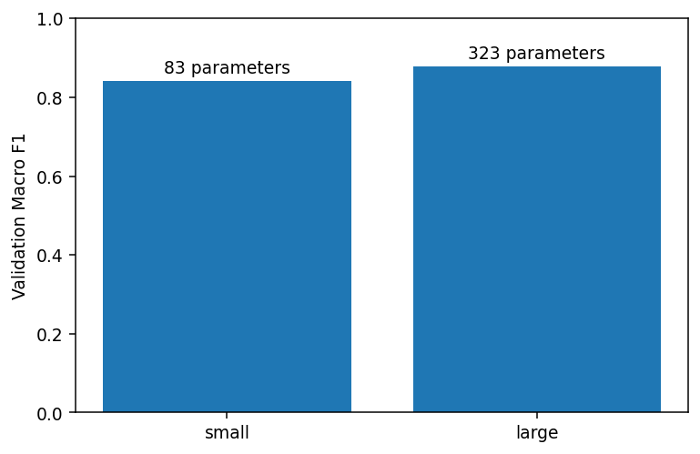

[← Chapter 06](../../README.md) · [Advanced Projects](../../README.md#section-6-18)

# Advanced Project 01. Architecture & Shape Audit

## 문제 상황

설비 신호 6개로 이벤트를 세 종류로 분류하는 신경망을 개발합니다. 모델을 학습하기 전에 **Layer별 Tensor Shape와 Parameter 수**, 활성화 함수의 위치, Logit 차원을 확인할 수 있어야 합니다. 이후 두 가지 네트워크 크기를 비교하여 모델을 복잡하게 만든 것이 실제 검증 결과에도 도움이 되는지 확인합니다.

## 입력 데이터

[`triage_signals.csv`](../../data/triage_signals.csv) — 실습용 합성 데이터, 360건

- Feature: `f1`~`f6` (각각 실수)
- Target: `class_id` (0, 1, 2)
- `event_id`는 추적용 식별자이며 Feature에 포함하지 않습니다.

## 구현 요구사항

1. `SignalNet(nn.Module)`을 작성하고 `forward()`에서 `(N,6)` 외 입력을 거부합니다.
2. `Linear(6, hidden) → ReLU → Dropout → Linear(hidden,3)` 구조를 구현합니다.
3. `hidden=8, dropout=0`과 `hidden=32, dropout=0.1`을 만듭니다.
4. Train/Validation을 분리하고 두 모델을 같은 기준으로 학습합니다.
5. 출력 Logit의 Shape가 `(N,3)`인지 검증하고 `CrossEntropyLoss`를 사용합니다.
6. 검증 데이터의 Macro F1과 학습 가능한 Parameter 수를 기록합니다.
7. 잘못된 입력 Shape와 미지원 Label을 검사합니다.

| 파일 | 열 |
|---|---|
| `architecture_comparison.csv` | `architecture,parameter_count,validation_macro_f1` |

## Parameter 수 계산

`Linear(6, h)`는 $6h+h$개, `Linear(h,3)`은 $3h+3$개의 Parameter를 사용합니다.

$$
P=(6h+h)+(3h+3)=10h+3
$$

따라서 $h=8$이면 83개, $h=32$이면 323개입니다. ReLU와 Dropout은 학습 가능한 Parameter를 갖지 않습니다.

## 실행 및 검증

```bash
python projects/advanced_01_architecture_audit/starter.py
python solutions/advanced_01_architecture_audit.py
```

- Class ID가 3종류이므로 출력층 크기는 3이어야 합니다.
- `CrossEntropyLoss`의 Target은 `(N,)` Shape의 `int64` Label입니다.
- `model.eval()`을 사용한 뒤 Validation 예측을 계산합니다.
- Parameter 수가 많다고 Macro F1이 반드시 높아지지는 않습니다.



모범 구현: [`solutions/advanced_01_architecture_audit.py`](../../solutions/advanced_01_architecture_audit.py)

[← Chapter 06](../../README.md) · [Contents](../../README.md#contents)
