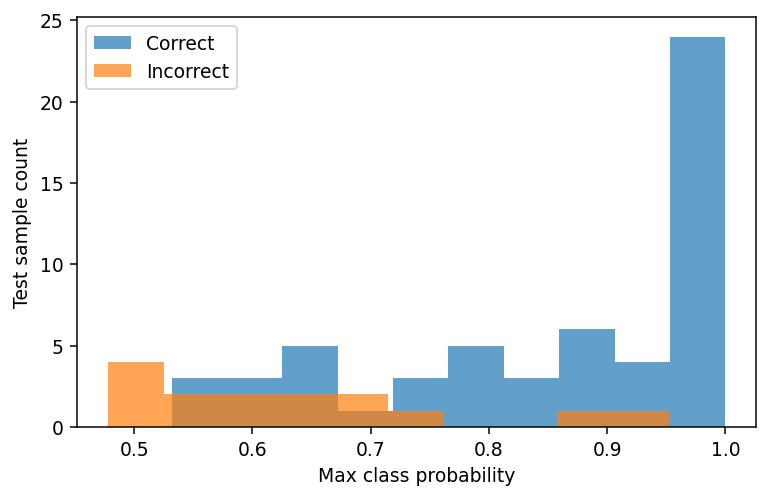

[← Chapter 06](../../README.md) · [Advanced Projects](../../README.md#section-6-18)

# Advanced Project 02. Reliable Model Handoff

## 문제 상황

설비 이벤트를 분류하는 신경망을 학습한 뒤 다른 프로그램에서도 동일한 예측을 얻을 수 있도록 전달합니다. 모델 Weight만 저장하면 충분하지 않습니다. **Feature 순서, Scaling 통계량, 모델 구조, 평가 결과**가 함께 관리되어야 합니다.

이번 문제의 핵심은 학습률 최적화가 아니라 모델을 안전하게 복원하고, 잘못된 입력을 거부하며, 동일한 예측을 재현하는 것입니다.

## 입력 데이터

[`triage_signals.csv`](../../data/triage_signals.csv) — 실습용 합성 데이터, 360건

- Feature: `f1, f2, f3, f4, f5, f6` (고정 순서)
- Label: `class_id` (0, 1, 2)
- 추적용 ID: `event_id`

## 구현 요구사항

1. Feature 열의 존재·순서, NaN, 무한대, Label 범위를 검사합니다.
2. Stratified Train/Validation/Test를 분리합니다. Test는 최종 평가에만 사용합니다.
3. Scaling의 `mean`, `std`는 Train 데이터에서만 계산합니다. 표준편차가 0이면 1로 대체합니다.
4. `Linear(6,24) → ReLU → Dropout(0.15) → Linear(24,3)` 모델을 작성합니다.
5. Train에서 학습하고 Validation Loss가 가장 작은 Weight를 선택합니다.
6. 최종 Test Accuracy와 Macro F1을 계산합니다.
7. Weight는 `state_dict()`로 저장하고, Feature 순서·Scaling 통계량·모델 정보는 JSON으로 저장합니다.
8. 새로운 모델 인스턴스에 `torch.load(..., weights_only=True)`로 Weight를 불러옵니다.
9. `eval()`과 `inference_mode()`를 사용해 같은 Test 입력에서 복원 전후 예측 확률을 비교합니다.
10. 입력 열 순서가 바뀌거나 비정상 값이 있으면 오류로 처리합니다.

## 출력 파일

| 파일 | 내용 |
|---|---|
| `model_weights.pt` | `state_dict` Weight |
| `model_metadata.json` | Feature 순서, `mean`, `std`, 모델 정보 |
| `evaluation.json` | Test Accuracy, Macro F1 및 분할 Sample 수 |
| `predictions.csv` | `event_id,true_label,predicted_label,confidence` |

## 중요한 판단 기준

`state_dict`에는 모델의 Parameter가 담겨 있지만 DataFrame의 열 순서는 포함되지 않습니다. 예를 들어 학습 시 `f1,f2` 순서였는데 추론 시 `f2,f1`로 입력하면 Shape가 같아 오류 없이 잘못된 예측이 나올 수 있습니다. 따라서 Shape 검사만으로는 충분하지 않습니다.

`model.eval()`은 Dropout 등의 동작을 평가 모드로 바꾸고, `torch.inference_mode()`는 추론 중 Gradient 추적 등을 줄여줍니다. 두 기능은 서로 다른 역할을 합니다.

`weights_only=True`는 모델 전체 객체를 무분별하게 역직렬화하는 방식보다 안전한 선택이지만, 외부에서 전달된 가중치 파일을 무조건 신뢰해도 된다는 의미는 아닙니다.

## 실행 및 검증

```bash
python projects/advanced_02_model_handoff/starter.py
python solutions/advanced_02_model_handoff.py
```

- 복원 모델과 원본 모델의 확률 차이를 허용 오차 `1e-6` 안에서 비교합니다.
- `model_metadata.json`과 원본 Train 통계량이 일치해야 합니다.
- Test Label을 모델 선택에 사용하면 안 됩니다.
- 잘못된 Feature 순서, NaN, 무한대를 가진 입력을 거부해야 합니다.



모범 구현: [`solutions/advanced_02_model_handoff.py`](../../solutions/advanced_02_model_handoff.py)

[← Chapter 06](../../README.md) · [Contents](../../README.md#contents)
