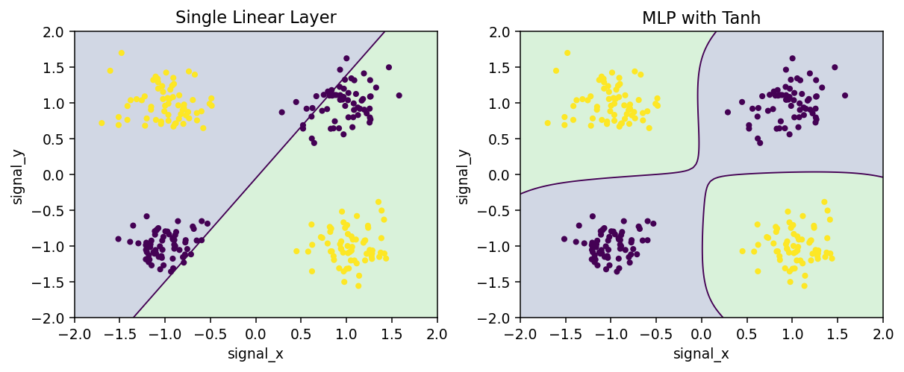

[← Chapter 06](../../README.md) · [Mini Projects](../../README.md#section-6-17)

# Mini Project 01. XOR Decision Boundary

## 문제 상황

장비의 두 신호가 서로 같은 방향이면 정상(0), 서로 다른 방향이면 경보(1)라고 가정합니다. 두 신호는 연속적인 실수로 기록되며, 신호의 부호를 기준으로 Label이 정해집니다. 이때 **단일 Linear 층과 은닉층을 가진 신경망의 표현 능력**을 비교합니다.

단순히 MLP의 점수가 높게 나오도록 만드는 것보다, 동일한 데이터를 사용했을 때 단일 선형 Decision Boundary가 해결하기 어려운 구조를 설명하는 것이 핵심입니다.

## 입력 데이터

[`xor_signals.csv`](../../data/xor_signals.csv) — 실습용 합성 데이터, 256건

| 열 | 형식 | 설명 |
|---|---|---|
| `sample_id` | 문자열 | 샘플 식별자, Feature로 사용하지 않음 |
| `signal_x`, `signal_y` | 실수 | 두 신호의 측정값 |
| `label` | 정수 | 부호가 다르면 1, 같으면 0 |

## 구현 요구사항

1. Label과 Feature의 결측값, 무한대, 허용 Label 범위를 검증합니다.
2. `train_test_split(test_size=0.25, stratify=y, random_state=17)`로 Train과 Test를 분리합니다.
3. `nn.Linear(2,1)` 모델과 `nn.Sequential(nn.Linear(2,8), nn.Tanh(), nn.Linear(8,1))` 모델을 만듭니다.
4. 두 모델을 같은 Loss(`BCEWithLogitsLoss`)와 학습 횟수로 학습합니다.
5. `torch.sigmoid(logits) >= 0.5`로 예측 Label을 계산합니다. Test는 학습이나 모델 선택에 사용하지 않습니다.
6. 모델별 Test Accuracy, 학습 가능한 Parameter 수, 예측 확률을 CSV에 저장하고 결과를 설명합니다.

출력 형식:

| 파일 | 열 |
|---|---|
| `model_comparison.csv` | `model,test_accuracy,parameter_count` |
| `predictions.csv` | `sample_id,true_label,linear_probability,mlp_probability` |

## 개념과 계산

하나의 Linear 층은 $z=w_1x_1+w_2x_2+b$를 계산합니다. `z=0`에 해당하는 Decision Boundary는 직선입니다. 반면 여러 비선형 층을 조합한 신경망은 단일 직선으로 나눌 수 없는 영역을 구분할 수 있습니다.

출력은 확률이 아닌 **Logit**입니다. `BCEWithLogitsLoss`에는 Sigmoid를 적용하기 전의 Logit을 전달합니다.

## 실행 및 검증

```bash
python projects/mini_01_xor_network/starter.py
python solutions/mini_01_xor_network.py
```

- 원본 Label이 임의로 섞여도 `stratify`로 Train/Test 클래스 비율을 유지합니다.
- `nn.Linear(2,1)`은 Weight 2개와 Bias 1개, 총 3개 Parameter입니다.
- 두 모델의 Test 입력 행 수와 ID 목록이 일치해야 합니다.
- 결과는 Seed와 실행 환경에 따라 달라질 수 있으므로 특정 정확도를 하드코딩하지 않습니다.



모범 구현: [`solutions/mini_01_xor_network.py`](../../solutions/mini_01_xor_network.py)

[← Chapter 06](../../README.md) · [Contents](../../README.md#contents)
