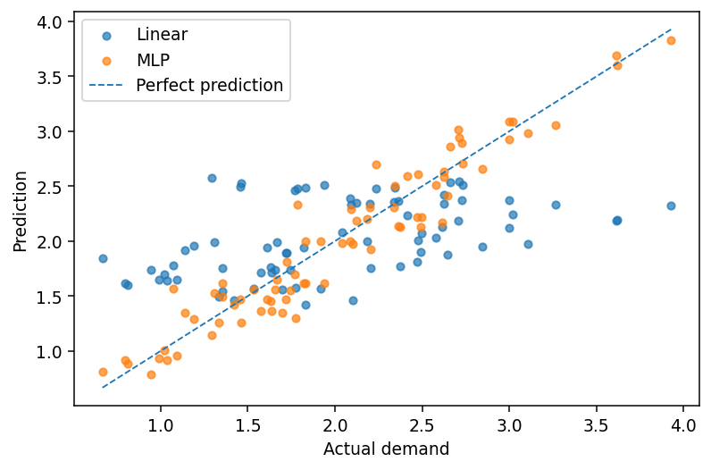

[← Chapter 06](../../README.md) · [Mini Projects](../../README.md#section-6-17)

# Mini Project 02. Nonlinear Demand Estimation

## 문제 상황

시설의 사용량은 온도와 부하의 단순한 합만으로 결정되지 않습니다. 특정 온도 구간에서 수요가 빠르게 변하고 부하 증가에 따라 변동 폭이 달라질 수 있습니다. 두 Feature를 이용해 수요를 예측하고 **Linear Regression 형태의 단일 출력층과 비선형 MLP**를 비교합니다.

## 입력 데이터

[`nonlinear_demand.csv`](../../data/nonlinear_demand.csv) — 실습용 합성 데이터, 300건

| 열 | 설명 |
|---|---|
| `record_id` | 샘플 ID, Feature에서 제외 |
| `temperature_scaled` | 정규화 범위로 생성된 온도 Feature |
| `load_scaled` | 정규화 범위로 생성된 부하 Feature |
| `demand` | 연속형 Target |

수요는 비선형 함수와 작은 난수를 합성해 생성했습니다. 실제 시설 수요를 설명하는 물리 모델은 아닙니다.

## 구현 요구사항

1. 필요한 열과 모든 수치의 유효성을 검증합니다.
2. `test_size=0.25, random_state=23`으로 데이터를 한 번 분리합니다.
3. `nn.Linear(2,1)`과 `Linear(2,24) → Tanh → Linear(24,12) → Tanh → Linear(12,1)`을 비교합니다.
4. Train에 `MSELoss`를 사용하고, Test에서 RMSE를 계산합니다.
5. `model.eval()`과 `torch.inference_mode()`로 추론합니다.
6. 모델별 Test RMSE와 각 Test Sample의 예측값을 CSV로 저장합니다.

| 파일 | 열 |
|---|---|
| `regression_comparison.csv` | `model,test_rmse` |
| `predictions.csv` | `record_id,actual,linear_prediction,mlp_prediction` |

## 수식 및 해석

$$
\mathrm{MSE}=\frac{1}{N}\sum_{i=1}^N(y_i-\hat y_i)^2,\qquad
\mathrm{RMSE}=\sqrt{\mathrm{MSE}}
$$

학습할 때는 MSE를 사용하고 평가 결과에는 Target과 동일한 단위를 갖는 RMSE를 제시합니다. 데이터가 이미 작은 범위로 생성되어 있어 추가 Scaling은 필수 조건이 아니지만, 새로운 데이터에서는 Train Data만 사용해 Scaling 기준을 계산해야 합니다.

## 실행 및 검증

```bash
python projects/mini_02_non_linear_regression/starter.py
python solutions/mini_02_nonlinear_regression.py
```

- 두 모델은 **동일한 Train/Test Split**으로 비교해야 합니다.
- Test Sample은 Parameter 학습에 사용하지 않습니다.
- Test RMSE가 항상 더 낮다는 보장은 없으므로 차이를 수치와 잔차로 해석합니다.
- 데이터 열이 누락되거나 무한대가 포함되면 오류로 처리합니다.



모범 구현: [`solutions/mini_02_nonlinear_regression.py`](../../solutions/mini_02_nonlinear_regression.py)

[← Chapter 06](../../README.md) · [Contents](../../README.md#contents)
