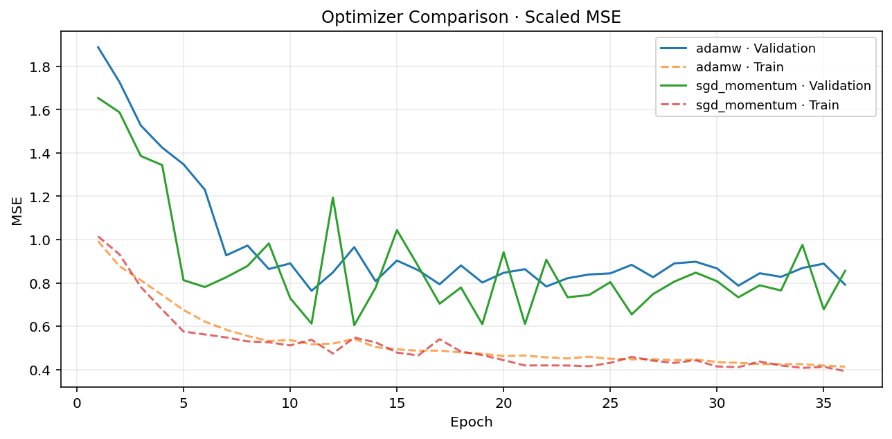
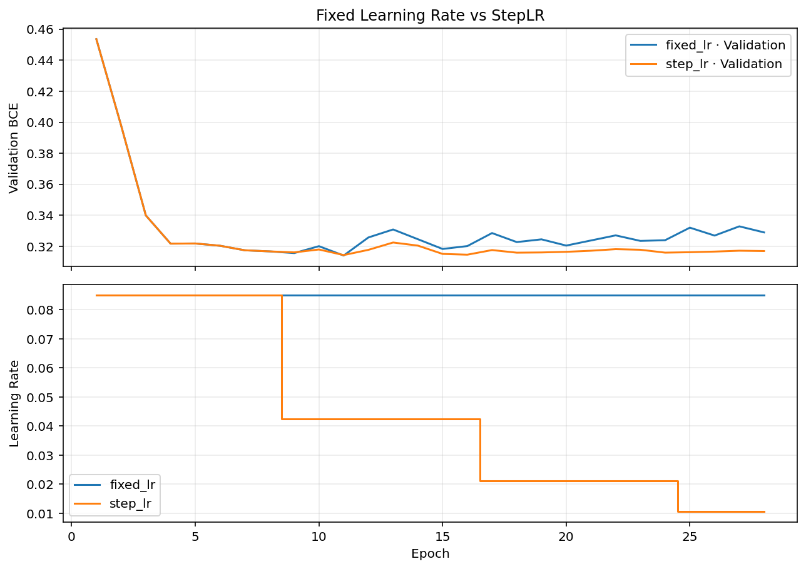
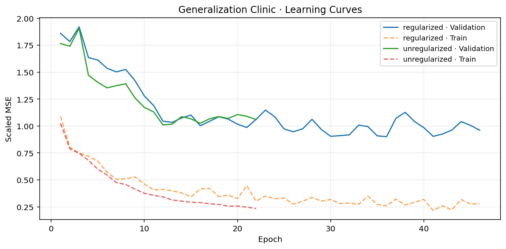
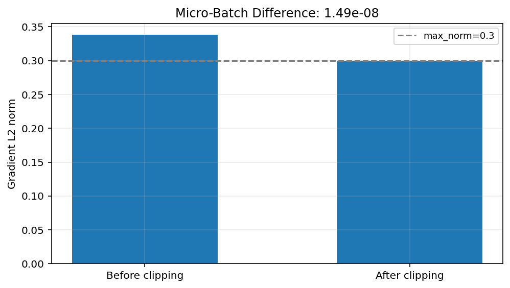
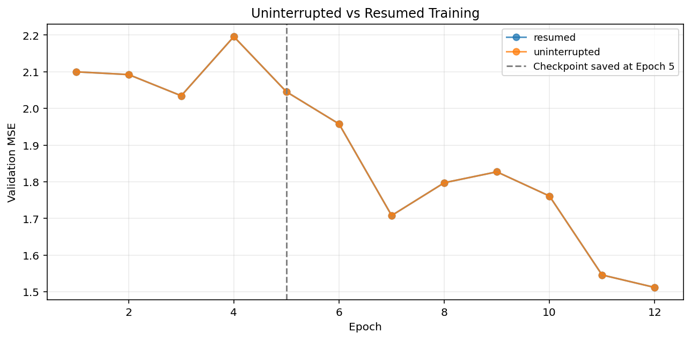
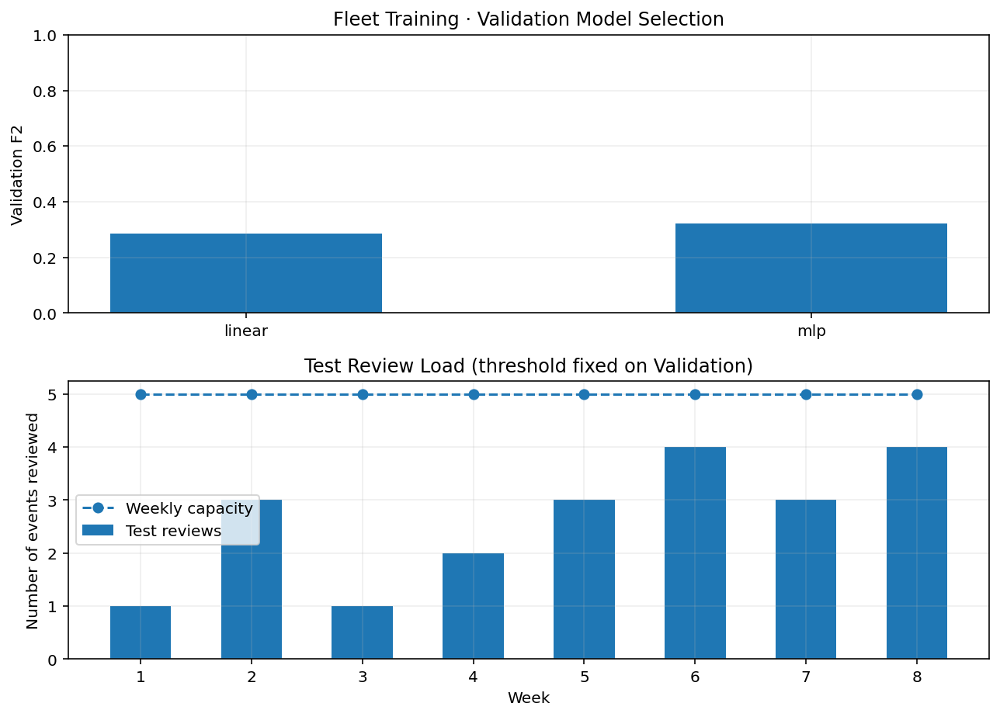

[← AI 목차](../README.md#contents) · [Chapter 06](../Chapter-06/README.md)

# Chapter 07. Model Training & Optimization

Chapter 06에서는 신경망의 Layer와 Forward·Backward 계산을 직접 구현했습니다. 이제는 하나의 모델을 **안정적으로 학습시키고, 설정을 비교하고, 중단된 작업을 이어서 실행하며, 결과가 믿을 만한지 확인하는 과정** 을 다룹니다.

모델을 구성하는 코드와 학습을 운영하는 코드는 목적이 다릅니다. 모델 구조가 올바르더라도 Batch 처리, Learning Rate, 데이터 분할, Checkpoint 복원 중 하나가 잘못되면 학습 결과를 신뢰하기 어렵습니다. 이번 Chapter에서는 이러한 부분을 분리해 점검하는 습관을 익힙니다.

- **기준 언어:** Python 3.11 이상 권장
- **주요 라이브러리:** PyTorch, NumPy, Pandas, Matplotlib, scikit-learn
- **권장 환경:** Google Colab(기본), VS Code, Jupyter Notebook
- **선행 학습:** Chapter 04의 모델 평가, Chapter 05의 Tensor·Autograd·DataLoader, Chapter 06의 MLP·Backpropagation
- **실습 규모:** 모든 필수 프로젝트는 CPU 실행 가능. AMP는 선택 실습
- **구성:** Python 예제 9개, Coding Practice 6개, Mini Project 2개, Advanced Project 3개, Professional Project 1개

## Contents

| Section | Topic |
|:---:|---|
| [7.1](#section-7-1) | **Learning Goals & Getting Started** — 학습 목표와 실습 환경 |
| [7.2](#section-7-2) | **Training Pipeline** — 학습·검증·최종 평가 연결 |
| [7.3](#section-7-3) | **Epoch, Batch & Metric Aggregation** — 손실 집계와 반복 처리 |
| [7.4](#section-7-4) | **Optimizer Fundamentals** — SGD, Momentum, AdamW |
| [7.5](#section-7-5) | **Learning Rate & Optimization Behavior** — 학습률 선택과 진단 |
| [7.6](#section-7-6) | **Learning Rate Schedulers** — StepLR, ReduceLROnPlateau |
| [7.7](#section-7-7) | **Loss Functions & Class Imbalance** — 목적에 맞는 Loss 계산 |
| [7.8](#section-7-8) | **Validation Protocol & Data Leakage** — 모델 선택의 기준 |
| [7.9](#section-7-9) | **Overfitting & Early Stopping** — 최선의 Epoch 선택 |
| [7.10](#section-7-10) | **Regularization** — Weight Decay, Dropout |
| [7.11](#section-7-11) | **Gradient Monitoring & Clipping** — 불안정한 학습 점검 |
| [7.12](#section-7-12) | **Gradient Accumulation** — 작은 Micro-Batch를 묶는 방법 |
| [7.13](#section-7-13) | **Reproducibility & Fair Comparison** — Seed, 초기 조건, 기록 |
| [7.14](#section-7-14) | **Checkpoint & Resume** — 학습 상태 저장·복원 |
| [7.15](#section-7-15) | **Training Performance & AMP** — CPU/GPU와 Mixed Precision |
| [7.16](#section-7-16) | **Training Debugging** — Loss, Gradient, Shape, 데이터 검사 |
| [7.17](#section-7-17) | **Examples** — 단계별 Python 실행 예제 9개 |
| [7.18](#section-7-18) | **Coding Practice** — 직접 구현하는 6문제 |
| [7.19](#section-7-19) | **Mini Projects** — Optimizer와 Scheduler 비교 |
| [7.20](#section-7-20) | **Advanced & Professional Projects** — 일반화, Gradient, Resume, 운영 정책 |
| [7.21](#section-7-21) | **Quiz** — 개념·계산·코드 분석 |
| [7.22](#section-7-22) | **Summary** — 전체 학습 흐름 정리 |
| [7.23](#section-7-23) | **References** — 공식 참고 문서 |

---

<a id="section-7-1"></a>
## 7.1. Learning Goals & Getting Started

### 학습 목표

이번 Chapter를 마치면 다음 작업을 수행할 수 있어야 합니다.

1. Mini-Batch 학습 Loop를 함수로 분리하고, Epoch별 Loss를 정확하게 집계합니다.
2. SGD Momentum과 AdamW의 차이를 이해하고 동일한 조건에서 성능을 비교합니다.
3. Learning Rate와 Scheduler의 역할을 구분하고 LR 변화 기록을 해석합니다.
4. Train·Validation·Test를 분리해 Early Stopping과 모델 선택을 수행합니다.
5. Weight Decay·Dropout·Gradient Clipping으로 일반화와 학습 안정성을 점검합니다.
6. Gradient Accumulation에서 불완전한 마지막 Batch를 올바르게 처리합니다.
7. Checkpoint에 모델·Optimizer·Scheduler 상태를 저장하고 학습을 재개합니다.
8. 신규 시설의 데이터와 검토 용량 제약을 고려하는 Training Pipeline을 설계합니다.

### 실행 준비

`Chapter-07/` 폴더에서 실행합니다.

```bash
python -m pip install -r requirements.txt
python examples/01_training_loop.py
python solutions/mini_01_optimizer_comparison.py
python -m unittest discover -s tests -v
```

Google Colab에서는 [`Chapter_07_Model_Training_and_Optimization.ipynb`](./notebooks/Chapter_07_Model_Training_and_Optimization.ipynb)를 업로드해 실행합니다. Notebook의 기본 코드 셀은 데이터 파일을 추가하지 않아도 작동합니다. 전체 프로젝트는 Python 파일과 CSV를 함께 사용하는 방식입니다.

```python
import torch

print(torch.__version__)
print("CUDA available:", torch.cuda.is_available())
print("MPS available:", hasattr(torch.backends, "mps") and torch.backends.mps.is_available())
```

PyTorch는 운영체제와 CPU·GPU 환경에 따라 설치 방식이 달라집니다. 필요한 경우 [PyTorch 설치 안내](https://pytorch.org/get-started/locally/)를 확인합니다. 본문 코드와 기본 프로젝트는 CPU를 기준으로 검증할 수 있도록 구성했습니다.

### 실습 데이터

| 데이터 | Sample 수 | 학습 내용 |
|---|---:|---|
| [`energy_demand.csv`](./data/energy_demand.csv) | 360 | Regression, Optimizer, Early Stopping, Resume |
| [`device_alerts.csv`](./data/device_alerts.csv) | 420 | Binary Classification, Scheduler, Gradient Accumulation |
| [`fleet_events.csv`](./data/fleet_events.csv) | 768 | Group Split, Leakage, 운영 Threshold, 모델 전달 |

모두 **실습용 합성 데이터** 입니다. 열의 의미와 생성 방법은 [`data/README.md`](./data/README.md)에 정리했습니다. 실제 설비 데이터를 사용하는 프로젝트가 아니므로 운영·안전 의사결정에 직접 적용하지 않습니다.

---

<a id="section-7-2"></a>
## 7.2. Training Pipeline

신경망 학습은 반복문 하나로 표현할 수 있지만, 실제 개발에서는 **학습·검증·모델 선택·최종 평가** 를 나누어 관리하는 편이 안정적입니다.

```text
원본 데이터
  ├─ Train: 전처리 기준 계산 → Batch → Forward → Loss → Backward → Optimizer Step
  ├─ Validation: 고정된 기준으로 변환 → Loss/Metric → Best Weight·설정 선택
  └─ Test: 확정된 모델로 마지막 평가
                 ↓
       Weight + 전처리 기준 + 설정 + 평가 결과 저장
```

Chapter 06에서 한 번 연결했던 `forward() → loss.backward() → optimizer.step()`을 함수로 나누어 구현합니다.

```python
import torch
from torch import nn


def train_one_epoch(model, loader, optimizer, loss_fn):
    model.train()
    loss_sum = 0.0
    sample_count = 0

    for x, y in loader:
        optimizer.zero_grad(set_to_none=True)
        logits = model(x)
        loss = loss_fn(logits, y)
        loss.backward()
        optimizer.step()

        batch_size = x.size(0)
        loss_sum += loss.item() * batch_size
        sample_count += batch_size

    return loss_sum / sample_count


def validation_loss(model, loader, loss_fn):
    model.eval()
    loss_sum = 0.0
    sample_count = 0
    with torch.inference_mode():
        for x, y in loader:
            loss = loss_fn(model(x), y)
            loss_sum += loss.item() * x.size(0)
            sample_count += x.size(0)
    return loss_sum / sample_count
```

이 코드는 `loss_fn`이 **Batch 평균 손실을 반환할 때** 정확합니다. 각 Sample의 Loss가 동일한 가중치로 집계되는 경우를 전제로 합니다. Sample마다 서로 다른 Weight를 사용하거나 `reduction='sum'`을 사용하면 집계 방식도 그 정의에 맞춰 바꿔야 합니다.

`model.train()`은 Dropout·BatchNorm 같은 Module의 동작을 Training 모드로 바꿉니다. `model.eval()`은 Evaluation 모드로 전환합니다. 둘 다 Gradient 계산을 켜거나 끄는 함수는 아닙니다. Evaluation에서는 `torch.inference_mode()`를 함께 사용합니다.

이 예제에서는 CPU를 사용하므로 `x`, `y`, `model`을 이동하지 않았습니다. GPU를 사용하는 경우에는 이 세 요소가 같은 Device에 있어야 합니다.

---

<a id="section-7-3"></a>
## 7.3. Epoch, Batch & Metric Aggregation

### Epoch, Iteration, Batch Size

| 용어 | 의미 | 예시 |
|---|---|---|
| Epoch | Train Data를 한 번 모두 사용하는 학습 주기 | 5 Epoch는 전체 데이터를 5회 순회 |
| Batch Size | 한 번의 Forward·Backward에서 처리하는 Sample 수 | Batch Size 32 |
| Iteration / Step | Optimizer가 한 번 Parameter를 갱신하는 과정 | 100 Batch를 순회하면 보통 100 Step |
| Micro-Batch | Accumulation에서 나누어 계산하는 더 작은 Batch | 32개를 8개씩 4회 처리 |

예를 들어 Train Sample이 100개이고 Batch Size가 32라면 한 Epoch에는 `32 + 32 + 32 + 4`의 네 Batch가 있습니다. 마지막 4개를 버리지 않으려면 기본 `drop_last=False` 설정을 유지합니다.

### Epoch Loss의 정확한 계산

Batch마다 평균 Loss를 계산했을 때 Epoch의 전체 평균은 다음과 같습니다.

$$
L_{\mathrm{epoch}}=\frac{\sum_{k=1}^{K}n_kL_k}{\sum_{k=1}^{K}n_k}
$$

- $K$: Batch 수
- $n_k$: $k$번째 Batch에 포함된 Sample 수
- $L_k$: $k$번째 Batch의 Sample 평균 Loss

예를 들어 8개 Sample의 평균 Loss가 0.4이고 마지막 2개 Sample의 평균 Loss가 0.9라면:

$$
L_{\mathrm{epoch}}=\frac{8\times0.4+2\times0.9}{10}=0.5
$$

Batch Loss를 단순 평균하면 $(0.4+0.9)/2=0.65$가 되어 마지막 두 Sample의 영향이 과도하게 커집니다.

```python
batch_losses = [0.4, 0.9]
batch_sizes = [8, 2]

epoch_loss = sum(
    loss * size for loss, size in zip(batch_losses, batch_sizes)
) / sum(batch_sizes)
print(epoch_loss)  # 0.5
```

이 원리는 Validation Loss를 계산할 때도 적용됩니다. 반면 Accuracy처럼 맞힌 Sample 수를 합산할 수 있는 지표는 `correct / total`로 계산하는 것이 더 직접적입니다.

---

<a id="section-7-4"></a>
## 7.4. Optimizer Fundamentals

### SGD — Gradient의 반대 방향으로 이동

Chapter 02에서 배운 Gradient Descent는 Loss가 감소할 것으로 예상되는 방향으로 Parameter를 이동시키는 과정입니다.

$$
\theta_{t+1}=\theta_t-\eta\nabla_{\theta}L(\theta_t)
$$

- $\theta_t$: 현재 Parameter
- $\eta$: Learning Rate
- $\nabla_{\theta}L$: 현재 Parameter에서 계산한 Gradient

예를 들어 현재 Weight가 2.0, Gradient가 0.5, Learning Rate가 0.1이면 다음 Weight는 $2.0-0.1\times0.5=1.95$입니다.

PyTorch에서는 `SGD`가 이 계산을 처리합니다.

```python
optimizer = torch.optim.SGD(model.parameters(), lr=0.1)
optimizer.zero_grad(set_to_none=True)
loss = loss_fn(model(x), y)
loss.backward()
optimizer.step()
```

`step()`은 모델의 Parameter를 변경하므로 같은 입력의 Prediction이 다음 Step에서 달라질 수 있습니다. `zero_grad()`를 하지 않으면 이전 Gradient가 누적됩니다. Gradient Accumulation을 의도한 것이 아니라면 각 Step 전에 초기화해야 합니다.

### Momentum — 이전 이동 방향을 함께 활용

Gradient가 매번 급격히 바뀌면 Parameter가 최적값 주변에서 진동할 수 있습니다. Momentum은 이전 이동의 방향을 일부 유지합니다. 단순화한 표현은 다음과 같습니다.

$$
v_t=\mu v_{t-1}+g_t,\qquad \theta_{t+1}=\theta_t-\eta v_t
$$

- $g_t$: 현재 Gradient
- $v_t$: 누적 이동 방향
- $\mu$: Momentum 비율. 예를 들어 0.9면 이전 방향의 90%를 유지

```python
optimizer = torch.optim.SGD(
    model.parameters(), lr=0.03, momentum=0.9
)
```

위 수식은 기본 Momentum의 개념을 나타내는 단순식입니다. PyTorch의 옵션인 Dampening·Nesterov와 최초 Step 처리 방식까지 모두 전개한 식은 아닙니다.

### Adam과 AdamW

Adam은 Gradient의 이동 평균과 제곱 Gradient의 이동 평균을 이용해 Parameter마다 갱신 크기를 조절합니다. 다음은 핵심 개념을 보여 주는 수식입니다.

$$
m_t=\beta_1m_{t-1}+(1-\beta_1)g_t
$$

$$
v_t=\beta_2v_{t-1}+(1-\beta_2)g_t^2
$$

Adam에서는 초기값 0에서 출발하는 두 평균의 Bias를 보정해 Update에 사용합니다. 기호 $m_t$와 $v_t$는 각각 Gradient의 1차·2차 이동 평균입니다.

**AdamW** 는 Weight Decay를 Adaptive Gradient Update와 분리하는 방식입니다. Adam과 AdamW의 Weight Decay 처리가 완전히 동일한 것은 아닙니다.

```python
optimizer = torch.optim.AdamW(
    model.parameters(), lr=0.001, weight_decay=0.01
)
```

| Optimizer | 장점 | 확인할 점 |
|---|---|---|
| SGD | 동작이 직관적이고 단순함 | LR에 민감할 수 있음 |
| SGD + Momentum | 진동을 완화하고 방향성을 유지 | LR·Momentum 조합 필요 |
| AdamW | Parameter별 적응형 갱신과 Decoupled Weight Decay | 메모리 사용, LR·Weight Decay 설정 |

어떤 Optimizer가 항상 더 빠르게 수렴하거나 더 좋은 일반화 성능을 보인다고 단정할 수는 없습니다. 실험 시에는 **같은 데이터 분할, 같은 초기 Weight, 같은 평가 기준** 을 적용합니다.

---

<a id="section-7-5"></a>
## 7.5. Learning Rate & Optimization Behavior

Learning Rate는 한 번의 Parameter 갱신에서 이동 크기를 조절합니다. 작은 값이 무조건 안전하거나 큰 값이 항상 위험한 것은 아닙니다. 모델, Scaling, Optimizer, Batch Size에 따라 적절한 범위가 달라집니다.

| 관찰 결과 | 가능한 원인 | 다음 점검 |
|---|---|---|
| Train Loss가 매우 느리게 감소 | LR이 작거나 입력 Scale 불균형 | Gradient Norm과 Scaling 확인, LR 후보 비교 |
| Loss가 크게 진동 | LR이 크거나 Batch Noise가 큼 | LR 낮추기, Batch 설정 점검 |
| Loss가 NaN/Inf가 됨 | 수치 불안정, 잘못된 입력, 큰 Gradient | 입력·Loss·Gradient 유한성 검사 |
| Train Loss는 감소하지만 Validation은 악화 | Overfitting, 분포 차이, Leakage 반대 효과 | Split 타당성, Early Stopping, Regularization |

다음과 같은 LR 실험은 한 번에 한 가지 설정만 바꿉니다.

```python
learning_rates = [0.001, 0.01, 0.05]

for lr in learning_rates:
    # 각 실험에서 같은 초기 Weight와 Train/Validation Split 사용
    optimizer = torch.optim.AdamW(model.parameters(), lr=lr)
    # Training Loop 실행 후 Validation Loss 기록
```

위 코드는 실험 흐름만 보여 주는 예시입니다. 실제 비교에서는 `model`을 실험마다 새로 만들거나 저장한 초기 State를 복원해야 합니다. 그렇지 않으면 두 번째 실험이 첫 번째 실험의 학습 결과에서 시작됩니다.

미리 정한 Epoch 수만 비교하면 어떤 모델은 충분히 학습되지 않은 상태일 수 있습니다. 따라서 Epoch별 Learning Curve를 함께 확인합니다. 다만 훈련 시간과 계산 비용이 다른 조건까지 무시해도 된다는 뜻은 아닙니다.

---

<a id="section-7-6"></a>
## 7.6. Learning Rate Schedulers

Scheduler는 학습 도중 Learning Rate를 변경하는 도구입니다. Optimizer는 Weight를 변경하고, Scheduler는 Optimizer가 다음에 사용할 Learning Rate를 설정합니다.

### StepLR — 일정한 간격으로 LR 감소

`StepLR(step_size=2, gamma=0.5)`를 사용하면 두 Epoch마다 LR이 절반으로 줄어듭니다.

$$
\eta_e=\eta_0\gamma^{\lfloor (e-1)/s\rfloor}
$$

- $\eta_e$: $e$번째 Epoch에서 사용하는 LR(첫 Epoch는 $e=1$)
- $\eta_0$: 초기 LR
- $s$: `step_size`
- $\gamma$: LR 감소 비율

초기 LR이 0.1이면 Epoch 1~2는 0.1, 3~4는 0.05, 5~6은 0.025를 사용합니다.

```python
optimizer = torch.optim.SGD(model.parameters(), lr=0.1)
scheduler = torch.optim.lr_scheduler.StepLR(
    optimizer, step_size=2, gamma=0.5
)

for epoch in range(6):
    train_one_epoch(model, train_loader, optimizer, loss_fn)
    scheduler.step()  # 해당 Epoch의 Optimizer 업데이트 이후
```

### ReduceLROnPlateau — Validation 변화에 따라 조절

Validation Loss가 개선되지 않을 때 LR을 줄이고 싶다면 `ReduceLROnPlateau`를 사용할 수 있습니다.

```python
scheduler = torch.optim.lr_scheduler.ReduceLROnPlateau(
    optimizer, mode="min", factor=0.5, patience=3
)

for epoch in range(20):
    train_one_epoch(model, train_loader, optimizer, loss_fn)
    val_loss = validation_loss(model, val_loader, loss_fn)
    scheduler.step(val_loss)
```

`StepLR`에는 일반적으로 Epoch가 끝났다는 사실만 전달합니다. 반면 `ReduceLROnPlateau`에는 **관찰할 Validation 지표** 가 필요합니다. 같은 `scheduler.step()`이지만 인자와 호출 시점이 다릅니다.

`CosineAnnealingLR`, `OneCycleLR`처럼 다른 Scheduler도 있습니다. 이번 Chapter에서는 먼저 StepLR와 Validation 기반 Scheduler를 정확히 사용할 수 있도록 구성했습니다. Mini Project 02에서는 LR 정책별 Loss·F1을 기록합니다.

---

<a id="section-7-7"></a>
## 7.7. Loss Functions & Class Imbalance

Chapter 06에서 출력층과 Loss의 관계를 익혔습니다. Chapter 07에서는 이를 Optimization 관점에서 적용합니다.

| 학습 문제 | 모델 출력 | 주로 사용하는 Loss |
|---|---|---|
| Regression | 연속형 예측값 | `nn.MSELoss()` / `nn.L1Loss()` |
| Binary Classification | 클래스 1의 Logit | `nn.BCEWithLogitsLoss()` |
| Multiclass Classification | 클래스별 Logits `[N, C]` | `nn.CrossEntropyLoss()` |

### Binary Classification에서 `pos_weight`

양성 Sample이 드물 때 모든 Sample에 동일한 영향력을 주면 모델이 음성 예측에 치우칠 수 있습니다. `BCEWithLogitsLoss`의 `pos_weight`는 양성 항의 영향력을 변경합니다. 실무에서 자주 쓰는 초기 설정은 다음과 같습니다.

$$
w_{+}=\frac{N_{-}}{N_{+}}
$$

- $N_{-}$: Train Data의 음성 Sample 수
- $N_{+}$: Train Data의 양성 Sample 수

예를 들어 Train에 양성 20건, 음성 80건이 있다면 `pos_weight=4`를 고려할 수 있습니다.

```python
positive = int(train_labels.sum().item())
negative = len(train_labels) - positive
pos_weight = torch.tensor([negative / positive])
loss_fn = nn.BCEWithLogitsLoss(pos_weight=pos_weight)
```

이때 Train에 두 클래스가 모두 있는지 확인해야 합니다. `pos_weight`는 모델이 추정한 확률을 자동으로 올바르게 Calibration해 주는 기능이 아닙니다. 또한 최종 Threshold를 정하거나 Precision·Recall의 Trade-off를 검토하는 작업을 대신하지 않습니다.

### 학습 Loss와 평가 Metric은 서로 다릅니다

MSE를 최소화하는 회귀 모델이라도 평가 보고에서는 MAE·RMSE를 함께 제시할 수 있습니다. Classification 학습에는 BCE를 사용하고 운영 목적에 따라 F2나 Recall을 볼 수 있습니다. Loss는 Parameter를 조정하기 위한 수치이고, Metric은 목적에 맞는 성능을 설명합니다.

이때 Validation Metric으로 정책을 바꾸는 것은 허용되지만 Test Metric을 반복해서 확인하면서 설정을 선택하면 최종 평가가 오염됩니다. 이 원칙은 Chapter 04의 Evaluation Protocol과 같습니다.

---

<a id="section-7-8"></a>
## 7.8. Validation Protocol & Data Leakage

### 모델 학습·선택·평가의 역할

| 데이터 | 사용 목적 | 하지 말아야 할 작업 |
|---|---|---|
| Train | Parameter 학습, 전처리 통계 계산 | Validation·Test 통계로 Scaling |
| Validation | Epoch·Optimizer·Scheduler·Threshold 선택 | Test처럼 최종 성능이라고 보고 |
| Test | 확정된 모델의 마지막 평가 | 성능을 보고 설정 반복 변경 |

일반적인 데이터는 무작위 Split으로 충분할 수 있지만, **시간 순서가 있는 데이터** 나 **같은 장비의 반복 측정** 에서는 다른 분할 방식이 필요합니다.

Professional Project에서는 새로운 시설에 배포하는 상황을 가정해 **시설 단위 Split** 을 사용합니다. 이는 사이트 간 일반화 성능을 점검하는 방식입니다. 반대로 향후 한 시설의 미래 기록을 예측하려는 목적이라면 Temporal Split을 따로 검토해야 합니다.

### 전처리 Leakage

잘못된 순서:

```python
# 잘못된 예: 모든 데이터에 대해 평균·표준편차를 계산함
mean = X_all.mean(axis=0)
std = X_all.std(axis=0)
X_scaled = (X_all - mean) / std
# 그 후 Train/Test로 나누는 것은 데이터 누출 위험
```

권장 순서:

```python
# X_train, X_val은 먼저 분리한 상태라고 가정
mean = X_train.mean(axis=0)
std = X_train.std(axis=0)
std = np.where(std == 0, 1.0, std)

X_train_scaled = (X_train - mean) / std
X_val_scaled = (X_val - mean) / std
```

이 예제에서 `np`는 NumPy를 의미합니다. Scaling은 가장 단순한 누출 원인 중 하나입니다. 실제로는 미래 결과를 알려 주는 Feature, 같은 이용자·설비 기록의 중복, 평가 결과를 이용한 Threshold 재선정도 점검해야 합니다.

---

<a id="section-7-9"></a>
## 7.9. Overfitting & Early Stopping

Training Loss가 감소하는 동안에도 Validation Loss는 어느 순간부터 증가할 수 있습니다. 모델이 Training Data의 노이즈까지 학습하거나 평가 대상의 분포가 다르기 때문입니다. 이때 더 많은 Epoch를 실행하는 것이 항상 도움이 되지는 않습니다.

**조기 종료(Early Stopping)** 는 Validation Metric이 일정 기간 개선되지 않을 때 학습을 멈추는 방법입니다. 다음 개념을 구분해야 합니다.

- `best_validation_loss`: 현재까지 가장 좋았던 Validation Loss
- `best_epoch`: 가장 좋았던 Weight가 만들어진 Epoch
- `patience`: 개선이 없어도 기다릴 Epoch 수
- `min_delta`: 개선이라고 판단할 최소 차이

예를 들어 Validation Loss가 `[0.83, 0.72, 0.69, 0.70, 0.71, 0.74]`이고 `patience=3`, `min_delta=0`이라면 세 번째 Epoch에서 최소 Loss 0.69를 기록하고, 이후 세 Epoch 연속 개선되지 않아 여섯 번째 Epoch가 끝난 뒤 중단할 수 있습니다. 최종 모델은 **6번째가 아닌 3번째 Epoch의 Weight** 를 사용합니다.

```python
import copy

best_loss = float("inf")
best_state = None
best_epoch = 0
stale_epochs = 0

for epoch in range(1, 101):
    train_one_epoch(model, train_loader, optimizer, loss_fn)
    val_loss = validation_loss(model, val_loader, loss_fn)

    if val_loss < best_loss - 1e-6:
        best_loss = val_loss
        best_epoch = epoch
        best_state = copy.deepcopy(model.state_dict())
        stale_epochs = 0
    else:
        stale_epochs += 1
        if stale_epochs >= 8:
            break

model.load_state_dict(best_state)
```

여기서 `copy.deepcopy()`는 중요합니다. `state_dict()`의 Tensor만 참조해 둔 경우 이후 Parameter 변경이 Best State에도 반영될 수 있습니다. 따라서 Weight를 별도로 복사해 보관합니다.

Early Stopping은 Overfitting을 줄이는 데 도움이 되지만 **데이터를 잘못 분할한 문제를 해결해 주지는 않습니다.** 또한 Validation Data를 무한히 반복 사용하면 선택 과정 자체가 그 데이터에 맞춰질 수 있습니다.

---

<a id="section-7-10"></a>
## 7.10. Regularization

정규화(Regularization)는 모델이 Training Data에 지나치게 맞춰지는 것을 제한하려는 방법입니다. 이번 Chapter에서는 Weight Decay와 Dropout을 실습합니다.

### Weight Decay

Weight Decay는 Parameter의 크기를 제한하는 방향으로 Update에 영향을 줍니다. L2 Penalty를 사용하는 방식은 다음 형태로 표현할 수 있습니다.

$$
L_{\mathrm{total}}=L_{\mathrm{data}}+\lambda\|\theta\|_2^2
$$

- $L_{\mathrm{data}}$: 예측과 정답 사이의 학습 Loss
- $\lambda$: 규제 강도
- $\|\theta\|_2^2$: Parameter 제곱합

다만 **AdamW의 Decoupled Weight Decay는 이 Penalty를 Loss에 단순히 더하는 방식과 동작이 같지 않습니다.** 구현에서는 다음처럼 Optimizer에 지정합니다.

```python
optimizer = torch.optim.AdamW(
    model.parameters(), lr=0.01, weight_decay=0.02
)
```

Weight Decay가 크면 복잡한 관계를 충분히 학습하지 못할 수도 있습니다. 지나치게 큰 값을 적용하기보다 Validation 결과를 통해 강도를 선택합니다. Bias나 Normalization Parameter를 Weight Decay에서 제외하는 Parameter Group 설계도 가능하지만, 이번 프로젝트의 기본 구현은 전체 Parameter에 같은 설정을 사용합니다.

### Dropout

Dropout은 Training 중 일부 활성값을 확률적으로 0으로 만들어 특정 경로에 지나치게 의존하지 않도록 도와줍니다.

```python
model = nn.Sequential(
    nn.Linear(4, 32),
    nn.ReLU(),
    nn.Dropout(p=0.2),
    nn.Linear(32, 1),
)
```

`p=0.2`는 Training 중 해당 Dropout Layer의 요소를 20% 확률로 비활성화한다는 뜻입니다. PyTorch의 Dropout은 Training에서 남은 요소의 값을 적절히 Scaling합니다. Evaluation에서는 무작위 비활성화를 수행하지 않습니다.

Dropout은 `model.train()`과 `model.eval()`의 동작 차이와 직접 연결됩니다. Prediction을 평가할 때 `eval()`을 빠뜨리면 같은 입력에서도 서로 다른 출력이 나올 수 있습니다.

### Regularization의 성능을 해석할 때

Training Loss가 조금 높아졌다고 해서 반드시 실패한 것은 아닙니다. Validation 성능과 Test 성능이 안정적으로 개선됐는지 확인해야 합니다. 반대로 Regularization을 적용했는데 성능이 나빠졌다면 그 결과도 그대로 기록합니다. **기법을 적용했다는 사실 자체는 성능 개선의 근거가 아닙니다.**

---

<a id="section-7-11"></a>
## 7.11. Gradient Monitoring & Clipping

학습이 갑자기 불안정해졌다면 Loss 값뿐 아니라 Gradient도 확인해야 합니다. 특히 큰 입력값이나 높은 Learning Rate 때문에 Gradient가 매우 커질 수 있습니다.

### Gradient Norm

모든 학습 Parameter의 Gradient를 하나의 벡터로 이었다고 가정하면, L2 Norm은 다음과 같습니다.

$$
\|g\|_2=\sqrt{\sum_{j=1}^{P}g_j^2}
$$

- $P$: 학습 Parameter의 총 원소 수
- $g_j$: $j$번째 Parameter Gradient

Gradient Norm이 크다는 사실만으로 오류는 아닙니다. 모델과 Loss의 Scale에 따라 정상적인 크기 범위가 다르기 때문입니다. 그러나 Norm이 급격히 커지거나 Inf·NaN이 발생한다면 입력값, Loss 계산, Optimizer 설정을 점검해야 합니다.

### Gradient Clipping

Clipping은 Gradient Norm이 정해진 한도를 넘지 않도록 Gradient를 조정합니다.

$$
\tilde{g}=g\cdot\min\left(1,\frac{c}{\|g\|_2}\right)
$$

- $c$: 허용할 최대 Gradient Norm
- $g$: Clipping 전 Gradient
- $\tilde g$: Clipping 후 Gradient

Gradient가 `(3, 4)`라면 Norm은 5입니다. `max_norm=2`로 Clipping하면 `(1.2, 1.6)`이 되고 Norm은 2가 됩니다.

```python
optimizer.zero_grad(set_to_none=True)
loss = loss_fn(model(x), y)
loss.backward()

before_norm = torch.nn.utils.clip_grad_norm_(
    model.parameters(), max_norm=1.0, error_if_nonfinite=True
)
optimizer.step()
```

`clip_grad_norm_()`은 Gradient를 제자리에서 수정하고 **Clipping 이전 Norm** 을 반환합니다. Clipping 이후 Norm이 필요하면 수정된 Gradient로 다시 계산해야 합니다. `error_if_nonfinite=True`는 NaN이나 Inf Norm이 발견될 때 오류를 발생시킵니다.

Clipping은 큰 Gradient로 인한 Update를 제한하지만, 잘못된 Label·데이터 누출·부적절한 Loss를 해결하지는 못합니다.

---

<a id="section-7-12"></a>
## 7.12. Gradient Accumulation

메모리 때문에 Batch Size 32를 한 번에 처리하기 어렵다면 Micro-Batch 8개를 네 번 처리한 뒤 한 번 Update할 수 있습니다. 이를 **기울기 누적(Gradient Accumulation)** 이라고 합니다.

중요한 점은 `optimizer.step()`을 Micro-Batch마다 호출하지 않는다는 것입니다. 먼저 모든 Micro-Batch의 Gradient를 누적하고 **Optimizer Step을 한 번** 수행합니다.

### Batch 크기가 같을 때

전체 Batch가 32개이고 Micro-Batch가 8개씩 네 개라면, 각각 평균 Loss를 `4`로 나누어 `backward()`하면 전체 평균 Loss의 Gradient와 일치합니다. 이는 Sample별 Loss가 독립적으로 평균되는 상황을 전제로 합니다.

### 마지막 Batch가 불완전할 때

전체 11개 Sample을 `4, 4, 3`으로 나눈다고 가정하겠습니다. 각 Micro-Batch의 평균 Loss를 단순히 `1/3`씩 반영하면 마지막 3개에 과도한 가중치가 주어집니다.

정확한 평균 Gradient는 다음과 같습니다.

$$
g_{\mathrm{total}}=\frac{4}{11}g_1+\frac{4}{11}g_2+\frac{3}{11}g_3
$$

- $g_i$: $i$번째 Micro-Batch의 **평균** Loss에 대한 Gradient
- 분모 11: 이번 Optimizer Step에 포함된 전체 Sample 수

```python
optimizer.zero_grad(set_to_none=True)

for start in range(0, len(x), 4):
    xb = x[start:start + 4]
    yb = y[start:start + 4]
    loss = loss_fn(model(xb), yb)
    weighted_loss = loss * (len(xb) / len(x))
    weighted_loss.backward()

# 전체 Gradient가 누적된 뒤에만 Clipping 및 Update 실행
torch.nn.utils.clip_grad_norm_(model.parameters(), max_norm=1.0)
optimizer.step()
```

위의 비교가 성립하려면 같은 Parameter·같은 Sample·같은 Loss 정의가 필요합니다. Dropout은 무작위 Mask를 사용하므로 Micro-Batch 순서와 Random State에 따라 Gradient가 달라질 수 있습니다. BatchNorm처럼 Batch 통계를 사용하는 Layer도 Micro-Batch 구성에 영향을 받습니다. 따라서 **어떤 모델에서도 무조건 동일한 Gradient가 나온다** 고 일반화해서는 안 됩니다.

Advanced Project 02에서는 `nn.Linear`와 `BCEWithLogitsLoss`를 사용해 차이를 수치로 확인합니다.

---

<a id="section-7-13"></a>
## 7.13. Reproducibility & Fair Comparison

실험 조건이 다르면 Optimizer와 Regularization의 효과를 공정하게 비교하기 어렵습니다. 다음 요소를 관리합니다.

| 항목 | 통제하는 이유 |
|---|---|
| 데이터 Split | 학습·평가 Sample의 차이 제거 |
| Random Seed | 초기 Weight·Shuffle 순서 등의 변동 관리 |
| 초기 Weight | 두 학습 정책이 같은 출발점에서 시작하도록 설정 |
| 전처리 통계량 | Scaling 차이로 인한 혼동 방지 |
| Epoch와 평가 기준 | 서로 다른 학습 기회를 공정하게 비교 |
| Library 버전·Device | 환경 차이에 따른 결과 해석 |

```python
import random
import numpy as np
import torch

seed = 42
random.seed(seed)
np.random.seed(seed)
torch.manual_seed(seed)

generator = torch.Generator().manual_seed(seed)
```

Seed를 고정해도 모든 환경에서 완전히 같은 결과가 보장되는 것은 아닙니다. CPU/GPU, PyTorch·CUDA 버전, 병렬 연산, 비결정적 알고리즘의 영향이 남아 있을 수 있습니다. `torch.use_deterministic_algorithms(True)`를 사용할 수 있지만 지원하지 않는 연산에서 오류가 발생할 수 있으며 성능에도 영향을 줄 수 있습니다.

이번 프로젝트의 정확한 Resume 검증은 CPU, 동일 코드·라이브러리 환경, Epoch별 Shuffle Seed 등 통제 가능한 범위에서 수행합니다.

---

<a id="section-7-14"></a>
## 7.14. Checkpoint & Resume

### Weight 저장과 학습 상태 저장은 다릅니다

Chapter 06에서는 `model.state_dict()`를 저장하고 추론에 사용했습니다. 하지만 중단된 학습을 이어 진행하려면 보통 Weight만으로 충분하지 않습니다.

| 항목 | 필요한 이유 |
|---|---|
| Model State | 현재 학습된 Parameter·Buffer |
| Optimizer State | Momentum·Adam 이동 평균 등 학습 상태 |
| Scheduler State | 현재 LR 단계와 내부 카운터 |
| Completed Epoch | 다음에 실행할 학습 위치 |
| Seed·Sampler 상태 | Batch 순서 및 난수 흐름 재현 |
| Feature 순서·Scaling | 새 실행에서도 동일한 입력 정의 유지 |

AdamW의 내부 이동 평균이 초기화되면 이전 Weight를 불러오더라도 다음 Step의 Update가 달라질 수 있습니다. Scheduler 위치가 초기화되어도 학습률이 잘못 적용됩니다.

```python
checkpoint = {
    "epoch": epoch,
    "model": model.state_dict(),
    "optimizer": optimizer.state_dict(),
    "scheduler": scheduler.state_dict(),
}
torch.save(checkpoint, "checkpoint.pt")

# 같은 모델 구조와 Optimizer/Scheduler를 만든 다음
state = torch.load("checkpoint.pt", map_location="cpu", weights_only=True)
model.load_state_dict(state["model"])
optimizer.load_state_dict(state["optimizer"])
scheduler.load_state_dict(state["scheduler"])
next_epoch = state["epoch"] + 1
```

이 코드는 저장·복원의 핵심 부분을 보여 줍니다. `model`, `optimizer`, `scheduler`, `epoch`는 앞서 생성되어 있어야 합니다. Shuffle 순서와 Random State까지 완전히 복원하려면 별도 관리가 필요합니다. Advanced Project 03에서는 **Epoch 번호로 Shuffle Seed를 결정하는 방식** 을 사용해 순서를 재현합니다.

`weights_only=True`는 불필요한 객체 역직렬화 위험을 줄이지만 악성·손상 파일로부터 완전한 안전성을 보장하지 않습니다. **출처가 확인된 로컬 Checkpoint만 로드** 하고, 외부 파일을 임의로 실행하거나 `weights_only=False`로 우회하지 않습니다.

### Best Model과 Resume Checkpoint는 목적이 다릅니다

- **Best Model:** Validation에서 가장 좋은 결과를 낸 Weight. 최종 평가와 추론에 사용
- **Resume Checkpoint:** 중단된 학습을 이어가기 위한 마지막 학습 상태. Optimizer·Scheduler 정보까지 필요

두 파일을 분리하면 모델 선정과 학습 재개가 섞이지 않습니다.

---

<a id="section-7-15"></a>
## 7.15. Training Performance & AMP

### CPU와 GPU 선택

작은 데이터와 작은 MLP는 CPU가 간단하며, GPU로 옮기는 비용이 오히려 더 클 수도 있습니다. 입력 크기와 모델 규모가 커질수록 GPU의 장점이 커질 수 있습니다.

```python
device = torch.device("cuda" if torch.cuda.is_available() else "cpu")
model = model.to(device)

for x, y in train_loader:
    x, y = x.to(device), y.to(device)
    # 이후 Forward/Backward/Optimizer Step 수행
```

여러 Device를 사용하는 경우 모델의 Parameter와 입력·Target이 같은 Device에 있어야 합니다. DataLoader가 CPU Tensor를 돌려주는 것은 정상이며, Training Loop에서 GPU로 옮길 수 있습니다.

### Automatic Mixed Precision — 선택 실습

**자동 혼합 정밀도(Automatic Mixed Precision, AMP)** 는 적절한 연산에 낮은 정밀도 Dtype을 사용해 메모리 사용량과 처리 속도를 개선하려는 기법입니다. CUDA에서 `float16`을 사용하는 경우 Gradient의 수치 범위를 보호하기 위해 GradScaler를 함께 사용할 수 있습니다.

```python
scaler = torch.amp.GradScaler("cuda")

optimizer.zero_grad(set_to_none=True)
with torch.amp.autocast("cuda", dtype=torch.float16):
    loss = loss_fn(model(x), y)
scaler.scale(loss).backward()
scaler.unscale_(optimizer)  # Clipping 전에 반드시 원래 Scale로 복원
torch.nn.utils.clip_grad_norm_(model.parameters(), max_norm=1.0)
scaler.step(optimizer)
scaler.update()
```

이 코드는 **CUDA 환경에 이미 모델·입력·Target이 이동해 있고 GradScaler를 지원하는 환경** 을 가정한 예시입니다. AMP는 필수 프로젝트에서 사용하지 않습니다. [`examples/09_amp_optional.py`](./examples/09_amp_optional.py)는 CUDA가 없으면 일반 Float32 경로로 실행됩니다.

처리 속도는 하드웨어, 모델 규모, Dtype, 메모리 전송량에 따라 다릅니다. AMP나 GPU를 사용했다고 해서 반드시 빨라지는 것은 아닙니다. 실제 성능을 비교할 때는 동일한 입력과 충분한 반복, GPU의 비동기 연산 완료 여부 등을 고려해야 합니다.

---

<a id="section-7-16"></a>
## 7.16. Training Debugging

학습 결과가 예상과 다를 때는 무작정 Epoch를 늘리기 전에 다음 순서로 확인합니다.

| 증상 | 점검 항목 | 대표적인 수정 방향 |
|---|---|---|
| Shape 오류 | Logit `[N,1]` vs Label `[N]` | 이진 분류 Label을 `[N,1]`로 맞춤 |
| BCE Loss 오류 | Sigmoid 중복, 정답 Dtype | Logits 그대로 전달, Label은 Float |
| CrossEntropy 오류 | Softmax 선적용, 클래스 ID | Logits 그대로 전달, Target은 `torch.long` |
| Loss가 줄지 않음 | Optimizer에 Parameter 누락, `step()` 누락 | `model.parameters()` 및 Step 위치 확인 |
| Gradient가 `None` | `detach()` 또는 `no_grad()` 범위 | Forward/Backward 계산 Graph 확인 |
| Gradient가 매번 누적됨 | `zero_grad()` 누락 | 의도한 Accumulation인지 확인 |
| Loss가 NaN/Inf | 입력값·Scale·LR·Grad Norm | 비정상 Sample 검사, LR·Clipping 점검 |
| Validation이 비정상적으로 높음 | Leakage, 중복 Sample, Group Split | Split·Feature 사용 시점 재점검 |
| 복원된 모델 결과가 다름 | 전처리 정보·모드·Weight 누락 | Feature 순서·Scaling·`eval()` 확인 |

### 작은 데이터로 먼저 검증하기

아주 작은 Training Set에 대해 모델이 Loss를 낮출 수 있는지 확인하는 방법도 유용합니다. 그러나 작은 데이터에 잘 맞는다고 해서 전체 데이터에 대해 일반화한다는 뜻은 아닙니다.

```python
x_small = x_train[:8]
y_small = y_train[:8]

for step in range(30):
    optimizer.zero_grad(set_to_none=True)
    loss = loss_fn(model(x_small), y_small)
    if not torch.isfinite(loss):
        raise ValueError("Non-finite Loss")
    loss.backward()
    optimizer.step()
```

이 코드는 Debugging 단계의 발췌 예시입니다. 변수가 정의된 실행 예제는 `examples/` 디렉터리에서 확인할 수 있습니다.

**실무적 점검 순서:** 입력 유효성 → Shape/Dtype/Device → Loss 정의 → Gradient → Optimizer Step → Learning Curve → Validation 분할 → 복원 및 재현성. 복잡한 최적화 기법은 이 기본 경로가 정상 동작한 뒤 도입합니다.

---

<a id="section-7-17"></a>
## 7.17. Examples

각 예제는 독립 실행할 수 있습니다. `Chapter-07/` 폴더에서 실행하며, 상대경로를 임의로 변경할 필요가 없습니다.

| 예제 | 학습 주제 | 실행 파일 |
|---|---|---|
| 01 | Training Loop와 Validation Loss | [`01_training_loop.py`](./examples/01_training_loop.py) |
| 02 | SGD와 AdamW의 갱신 경로 비교 | [`02_optimizer_comparison.py`](./examples/02_optimizer_comparison.py) |
| 03 | StepLR의 호출 순서와 LR 기록 | [`03_scheduler.py`](./examples/03_scheduler.py) |
| 04 | Sample 수에 따른 Loss 가중 평균 | [`04_metrics_and_validation.py`](./examples/04_metrics_and_validation.py) |
| 05 | Early Stopping과 Best Weight 복원 | [`05_early_stopping.py`](./examples/05_early_stopping.py) |
| 06 | Dropout과 Weight Decay의 역할 | [`06_weight_decay_dropout.py`](./examples/06_weight_decay_dropout.py) |
| 07 | Gradient Norm과 Clipping | [`07_gradient_clipping.py`](./examples/07_gradient_clipping.py) |
| 08 | Checkpoint와 Optimizer State 복원 | [`08_checkpoint_resume.py`](./examples/08_checkpoint_resume.py) |
| 09 | CUDA가 있을 때 AMP 사용 | [`09_amp_optional.py`](./examples/09_amp_optional.py) |

### 예제 01 — 작은 신경망의 Training Loop

```bash
python examples/01_training_loop.py
```

이진 분류 모델을 5 Epoch 학습합니다. `train_epoch()`은 매 Batch의 Parameter를 갱신하고 `eval_loss()`는 평가 모드에서 Validation Loss만 계산합니다. 두 함수가 어떤 데이터에 접근하는지 확인하세요. Validation 중에는 `optimizer.step()`이 실행되지 않습니다.

### 예제 03 — Learning Rate 기록

```bash
python examples/03_scheduler.py
```

초기 LR 0.1, `step_size=2`, `gamma=0.5`를 사용할 때 Epoch별 기록은 다음과 같습니다.

```text
Epoch 1: LR used=0.1000
Epoch 2: LR used=0.1000
Epoch 3: LR used=0.0500
Epoch 4: LR used=0.0500
Epoch 5: LR used=0.0250
Epoch 6: LR used=0.0250
```

Scheduler가 변경한 LR은 **다음 Epoch부터 사용** 됩니다. 학습률을 기록할 때 `scheduler.step()` 이전에 읽어야 사용된 값과 일치합니다.

### 예제 04 — Batch Loss 집계

```bash
python examples/04_metrics_and_validation.py
```

Validation을 Batch Size 17로 나누면 마지막 Batch는 더 작습니다. Batch 평균을 무조건 같은 비중으로 평균하는 방식과 실제 Sample 가중 평균을 비교합니다. Loss가 다르게 나온다면 어느 값이 어떤 의미인지 설명할 수 있어야 합니다.

### 예제 08 — Checkpoint 복원

```bash
python examples/08_checkpoint_resume.py
```

학습 상태를 임시 폴더에 저장하고 복원합니다. 예제는 상태를 불러오는 가장 작은 구조이며, **정확한 중단 재개 검증** 은 Advanced Project 03에서 다룹니다.

---

<a id="section-7-18"></a>
## 7.18. Coding Practice

각 Practice는 학생용 Starter와 모범답안을 분리했습니다. Starter에는 직접 구현할 부분이 남아 있어 처음 실행하면 `NotImplementedError`가 발생할 수 있습니다. 아래의 입출력 예시와 검증 조건에 맞춰 완성합니다.

| Practice | 핵심 구현 | Starter / Solution |
|---|---|---|
| 01 — SGD Update | Parameter와 Gradient로 Update 계산 | [`Starter`](./exercises/01_sgd_update.py) · [`Solution`](./solutions/practice_01_sgd_update.py) |
| 02 — Weighted Epoch Loss | 불완전한 마지막 Batch를 포함한 평균 | [`Starter`](./exercises/02_weighted_epoch_loss.py) · [`Solution`](./solutions/practice_02_weighted_epoch_loss.py) |
| 03 — Gradient Clipping | Norm 계산과 한도 적용 | [`Starter`](./exercises/03_clip_gradients.py) · [`Solution`](./solutions/practice_03_clip_gradients.py) |
| 04 — Early Stopper | Validation 상태와 Patience 관리 | [`Starter`](./exercises/04_early_stopper.py) · [`Solution`](./solutions/practice_04_early_stopper.py) |
| 05 — Scheduler Steps | StepLR의 LR 사용 기록 | [`Starter`](./exercises/05_scheduler_steps.py) · [`Solution`](./solutions/practice_05_scheduler_steps.py) |
| 06 — Micro-Batch | 평균 Gradient를 크기별로 누적 | [`Starter`](./exercises/06_micro_batch.py) · [`Solution`](./solutions/practice_06_micro_batch.py) |

### Practice 01 — SGD Update

**요구사항:** `sgd_update(weight, gradient, learning_rate)`를 작성해 각 Parameter의 새 값을 계산합니다. 입력 Tensor의 Shape가 다르거나 LR이 양수가 아니면 `ValueError`를 발생시킵니다. 함수는 입력 Tensor를 변경하지 않습니다.

```python
weight = torch.tensor([2.0, -1.0])
gradient = torch.tensor([0.5, -0.2])
print(sgd_update(weight, gradient, 0.1))
# tensor([ 1.9500, -0.9800])
```

### Practice 02 — Weighted Epoch Loss

**요구사항:** Batch 평균 Loss와 해당 Sample 수를 받아 전체 Epoch의 Sample 평균 Loss를 반환합니다. 리스트 길이가 다르거나 크기가 0 이하이면 오류 처리합니다.

```python
print(weighted_epoch_loss([0.4, 0.9], [8, 2]))
# 0.5
```

### Practice 03 — Gradient Clipping

**요구사항:** `model.parameters()`에서 Gradient가 존재하는 Parameter만 모아 Clipping 전·후 Norm을 반환합니다. `max_norm`이 양수가 아니면 오류 처리합니다. `None` Gradient는 제외합니다.

### Practice 04 — Early Stopper

**요구사항:** `patience`, `best`, `best_epoch`, `stale_epochs` 상태를 가진 클래스를 구현합니다. Validation Loss가 개선되면 대기 횟수를 초기화하고, 개선이 없으면 증가시킵니다. `patience`에 도달한 시점에 `True`를 반환합니다.

예를 들어 Loss가 `0.8 → 0.6 → 0.61 → 0.62`, `patience=2`, `min_delta=0`이라면 마지막 Epoch에서 중단합니다. 최선의 Epoch는 2입니다.

### Practice 05 — Scheduler Steps

**요구사항:** `learning_rate_history(0.1, 2, 0.5, 5)`는 `[0.1, 0.1, 0.05, 0.05, 0.025]`와 같은 LR 기록을 반환해야 합니다. Scheduler 호출 시점과 사용한 LR 기록을 구분합니다.

### Practice 06 — Micro-Batch

**요구사항:** `nn.MSELoss(reduction='mean')`의 Gradient를 Micro-Batch로 누적합니다. 전체 Sample 수가 Micro-Batch Size로 나누어떨어지지 않아도 전체 Batch의 평균 Gradient와 일치해야 합니다. 이 함수에서는 `optimizer.step()`을 호출하지 않습니다.

각 Practice의 모범 구현은 `solutions/` 아래에 있습니다. 먼저 Starter를 완성한 뒤 Test를 실행하고, 모범답안과 입력 검증·Tensor 처리 방식의 차이를 비교해 보세요.

---

<a id="section-7-19"></a>
## 7.19. Mini Projects

Mini Project는 학습 Loop를 직접 운영하며 설정 차이를 비교하는 단계입니다. 단순히 마지막 Epoch의 Loss만 출력하지 않고 Validation에서 선택한 결과를 사용합니다.

| 프로젝트 | 문제 상황 | 프로젝트 문서 |
|---|---|---|
| **Mini 01 — Optimizer Comparison** | 동일한 초기 Weight에서 SGD Momentum·AdamW 비교 | [`README.md`](./projects/mini_01_optimizer_comparison/README.md) |
| **Mini 02 — Learning Rate Scheduler** | 고정 LR과 StepLR의 학습·평가 차이 분석 | [`README.md`](./projects/mini_02_learning_rate_scheduler/README.md) |

### Mini 01 — Optimizer Comparison

전력 사용량을 추정하는 MLP에서 Optimizer가 학습 경로와 최선의 Epoch에 어떤 차이를 만드는지 확인합니다. 같은 모델 구조, 동일한 초기 Weight, 같은 데이터 분할을 사용합니다. Train과 Validation Loss를 Epoch별로 기록하고, 최종 Test MAE와 RMSE를 구합니다.



### Mini 02 — Learning Rate Scheduler

설비 경보 Classification에서 초기 LR을 같은 값으로 두고 고정 LR과 StepLR을 비교합니다. Scheduler를 언제 호출했는지에 따라 Epoch별 LR이 달라지므로 실제 사용한 값을 기록합니다. 마지막에는 Test Accuracy·F1을 확인합니다.



두 프로젝트 모두 `projects/`의 개별 README에 입력·출력 데이터, 구현 STEP, 검증 기준을 독립적으로 정리했습니다.

---

<a id="section-7-20"></a>
## 7.20. Advanced & Professional Projects

### Advanced Projects

| 프로젝트 | 주요 평가 내용 | 프로젝트 문서 |
|---|---|---|
| **Advanced 01 — Generalization Clinic** | Early Stopping, Dropout, Weight Decay, 학습 곡선 해석 | [`README.md`](./projects/advanced_01_generalization_clinic/README.md) |
| **Advanced 02 — Gradient Audit** | 불완전한 Micro-Batch 가중치, Gradient 일치, Clipping | [`README.md`](./projects/advanced_02_gradient_audit/README.md) |
| **Advanced 03 — Checkpoint & Exact Resume** | Optimizer·Scheduler 상태 복원, 중단 전후 학습 일치 | [`README.md`](./projects/advanced_03_checkpoint_resume/README.md) |

**Advanced 01** 에서는 Training Sample이 제한된 조건에서 비교적 큰 MLP를 학습합니다. Regularization이 언제나 우수한 것은 아니므로 Validation과 Test 수치를 근거로 평가합니다.



**Advanced 02** 에서는 11개 Sample의 전체 Gradient와 Micro-Batch 4·4·3개를 누적한 Gradient를 비교합니다. 평균 Loss의 가중치가 틀리면 Gradient가 달라지므로 작은 차이까지 확인해야 합니다.



**Advanced 03** 에서는 중단 없이 12 Epoch 학습한 결과와, 5 Epoch 뒤 Checkpoint를 저장한 다음 이어 학습한 결과를 비교합니다. 모델 Weight뿐 아니라 AdamW·StepLR 내부 상태를 함께 보관해야 합니다.



### Professional Project 01 — Fleet Risk Training

| 구성 | 내용 |
|---|---|
| 상황 | 여러 시설에서 들어오는 설비 이벤트를 바탕으로 정비 검토 대상을 선정 |
| 모델 | Linear·MLP 후보를 학습하고 Validation으로 선택 |
| 분할 | S01~S04 Train, S05 Validation, S06 Test |
| 주요 제약 | 주차별 검토 건수는 전체의 30% 이내(올림) |
| 핵심 역량 | Leakage 점검, Loss·Optimizer 설정, Threshold 정책, 모델 복원, 운영 평가 |

[`Professional 01 — 프로젝트 README`](./projects/professional_01_fleet_training/README.md)



이 프로젝트의 목표는 모델을 학습시키는 것만이 아닙니다. 기존 시설의 데이터가 새 시설에 적용될 때의 한계를 확인하고, **운영팀이 검토할 수 있는 건수** 를 반영해 Validation에서 판단 기준을 확정해야 합니다. Test를 기준으로 Threshold를 다시 조정하는 구현은 올바른 평가가 아닙니다.

프로젝트에서는 입력 Schema를 검사하고 사후 정보인 `post_inspection_result`를 제외합니다. Train에서 계산한 Scaling을 유지하고, 모델·Threshold·평가 결과를 분리해 저장합니다. 출력 보고서에는 전체 성능뿐 아니라 장비 유형별 Recall과 주차별 검토 용량 초과 여부도 포함합니다.

Professional은 모든 고급 라이브러리를 사용하는 단계가 아닙니다. **이미 학습한 기술을 실제 제약 조건 아래에서 결합하고, 해결 방법을 설명 가능한 형태로 전달하는 능력** 을 확인하는 단계입니다.

---

<a id="section-7-21"></a>
## 7.21. Quiz — Training & Optimization

### 객관식

**Q1.** Mini-Batch 학습에서 다음 중 올바른 Parameter Update 순서는 무엇인가요?

1. `optimizer.step()` → `loss.backward()` → `optimizer.zero_grad()`
2. `optimizer.zero_grad()` → Forward → Loss → `loss.backward()` → `optimizer.step()`
3. `loss.backward()` → Forward → `optimizer.zero_grad()` → `optimizer.step()`
4. `model.eval()` → `optimizer.step()` → Loss

<details>
<summary><strong>정답 및 해설</strong></summary>

정답: **2번**

기존 Gradient를 초기화한 다음 예측값과 Loss를 계산합니다. `backward()`가 Gradient를 계산하고 `optimizer.step()`이 Parameter를 갱신합니다. Gradient Accumulation을 의도했다면 초기화와 Step 빈도가 달라질 수 있습니다.

</details>

**Q2.** Sample 8개의 평균 Loss가 0.4, Sample 2개의 평균 Loss가 0.9입니다. 전체 Sample 평균 Loss는 얼마인가요?

1. 0.45
2. 0.50
3. 0.65
4. 0.90

<details>
<summary><strong>정답 및 해설</strong></summary>

정답: **2번, 0.50**

$\left(8\times0.4+2\times0.9\right)/10=(3.2+1.8)/10=0.5$입니다. Batch 손실을 개수에 관계없이 평균한 0.65는 올바른 Sample 평균이 아닙니다.

</details>

**Q3.** `StepLR(step_size=2, gamma=0.5)`를 Epoch마다 `optimizer.step()` 이후 호출합니다. 초기 LR이 0.1이라면 세 번째 Epoch에서 사용되는 LR은 얼마인가요?

1. 0.1
2. 0.05
3. 0.025
4. 0.2

<details>
<summary><strong>정답 및 해설</strong></summary>

정답: **2번, 0.05**

1~2번째 Epoch는 0.1, 세 번째 Epoch부터 0.05를 사용합니다. `scheduler.step()` 호출 직후의 LR과 방금 사용한 LR을 혼동하지 않아야 합니다.

</details>

**Q4.** AdamW와 Weight Decay에 관한 설명으로 가장 적절한 것은 무엇인가요?

1. AdamW는 Learning Rate가 필요하지 않습니다.
2. AdamW는 Gradient 계산 없이 Weight를 조정합니다.
3. AdamW는 Weight Decay를 Adaptive Gradient Update와 분리해 처리합니다.
4. Weight Decay를 사용하면 Validation Loss가 반드시 낮아집니다.

<details>
<summary><strong>정답 및 해설</strong></summary>

정답: **3번**

AdamW는 Decoupled Weight Decay를 사용합니다. Learning Rate와 Gradient가 필요하며, Weight Decay가 모든 문제에서 일반화 성능을 개선하는 것은 아닙니다.

</details>

**Q5.** `model.eval()`과 `torch.inference_mode()`에 관한 설명으로 올바른 것은 무엇인가요?

1. `eval()`은 Optimizer를 초기화합니다.
2. `inference_mode()`는 Dropout을 비활성화하므로 `eval()`이 필요 없습니다.
3. `eval()`은 Module의 평가 동작을 설정하고, `inference_mode()`는 추론 중 Autograd 관련 작업을 줄입니다.
4. 둘 다 Train Data를 자동으로 제외합니다.

<details>
<summary><strong>정답 및 해설</strong></summary>

정답: **3번**

`eval()`과 `inference_mode()`는 역할이 다릅니다. Dropout이 있는 모델의 추론에서는 일반적으로 둘을 함께 사용합니다.

</details>

**Q6.** Validation Loss가 가장 낮은 Epoch가 7이고, Early Stopping은 12번째 Epoch에서 발생했습니다. 최종 평가에 사용할 Weight는 무엇인가요?

1. 1번째 Epoch
2. 7번째 Epoch
3. 12번째 Epoch
4. 7~12번째 Epoch의 Weight를 단순 평균

<details>
<summary><strong>정답 및 해설</strong></summary>

정답: **2번**

Validation 기준으로 가장 좋았던 7번째 Epoch의 Weight를 복원합니다. 최종 Epoch의 Weight가 반드시 최선은 아닙니다.

</details>

**Q7.** 11개 Sample을 크기 4·4·3으로 나눠 평균 Loss의 Gradient를 누적할 때 세 번째 Micro-Batch의 가중치는 무엇인가요?

1. $1/11$
2. $1/3$
3. $3/11$
4. $4/11$

<details>
<summary><strong>정답 및 해설</strong></summary>

정답: **3번, $3/11$**

각 Micro-Batch의 평균 Loss에는 그 Batch의 Sample 비율을 곱해야 합니다. 마지막 Batch가 작다고 해서 동일한 가중치를 적용하면 전체 평균 Gradient와 달라집니다.

</details>

**Q8.** AdamW와 StepLR을 사용하던 모델의 학습을 정확히 재개하려고 합니다. 가장 필요한 저장 구성은 무엇인가요?

1. Test Accuracy만 저장
2. 모델의 구조 이름만 저장
3. 모델 Weight와 현재 LR만 저장
4. Model State, Optimizer State, Scheduler State, 완료 Epoch와 Batch 순서 재현 정보

<details>
<summary><strong>정답 및 해설</strong></summary>

정답: **4번**

AdamW의 이동 평균과 Scheduler의 상태가 사라지면 다음 Update가 달라질 수 있습니다. Dropout이나 Shuffle에 영향을 주는 Random State도 재현 조건에 포함해야 합니다.

</details>

### 주관식

**Q9.** Learning Rate가 너무 큰 경우와 너무 작은 경우 Loss 곡선에서 어떤 현상이 나타날 수 있는지 설명하세요. Loss가 이상할 때 LR을 바꾸기 전에 확인해야 할 요소도 두 가지 작성하세요.

<details>
<summary><strong>정답 및 해설</strong></summary>

큰 LR에서는 Loss가 크게 진동하거나 발산할 수 있고, 작은 LR에서는 개선 속도가 지나치게 느릴 수 있습니다. 입력값의 Scaling, NaN/Inf, Loss 함수와 Output Shape, Gradient Norm, `optimizer.step()`의 실행 여부 등을 먼저 점검할 수 있습니다. 곡선만으로 LR이 유일한 원인이라고 확정해서는 안 됩니다.

</details>

**Q10.** Train Loss는 계속 줄지만 Validation Loss가 증가하는 상황입니다. 어떤 원인을 의심할 수 있으며, 모델을 선택하기 위해 어떤 절차를 적용할 수 있나요?

<details>
<summary><strong>정답 및 해설</strong></summary>

Overfitting이나 Train·Validation의 분포 차이를 의심할 수 있습니다. 먼저 Split이 적절한지 확인하고, Validation Loss를 기록해 Best Epoch의 Weight를 복원합니다. 필요하면 Dropout·Weight Decay·모델 크기를 비교합니다. 이때 Test로 Epoch를 선택해서는 안 됩니다.

</details>

**Q11.** Validation에서 정한 Threshold를 Test에서 바꾸면 왜 문제가 되나요? 실제 운영에서 처리할 수 있는 경보 건수에 제한이 있다면 Threshold를 어떤 데이터로 정해야 할까요?

<details>
<summary><strong>정답 및 해설</strong></summary>

Test를 보고 Threshold를 다시 조정하면 Test가 모델 선택에 사용된 것과 같아져 최종 성능이 낙관적으로 나타날 수 있습니다. 운영 한도와 평가 목적을 먼저 정의하고 Validation에서 Threshold를 선택합니다. Test는 결정한 정책의 실제 관측 성능과 용량 초과 여부를 확인하는 데 사용합니다.

</details>

**Q12.** Training Checkpoint와 추론용 Weight 파일의 차이를 설명하고, 각 파일에 어떤 정보가 필요한지 작성하세요.

<details>
<summary><strong>정답 및 해설</strong></summary>

학습 재개에는 Model State뿐 아니라 Optimizer·Scheduler 상태, 완료 Epoch, Batch 순서를 재현할 설정 등이 필요할 수 있습니다. 추론용 배포에는 모델 Weight와 구조, Feature 순서, Scaling 기준, Threshold 등 일관된 입력·출력에 필요한 정보가 중요합니다. 두 목적의 파일을 혼동하면 학습 상태가 잘못 복원되거나 예측값이 달라질 수 있습니다.

</details>

### 코드 분석

**Q13.** 다음 코드에서 학습이 의도대로 이루어지지 않을 수 있는 이유를 설명하고 수정하세요.

```python
for x, y in loader:
    output = model(x)
    loss = loss_fn(output, y)
    optimizer.step()
    loss.backward()
```

<details>
<summary><strong>정답 및 해설</strong></summary>

Optimizer Step이 `backward()`보다 먼저 실행되며, Gradient 초기화도 없습니다. 먼저 `optimizer.zero_grad(set_to_none=True)`를 호출하고 Forward·Loss·Backward를 마친 다음 `optimizer.step()`을 실행해야 합니다.

```python
for x, y in loader:
    optimizer.zero_grad(set_to_none=True)
    output = model(x)
    loss = loss_fn(output, y)
    loss.backward()
    optimizer.step()
```

</details>

**Q14.** 다음 코드는 어떤 조건에서 전체 Sample 평균 Loss를 잘못 계산하나요? 수정 코드를 작성하세요.

```python
losses = []
with torch.inference_mode():
    for x, y in loader:
        losses.append(loss_fn(model(x), y).item())
epoch_loss = sum(losses) / len(losses)
```

<details>
<summary><strong>정답 및 해설</strong></summary>

`loss_fn`이 Batch 평균을 반환하는 경우 Batch 크기가 다르면 올바른 Sample 평균이 되지 않습니다. 마지막 Batch의 크기가 다른 경우가 대표적입니다. 전체 Loss 합을 Sample 수로 나누도록 수정합니다.

```python
total_loss = 0.0
sample_count = 0
model.eval()
with torch.inference_mode():
    for x, y in loader:
        batch_loss = loss_fn(model(x), y).item()
        total_loss += batch_loss * len(x)
        sample_count += len(x)
epoch_loss = total_loss / sample_count
```

이 수정은 Sample 평균 Loss가 반환된다는 전제에서 성립합니다.

</details>

**Q15.** 다음 코드에서 StepLR의 호출 위치를 어떻게 수정하는 것이 적절한가요?

```python
optimizer = torch.optim.SGD(model.parameters(), lr=0.1)
scheduler = torch.optim.lr_scheduler.StepLR(optimizer, step_size=2, gamma=0.5)
for epoch in range(5):
    scheduler.step()
    for x, y in train_loader:
        optimizer.zero_grad(set_to_none=True)
        loss = loss_fn(model(x), y)
        loss.backward()
        optimizer.step()
```

<details>
<summary><strong>정답 및 해설</strong></summary>

Scheduler를 Epoch의 학습이 끝난 뒤 호출합니다. 현재 코드처럼 먼저 호출하면 초기 LR 계획이 어긋나고, 일부 버전에서는 `optimizer.step()`보다 `scheduler.step()`이 먼저 호출된다는 경고가 발생할 수 있습니다.

```python
for epoch in range(5):
    for x, y in train_loader:
        optimizer.zero_grad(set_to_none=True)
        loss = loss_fn(model(x), y)
        loss.backward()
        optimizer.step()
    scheduler.step()
```

</details>

**Q16.** 다음 코드는 두 학습 설정을 공정하게 비교하고 있나요? 문제가 있다면 이유와 수정 방향을 설명하세요.

```python
model = Network()
for lr in [0.01, 0.001]:
    optimizer = torch.optim.AdamW(model.parameters(), lr=lr)
    train(model, optimizer, train_loader)
    print(validate(model, val_loader))
```

<details>
<summary><strong>정답 및 해설</strong></summary>

공정한 비교가 아닙니다. 두 번째 설정의 학습은 첫 번째 설정으로 학습한 Weight에서 시작합니다. `Network()`를 다시 생성하고 동일한 초기 State를 로드해야 합니다. Optimizer도 모델별로 새로 생성합니다. 같은 Split·초기 Weight·평가 방식으로 비교한 뒤 Validation 결과로 설정을 선택합니다.

```python
import copy

template = Network()
initial_state = copy.deepcopy(template.state_dict())
for lr in [0.01, 0.001]:
    model = Network()
    model.load_state_dict(initial_state)
    optimizer = torch.optim.AdamW(model.parameters(), lr=lr)
    train(model, optimizer, train_loader)
    print(validate(model, val_loader))
```

Train Data가 Shuffle된다면 Random Seed 및 Batch 순서 조건도 함께 관리해야 합니다.

</details>

---

<a id="section-7-22"></a>
## 7.22. Summary

| 핵심 개념 | 실습에서 반드시 확인할 점 |
|---|---|
| Training Loop | `zero_grad()` → Forward → Loss → Backward → Step |
| Mini-Batch Metric | Batch 크기가 다르면 Sample 수로 가중 평균 |
| Optimizer | SGD Momentum과 AdamW를 같은 초기 Weight에서 비교 |
| Learning Rate | LR은 모델·Scaling·Batch Size에 따라 성능이 달라짐 |
| Scheduler | StepLR는 Epoch 끝에, ReduceLROnPlateau는 Validation 뒤에 호출 |
| Loss & Metric | Parameter 학습용 Loss와 운영 평가용 Metric 구분 |
| Early Stopping | Validation의 Best Epoch Weight를 복원 |
| Regularization | Dropout·Weight Decay의 효과를 Validation으로 확인 |
| Gradient Clipping | 누적 Gradient에 적용하고 전·후 Norm을 점검 |
| Gradient Accumulation | 불완전한 마지막 Micro-Batch의 비율까지 반영 |
| Checkpoint | Weight뿐 아니라 Optimizer·Scheduler·Epoch 상태 저장 |
| Evaluation | Test Data는 설정 확정 후 최종 평가에만 사용 |

이번 Chapter에서는 PyTorch Training Loop를 단순히 실행하는 데서 끝나지 않고, **왜 해당 설정을 선택했는지와 그 선택을 어떻게 검증했는지** 설명할 수 있도록 구성했습니다.

다음 Chapter 08에서는 이번에 익힌 Training Pipeline을 이미지 데이터와 Convolutional Neural Network(CNN)에 적용합니다. CNN을 학습할 때도 Optimizer 선택, Validation, Checkpoint, 데이터 누출 방지 원칙은 그대로 중요합니다.

### 실행 및 테스트

```bash
python -m pip install -r requirements.txt
python -m unittest discover -s tests -v
```

실행 결과 CSV와 Checkpoint는 기본적으로 `outputs/` 아래에 만들어지며, 이 폴더는 `.gitignore`로 제외합니다. 원본 CSV나 모범답안 파일을 덮어쓰지 않습니다.

---

<a id="section-7-23"></a>
## 7.23. References

- [PyTorch — Optimizing Model Parameters](https://docs.pytorch.org/tutorials/beginner/basics/optimization_tutorial.html)
- [PyTorch — torch.optim](https://docs.pytorch.org/docs/stable/optim.html)
- [PyTorch — AdamW](https://docs.pytorch.org/docs/stable/generated/torch.optim.AdamW.html)
- [PyTorch — ReduceLROnPlateau](https://docs.pytorch.org/docs/stable/generated/torch.optim.lr_scheduler.ReduceLROnPlateau.html)
- [PyTorch — clip_grad_norm_](https://docs.pytorch.org/docs/stable/generated/torch.nn.utils.clip_grad_norm_.html)
- [PyTorch — Automatic Mixed Precision Examples](https://docs.pytorch.org/docs/stable/notes/amp_examples.html)
- [PyTorch — Serialization Semantics](https://docs.pytorch.org/docs/stable/notes/serialization.html)
- [PyTorch — Reproducibility](https://docs.pytorch.org/docs/stable/notes/randomness.html)
- [PyTorch — Datasets & DataLoaders](https://docs.pytorch.org/tutorials/beginner/basics/data_tutorial.html)
- [scikit-learn — Model Evaluation](https://scikit-learn.org/stable/modules/model_evaluation.html)

---

[← AI 목차](../README.md#contents) · [Chapter 06](../Chapter-06/README.md) · [Contents](#contents)
