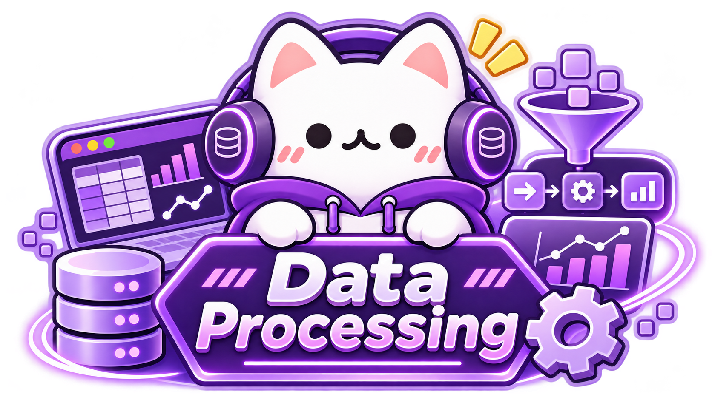

<p align="center">
  
</p>

Python을 기반으로 데이터를 수집하고, 정제하고, 변환하는 방법을 학습하는 자료입니다. Python 자료구조와 NumPy·Pandas를 활용한 데이터 처리부터 CSV·JSON·Excel·Parquet 파일 입출력, 데이터 품질 검증, 집계 및 처리 과정의 자동화까지 단계적으로 다룹니다.

각 Chapter는 개념 설명, 실행 가능한 예제 코드, 연습문제와 정답 코드로 구성합니다. 마지막에는 여러 데이터셋을 연결하여 하나의 데이터 처리 프로젝트를 완성합니다.

- **주요 언어:** Python
- **주요 도구:** Python 표준 라이브러리, NumPy, Pandas, PyArrow, SQLite
- **권장 선수 학습:** Python 변수, 조건문, 반복문, 함수의 기초
- **자료 구성:** 학습 문서, 예제 코드, 연습문제, 정답 코드, 실습 데이터

## Contents

### Part 1 — Data Processing Fundamentals

데이터 처리의 기본 개념과 Python 자료구조, 수치 연산을 학습합니다.

| Chapter | Topic |
|:---:|---|
| [01](./Chapter-01) | **Introduction to Data Processing** — 데이터 유형, 처리 흐름, 개발 환경, 기본 데이터 탐색 |
| [02](./Chapter-02) | **Python Data Structures** — List, Tuple, Dictionary, Set, 중첩 데이터, 정렬과 필터링 |
| [03](./Chapter-03) | **NumPy Fundamentals** — ndarray, 배열 연산, 인덱싱, Broadcasting, 벡터화 |

### Part 2 — Data Handling & Transformation

다양한 데이터 형식을 읽고 데이터의 품질을 확인한 뒤, 필요한 형태로 가공합니다.

| Chapter | Topic |
|:---:|---|
| [04](./Chapter-04) | **Pandas & DataFrames** — Series, DataFrame, 데이터 선택, 정렬, 기본 집계 |
| [05](./Chapter-05) | **File I/O & Data Formats** — pathlib, CSV, JSON, Excel, Parquet, SQLite, API 데이터 |
| [06](./Chapter-06) | **Data Cleaning & Validation** — 결측치, 중복, 이상치, 자료형 변환, 유효성 검사 |
| [07](./Chapter-07) | **Data Transformation & Aggregation** — GroupBy, Merge, Join, Pivot, 시계열 집계, 처리 흐름 설계 |

### Part 3 — Data Processing Project

앞서 배운 내용을 연결하여 데이터 처리 과정을 구현합니다.

| Chapter | Topic |
|:---:|---|
| [08](./Chapter-08) | **Data Processing Project** — 기상 데이터 불러오기, 검증, 정제, 결합, 집계, 결과 저장 |


## Learning Path

```text
원본 데이터 (Raw Data)
    ↓
데이터 불러오기 (Loading)
    ↓
데이터 검증 및 정제 (Validation & Cleaning)
    ↓
데이터 변환 및 결합 (Transformation & Integration)
    ↓
집계 및 요약 (Aggregation)
    ↓
결과 저장 (Export)
    ↓
Data Visualization
```

데이터 처리 과정의 최종 결과는 [Data Visualization](../Data_Visualization/)에서 그래프와 대시보드를 제작하는 데 활용할 수 있습니다.

## Getting Started

### 1. 개발 환경

- **Python:** 3.13 또는 3.14 권장 (다른 버전은 사용하는 라이브러리의 지원 여부 확인)
- **운영체제:** Windows, macOS, Linux
- **에디터:** Visual Studio Code 권장, JupyterLab 선택 사용

Python이 설치되어 있는지 확인합니다.

```bash
python --version
```

일부 Windows 환경에서는 `py --version`, macOS·Linux 환경에서는 `python3 --version`을 사용해야 할 수 있습니다.

### 2. 가상환경 생성

프로젝트별 패키지 관리를 위해 가상환경을 권장합니다. 학습자료의 루트 디렉터리에서 다음 명령어를 실행합니다.

```bash
python -m venv .venv
```

**Windows PowerShell**

```powershell
.\.venv\Scripts\Activate.ps1
```

**Windows Command Prompt**

```bat
.venv\Scripts\activate.bat
```

**macOS / Linux**

```bash
source .venv/bin/activate
```

가상환경을 종료하려면 `deactivate`를 실행합니다. `.venv/` 디렉터리는 Git에 커밋하지 않습니다.

### 3. 라이브러리 설치

```bash
python -m pip install --upgrade pip
python -m pip install numpy pandas openpyxl pyarrow
```

- `numpy`: 배열 및 수치 연산
- `pandas`: 표 형태의 데이터 탐색·가공
- `openpyxl`: Excel `.xlsx` 파일 입출력 지원
- `pyarrow`: Parquet 파일 입출력 및 Arrow 데이터 처리
- `sqlite3`, `csv`, `json`, `pathlib`: Python 표준 라이브러리에 포함

Notebook 환경이 필요한 경우 JupyterLab을 추가로 설치할 수 있습니다.

```bash
python -m pip install jupyterlab
jupyter lab
```

### 4. 첫 번째 데이터 처리

다음 예제는 주문 데이터를 테이블로 구성하고, 상품 분류별 매출을 계산합니다.

```python
import pandas as pd

orders = pd.DataFrame(
    {
        "category": ["음료", "문구", "음료"],
        "quantity": [2, 3, 1],
        "unit_price": [1500, 2000, 1500],
    }
)

orders["sales"] = orders["quantity"] * orders["unit_price"]
summary = orders.groupby("category", as_index=False)["sales"].sum()

print(summary.to_string(index=False))
```

**실행 결과**

```text
category  sales
      문구   6000
      음료   4500
```

Chapter 04에서 DataFrame의 구조를 학습하고, Chapter 07에서 그룹별 집계 과정을 자세히 다룹니다.

## Directory Structure

```text
Data_Processing/
├── README.md
├── datasets/             # 여러 Chapter에서 사용하는 공통 실습 데이터
├── Chapter-01/
│   ├── README.md
│   ├── examples/
│   ├── exercises/
│   └── solutions/
├── Chapter-02/
├── Chapter-03/
├── Chapter-04/
├── Chapter-05/
├── Chapter-06/
├── Chapter-07/
└── Chapter-08/
    ├── README.md
    ├── examples/
    ├── exercises/
    ├── solutions/
    └── project/
```

## Code Guidelines

- 변수와 함수 이름은 데이터의 의미가 드러나도록 작성합니다.
- 원본 데이터는 유지하고, 정제·변환 결과는 별도 파일에 저장합니다.
- 파일 경로는 가능한 한 `pathlib`를 활용하고, 텍스트 파일의 인코딩 형식을 명시합니다.
- 결측치(Missing Value), 중복값(Duplicate Value), 이상치(Outlier/Anomaly) 처리에는 판단 기준과 처리 결과를 함께 확인합니다.
- 예제와 연습문제 정답은 `examples/`, `solutions/`에서 확인할 수 있습니다.

## References

- [Python Documentation](https://docs.python.org/3/)
- [Python `venv` — Virtual Environments](https://docs.python.org/3/library/venv.html)
- [NumPy Documentation](https://numpy.org/doc/stable/)
- [NumPy — Absolute Beginners](https://numpy.org/doc/stable/user/absolute_beginners.html)
- [Pandas Documentation](https://pandas.pydata.org/docs/)
- [Pandas — Getting Started](https://pandas.pydata.org/docs/getting_started/)
- [Apache Arrow — PyArrow](https://arrow.apache.org/docs/python/)
- [Python `sqlite3` Documentation](https://docs.python.org/3/library/sqlite3.html)
- [Jupyter — Installation](https://jupyter.org/install)
- [VS Code — Getting Started with Python](https://code.visualstudio.com/docs/python/python-tutorial)

---

[← MoreStudy](../README.md) · [Data Visualization](../Data_Visualization/)
