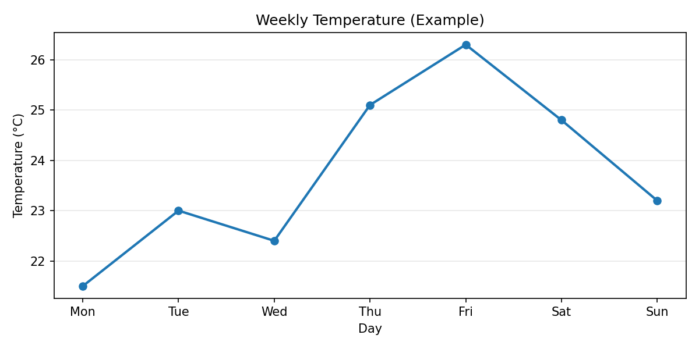
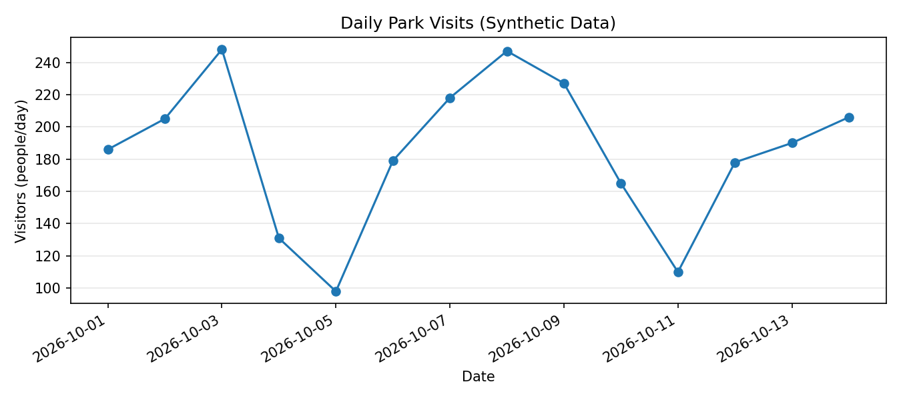
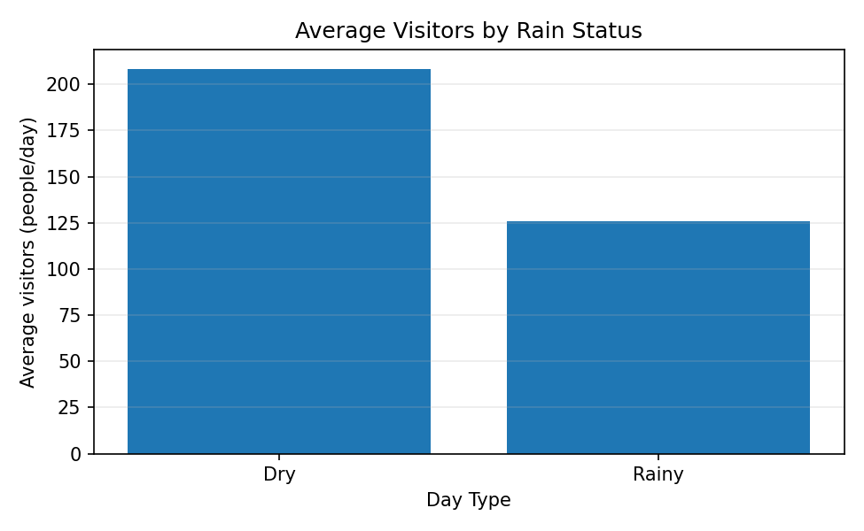
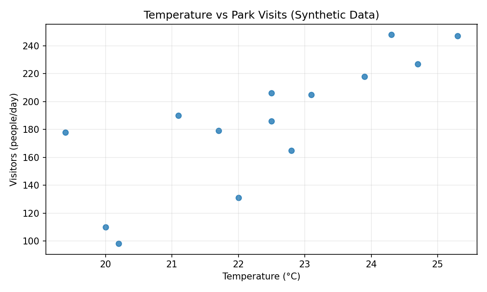
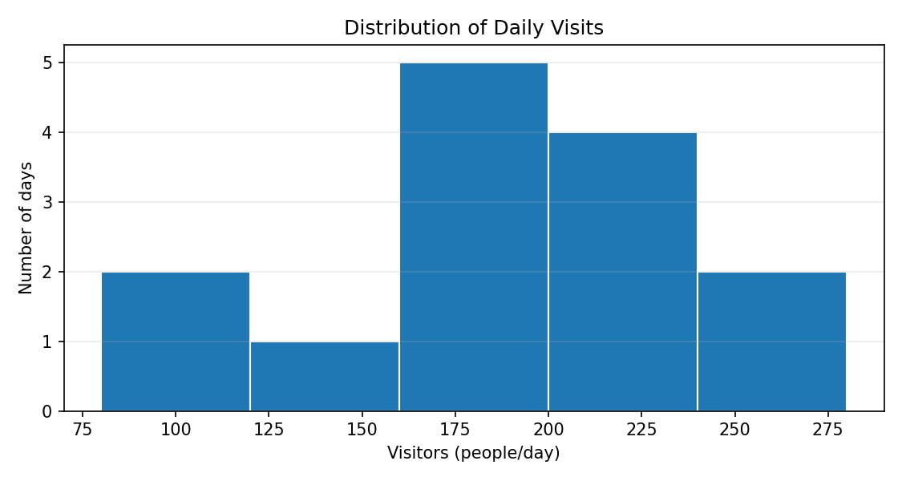
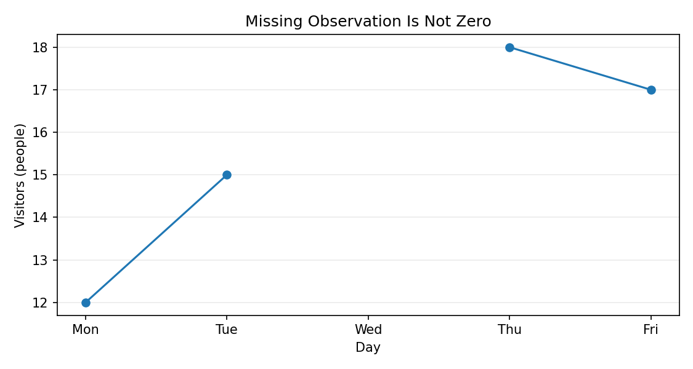
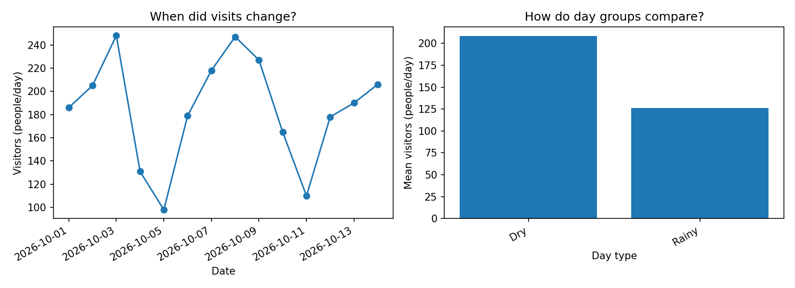
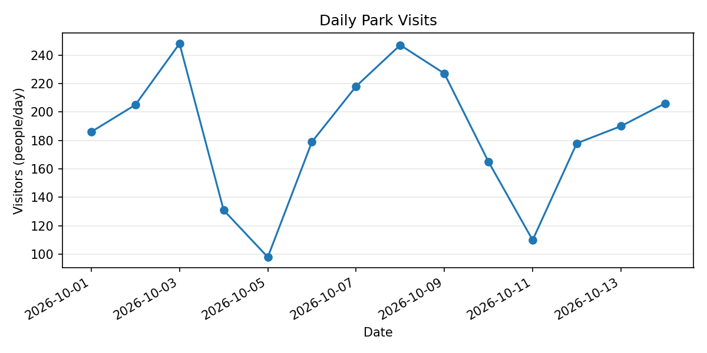
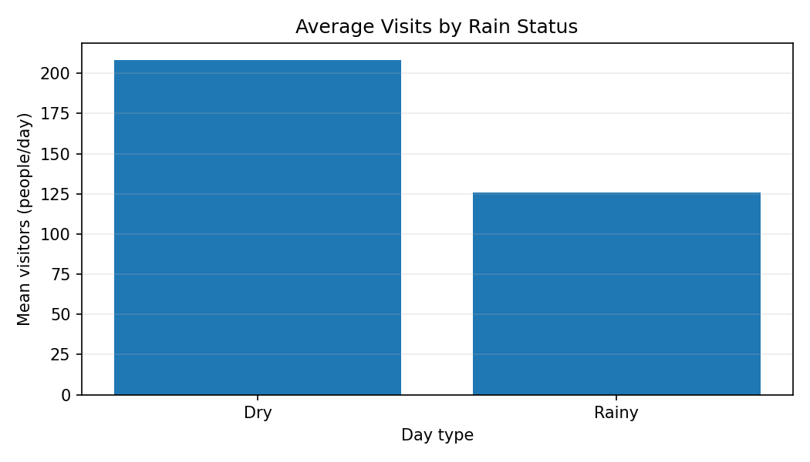

# Chapter 01. Introduction to Data Visualization

데이터 시각화(Data Visualization)의 목적과 주요 그래프 유형을 살펴보고, Python으로 처음부터 그래프를 작성하는 방법을 학습합니다. 데이터의 형태와 질문에 따라 적절한 표현을 선택하고, 축·단위·범례·결측값을 확인하며 결과를 해석하는 과정을 다룹니다.

본 Chapter는 **Python 3.13 / Matplotlib 3.10 / Pandas 2.2 / NumPy 2.3** 환경에서 예제와 정답 코드, 자동 테스트를 검증했습니다. 예제의 공원 방문 기록은 모두 **교육용 가상 데이터**이며 실제 방문 통계나 기상 관측 자료가 아닙니다. 이후 Chapter에서는 Matplotlib의 세부 기능과 통계 시각화 원리를 더 깊게 다룹니다.

<details>
<summary><strong>선행 학습 목록</strong></summary>

- [Data Processing — Chapter 01. Introduction to Data Processing](../../Data_Processing/Chapter-01/)
- [Data Processing — Chapter 03. NumPy Fundamentals](../../Data_Processing/Chapter-03/)
- [Data Processing — Chapter 04. Pandas & DataFrames](../../Data_Processing/Chapter-04/)

</details>

<a id="contents"></a>
## Contents

| Section | Topic |
|:---:|---|
| [1.1](#section-1-1) | Data Visualization — 개념과 목적 |
| [1.2](#section-1-2) | Data Processing와 Data Visualization의 관계 |
| [1.3](#section-1-3) | Dataset, Variables & Questions — 데이터 확인 |
| [1.4](#section-1-4) | Chart Types — 그래프 종류와 사용 목적 |
| [1.5](#section-1-5) | Getting Started — 환경 및 첫 번째 선 그래프 |
| [1.6](#section-1-6) | Figure & Axes — Matplotlib의 기본 구조 |
| [1.7](#section-1-7) | From CSV to Line Chart — 날짜별 변화 |
| [1.8](#section-1-8) | Bar Chart — 범주별 비교 |
| [1.9](#section-1-9) | Scatter Plot — 변수 사이의 관계 |
| [1.10](#section-1-10) | Histogram — 값의 분포 |
| [1.11](#section-1-11) | Labels, Legends & Scales — 명확한 그래프 작성 |
| [1.12](#section-1-12) | Missing Data & Interpretation — 누락과 해석 주의 |
| [1.13](#section-1-13) | Export & Reproducibility — 그래프 저장 및 재실행 |
| [1.14](#section-1-14) | Mini Project — City Park Visitor Snapshot |
| [1.15](#section-1-15) | Coding Practice |
| [1.16](#section-1-16) | Quiz & Summary |

## Getting Started

**필요 환경:** Python 3.11 이상, NumPy, Pandas, Matplotlib. `Data_Visualization/Chapter-01/` 디렉터리를 기준으로 실행합니다.

```bash
python -m pip install -r requirements.txt
python examples/02_first_line_chart.py
python examples/04_line_chart_from_csv.py
python project/park_report.py
python -m unittest discover -s tests -v
```

- 모든 예제는 데이터를 다운로드하지 않아도 실행됩니다. CSV는 `data/`에 포함되어 있습니다.
- 예제 그래프는 `output/`에 PNG로 저장되며, 해당 폴더는 실행 시 생성됩니다.
- 문서에는 검증된 그래프 이미지의 사본을 `figures/`에 포함했습니다.
- 예제는 디스플레이가 없는 환경에서도 저장되도록 `matplotlib.use("Agg")`를 사용합니다. 화면에서 직접 표시하려면 GUI 백엔드를 사용하고 `plt.show()`를 호출할 수 있습니다.
- Windows에서 `python` 대신 `py`를 사용하거나, 가상환경을 활성화하여 실행해도 됩니다.

**학습 목표**

1. 데이터 분석 질문과 그래프의 목적을 구별합니다.
2. Line·Bar·Scatter·Histogram의 기본 사용 목적을 설명합니다.
3. Matplotlib의 `Figure`와 `Axes`를 사용하여 그래프를 저장합니다.
4. 축 단위·범례·결측값을 확인하고 잘못된 해석을 피합니다.

---

<a id="section-1-1"></a>
## 1.1. Data Visualization — 개념과 목적

데이터 시각화는 숫자, 시간, 범주 등으로 이루어진 데이터를 **그래프와 도표로 표현하여 특징을 파악하고 정보를 전달하는 과정**입니다. 데이터의 값이 변하지 않더라도 표현 방식에 따라 이해하기 쉬워지는 정도가 달라집니다.

예를 들어 일주일의 기온을 `21.5, 23.0, 22.4, 25.1, 26.3, 24.8, 23.2`라는 목록으로만 보면 최댓값을 찾는 데 시간이 걸릴 수 있습니다. 같은 값을 선 그래프로 표현하면 상승·하락 시점을 쉽게 확인할 수 있습니다.

| 질문 | 데이터 예시 | 시각화의 목적 |
|---|---|---|
| 방문자가 언제 증가했나요? | 날짜별 방문자 수 | 시간에 따른 변화 파악 |
| 어떤 상품의 판매량이 많나요? | 상품별 판매량 | 범주별 수량 비교 |
| 기온과 방문자 수가 함께 변하나요? | 기온과 방문자 수 | 변수 간 관계 탐색 |
| 하루 방문자 수가 어느 범위에 집중되나요? | 일별 방문자 수 | 분포 확인 |

시각화는 **가설을 확인하거나 질문을 찾도록 돕는 도구**입니다. 그래프만으로 데이터 수집 방법이나 측정 오류가 해결되지는 않으며, 시각적으로 함께 움직인다는 사실만으로 인과관계를 확정할 수도 없습니다.

---

<a id="section-1-2"></a>
## 1.2. Data Processing와 Data Visualization의 관계

두 과정은 연결되지만 서로 다른 목표를 가집니다. Data Processing은 데이터를 사용 가능한 형태로 준비하는 과정이고, Data Visualization은 그 데이터를 목적에 맞게 표현하고 해석하는 과정입니다.

```text
Raw Data → Validation & Cleaning → Transformation & Aggregation
         → Visualization Design → Chart → Interpretation
```

| 단계 | 주요 질문 | 관련 학습 |
|---|---|---|
| 데이터 처리 | 파일을 올바르게 읽었나요? 단위와 형식이 맞나요? | [Data Processing](../../Data_Processing/) |
| 데이터 탐색 | 분석하려는 값이 무엇인가요? 결측·중복은 없나요? | 이번 Chapter 1.3 |
| 그래프 설계 | 시간의 변화인가요, 범주 간 비교인가요? | 이번 Chapter 1.4 / Chapter 02 |
| 시각화 | 어떤 함수로 그래프를 만들까요? | Matplotlib / Chapter 03 |
| 결과 해석 | 무엇을 알 수 있고, 무엇은 알 수 없나요? | 이번 Chapter 1.12 이후 |

앞서 제작한 [Data Processing Chapter 08](../../Data_Processing/Chapter-08/)의 기상 데이터 처리 결과는 최종 Data Visualization 프로젝트에서 재사용할 수 있습니다. 이번 Chapter에서는 독립적인 공원 방문 예제 데이터로 기초적인 차트 제작에 집중합니다.

---

<a id="section-1-3"></a>
## 1.3. Dataset, Variables & Questions — 데이터 확인

그래프를 그리기 전에 **한 행이 무엇을 나타내는지(Grain), 변수의 단위가 무엇인지, 비교할 값이 정확히 무엇인지** 확인해야 합니다. 이 Chapter에서는 [park_visits.csv](./data/park_visits.csv)를 사용합니다.

| Column | 자료형 | 의미 | 단위 |
|---|---|---|---|
| `date` | 날짜 문자열 | 날짜 | 일 |
| `temperature_c` | 숫자 | 가상 대표 기온 | °C |
| `rainfall_mm` | 숫자 | 하루 강수량 | mm/day |
| `visitors` | 정수 | 해당 날짜 방문자 수 | 명/day |

한 행은 하루의 기록이며, 날짜마다 한 행만 존재합니다. 자세한 정의는 [DATA_DICTIONARY.md](./data/DATA_DICTIONARY.md)를 참고하세요.

**시각화 전 간단한 점검**에는 행·열 개수, 결측값, 중복된 날짜, 값의 범위 등이 포함됩니다. 심화된 데이터 품질 검증은 Data Processing Chapter 06에서 다룹니다.

**예제 코드 — [01_inspect_before_plot.py](./examples/01_inspect_before_plot.py)**

```python
import pandas as pd
from pathlib import Path

DATA = Path(__file__).resolve().parents[1] / "data" / "park_visits.csv"
frame = pd.read_csv(DATA)

print("Rows:", len(frame))
print("Columns:", ", ".join(frame.columns))
print("Missing cells:", int(frame.isna().sum().sum()))
print("Duplicate dates:", int(frame["date"].duplicated().sum()))
print("Visitor range:", int(frame["visitors"].min()), "to", int(frame["visitors"].max()))
```

**실행 결과**

```text
Rows: 14
Columns: date, temperature_c, rainfall_mm, visitors
Missing cells: 0
Duplicate dates: 0
Visitor range: 98 to 248
```

`isna()`는 결측값을 검사하지만 데이터가 의미상 올바른지까지 보장하지는 않습니다. 실제 데이터에 적용할 때는 음수 방문자 수, 날짜 누락 등도 별도로 확인해야 합니다.

---

<a id="section-1-4"></a>
## 1.4. Chart Types — 그래프 종류와 사용 목적

그래프 유형은 **데이터에 답하려는 질문**을 먼저 정한 뒤 선택합니다. 모든 데이터에 특정 차트 하나가 가장 좋은 것은 아닙니다.

| 종류 | 적합한 질문 | Matplotlib 함수 | 주의 사항 |
|---|---|---|---|
| Line Chart | 시간이 지나며 어떻게 변하나요? | `ax.plot()` | 관측 순서와 누락 날짜 확인 |
| Bar Chart | 어떤 범주가 더 큰가요? | `ax.bar()` | 0 기준, 범주 및 집계 기준 확인 |
| Scatter Plot | 두 수치 변수의 관계가 있나요? | `ax.scatter()` | 관측 단위, 이상치, 인과관계 주의 |
| Histogram | 값이 어떤 구간에 분포하나요? | `ax.hist()` | 구간 수(`bins`)에 따라 모습이 달라짐 |

예를 들어 날짜별 방문자 수는 선 그래프가 자연스럽지만, 비가 온 날과 오지 않은 날의 평균 방문자 수는 막대그래프가 비교하기 편합니다. 시각적 인코딩, 색상, 스케일 등 상세 설계 원리는 Chapter 02 — Principles of Data Visualization에서 다룹니다.

---

<a id="section-1-5"></a>
## 1.5. Getting Started — 환경 및 첫 번째 선 그래프

Matplotlib는 Python에서 정적인 그래프를 제작할 때 널리 사용하는 라이브러리입니다. `pyplot`은 Figure를 생성하고 화면 표시 또는 파일 저장을 제어하는 인터페이스를 제공하며, `Axes` 객체의 메서드로 데이터와 레이블을 설정할 수 있습니다.

첫 번째 예제는 Python 리스트를 그대로 그래프로 표현합니다. `matplotlib.use("Agg")`는 파일로 저장하는 비대화형 백엔드를 명시하며, **그래프를 보여주지 않고 PNG로 저장하도록 설정**합니다.

**예제 코드 — [02_first_line_chart.py](./examples/02_first_line_chart.py)**

```python
from pathlib import Path
import matplotlib
matplotlib.use("Agg")
import matplotlib.pyplot as plt

DAYS = ["Mon", "Tue", "Wed", "Thu", "Fri", "Sat", "Sun"]
TEMPERATURES = [21.5, 23.0, 22.4, 25.1, 26.3, 24.8, 23.2]
OUTPUT = Path(__file__).resolve().parents[1] / "output" / "02_first_line_chart.png"

fig, ax = plt.subplots(figsize=(8, 4))
ax.plot(DAYS, TEMPERATURES, marker="o", linewidth=2)
ax.set(title="Weekly Temperature (Example)", xlabel="Day", ylabel="Temperature (°C)")
ax.grid(axis="y", alpha=0.3)
fig.tight_layout()
OUTPUT.parent.mkdir(parents=True, exist_ok=True)
fig.savefig(OUTPUT, dpi=150)
plt.close(fig)
print("Saved:", OUTPUT.name)
print("Highest:", max(TEMPERATURES), "°C")
```

**실행 결과**

```text
Saved: 02_first_line_chart.png
Highest: 26.3 °C
```

**생성된 그래프**



- `plt.subplots(figsize=(8, 4))`: Figure와 Axes 생성. 크기는 인치 단위입니다.
- `ax.plot(...)`: 주어진 순서의 좌표를 선으로 연결합니다.
- `marker="o"`: 개별 관측 위치를 원형 점으로 표시합니다.
- `ax.set(...)`: 제목, 가로축과 세로축의 의미를 지정합니다.
- `fig.savefig(..., dpi=150)`: PNG를 지정한 해상도로 저장합니다.
- `plt.close(fig)`: 필요 없는 Figure 객체를 닫습니다.

**해석:** 예제에서 금요일 26.3°C가 가장 높습니다. 7일치 가상 데이터이므로 장기 기후 변화나 실제 지역의 기온을 설명하지는 않습니다.

---

<a id="section-1-6"></a>
## 1.6. Figure & Axes — Matplotlib의 기본 구조

Matplotlib에서 Figure는 전체 그림을 나타내며, Axes는 데이터가 실제로 그려지는 좌표 영역입니다. 이름이 비슷한 `Axis`는 개별 x축 또는 y축을 의미합니다.

| 요소 | 역할 | 예시 |
|---|---|---|
| `Figure` | 전체 출력 그림 | `fig` |
| `Axes` | 그래프 영역 | `ax` |
| x/y `Axis` | 눈금과 스케일 표현 | x축 눈금, y축 눈금 |
| `Artist` | 그래프를 구성하는 시각 요소 | 선, 점, 글자 등 |

재사용 가능한 함수와 복수 그래프를 작성할 때는 `fig, ax = plt.subplots()`로 객체를 명시적으로 다루는 방법을 권장합니다. Chapter 03에서 여러 Axes와 Figure 레이아웃을 자세히 학습합니다.

**예제 코드 — [03_figure_and_axes.py](./examples/03_figure_and_axes.py)**

```python
from pathlib import Path
import matplotlib
matplotlib.use("Agg")
import matplotlib.pyplot as plt

OUTPUT = Path(__file__).resolve().parents[1] / "output" / "03_figure_and_axes.png"
fig, ax = plt.subplots(figsize=(7, 3.8))
ax.plot([1, 2, 3, 4], [12, 17, 15, 22], marker="o")
ax.set_title("Four Observations")
ax.set_xlabel("Observation Index")
ax.set_ylabel("Measured Value")
ax.grid(axis="y", alpha=0.3)
fig.tight_layout()
OUTPUT.parent.mkdir(parents=True, exist_ok=True)
fig.savefig(OUTPUT, dpi=150)
plt.close(fig)
print("Figure contains:", len(fig.axes), "Axes")
```

**실행 결과**

```text
Figure contains: 1 Axes
```

`len(fig.axes)`가 `1`이라는 것은 한 개의 Figure에 한 개의 Axes가 있다는 의미입니다. Figure의 크기와 축 레이블은 각각 별도로 관리됩니다.

---

<a id="section-1-7"></a>
## 1.7. From CSV to Line Chart — 날짜별 변화

실제 시각화에서는 CSV와 같은 파일에서 값을 읽어 그래프를 만드는 경우가 많습니다. 이 예제는 Pandas의 `read_csv()`로 방문자 데이터를 읽고, 날짜를 파싱한 뒤 오름차순으로 정렬합니다.

시간에 따른 선 그래프는 관측 순서가 중요합니다. 날짜가 뒤섞인 상태로 점을 연결하면 시간 순서와 무관한 선이 만들어질 수 있습니다.

**예제 코드 — [04_line_chart_from_csv.py](./examples/04_line_chart_from_csv.py)**

```python
from pathlib import Path
import matplotlib
matplotlib.use("Agg")
import matplotlib.pyplot as plt
import pandas as pd

ROOT = Path(__file__).resolve().parents[1]
frame = pd.read_csv(ROOT / "data" / "park_visits.csv", parse_dates=["date"])
frame = frame.sort_values("date")
fig, ax = plt.subplots(figsize=(9, 4))
ax.plot(frame["date"], frame["visitors"], marker="o")
ax.set(title="Daily Park Visits (Synthetic Data)", xlabel="Date", ylabel="Visitors (people/day)")
ax.grid(axis="y", alpha=0.3)
fig.autofmt_xdate()
fig.tight_layout()
out = ROOT / "output" / "04_visitor_trend.png"
out.parent.mkdir(parents=True, exist_ok=True)
fig.savefig(out, dpi=150)
plt.close(fig)
print("Days:", len(frame))
print("Total visitors:", int(frame["visitors"].sum()))
```

**실행 결과**

```text
Days: 14
Total visitors: 2588
```

**생성된 그래프**



- `parse_dates=["date"]`: 문자열 날짜를 날짜 타입으로 변환합니다.
- `sort_values("date")`: 그래프가 시간 순서에 따라 연결되도록 정렬합니다.
- `fig.autofmt_xdate()`: 날짜 레이블을 회전시켜 겹침을 줄입니다.

**해석:** 10월 3일의 방문자 수는 248명이고 10월 5일에는 98명입니다. 두 날짜의 차이는 150명이지만, 그래프만으로 감소 원인을 단정할 수는 없습니다.

---

<a id="section-1-8"></a>
## 1.8. Bar Chart — 범주별 비교

막대그래프는 서로 다른 범주의 값을 비교할 때 사용합니다. 여기서는 하루 강수량이 `0`보다 크면 `Rainy`, 그렇지 않으면 `Dry`로 분류해 방문자 수의 **그룹별 평균**을 비교합니다.

평균은 합계와 다릅니다. 건수가 다른 범주를 비교할 때는 어떤 통계량을 사용했는지 제목·축·본문에 표시해야 합니다. 이 예제는 두 범주의 평균을 비교하며, 관측 일수가 같은 것은 아닙니다.

**예제 코드 — [05_category_bar_chart.py](./examples/05_category_bar_chart.py)**

```python
from pathlib import Path
import matplotlib
matplotlib.use("Agg")
import matplotlib.pyplot as plt
import pandas as pd

ROOT = Path(__file__).resolve().parents[1]
frame = pd.read_csv(ROOT / "data" / "park_visits.csv")
frame["weather"] = frame["rainfall_mm"].gt(0).map({True: "Rainy", False: "Dry"})
summary = frame.groupby("weather")["visitors"].mean().reindex(["Dry", "Rainy"])

fig, ax = plt.subplots(figsize=(6.5, 4))
ax.bar(summary.index, summary.values)
ax.set(title="Average Visitors by Rain Status", xlabel="Day Type", ylabel="Average visitors (people/day)")
ax.set_ylim(bottom=0)  # 막대의 길이를 비교할 때는 0 기준을 권장합니다.
ax.grid(axis="y", alpha=0.25)
fig.tight_layout()
out = ROOT / "output" / "05_bar_chart.png"
out.parent.mkdir(parents=True, exist_ok=True)
fig.savefig(out, dpi=150)
plt.close(fig)
for label, value in summary.items():
    print(f"{label}: {value:.1f}")
```

**실행 결과**

```text
Dry: 208.4
Rainy: 126.0
```

**생성된 그래프**



비가 오지 않은 날은 10일, 비가 온 날은 4일입니다. 평균 방문자 수는 각각 208.4명과 126.0명입니다. **표본 크기와 다른 요인을 통제하지 않았으므로 비 때문에 방문자가 줄었다고 단정하지 않습니다.** 막대그래프는 길이를 비교하기 때문에 일반적으로 0에서 시작하는 축을 권장합니다.

---

<a id="section-1-9"></a>
## 1.9. Scatter Plot — 변수 사이의 관계

산점도(Scatter Plot)는 **두 개의 수치형 변수**를 한 쌍의 좌표로 표현합니다. 예제에서는 가로축에 기온, 세로축에 방문자 수를 배치하므로 점 하나는 하루의 기록을 나타냅니다.

점이 오른쪽 위로 모인다고 해서 기온 변화가 방문자 수의 직접적인 원인이라는 뜻은 아닙니다. 요일, 행사, 강수, 계절 등 관측되지 않았거나 통제되지 않은 요인이 존재할 수 있습니다.

**예제 코드 — [06_relationship_scatter.py](./examples/06_relationship_scatter.py)**

```python
from pathlib import Path
import matplotlib
matplotlib.use("Agg")
import matplotlib.pyplot as plt
import pandas as pd

ROOT = Path(__file__).resolve().parents[1]
frame = pd.read_csv(ROOT / "data" / "park_visits.csv")
fig, ax = plt.subplots(figsize=(7.5, 4.5))
ax.scatter(frame["temperature_c"], frame["visitors"], alpha=0.8)
ax.set(title="Temperature vs Park Visits (Synthetic Data)", xlabel="Temperature (°C)", ylabel="Visitors (people/day)")
ax.grid(alpha=0.25)
fig.tight_layout()
out = ROOT / "output" / "06_scatter_chart.png"
out.parent.mkdir(parents=True, exist_ok=True)
fig.savefig(out, dpi=150)
plt.close(fig)
print("Points:", len(frame))
print("Interpretation: association is not causation")
```

**실행 결과**

```text
Points: 14
Interpretation: association is not causation
```

**생성된 그래프**



산점도는 관계를 **탐색**하는 도구입니다. 상관계수 계산, 추세선, 이상치, 표본 편향 등은 Chapter 05의 통계 시각화에서 더 자세히 다룹니다.

---

<a id="section-1-10"></a>
## 1.10. Histogram — 값의 분포

히스토그램은 연속적인 수치 데이터가 어느 값의 구간에 자주 나타나는지 보여줍니다. 막대그래프는 서로 다른 **범주**를 비교하지만, 히스토그램은 수치 구간(bin)의 빈도를 표현합니다.

여기서는 방문자 수를 `[80, 120, 160, 200, 240, 280]`의 구간 경계로 나눕니다. `bins` 설정을 바꾸면 같은 데이터라도 분포의 시각적 형태가 달라질 수 있습니다.

**예제 코드 — [07_distribution_histogram.py](./examples/07_distribution_histogram.py)**

```python
from pathlib import Path
import matplotlib
matplotlib.use("Agg")
import matplotlib.pyplot as plt
import pandas as pd

ROOT = Path(__file__).resolve().parents[1]
frame = pd.read_csv(ROOT / "data" / "park_visits.csv")
fig, ax = plt.subplots(figsize=(7.5, 4))
ax.hist(frame["visitors"], bins=[80, 120, 160, 200, 240, 280], edgecolor="white")
ax.set(title="Distribution of Daily Visits", xlabel="Visitors (people/day)", ylabel="Number of days")
ax.grid(axis="y", alpha=0.25)
fig.tight_layout()
out = ROOT / "output" / "07_histogram.png"
out.parent.mkdir(parents=True, exist_ok=True)
fig.savefig(out, dpi=150)
plt.close(fig)
print("Days:", len(frame))
print("Mean visits:", round(float(frame["visitors"].mean()), 1))
```

**실행 결과**

```text
Days: 14
Mean visits: 184.9
```

**생성된 그래프**



- 가로축은 **하루 방문자 수(명/day)**, 세로축은 해당 구간에 속하는 **일수**입니다.
- 14일 자료의 평균 방문자 수는 반올림하여 184.9명입니다.
- 이 예제처럼 표본이 적으면 히스토그램만으로 일반적인 확률분포 형태를 추정하기 어렵습니다.

---

<a id="section-1-11"></a>
## 1.11. Labels, Legends & Scales — 명확한 그래프 작성

그래프에 숫자가 있더라도 제목과 축의 의미가 없으면 잘못 해석할 수 있습니다. 특히 서로 다른 단위를 가진 값을 비교할 때 단위를 표시하지 않으면 의미가 모호해집니다.

| 요소 | 확인할 사항 |
|---|---|
| Title | 그래프가 답하려는 질문이 드러나는가? |
| X/Y Labels | 변수명과 단위가 있는가? |
| Legend | 두 개 이상의 데이터 계열을 구분할 수 있는가? |
| Scale | 범위가 차이를 과장하거나 축소하지 않는가? |
| Source | 데이터의 출처와 기간을 알 수 있는가? |

두 개의 시계열을 한 그래프에 나타낼 때는 범례를 추가해야 합니다.

**예제 코드 — [08_labels_and_legend.py](./examples/08_labels_and_legend.py)**

```python
from pathlib import Path
import matplotlib
matplotlib.use("Agg")
import matplotlib.pyplot as plt

DAYS = ["Mon", "Tue", "Wed", "Thu", "Fri", "Sat", "Sun"]
WEEK_A = [15, 18, 20, 19, 22, 21, 17]
WEEK_B = [17, 16, 19, 23, 24, 20, 18]
fig, ax = plt.subplots(figsize=(8, 4))
ax.plot(DAYS, WEEK_A, marker="o", label="Week A")
ax.plot(DAYS, WEEK_B, marker="s", label="Week B")
ax.set(title="Two Weeks: Temperature Comparison", xlabel="Day", ylabel="Temperature (°C)")
ax.legend()
ax.grid(axis="y", alpha=0.25)
fig.tight_layout()
out = Path(__file__).resolve().parents[1] / "output" / "08_labels_and_legend.png"
out.parent.mkdir(parents=True, exist_ok=True)
fig.savefig(out, dpi=150)
plt.close(fig)
print("Series:", 2)
```

**실행 결과**

```text
Series: 2
```

서로 다른 선은 선 모양과 마커도 함께 구분하면 인쇄 환경이나 색각 특성이 다른 독자에게 도움이 됩니다.

**축과 스케일:** 일반적으로 막대그래프는 0 기준에서 막대 길이를 비교하고, 선 그래프는 변화 자체를 보기 위해 상황에 맞는 y축 범위를 사용할 수 있습니다. 어떤 경우든 축 범위를 의도적으로 바꿨다면 독자가 오해하지 않도록 명확하게 표현해야 합니다. 이 문제는 Chapter 02에서 비교 사례를 통해 자세히 설명합니다.

---

<a id="section-1-12"></a>
## 1.12. Missing Data & Interpretation — 누락과 해석 주의

그래프에서 값이 비어 있는 상태와 값이 실제로 0인 상태는 다릅니다. **관측이 없었다는 사실 자체가 중요한 정보**일 수 있습니다.

다음 예제의 수요일 값은 `math.nan`으로 표시합니다. Matplotlib는 기본 선 그래프에서 해당 위치의 연결을 끊어 그리므로, 0이라고 잘못 표현하지 않습니다.

**예제 코드 — [09_missing_is_not_zero.py](./examples/09_missing_is_not_zero.py)**

```python
from pathlib import Path
import math
import matplotlib
matplotlib.use("Agg")
import matplotlib.pyplot as plt

DAYS = ["Mon", "Tue", "Wed", "Thu", "Fri"]
VALUES = [12, 15, math.nan, 18, 17]  # 수요일은 관측 누락
fig, ax = plt.subplots(figsize=(7.5, 4))
ax.plot(DAYS, VALUES, marker="o")
ax.set(title="Missing Observation Is Not Zero", xlabel="Day", ylabel="Visitors (people)")
ax.grid(axis="y", alpha=0.25)
fig.tight_layout()
out = Path(__file__).resolve().parents[1] / "output" / "09_missing_data.png"
out.parent.mkdir(parents=True, exist_ok=True)
fig.savefig(out, dpi=150)
plt.close(fig)
print("Observed values:", sum(not math.isnan(v) for v in VALUES))
print("Missing values:", sum(math.isnan(v) for v in VALUES))
```

**실행 결과**

```text
Observed values: 4
Missing values: 1
```

**생성된 그래프**



시계열에서 날짜 한 행이 통째로 누락된 경우에는 먼저 예상 날짜를 만들어 누락을 확인해야 할 수도 있습니다. `NaN` 표시만으로 모든 누락이 자동 검출되는 것은 아닙니다.

또한 같은 데이터를 그리더라도 질문에 따라 차트 선택이 달라집니다. **언제 변했는지**는 선 그래프, **집단 사이에 평균 차이가 있는지**는 막대그래프가 유용합니다.

**예제 코드 — [10_one_data_two_questions.py](./examples/10_one_data_two_questions.py)**

```python
from pathlib import Path
import matplotlib
matplotlib.use("Agg")
import matplotlib.pyplot as plt
import pandas as pd

ROOT = Path(__file__).resolve().parents[1]
frame = pd.read_csv(ROOT / "data" / "park_visits.csv", parse_dates=["date"])
summary = frame.groupby(frame["rainfall_mm"].gt(0))["visitors"].mean()
fig, (ax1, ax2) = plt.subplots(1, 2, figsize=(11, 4))
ax1.plot(frame["date"], frame["visitors"], marker="o")
ax1.set(title="When did visits change?", xlabel="Date", ylabel="Visitors (people/day)")
ax2.bar(["Dry", "Rainy"], [summary.loc[False], summary.loc[True]])
ax2.set(title="How do day groups compare?", xlabel="Day type", ylabel="Mean visitors (people/day)")
ax2.set_ylim(bottom=0)
fig.autofmt_xdate()
fig.tight_layout()
out = ROOT / "output" / "10_two_questions.png"
out.parent.mkdir(parents=True, exist_ok=True)
fig.savefig(out, dpi=150)
plt.close(fig)
print("Different questions require different charts")
```

**실행 결과**

```text
Different questions require different charts
```

**생성된 그래프**



이때 그룹 평균은 두 그룹의 기술통계만을 나타냅니다. 실제 차이가 우연인지 판단하려면 표본 추출 방식과 불확실성에 대한 추가 분석이 필요합니다.

---

<a id="section-1-13"></a>
## 1.13. Export & Reproducibility — 그래프 저장 및 재실행

그래프 결과물을 문서·발표에 활용하려면 파일 형식과 저장 방식을 정해야 합니다.

| Format | 특징 | 사용 예시 |
|---|---|---|
| PNG | 픽셀 기반 이미지. 크기와 DPI에 따라 선명도 달라짐 | README, 보고서, 슬라이드 |
| SVG | 벡터 형식. 확대해도 선과 글자의 윤곽이 선명함 | 웹, 편집 가능한 도형이 필요한 경우 |

Matplotlib의 `savefig()`로 두 형식을 생성할 수 있습니다. 운영체제별 폰트가 다르면 레이블의 모양도 달라질 수 있으므로, 예제는 영어 레이블을 기본으로 사용합니다.

**예제 코드 — [11_save_png_and_svg.py](./examples/11_save_png_and_svg.py)**

```python
from pathlib import Path
import matplotlib
matplotlib.use("Agg")
import matplotlib.pyplot as plt

ROOT = Path(__file__).resolve().parents[1]
out = ROOT / "output"
out.mkdir(parents=True, exist_ok=True)
fig, ax = plt.subplots(figsize=(6.5, 3.5))
ax.bar(["A", "B", "C"], [12, 17, 14])
ax.set(title="Simple Comparison", ylabel="Count (items)")
ax.set_ylim(bottom=0)
fig.tight_layout()
fig.savefig(out / "11_comparison.png", dpi=150)
fig.savefig(out / "11_comparison.svg")
plt.close(fig)
print("Saved: 11_comparison.png, 11_comparison.svg")
```

**실행 결과**

```text
Saved: 11_comparison.png, 11_comparison.svg
```

재현 가능한 시각화를 위해서는 **코드뿐 아니라 데이터와 단위, 패키지 설치 방법도 함께 제공**해야 합니다. 이 Chapter의 코드는 무작위 값을 사용하지 않고, `requirements.txt`와 CSV를 포함하여 실행 결과가 동일한 값을 나타내도록 구성했습니다.

`output/`은 자동 생성 결과 보관 디렉터리이며 Git 추적에서 제외합니다. 반면 README에서 보여주는 검증된 예시 그래프는 `figures/`에 별도로 포함합니다.

---

<a id="section-1-14"></a>
## 1.14. Mini Project — City Park Visitor Snapshot

### 목표

14일간의 가상 공원 방문·기온·강수량 데이터를 이용하여 **어떤 날짜에 방문자가 많았는지, 비가 온 날과 오지 않은 날의 차이가 어떤지, 기온과 방문자의 관계가 있는지**를 그래프로 정리합니다.

**프로젝트 흐름**

```text
park_visits.csv
   ↓
열 이름·날짜·숫자 데이터 검증
   ↓
방문 총계 / 비 온 날 개수 / 그룹별 평균 계산
   ↓
Line / Bar / Scatter / Histogram 생성
   ↓
PNG 4개 + summary.json 저장
```

**구현 파일**

- [park_report.py](./project/park_report.py) — 검증, 요약, 차트 생성, 파일 저장
- [12_run_mini_project.py](./examples/12_run_mini_project.py) — 실습용 실행 진입점
- [park_visits.csv](./data/park_visits.csv) — 교육용 가상 데이터
- [DATA_DICTIONARY.md](./data/DATA_DICTIONARY.md) — 컬럼 정의와 가정

**주요 함수**

| 함수 | 역할 |
|---|---|
| `load_data()` | 필수 열, 날짜 중복, 숫자 범위 등 검사 |
| `summarize()` | 기간, 방문자 총합, 일별 평균, 강수 상태별 평균 계산 |
| `make_charts()` | 4개 그래프 생성 및 PNG 저장 |
| `run_report()` | 입력·검증·집계·저장을 연결하여 실행 |

이 프로젝트의 검증 규칙은 연습용 데이터에 적용되는 규칙입니다. 실제 방문 통계·기상 데이터에 그대로 적용해야 하는 표준을 의미하지 않습니다.

### 실행 방법

`Chapter-01/` 디렉터리에서 아래 명령어를 실행합니다.

```bash
python project/park_report.py
```

다른 입력 또는 출력 경로를 사용하려면 다음과 같이 지정합니다.

```bash
python project/park_report.py --input data/park_visits.csv --output output/my_report
```

**단계별 실행 예제**

**예제 코드 — [12_run_mini_project.py](./examples/12_run_mini_project.py)**

```python
import sys
from pathlib import Path

ROOT = Path(__file__).resolve().parents[1]
sys.path.insert(0, str(ROOT))
from project.park_report import run_report

result = run_report(ROOT / "data" / "park_visits.csv", ROOT / "output" / "park_report")
print("Total days:", result["days"])
print("Total visitors:", result["total_visitors"])
print("Rainy days:", result["rainy_days"])
print("Saved charts:", 4)
```

**실행 결과**

```text
Total days: 14
Total visitors: 2588
Rainy days: 4
Saved charts: 4
```

**프로젝트 결과 요약**

```json
{
  "days": 14,
  "total_visitors": 2588,
  "mean_daily_visitors": 184.86,
  "rainy_days": 4,
  "dry_days": 10,
  "mean_visitors_rainy": 126.0,
  "mean_visitors_dry": 208.4,
  "dataset": "Synthetic training data"
}
```

**생성 파일**

```text
output/park_report/
├── visitor_trend.png
├── rain_status_comparison.png
├── temperature_scatter.png
├── visitor_histogram.png
└── summary.json
```

**프로젝트 결과 예시 — 방문자 변화와 강수 상태 비교**





**해석:** 14일의 가상 데이터에서는 비가 오지 않은 날의 평균 방문자 수가 비가 온 날보다 높습니다. 그러나 비가 오지 않은 날 10일과 비가 온 날 4일의 표본 수가 다르고 다른 조건도 통제하지 않았으므로 **인과관계나 일반적인 계절 패턴으로 확대 해석하지 않습니다.**

**테스트**

```bash
python -m unittest discover -s tests -v
```

정상 입력뿐 아니라 필수 열 누락, 날짜 중복, 음수 방문자 수, 잘못된 숫자 등의 오류도 검사합니다. 원본 CSV는 수정하지 않으며 결과는 새 `output/` 폴더에 저장합니다.

---

<a id="section-1-15"></a>
## 1.15. Coding Practice

다음 문제는 `exercises/`에 시작 코드, `solutions/`에 모범답안을 제공합니다. 문제를 먼저 구현한 다음 정답 코드를 확인하세요. **각 그래프는 PNG로 저장하고 축 제목과 단위를 명확하게 표시**해야 합니다.

| No. | Practice | Exercise | Solution |
|:---:|---|---|---|
| 01 | Weekly Temperature | [문제 코드](./exercises/01_weekly_temperature.py) | [정답 코드](./solutions/01_weekly_temperature.py) |
| 02 | Product Sales Bar | [문제 코드](./exercises/02_product_sales_bar.py) | [정답 코드](./solutions/02_product_sales_bar.py) |
| 03 | Temperature & Visitors | [문제 코드](./exercises/03_temperature_visitors_scatter.py) | [정답 코드](./solutions/03_temperature_visitors_scatter.py) |
| 04 | Park Mini Dashboard | [문제 코드](./exercises/04_park_dashboard.py) | [정답 코드](./solutions/04_park_dashboard.py) |

### Exercise 01 — Weekly Temperature

주어진 월~금요일 기온을 선 그래프로 표현합니다.

- 가로축은 요일, 세로축은 기온(°C)으로 설정합니다.
- `marker`를 추가하고 PNG 파일로 저장합니다.
- 함수는 최솟값과 최댓값을 `(min, max)` 튜플로 반환합니다.
- **기대 결과:** 최솟값 19.0°C, 최댓값 23.0°C

### Exercise 02 — Product Sales Bar

상품별 판매 수량을 막대그래프로 비교합니다.

- 품목과 판매 수량을 축에 표시합니다.
- y축을 0에서 시작하게 하고 PNG로 저장합니다.
- 전체 판매 수량을 반환합니다.
- **기대 결과:** 155개

### Exercise 03 — Temperature & Visitors

`park_visits.csv`를 읽고 기온과 방문자 수 산점도를 생성합니다.

- `temperature_c`를 x축, `visitors`를 y축에 배치합니다.
- 축 단위를 표시하고 PNG로 저장합니다.
- 그린 점의 개수를 반환합니다.
- **기대 결과:** 14개 점

### Exercise 04 — Park Mini Dashboard

하나의 Figure에 두 그래프를 배치합니다.

- 왼쪽은 날짜별 방문자 수 선 그래프입니다.
- 오른쪽은 비가 온 날과 오지 않은 날의 평균 방문자 수 막대그래프입니다.
- `total_visitors`, `rainy_days`를 포함하는 딕셔너리를 반환합니다.
- **기대 결과:** 총 방문 2,588명, 비 온 날 4일

### 실행 방법

```bash
python solutions/01_weekly_temperature.py
python solutions/02_product_sales_bar.py
python solutions/03_temperature_visitors_scatter.py
python solutions/04_park_dashboard.py
```

실습 문제 파일은 미완성 코드를 포함하므로 처음 실행 시 `NotImplementedError`가 발생합니다. `TODO`를 직접 구현한 뒤 실행해야 합니다.

---

<a id="section-1-16"></a>
## 1.16. Quiz & Summary

### Quiz

각 질문에 먼저 답해 본 뒤, 해당 문제의 **정답 및 해설 확인**을 펼쳐 확인하세요.

**Q1. Data Visualization의 목적은 데이터를 무조건 보기 좋게 꾸미는 것인가요?**

<details>
<summary>정답 및 해설 확인</summary>

아닙니다. 데이터를 더 쉽게 이해하고, 비교하고, 탐색하고, 정확하게 전달하는 것이 목적입니다. 꾸밈보다 표현의 정확성과 해석 가능성이 우선입니다.

</details>

**Q2. 한 행이 무엇을 나타내는지 확인하는 개념은 무엇인가요?**

<details>
<summary>정답 및 해설 확인</summary>

Grain(관측 단위)입니다. 이 Chapter의 CSV 한 행은 공원 방문자의 하루 단위 기록입니다.

</details>

**Q3. 시간에 따른 일별 방문자 수 변화를 표현할 때 기본적으로 어떤 그래프를 선택하나요?**

<details>
<summary>정답 및 해설 확인</summary>

Line Chart(선 그래프)입니다. 날짜 순서를 기준으로 값의 증감을 살펴볼 수 있습니다.

</details>

**Q4. 상품 범주별 판매 수량을 비교할 때 적절한 그래프는 무엇인가요?**

<details>
<summary>정답 및 해설 확인</summary>

Bar Chart(막대그래프)입니다. 서로 다른 범주에 속한 값의 크기를 비교할 수 있습니다.

</details>

**Q5. 기온과 방문자 수의 두 수치형 변수 관계를 탐색할 때 사용하는 그래프는 무엇인가요?**

<details>
<summary>정답 및 해설 확인</summary>

Scatter Plot(산점도)입니다. 하루 기록을 기온과 방문자 수의 좌표 한 점으로 표현합니다.

</details>

**Q6. 하루 방문자 수가 어떤 값의 구간에 자주 나타나는지 확인하려면 어떤 그래프를 사용하나요?**

<details>
<summary>정답 및 해설 확인</summary>

Histogram(히스토그램)입니다. 연속 수치 데이터를 구간으로 나누어 구간별 빈도를 나타냅니다.

</details>

**Q7. Matplotlib에서 Figure와 Axes의 차이는 무엇인가요?**

<details>
<summary>정답 및 해설 확인</summary>

Figure는 전체 그림이고 Axes는 실제 데이터를 그리는 좌표 영역입니다. Axes 내부에는 x·y Axis 등이 존재합니다.

</details>

**Q8. `ax.plot()`과 `fig.savefig()`는 각각 어떤 작업을 하나요?**

<details>
<summary>정답 및 해설 확인</summary>

`ax.plot()`은 주어진 데이터를 그래프 선으로 나타내고, `fig.savefig()`는 Figure를 이미지 파일 등으로 저장합니다.

</details>

**Q9. 방문자 수가 관측되지 않은 날짜를 자동으로 0명으로 바꾸어도 되나요?**

<details>
<summary>정답 및 해설 확인</summary>

아닙니다. 결측은 값이 없다는 뜻이고 0명은 관측된 값입니다. 두 상태를 구분해야 합니다.

</details>

**Q10. 가상 데이터에서 비가 온 날 평균 방문자가 적다는 사실만으로 비가 방문 감소의 원인이라고 단정할 수 있나요?**

<details>
<summary>정답 및 해설 확인</summary>

아닙니다. 상관관계와 인과관계는 다릅니다. 요일·행사·계절 등 다른 영향을 확인해야 합니다.

</details>

**Q11. 막대그래프에서 y축을 일반적으로 0에서 시작하도록 권장하는 이유는 무엇인가요?**

<details>
<summary>정답 및 해설 확인</summary>

막대의 길이 자체가 수치 크기를 나타내므로, 0이 아닌 지점부터 시작하면 차이가 실제보다 크게 보일 수 있기 때문입니다.

</details>

**Q12. README 등 문서에 그래프를 다시 생성할 수 있도록 어떤 자료를 함께 보관해야 하나요?**

<details>
<summary>정답 및 해설 확인</summary>

실행 코드, 데이터(또는 출처·접근 방법), 패키지 설치 지침과 차트의 단위·가정 등을 함께 제공해야 재현성과 검증 가능성이 높아집니다.

</details>

### Summary

- **Data Visualization:** 데이터를 그래프와 도표로 표현하여 특성을 이해하고 전달하는 과정
- **Data Processing:** 시각화 전에 데이터를 검증하고 필요한 형태로 준비하는 과정
- **Grain:** 한 행이 나타내는 기록의 단위
- **Line Chart:** 시간·순서에 따른 변화를 표현
- **Bar Chart:** 범주별 수치를 비교하고 일반적으로 0 기준을 사용
- **Scatter Plot:** 두 수치형 변수의 관계를 탐색
- **Histogram:** 수치 데이터가 각 구간에 나타나는 빈도를 표현
- **Figure / Axes:** 전체 그림과 데이터가 그려지는 좌표 영역 구분
- **Label / Legend / Unit:** 독자가 데이터를 정확히 해석할 수 있도록 명시
- **Missing Data:** 관측 누락을 0이라는 실제 값과 구분
- **Interpretation:** 상관관계를 인과관계로 단정하지 않음
- **Reproducibility:** 데이터·코드·환경·출력을 연결하여 결과를 재생성

### References

- [Matplotlib — Quick Start Guide](https://matplotlib.org/stable/users/explain/quick_start.html)
- [Matplotlib — `pyplot.subplots`](https://matplotlib.org/stable/api/_as_gen/matplotlib.pyplot.subplots.html)
- [Matplotlib — `Axes.plot`](https://matplotlib.org/stable/api/_as_gen/matplotlib.axes.Axes.plot.html)
- [Matplotlib — `Axes.bar`](https://matplotlib.org/stable/api/_as_gen/matplotlib.axes.Axes.bar.html)
- [Matplotlib — `Axes.scatter`](https://matplotlib.org/stable/api/_as_gen/matplotlib.axes.Axes.scatter.html)
- [Matplotlib — `Axes.hist`](https://matplotlib.org/stable/api/_as_gen/matplotlib.axes.Axes.hist.html)
- [Matplotlib — `Figure.savefig`](https://matplotlib.org/stable/api/figure_api.html#matplotlib.figure.Figure.savefig)
- [Pandas — `read_csv`](https://pandas.pydata.org/docs/reference/api/pandas.read_csv.html)
- [NumPy Documentation](https://numpy.org/doc/stable/)

---

[← Data Visualization 목차](../README.md) · [Data Processing](../../Data_Processing/)

