# Chapter 02. Principles of Data Visualization

데이터를 정확하게 표현하기 위한 시각화 설계 원칙을 학습합니다. **분석 질문에 맞는 그래프 선택, 시각적 인코딩, 축의 기준점과 스케일, 비율의 분모, 색상·접근성, 결측값, 변동성과 해석의 한계**를 실제 그래프를 비교하면서 살펴봅니다. Matplotlib의 모든 옵션을 외우기보다, 같은 데이터라도 표현 방식이 바뀌면 독자가 받아들이는 의미가 어떻게 달라지는지 이해하는 것이 목표입니다.

본 자료는 **Python 3.13.5 / Matplotlib 3.10.8 / Pandas 2.2.3 / NumPy 2.3.5**에서 예제와 정답 코드, 테스트를 실행하여 확인했습니다. 실습 데이터는 모두 **교육용 가상 데이터**입니다. 실제 도서관 통계, 개인별 기록 또는 정책 효과를 나타내지 않습니다.

<details>
<summary><strong>선행 학습 목록</strong></summary>

- [Data Visualization — Chapter 01. Introduction to Data Visualization](../Chapter-01/)
- [Data Processing — Chapter 03. NumPy Fundamentals](../../Data_Processing/Chapter-03/)
- [Data Processing — Chapter 04. Pandas & DataFrames](../../Data_Processing/Chapter-04/)
- [Data Processing — Chapter 06. Data Cleaning & Validation](../../Data_Processing/Chapter-06/)
- [Data Processing — Chapter 07. Data Transformation & Aggregation](../../Data_Processing/Chapter-07/)

</details>

<a id="contents"></a>
## Contents

| Section | Topic |
|:---:|---|
| [2.1](#section-2-1) | Purpose & Questions — 그래프를 그리는 이유 |
| [2.2](#section-2-2) | Dataset, Variables & Grain — 데이터 구조 확인 |
| [2.3](#section-2-3) | Chart Selection — 질문에 적합한 그래프 |
| [2.4](#section-2-4) | Visual Encoding — 위치, 길이, 색상, 면적 |
| [2.5](#section-2-5) | Baselines & Truncated Axes — 기준점과 왜곡 |
| [2.6](#section-2-6) | Dot Plots & Fair Comparison — 작은 차이 비교 |
| [2.7](#section-2-7) | Counts, Rates & Denominators — 절대값과 비율 |
| [2.8](#section-2-8) | Color & Accessibility — 색상과 접근성 |
| [2.9](#section-2-9) | Axis Scales — 선형 및 로그 스케일 |
| [2.10](#section-2-10) | Category Ordering — 범주 순서와 정렬 |
| [2.11](#section-2-11) | Time & Missing Observations — 시간과 결측 관측 |
| [2.12](#section-2-12) | Histograms & Binning — 구간 설정의 영향 |
| [2.13](#section-2-13) | Variability & Uncertainty — 변동성과 불확실성 |
| [2.14](#section-2-14) | Dual Axes & Small Multiples — 비교를 위한 축 설계 |
| [2.15](#section-2-15) | Titles, Labels & Annotations — 그래프 설명과 출처 |
| [2.16](#section-2-16) | Mini Project — Library Visualization Design Review |
| [2.17](#section-2-17) | Coding Practice |
| [2.18](#section-2-18) | Quiz & Summary |

## Getting Started

**필요 환경:** Python 3.11 이상, NumPy, Pandas, Matplotlib. 아래 명령어는 `Data_Visualization/Chapter-02/` 디렉터리 기준입니다.

```bash
python -m pip install -r requirements.txt
python examples/04_truncated_bar_axis.py
python examples/06_counts_vs_rates.py
python -m project.main
python -m unittest discover -s tests -v
```

- 예제는 인터넷 연결이나 API 키 없이 실행할 수 있습니다.
- `data/`는 원본 실습 데이터입니다. 실행 시 덮어쓰지 않습니다.
- 이미지·요약 데이터는 `output/`에 생성되며, 이 디렉터리는 Git 추적 대상에서 제외합니다.
- 문서에 삽입한 검증된 이미지 사본은 `figures/`에 있습니다.
- 그래프 생성 코드는 화면 표시가 필요 없는 `Agg` 백엔드를 사용합니다. 화면에서 직접 확인하려면 사용 환경에 맞는 GUI 백엔드에서 `plt.show()`를 사용할 수 있습니다.

**학습 목표**

1. 데이터의 관측 단위와 변수 유형에 따라 적절한 그래프를 고릅니다.
2. 막대의 길이, 축 범위, 색상, 정렬이 독자의 판단에 미치는 영향을 이해합니다.
3. 총합과 비율, 결측값과 0, 변동성과 통계적 불확실성을 구별합니다.
4. 출처·단위·조건·한계를 함께 제공하는 그래프를 작성합니다.

---

<a id="section-2-1"></a>
## 2.1. Purpose & Questions — 그래프를 그리는 이유

그래프는 시각적으로 보기 좋게 꾸미는 결과물보다 **질문에 답하기 위한 정보 표현**에 가깝습니다. 시각화 전에 무엇을 비교하고 싶은지 한 문장으로 정의하는 것이 좋습니다.

| 질문 | 주목할 데이터 | 적합한 표현 |
|---|---|---|
| 분관별 누적 방문자 수가 어떻게 다른가요? | 분관·방문자 수 | 막대그래프 |
| 날짜별 방문자 수는 어떻게 변하나요? | 날짜·방문자 수 | 선 그래프 |
| 방문자 수는 어떤 범위에 집중되나요? | 일별 방문자 수 | 히스토그램 |
| 방문자 수와 신규 등록자 수가 관련이 있나요? | 숫자 변수 2개 | 산점도 |

시각화 목적은 일반적으로 **비교(Comparison)**, **변화(Change)**, **분포(Distribution)**, **관계(Relationship)**, **구성(Composition)** 등으로 나눠 생각할 수 있습니다. 같은 열을 사용하더라도 묻는 질문이 달라지면 적절한 그래프도 달라집니다.

**설계 순서:** 질문 정의 → 관측 단위 및 분모 확인 → 그래프 종류 선택 → 축·색상·표기 설정 → 해석과 한계 검토.

---

<a id="section-2-2"></a>
## 2.2. Dataset, Variables & Grain — 데이터 구조 확인

이번 Chapter에서는 4개 가상 도서관 분관의 14일간 방문자 기록을 사용합니다. 원본 [library_visits.csv](./data/library_visits.csv)는 예정된 **56행 중 실제 관측 55행**으로 구성되어 있으며, 나머지 **1행은 의도적으로 누락**했습니다.

| 열 | 변수 유형 | 의미 | 단위 |
|---|---|---|---|
| `date` | 시간형 | 관측 날짜 | 일 |
| `branch` | 범주형 | 분관 | 4개 이름 |
| `visitors` | 수치형(정수) | 하루 방문자 수 | 명/일 |
| `new_members` | 수치형(정수) | 하루 신규 등록자 수 | 명/일 |
| `event_day` | 범주형(0/1) | 행사 여부 | 플래그 |

**Grain(관측 단위):** CSV의 한 행은 *한 분관의 하루*입니다. 분관별 누적 방문자 수를 계산하려면 같은 분관의 여러 행을 합산해야 하고, 날짜별 추이를 그리려면 날짜 순서와 누락 여부를 확인해야 합니다.

**데이터 품질 확인:** 날짜·분관 조합이 중복되지 않았는지 확인합니다. 다만 중복이 없다는 것과 기대한 모든 날짜가 존재한다는 것은 서로 다른 문제입니다. 열의 정확한 정의는 [DATA_DICTIONARY.md](./data/DATA_DICTIONARY.md)를 참고하세요.

**예제 코드 — [01_questions_and_grain.py](./examples/01_questions_and_grain.py)**

```python
from pathlib import Path
import pandas as pd

ROOT = Path(__file__).resolve().parents[1]
frame = pd.read_csv(ROOT / "data" / "library_visits.csv", parse_dates=["date"])

print("Rows:", len(frame))
print("Unique branches:", frame["branch"].nunique())
print("Unique dates:", frame["date"].nunique())
print("Duplicate branch/date keys:", int(frame.duplicated(["branch", "date"]).sum()))
```

**실행 결과**

```text
Rows: 55
Unique branches: 4
Unique dates: 14
Duplicate branch/date keys: 0
```

---

<a id="section-2-3"></a>
## 2.3. Chart Selection — 질문에 적합한 그래프

차트의 모양이 아니라 **표현해야 하는 관계**를 기준으로 선택합니다.

| 분석 목적 | 우선 고려할 차트 | 피해야 할 혼동 |
|---|---|---|
| 범주 간 수량 비교 | Bar / Dot Plot | 순서 없는 범주를 연결한 선 그래프 |
| 시간에 따른 연속 변화 | Line Chart | 빠진 날짜를 연속 관측인 것처럼 연결 |
| 수치 값의 분포 | Histogram / Box Plot | 범주별 막대그래프와 히스토그램 혼동 |
| 두 수치 변수의 관계 | Scatter Plot | 선의 연결 순서가 의미가 없는 산점도 |
| 비중·구성 비교 | 100% Stacked Bar 등 | 합계나 분모가 서로 다른 비율의 무비판적 비교 |

특정 차트가 언제나 정답인 것은 아닙니다. 관측 단위, 독자의 목적, 데이터 개수, 비교 기준에 따라 선택이 달라집니다.

**예제 코드 — [02_chart_selection.py](./examples/02_chart_selection.py)**

```python
# Choose a chart from the question rather than from appearance.
questions = {
    "Branch totals?": "Bar chart",
    "Visits changing over time?": "Line chart",
    "How are daily counts distributed?": "Histogram",
    "Visits related to new members?": "Scatter plot",
}
for question, chart in questions.items():
    print(f"{question} -> {chart}")
```

**실행 결과**

```text
Branch totals? -> Bar chart
Visits changing over time? -> Line chart
How are daily counts distributed? -> Histogram
Visits related to new members? -> Scatter plot
```

---

<a id="section-2-4"></a>
## 2.4. Visual Encoding — 위치, 길이, 색상, 면적

시각적 인코딩(Visual Encoding)은 데이터를 **좌표 위치, 선·막대 길이, 면적, 색상, 형태**와 같은 시각적 속성으로 변환하는 방법입니다. 표현 속성이 달라지면 사람의 비교 방식도 달라집니다.

| 인코딩 | 주된 용도 | 유의 사항 |
|---|---|---|
| 위치(Position) | 두 변수의 좌표, 차이 비교 | 축 범위와 단위 확인 |
| 길이(Length) | 수량의 크기 비교 | 막대의 기준점 확인 |
| 면적(Area) | 크기 변화 표현 | 원의 반지름과 면적을 혼동하지 않도록 주의 |
| 색상(Hue) | 범주 구분 | 색만으로 핵심 정보를 전달하지 않기 |
| 명도·채도 | 크기 또는 강도 표현 | 명도 차이와 배경 대비 검토 |

다음 비교의 원 마커 크기는 `s = 값² / 6`으로 **의도적으로 비선형 확대**했습니다. 80→90의 작은 수치 차이도 면적 표현에서는 다른 인상을 줄 수 있음을 설명하기 위한 사례입니다. 정량적 비교가 목적일 때는 값과 면적의 대응 관계를 명확히 정의해야 합니다.

**예제 코드 — [03_visual_encoding.py](./examples/03_visual_encoding.py)**

```python
from pathlib import Path
import matplotlib
matplotlib.use("Agg")
import matplotlib.pyplot as plt

ROOT = Path(__file__).resolve().parents[1]
OUTPUT = ROOT / "output"
OUTPUT.mkdir(exist_ok=True)

values = [80, 85, 90]
labels = ["A", "B", "C"]
fig, axes = plt.subplots(1, 2, figsize=(9, 3.8))
axes[0].bar(labels, values)
axes[0].set(title="Length (Bar)", ylabel="Count", ylim=(0, 110))
axes[1].scatter(labels, [1, 1, 1], s=[v**2 / 6 for v in values])
axes[1].set(title="Marker Area (Illustration)", ylim=(.6, 1.4))
axes[1].set_yticks([])
fig.suptitle("The Encoding Changes Perception")
fig.tight_layout()
fig.savefig(OUTPUT / "03_visual_encoding.png", dpi=150)
plt.close(fig)
print("Values:", values)
```

**실행 결과**

```text
Values: [80, 85, 90]
```

**생성된 그래프**

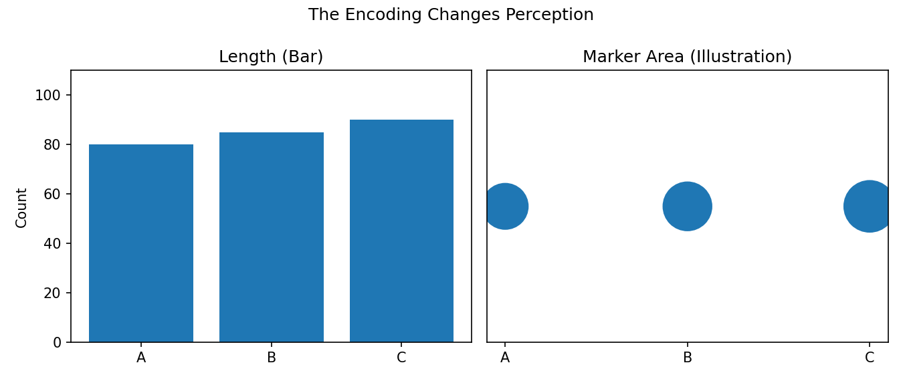

---

<a id="section-2-5"></a>
## 2.5. Baselines & Truncated Axes — 기준점과 왜곡

막대그래프는 **길이 또는 높이**로 값을 비교하기 때문에, 0이 의미 있는 양(개수·매출·빈도 등)을 표현할 때는 일반적으로 0을 기준으로 시작하는 것이 좋습니다. 0보다 큰 값만 보여주도록 축을 자르면 작은 차이가 과장될 수 있습니다.

다음 두 그래프는 **A=80점, B=85점**으로 완전히 같은 데이터입니다.

- 왼쪽은 0~100을 사용하며 막대 길이가 실제 값을 나타냅니다.
- 오른쪽은 75~100을 사용합니다. **비교를 위한 왜곡 사례**이며 권장 방식이 아닙니다.
- 실제 차이는 **5점**입니다. `85/80 = 1.0625`이므로 B는 A보다 **6.25% 높습니다**. 잘린 막대 높이만 비교하면 이보다 훨씬 큰 격차로 받아들일 수 있습니다.

온도처럼 0이 자연스러운 기준점이 아닌 수치의 *선 그래프*에서는 전체 변화 폭을 보이기 위해 0부터 시작하지 않아도 됩니다. 그래프 유형과 비교 목적을 함께 고려해야 합니다.

**예제 코드 — [04_truncated_bar_axis.py](./examples/04_truncated_bar_axis.py)**

```python
from pathlib import Path
import matplotlib
matplotlib.use("Agg")
import matplotlib.pyplot as plt

ROOT = Path(__file__).resolve().parents[1]
OUTPUT = ROOT / "output"
OUTPUT.mkdir(exist_ok=True)

values = [80, 85]
fig, axes = plt.subplots(1, 2, figsize=(9.2, 4))
for ax in axes:
    bars = ax.bar(["A", "B"], values)
    ax.bar_label(bars, padding=4)
    ax.set_ylabel("Score (points)")
axes[0].set(title="Zero Baseline", ylim=(0, 100))
axes[1].set(title="Truncated Bar Axis (Misleading)", ylim=(75, 100))
fig.tight_layout()
fig.savefig(OUTPUT / "04_truncated_bar_axis.png", dpi=150)
plt.close(fig)
print("Absolute difference:", values[1] - values[0], "points")
```

**실행 결과**

```text
Absolute difference: 5 points
```

**생성된 그래프**

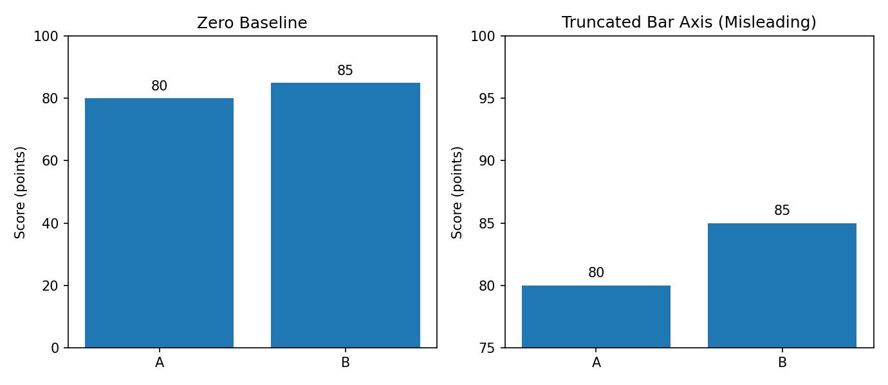

---

<a id="section-2-6"></a>
## 2.6. Dot Plots & Fair Comparison — 작은 차이 비교

80점과 85점처럼 가까운 값을 비교할 때, **Dot Plot(점 그래프)**은 위치로 차이를 표현하므로 0부터 시작하지 않는 범위를 활용할 수 있습니다. 단, 축이 확대되어 있다는 사실은 독자가 쉽게 확인할 수 있어야 합니다.

여기에서는 76~90점으로 범위를 제한했으며, 막대처럼 면적이 0부터 채워지는 시각 요소를 사용하지 않습니다. 그래프 아래에 절대 차이와 단위를 함께 설명하면 해석에 도움이 됩니다.

**예제 코드 — [05_dot_plot_alternative.py](./examples/05_dot_plot_alternative.py)**

```python
from pathlib import Path
import matplotlib
matplotlib.use("Agg")
import matplotlib.pyplot as plt

ROOT = Path(__file__).resolve().parents[1]
OUTPUT = ROOT / "output"
OUTPUT.mkdir(exist_ok=True)

values = [80, 85]
fig, ax = plt.subplots(figsize=(7.5, 3.2))
ax.scatter(values, ["A", "B"], s=105)
ax.set(xlim=(76, 90), title="Compare Close Values with a Dot Plot", xlabel="Score (points)")
ax.grid(axis="x", alpha=.25)
fig.tight_layout()
fig.savefig(OUTPUT / "05_dot_plot_alternative.png", dpi=150)
plt.close(fig)
print("Difference: 5 points (A=80, B=85)")
```

**실행 결과**

```text
Difference: 5 points (A=80, B=85)
```

**생성된 그래프**

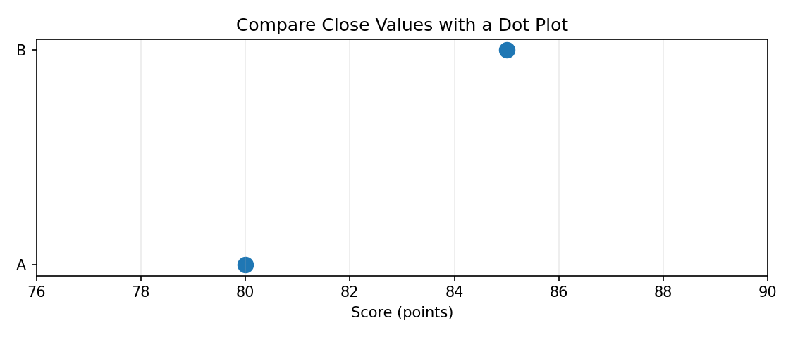

---

<a id="section-2-7"></a>
## 2.7. Counts, Rates & Denominators — 절대값과 비율

총 신규 등록자 수와 방문자 대비 신규 등록 비율은 **서로 다른 질문**에 답합니다.

- **건수(Count):** 신규 등록자가 실제로 몇 명인가요?
- **비율(Rate):** 전체 방문자 중 신규 등록자가 어느 정도 비중을 차지하나요?

이 Chapter의 비율은 다음과 같이 계산합니다.

$$
\text{신규 등록 비율}(\%) = \frac{\text{신규 등록자 수}}{\text{방문자 수}} \times 100
$$

여러 날짜를 합쳐 분관별 비율을 계산할 때는 **일별 비율을 단순 평균하는 대신, 기간 전체의 신규 등록자 수 합계를 방문자 수 합계로 나눕니다.** 서로 다른 방문 규모의 날을 같은 가중치로 취급하지 않기 위해서입니다. 분모가 0인 경우 비율을 정의할 수 없으므로 0%로 단정하지 않습니다.

같은 데이터라도 왼쪽의 절대 건수와 오른쪽의 비율에서 분관 순위가 달라질 수 있습니다. 이는 오류가 아니라 지표의 의미가 다르기 때문입니다.

**예제 코드 — [06_counts_vs_rates.py](./examples/06_counts_vs_rates.py)**

```python
from pathlib import Path
import matplotlib
matplotlib.use("Agg")
import matplotlib.pyplot as plt

ROOT = Path(__file__).resolve().parents[1]
OUTPUT = ROOT / "output"
OUTPUT.mkdir(exist_ok=True)
import sys
sys.path.insert(0, str(ROOT))
from project.chart_design import load_visits, branch_summary

summary = branch_summary(load_visits(ROOT / "data" / "library_visits.csv"))
fig, axes = plt.subplots(1, 2, figsize=(10.5, 4))
axes[0].bar(summary["branch"], summary["new_members"])
axes[0].set(title="New Members (Count)", ylabel="People")
axes[1].bar(summary["branch"], summary["signup_rate_pct"])
axes[1].set(title="New Members / Visitors (Rate)", ylabel="Percent (%)")
for ax in axes: ax.tick_params(axis="x", rotation=20)
fig.tight_layout()
fig.savefig(OUTPUT / "06_counts_vs_rates.png", dpi=150)
plt.close(fig)
print(summary[["branch", "new_members", "signup_rate_pct"]].round(2).to_string(index=False))
```

**실행 결과**

```text
branch  new_members  signup_rate_pct
  Central          275             8.01
Riverside          279            10.99
  Hilltop          286            15.05
 Eastgate          246            19.05
```

**생성된 그래프**

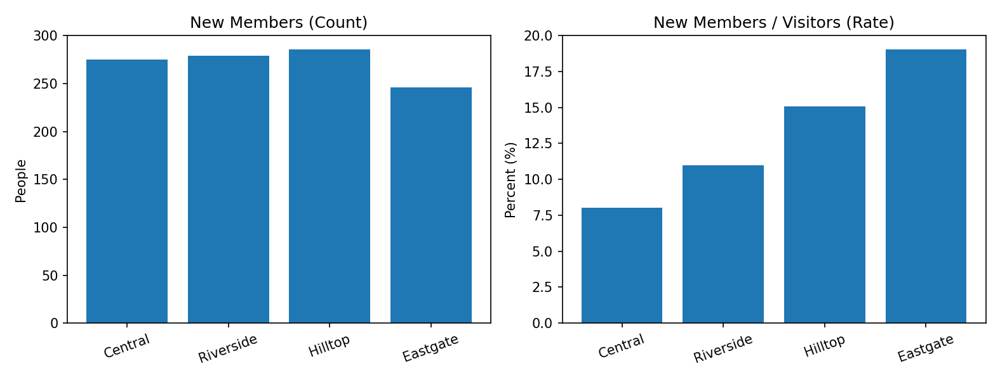

---

<a id="section-2-8"></a>
## 2.8. Color & Accessibility — 색상과 접근성

색상은 비교할 대상을 구분하거나 중요한 정보를 강조하는 데 유용합니다. 그러나 **색상만으로 구별할 수 있도록 설계하면 일부 독자가 그래프를 이해하기 어려울 수 있습니다.**

- 범주 수가 적고 구분이 중요할 때만 색상을 추가합니다.
- 색상에 더해 텍스트 라벨, 마커 모양, 패턴(Hatching) 등을 함께 사용할 수 있습니다.
- 밝은 배경과 대비되는 글자색을 사용하고, 작은 글자가 겹치지 않도록 합니다.
- 차트 이미지는 주변 문장·캡션 또는 대체 텍스트(Alt Text)로 핵심 수치를 전달합니다.
- 단순히 예쁘다는 이유로 모든 막대를 서로 다른 색상으로 만들 필요는 없습니다.

아래 예제는 **패턴과 수치 라벨**을 함께 사용하므로 흑백 출력에서도 비교할 수 있습니다.

**예제 코드 — [07_redundant_encoding.py](./examples/07_redundant_encoding.py)**

```python
from pathlib import Path
import matplotlib
matplotlib.use("Agg")
import matplotlib.pyplot as plt

ROOT = Path(__file__).resolve().parents[1]
OUTPUT = ROOT / "output"
OUTPUT.mkdir(exist_ok=True)

labels = ["Complete", "Pending", "Failed"]
values = [18, 9, 3]
fig, ax = plt.subplots(figsize=(7.5, 3.7))
bars = ax.bar(labels, values, edgecolor="black")
for bar, pattern in zip(bars, ["", "//", "xx"]):
    bar.set_hatch(pattern)
ax.bar_label(bars, padding=3)
ax.set(title="Status Counts (Patterns + Text)", ylabel="Cases", ylim=(0, 22))
fig.tight_layout()
fig.savefig(OUTPUT / "07_redundant_encoding.png", dpi=150)
plt.close(fig)
print("Counts:", dict(zip(labels, values)))
```

**실행 결과**

```text
Counts: {'Complete': 18, 'Pending': 9, 'Failed': 3}
```

**생성된 그래프**

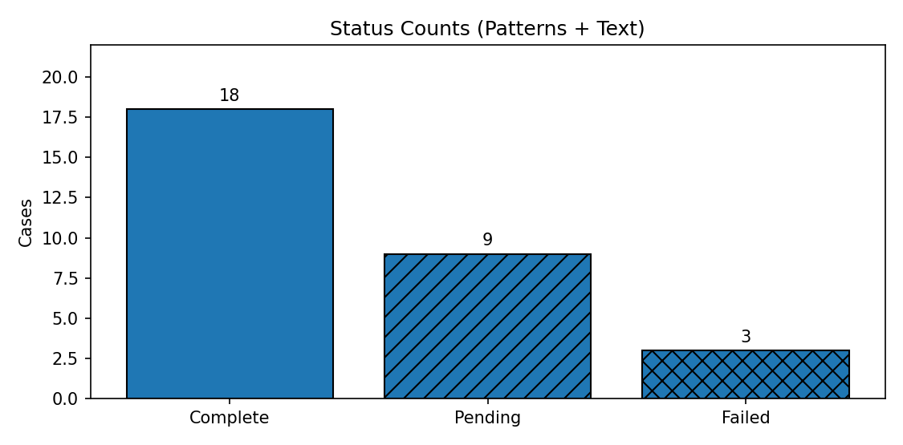

---

<a id="section-2-9"></a>
## 2.9. Axis Scales — 선형 및 로그 스케일

축 스케일은 데이터 값을 좌표에 배치하는 규칙입니다.

| 종류 | 특징 | 유의 사항 |
|---|---|---|
| Linear | 같은 수치 차이가 같은 거리로 표현됨 | 일반적인 양적 비교에 적합 |
| Logarithmic | 같은 *배율* 변화가 같은 거리로 표현됨 | 0 및 음수는 일반 로그 축에 바로 표시 불가능 |

12 → 120 → 1,200처럼 **각 단계가 10배씩 증가**하는 데이터는 선형 축과 로그 축에서 다르게 보입니다. 로그 축을 사용했다면 축에 눈금과 로그 스케일임을 명확하게 표시해야 합니다.

로그 축 자체가 왜곡은 아니지만, 독자가 선형 변화로 오해할 수 있으므로 사용 목적을 반드시 설명합니다.

**예제 코드 — [08_linear_vs_log_scale.py](./examples/08_linear_vs_log_scale.py)**

```python
from pathlib import Path
import matplotlib
matplotlib.use("Agg")
import matplotlib.pyplot as plt

ROOT = Path(__file__).resolve().parents[1]
OUTPUT = ROOT / "output"
OUTPUT.mkdir(exist_ok=True)

labels = ["Small", "Medium", "Large"]
values = [12, 120, 1200]
fig, axes = plt.subplots(1, 2, figsize=(9, 3.8))
for ax in axes:
    ax.plot(labels, values, marker="o")
    ax.set_ylabel("Positive count")
axes[0].set(title="Linear Y Axis")
axes[1].set_yscale("log")
axes[1].set(title="Log Y Axis (Explicit)")
fig.tight_layout()
fig.savefig(OUTPUT / "08_linear_vs_log_scale.png", dpi=150)
plt.close(fig)
print("Values: 12, 120, 1200 (10x steps)")
```

**실행 결과**

```text
Values: 12, 120, 1200 (10x steps)
```

**생성된 그래프**

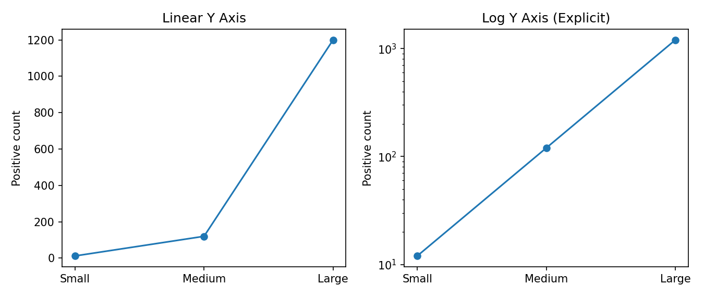

---

<a id="section-2-10"></a>
## 2.10. Category Ordering — 범주 순서와 정렬

범주형 비교에서 **정렬**은 큰 차이를 만듭니다. 순위를 비교하려면 크기 순 정렬이 편리하고, 교육 수준·지역·요일처럼 자연스러운 순서가 있는 경우 해당 순서를 유지하는 것이 좋습니다.

- **순위 비교:** 오름차순 또는 내림차순 정렬
- **시간적 순서:** 월→화→수, 1월→2월→3월처럼 시간 순서 유지
- **고정 분류 체계:** 단계/등급의 본래 순서 유지
- **범주가 많은 경우:** 수평 막대그래프와 간결한 라벨 고려

아래 예제는 같은 네 값을 원래 순서와 내림차순으로 각각 출력합니다.

**예제 코드 — [09_category_order.py](./examples/09_category_order.py)**

```python
from pathlib import Path
import matplotlib
matplotlib.use("Agg")
import matplotlib.pyplot as plt

ROOT = Path(__file__).resolve().parents[1]
OUTPUT = ROOT / "output"
OUTPUT.mkdir(exist_ok=True)

original = {"East": 75, "West": 120, "North": 91, "South": 160}
ordered = sorted(original.items(), key=lambda item: item[1], reverse=True)
fig, axes = plt.subplots(1, 2, figsize=(10, 3.8))
axes[0].bar(list(original), list(original.values()))
axes[0].set(title="Unsorted Categories", ylim=(0, 185))
axes[1].bar([x[0] for x in ordered], [x[1] for x in ordered])
axes[1].set(title="Sorted by Value", ylim=(0, 185))
fig.tight_layout()
fig.savefig(OUTPUT / "09_category_order.png", dpi=150)
plt.close(fig)
print("Ranked:", [name for name, _ in ordered])
```

**실행 결과**

```text
Ranked: ['South', 'West', 'North', 'East']
```

**생성된 그래프**

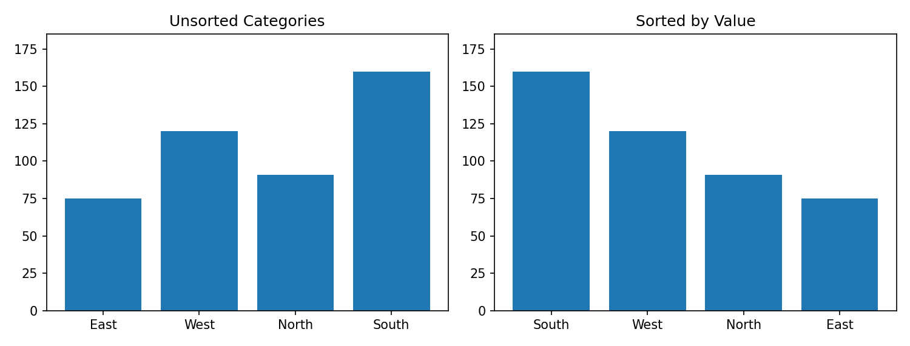

---

<a id="section-2-11"></a>
## 2.11. Time & Missing Observations — 시간과 결측 관측

시계열에서는 기록이 없는 날을 0으로 대체하면 **측정값 0**과 **관측 자체가 없음**을 혼동하게 됩니다. `Eastgate`의 2026-10-07 기록은 원본에 없으며 방문자 수가 0이었다는 뜻이 아닙니다.

날짜를 모두 생성한 뒤 `reindex()`로 관측값이 존재하는지 확인하면 빠진 날짜가 `NaN`으로 표시됩니다. Matplotlib의 선 그래프는 일반적으로 이런 결측 지점에서 선을 끊어 표현할 수 있습니다.

실제 시계열을 비교하기 전에는 시간대, 데이터 집계 단위, 누락 기간, 불규칙한 관측 간격을 함께 확인합니다. 이후 Chapter 06에서 보다 자세한 시계열 시각화를 학습합니다.

**예제 코드 — [10_missing_dates.py](./examples/10_missing_dates.py)**

```python
from pathlib import Path
import matplotlib
matplotlib.use("Agg")
import matplotlib.pyplot as plt

ROOT = Path(__file__).resolve().parents[1]
OUTPUT = ROOT / "output"
OUTPUT.mkdir(exist_ok=True)
import pandas as pd

frame = pd.read_csv(ROOT / "data" / "library_visits.csv", parse_dates=["date"])
east = frame.loc[frame["branch"].eq("Eastgate"), ["date", "visitors"]]
full_dates = pd.date_range("2026-10-01", "2026-10-14", freq="D")
east = east.set_index("date").reindex(full_dates)
assert east["visitors"].isna().sum() == 1
fig, ax = plt.subplots(figsize=(8.4, 3.6))
ax.plot(east.index, east["visitors"], marker="o")
ax.set(title="Eastgate: Missing Observation Remains a Gap", ylabel="Visitors / day")
ax.tick_params(axis="x", rotation=30)
ax.grid(alpha=.2)
fig.tight_layout()
fig.savefig(OUTPUT / "10_missing_dates.png", dpi=150)
plt.close(fig)
print("Missing date:", east.index[east["visitors"].isna()][0].date())
```

**실행 결과**

```text
Missing date: 2026-10-07
```

**생성된 그래프**

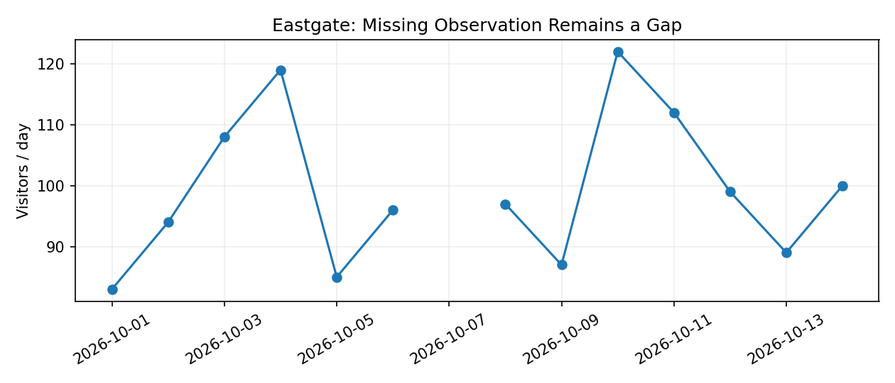

---

<a id="section-2-12"></a>
## 2.12. Histograms & Binning — 구간 설정의 영향

히스토그램은 연속 수치 데이터를 여러 구간(Bin)으로 나누고 각 구간에 속한 관측 개수를 나타냅니다. **구간의 개수와 경계가 바뀌면 분포의 모습도 바뀝니다.**

- 구간이 너무 적으면 여러 특징이 하나로 뭉칠 수 있습니다.
- 구간이 너무 많으면 적은 표본에서 우연한 들쭉날쭉함이 크게 보일 수 있습니다.
- 서로 다른 데이터셋을 비교할 때는 가능하면 같은 구간과 범위를 사용합니다.
- 표본의 개수와 관측 단위를 명시하고 작은 표본에 지나치게 확정적인 해석을 피합니다.

아래는 동일한 일별 방문자 수 55개를 4개 구간과 12개 구간으로 나눈 비교입니다.

**예제 코드 — [11_histogram_bin_choice.py](./examples/11_histogram_bin_choice.py)**

```python
from pathlib import Path
import matplotlib
matplotlib.use("Agg")
import matplotlib.pyplot as plt

ROOT = Path(__file__).resolve().parents[1]
OUTPUT = ROOT / "output"
OUTPUT.mkdir(exist_ok=True)
import pandas as pd

frame = pd.read_csv(ROOT / "data" / "library_visits.csv")
counts = frame["visitors"]
fig, axes = plt.subplots(1, 2, figsize=(9.5, 3.8), sharey=True)
axes[0].hist(counts, bins=4, edgecolor="white")
axes[0].set(title="4 Bins", xlabel="Visitors / day", ylabel="Days")
axes[1].hist(counts, bins=12, edgecolor="white")
axes[1].set(title="12 Bins", xlabel="Visitors / day")
fig.tight_layout()
fig.savefig(OUTPUT / "11_histogram_bin_choice.png", dpi=150)
plt.close(fig)
print("Observations:", len(counts))
```

**실행 결과**

```text
Observations: 55
```

**생성된 그래프**

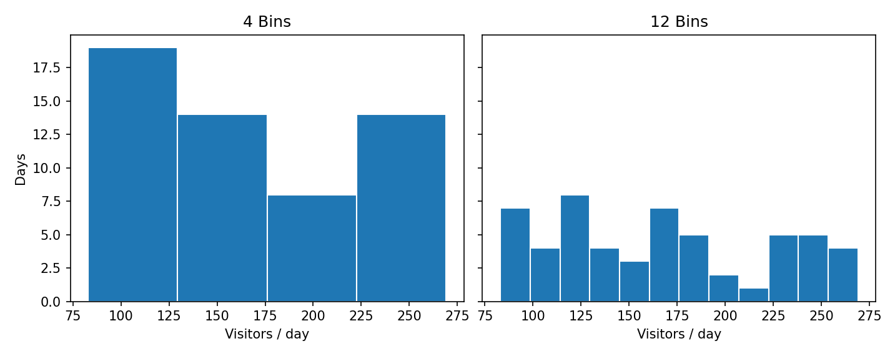

---

<a id="section-2-13"></a>
## 2.13. Variability & Uncertainty — 변동성과 불확실성

그래프에서 오차 막대(Error Bar)를 사용한다면 **무엇을 나타내는지** 반드시 밝혀야 합니다.

| 표시 | 의미 | 주의 |
|---|---|---|
| Standard Deviation (SD) | 관측값 자체의 퍼짐 정도 | 평균 추정의 불확실성과 같지 않음 |
| Standard Error (SE) | 특정 가정에서 추정량의 변동성 척도 | 표본 추출 구조에 의존 |
| Confidence Interval (CI) | 모수 추정의 불확실성을 표현한 구간 | 계산 방법, 수준, 전제 명시 필요 |

예제는 두 측정 집단에 대해 **평균 ± 표본 표준편차**를 표시합니다. 신뢰구간이나 통계적으로 유의미한 차이를 주장하는 그림은 아닙니다. 실제 데이터 분석에서는 표본 크기, 모집 방식, 독립성 및 측정 단위를 검토해야 합니다.

**예제 코드 — [12_variation_not_uncertainty.py](./examples/12_variation_not_uncertainty.py)**

```python
from pathlib import Path
import matplotlib
matplotlib.use("Agg")
import matplotlib.pyplot as plt

ROOT = Path(__file__).resolve().parents[1]
OUTPUT = ROOT / "output"
OUTPUT.mkdir(exist_ok=True)
import numpy as np

samples = {"Method A": [10.0, 10.5, 9.8, 11.0, 10.2], "Method B": [12.2, 11.5, 12.0, 13.1, 11.2]}
labels = list(samples)
means = [np.mean(samples[name]) for name in labels]
stds = [np.std(samples[name], ddof=1) for name in labels]
fig, ax = plt.subplots(figsize=(7.4, 3.8))
ax.errorbar(labels, means, yerr=stds, fmt="o", capsize=6)
ax.set(title="Mean ± Sample SD (Not a Confidence Interval)", ylabel="Measurement units", ylim=(8.8, 14.0))
ax.grid(axis="y", alpha=.2)
fig.tight_layout()
fig.savefig(OUTPUT / "12_variation_not_uncertainty.png", dpi=150)
plt.close(fig)
for label, mean, sd in zip(labels, means, stds): print(f"{label}: mean={mean:.2f}, sample SD={sd:.2f}")
```

**실행 결과**

```text
Method A: mean=10.30, sample SD=0.47
Method B: mean=12.00, sample SD=0.73
```

**생성된 그래프**

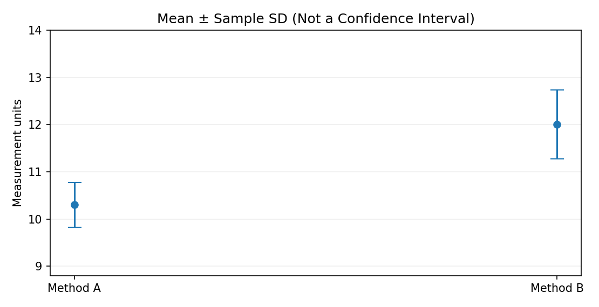

---

<a id="section-2-14"></a>
## 2.14. Dual Axes & Small Multiples — 비교를 위한 축 설계

서로 다른 단위를 하나의 그림에 나타내기 위해 양쪽에 서로 다른 y축을 두는 **Dual-Axis Chart**는 두 선이 실제보다 밀접하게 함께 움직이는 것처럼 보이게 할 위험이 있습니다. 두 축의 범위를 각각 바꾸면 같은 데이터에서도 인상이 달라지기 때문입니다.

이런 상황에서는 우선 **별도 Axes를 세로로 나누되 같은 시간축을 공유하는 방식**을 고려할 수 있습니다. 단위가 다르면 각 그래프에 명확한 축 제목을 표시하고, 비교할 수 있는 범위만 해석해야 합니다.

여러 범주의 추이를 동시에 살펴볼 때는 **Small Multiples**(동일한 형식을 여러 패널로 반복하는 방법)를 고려할 수 있습니다. 단순한 절대 규모 비교라면 패널마다 축 범위를 달리하지 말고 공통 축을 사용하는 것이 유리합니다.

**데이터 누락 주의:** 이 예제의 일별 합계에는 Eastgate의 하루 기록이 빠져 있으므로, 해당 날짜의 합계 감소를 실제 방문 감소로 단정하지 않습니다.

**예제 코드 — [13_dual_axis_alternative.py](./examples/13_dual_axis_alternative.py)**

```python
from pathlib import Path
import matplotlib
matplotlib.use("Agg")
import matplotlib.pyplot as plt

ROOT = Path(__file__).resolve().parents[1]
OUTPUT = ROOT / "output"
OUTPUT.mkdir(exist_ok=True)
import pandas as pd

frame = pd.read_csv(ROOT / "data" / "library_visits.csv", parse_dates=["date"])
daily = frame.groupby("date", as_index=False)[["visitors", "new_members"]].sum()
fig, axes = plt.subplots(2, 1, figsize=(8.4, 5.8), sharex=True)
axes[0].plot(daily["date"], daily["visitors"], marker="o", markersize=3)
axes[0].set(ylabel="Visitors (people)", title="Same Timeline, Separate Scales")
axes[1].plot(daily["date"], daily["new_members"], marker="o", markersize=3)
axes[1].set(ylabel="New members (people)", xlabel="Date")
for ax in axes: ax.grid(alpha=.2)
axes[1].tick_params(axis="x", rotation=30)
fig.tight_layout()
fig.savefig(OUTPUT / "13_dual_axis_alternative.png", dpi=150)
plt.close(fig)
print("Daily rows:", len(daily))
```

**실행 결과**

```text
Daily rows: 14
```

**생성된 그래프**

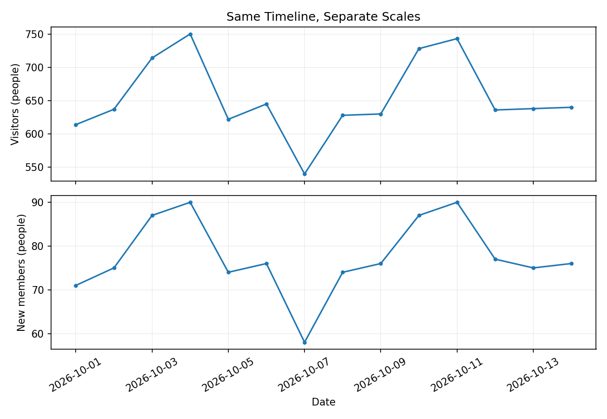

---

<a id="section-2-15"></a>
## 2.15. Titles, Labels & Annotations — 그래프 설명과 출처

좋은 그래프는 데이터만 보여주는 것이 아니라 **독자가 오해 없이 읽기 위한 맥락**도 제공합니다.

| 요소 | 검토할 질문 |
|---|---|
| 제목(Title) | 무엇을 비교하는 그래프인가요? |
| 축 이름·단위 | 수치가 명, %, 원, °C 중 무엇을 나타내나요? |
| 범례(Legend) | 색과 기호가 가리키는 대상이 분명한가요? |
| 값 라벨 | 정확한 숫자가 꼭 필요한가요? 지나치게 많지 않나요? |
| 데이터 출처 | 어디에서 수집되거나 생성된 데이터인가요? |
| 기간·범위 | 어느 시점과 대상을 포함하나요? |
| 한계·주의 | 결측값, 서로 다른 분모, 집계 기준 등의 문제가 있나요? |

아래 예제는 총 방문자 수를 표시하면서, **Eastgate의 하루 기록이 누락되어 총합이 다른 분관과 동일한 관측일 기준이 아니라는 점**을 그림 아래에 알립니다. 총합은 실제 존재하는 13일/14일 기록만을 합한 값입니다.

**예제 코드 — [14_annotations_and_source.py](./examples/14_annotations_and_source.py)**

```python
from pathlib import Path
import matplotlib
matplotlib.use("Agg")
import matplotlib.pyplot as plt

ROOT = Path(__file__).resolve().parents[1]
OUTPUT = ROOT / "output"
OUTPUT.mkdir(exist_ok=True)
import sys
sys.path.insert(0, str(ROOT))
from project.chart_design import load_visits, branch_summary

summary = branch_summary(load_visits(ROOT / "data" / "library_visits.csv"))
fig, ax = plt.subplots(figsize=(8.5, 4.2))
bars = ax.barh(summary["branch"], summary["visitors"])
ax.invert_yaxis()
ax.set(xlim=(0, summary["visitors"].max()*1.2),
       xlabel="Visitors (people)", title="Total Visits by Branch")
ax.bar_label(bars, padding=3)
ax.text(0, -0.23, "Source: Synthetic library visits, 2026-10-01 to 2026-10-14",
        transform=ax.transAxes, fontsize=8)
ax.text(0, -0.32, "Note: Eastgate has one missing date; totals are observed only.",
        transform=ax.transAxes, fontsize=8)
fig.subplots_adjust(bottom=.34)
fig.savefig(OUTPUT / "14_annotations_and_source.png", dpi=150, bbox_inches="tight")
plt.close(fig)
print("Annotated chart saved")
```

**실행 결과**

```text
Annotated chart saved
```

**생성된 그래프**

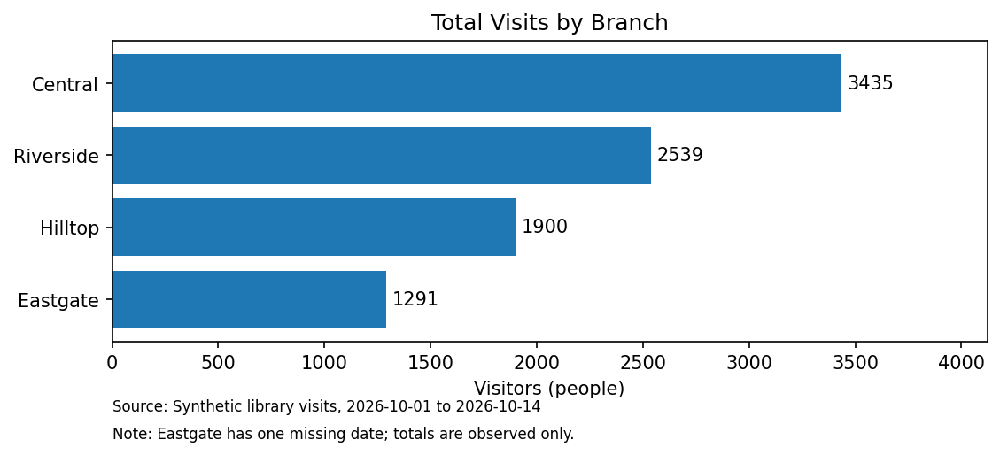

---

<a id="section-2-16"></a>
## 2.16. Mini Project — Library Visualization Design Review

### 목표

가상 도서관 4개 분관의 방문 기록을 사용하여 **질문별 그래프를 올바르게 선택하고**, 왜곡될 수 있는 표시를 검토한 뒤 독자가 해석할 수 있는 보고서를 제작합니다. 이 프로젝트는 **데이터 시각화 설계**에 초점을 둡니다. 복잡한 결측치 정제나 파일 변환은 [Data Processing](../../Data_Processing/)에서 학습한 내용을 활용합니다.

### 데이터와 완료 조건

| 항목 | 기대 결과 |
|---|---|
| 입력 | `data/library_visits.csv`의 스키마 검증 |
| 관측 범위 | 4개 분관 × 14일 = 예정 56행 |
| 실제 기록 | 55행, 결측 날짜 1건 |
| 기간 방문자 수 합계 | **9,165명** |
| 기간 신규 등록자 수 합계 | **1,086명** |
| 분관별 요약 | 전체 방문자 수, 관측일 수, 관측일 평균, 신규 등록 비율 |
| 그래프 | 총합, 관측일 평균, 신규 등록 비율, 일별 추이, 수집 완전성 |
| 출력 | PNG 5개, CSV 2개, JSON 1개 |

**입력 검증:** 열 이름과 타입, 날짜 범위, 분관 이름, 음수 데이터, `new_members > visitors`, 날짜·분관 중복 등을 검사합니다. 오류가 발견되면 그래프를 제작하지 않고 예외를 발생시킵니다.

### 파일 구조

```text
Chapter-02/
├── README.md
├── requirements.txt
├── .gitignore
├── data/
│   ├── DATA_DICTIONARY.md
│   └── library_visits.csv
├── figures/                 # 검증한 그래프 이미지
├── examples/                # 학습용 예제 16개
├── exercises/               # 연습문제 5개
├── solutions/               # 정답 코드 5개
├── project/
│   ├── __init__.py
│   ├── chart_design.py      # 데이터 검사, 요약, 그래프 생성
│   └── main.py              # 프로젝트 실행 진입점
├── tests/
│   └── test_chapter02.py
└── output/                  # 실행 후 자동 생성, Git 추적 제외
```

[chart_design.py](./project/chart_design.py)는 파일 불러오기(`load_visits`), 분관별 요약(`branch_summary`), 기대 날짜표 생성(`completeness`), 그래프 작성(`make_charts`), 보고서 저장(`make_report`)을 함수로 구분합니다.

### 데이터 점검 예제

**예제 코드 — [15_project_overview.py](./examples/15_project_overview.py)**

```python
from pathlib import Path
import sys

ROOT = Path(__file__).resolve().parents[1]
sys.path.insert(0, str(ROOT))
from project.chart_design import load_visits, branch_summary, completeness

frame = load_visits(ROOT / "data" / "library_visits.csv")
summary = branch_summary(frame)
coverage = completeness(frame)
print("Observed:", len(frame), "Expected:", len(coverage))
print("Missing:", int((~coverage["observed"]).sum()))
print("Overall visitors:", int(summary["visitors"].sum()))
print("Branch totals:", summary.set_index("branch")["visitors"].to_dict())
```

**실행 결과**

```text
Observed: 55 Expected: 56
Missing: 1
Overall visitors: 9165
Branch totals: {'Central': 3435, 'Riverside': 2539, 'Hilltop': 1900, 'Eastgate': 1291}
```

### 프로젝트 실행

**예제 코드 — [16_run_mini_project.py](./examples/16_run_mini_project.py)**

```python
from pathlib import Path
import sys

ROOT = Path(__file__).resolve().parents[1]
sys.path.insert(0, str(ROOT))
from project.chart_design import load_visits, make_report

result = make_report(load_visits(ROOT / "data" / "library_visits.csv"), ROOT / "output")
print("Visitors:", result["total_visitors"])
print("Missing:", result["missing_records"])
print("Images:", len(result["figure_files"]))
```

**실행 결과**

```text
Visitors: 9165
Missing: 1
Images: 5
```

또는 명령행에서 프로젝트 진입점을 직접 실행합니다.

```bash
python -m project.main
python -m project.main --output output/custom_report
```

**기본 실행 결과**

```text
Rows: 55/56 expected
Missing records: 1
Total visitors: 9,165
New memberships: 1,086
Charts saved: 5
```

**주요 출력 파일**

| 파일 | 내용 |
|---|---|
| `branch_summary.csv` | 분관별 총합, 관측일, 관측일 평균 및 신규 등록 비율 |
| `missing_dates.csv` | 누락된 날짜 및 분관의 조합 |
| `report.json` | 입력 행 수, 예정 행 수, 누락 건수, 총합, 출력 파일명 |
| `branch_totals.png` | 분관별 방문자 총합 |
| `daily_mean_dots.png` | 관측일 기준 하루 평균 방문자 수 비교 |
| `signup_rates.png` | 분관별 신규 등록 비율 |
| `daily_trends.png` | 네 분관의 일별 방문 추이를 비교한 Small Multiples |
| `data_completeness.png` | 관측된 날짜와 누락된 날짜의 구분 |

### 실제 생성된 프로젝트 그래프

**① 총방문자 수 — 막대 길이는 0부터 시작**

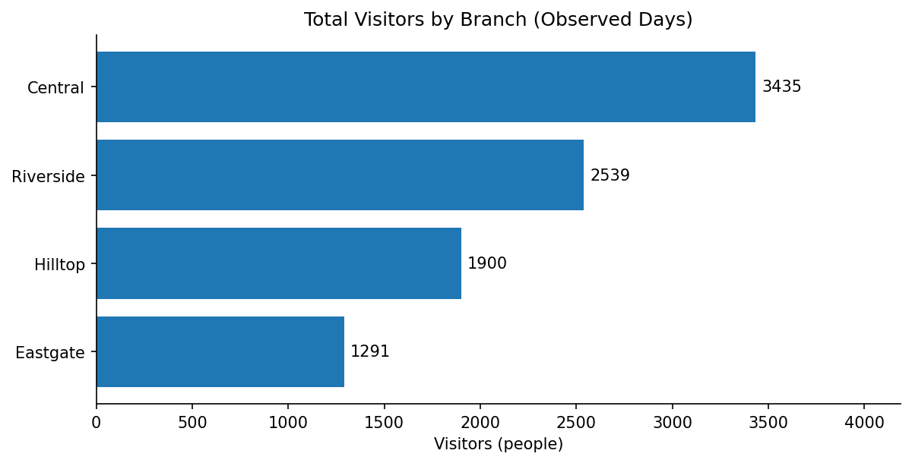

**② 관측일 평균 방문자 수 — 점의 위치로 비교**

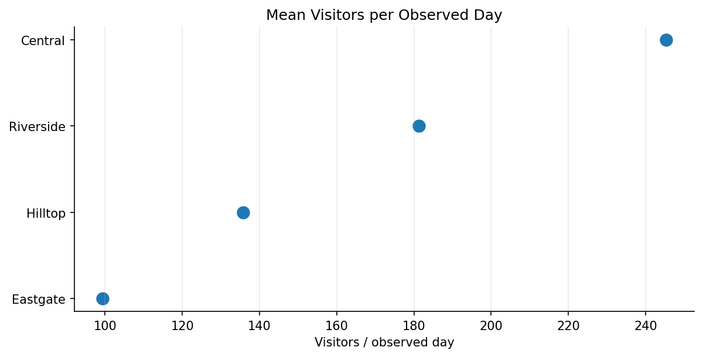

**③ 신규 등록 비율 — 분모는 각 분관의 방문자 수 합계**

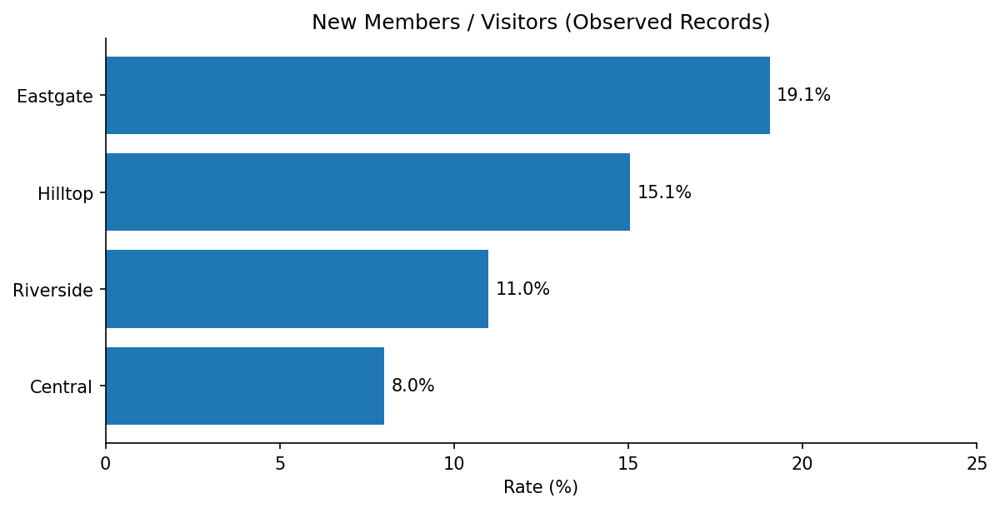

**④ 일별 추이 — 누락 관측을 0명으로 채우지 않음**

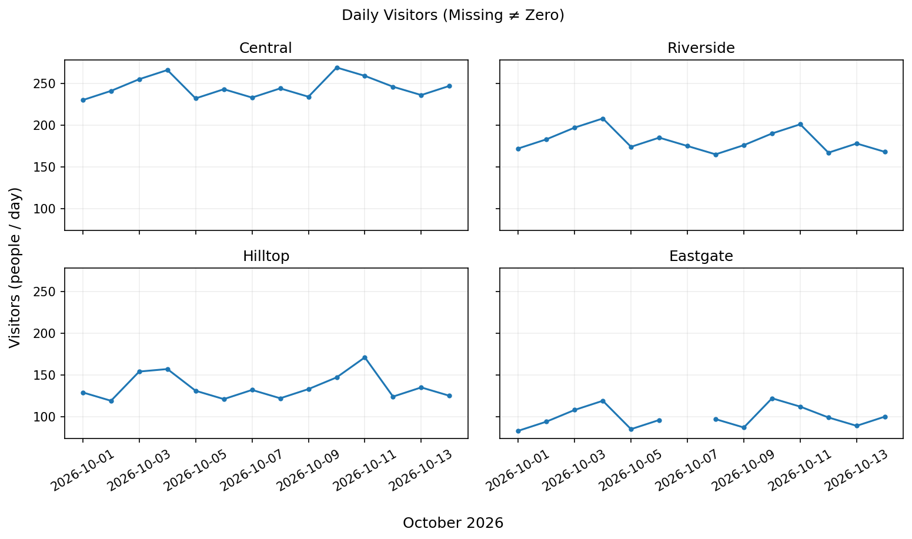

**⑤ 데이터 수집 완전성 — 예정 14일 중 관측된 날짜**

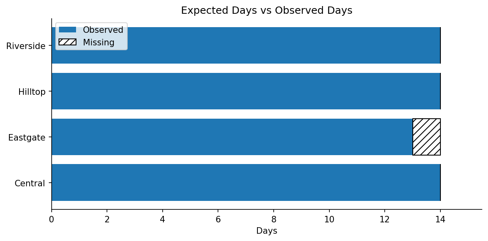

### 결과 해석 및 한계

- **Central**은 원본 기준 총 방문자 수가 가장 많습니다. 이는 절대량 비교 결과입니다.
- **Eastgate**는 신규 등록 비율이 가장 높습니다. 다만 등록 비율이 높다고 곧바로 운영 성과가 더 좋다고 결론지을 수는 없습니다.
- **Eastgate**는 14일 중 13일의 기록만 있습니다. 전체 기간의 누적 수치를 비교할 때 이 차이를 밝혀야 합니다.
- **관측일 평균**은 기록이 있는 날만 분모로 사용합니다. 전체 14일 평균과 같은 뜻이 아닙니다.
- `event_day`는 행사 여부를 나타내지만 이 가상 자료만으로 행사가 방문자를 늘렸다는 인과효과를 검증할 수는 없습니다.
- 결과 이미지의 출처는 **Synthetic library visits (교육용 가상 데이터)**입니다.

**실행 확인:** `python -m unittest discover -s tests -v`로 데이터 검증과 보고서 생성을 확인합니다. `output/`은 언제든 재생성할 수 있으므로 Git에 커밋하지 않습니다.

---

<a id="section-2-17"></a>
## 2.17. Coding Practice

`exercises/`에는 직접 작성할 코드의 시작 파일을, `solutions/`에는 같은 문제를 해결한 예시 답안을 제공합니다. **정답 코드를 먼저 열기보다 문제의 요구사항을 충족하도록 작성한 다음** 결과를 비교하는 것을 권장합니다.

| 번호 | 실습 | 문제 코드 | 정답 코드 |
|:---:|---|---|---|
| 01 | Branch Visit Ranking | [문제](./exercises/01_branch_visit_ranking.py) | [정답](./solutions/01_branch_visit_ranking.py) |
| 02 | Registration Rate | [문제](./exercises/02_registration_rate.py) | [정답](./solutions/02_registration_rate.py) |
| 03 | Missing Date Analysis | [문제](./exercises/03_missing_date_analysis.py) | [정답](./solutions/03_missing_date_analysis.py) |
| 04 | Compare Two Encodings | [문제](./exercises/04_compare_two_encodings.py) | [정답](./solutions/04_compare_two_encodings.py) |
| 05 | Small Multiples | [문제](./exercises/05_small_multiples.py) | [정답](./solutions/05_small_multiples.py) |

### Exercise 01 — Branch Visit Ranking

- CSV를 읽고 분관별 방문자 수의 **합계**를 계산합니다.
- 방문자 수가 높은 분관부터 **수평 막대그래프**로 정렬합니다.
- 막대 길이는 **0을 기준**으로 하며, 단위를 명시합니다.
- **확인값:** `Central=3435`, `Riverside=2539`, `Hilltop=1900`, `Eastgate=1291`.

### Exercise 02 — Registration Rate

- 분관별 `new_members`와 `visitors`를 각각 합산합니다.
- 합산된 값으로 신규 등록 비율(%)을 구합니다. 일별 비율의 단순 평균을 사용하지 않습니다.
- 분모가 0인 경우 비율은 계산하지 않도록 처리합니다.
- 비율이 높은 분관부터 그래프를 그립니다.
- **확인값:** `Eastgate`의 비율은 약 **19.05%**입니다.

### Exercise 03 — Missing Date Analysis

- 2026-10-01부터 2026-10-14까지 **모든 분관·날짜 조합**을 생성합니다.
- 원본에 없는 조합을 탐지하고, 결측값을 0으로 바꾸지 않습니다.
- `Eastgate`의 일별 추이를 표시합니다.
- **확인값:** `2026-10-07`, `Eastgate` 1행이 누락되어 있습니다.

### Exercise 04 — Compare Two Encodings

- 점수 A=80, B=85를 **0 기준 막대그래프**와 **확대된 Dot Plot**으로 비교합니다.
- 두 그래프가 **같은 값을 서로 다른 방법으로 표시**한다는 점을 확인합니다.
- 막대그래프를 75부터 시작하지 않으며 확대된 Dot Plot의 축 범위를 명시합니다.

### Exercise 05 — Small Multiples

- 4개 분관의 방문자 수 추이를 **2×2 Subplots**로 나타냅니다.
- 모든 패널에서 동일한 y축 범위를 사용합니다.
- 관측값이 없는 날짜는 비어 있는 상태로 유지합니다.
- **확인값:** `Central`, `Riverside`, `Hilltop`은 각각 14일, `Eastgate`는 13일이 관측되었습니다.

정답 실행 예시:

```bash
python solutions/01_branch_visit_ranking.py
python solutions/03_missing_date_analysis.py
python solutions/05_small_multiples.py
```

---

<a id="section-2-18"></a>
## 2.18. Quiz & Summary

### Quiz

각 문제의 답은 해당 문항 아래의 **정답 및 해설 확인**을 펼쳐서 확인합니다.

**1.** 막대그래프에서 0을 기준으로 시작하는 이유는 무엇인가요?

<details>
<summary>정답 및 해설 확인</summary>

**정답:** 막대의 길이가 실제 값의 크기와 비례하도록 하기 위해서입니다.

**해설:** 개수·매출처럼 0이 의미 있는 양을 막대로 표현할 때 기준점을 자르면 작은 수치 차이가 길이 차이로 과장될 수 있습니다.

</details>

**2.** A=80, B=85인 값에서 B가 A보다 몇 퍼센트 높은가요?

<details>
<summary>정답 및 해설 확인</summary>

**정답:** 6.25%

**해설:** `(85-80) / 80 × 100 = 6.25%`입니다. 차이는 5점이고, 상대 증가율의 분모는 A(80)입니다.

</details>

**3.** Dot Plot에서 확대된 축을 사용할 수 있는 이유는 무엇인가요?

<details>
<summary>정답 및 해설 확인</summary>

**정답:** 막대의 채워진 길이가 아니라 좌표상의 위치로 값을 비교하기 때문입니다.

**해설:** 작은 차이를 더 쉽게 볼 수 있지만 축의 시작값과 끝값은 명확하게 표시해야 합니다.

</details>

**4.** 분관별 신규 등록 비율을 기간 전체로 계산할 때 분모는 무엇인가요?

<details>
<summary>정답 및 해설 확인</summary>

**정답:** 해당 분관의 기간 전체 방문자 수 합계입니다.

**해설:** 기간 신규 등록 합계 ÷ 기간 방문자 합계 × 100을 사용합니다. 일별 비율의 무가중 평균은 방문 규모가 서로 다를 때 다른 값을 만들 수 있습니다.

</details>

**5.** 그래프의 색상만으로 범주를 구별하도록 만드는 것이 바람직한가요?

<details>
<summary>정답 및 해설 확인</summary>

**정답:** 권장하지 않습니다.

**해설:** 색상과 함께 텍스트 라벨, 마커 모양, 패턴 등을 사용하면 색각 차이와 흑백 출력에서도 정보를 전달할 수 있습니다.

</details>

**6.** 로그 스케일에서 10, 100, 1000의 간격이 균등하게 보이는 이유는 무엇인가요?

<details>
<summary>정답 및 해설 확인</summary>

**정답:** 각각 같은 10배의 배율 변화이기 때문입니다.

**해설:** 일반 로그 축은 선형적인 절대 차이가 아니라 일정한 배율 변화가 같은 간격으로 배치됩니다. 0과 음수는 일반 로그 축에서 직접 표현할 수 없습니다.

</details>

**7.** Eastgate의 10월 7일 기록이 없을 때 방문자 수를 0으로 처리해도 되나요?

<details>
<summary>정답 및 해설 확인</summary>

**정답:** 안 됩니다.

**해설:** 관측 자체가 없는 상태는 실제 방문자 0명과 다릅니다. `NaN` 등 결측 상태로 유지하고 수집 완전성을 따로 표시해야 합니다.

</details>

**8.** 히스토그램에서 `bins`를 변경하면 원본 데이터의 값도 바뀌나요?

<details>
<summary>정답 및 해설 확인</summary>

**정답:** 바뀌지 않습니다.

**해설:** 구간 경계와 각 구간에 포함되는 관측 수가 달라져 그래프의 모양이 바뀔 뿐, 원본 수치는 그대로입니다.

</details>

**9.** 평균 ± 표본 표준편차를 표현한 오차 막대는 곧 95% 신뢰구간인가요?

<details>
<summary>정답 및 해설 확인</summary>

**정답:** 아닙니다.

**해설:** 표준편차는 관측값의 퍼짐 정도이고, 신뢰구간은 별도의 통계적 가정과 계산 방법을 통해 구합니다.

</details>

**10.** 서로 단위가 다른 두 시계열을 비교할 때 Dual-Axis Chart의 주의점은 무엇인가요?

<details>
<summary>정답 및 해설 확인</summary>

**정답:** 두 축의 범위를 임의로 조절하면 두 선이 실제보다 비슷하게 움직이는 것처럼 보일 수 있습니다.

**해설:** 목적에 따라 같은 x축을 공유하는 두 개의 패널로 분리하는 방법을 우선 고려할 수 있습니다.

</details>

**11.** 분관별 총방문자 수가 많으면 신규 등록 비율도 반드시 높나요?

<details>
<summary>정답 및 해설 확인</summary>

**정답:** 그렇지 않습니다.

**해설:** 방문자 총합은 절대량이며 신규 등록 비율은 신규 등록 수를 방문자 수로 나눈 상대 지표입니다. 둘의 순위는 달라질 수 있습니다.

</details>

**12.** 작은 그래프 4개를 나란히 비교할 때 공통 y축 범위가 유용한 이유는 무엇인가요?

<details>
<summary>정답 및 해설 확인</summary>

**정답:** 동일한 눈금 기준으로 패널 사이의 수치 크기와 변화 폭을 비교할 수 있기 때문입니다.

**해설:** 패널마다 축 범위를 다르게 하면 비슷한 선의 높이·변동 폭이 실제로 같은 크기라는 잘못된 인상을 줄 수 있습니다.

</details>

### Summary

- **Chart Selection:** 비교·변화·분포·관계 중 어떤 질문을 다루는지 먼저 결정합니다.
- **Visual Encoding:** 위치·길이·색상·면적은 서로 다른 방식으로 정보를 전달합니다.
- **Zero Baseline:** 개수·총량을 표현하는 막대그래프는 일반적으로 0 기준을 유지합니다.
- **Dot Plot:** 가까운 값의 차이를 강조하려면 축 범위가 명확한 점 그래프를 고려합니다.
- **Counts & Rates:** 절대값과 상대 비율은 다른 질문에 답합니다. 분모를 명확하게 밝힙니다.
- **Color & Accessibility:** 색상 외에도 패턴·라벨을 사용해 정보 전달을 보완합니다.
- **Linear & Log Scales:** 절대 차이와 배율 차이의 의미를 구별합니다.
- **Category Order:** 순위 비교인지, 자연스러운 순서인지에 따라 정렬을 결정합니다.
- **Missing Data:** 관측 누락은 실제로 측정된 0과 다르므로 인위적으로 채우지 않습니다.
- **Histogram Bins:** 같은 데이터라도 구간 설정에 따라 시각적 분포가 달라집니다.
- **Variability:** 표준편차는 신뢰구간과 동일하지 않습니다.
- **Dual Axes:** 서로 다른 축 범위 때문에 오해를 만들 수 있으므로 다중 패널 등 대안을 고려합니다.
- **Transparency:** 제목·축 단위·데이터 출처·관측 기간·결측·분모·표본 크기를 설명합니다.

### References

- [Matplotlib — Plot Types](https://matplotlib.org/stable/plot_types/index.html)
- [Matplotlib — Quick Start Guide](https://matplotlib.org/stable/users/explain/quick_start.html)
- [Matplotlib — Figure, Axes and Axis](https://matplotlib.org/stable/users/explain/quick_start.html#parts-of-a-figure)
- [Matplotlib — Logarithmic and Nonlinear Axes](https://matplotlib.org/stable/tutorials/pyplot.html#logarithmic-and-other-nonlinear-axes)
- [Matplotlib — Bar Charts](https://matplotlib.org/stable/api/_as_gen/matplotlib.axes.Axes.bar.html)
- [Pandas — Reshaping and Pivot Tables](https://pandas.pydata.org/docs/user_guide/reshaping.html)
- [Google for Developers — Visualization Traps](https://developers.google.com/machine-learning/guides/data-traps/visualization-traps)
- [Datawrapper Academy — Why Bar Charts Start at Zero](https://www.datawrapper.de/academy/why-our-column-and-bar-charts-start-at-zero)
- [Datawrapper Academy — Accessibility](https://www.datawrapper.de/academy/how-we-make-sure-our-charts-maps-and-tables-are-accessible)

---

[← Data Visualization 목차](../README.md) · [Chapter 01 — Introduction to Data Visualization](../Chapter-01/)