# Chapter 03. Matplotlib

Matplotlib의 **객체 지향(Object-Oriented) API**를 활용하여 데이터의 비교·분포·관계·시간 흐름을 명확하게 표현하는 방법을 학습합니다. Chapter 01의 첫 그래프와 `Figure`·`Axes`를 복습하고, Chapter 02의 시각화 원칙을 적용해 여러 그래프를 배치하고 저장합니다.

각 Section은 **개념 이해 → 문제 상황 → 적용 개념 → 예제 코드 → 실제 그래프 → 코드 해설** 순서로 학습합니다. 개념을 먼저 정의하고, 필요한 경우 작은 데이터 예시·수식·비교표로 원리를 설명합니다. 이미 배운 기초는 연결하여 복습하되, 새로운 개념을 코드 사용법만으로 대체하지 않습니다. 코드를 읽는 것에 그치지 않고 **직접 완성하는 Coding Practice 14문제**, **Mini Project 3개**, **Advanced Project 2개**와 **Quiz 18문제**를 제공합니다.

**모든 숫자 데이터는 교육용 가상 데이터입니다.** 지하철역 이름은 실제 명칭을 참고하지만 이용객 수는 실제 통계가 아닙니다.

- **권장 환경:** Python 3.11 이상, Matplotlib 3.8 이상, NumPy, Pandas
- **실행 검증 환경:** Python 3.13.5, Matplotlib 3.10.8, NumPy 2.3.5, Pandas 2.2.3
- **학습 방식:** 핵심 예제와 Quiz 해설은 README에서 확인, 연습문제와 프로젝트의 모범 구현은 별도 `solutions/`에서 확인

<details>
<summary><strong>선행 학습 목록</strong></summary>

- [Chapter 01 — Introduction to Data Visualization](../Chapter-01/)
- [Chapter 02 — Principles of Data Visualization](../Chapter-02/)
- [Data Processing Chapter 03 — NumPy Fundamentals](../../Data_Processing/Chapter-03/)
- [Data Processing Chapter 04 — Pandas & DataFrames](../../Data_Processing/Chapter-04/)
- [Data Processing Chapter 06 — Data Cleaning & Validation](../../Data_Processing/Chapter-06/)
- [Data Processing Chapter 07 — Data Transformation & Aggregation](../../Data_Processing/Chapter-07/)

</details>

<a id="contents"></a>
## Contents

| Section | Topic |
|:---:|---|
| [3.1](#section-3-1) | Learning Goals & Getting Started |
| [3.2](#section-3-2) | Figure & Axes — 구조 복습 |
| [3.3](#section-3-3) | Multiple Line Series — 여러 계열 비교 |
| [3.4](#section-3-4) | Horizontal Bar Charts — 정렬과 값 표시 |
| [3.5](#section-3-5) | Scatter Plots — 그룹별 관계 표현 |
| [3.6](#section-3-6) | Subplots — 다른 단위를 별도 축에 배치 |
| [3.7](#section-3-7) | Histograms — 구간 설정과 분포 |
| [3.8](#section-3-8) | Annotations — 주요 값 강조 |
| [3.9](#section-3-9) | Missing Observations — 관측 누락과 0 구별 |
| [3.10](#section-3-10) | Export — PNG·SVG와 Figure 관리 |
| [3.11](#section-3-11) | Grouped Bars — 나란한 막대와 레이블 |
| [3.12](#section-3-12) | Shared Axes — 공통 시간 축 |
| [3.13](#section-3-13) | Axis Scales & Dates — 로그 축과 날짜 눈금 |
| [3.14](#section-3-14) | Color Mapping & Styling — 색상 막대와 스타일 |
| [3.15](#section-3-15) | Layout & Heatmaps — GridSpec과 행렬 시각화 |
| [3.16](#section-3-16) | Mini Project 01 — City Weather Snapshot |
| [3.17](#section-3-17) | Mini Project 02 — Store Sales Visualization Report |
| [3.18](#section-3-18) | Mini Project 03 — Server Performance Monitoring |
| [3.19](#section-3-19) | Coding Practice — 14 Exercises |
| [3.20](#section-3-20) | Advanced Project 01 — Multi-Station Weather Report Generator |
| [3.21](#section-3-21) | Advanced Project 02 — Subway Ridership Analysis System |
| [3.22](#section-3-22) | Quiz — 코드·그래프 판별·디버깅 18문제 |
| [3.23](#section-3-23) | Summary & References |

<a id="section-3-1"></a>
## 3.1. Learning Goals & Getting Started

Chapter 01은 그래프 생성의 기초, Chapter 02는 그래프의 선택과 해석 원칙을 다뤘습니다. 이번 장에서는 **하나의 데이터를 여러 관점으로 보여주는 그래프를 직접 구성하는 기술**을 익힙니다.

### 학습 목표

### Matplotlib을 배우는 관점

Matplotlib은 Python 데이터를 선·막대·점·색상 등의 시각적 요소로 변환하는 라이브러리입니다. 데이터를 그리는 함수만 외우는 것보다 **데이터의 의미 → 적절한 표현 → 축과 단위 → 결과 해석**의 순서로 접근해야 합니다.

- **데이터(Data):** 날짜, 방문자 수, 온도처럼 표현할 관측값. 각각의 값이 어떤 대상과 시점을 의미하는지 먼저 확인합니다.
- **시각적 표현(Mark):** 선은 시간에 따른 변화, 막대 길이는 수량 비교, 점은 두 변수의 관계, 색상은 추가 수치 또는 범주를 전달합니다.
- **좌표와 스케일(Scale):** 데이터를 화면 위치에 대응시키는 규칙. 축 범위나 로그 스케일을 바꾸면 그래프의 인상이 달라질 수 있습니다.
- **해석(Interpretation):** 축의 단위·집계 기준·관측 누락을 함께 읽고, 그래프만으로 알 수 없는 인과관계는 단정하지 않습니다.

Matplotlib은 그래프 전체를 관리하는 **Figure**, 데이터를 그리는 **Axes**, 축의 눈금과 스케일을 관리하는 **Axis**로 구성됩니다. 그래프가 복잡해져도 각 영역을 지정해 수정할 수 있도록 이 장에서는 객체 지향 API를 중심으로 설명합니다.

1. `Figure`·`Axes`·`Axis`를 구별하고 필요한 그래프 영역을 선택합니다.
2. 선·막대·산점도·히스토그램을 데이터의 단위와 비교 목적에 맞게 사용합니다.
3. `plt.subplots()`, `sharex`, `GridSpec`으로 여러 그래프를 구성합니다.
4. 눈금·색상·범례·주석을 조절하고 PNG·SVG를 저장합니다.
5. 관측 누락을 0과 구별하고, 데이터 수집률을 그래프에 함께 표현합니다.
6. 입력 크기나 관측소 수가 바뀌어도 결과를 저장할 수 있는 보고서 프로그램을 만듭니다.

### 실행 준비

`Data_Visualization/Chapter-03/` 폴더에서 실행합니다.

```bash
python -m pip install -r requirements.txt
python examples/05_subplots.py
python -m unittest discover -s tests -v
```

이 장의 정적 그래프는 화면을 열지 않고 PNG 파일로 저장할 수 있도록 작성했습니다. 화면에서 확인하려면 파일을 열거나, GUI 환경에서 `plt.show()`를 사용할 수 있습니다. 원본 데이터는 `data/`에 보존하고 프로젝트 실행 결과는 `output/`으로 저장합니다.

| 기능 | 주로 사용하는 코드 | 사용 목적 |
|---|---|---|
| Figure 생성 | `plt.subplots()` | 그래프 전체와 Axes 준비 |
| 그래프 작성 | `ax.plot()`, `ax.bar()`, `ax.scatter()`, `ax.hist()` | 데이터 표현 |
| 축·레이블 | `ax.set()`, `ax.set_xticks()` | 의미와 단위 표시 |
| 범례·주석 | `ax.legend()`, `ax.annotate()` | 계열 및 주요 값 표시 |
| 다중 그래프 | `plt.subplots(2, 2)` | 여러 비교 질문 구성 |
| 이미지 저장 | `fig.savefig()` | 결과 공유·보고서 활용 |

<details>
<summary><strong>참고 — pyplot과 객체 지향 API의 역할</strong></summary>

`plt.plot()`처럼 현재 그래프를 기준으로 그리는 방법도 유효합니다. 하지만 그래프가 둘 이상일 때는 `axes[0]`, `axes[1]`처럼 대상을 명시하는 편이 안전합니다. 이 장에서는 `fig, ax = plt.subplots()`를 기본으로 사용합니다.

`Axes`는 한 그래프 영역, `Axis`는 x축·y축의 눈금 및 스케일을 관리하는 객체입니다. 이름이 비슷하지만 다릅니다.

</details>

<a id="section-3-2"></a>
## 3.2. Figure & Axes — 구조 복습

### 개념 이해 — 그래프의 객체 구조

Matplotlib에서 그래프는 하나의 이미지가 아니라 여러 객체의 조합입니다. 이를 문서 편집에 비유하면, **Figure는 페이지 전체**, **Axes는 페이지 안의 개별 차트 영역**, **Axis는 각 차트의 x축과 y축을 담당하는 구성요소**입니다.

| 객체 | 의미 | 자주 사용하는 기능 |
|---|---|---|
| `Figure` | 최상위 그림 영역. 여러 Axes와 전체 제목·색상 막대를 포함 | `fig.savefig()`, `fig.suptitle()` |
| `Axes` | 실제 데이터를 그리는 좌표 영역 | `ax.plot()`, `ax.bar()`, `ax.set()` |
| `Axis` | 각 방향의 스케일, 눈금 위치와 눈금 레이블 관리 | `ax.xaxis.set_major_locator()` |
| `Artist` | 화면에 그려지는 선, 텍스트, 점, 패치 등의 객체를 통칭 | `Line2D`, `Text`, 막대 객체 등 |

`Axes`라는 복수형 이름 때문에 여러 그래프 영역을 뜻한다고 오해하기 쉽지만, **`Axes` 객체 하나가 개별 그래프 한 칸**입니다. 반면 `Axis`는 그 그래프 안의 x축 또는 y축을 의미합니다.

```python
import matplotlib.pyplot as plt

fig, ax = plt.subplots()          # Figure 1개, Axes 1개
ax.plot([1, 2, 3], [2, 5, 4])   # 데이터 표현을 Axes에 추가
ax.set(xlabel="Day", ylabel="Count")
fig.savefig("chart.png")         # 전체 Figure 저장
plt.close(fig)                   # 사용이 끝난 Figure 정리
```

일반적으로 `plt.plot()`은 현재 활성화된 그래프를 대상으로 작동하지만, `ax.plot()`은 **어느 그래프에 그릴지 명시**합니다. 하나의 Figure에 여러 그래프를 담거나 함수를 재사용할 때 이 구분이 중요합니다.

**그래프를 읽는 순서:** 무엇을 그렸는지 제목 확인 → x/y축 의미와 단위 확인 → 데이터의 변화 읽기 → 범례와 주석 확인. 그래프를 만드는 순서와 읽는 순서를 함께 익히는 것이 좋습니다.

**문제 상황**

주별 방문 건수를 선 그래프로 나타내려고 합니다. 그래프 전체와 데이터를 그릴 영역을 구분해 구성합니다.

**필요한 개념**

`Figure`는 결과 이미지 전체, `Axes`는 그 안의 개별 그래프 영역입니다. `plt.subplots()`가 둘을 함께 생성합니다. `ax.plot()`으로 데이터, `ax.set()`으로 제목과 단위를 지정합니다.

**예제 코드 — [`01_figure_axes_review.py`](./examples/01_figure_axes_review.py)**

```python
from pathlib import Path
ROOT = Path(__file__).resolve().parents[1]
import matplotlib.pyplot as plt

# Chapter 01 복습: Figure 전체와 단일 Axes
fig, ax = plt.subplots(figsize=(7, 3.8), layout="constrained")
ax.plot([1, 2, 3, 4], [12, 16, 13, 19], marker="o")
ax.set(title="Weekly Visits", xlabel="Week", ylabel="Visitors (hundreds)")
ax.set_xticks([1, 2, 3, 4])
ax.grid(axis="y", alpha=0.25)
fig.savefig(ROOT / "figures" / "01_figure_axes.png", dpi=150)
plt.close(fig)
```

**실행 결과**

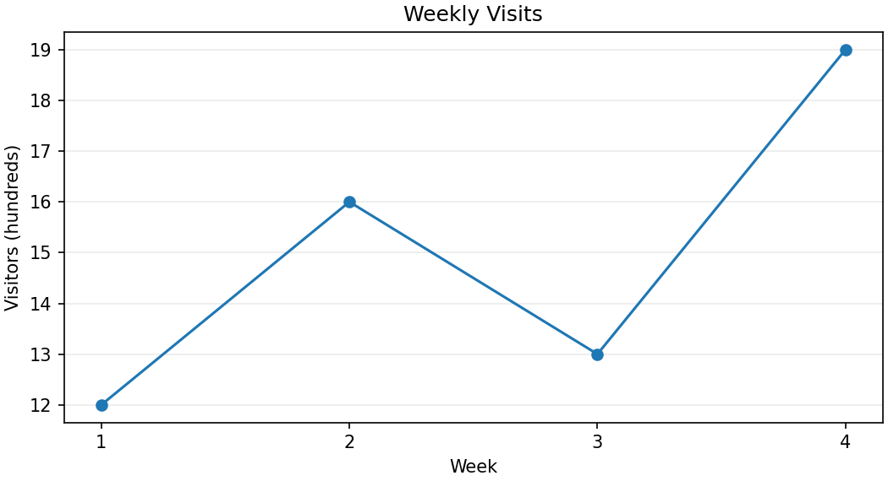

**핵심 코드 해설**

- `fig, ax = plt.subplots(...)`: Figure와 하나의 Axes를 만듭니다.
- `ax.set_xticks(...)`: 관측 주차에 맞춰 눈금을 지정합니다.
- `fig.savefig(...)`: Figure 전체를 PNG로 저장합니다.

<details>
<summary><strong>참고 — `figsize`와 `dpi`</strong></summary>

`figsize=(7, 4)`는 인치 단위의 그림 크기, `dpi=150`은 인치당 출력 픽셀 수를 뜻합니다. 저장 PNG의 픽셀 크기는 `figsize × dpi`와 연결됩니다.

</details>

**생각해 보기**

`ax.set_ylabel(...)`을 생략하면 어떤 정보가 빠질까요?

<a id="section-3-3"></a>
## 3.3. Multiple Line Series — 여러 계열 비교

### 개념 이해 — 여러 선으로 변화 비교하기

선 그래프(Line Chart)는 **순서가 의미 있는 관측값**을 선으로 연결한 표현입니다. 대표적인 x축은 날짜·시간·순차 측정 번호입니다. 각 점은 실제 관측값이고, 이웃한 점을 잇는 선은 **값의 변화 방향**을 쉽게 보이게 합니다. 모든 시간 사이를 실제로 측정했다는 뜻은 아닙니다.

두 계열을 같은 그래프에 배치하려면 다음 조건을 먼저 확인합니다.

1. **같은 x축 기준:** 두 지역 모두 1~6월처럼 비교 가능한 시점을 가져야 합니다.
2. **같은 y축 단위:** 방문자 수와 방문자 수는 함께 비교할 수 있지만, 방문자 수와 매출액은 일반적으로 별도 축이 적합합니다.
3. **식별 가능한 계열:** 범례(`label`, `legend`)와 선 모양·마커를 조합해 구분합니다.
4. **동일한 집계 기준:** 월별 합계인지 월별 평균인지 일치해야 의미 있는 비교가 됩니다.

**실제 예제 데이터의 해석:** Site A는 1월 120에서 6월 201로 **81 증가**, Site B는 100에서 174로 **74 증가**했습니다. 절대 증가량은 A가 크지만 상대 증가율은 다릅니다.

**증가율(Growth Rate)**

$$
\mathrm{Growth\ Rate} =
\left(\frac{V_f - V_i}{V_i}\right) \times 100\%
$$

- $V_f$: 마지막 값(Final Value)
- $V_i$: 처음 값(Initial Value)


A의 증가율은 약 67.5%, B는 약 74.0%입니다. 따라서 **값의 크기**, **증가량**, **증가율**은 서로 다른 질문임을 구별해야 합니다.

`marker`는 관측 지점, `linewidth`는 연결선의 두께를 조절합니다. 마커가 없는 선에서도 데이터는 존재하지만, 실제 관측 시점이 어디인지 덜 명확해질 수 있습니다. 범주 순서가 없는 상품 이름 등을 무의미하게 연결하지 않도록 주의합니다.

**문제 상황**

두 서비스의 월별 이용 건수 추이를 하나의 그래프에서 비교하려고 합니다. 각 계열은 동일한 단위를 사용합니다.

**필요한 개념**

`ax.plot()`을 여러 번 호출하면 한 Axes에 여러 선을 그릴 수 있습니다. `label`과 `legend()`로 계열을 구분하고 마커 모양도 달리합니다.

**예제 코드 — [`02_multiple_lines.py`](./examples/02_multiple_lines.py)**

```python
from pathlib import Path
ROOT = Path(__file__).resolve().parents[1]
import matplotlib.pyplot as plt

months = ["Jan", "Feb", "Mar", "Apr", "May", "Jun"]
site_a = [120, 140, 138, 167, 185, 201]
site_b = [100, 118, 130, 142, 148, 174]

fig, ax = plt.subplots(figsize=(8, 4.2), layout="constrained")
ax.plot(months, site_a, marker="o", linewidth=2, label="Site A")
ax.plot(months, site_b, marker="s", linewidth=2, label="Site B")
ax.set(title="Monthly Visits by Site", xlabel="Month", ylabel="Visits")
ax.legend(title="Location")
ax.grid(axis="y", alpha=0.25)
fig.savefig(ROOT / "figures" / "02_multiple_lines.png", dpi=150)
plt.close(fig)
```

**실행 결과**

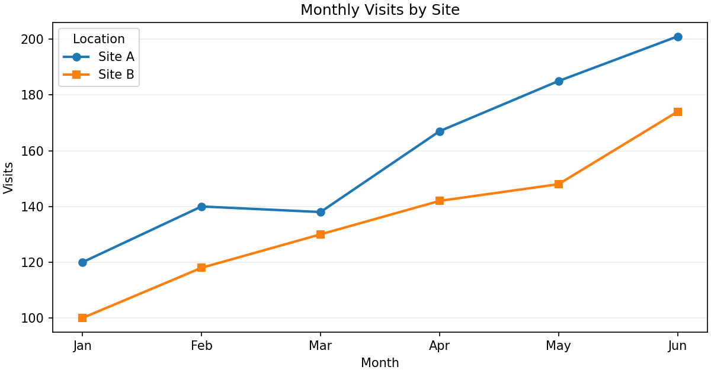

**핵심 코드 해설**

- `label`: 범례에 표시할 계열 이름입니다.
- `marker="o"`, `marker="s"`: 관측 지점을 구분합니다.
- `ax.legend()`: 범례를 표시합니다.

<details>
<summary><strong>참고 — 서로 다른 단위의 선을 겹치면?</strong></summary>

건수와 원화처럼 단위가 다른 값은 동일한 y축에 겹치지 않는 편이 좋습니다. Chapter 02에서 배운 대로 별도의 Axes로 분리하세요.

</details>

**생각해 보기**

범례를 숨긴다면 어느 선이 어느 서비스인지 구분할 수 있을까요?

<a id="section-3-4"></a>
## 3.4. Horizontal Bar Charts — 정렬과 값 표시

### 개념 이해 — 가로 막대와 순위 비교

막대그래프(Bar Chart)는 서로 다른 **범주(Category)**의 값을 막대 길이로 비교하는 도구입니다. 가로 막대그래프는 범주를 세로축, 수치를 가로축에 두므로 범주 이름이 길거나 순위가 중요한 경우 특히 유용합니다.

선 그래프의 점 연결이 변화의 흐름을 전달한다면, 막대그래프의 길이는 **기준선부터 값까지의 크기**를 전달합니다. 양수 수량을 비교하는 막대는 일반적으로 0에서 시작해야 합니다. 예를 들어 205와 235를 비교하면서 축을 200부터 표시하면 차이가 실제보다 훨씬 커 보입니다.

| 설계 항목 | 이유 |
|---|---|
| 값 기준 정렬 | 가장 크거나 작은 범주를 빠르게 확인 |
| 적절한 축 범위 | 막대가 잘리지 않고 크기가 왜곡되지 않게 표시 |
| `bar_label()` | 세부 수치를 별도로 읽을 수 있도록 제공 |
| 단위 명시 | 주문 수, 판매 상품 수, 매출액을 혼동하지 않도록 구분 |

예제에서는 판매량을 기준으로 정렬합니다. `sorted(..., key=lambda item: item[1])`은 딕셔너리 항목의 **두 번째 요소인 값**을 기준으로 정렬한다는 뜻입니다. `barh()`는 주어진 y축 순서대로 막대를 배치하므로, 오름차순으로 넘기면 작은 막대가 아래쪽부터 배치되어 큰 막대가 위쪽에 나타납니다.

**해석의 한계:** 판매량이 가장 많다는 사실만으로 수익성이 높다고 볼 수는 없습니다. 판매량과 매출액, 이익은 서로 다른 지표입니다.

**문제 상황**

여러 상품의 판매량을 비교하려는데 상품명이 길어 세로 막대보다 읽기 어렵습니다.

**필요한 개념**

`ax.barh()`는 범주를 y축에 배치하는 가로 막대그래프입니다. 범주를 수치순으로 정렬하면 순위를 쉽게 읽을 수 있습니다. 막대 기준선은 보통 0을 유지합니다.

**예제 코드 — [`03_category_bar.py`](./examples/03_category_bar.py)**

```python
from pathlib import Path
ROOT = Path(__file__).resolve().parents[1]
import matplotlib.pyplot as plt

sales = {"Books": 235, "Stationery": 174, "Snacks": 132, "Drinks": 205}
items = sorted(sales.items(), key=lambda item: item[1])
names = [name for name, value in items]
values = [value for name, value in items]

fig, ax = plt.subplots(figsize=(8, 4.2), layout="constrained")
bars = ax.barh(names, values)
ax.bar_label(bars, padding=4)
ax.set(title="Sales by Category", xlabel="Orders")
ax.set_xlim(0, 270)
ax.spines[["top", "right"]].set_visible(False)
fig.savefig(ROOT / "figures" / "03_category_bar.png", dpi=150)
plt.close(fig)
```

**실행 결과**

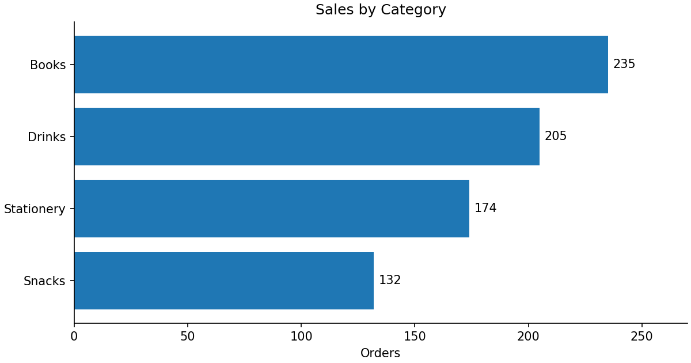

**핵심 코드 해설**

- `ax.barh(...)`: 가로 막대그래프를 만듭니다.
- `ax.bar_label(...)`: 각 막대에 수치를 표시합니다.
- 값 기준 정렬 후 그려 순위를 명확하게 보여줍니다.

<details>
<summary><strong>참고 — 막대와 점 그래프의 차이</strong></summary>

막대의 길이는 0을 기준으로 크기를 표현하므로 축 시작점을 자르면 차이가 과장될 수 있습니다. 점 그래프는 특정 목적에서 더 적합할 수 있지만, 이 장에서는 0을 기준으로 한 막대 구현을 먼저 연습합니다.

</details>

<a id="section-3-5"></a>
## 3.5. Scatter Plots — 그룹별 관계 표현

### 개념 이해 — 두 수치형 변수와 그룹 비교

산점도(Scatter Plot)는 **하나의 관측 대상에서 측정한 두 수치형 변수**를 좌표 한 점으로 나타냅니다. 예를 들어 하루의 기온이 21°C이고 방문자가 185명이면 그날은 `(21, 185)`라는 점 하나가 됩니다. 수치가 높아질수록 점이 함께 위쪽으로 이동하면 양의 관계가 의심되지만, 관계의 존재와 원인은 별개입니다.

산점도에서는 다음을 관찰합니다.

- **방향(Direction):** x가 증가할수록 y가 대체로 증가하는지, 감소하는지, 뚜렷한 방향이 없는지
- **형태(Form):** 직선에 가까운지, 곡선인지, 여러 집단으로 나뉘는지
- **퍼짐(Spread):** 같은 x 주변에서 y가 얼마나 다양하게 나타나는지
- **이상값(Outlier):** 다른 점들과 크게 떨어진 관측이 있는지

그룹이 있는 데이터는 색상과 범례로 구분할 수 있습니다. 예제처럼 **평일과 주말을 별도 `scatter()`로 표시**하면 전체 관계가 요일 구성 차이 때문에 나타나는지 추가로 살펴볼 수 있습니다. 단, 평일 6개와 주말 4개처럼 관측 수가 다르면 단순히 점 개수만 비교해서 빈도가 높다고 판단하면 안 됩니다.

`alpha=0.8`은 점의 불투명도를 80%로 설정합니다. 점이 겹칠수록 더 진하게 보일 수 있지만, 완전히 같은 위치에 겹친 점의 개수를 정확히 셀 수 있는 것은 아닙니다. `s=65`는 점의 **면적을 pt² 단위**로 설정합니다.

**핵심 구분:** 산점도의 동반 변화는 상관관계의 단서일 뿐입니다. 기온과 방문자가 함께 늘었더라도 요일·행사·계절처럼 두 변수에 영향을 주는 요인을 검토해야 합니다.

**문제 상황**

온도와 방문객 수 사이에 어떤 관계가 있는지 확인하되 지역별 관측도 구분해야 합니다.

**필요한 개념**

산점도(`ax.scatter`)는 각 관측값을 `(x, y)` 좌표로 표현합니다. 그룹별로 `scatter()`를 호출하고 `label`을 붙여 비교합니다. 관계가 보여도 그것만으로 인과관계를 증명할 수는 없습니다.

**예제 코드 — [`04_scatter_groups.py`](./examples/04_scatter_groups.py)**

```python
from pathlib import Path
ROOT = Path(__file__).resolve().parents[1]
import matplotlib.pyplot as plt

weekday_temp = [15, 17, 19, 21, 23, 25]
weekday_visits = [120, 145, 150, 185, 201, 223]
weekend_temp = [16, 19, 22, 24]
weekend_visits = [170, 210, 230, 265]

fig, ax = plt.subplots(figsize=(8, 4.5), layout="constrained")
ax.scatter(weekday_temp, weekday_visits, s=65, label="Weekday", alpha=0.8)
ax.scatter(weekend_temp, weekend_visits, s=65, label="Weekend", alpha=0.8)
ax.set(title="Temperature vs Visits", xlabel="Temperature (°C)", ylabel="Visitors")
ax.legend()
ax.grid(alpha=0.2)
fig.savefig(ROOT / "figures" / "04_scatter_groups.png", dpi=150)
plt.close(fig)
```

**실행 결과**

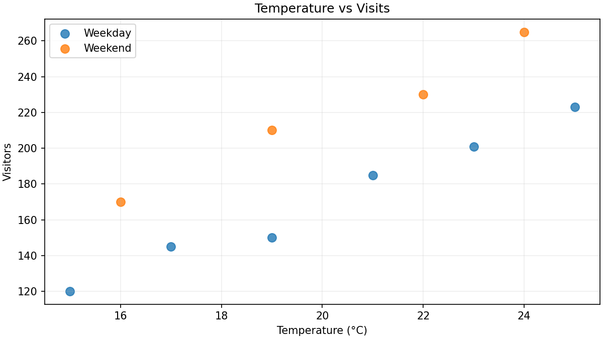

**핵심 코드 해설**

- `ax.scatter(x, y, ...)`: 각 행을 하나의 점으로 표현합니다.
- `alpha`: 점이 겹치는 곳을 파악하기 위해 투명도를 설정합니다.
- `ax.legend()`: 그룹 의미를 표시합니다.

<details>
<summary><strong>참고 — 겹치는 점을 읽는 방법</strong></summary>

같은 좌표에 점이 여러 개 있는 경우 개수까지 정확히 파악하기 어렵습니다. 투명도를 사용해 밀집된 구간을 보완할 수 있지만, 정밀한 빈도 비교에는 집계나 다른 표현이 필요할 수 있습니다.

</details>

<a id="section-3-6"></a>
## 3.6. Subplots — 다른 단위를 별도 축에 배치

### 개념 이해 — 하나의 Figure에 여러 질문 담기

Subplot은 하나의 Figure 안에 배치된 **개별 Axes 영역**을 뜻합니다. 여러 그래프를 나란히 놓으면 서로 관련된 정보를 한눈에 볼 수 있고, 단위가 다른 값을 무리하게 같은 축에 표시하지 않아도 됩니다.

```python
import matplotlib.pyplot as plt

fig, axes = plt.subplots(1, 2)  # 1행 2열: axes[0], axes[1]
fig, axes = plt.subplots(2, 1)  # 2행 1열: axes[0], axes[1]
fig, axes = plt.subplots(2, 2)  # 2행 2열: axes[행, 열]
```

위 코드는 **배치 형태를 비교하기 위한 독립적인 예시**입니다. 실제로는 필요한 구성 하나를 선택하고 해당 Figure를 사용합니다. `plt.subplots()`는 Axes를 만들며, **각 Axes에는 다른 종류의 그래프**를 넣어도 됩니다.

| 구성 | 적합한 상황 | 주의할 점 |
|---|---|---|
| 1행 2열 | 두 지표의 나란한 비교 | 좁은 화면에서 레이블 겹침 |
| 2행 1열 | 같은 시간축의 다른 단위 비교 | 시점 정렬 필요 |
| 2행 2열 | 추이·비교·분포·관계를 함께 제시 | 각 그래프의 역할 명시 |

예제의 방문자 수는 **명**, 매출은 **만원** 단위입니다. 값 190명과 145만원을 같은 y축에 겹치면 숫자만 비슷해 보일 뿐 단위가 다르므로 직접 비교할 수 없습니다. 각각의 Axes와 y축 레이블을 사용하면 의미가 분리됩니다.

`fig.suptitle()`은 Figure 전체 제목이고, `ax.set(title=...)`은 해당 그래프 영역의 제목입니다. `layout="constrained"`는 제목·눈금·범례 등이 서로 겹치는 문제를 완화하지만, 모든 배치 문제를 자동으로 해결해 주지는 않습니다.

**문제 상황**

월별 방문자 수(명)와 매출액(만원)을 비교하고 싶습니다. 두 지표를 같은 y축에 놓으면 단위가 혼동됩니다.

**필요한 개념**

`plt.subplots(1, 2)`는 **1행 2열**의 Axes를 생성합니다. `axes[0]`은 왼쪽, `axes[1]`은 오른쪽입니다. `plt.subplots(2, 1)`로 바꾸면 세로 배치가 됩니다.

**예제 코드 — [`05_subplots.py`](./examples/05_subplots.py)**

```python
from pathlib import Path
ROOT = Path(__file__).resolve().parents[1]
import matplotlib.pyplot as plt

months = ["Jan", "Feb", "Mar", "Apr"]
visitors = [120, 150, 140, 190]
revenue = [80, 110, 100, 145]

fig, axes = plt.subplots(1, 2, figsize=(10, 4), layout="constrained")
axes[0].plot(months, visitors, marker="o")
axes[0].set(title="Monthly Visitors", ylabel="Visitors")
axes[1].bar(months, revenue)
axes[1].set(title="Monthly Revenue", ylabel="Revenue (10k KRW)")
fig.suptitle("Two Measures, Two Units")
fig.savefig(ROOT / "figures" / "05_subplots.png", dpi=150)
plt.close(fig)
```

**실행 결과**

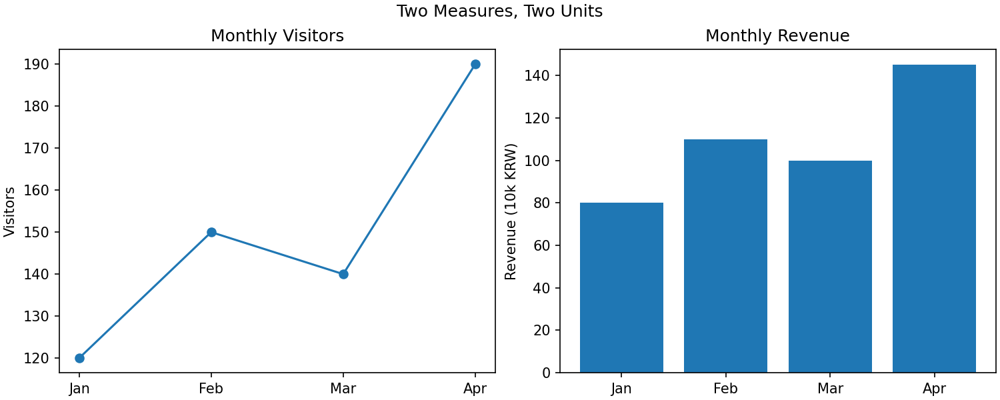

**핵심 코드 해설**

- `axes[0]`, `axes[1]`: 각각 독립적인 그래프 영역입니다.
- 서로 다른 단위의 지표는 y축 레이블을 따로 표시합니다.
- `layout="constrained"`는 구성요소 간 충돌을 줄입니다.

<details>
<summary><strong>참고 — 2행 2열 인덱싱</strong></summary>

`fig, axes = plt.subplots(2, 2)`라면 `axes[0, 0]`은 왼쪽 위, `axes[1, 1]`은 오른쪽 아래입니다. 두 차원을 가진 NumPy 배열의 행·열 인덱싱과 같습니다.

</details>

**생각해 보기**

`plt.subplots(2, 1)`과 `plt.subplots(1, 2)`의 차이를 직접 확인해 보세요.

<a id="section-3-7"></a>
## 3.7. Histograms — 구간 설정과 분포

### 개념 이해 — 수치 분포를 구간으로 읽기

히스토그램(Histogram)은 연속형 또는 순서가 있는 수치 데이터를 **구간(Bin)**으로 묶고 각 구간에 속한 관측값의 개수를 나타냅니다. 막대그래프는 '상품 A, B, C'처럼 **서로 다른 범주**를 비교하고, 히스토그램은 '0~10분, 10~20분'처럼 **수치 범위**를 비교합니다. 히스토그램의 막대가 서로 맞닿아 있는 경우가 많은 이유입니다.

예제의 18개 대기시간을 다음과 같은 구간으로 나누면 분포가 명확해집니다.

| 대기시간 구간 | 관측 건수 | 해석 |
|---|---:|---|
| 0분 이상 10분 미만 | 10 | 짧은 대기시간이 가장 많음 |
| 10분 이상 20분 미만 | 7 | 중간 구간에도 다수 분포 |
| 20분 이상 30분 이하 | 1 | 긴 대기시간은 드묾 |

일반적으로 히스토그램의 구간 경계는 **왼쪽 포함·오른쪽 제외**이며 마지막 구간은 오른쪽 끝 값도 포함합니다. 같은 데이터라도 구간을 어떻게 자르는지에 따라 막대의 모양이 달라집니다.

**구간 빈도(Bin Frequency)**

$$
n_j = \left| \left\lbrace i \mid b_j \leq x_i < b_{j+1} \right\rbrace \right|
$$

- $n_j$: $j$번째 구간에 포함된 데이터 개수
- $x_i$: $i$번째 데이터 값
- $b_j$: $j$번째 구간의 시작 경계
- $b_{j+1}$: $j$번째 구간의 끝 경계
- 집합 바깥의 $|\,\cdot\,|$: 집합에 포함된 원소의 개수

- **구간이 너무 적으면:** 여러 봉우리나 긴 꼬리 같은 특징이 하나의 막대로 뭉개집니다.
- **구간이 너무 많으면:** 관측값이 적은 경우 빈 막대와 불규칙한 모양이 늘어 우연한 차이를 과장할 수 있습니다.
- **구간 폭이 다른 경우:** 단순 건수 높이가 아닌 밀도와 막대 **면적**의 의미도 고려해야 합니다.

`ax.hist(values, bins=9)`는 구간을 9개로 정하고, `bins=[0, 10, 20, 30]`은 **경계를 직접 지정**합니다. 기본 `density=False`는 빈도(건수), `density=True`는 전체 막대 면적이 1이 되도록 정규화한 밀도를 나타냅니다. 밀도 축은 그대로 '관측 건수'라고 표기하면 안 됩니다.

**문제 상황**

배송시간이 어느 구간에 많이 모이는지 알아보려고 합니다. 관측값 하나하나보다 전체 분포가 중요합니다.

**필요한 개념**

히스토그램(`ax.hist`)은 연속형 수치 데이터를 구간(bin)으로 나누어 빈도를 표시합니다. 막대그래프의 범주와 달리 구간의 경계·폭이 해석에 영향을 줍니다.

**예제 코드 — [`06_histogram_bins.py`](./examples/06_histogram_bins.py)**

```python
from pathlib import Path
ROOT = Path(__file__).resolve().parents[1]
import matplotlib.pyplot as plt

waiting_minutes = [3, 4, 5, 5, 6, 7, 7, 8, 8, 9, 10, 11, 12, 13, 14, 15, 19, 22]

fig, axes = plt.subplots(1, 2, figsize=(10, 4), sharey=True, layout="constrained")
for ax, bins in zip(axes, [4, 9]):
    ax.hist(waiting_minutes, bins=bins, edgecolor="white")
    ax.set(title=f"Histogram (bins={bins})", xlabel="Wait time (min)")
    ax.grid(axis="y", alpha=0.2)
axes[0].set_ylabel("Count")
fig.savefig(ROOT / "figures" / "06_histogram_bins.png", dpi=150)
plt.close(fig)
```

**실행 결과**

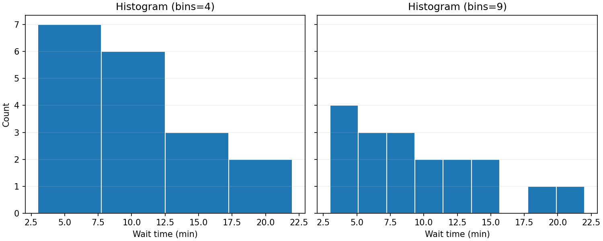

**핵심 코드 해설**

- `bins=...`: 값이 구분되는 구간을 결정합니다.
- `bins`가 달라지면 같은 데이터도 다른 분포처럼 보일 수 있습니다.
- x축에 측정 단위, y축에 빈도를 표시합니다.

<details>
<summary><strong>참고 — 구간 경계를 직접 지정하기</strong></summary>

구간을 일정한 규칙으로 나누고 싶다면 `bins=[0, 20, 40, 60]`처럼 경계 배열을 직접 지정할 수 있습니다. 히스토그램에서 오른쪽 끝 구간을 제외한 대부분의 구간은 왼쪽 경계를 포함하고 오른쪽 경계는 포함하지 않습니다.

</details>

**생각해 보기**

구간 수를 늘려도 반드시 정보가 더 좋아지는 것은 아닌 이유를 생각해 보세요.

<a id="section-3-8"></a>
## 3.8. Annotations — 주요 값 강조

### 개념 이해 — 그래프에서 중요한 위치 설명하기

Annotation(주석)은 그래프의 특정 점, 구간, 기준선에 설명을 추가하는 기능입니다. 독자가 최고값이나 급격한 변화를 쉽게 찾도록 돕지만, **강조할 근거가 있는 정보**만 표시해야 합니다.

`ax.annotate()`의 핵심은 두 위치를 구별하는 것입니다.

| 인수 | 의미 | 예제 값 |
|---|---|---|
| `xy` | 화살표가 가리키는 **데이터 위치** | `(4, 184)` = 4주차, 184건 |
| `xytext` | 설명 텍스트를 놓을 위치 | `(4.6, 199)` |
| `arrowprops` | 화살표 스타일 | `{"arrowstyle": "->"}` |
| `xycoords`, `textcoords` | 각 위치의 좌표계 | 기본적으로 데이터 좌표 사용 |

예제의 요청 수는 `[120, 132, 148, 184, 166, 181]`이므로 최댓값은 **4주차 184건**입니다. `xy=(4, 184)`라는 위치는 실제 관측값과 일치합니다. 다만 주석 문자열 `"Campaign"`은 표시용 설명이며, **캠페인 때문에 값이 증가했다고 데이터만으로 입증하는 것은 아닙니다.**

데이터가 자주 바뀐다면 고정 좌표 대신 `max()`나 `argmax()`로 최댓값을 계산하여 주석을 붙이는 것이 안전합니다. 축 범위를 변경할 때는 설명이 잘리거나 다른 값과 겹치지 않는지 저장된 이미지까지 확인합니다.

**문제 상황**

한 달 동안 방문 건수가 가장 많았던 날짜에 주석을 달아 보고서에서 바로 찾을 수 있게 하려고 합니다.

**필요한 개념**

`ax.annotate(text, xy=..., xytext=...)`는 그래프의 특정 데이터 위치에 설명을 붙입니다. `xy`는 가리키는 위치이고 `xytext`는 설명을 배치할 위치입니다.

**예제 코드 — [`07_annotation.py`](./examples/07_annotation.py)**

```python
from pathlib import Path
ROOT = Path(__file__).resolve().parents[1]
import matplotlib.pyplot as plt

weeks = [1, 2, 3, 4, 5, 6]
requests = [120, 132, 148, 184, 166, 181]

fig, ax = plt.subplots(figsize=(8, 4.2), layout="constrained")
ax.plot(weeks, requests, marker="o")
ax.annotate("Campaign", xy=(4, 184), xytext=(4.6, 199),
            arrowprops={"arrowstyle": "->"})
ax.set(title="Weekly Requests", xlabel="Week", ylabel="Requests")
ax.set_xticks(weeks)
ax.set_ylim(100, 220)
ax.grid(axis="y", alpha=0.2)
fig.savefig(ROOT / "figures" / "07_annotation.png", dpi=150)
plt.close(fig)
```

**실행 결과**

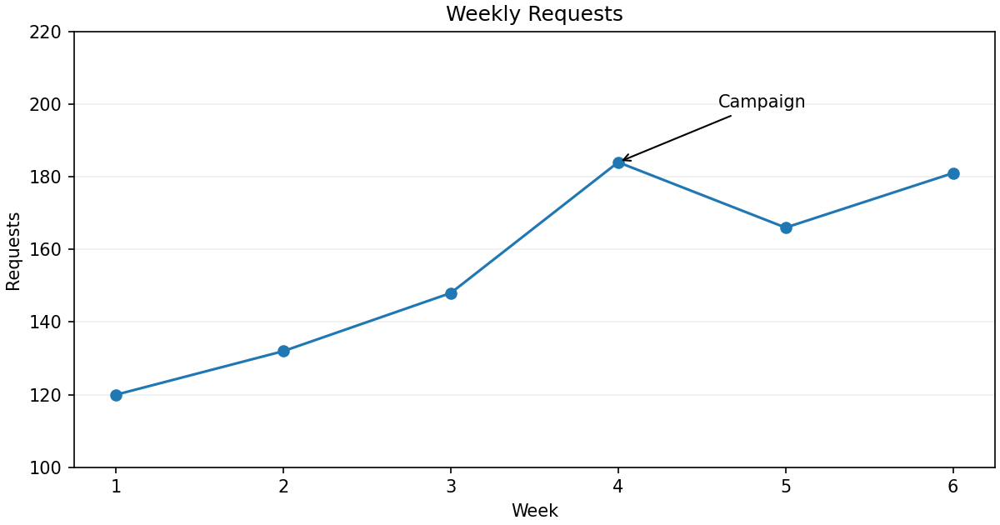

**핵심 코드 해설**

- `xy=(x, y)`: 화살표가 가리키는 값입니다.
- `xytext`: 설명이 나타나는 위치입니다.
- `arrowprops`: 화살표 모양을 지정합니다.

<details>
<summary><strong>참고 — 강조 표시의 기준</strong></summary>

일정한 규칙(최댓값·임계값 등)에 따라 자동으로 주석을 달면 데이터가 바뀌어도 오류를 줄일 수 있습니다. 특정 날짜를 하드코딩해서 표시하면 나중에 잘못된 강조가 남을 수 있습니다.

</details>

<a id="section-3-9"></a>
## 3.9. Missing Observations — 관측 누락과 0 구별

### 개념 이해 — '기록이 없음'과 '0을 기록함'

결측(Missing Observation)은 **측정이 이루어지지 않았거나 값을 사용할 수 없는 상태**입니다. 0은 실제로 관측한 수치입니다. 예를 들어 기온 0°C는 유효한 측정이지만 센서가 꺼져 기온을 기록하지 못한 날은 0°C가 아닙니다.

| 상황 | 데이터 표현 | 그래프 해석 |
|---|---|---|
| 실제 측정 기온 0°C | `0.0` | 관측한 값이 0 |
| 기온을 측정하지 못함 | `NaN` | 해당 시점의 관측값이 없음 |
| 날짜 행 자체가 없음 | 데이터에 행 없음 | 예상 날짜와 대조해야 누락 발견 가능 |

관측값 중 일부가 `NaN`이면 Matplotlib의 `plot()`은 해당 값을 건너뛰어 **선이 끊긴 구간**으로 보이게 할 수 있습니다. 그러나 날짜 행 자체가 빠져 있다면 그 위치가 x축 데이터에서 사라지므로, 먼저 **예상 날짜 목록**을 만들고 원본 자료를 정렬해야 합니다.

```python
import pandas as pd

observed = pd.Series(
    [19.2, 20.1, 20.5, 18.1, 17.8],
    index=pd.to_datetime([
        "2026-10-01", "2026-10-02", "2026-10-03",
        "2026-10-05", "2026-10-06"
    ])
)
expected = pd.date_range("2026-10-01", "2026-10-06", freq="D")
aligned = observed.reindex(expected)  # 10월 4일은 NaN
```

이 보충 코드는 CSV에서 날짜가 통째로 빠진 상황에 적용하는 방법입니다. 아래 원래 예제 코드는 `np.nan`을 **직접 값 목록에 입력해 선이 끊기는 원리를 시연**합니다. 두 방식은 문제의 출발점이 다릅니다.

관측률을 기록하려면 전체 예상 슬롯 중 실제로 값이 존재하는 비율을 계산할 수 있습니다.

\[
\text{관측률}(\%)=\frac{\text{유효 관측값 수}}{\text{예상 관측 슬롯 수}}\times100
\]

예를 들어 6일 중 5일에 기온이 있으면 관측률은 약 83.3%입니다. **행 누락**과 **행은 있지만 값이 `NaN`인 경우**를 구별하면 데이터 품질 문제를 더 정확하게 설명할 수 있습니다.

**문제 상황**

센서 데이터 중 하루가 누락되었습니다. 없는 관측을 0으로 채우면 실제 측정값 0과 혼동될 수 있습니다.

**필요한 개념**

기대되는 날짜 인덱스를 만들고 데이터를 `reindex()`하면 빠진 위치가 `NaN`으로 표현됩니다. Matplotlib은 `NaN`을 포함한 선 그래프에서 해당 구간을 비워 두므로 누락을 드러낼 수 있습니다.

**예제 코드 — [`08_missing_dates.py`](./examples/08_missing_dates.py)**

```python
from pathlib import Path
ROOT = Path(__file__).resolve().parents[1]
import matplotlib.pyplot as plt
import numpy as np

# 2026-10-04는 관측되지 않은 날이며 0°C가 아님
labels = ["Oct 01", "Oct 02", "Oct 03", "Oct 04", "Oct 05", "Oct 06"]
temperatures = [19.2, 20.1, 20.5, np.nan, 18.1, 17.8]

fig, ax = plt.subplots(figsize=(8, 4.2), layout="constrained")
ax.plot(labels, temperatures, marker="o")
ax.set(title="Temperature with Missing Observation", xlabel="Date", ylabel="°C")
ax.grid(axis="y", alpha=0.25)
fig.savefig(ROOT / "figures" / "08_missing_dates.png", dpi=150)
plt.close(fig)
```

**실행 결과**

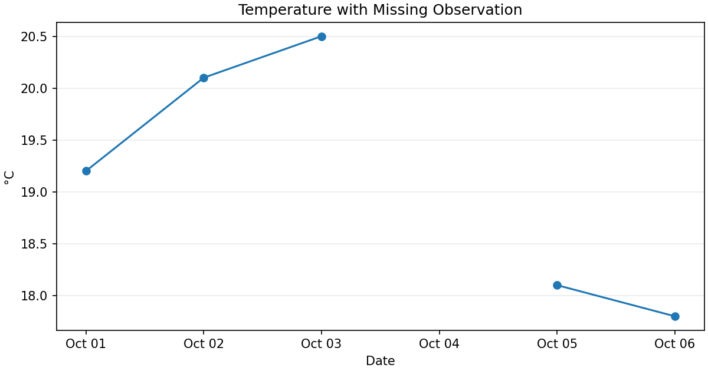

**핵심 코드 해설**

- `temperatures` 목록의 `np.nan`: 10월 4일 기온이 관측되지 않았음을 명시적으로 표시합니다.
- `ax.plot(labels, temperatures, ...)`: `NaN` 지점에서 선을 끊어 실제 0°C와 구별합니다.
- 날짜 행 자체가 빠진 CSV를 처리할 때는 앞의 보충 예제처럼 `pd.date_range()`와 `reindex()`로 누락된 날짜 위치를 복원합니다.
- `fillna(0)`는 실제 0인 측정값과 누락을 구분하지 못하게 하므로 이 상황에서는 사용하지 않습니다.

<details>
<summary><strong>참고 — 연결된 선의 의미</strong></summary>

누락된 시점이 있는데 이를 건너뛰어 선을 연결하면 연속된 관측처럼 보일 수 있습니다. 데이터가 연속으로 수집됐다는 전제가 없다면 간격을 드러내는 편이 적절합니다.

</details>

**생각해 보기**

기온 0°C, 강수량 0mm, 측정 실패는 각각 어떤 의미일까요?

<a id="section-3-10"></a>
## 3.10. Export — PNG·SVG와 Figure 관리

### 개념 이해 — 그래프를 결과물로 저장하기

화면에서 그래프가 보이는 것과 파일을 저장하는 것은 별개의 작업입니다. `fig.savefig()`는 Figure를 이미지로 내보내고, `plt.close(fig)`는 해당 Figure의 자원을 정리합니다. 많은 파일을 연속 생성하는 보고서 프로그램에서는 저장과 정리를 한 쌍으로 생각하면 좋습니다.

| 형식 | 저장 방식 | 적합한 사용처 | 주의 사항 |
|---|---|---|---|
| PNG | 픽셀(Raster) 이미지 | README, 웹, 보고서, 슬라이드 | 크게 확대하면 화질이 떨어질 수 있음 |
| SVG | 경로와 도형 기반(Vector) 이미지 | 확대·편집이 필요한 그림 | 텍스트 렌더링과 폰트 설정에 따라 결과가 달라질 수 있음 |

PNG 출력의 기본 관계는 다음과 같습니다.

\[
\text{픽셀 너비}\approx\text{Figure 너비(inch)}\times\text{DPI}
\]

예를 들어 `figsize=(7, 4)`와 `dpi=150`이면 기본 출력 크기는 **약 1050×600픽셀**입니다. `bbox_inches="tight"`를 지정하면 여백을 조정하므로 최종 픽셀 크기는 달라질 수 있습니다. SVG는 확대 시 선과 도형을 선명하게 표현할 수 있지만, 포함된 래스터 요소나 폰트 처리까지 모두 무조건 벡터로 보장되는 것은 아닙니다.

프로젝트 폴더의 역할도 구별합니다. `data/`는 입력 원본, `figures/`는 README에서 참조하는 검증된 예제 그림, `output/`은 실행할 때 생성한 결과물입니다. 저장 경로를 상대경로만으로 정하면 실행 위치에 따라 다른 폴더가 선택될 수 있어, 예제에서는 `Path(__file__).resolve()`를 활용합니다.

**문제 상황**

작성한 그래프를 문서와 웹 페이지에 삽입하고 싶습니다. 출력 크기와 파일 형식을 지정해야 합니다.

**필요한 개념**

`fig.savefig()`는 Figure를 파일로 저장합니다. PNG는 픽셀 기반 이미지, SVG는 벡터 기반 이미지입니다. `plt.close(fig)`로 사용이 끝난 Figure를 정리할 수 있습니다.

**예제 코드 — [`09_export_formats.py`](./examples/09_export_formats.py)**

```python
from pathlib import Path
ROOT = Path(__file__).resolve().parents[1]
import matplotlib.pyplot as plt

(ROOT / "output").mkdir(exist_ok=True)

categories = ["Mon", "Tue", "Wed", "Thu"]
values = [35, 42, 39, 51]

fig, ax = plt.subplots(figsize=(7, 4), layout="constrained")
ax.bar(categories, values)
ax.set(title="Daily Check-ins", xlabel="Day", ylabel="Check-ins")
fig.savefig(ROOT / "figures" / "09_export_formats.png", dpi=150)
fig.savefig(ROOT / "output" / "09_export_formats.svg", bbox_inches="tight")
plt.close(fig)
print("Saved: PNG (raster), SVG (vector)")
```

**실행 결과**

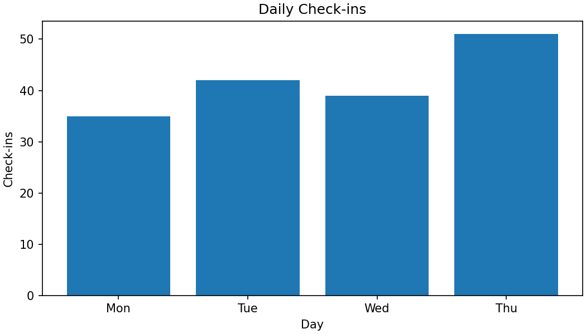

**핵심 코드 해설**

- PNG: 사진·문서 등 다양한 환경에서 사용하기 쉽습니다.
- SVG: 선과 글자를 확대할 때 상대적으로 선명합니다. 단, 외부 폰트·뷰어 조건에 영향을 받을 수 있습니다.
- 한 번에 여러 Figure를 만들 때는 `close()`로 리소스를 정리합니다.

<details>
<summary><strong>참고 — Figure 저장 위치</strong></summary>

예제는 Chapter 폴더 기준으로 경로를 구성해 실행 위치의 차이를 줄입니다. 프로젝트는 원본을 보존하면서 별도의 `output/`으로 결과를 저장합니다.

</details>

<a id="section-3-11"></a>
## 3.11. Grouped Bars — 나란한 막대와 값 표시

### 개념 이해 — 동일 범주 안의 여러 계열 비교

그룹형 막대그래프(Grouped Bar Chart)는 하나의 범주에 대해 **여러 그룹의 막대**를 나란히 놓는 표현입니다. 예를 들어 Food 상품에서 West 매장과 East 매장의 판매량을 비교할 수 있습니다. 각 범주의 총합이 아니라 **매장 간 차이**가 주된 질문입니다.

일반적인 세로 막대그래프에서 범주 중심을 `x_i`, 막대 폭을 `w`라고 하면 두 계열의 중심 위치를 다음처럼 배치합니다.

**막대 위치(Bar Position)**

$$
x_{\mathrm{left},i} = x_i - \frac{w}{2},
\qquad
x_{\mathrm{right},i} = x_i + \frac{w}{2}
$$

- $x_i$: $i$번째 막대의 중심 위치
- $w$: 막대의 너비(Width)
- $x_{\mathrm{left},i}$: $i$번째 막대의 왼쪽 경계
- $x_{\mathrm{right},i}$: $i$번째 막대의 오른쪽 경계


이때 `np.arange(len(labels))`는 `[0, 1, 2, ...]` 형태의 범주 중심 좌표를 만들고, `ax.set_xticks(x, labels)`가 숫자 좌표를 사람이 읽을 수 있는 상품 이름으로 바꿉니다.

**실제 예제 해석:** Food는 West 45개, East 38개이므로 West가 **7개 많습니다**. Drink는 West 37개, East 42개이므로 East가 **5개 많습니다**. 같은 범주 안의 두 막대를 비교할 수 있어야 합니다.

그룹형 막대와 누적 막대는 목적이 다릅니다. **그룹형 막대**는 같은 범주의 그룹 간 차이를 읽기 쉽고, **누적 막대**는 범주의 전체 합계와 구성 비중을 강조합니다. 그룹 수가 지나치게 많아 막대가 빽빽해지면 그래프를 분리하거나 다른 표현을 검토합니다.

**문제 상황**

두 매장의 상품 분류별 판매량을 비교하려고 합니다. 매장별 값이 겹치지 않도록 분류마다 두 막대를 배치합니다.

**필요한 개념**

막대의 x좌표를 직접 계산하면 그룹화된 막대그래프를 만들 수 있습니다. `np.arange()`로 분류 위치를 준비하고 `width/2`만큼 좌우로 이동합니다.

**예제 코드 — [`10_grouped_bars.py`](./examples/10_grouped_bars.py)**

```python
from pathlib import Path
import numpy as np
import matplotlib.pyplot as plt

ROOT=Path(__file__).resolve().parents[1]
labels=['Food','Drink','Stationery','Household']
west=np.array([45,37,26,19]);east=np.array([38,42,31,24])
x=np.arange(len(labels));width=0.36
fig,ax=plt.subplots(figsize=(8,4),layout='constrained')
a=ax.bar(x-width/2,west,width,label='West')
b=ax.bar(x+width/2,east,width,label='East')
ax.bar_label(a,padding=2);ax.bar_label(b,padding=2)
ax.set_xticks(x,labels)
ax.set(title='Sales Units by Category',ylabel='Items sold',ylim=(0,55))
ax.legend()
fig.savefig(ROOT/'figures'/'11_grouped_bars.png',dpi=145)
plt.close(fig)
```

**실행 결과**

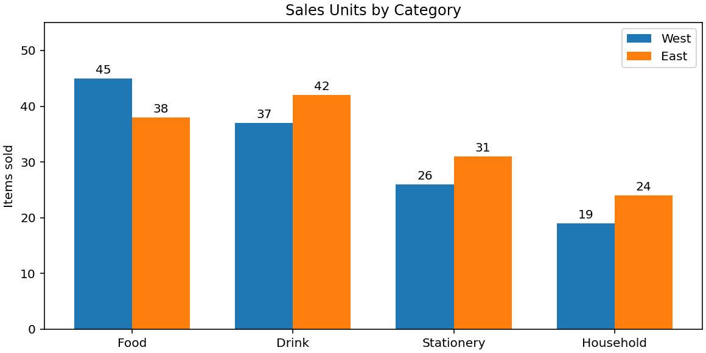

**핵심 코드 해설**

- `x - width/2`, `x + width/2`: 막대를 서로 다른 위치에 배치합니다.
- `ax.set_xticks(x, labels)`: 중심 좌표에 분류 이름을 표시합니다.
- `ax.bar_label(container)`: 수치를 막대 위에 표시합니다.

<details>
<summary><strong>참고 — 막대 레이블이 잘릴 때</strong></summary>

막대 위에 수치를 표시하면 그래프 최댓값과 겹칠 수 있습니다. 필요하다면 `ax.set_ylim()`으로 여백을 확보합니다.

</details>

<a id="section-3-12"></a>
## 3.12. Shared Axes — 공통 시간 축

### 개념 이해 — 서로 다른 그래프를 같은 기준으로 정렬하기

축 공유(Shared Axes)는 서로 다른 Axes가 **동일한 축의 범위·눈금·스케일**을 공유하도록 연결하는 기능입니다. 특히 같은 시점에 관측한 다른 지표를 세로로 배치할 때 유용합니다.

- `sharex=True`: x축 범위와 눈금을 공유. 위 그래프 12시의 위치와 아래 그래프 12시의 위치가 일치합니다.
- `sharey=True`: y축 범위와 눈금을 공유. 같은 단위의 지점별 수치를 공정하게 비교할 때 도움이 됩니다.
- 각각의 Axes에 표시할 **데이터 자체가 자동 집계되거나 정렬되는 기능은 아닙니다.** 시간대가 서로 다르면 미리 날짜·시간을 맞춰야 합니다.

예제의 위쪽 그래프는 시간대별 요청 건수(Requests), 아래쪽은 평균 응답시간(ms)을 표현합니다. 두 지표가 모두 12시에 높아 보여도 **요청 수 증가가 응답시간 증가의 원인**이라고 바로 결론 내릴 수는 없습니다. 공통 시간축은 관련 패턴을 발견하도록 돕지만 인과관계를 계산하지 않습니다.

`sharex=True`로 연결한 축의 범위를 한쪽에서 수정하면 다른 쪽에도 반영될 수 있습니다. 그러나 서로 다른 단위의 y축을 `sharey=True`로 묶으면 값의 의미가 왜곡되므로 주의해야 합니다.

**문제 상황**

동일한 시간대의 요청 건수와 응답시간을 각각의 그래프로 표시합니다. x축은 같지만 y축 단위는 다릅니다.

**필요한 개념**

`sharex=True`를 지정하면 두 Axes가 같은 x축 범위와 눈금을 공유합니다. 서로 다른 단위의 y축까지 합치지는 않습니다.

**예제 코드 — [`11_shared_axes.py`](./examples/11_shared_axes.py)**

```python
from pathlib import Path
import matplotlib.pyplot as plt

ROOT=Path(__file__).resolve().parents[1]
hours=[9,10,11,12,13,14]
requests=[115,135,151,170,166,148]
latency=[75,82,96,128,112,88]
fig,axes=plt.subplots(2,1,sharex=True,figsize=(8,5.8),layout='constrained')
axes[0].plot(hours,requests,marker='o')
axes[0].set(title='Requests Received',ylabel='Requests')
axes[1].plot(hours,latency,marker='s',color='C1')
axes[1].set(title='Mean Response Time',ylabel='ms',xlabel='Hour')
axes[1].set_xticks(hours)
for ax in axes:ax.grid(axis='y',alpha=.22)
fig.savefig(ROOT/'figures'/'12_shared_axes.png',dpi=145)
plt.close(fig)
```

**실행 결과**

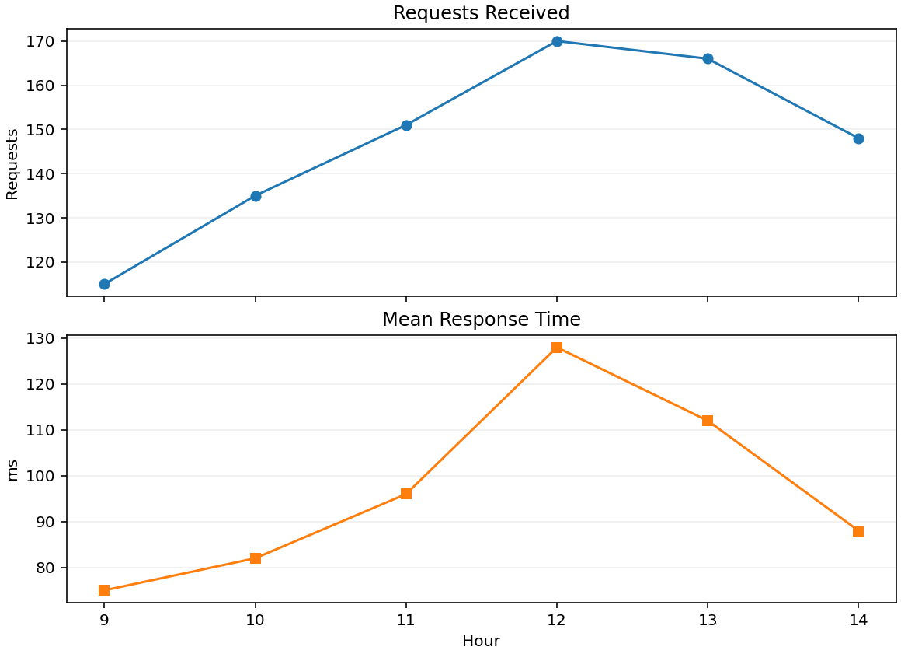

**핵심 코드 해설**

- `plt.subplots(2, 1, sharex=True)`: 세로 배치와 공통 x축을 결합합니다.
- 각 Axes에서 별도의 y축 단위를 표시합니다.
- 동일한 시간 구간을 나란히 확인할 때 유용합니다.

<details>
<summary><strong>참고 — `sharey`가 필요한 경우</strong></summary>

서로 다른 지점의 같은 단위 측정값을 비교한다면 `sharey=True`로 y축 범위를 통일할 수 있습니다. 단위가 다르면 공통 y축을 적용하지 않습니다.

</details>

<a id="section-3-13"></a>
## 3.13. Axis Scales — 선형 축과 로그 축

### 3.13.1. Linear & Log Scales — 축의 거리 해석

축의 스케일(Scale)은 데이터 값을 화면상의 **위치와 간격**으로 변환하는 규칙입니다. 같은 데이터라도 스케일에 따라 보이는 패턴이 달라지므로 축의 숫자만이 아니라 간격의 의미를 이해해야 합니다.

- **선형 축(Linear):** 10에서 20까지의 간격과 80에서 90까지의 간격이 같습니다. **절대적인 차이**를 읽는 데 적합합니다.
- **로그 축(Logarithmic):** 1에서 10, 10에서 100, 100에서 1,000의 간격이 같습니다. **같은 배율의 변화**를 읽는 데 적합합니다.

**선형 척도(Linear Scale)**

$$
p_{\mathrm{linear}} \propto x
$$

**로그 척도(Logarithmic Scale)**

$$
p_{\mathrm{log}} \propto \log_{10}(x)
$$

- $p_{\mathrm{linear}}$: 선형 척도에서의 상대적 위치
- $p_{\mathrm{log}}$: 로그 척도에서의 상대적 위치
- $x$: 원본 데이터 값
- $\propto$: 비례 관계
- $\log_{10}(x)$: 밑이 10인 로그 함수 ($x>0$)


예를 들어 값이 `1 → 10 → 100 → 1,000`으로 변하면 선형 축에서는 1과 10의 차이가 작게 보이지만, 밑이 10인 로그 축에서는 각 단계가 **10배 증가**이므로 균등한 간격으로 표시됩니다. 예제처럼 입력 데이터의 크기와 연산량이 여러 자릿수에 걸쳐 증가하면 로그–로그 그래프로 배율 관계를 살펴볼 수 있습니다.

**로그 축의 제약:** 실수 범위에서 `log(0)`은 정의되지 않고 음수의 보통 실수 로그도 정의되지 않습니다. 따라서 로그 축은 일반적으로 **양수 데이터**에 사용합니다. 0이나 음수를 포함한 데이터를 무턱대고 로그 축에 넣으면 점이 생략되거나 특별한 처리 방식이 적용될 수 있습니다.

**해석 주의:** 로그 축의 선이 직선처럼 보인다는 사실만으로 원인을 증명하지는 않습니다. 그리고 축이 로그라는 사실을 레이블·눈금에서 명확히 해야 합니다. 독자가 일반적인 차이로 오해할 수 있기 때문입니다.

**문제 상황**

입력 행 수가 1개에서 10,000개까지 커질 때 연산량이 어떻게 증가하는지 확인하려고 합니다. 값의 범위가 커 한쪽 구간에 점이 몰립니다.

**필요한 개념**

선형 축은 같은 값 차이를 같은 거리로, 로그 축은 같은 비율 변화를 같은 거리로 표현합니다. `ax.set_xscale("log")`, `ax.set_yscale("log")`를 사용합니다.

**예제 코드 — [`12_axis_scales.py`](./examples/12_axis_scales.py)**

```python
from pathlib import Path
import matplotlib.pyplot as plt

ROOT=Path(__file__).resolve().parents[1]
sizes=[1,10,100,1000,10000]
counts=[5,45,600,5600,58000]
fig,axes=plt.subplots(1,2,figsize=(10,4),layout='constrained')
for ax in axes:
    ax.plot(sizes,counts,marker='o')
    ax.set(xlabel='Input rows',ylabel='Operations')
    ax.grid(alpha=.2)
axes[0].set(title='Linear Axes')
axes[1].set(xscale='log',yscale='log',title='Log-Log Axes')
fig.savefig(ROOT/'figures'/'13_axis_scales.png',dpi=145)
plt.close(fig)
```

**실행 결과**

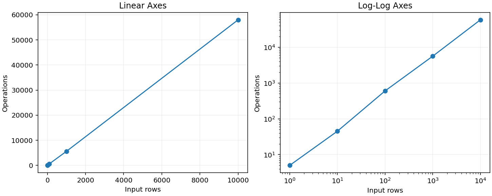

**핵심 코드 해설**

- 오른쪽은 x·y축 모두 로그로 변환했습니다.
- 로그 축은 **0 또는 음수**를 일반적인 방식으로 표시하지 못합니다.
- 로그 축으로 바꿨다는 사실을 제목과 눈금에서 명확하게 표현해야 합니다.

<details>
<summary><strong>참고 — 로그 축의 적절한 사용</strong></summary>

연산 시간, 파일 크기 등 값의 범위가 수십~수만 배 차이 나는 경우 유용합니다. 막대그래프의 시작 기준을 임의로 바꾸어 차이를 과장하려는 용도로 사용해서는 안 됩니다.

</details>

### 3.13.2. Datetime Ticks — 날짜 눈금 간격

#### 개념 이해 — 날짜 데이터와 축 눈금은 다름

날짜 그래프에는 **실제 데이터의 시점**과 **화면에 표시할 날짜 눈금**이라는 두 요소가 있습니다. 매일 35개를 관측했더라도 x축에 35개의 날짜 문자열을 모두 표시할 필요는 없습니다. 데이터를 생략하는 것이 아니라 **눈금 레이블만 적절한 간격으로 표시**하면 됩니다.

Matplotlib의 날짜 축에서 `Locator`는 **어디에 눈금을 찍을지**, `Formatter`는 **눈금을 어떤 글자로 표시할지** 정합니다.

| 객체 | 역할 | 예제 |
|---|---|---|
| `WeekdayLocator` | 매주 특정 요일의 눈금 위치 지정 | 매주 월요일 |
| `DateFormatter` | 날짜 표시 형식 지정 | `%m-%d` → `10-05` |
| `AutoDateLocator` | 기간에 따라 적절한 날짜 눈금 자동 선택 | 자료 기간이 수시로 변할 때 |

`datetime` 또는 Pandas `DatetimeIndex`를 사용하면 날짜 사이의 **실제 시간 간격**을 표현할 수 있습니다. 반면 날짜를 문자열 범주로 전달하면 10월 1일과 10월 5일이 서로 붙어 있는 범주처럼 동일 간격에 배치될 수 있습니다. 날짜를 빠뜨려도 시간 간격을 유지해야 한다면 날짜형 데이터와 누락 날짜 처리가 중요합니다.

아래 예제의 35일치 기록은 모두 유지하고, `WeekdayLocator(byweekday=mdates.MO)`로 **월요일만 눈금**에 표시합니다. `DateFormatter("%m-%d")`는 월-일 표기만 변경하므로 집계 단위나 원본 값을 바꾸지 않습니다.

**문제 상황**

35일치 측정 기록을 그렸더니 날짜 레이블이 너무 많아 서로 겹칩니다. 매주 월요일에만 눈금을 표시하려고 합니다.

**필요한 개념**

`matplotlib.dates`는 날짜 축의 눈금 위치(`Locator`)와 표시 형식(`Formatter`)을 제어합니다. 두 기능의 역할을 구분해 사용합니다.

**예제 코드 — [`13_date_ticks.py`](./examples/13_date_ticks.py)**

```python
from pathlib import Path
import matplotlib.pyplot as plt
import matplotlib.dates as mdates
import pandas as pd

ROOT=Path(__file__).resolve().parents[1]
dates=pd.date_range('2026-10-01',periods=35,freq='D')
values=[100+(i%7)*4+i*.6 for i in range(len(dates))]
fig,ax=plt.subplots(figsize=(9,4),layout='constrained')
ax.plot(dates,values,marker='.',markersize=4)
locator=mdates.WeekdayLocator(byweekday=mdates.MO)
ax.xaxis.set_major_locator(locator)
ax.xaxis.set_major_formatter(mdates.DateFormatter('%m-%d'))
ax.set(title='Daily Sensor Readings',xlabel='Date (MM-DD)',ylabel='Reading')
ax.grid(alpha=.2)
fig.savefig(ROOT/'figures'/'14_date_ticks.png',dpi=145)
plt.close(fig)
```

**실행 결과**

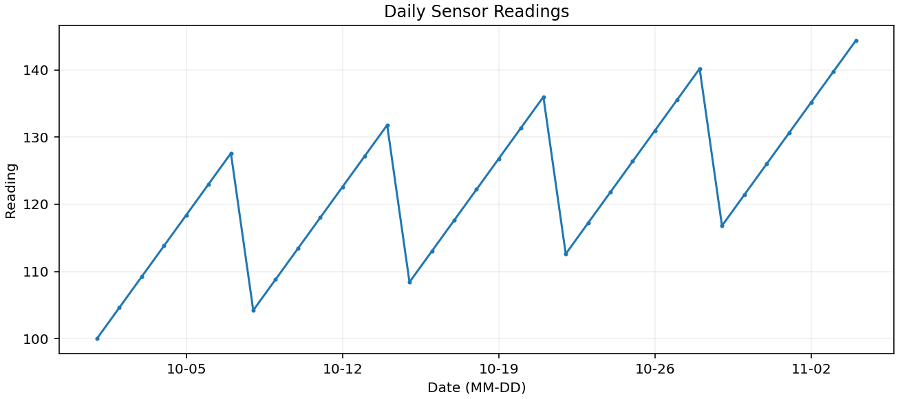

**핵심 코드 해설**

- `WeekdayLocator(byweekday=MO)`: 월요일 눈금 위치를 만듭니다.
- `DateFormatter("%m-%d")`: 날짜를 월-일 형태로 표시합니다.
- 데이터를 건드리지 않고 표시 형식만 변경합니다.

<details>
<summary><strong>참고 — 자동 눈금 조절</strong></summary>

대부분의 짧은 날짜 그래프는 Matplotlib의 자동 눈금으로 충분합니다. 날짜 레이블이 겹치거나 특정 주기에 맞춰 비교해야 할 때 Locator/Formatter를 직접 사용합니다.

</details>

<a id="section-3-14"></a>
## 3.14. Color Mapping — 색상으로 세 번째 값 표시

### 3.14.1. Color Mapping — 숫자를 색으로 변환하는 규칙

Color Mapping은 숫자값을 색상에 대응시키는 방법입니다. 일반적인 2차원 산점도는 x와 y 두 변수를 표현하지만, **점 색상을 세 번째 변수의 값**에 연결하면 한 그래프 안에서 더 많은 정보를 읽을 수 있습니다.

- **연속형 값(Continuous):** 온도·압력·속도처럼 수치의 크기와 순서가 중요합니다. 연속적인 색 변화가 적합합니다.
- **범주형 값(Categorical):** 서비스 A/B/C처럼 각 이름을 구분하는 것이 목적입니다. 구별 가능한 색상 목록과 범례가 적합합니다.

연속형 컬러맵은 대체로 아래 절차로 값을 표시합니다.

**정규화된 값(Normalized Value)**

$$
t = \frac{x - v_{\min}}{v_{\max} - v_{\min}},
\qquad 0 \leq t \leq 1
$$

- $t$: 정규화된 값 (0~1 범위)
- $x$: 원본 데이터 값
- $v_{\min}$: 데이터의 최솟값
- $v_{\max}$: 데이터의 최댓값

값 `x`를 `vmin`과 `vmax` 사이의 상대 위치 `t`로 바꾼 다음 컬러맵(`cmap`)이 그 위치에 해당하는 색을 정합니다. 예를 들어 최소 20°C, 최대 40°C에서 30°C는 중간인 `t=0.5`입니다. 실제 Matplotlib의 `Normalize`는 데이터 범위나 옵션에 따라 다른 처리를 할 수 있으므로 이 식은 **기본적인 선형 정규화의 원리**입니다.

**Colorbar(색상 막대)**는 색과 수치의 대응 관계를 설명하는 범례입니다. 색상만 있는 그래프에서는 진한 점이 몇 도인지 읽을 수 없으므로, 연속형 값에는 일반적으로 Colorbar와 단위를 함께 표시합니다.

예제에서 `c=temp`는 온도를 점 색에 연결하고, `cmap="viridis"`는 연속형 수치에 사용할 색상 체계를 선택합니다. `fig.colorbar(dots, ax=ax, label="Device temperature (°C)")`가 그 의미를 알려줍니다.

**비교 원칙:** 여러 그래프를 나란히 놓았다면 같은 온도가 같은 색으로 보이도록 `vmin`·`vmax`를 통일하는 편이 좋습니다. 자동 범위를 각 그래프마다 다르게 잡으면 같은 색이 다른 값을 뜻할 수 있습니다.

**문제 상황**

CPU 부하와 응답시간의 관계를 표시하면서 장비 온도까지 함께 확인하려고 합니다. 세 번째 변수를 점의 색상으로 표현합니다.

**필요한 개념**

`scatter(..., c=값, cmap=...)`는 수치를 색상으로 매핑합니다. 색상이 어떤 값을 뜻하는지 알려주는 **Colorbar**가 반드시 필요합니다.

**예제 코드 — [`14_scatter_colorbar.py`](./examples/14_scatter_colorbar.py)**

```python
from pathlib import Path
import matplotlib.pyplot as plt

ROOT=Path(__file__).resolve().parents[1]
loads=[20,35,43,50,60,71,80,89]
latency=[95,110,133,145,190,225,315,410]
temp=[24,26,25,28,29,31,33,34]
fig,ax=plt.subplots(figsize=(8,4.5),layout='constrained')
dots=ax.scatter(loads,latency,c=temp,cmap='viridis',s=90,edgecolor='black',linewidth=.3)
fig.colorbar(dots,ax=ax,label='Device temperature (°C)')
ax.set(title='Load and Latency',xlabel='CPU Load (%)',ylabel='Response Time (ms)')
ax.grid(alpha=.2)
fig.savefig(ROOT/'figures'/'15_scatter_colorbar.png',dpi=145)
plt.close(fig)
```

**실행 결과**

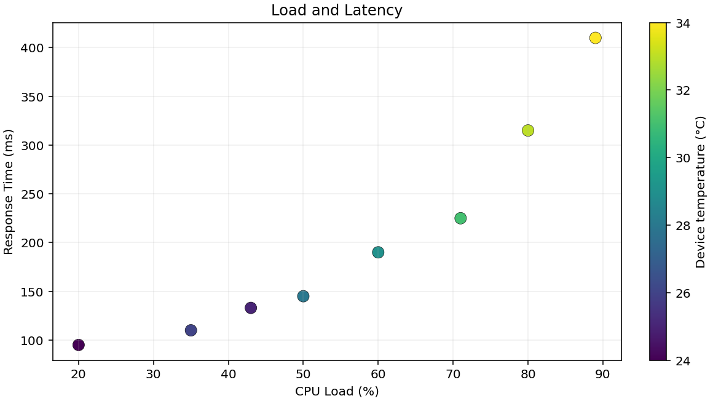

**핵심 코드 해설**

- `c=temp`: 온도값을 색상으로 연결합니다.
- `cmap="viridis"`: 연속적인 수치에 쓸 수 있는 컬러맵입니다.
- `fig.colorbar(dots, ax=ax, label=...)`: 수치와 색상 사이의 관계를 표시합니다.

<details>
<summary><strong>참고 — 색상의 의미와 접근성</strong></summary>

그룹을 구분하는 색과 연속적인 수치를 표현하는 색은 역할이 다릅니다. 색만으로 중요한 차이를 구분하도록 만들지 말고, 점 모양·레이블·범례를 함께 고려합니다.

</details>

### 3.14.2. Styling — 특정 그래프에만 스타일 적용

#### 개념 이해 — 스타일은 데이터보다 뒤에 온다

스타일(Styling)은 글꼴·색·격자·테두리 등의 외형을 조정해 **정보를 정확하고 빠르게 읽도록 돕는 과정**입니다. 눈에 띄는 색을 사용하는 것 자체가 목적은 아닙니다. 중요한 정보와 그렇지 않은 정보를 시각적으로 구별하는 것이 목적입니다.

Matplotlib의 설정에는 **전체 실행 환경에 영향을 줄 수 있는 설정**과 **특정 Axes에만 적용하는 설정**이 있습니다. `plt.rcParams`를 직접 바꾸면 이후 그래프의 스타일까지 바뀔 수 있지만, `with plt.rc_context({...}):`는 블록 안에서만 설정을 적용하고 종료하면 이전 설정으로 복원합니다.

| 요소 | 사용 이유 | 대표 코드 |
|---|---|---|
| 불필요한 상단·우측 테두리 제거 | 시선 분산 완화 | `ax.spines[["top", "right"]].set_visible(False)` |
| 가벼운 격자 | 값의 높이 비교 | `ax.grid(axis="y", alpha=0.2)` |
| 적절한 선 굵기·마커 | 주요 계열의 식별력 확보 | `linewidth=2`, `marker="o"` |
| 글자와 단위 | 그래프의 의미 설명 | `ax.set(xlabel=..., ylabel=...)` |

인쇄 환경이나 색각 특성이 다른 독자를 위해서는 **색만으로 범주를 구분하지 않고** 선 스타일·마커·레이블 등 다른 단서도 제공합니다. 그래프를 읽기 쉽게 만들기 위해 꼭 필요한 부분부터 스타일을 적용합니다.

**문제 상황**

여러 보고서 중 하나에만 테두리와 격자 스타일을 적용해야 합니다. 전역 설정을 바꾸면 다른 그래프까지 영향을 받을 수 있습니다.

**필요한 개념**

`plt.rc_context({...})`는 스타일 설정을 해당 블록 안에 한정합니다. 개별 Axes의 `spines`, `grid`를 조절하는 방법도 자주 사용합니다.

**예제 코드 — [`15_style_context.py`](./examples/15_style_context.py)**

```python
from pathlib import Path
import matplotlib.pyplot as plt

ROOT=Path(__file__).resolve().parents[1]
months=['Jan','Feb','Mar','Apr','May']
units=[83,97,112,105,125]
# Context confines style adjustments to this figure.
with plt.rc_context({'axes.spines.top':False,'axes.spines.right':False,'grid.alpha':0.2}):
    fig,ax=plt.subplots(figsize=(7.5,4),layout='constrained')
    ax.plot(months,units,color='#2C648D',linewidth=2.2,marker='o')
    ax.grid(axis='y')
    ax.set(title='Monthly Output',xlabel='Month',ylabel='Units')
    fig.savefig(ROOT/'figures'/'16_style_context.png',dpi=145)
    plt.close(fig)
```

**실행 결과**

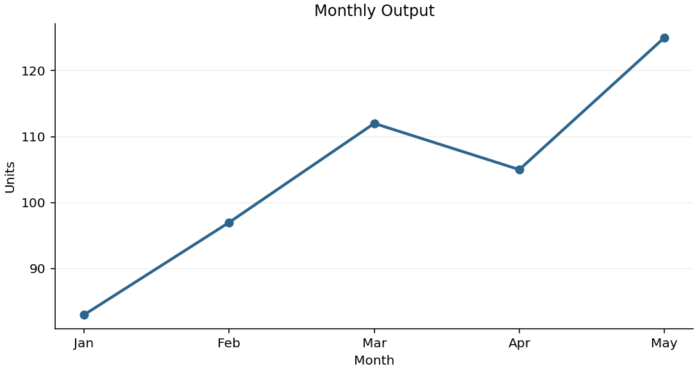

**핵심 코드 해설**

- `with plt.rc_context(...)`: 필요한 구간에만 스타일 변경을 적용합니다.
- `axes.spines.*`: 그래프의 경계선 표시 여부를 조절합니다.
- 회색 격자나 균형 잡힌 색을 사용해 데이터의 가독성을 높입니다.

<details>
<summary><strong>참고 — 과도한 장식은 피하기</strong></summary>

그라데이션·음영·배경 그림처럼 데이터 판독에 기여하지 않는 요소는 줄이는 편이 좋습니다. 목적에 맞는 레이블과 축 단위가 우선입니다.

</details>

<a id="section-3-15"></a>
## 3.15. GridSpec — 서로 다른 크기의 그래프 배치

### 3.15.1. GridSpec — 공간을 비율로 배치하기

`plt.subplots(2, 2)`는 일반적으로 비슷한 크기의 그래프 네 개를 만드는 데 편리합니다. 그러나 실제 보고서에서는 추이를 크게 보여주고 보조 정보는 작게 배치해야 할 때가 많습니다. **GridSpec은 Figure를 격자로 나눈 뒤 하나의 Axes가 여러 칸을 차지하도록 하는 배치 도구**입니다.

```text
┌─────────────────────┬─────────────┐
│                     │  오른쪽 위  │
│      왼쪽 메인      ├─────────────┤
│      (2개 행)       │  오른쪽 아래│
└─────────────────────┴─────────────┘
```

`fig.add_gridspec(2, 2, width_ratios=[2, 1])`은 2행 2열 격자를 만들고 **왼쪽 열이 오른쪽 열보다 상대적으로 넓게** 배치되도록 지정합니다. `grid[:, 0]`은 전체 행에 걸친 첫 번째 열, `grid[0, 1]`은 첫 번째 행의 두 번째 열입니다. 이는 NumPy 배열의 `[행, 열]` 슬라이싱과 같은 방식입니다.

이 배치는 그래프를 자동으로 생성하지 않습니다. `fig.add_subplot(grid[:, 0])`처럼 **선택한 격자 칸에 Axes를 만든 다음** 데이터를 그려야 합니다.

| 도구 | 적합한 상황 |
|---|---|
| `plt.subplots()` | 간단한 행×열 배치 |
| `GridSpec` | 그래프마다 다른 크기·여러 칸 점유 필요 |
| `subplot_mosaic()` | 이름을 붙여 의미 중심으로 레이아웃 관리 |

큰 그래프에 가장 중요한 질문을 배치하고 작은 그래프는 그 해석을 보조하도록 구성합니다. 그래프의 면적을 크게 했다는 이유만으로 데이터 값 자체가 커지는 것은 아닙니다.

**문제 상황**

요약 보고서에서 추이 그래프를 크게, 분류·분포 그래프를 상대적으로 작게 배치하려고 합니다.

**필요한 개념**

`GridSpec`은 여러 행과 열에 걸쳐 Axes를 배치할 수 있는 도구입니다. 단순 2×2 배치로 충분할 때는 일반 `subplots()`가 더 간결합니다.

**예제 코드 — [`16_gridspec.py`](./examples/16_gridspec.py)**

```python
from pathlib import Path
import numpy as np
import matplotlib.pyplot as plt

ROOT=Path(__file__).resolve().parents[1]
fig=plt.figure(figsize=(9,5.8),layout='constrained')
grid=fig.add_gridspec(2,2,width_ratios=[2,1])
ax_main=fig.add_subplot(grid[:,0])
ax_top=fig.add_subplot(grid[0,1])
ax_bottom=fig.add_subplot(grid[1,1])
ax_main.plot(np.arange(12),[20,21,25,22,23,27,24,29,30,28,32,31],marker='o')
ax_main.set(title='Weekly Throughput',xlabel='Observation',ylabel='Requests (thousands)')
ax_top.bar(['A','B','C'],[20,13,17])
ax_top.set(title='By Site',ylabel='Count')
ax_bottom.hist([45,50,55,62,63,67,68,71,73,74,78,81],bins=5,edgecolor='white')
ax_bottom.set(title='Distribution',xlabel='Measured Value')
fig.savefig(ROOT/'figures'/'17_gridspec.png',dpi=145)
plt.close(fig)
```

**실행 결과**

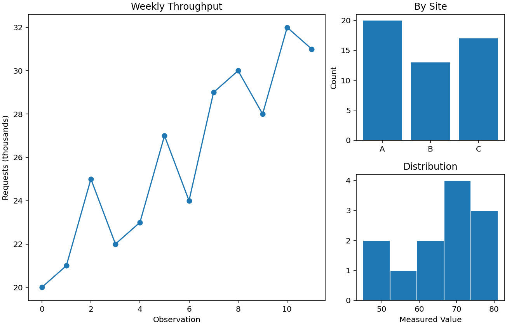

**핵심 코드 해설**

- `fig.add_gridspec(...)`: 그래프를 배치할 격자를 준비합니다.
- `grid[:, 0]`: 왼쪽 열의 모든 행을 차지합니다.
- `grid[0, 1]`: 오른쪽 위 영역입니다.

<details>
<summary><strong>참고 — `subplot_mosaic` 선택지</strong></summary>

문자열 키로 Axes를 관리하고 싶다면 `subplot_mosaic()`도 사용할 수 있습니다. 이번 장에서는 인덱스와 슬라이스를 이해하는 데 집중합니다.

</details>

### 3.15.2. Heatmap — 행과 열의 값 비교

#### 개념 이해 — Heatmap은 무엇이고 어떻게 읽는가?

히트맵(Heatmap)은 **행과 열로 이루어진 2차원 표의 값을 색상으로 표현한 그래프**입니다. 표의 숫자를 하나씩 읽는 대신, 값이 크거나 작은 위치가 어느 행·열에 집중되어 있는지 한눈에 발견하도록 돕습니다. 이름에 '열(Heat)'이 들어가지만 실제 온도 자료에만 사용하는 것은 아닙니다. 이용 건수, 처리 시간, 상관계수 등 다양한 수치 행렬을 시각화할 수 있습니다.

예제에는 작업 지점 3개(행)와 시간대 4개(열)가 있습니다.

| 작업 지점 / 시간 | 09:00 | 12:00 | 15:00 | 18:00 |
|---|---:|---:|---:|---:|
| Terminal A | 44 | 61 | 70 | 85 |
| Terminal B | 35 | 49 | 65 | 76 |
| Terminal C | 18 | 30 | 48 | 53 |

**셀(Cell) 하나는 한 지점과 한 시간대의 조합**입니다. 예를 들어 `values[0, 3] = 85`는 Terminal A의 18:00 처리 건수가 85라는 뜻입니다. Python/NumPy 배열의 인덱스는 0부터 시작하므로 행 0은 A, 열 3은 18:00에 대응합니다.

$$
M =
\begin{bmatrix}
44 & 61 & 70 & 85 \\
35 & 49 & 65 & 76 \\
18 & 30 & 48 & 53
\end{bmatrix}
$$

$$
M_{1,4} = 85
$$

- $M$: 3행 4열로 구성된 행렬
- $M_{i,j}$: $i$번째 행, $j$번째 열의 원소
- $M_{1,4}$: 1행 4열에 위치한 값인 85


수식의 `M_{1,4}`는 **수학에서 1부터 세는 행·열 번호**를 사용한 표기이며, Python에서는 `values[0, 3]`입니다.

히트맵은 일반적으로 각 셀의 숫자를 **컬러맵(Color Map)**으로 변환합니다. 이때 알아야 할 구성 요소는 다음과 같습니다.

- **행(Row)·열(Column):** 각각 어떤 범주 또는 순서를 나타내는지 축 레이블로 명시
- **셀 값(Value):** 합계인지, 평균인지, 실제 관측값인지 등 통계적 의미 명시
- **컬러맵(`cmap`):** 값의 크기에 대응하는 색상 체계 지정
- **Colorbar:** 색과 값의 관계를 알려주는 눈금 및 단위 제공
- **결측 셀:** `NaN`을 0처럼 표시하지 않도록 별도 처리

예제는 18:00의 Terminal A가 **85건으로 가장 많고**, 같은 시각의 Terminal C는 **53건**임을 보여줍니다. 시간대가 뒤로 갈수록 값이 높아지는 양상이 보이지만, 이 표만으로 왜 그런 변화가 생겼는지는 알 수 없습니다.

**Matplotlib에서 구현하기:** `ax.imshow(values, cmap="viridis", interpolation="nearest")`는 2차원 배열을 색상 이미지로 표시합니다. `interpolation="nearest"`는 셀 사이의 색을 부드럽게 섞지 않아 **원래 셀 경계가 유지**되게 합니다. `aspect="auto"`는 그림 영역에 맞춰 셀의 가로·세로 비율을 조절하므로 모든 셀이 정사각형일 필요는 없습니다.

**다른 히트맵과 비교하기:** 두 그림을 비교할 때 `vmin`과 `vmax`가 다르면 **같은 색이 서로 다른 값**을 나타낼 수 있습니다. 여러 기간의 히트맵을 함께 비교하는 보고서에서는 같은 척도를 쓰는 편이 안전합니다. 값 0은 실제 처리 건수가 0이라는 뜻이고, 기록 누락은 `NaN`입니다. 두 상태를 같은 색으로 표현하면 중요한 정보가 사라집니다.

이 장에서는 **Matplotlib의 `imshow()`로 히트맵의 원리를 학습**합니다. 다음 Chapter 04에서는 Seaborn `heatmap()`을 사용하여 상관계수 행렬과 피벗 테이블을 시각화하는 방법으로 확장합니다.

**문제 상황**

여러 작업 지점의 시간대별 처리 건수를 한눈에 비교해야 합니다. 각각의 막대그래프를 그리면 전체 패턴을 확인하기 어렵습니다.

**필요한 개념**

`imshow()`는 행렬 값을 색으로 표현합니다. x축·y축이 각각 어떤 범주를 뜻하는지 명시하고 반드시 색상 막대를 함께 제공합니다.

**예제 코드 — [`17_heatmap.py`](./examples/17_heatmap.py)**

```python
from pathlib import Path
import numpy as np
import matplotlib.pyplot as plt

ROOT=Path(__file__).resolve().parents[1]
values=np.array([[44,61,70,85],[35,49,65,76],[18,30,48,53]],dtype=float)
fig,ax=plt.subplots(figsize=(7.5,4),layout='constrained')
image=ax.imshow(values,aspect='auto',cmap='viridis',interpolation='nearest')
ax.set_xticks(range(4),['09:00','12:00','15:00','18:00'])
ax.set_yticks(range(3),['Terminal A','Terminal B','Terminal C'])
ax.set(title='Hourly Transactions',xlabel='Hour',ylabel='Location')
fig.colorbar(image,ax=ax,label='Transactions')
fig.savefig(ROOT/'figures'/'18_heatmap.png',dpi=145)
plt.close(fig)
```

**실행 결과**

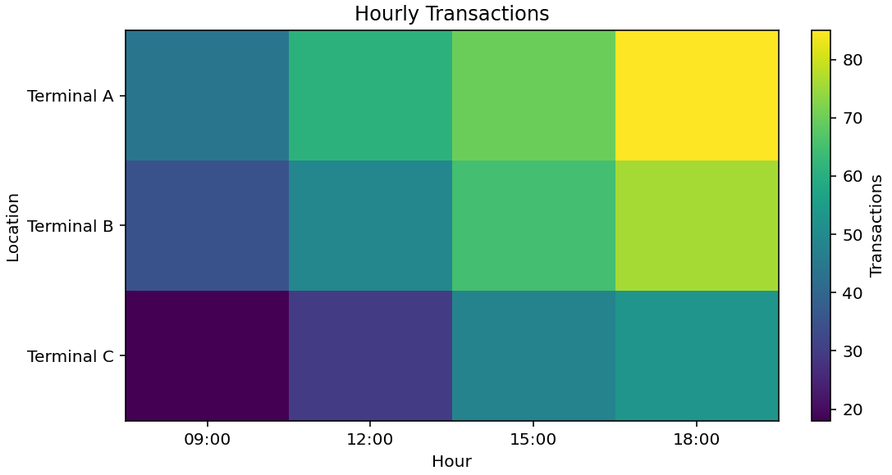

**핵심 코드 해설**

- `imshow(values, aspect="auto")`: 행렬을 이미지 형태로 나타냅니다.
- `set_xticks()`, `set_yticks()`: 실제 시간과 지점명을 연결합니다.
- `colorbar()`: 색상이 나타내는 건수를 표시합니다.

<details>
<summary><strong>참고 — 누락된 행렬 원소</strong></summary>

행렬에 `NaN`이 존재할 경우 관측 누락을 별도 색으로 표시하거나 주석으로 알리는 방법을 고려합니다. 이 예제에서는 모든 셀에 값이 있는 데이터를 사용합니다.

</details>

<a id="section-3-16"></a>
## 3.16. Mini Project 01 — City Weather Snapshot

**문제 상황**

3개 지역에서 14일 동안 기록한 기온·강수량을 한 페이지의 기상 보고서로 정리하려고 합니다. 특정 날짜의 기록이 없고 기온값이 비어 있는 관측도 있으므로 누락 상태를 구별해야 합니다.

**입력 데이터:** [`weather_daily.csv`](./data/weather_daily.csv), 열 정의는 [Data Dictionary](./data/DATA_DICTIONARY.md)를 참고합니다.

**구현 목표**

1. **2행 2열** Figure를 만듭니다.
2. 지역별 일별 기온을 비교하되 기록이 없는 날짜는 선이 끊기도록 처리합니다.
3. 지역별 강수량 합계, 기온·강수량 산점도, 날짜별 관측 지역 수를 별도 패널로 표시합니다.
4. 축 레이블·단위·범례·제목을 붙이고 이미지를 PNG로 저장합니다.
5. **예정 42개, 원본 41개, 유효 기온 40개**와 같이 측정 슬롯과 값 결측을 별도로 기록합니다.

**Starter Code:** [`projects/mini_01_weather/starter.py`](./projects/mini_01_weather/starter.py)

**완료 결과 예시**

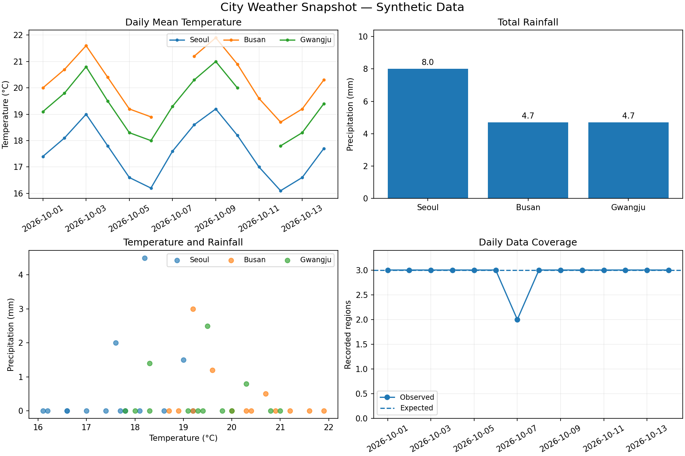

**검증 기준:** 그래프 4개, 지역별 표시, 단위와 범례, 누락일 및 비어 있는 기온의 구분, 원본 파일 비변경.

<details>
<summary><strong>Hint — 필요한 함수와 구현 순서</strong></summary>

- `pd.date_range()`로 기대 날짜를 만들고 `Series.reindex()`로 지역별 선의 누락 위치를 드러냅니다.
- `plt.subplots(2, 2)`로 4개의 Axes를 준비합니다.
- `groupby()`와 `scatter()`, `bar()`의 결과가 어떤 단위인지 확인합니다.
- `fig.savefig()`로 Figure 전체를 저장합니다.

</details>

<a id="section-3-17"></a>
## 3.17. Mini Project 02 — Store Sales Visualization Report

**문제 상황**

3개 매장의 상품 분류별 매출과 일별 매출 변화를 보고서로 정리해야 합니다. 방문자가 가장 많은 날이 아니라 **매출이 가장 높았던 날**을 정확히 강조해야 합니다.

**입력 데이터:** [`store_sales.csv`](./data/store_sales.csv) — 28일 × 3개 매장 × 4개 분류 = **336행**.

**구현 목표**

1. 일별 매출 합계를 선 그래프로 표현합니다.
2. 매장별 총매출을 세로 막대그래프로 비교하고 수치를 표시합니다.
3. 상품 분류별 매출을 정렬된 가로 막대그래프로 표현합니다.
4. 일별 매출액의 분포를 히스토그램으로 나타냅니다.
5. 최고 매출일에 주석을 붙이고, 모든 축에 원화(원) 단위를 표시합니다.
6. 결과 이미지와 총매출·최고 매출일을 JSON 파일에 저장합니다.

**Starter Code:** [`projects/mini_02_sales/starter.py`](./projects/mini_02_sales/starter.py)

**완료 결과 예시**

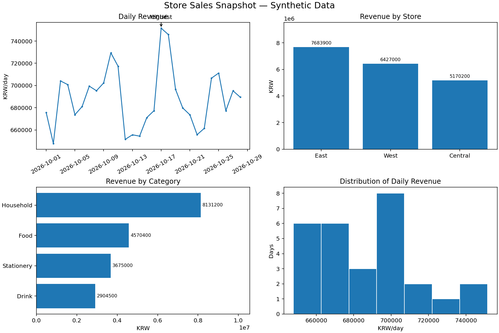

**검증 기준:** 4개 패널, 매출 합계 **19,281,100원**, 관측 기간 28일, `output/`에 PNG·JSON 생성, 원본 보존.

<details>
<summary><strong>Hint — 그래프와 집계 단위</strong></summary>

- `groupby('date')`, `groupby('store')`, `groupby('category')`는 서로 다른 비교 질문에 대응합니다.
- 금액 단위와 건수 단위를 같은 축에 섞지 않습니다.
- `idxmax()`로 최고 매출일을 찾을 수 있습니다.
- `bar_label()`을 쓸 때 그래프 위 여백을 남겨 텍스트가 잘리지 않게 합니다.

</details>

<a id="section-3-18"></a>
## 3.18. Mini Project 03 — Server Performance Monitoring

**문제 상황**

3개 서비스의 시간대별 CPU 사용률·메모리 사용률·응답시간을 한 화면에서 비교하려고 합니다. 특정 시간대의 관측이 없고 일부 응답시간도 기록되지 않았으므로 **측정 누락과 실제 0을 구별**해야 합니다.

**입력 데이터:** [`server_metrics.csv`](./data/server_metrics.csv), 72시간 × 3개 서비스 = **예정 216개 슬롯**, 제공된 행 **213개**, 응답시간 결측 **1개**.

**구현 목표**

1. 3행 1열 Axes를 생성하고 세 패널에 동일한 시간 축을 적용합니다.
2. 서비스별 CPU(%), 메모리(%), 응답시간(ms) 추이를 표시합니다.
3. CPU **85%**, 메모리 **90%**, 응답시간 **450ms**를 *검토 기준선*으로 표시합니다.
4. 없는 시간은 0으로 보정하지 않고 빈 구간으로 표현합니다.
5. 원본 슬롯 수·누락 슬롯·임계값 초과 관측 수를 요약합니다.
6. 출력물을 PNG·JSON으로 저장합니다.

**Starter Code:** [`projects/mini_03_server/starter.py`](./projects/mini_03_server/starter.py)

**완료 결과 예시**

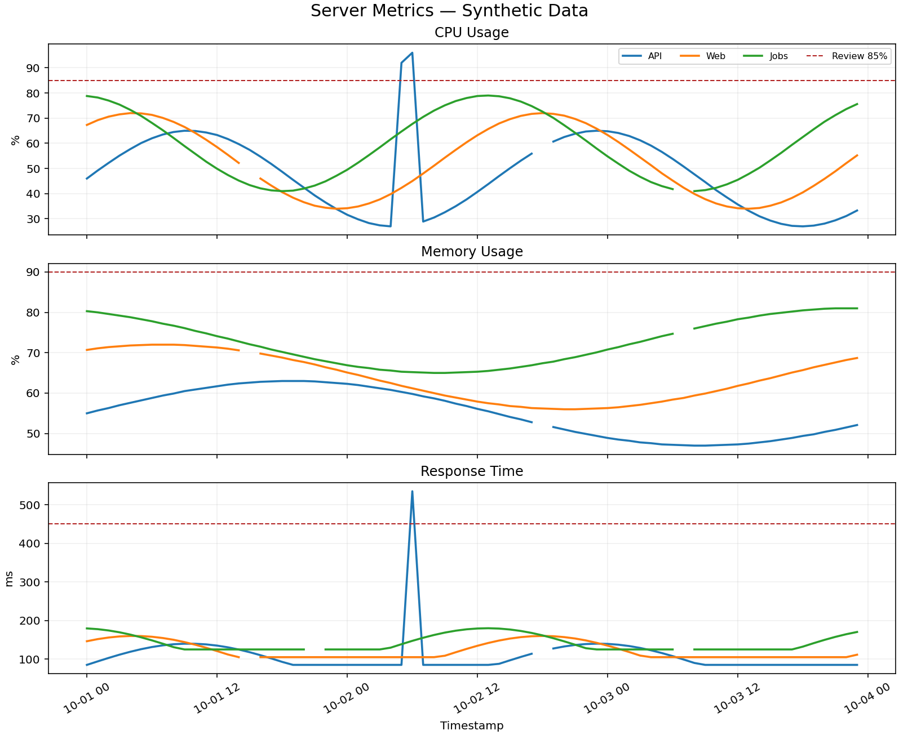

**검증 기준:** 서비스 3개, 서로 다른 단위 분리, 시간 축 공유, 결측 위치 유지. 임계선을 넘었다는 사실만으로 장애나 원인을 단정하지 않습니다.

<details>
<summary><strong>Hint — 시간 축 공유</strong></summary>

- `plt.subplots(3, 1, sharex=True)`로 시작합니다.
- 서비스별 데이터에 전체 시간 목록을 `reindex()`하여 누락을 그대로 표시합니다.
- `ax.axhline()`으로 기준선을 추가합니다.
- 출력물의 수치가 원본 CSV와 일치하는지 확인합니다.

</details>

<a id="section-3-19"></a>
## 3.19. Coding Practice — 14 Exercises

각 문제는 **문제 상황과 시작 코드**를 제공합니다. 이미 주어진 코드를 모두 다시 작성하지 않고 `TODO`를 완성하세요. 실행 결과가 요구사항과 일치하는지 확인한 뒤, 별도 `solutions/exercises/`의 모범 구현과 비교할 수 있습니다. README에서는 연습문제의 완성 코드를 직접 보여주지 않습니다.

**권장 순서:** 01~04는 기본 적용, 05~10은 그래프 구성, 11~14는 결과 해석과 출력 관리에 초점을 맞춥니다.

### Practice 01 — 동일한 단위의 두 지표 추이 비교

**문제 상황:** 두 계열을 서로 다른 마커와 범례로 표현합니다.

**시작 코드:** [`01_compare_trends.py`](./exercises/01_compare_trends.py)

```python
"""실습 1: 두 지역의 월별 방문 추이를 선 그래프로 비교하세요."""
import matplotlib.pyplot as plt

months = ["Jan", "Feb", "Mar", "Apr"]
site_a = [120, 140, 150, 180]
site_b = [105, 131, 137, 160]

# TODO: fig, ax 생성, 두 시리즈의 선 그래프, 범례, 제목 설정
# TODO: 결과를 figures/exercise_01.png에 저장
```

**완료 조건:** 코드의 `TODO`를 구현하고, PNG 이미지에서 그래프 종류·축·단위·범례 또는 주석이 요구사항과 일치하는지 확인합니다.

### Practice 02 — 범주 순위 표시

**문제 상황:** 판매량 기준 정렬과 가로 막대 수치를 표시합니다.

**시작 코드:** [`02_category_bars.py`](./exercises/02_category_bars.py)

```python
"""실습 2: 카테고리별 주문량을 큰 값부터 가로 막대로 표시하세요."""
import matplotlib.pyplot as plt

orders = {"Books": 42, "Games": 63, "Music": 35, "Movies": 48}
# TODO: 값 기준 정렬, barh(), 제목과 단위, 값 레이블
```

**완료 조건:** 코드의 `TODO`를 구현하고, PNG 이미지에서 그래프 종류·축·단위·범례 또는 주석이 요구사항과 일치하는지 확인합니다.

### Practice 03 — 서로 다른 단위의 그래프 배치

**문제 상황:** 1행 2열로 두 지표를 분리합니다.

**시작 코드:** [`03_two_panels.py`](./exercises/03_two_panels.py)

```python
"""실습 3: 방문 수와 매출을 서로 다른 Axes에 표시하세요."""
import matplotlib.pyplot as plt

weeks = [1, 2, 3, 4]
visits = [60, 80, 75, 95]
revenue = [30, 38, 42, 47]
# TODO: plt.subplots(1, 2)와 axes[0], axes[1] 이용
```

**완료 조건:** 코드의 `TODO`를 구현하고, PNG 이미지에서 그래프 종류·축·단위·범례 또는 주석이 요구사항과 일치하는지 확인합니다.

### Practice 04 — 관측 누락 표시

**문제 상황:** 관측하지 않은 날짜에 0을 넣지 않습니다.

**시작 코드:** [`04_missing_observations.py`](./exercises/04_missing_observations.py)

```python
"""실습 4: 누락된 관측값을 0으로 바꾸지 않고 선 그래프로 표시하세요."""
import matplotlib.pyplot as plt
import numpy as np

labels = ["D1", "D2", "D3", "D4", "D5"]
measurements = [7, 10, np.nan, 8, 12]
# TODO: 선 그래프를 그리되 누락값을 그대로 둡니다.
```

**완료 조건:** 코드의 `TODO`를 구현하고, PNG 이미지에서 그래프 종류·축·단위·범례 또는 주석이 요구사항과 일치하는지 확인합니다.

### Practice 05 — 매장별 분류 막대 비교

**문제 상황:** 분류마다 A·B 막대가 겹치지 않게 배치합니다.

**시작 코드:** [`05_grouped_bar.py`](./exercises/05_grouped_bar.py)

```python
from pathlib import Path
import matplotlib.pyplot as plt
import numpy as np
ROOT=Path(__file__).resolve().parents[1]
labels=['Food','Drink','Stationery']
a=np.array([22,31,19]);b=np.array([27,26,25]);x=np.arange(len(labels))
fig,ax=plt.subplots(figsize=(7.5,4),layout='constrained')
# TODO: 각 분류마다 A와 B 막대가 겹치지 않도록 배치하고 범례를 추가하세요.
# TODO: x축 눈금을 분류 이름으로 지정하세요.
(ROOT/'output').mkdir(exist_ok=True)
fig.savefig(ROOT/'output'/'practice_05.png',dpi=145)
plt.close(fig)
```

**완료 조건:** 코드의 `TODO`를 구현하고, PNG 이미지에서 그래프 종류·축·단위·범례 또는 주석이 요구사항과 일치하는지 확인합니다.

### Practice 06 — 가장 많은 주문이 발생한 시점 강조

**문제 상황:** 데이터에서 최댓값을 찾아 주석을 추가합니다.

**시작 코드:** [`06_peak_annotation.py`](./exercises/06_peak_annotation.py)

```python
from pathlib import Path
import matplotlib.pyplot as plt
ROOT=Path(__file__).resolve().parents[1]
hours=[9,10,11,12,13,14];orders=[13,16,27,31,25,18]
fig,ax=plt.subplots(figsize=(7.5,4),layout='constrained')
ax.plot(hours,orders,marker='o')
# TODO: 가장 많은 주문이 발생한 (시간, 주문량)을 계산하여 화살표로 표시하세요.
# TODO: 축 제목과 그래프 제목을 지정하세요.
(ROOT/'output').mkdir(exist_ok=True)
fig.savefig(ROOT/'output'/'practice_06.png',dpi=145)
plt.close(fig)
```

**완료 조건:** 코드의 `TODO`를 구현하고, PNG 이미지에서 그래프 종류·축·단위·범례 또는 주석이 요구사항과 일치하는지 확인합니다.

### Practice 07 — 온도와 습도의 공통 시간 축

**문제 상황:** 2개 Axes의 x축을 공유하고 단위를 구분합니다.

**시작 코드:** [`07_shared_timeline.py`](./exercises/07_shared_timeline.py)

```python
from pathlib import Path
import matplotlib.pyplot as plt
ROOT=Path(__file__).resolve().parents[1]
hours=[8,9,10,11,12];temperature=[21,22,23,25,24];humidity=[47,45,48,51,49]
fig,axes=plt.subplots(2,1,sharex=True,figsize=(8,5),layout='constrained')
# TODO: 위에는 기온, 아래에는 습도 그래프를 그리고 x축 눈금을 공유하세요.
# TODO: 각각의 y축 단위를 표시하세요.
(ROOT/'output').mkdir(exist_ok=True)
fig.savefig(ROOT/'output'/'practice_07.png',dpi=145)
plt.close(fig)
```

**완료 조건:** 코드의 `TODO`를 구현하고, PNG 이미지에서 그래프 종류·축·단위·범례 또는 주석이 요구사항과 일치하는지 확인합니다.

### Practice 08 — 기간이 긴 그래프의 날짜 레이블

**문제 상황:** 일별 데이터를 유지하면서 눈금만 주 단위로 표시합니다.

**시작 코드:** [`08_date_locator.py`](./exercises/08_date_locator.py)

```python
from pathlib import Path
import matplotlib.pyplot as plt
import pandas as pd
ROOT=Path(__file__).resolve().parents[1]
dates=pd.date_range('2026-10-01',periods=30,freq='D');values=[20+(i%6)*2 for i in range(30)]
fig,ax=plt.subplots(figsize=(8.5,4),layout='constrained')
ax.plot(dates,values)
# TODO: WeekdayLocator, DateFormatter로 매주 월요일 및 MM-DD 표시
(ROOT/'output').mkdir(exist_ok=True)
fig.savefig(ROOT/'output'/'practice_08.png',dpi=145)
plt.close(fig)
```

**완료 조건:** 코드의 `TODO`를 구현하고, PNG 이미지에서 그래프 종류·축·단위·범례 또는 주석이 요구사항과 일치하는지 확인합니다.

### Practice 09 — 색상으로 센서 온도 나타내기

**문제 상황:** 산점도의 색상 범례와 단위를 지정합니다.

**시작 코드:** [`09_colorbar.py`](./exercises/09_colorbar.py)

```python
from pathlib import Path
import matplotlib.pyplot as plt
ROOT=Path(__file__).resolve().parents[1]
load=[30,45,57,68,80];time=[80,98,110,180,240];temp=[22,24,27,29,31]
fig,ax=plt.subplots(figsize=(7.5,4),layout='constrained')
# TODO: 점 크기 100, color mapping은 temp, cmap='viridis'를 사용하세요.
# TODO: Figure의 colorbar에 'Device temp (°C)'를 표시하세요.
(ROOT/'output').mkdir(exist_ok=True)
fig.savefig(ROOT/'output'/'practice_09.png',dpi=145)
plt.close(fig)
```

**완료 조건:** 코드의 `TODO`를 구현하고, PNG 이미지에서 그래프 종류·축·단위·범례 또는 주석이 요구사항과 일치하는지 확인합니다.

### Practice 10 — 그래프 장식 최소화

**문제 상황:** 상단·오른쪽 테두리를 숨기고 수평 격자를 그립니다.

**시작 코드:** [`10_style_scope.py`](./exercises/10_style_scope.py)

```python
from pathlib import Path
import matplotlib.pyplot as plt
ROOT=Path(__file__).resolve().parents[1]
x=[1,2,3,4];y=[15,20,17,26]
fig,ax=plt.subplots(figsize=(7,4),layout='constrained')
ax.plot(x,y,marker='o')
# TODO: 이번 Axes의 top/right spine을 숨기고 y축 격자만 표시하세요.
(ROOT/'output').mkdir(exist_ok=True)
fig.savefig(ROOT/'output'/'practice_10.png',dpi=145)
plt.close(fig)
```

**완료 조건:** 코드의 `TODO`를 구현하고, PNG 이미지에서 그래프 종류·축·단위·범례 또는 주석이 요구사항과 일치하는지 확인합니다.

### Practice 11 — 배송 시간 구간별 빈도

**문제 상황:** 정해진 구간 경계로 히스토그램을 생성합니다.

**시작 코드:** [`11_histogram_bins.py`](./exercises/11_histogram_bins.py)

```python
from pathlib import Path
import matplotlib.pyplot as plt
ROOT=Path(__file__).resolve().parents[1]
minutes=[4,8,11,12,19,24,27,32,37,39,43,48,55]
fig,ax=plt.subplots(figsize=(7.5,4),layout='constrained')
# TODO: 구간 경계 0,20,40,60으로 히스토그램 작성, x축 단위 명시
(ROOT/'output').mkdir(exist_ok=True)
fig.savefig(ROOT/'output'/'practice_11.png',dpi=145)
plt.close(fig)
```

**완료 조건:** 코드의 `TODO`를 구현하고, PNG 이미지에서 그래프 종류·축·단위·범례 또는 주석이 요구사항과 일치하는지 확인합니다.

### Practice 12 — 잘못 배치된 보고서 수정

**문제 상황:** 2×2 Axes의 올바른 영역에 그래프를 작성합니다.

**시작 코드:** [`12_dashboard_repair.py`](./exercises/12_dashboard_repair.py)

```python
from pathlib import Path
import matplotlib.pyplot as plt
ROOT=Path(__file__).resolve().parents[1]
fig,axes=plt.subplots(2,2,figsize=(9,6),layout='constrained')
axes[0,0].plot([1,2,3],[4,6,5]);axes[0,0].set_title('Daily')
axes[0,1].bar(['A','B'],[5,7]);axes[0,1].set_title('Category')
# TODO: 오른쪽 아래가 아니라 왼쪽 아래 axes[1,0]에 분포 그래프를 추가하세요.
# TODO: 오른쪽 아래 axes[1,1]에는 누적 데이터 선 그래프를 그리세요.
(ROOT/'output').mkdir(exist_ok=True)
fig.savefig(ROOT/'output'/'practice_12.png',dpi=145)
plt.close(fig)
```

**완료 조건:** 코드의 `TODO`를 구현하고, PNG 이미지에서 그래프 종류·축·단위·범례 또는 주석이 요구사항과 일치하는지 확인합니다.

### Practice 13 — 매장 순위 가로 막대

**문제 상황:** 판매량 오름차순 정렬 후 가로 막대를 그립니다.

**시작 코드:** [`13_sort_barh.py`](./exercises/13_sort_barh.py)

```python
from pathlib import Path
import matplotlib.pyplot as plt
ROOT=Path(__file__).resolve().parents[1]
stores={'North':70,'South':35,'East':52,'West':86}
fig,ax=plt.subplots(figsize=(7.5,4),layout='constrained')
# TODO: 값으로 정렬하고, y축이 오름차순인 가로 막대그래프로 구현하세요.
(ROOT/'output').mkdir(exist_ok=True)
fig.savefig(ROOT/'output'/'practice_13.png',dpi=145)
plt.close(fig)
```

**완료 조건:** 코드의 `TODO`를 구현하고, PNG 이미지에서 그래프 종류·축·단위·범례 또는 주석이 요구사항과 일치하는지 확인합니다.

### Practice 14 — 측정값·오차범위 표현

**문제 상황:** 오류 막대를 추가하고 PNG·SVG 파일을 모두 저장합니다.

**시작 코드:** [`14_errorbar_export.py`](./exercises/14_errorbar_export.py)

```python
from pathlib import Path
import matplotlib.pyplot as plt
ROOT=Path(__file__).resolve().parents[1]
months=['Jan','Feb','Mar','Apr'];means=[12,15,14,18];error=[1.1,1.8,1.4,1.2]
fig,ax=plt.subplots(figsize=(7.5,4),layout='constrained')
# TODO: 각 평균에 error 범위를 수직 오류 막대로 표현하세요.
# TODO: 현재 출력 PNG 외에 practice_14.svg도 저장하세요.
(ROOT/'output').mkdir(exist_ok=True)
fig.savefig(ROOT/'output'/'practice_14.png',dpi=145)
plt.close(fig)
```

**완료 조건:** 코드의 `TODO`를 구현하고, PNG 이미지에서 그래프 종류·축·단위·범례 또는 주석이 요구사항과 일치하는지 확인합니다.

<a id="section-3-20"></a>
## 3.20. Advanced Project 01 — Multi-Station Weather Report Generator

**난이도: 심화 · 선택 과제**

**문제 상황**

기온 관측소의 수와 관측 기간은 변경될 수 있습니다. 관측소가 1개일 때도 10개일 때도 보고서의 그래프가 잘리거나 겹치지 않고 생성되어야 합니다. 일부 날짜의 관측이 없을 수 있으며, 기온을 비교할 때 관측소별 y축 기준을 다르게 적용하면 차이를 잘못 읽을 수 있습니다.

**입력:** [`weather_stations.csv`](./data/weather_stations.csv) — 5개 관측소 × 30일, 관측 행 **145개**, 기온값이 비어 있는 행 1개.

**구현 요구사항**

1. 관측소 ID를 명령행 인수로 받아 선택적으로 보고서를 만듭니다. 인수를 생략하면 모든 관측소를 포함합니다.
2. 선택한 관측소 수에 따라 `Subplots` 행·열을 자동 계산합니다. 빈 Axes는 숨깁니다.
3. 모든 관측소의 기온 그래프에 동일한 y축 범위를 적용합니다.
4. 날짜별 누락을 NaN으로 남겨 결측 구간을 드러냅니다.
5. **28°C**를 표시하는 검토 기준선을 추가합니다. 이 선만으로 이상 관측 여부를 단정하지 않습니다.
6. 관측소별 유효 기온 수집률과 누락 수를 계산해 CSV·JSON으로 저장합니다.
7. 중복 관측, 잘못된 관측소 ID, 음수 강수량 등의 입력을 검사합니다.
8. 선택한 관측소가 1개·2개·5개일 때 모두 그래프가 생성되도록 확인합니다.

**Starter Code:** [`projects/advanced_01_weather/starter.py`](./projects/advanced_01_weather/starter.py)

**완료 결과 예시**

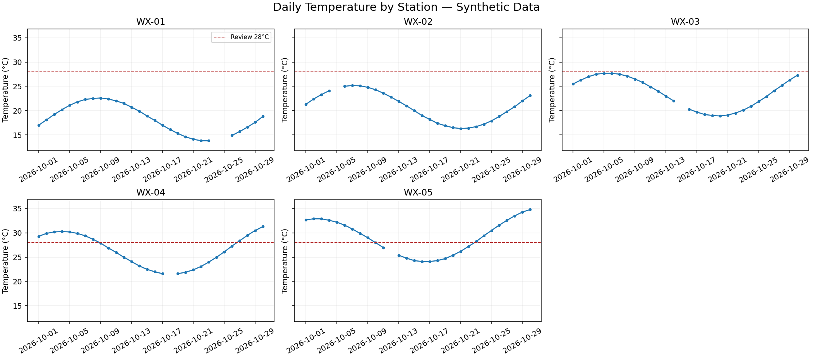

**검증 기준:** 150개 예정 슬롯 중 유효 기온 **144개**, 빠진 행 5개와 결측 기온 1개를 구분. 선택 관측소의 변화에 맞춘 동적 배치. 동일한 y축 범위. 원본 파일 유지.

<details>
<summary><strong>Hint 01 — 날짜와 관측소의 가능한 모든 조합</strong></summary>

예상 날짜 범위를 만들고, 관측소마다 해당 날짜로 `reindex()`해 보세요. 파일에 없는 날짜는 0이 아니라 NaN으로 남깁니다.

</details>

<details>
<summary><strong>Hint 02 — 동적 그래프 개수</strong></summary>

`math.ceil()`로 필요한 행 수를 계산하고, `plt.subplots(..., squeeze=False)`로 반환 타입을 2차원 배열로 통일하면 1개 관측소도 쉽게 처리할 수 있습니다.

</details>

<details>
<summary><strong>Hint 03 — 축 기준 통일</strong></summary>

전체 선택 관측소의 유효 기온에서 최소·최댓값을 구한 뒤, 모든 Axes에 같은 `ylim`을 설정해 보세요.

</details>

**완성 기준:** 여러 입력 크기에서 프로그램을 실행해 출력 이미지와 수집률 CSV를 확인합니다. 모범 구현은 별도 `solutions/advanced_projects/`에 보관합니다.

<a id="section-3-21"></a>
## 3.21. Advanced Project 02 — Subway Ridership Analysis System

**난이도: 고난도 · 선택 과제**

**문제 상황**

여러 지하철역의 시간대별 승하차 현황을 비교하는 보고서를 자동 생성해야 합니다. 특정 역의 시간대가 빠지거나 입력 CSV에 중복·잘못된 숫자가 있어도 총합이 잘못 계산되면 안 됩니다. 선택한 역의 개수가 바뀌어도 읽을 수 있는 보고서가 생성되어야 합니다.

**입력 파일**

- [`subway_ridership.csv`](./data/subway_ridership.csv) — 날짜 × 역사 × 시간대, 4,251행
- [`subway_stations.csv`](./data/subway_stations.csv) — 역사 ID·이름·호선 정보

실제 지하철역 이름을 참고했지만 **승하차 인원은 모두 교육용 가상 데이터**입니다. 실제 통계나 공식 수요 자료로 해석하면 안 됩니다. 출퇴근 시간대라는 특성은 학습을 위한 합성 패턴입니다.

별도의 실제 자료로 확장할 때는 [서울 열린데이터광장 — 서울시 지하철 호선별 역별 시간대별 승하차 인원 정보](https://data.seoul.go.kr/dataList/OA-12252/S/1/datasetView.do?tab=A)를 참고할 수 있습니다. 공개 데이터의 열 이름과 집계 기간은 이 장의 가상 CSV와 다를 수 있으므로, 그대로 교체하지 말고 먼저 스키마와 단위를 확인해야 합니다.

### 요구사항

| 단계 | 구현 내용 | 완료 조건 |
|---|---|---|
| 1 | 데이터 검증 | 날짜·시간대·승차·하차 값 검사, 중복 관측 제외 사유 기록 |
| 2 | 예상 슬롯 복원 | 날짜 × 역사 × 05~23시의 모든 조합 생성 |
| 3 | 역별 순위 | 관측된 승하차 합계가 많은 역사 정렬, 기간과 누락률 표시 |
| 4 | 시간대별 비교 | 평일·주말의 **관측된 슬롯당 평균**을 별도로 비교 |
| 5 | 역 × 시간대 히트맵 | 색상 단위와 범례 제공, 관측 없는 셀의 무조건적 0 대체 금지 |
| 6 | 동적 역별 보고서 | 선택 역 1개·3개·8개에서 그래프 자동 배치 |
| 7 | 데이터 품질 보고 | 역별 유효 슬롯 수집률, 누락·제외 행, 사유별 수량 기록 |
| 8 | 결과 저장 | PNG 보고서, 집계 CSV, 제외 행 CSV, 요약 JSON 저장 |
| 9 | 신뢰성 검사 | 중복·음수·비숫자 입력이 총합에 반영되지 않았는지 검증 |

**중요:** `승차 + 하차`는 해당 역에서 기록된 사람의 이동 건수를 나타낼 뿐 **열차 내부 혼잡도나 승객의 실제 이동 경로를 의미하지 않습니다.** 관측된 건수의 합계도 누락된 슬롯이 있는 경우 전체 기간의 완전한 통계가 아닙니다.

### 예시 데이터의 확인 수치

| 항목 | 결과 |
|---|---:|
| 예정 관측 슬롯 | 4,256개 |
| 원본 CSV 행 수 | 4,251개 |
| 검증에 통과한 행 | 4,246개 |
| 제외된 원본 행 | 5개 (중복 2개·유효하지 않은 값 3개) |
| 누락·제외로 비어 있는 예상 슬롯 | 10개 |
| 검증 통과 행의 승차 합계 | 1,536,856명 |
| 검증 통과 행의 하차 합계 | 1,642,122명 |

누락 10개 슬롯은 원본에 없는 7개 + 값이 잘못되어 제외된 3개로 구성됩니다. 추가 중복 행 2개는 원래 존재하는 슬롯을 중복 기록한 것이므로 누락 슬롯 수에 더하지 않습니다.

**Starter Code:** [`projects/advanced_02_subway/starter.py`](./projects/advanced_02_subway/starter.py)

**완료 결과 예시 — 요약 보고서**

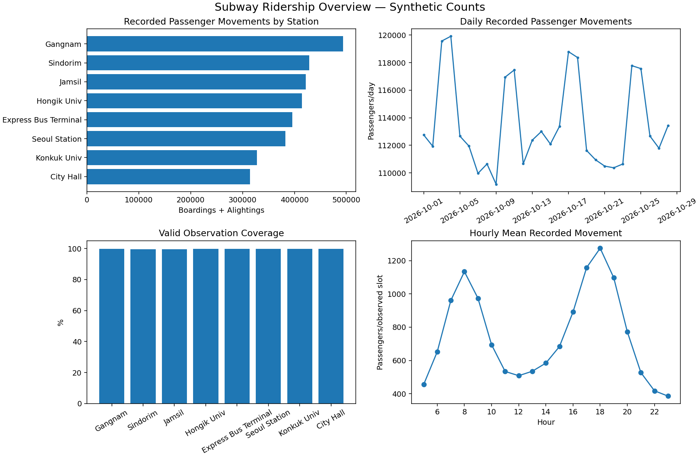

**완료 결과 예시 — 역×시간대 히트맵**

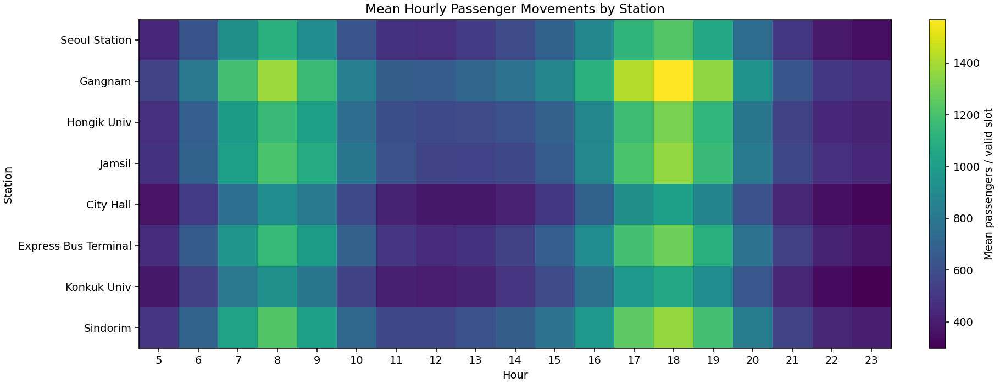

<details>
<summary><strong>Hint 01 — 중복과 잘못된 숫자의 우선 처리</strong></summary>

집계를 시작하기 전에 날짜·역사 ID·시간대가 같은 중복 행을 검사하고, 숫자로 변환할 수 없는 값과 음수를 별도로 기록합니다. 잘못된 숫자를 0으로 바꾸는 대신 검증에서 제외합니다.

</details>

<details>
<summary><strong>Hint 02 — 예상 관측 슬롯 생성</strong></summary>

`pd.MultiIndex.from_product()`로 역사×날짜×시간대 조합을 만들 수 있습니다. 데이터와 결합한 뒤 NaN 상태의 시간대를 집계와 구분하세요.

</details>

<details>
<summary><strong>Hint 03 — 역별 동적 패널과 축 일관성</strong></summary>

선택 역의 수가 바뀌어도 모든 Axes를 순회할 수 있도록 `squeeze=False`를 고려합니다. 비교 그래프의 y축 범위는 같은 기준을 사용하세요.

</details>

<details>
<summary><strong>Hint 04 — 테스트할 오류 입력</strong></summary>

같은 슬롯의 행을 하나 더 추가하거나, 승차 수를 음수·문자열로 변경하고 출력 합계가 잘못 증가하지 않는지 확인하세요. 존재하지 않는 역사 ID를 입력하면 명확한 오류로 처리해야 합니다.

</details>

**완성 기준:** 전체 보고서 PNG 5종, 역별 집계 CSV, 제외 행 CSV, 품질 요약 JSON이 생성되고, 누락·중복·잘못된 숫자가 잘못 합산되지 않아야 합니다. 모범 구현은 별도 `solutions/advanced_projects/`에 보관합니다.

<a id="section-3-22"></a>
## 3.22. Quiz — 코드·그래프 판별·디버깅 18문제

문제는 Chapter에서 배운 개념을 실제 상황에 적용할 수 있는지 확인하는 데 목적이 있습니다. 이미지 객관식은 **네 선택지 모두 동일하거나 유사한 그래프 종류**로 구성했으므로 세부 코드와 그래프를 비교하세요. 문제마다 **정답과 해설을 독립적으로 펼칠 수 있습니다.**

### Q01. 하나의 Figure 안에 여러 그래프가 있을 때 각각의 그래프 영역을 나타내는 객체는 무엇인가요?

A. Figure / B. Axes / C. Axis / D. Legend

<details>
<summary><strong>Q01. 정답 및 해설 확인</strong></summary>

**정답: B. Axes**

`Figure`는 전체 그림, `Axes`는 개별 그래프 영역입니다. `Axis`는 눈금·스케일 등을 관리하는 축 객체입니다.

</details>

### Q02. 2행 2열로 생성한 그래프에서 오른쪽 아래 영역을 가리키는 코드는 무엇인가요?

```python
fig, axes = plt.subplots(2, 2)
# TODO: 오른쪽 아래 영역 사용
```

A. `axes[0, 1]` / B. `axes[1, 0]` / C. `axes[1, 1]` / D. `axes[2, 2]`

<details>
<summary><strong>Q02. 정답 및 해설 확인</strong></summary>

**정답: C. `axes[1, 1]`**

NumPy 배열처럼 첫 번째 인덱스가 **행**, 두 번째가 **열**을 가리킵니다. 인덱스는 0에서 시작하므로 오른쪽 아래는 `(1,1)`입니다.

</details>

### Q03. 같은 시간대의 CPU(%)와 응답시간(ms)을 2개의 그래프로 표현할 때 가장 적절한 설정은?

A. `plt.subplots(2, 1, sharex=True)` / B. `plt.subplots(1, 1)` / C. `plt.subplots(2, 1, sharey=True)` / D. `plt.subplots(2, 2, sharey=True)`

<details>
<summary><strong>Q03. 정답 및 해설 확인</strong></summary>

**정답: A. `plt.subplots(2, 1, sharex=True)`**

두 지표의 단위가 다르므로 y축은 분리하고, 같은 시간대이므로 x축만 공유합니다. `sharey=True`는 단위가 다른 y축을 같은 범위로 묶을 수 있어 부적절합니다.

</details>

### Q04. 보고서 출력용 PNG와 확대에 적합한 벡터 이미지가 모두 필요하다면 어떤 파일 형식을 함께 저장할까요?

A. CSV와 JSON / B. PNG와 SVG / C. TXT와 CSV / D. MP3와 SVG

<details>
<summary><strong>Q04. 정답 및 해설 확인</strong></summary>

**정답: B. PNG와 SVG**

PNG는 래스터 이미지, SVG는 벡터 이미지를 저장합니다. Matplotlib에서는 `fig.savefig("report.png", dpi=150)`와 `fig.savefig("report.svg")`를 각각 호출합니다. PNG의 품질은 저장 DPI의 영향을 받습니다.

</details>

### Q05. 아래 코드를 실행하면 생성되는 그래프는 A~D 중 무엇인가요?

```python
labels = ["A", "B", "C"]
fig, axes = plt.subplots(1, 2)
axes[0].bar(labels, [4, 7, 3])
axes[1].barh(labels, [3, 5, 8])
axes[1].invert_yaxis()
```

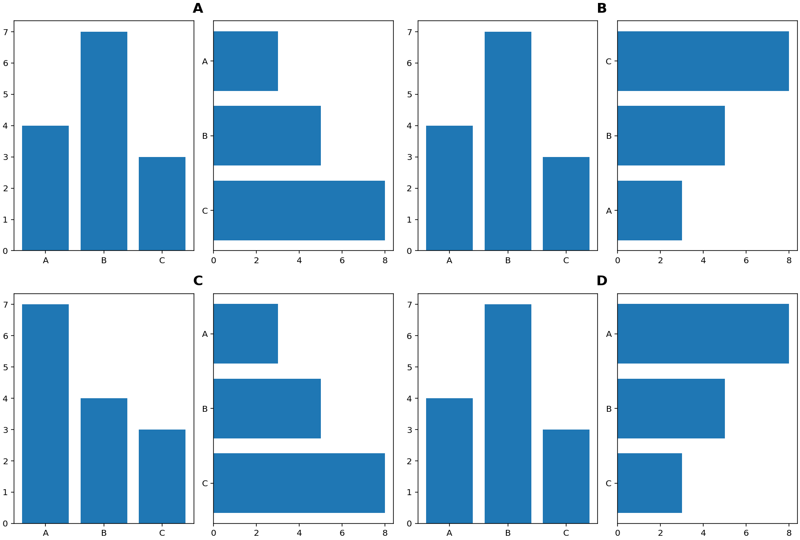

<details>
<summary><strong>Q05. 정답 및 해설 확인</strong></summary>

**정답: A**

`subplots(1,2)`의 왼쪽은 `bar()`의 **4·7·3**, 오른쪽은 `barh()`의 **3·5·8**입니다. `invert_yaxis()` 때문에 오른쪽에 A가 맨 위, C가 맨 아래로 배치됩니다. B는 축 반전이 없고, C와 D는 데이터 값이 다릅니다.

</details>

### Q06. 다음 코드의 선 스타일과 마커에 일치하는 그래프는 무엇인가요?

```python
x = [1, 2, 3, 4]
a = [3, 7, 5, 9]
b = [4, 5, 8, 7]
fig, ax = plt.subplots()
ax.plot(x, a, linestyle="-", marker="o", label="A")
ax.plot(x, b, linestyle="--", marker="s", label="B")
ax.legend()
```

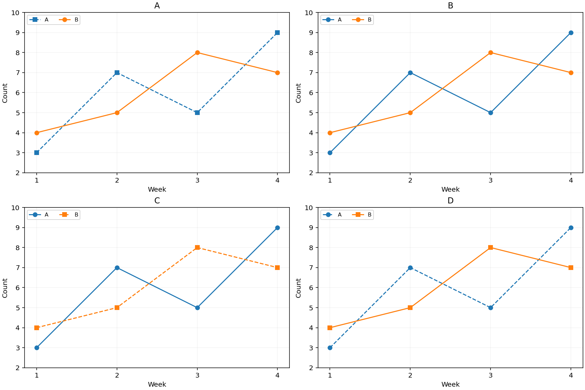

<details>
<summary><strong>Q06. 정답 및 해설 확인</strong></summary>

**정답: C**

A 시리즈는 **실선·원형 마커**, B 시리즈는 **점선·사각형 마커**입니다. A와 B를 서로 바꾸거나 둘 다 실선으로 그리면 코드와 다릅니다. `linestyle`과 `marker`는 서로 독립적으로 지정됩니다.

</details>

### Q07. 다음 히스토그램과 동일한 구간 경계로 그려진 그래프는 무엇인가요?

```python
values = [1, 1, 2, 3, 3, 4, 5, 5, 7, 7]
fig, ax = plt.subplots()
ax.hist(values, bins=[0, 2, 4, 6, 8])
```

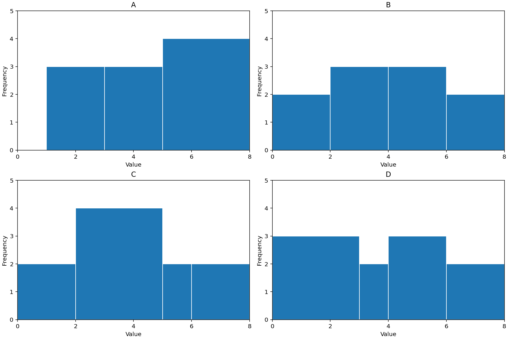

<details>
<summary><strong>Q07. 정답 및 해설 확인</strong></summary>

**정답: B**

구간 경계는 **0·2·4·6·8**입니다. 네 선택지 모두 막대 네 개로 표시되므로 막대 개수만 세면 안 됩니다. 각 막대의 **경계 위치와 높이**를 확인해야 합니다. 첫 구간 `[0,2)`에 값 1 두 개가 포함됩니다.

</details>

### Q08. 다음 코드의 선 그래프와 막대그래프가 정확히 배치되는 결과는 무엇인가요?

```python
fig, axes = plt.subplots(2, 2)
axes[0, 1].plot([1, 2, 3], [2, 5, 3], marker="o")
axes[1, 0].bar(["A", "B"], [4, 7])
```

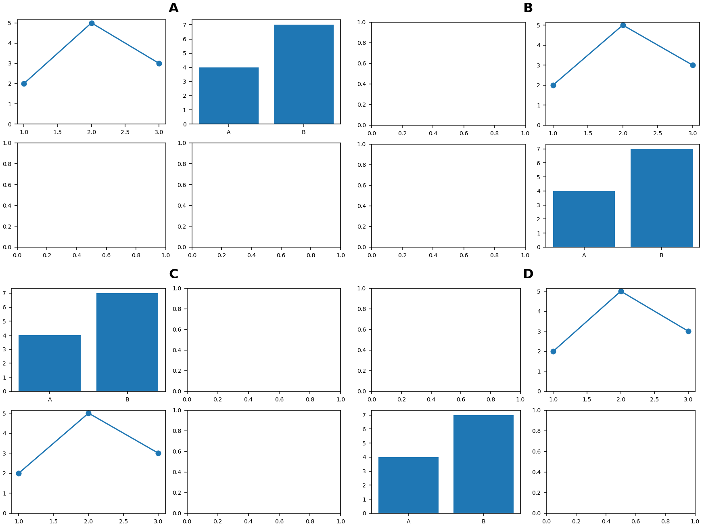

<details>
<summary><strong>Q08. 정답 및 해설 확인</strong></summary>

**정답: D**

`axes[0, 1]`은 **오른쪽 위**, `axes[1, 0]`은 **왼쪽 아래**입니다. 선택지 모두 2행 2열이지만, 그래프가 놓인 위치가 다릅니다. `axes[행, 열]` 순서를 확인하세요.

</details>

### Q09. 세 번째 날의 측정이 누락된 다음 데이터에 정확히 대응하는 선 그래프는 무엇인가요?

```python
x = [1, 2, 3, 4, 5]
y = [11, 14, np.nan, 17, 19]
fig, ax = plt.subplots()
ax.plot(x, y, marker="o")
```

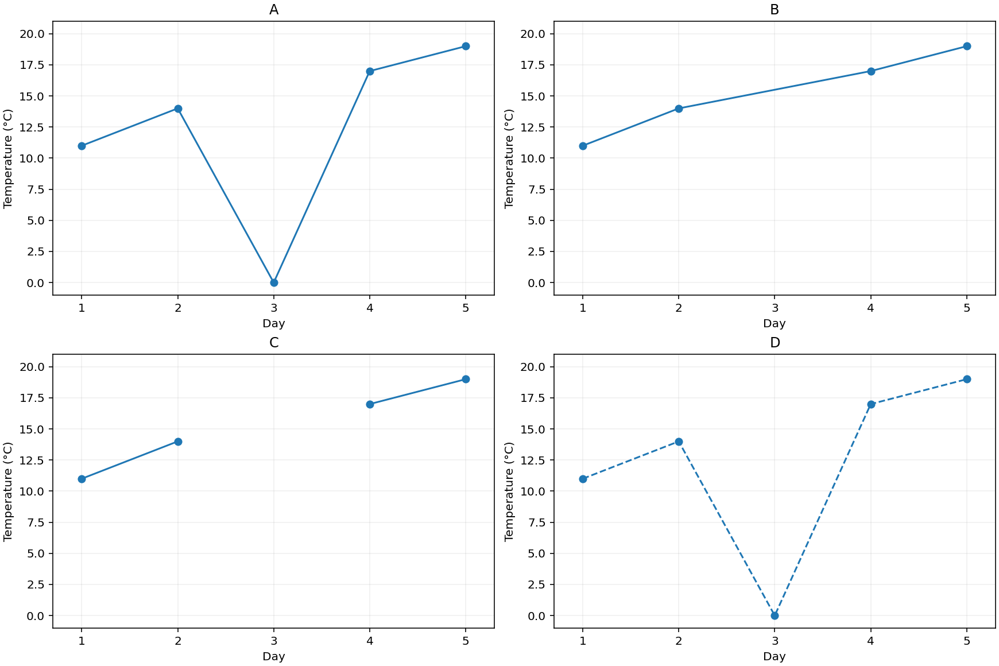

<details>
<summary><strong>Q09. 정답 및 해설 확인</strong></summary>

**정답: C**

세 번째 날짜는 `np.nan`이므로 그래프의 선이 **끊어져야** 합니다. A와 D는 누락을 0으로 바꿔 잘못된 측정값을 만들어냈고, B는 세 번째 날을 건너뛰어 연속 관측처럼 연결합니다.

</details>

### Q10. 막대 위에 숫자를 표시하도록 TODO를 완성하세요.

```python
fig, ax = plt.subplots()
bars = ax.bar(["A", "B"], [13, 21])
# TODO: 막대의 수치를 막대 위에 표시하세요.
```

<details>
<summary><strong>Q10. 정답 및 해설 확인</strong></summary>

**정답: `ax.bar_label(bars, padding=3)`**

`ax.bar()`가 반환한 막대 컨테이너를 `bar_label()`에 전달합니다. `bars`를 다시 `bar()`로 감싸거나 문자열 레이블을 전달하는 것이 아닙니다.

```python
bars = ax.bar(["A", "B"], [13, 21])
ax.bar_label(bars, padding=3)
```

</details>

### Q11. 산점도 색상이 센서 온도(°C)를 의미하도록 색상 막대를 추가하세요.

```python
fig, ax = plt.subplots()
points = ax.scatter(load, latency, c=temp, cmap="viridis")
# TODO: 온도 색상 막대를 추가하세요.
```

<details>
<summary><strong>Q11. 정답 및 해설 확인</strong></summary>

**정답: `fig.colorbar(points, ax=ax, label="Sensor temp (°C)")`**

`scatter()`가 반환하는 객체에 색상 매핑 정보가 담깁니다. 이 객체를 `fig.colorbar()`에 전달해야 표시된 수치 범위와 색상이 연결됩니다.

```python
points = ax.scatter(load, latency, c=temp, cmap="viridis")
fig.colorbar(points, ax=ax, label="Sensor temp (°C)")
```

</details>

### Q12. 측정량이 1~10,000까지 달라 세로축을 로그 스케일로 바꾸려면?

A. `ax.set_yscale("log")` / B. `ax.set_ylabel("log")` / C. `ax.set_xlim("log")` / D. `ax.set_title("log")`

<details>
<summary><strong>Q12. 정답 및 해설 확인</strong></summary>

**정답: `ax.set_yscale("log")`**

로그 축은 값의 **비율**을 해석하는 데 사용됩니다. y값이 0 또는 음수일 때는 바로 적용하면 적절하게 표시할 수 없으므로 입력값을 확인해야 합니다.

</details>

### Q13. 일별 기록이 없는 날에도 날짜 간격이 유지되도록 TODO를 완성하세요.

```python
dates = pd.date_range("2026-10-01", periods=4, freq="D")
observed = pd.Series([19, 22, 21], index=[dates[0], dates[1], dates[3]])
# TODO: 모든 날짜를 포함하되 없는 관측은 NaN으로 유지하세요.
```

<details>
<summary><strong>Q13. 정답 및 해설 확인</strong></summary>

**정답: `aligned = observed.reindex(dates)`**

`reindex()`는 기대하는 날짜 목록에 맞춰 시리즈를 재배치합니다. 빠진 날짜는 NaN으로 남습니다. `fillna(0)`을 추가하면 관측 누락과 실제 측정값 0을 구분할 수 없게 됩니다.

```python
dates = pd.date_range("2026-10-01", periods=4, freq="D")
aligned = observed.reindex(dates)
```

</details>

### Q14. 최대 응답시간을 자동으로 찾아 주석을 추가하려면 다음 중 올바른 구현은?

A. 항상 첫 번째 점에 주석 / B. 최댓값의 인덱스로 x·y 함께 선택 / C. 최댓값을 x좌표로 사용 / D. 최솟값을 표시

<details>
<summary><strong>Q14. 정답 및 해설 확인</strong></summary>

**정답: B**

최댓값의 **인덱스**를 먼저 구해야 x와 y를 올바르게 연결할 수 있습니다.

```python
i = max(range(len(latency)), key=lambda j: latency[j])
ax.annotate("Peak", xy=(hours[i], latency[i]), xytext=(0, 22),
            textcoords="offset points", arrowprops={"arrowstyle": "->"})
```

</details>

### Q15. 다음 코드에서 두 번째 Axes에 막대그래프를 만들려면 어느 부분을 수정해야 하나요?

```python
fig, axes = plt.subplots(1, 2)
axes[1, 1].bar(["A", "B"], [4, 7])  # 오류 수정
```

<details>
<summary><strong>Q15. 정답 및 해설 확인</strong></summary>

**정답: `axes[1, 1]` → `axes[1]`**

`plt.subplots(1, 2)`는 1차원 Axes 배열을 반환합니다. 따라서 `axes[1]`이 오른쪽 그래프입니다. 2차원 인덱싱인 `axes[1, 1]`은 2행 2열에서 사용합니다.

```python
fig, axes = plt.subplots(1, 2)
axes[1].bar(["A", "B"], [4, 7])
```

</details>

### Q16. 상점의 판매량(개)과 매출(원)을 하나의 y축에 겹쳐 놓았습니다. 가장 적절한 개선은?

A. 단위 삭제 / B. 색상을 동일하게 설정 / C. 단위를 분리한 Axes 사용 / D. 데이터의 모든 값을 0으로 변환

<details>
<summary><strong>Q16. 정답 및 해설 확인</strong></summary>

**정답: C. 단위를 분리한 Axes 사용**

판매량과 금액은 단위가 다릅니다. 같은 y축에서는 크기를 직관적으로 비교하기 어렵습니다. 별도 Axes에 단위를 표기하고, 가능하다면 동일한 x축을 공유하세요.

```python
fig, axes = plt.subplots(2, 1, sharex=True)
axes[0].plot(dates, sales_units)
axes[0].set_ylabel("Items")
axes[1].plot(dates, revenue_krw)
axes[1].set_ylabel("KRW")
```

</details>

### Q17. 35일 그래프에서 매주 월요일만 x축 눈금으로 표시하는 코드 완성은?

```python
import matplotlib.dates as mdates
# TODO: 매주 월요일 눈금 지정
# TODO: 날짜를 MM-DD로 표현
```

<details>
<summary><strong>Q17. 정답 및 해설 확인</strong></summary>

**정답: `WeekdayLocator(byweekday=mdates.MO)`**

`Locator`는 눈금의 **위치**, `DateFormatter`는 눈금 레이블의 **표현 형식**을 담당합니다.

```python
ax.xaxis.set_major_locator(mdates.WeekdayLocator(byweekday=mdates.MO))
ax.xaxis.set_major_formatter(mdates.DateFormatter("%m-%d"))
```

</details>

### Q18. 관측소가 1개일 때도 Axes를 항상 2차원 배열로 다루려면 어떤 옵션이 유용한가요?

A. `squeeze=False` / B. `sharex=False` / C. `alpha=0` / D. `dpi=0`

<details>
<summary><strong>Q18. 정답 및 해설 확인</strong></summary>

**정답: `squeeze=False`**

`plt.subplots(rows, cols, squeeze=False)`는 행이나 열 수가 1이더라도 Axes를 2차원 배열로 반환합니다. 동적 서브플롯 구현에서 `axes.flat`을 일관되게 순회하기 쉽습니다.

```python
fig, axes = plt.subplots(1, 1, squeeze=False)
axes[0, 0].plot([1, 2], [3, 4])
```

</details>

<a id="section-3-23"></a>
## 3.23. Summary & References

### Summary

이 장에서 작성한 그래프는 **값을 그리는 것만으로 완성되지 않습니다.** 어떤 값이 언제, 어떤 단위로 관측되었으며 색상·막대·점·선이 무엇을 뜻하는지 설명할 수 있어야 합니다.

| 핵심 개념 | 반드시 이해할 내용 |
|---|---|
| Figure / Axes / Axis | 전체 그림 / 그래프 영역 / 축과 눈금의 역할 구분 |
| Line / Bar / Scatter | 변화 / 범주별 크기 / 두 변수의 관계를 표현 |
| Histogram / Bin | 수치 구간의 빈도와 구간 경계가 해석에 미치는 영향 |
| Subplot / GridSpec | 여러 Axes의 배치와 그래프별 시각적 비중 |
| Shared Axes | 동일 기준으로 정렬하되 서로 다른 단위는 구분 |
| Linear / Log Scale | 절대 차이와 배율 차이의 시각적 의미 구별 |
| Color Mapping / Colorbar | 수치를 색으로 변환하는 기준과 단위 설명 |
| Heatmap | 행×열 조합의 수치 행렬을 색으로 표현하며 결측을 구분 |
| Missing Observation | 실제 0과 기록 누락(`NaN`)의 의미 구별 |
| Annotation / Export | 근거 있는 값 강조와 재현 가능한 파일 저장 |

- Matplotlib의 **Figure**는 전체 이미지, **Axes**는 데이터를 그릴 개별 그래프 영역입니다.
- 서로 다른 단위는 별도의 Axes에 배치하고, 같은 시간 축은 `sharex=True`로 공유할 수 있습니다.
- `bar`, `barh`, `scatter`, `hist`, `imshow`는 서로 다른 데이터 구조와 질문에 대응합니다.
- 눈금·색상·범례·주석을 명확히 표시하고, 그림이 전달하는 의미를 점검합니다.
- `NaN`과 실제 측정값 0은 다르므로, 관측 누락을 임의로 0으로 채우지 않습니다.
- `GridSpec`과 동적으로 생성되는 Subplots는 여러 차트를 하나의 보고서에 조합할 때 유용합니다.
- PNG·SVG 출력과 `plt.close(fig)`를 활용해 결과 파일을 관리합니다.
- 보고서는 숫자가 정확하게 집계되는 것뿐 아니라 **수집률·누락·단위·축 기준**도 함께 드러내야 합니다.

### Directory Structure

```text
Chapter-03/
├── README.md
├── requirements.txt
├── .gitignore
├── data/                        # 입력 CSV 및 데이터 정의
├── examples/                    # 17개 독립 예제
├── figures/                     # 예제·프로젝트 결과 이미지
│   └── quiz/                    # 그래프 선택형 문제 이미지
├── exercises/                   # 14개 시작 코드
├── projects/                    # Mini 3개 + Advanced 2개 시작 코드
│   ├── mini_01_weather/
│   ├── mini_02_sales/
│   ├── mini_03_server/
│   ├── advanced_01_weather/
│   └── advanced_02_subway/
├── solutions/
│   ├── exercises/               # Coding Practice 모범 구현
│   ├── mini_projects/           # Mini Project 모범 구현 및 해설
│   └── advanced_projects/       # Advanced Project 모범 구현 및 해설
├── tests/                       # 입력 검증·집계·출력 테스트
└── output/                      # 실행 시 생성, Git 추적 제외
```

### 실행 및 검증

```bash
# 기본 학습 예제
python examples/10_grouped_bars.py

# 시작 코드 (TODO를 완성한 뒤 실행)
python projects/mini_02_sales/starter.py

# 테스트
python -m unittest discover -s tests -v
```

참고로 프로젝트 정답 파일은 `solutions/mini_projects/`, `solutions/advanced_projects/`에 보관합니다. README에서는 프로젝트 완성 코드를 직접 공개하지 않습니다.

### References

- [Matplotlib — Quick Start Guide](https://matplotlib.org/stable/users/explain/quick_start.html)
- [Matplotlib — Axes API](https://matplotlib.org/stable/api/axes_api.html)
- [Matplotlib — Figure & Subplots](https://matplotlib.org/stable/api/_as_gen/matplotlib.pyplot.subplots.html)
- [Matplotlib — Arranging Multiple Axes](https://matplotlib.org/stable/users/explain/axes/arranging_axes.html)
- [Matplotlib — Colors and Colormaps](https://matplotlib.org/stable/users/explain/colors/colormaps.html)
- [Matplotlib — Dates](https://matplotlib.org/stable/api/dates_api.html)
- [Matplotlib — `savefig`](https://matplotlib.org/stable/api/_as_gen/matplotlib.figure.Figure.savefig.html)
- [NumPy Documentation](https://numpy.org/doc/stable/)
- [Pandas Documentation](https://pandas.pydata.org/docs/)

---

[← Data Visualization](../README.md) · [Chapter 02 — Principles of Data Visualization](../Chapter-02/)

