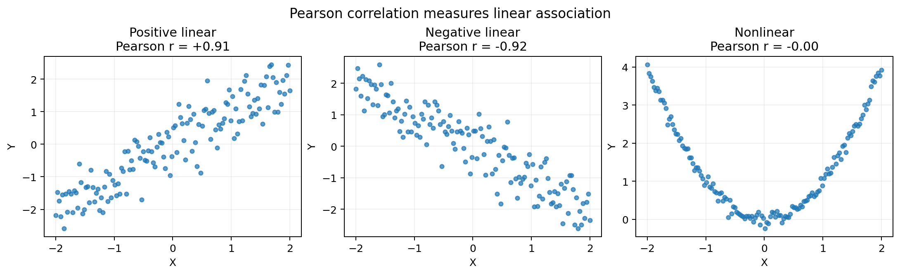
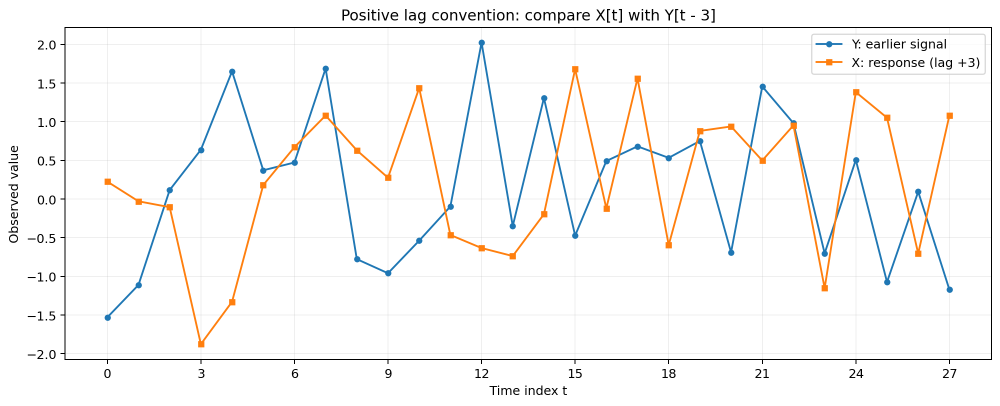
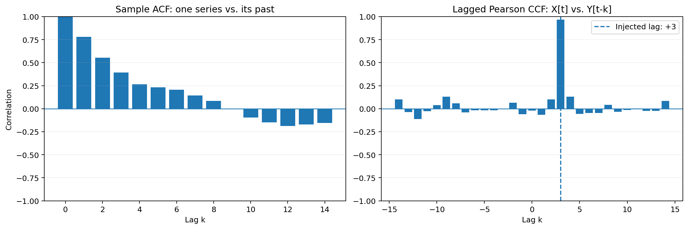

# Advanced Correlation Analysis — 상관관계 심화 분석

두 변수의 관계를 나타내는 **Pearson Correlation(피어슨 상관계수)**에서 출발하여, 벡터의 내적과 L2 노름으로 공식을 해석하고, 시간 간격을 고려하는 **Autocorrelation(자기상관)** 및 **Cross-Correlation(상호상관)**으로 확장한다.

> **학습 수준:** 선택형 심화자료  
> **선행 개념:** 평균, 편차, 제곱근, 좌표평면, Python 배열  
> **학습 목표:** 상관계수의 수학적 의미 이해 · 시차(Lag) 해석 · Python으로 ACF/CCF 계산 및 시각화

---

## 1. 상관관계는 무엇을 비교하는가?

상관관계(Correlation)는 **두 데이터가 함께 변하는 경향**을 나타내는 개념이다. 예를 들어 기온과 아이스크림 판매량이 함께 증가하는지, 공부 시간과 시험 점수가 비슷한 방향으로 변화하는지 살펴볼 수 있다.

그런데 데이터를 비교할 때는 **무엇과 무엇을 비교하는지** 먼저 정해야 한다.

| 구분 | 비교하는 대상 | 질문 예시 |
|---|---|---|
| Pearson Correlation | 같은 순서로 관측한 두 변수 | 기온이 높을수록 판매량도 높은가? |
| Autocorrelation (ACF) | **한 변수**의 현재 값과 과거 값 | 오늘 기온과 어제 기온은 비슷한가? |
| Cross-Correlation (CCF) | **두 변수**를 서로 다른 시점에서 비교 | 광고를 한 뒤 며칠 후 방문자가 증가하는가? |

Pearson은 **상관계수를 계산하는 대표적인 방법**이고, Auto/Cross는 **어떤 시차를 두고 데이터를 비교할지**를 다루는 개념이다. 이 구분을 알면 세 주제를 하나의 흐름으로 이해할 수 있다.

## 2. Pearson Correlation — 피어슨 상관계수

### 2.1. 기본 표현식

관측값이 $n$개인 두 변수 $X$와 $Y$의 피어슨 상관계수는 다음과 같다.

$$
r=\frac{\sum_{i=1}^{n}(x_i-\bar{x})(y_i-\bar{y})}
{\sqrt{\sum_{i=1}^{n}(x_i-\bar{x})^2}\sqrt{\sum_{i=1}^{n}(y_i-\bar{y})^2}}
$$

- $x_i,y_i$: $i$번째 관측값
- $\bar{x},\bar{y}$: 각 변수의 평균
- $x_i-\bar{x},y_i-\bar{y}$: 평균에서 얼마나 떨어져 있는지를 나타내는 **편차**
- $r$: 두 변수 사이의 **선형 관계**의 방향과 강도 ($-1\le r\le 1$)

분자는 두 변수가 평균보다 **함께 크거나 함께 작을 때** 양수가 되기 쉽다. 반대로 한쪽은 평균보다 크고 다른 쪽은 작으면 음수가 되기 쉽다. 분모는 두 데이터의 변동 크기를 조절하여 서로 다른 단위의 데이터도 비교할 수 있게 만든다.

| 상관계수 | 의미 |
|---:|---|
| $r=+1$ | 완벽한 양의 선형 관계 |
| $r\approx 0$ | 선형 관계가 거의 나타나지 않음 |
| $r=-1$ | 완벽한 음의 선형 관계 |

상관계수가 0에 가깝더라도 **곡선 형태의 관계**는 존재할 수 있다.



### 2.2. 평균 중심화(Mean Centering)

위 공식을 벡터로 간단하게 나타내기 위해 모든 값에서 평균을 뺀다.

$$
\mathbf{x}_c=\mathbf{x}-\bar{x}\mathbf{1},
\qquad
\mathbf{y}_c=\mathbf{y}-\bar{y}\mathbf{1}
$$

여기서 $\mathbf{1}=(1,1,\ldots,1)$은 모든 원소가 1인 벡터다. 즉, $\bar{x}\mathbf{1}$은 평균 $\bar{x}$를 관측값 개수만큼 반복한 벡터다.

예를 들어 $\mathbf{x}=(1,2,3)$이면 평균은 2이고,

$$
\mathbf{x}_c=(1-2,\ 2-2,\ 3-2)=(-1,0,1)
$$

이처럼 **데이터의 평균을 0으로 옮기되, 값 사이의 상대적인 차이는 유지**하는 과정이 평균 중심화다.

### 2.3. 내적(Dot Product)과 L2 노름(L2 Norm)

두 벡터의 **내적**은 같은 위치의 원소끼리 곱한 값을 모두 더한 것이다.

$$
\langle\mathbf{a},\mathbf{b}\rangle
=\mathbf{a}\cdot\mathbf{b}
=\sum_{i=1}^{n}a_i b_i
$$

**L2 노름**은 벡터의 길이(유클리드 길이)다. 2차원 좌표에서 피타고라스 정리로 거리를 구하는 방법을 여러 차원으로 확장한 것과 같다.

$$
\|\mathbf{a}\|_2=\sqrt{a_1^2+a_2^2+\cdots+a_n^2}
=\sqrt{\sum_{i=1}^{n}a_i^2}
$$

따라서 Pearson 상관계수는 아래와 같이 표현할 수 있다.

**L2 노름을 이용한 벡터 표현식**

$$
\boxed{
r=\frac{\langle\mathbf{x}_c,\mathbf{y}_c\rangle}
{\|\mathbf{x}_c\|_2\|\mathbf{y}_c\|_2}
}
$$

분자에는 **평균 중심화된 두 벡터의 내적**, 분모에는 **각 벡터의 L2 노름을 곱한 값**이 들어간다.

### 2.4. 직접 계산해 보기

$$
\mathbf{x}=(1,2,3),\qquad \mathbf{y}=(2,4,6)
$$

평균 중심화 후 두 벡터는 다음과 같다.

$$
\mathbf{x}_c=(-1,0,1),\qquad \mathbf{y}_c=(-2,0,2)
$$

**① 내적**

$$
\langle\mathbf{x}_c,\mathbf{y}_c\rangle=(-1)(-2)+0\cdot0+1\cdot2=4
$$

**② L2 노름**

$$
\|\mathbf{x}_c\|_2=\sqrt{2},\qquad
\|\mathbf{y}_c\|_2=\sqrt{8}
$$

**③ 상관계수**

$$
r=\frac{4}{\sqrt{2}\sqrt{8}}=\frac44=1
$$

$Y=2X$이므로 두 변수는 완벽한 양의 선형 관계를 가진다. 상관계수는 두 값의 **크기가 같은지**가 아니라 **변화하는 방향이 얼마나 일치하는지**를 판단한다.

### 2.5. 코사인 유사도와 연결

벡터 사이 각도를 $\theta$라고 하면 코사인 유사도는 다음과 같다.

$$
\operatorname{CosSim}(\mathbf{a},\mathbf{b})
=\frac{\langle\mathbf{a},\mathbf{b}\rangle}
{\|\mathbf{a}\|_2\|\mathbf{b}\|_2}
=\cos\theta
$$

이를 평균 중심화된 벡터에 적용하면,

$$
\boxed{
\operatorname{Corr}(\mathbf{x},\mathbf{y})
=\operatorname{CosSim}(\mathbf{x}_c,\mathbf{y}_c)
=\cos\theta
}
$$

즉, **Pearson 상관계수는 평균 중심화된 두 벡터의 코사인 유사도**다. 여기서 $\theta$는 원본 벡터가 아니라 평균 중심화된 벡터 사이의 각도다. 두 벡터의 각도에 대한 코사인 값이 $[-1,1]$에 있기 때문에 Pearson 상관계수도 이 범위에 있다.

> **주의:** 평균 중심화를 하지 않은 원본 벡터의 코사인 유사도는 일반적으로 Pearson 상관계수와 다르다. 또한 변수 중 하나의 값이 모두 같아 L2 노름이 0이면 Pearson 상관계수는 정의되지 않는다.

### 2.6. 공분산(Covariance)과의 관계

표본공분산과 표본표준편차를 이용해도 같은 피어슨 상관계수를 얻는다.

$$
s_{xy}=\frac{1}{n-1}\sum_{i=1}^{n}(x_i-\bar{x})(y_i-\bar{y})
$$

$$
r=\frac{s_{xy}}{s_xs_y}
$$

두 표본표준편차에도 $1/(n-1)$에서 나온 계수가 들어 있으므로, 이를 나누면 2.1절의 공식과 같아진다. **공분산을 표준화한 값이 Pearson 상관계수**라고 이해하면 된다.

## 3. Lag(시차) — 시간을 어긋나게 비교하기

지금까지는 같은 순서에 있는 $x_i$와 $y_i$를 비교했다. 하지만 시계열(Time Series)은 **시간 순서대로 기록한 데이터**이기 때문에, 어떤 현상의 효과가 나중에 나타날 수 있다.

예를 들어 광고가 노출된 직후가 아니라 **이틀 뒤**에 방문자 수가 증가한다면 같은 날끼리 비교하는 것만으로는 관계를 놓칠 수 있다.

시간 간격을 나타내는 $k$를 **시차(Lag)**라고 한다. 하루 단위로 수집했다면 $k=2$는 이틀 차이, 한 시간 단위라면 두 시간 차이를 의미한다.

이 자료는 **$X_t$와 $Y_{t-k}$를 비교하는 방식**을 사용한다.

| 시차 | 비교 대상 | 해석 |
|---:|---|---|
| $k=0$ | $X_t$와 $Y_t$ | 같은 시점 비교 |
| $k=+2$ | $X_t$와 $Y_{t-2}$ | **Y가 X보다 두 시점 앞섬** |
| $k=-2$ | $X_t$와 $Y_{t+2}$ | **X가 Y보다 두 시점 앞섬** |

시차의 부호는 문헌이나 라이브러리에 따라 다르게 정의될 수 있다. **코드에서 어떤 두 구간을 비교하는지** 확인하는 것이 가장 확실하다.



## 4. Autocorrelation (ACF) — 자기상관

### 4.1. 개념

**Autocorrelation(자기상관)**은 하나의 시계열을 **시간만 이동시켜 자기 자신과 비교**하는 방법이다.

예를 들어 다음과 같은 질문을 할 수 있다.

- 오늘 기온과 어제 기온은 비슷한가? → Lag 1
- 오늘 기온과 일주일 전 기온은 비슷한가? → Lag 7 (일 단위 데이터 기준)
- 매주 비슷한 요일에 방문자가 늘어나는가? → 여러 Lag에서 반복 패턴 확인

**ACF(Autocorrelation Function)**는 시차 $k$를 바꾸어 가며 자기상관을 계산한 함수다.

### 4.2. 이론적 표현식

평균과 분산이 시간에 따라 일정하고, 공분산이 두 시점 사이의 간격에만 의존하는 **약정상(Weak Stationarity)** 시계열을 생각하자.

$$
\gamma_{XX}(k)=\operatorname{Cov}(X_t,X_{t-k})
$$

$$
\boxed{
\rho_{XX}(k)
=\frac{\gamma_{XX}(k)}{\gamma_{XX}(0)}
=\frac{\operatorname{Cov}(X_t,X_{t-k})}
{\operatorname{Var}(X_t)}
}
$$

- $\gamma_{XX}(k)$: 시차 $k$에서의 **자기공분산**
- $\gamma_{XX}(0)$: 시차 0의 자기공분산, 즉 분산
- $\rho_{XX}(k)$: 시차 $k$에서의 자기상관

$k=0$에서는 자기 자신과 같은 시점에 비교하므로 $\rho_{XX}(0)=1$이다. 단, 분산은 0이 아니어야 한다.

### 4.3. 실제 데이터의 표본 ACF

관측값 $x_1,x_2,\ldots,x_n$에서 자주 사용하는 **표본 ACF 추정식의 한 형태**는 다음과 같다.

$$
\boxed{
\hat\rho_{XX}(k)=
\frac{\sum_{t=k+1}^{n}(x_t-\bar{x})(x_{t-k}-\bar{x})}
{\sum_{t=1}^{n}(x_t-\bar{x})^2}
},\qquad 0\le k<n
$$

이 방식에서는 전체 데이터의 평균 $\bar{x}$를 사용하고, **모든 시차에 같은 분모**를 사용한다.

### 4.4. L2 노름으로 계산하는 구간별 자기상관

시차를 적용한 뒤 **서로 겹치는 구간끼리 Pearson 상관계수**를 구할 수도 있다.

$$
\mathbf{x}_{k,+}=(x_{k+1},\ldots,x_n),\qquad
\mathbf{x}_{k,-}=(x_1,\ldots,x_{n-k})
$$

각 구간의 **자기 평균**을 빼서 중심화한 벡터를 각각 $\widetilde{\mathbf{x}}_{k,+}$와 $\widetilde{\mathbf{x}}_{k,-}$라고 하면,

$$
\boxed{
r_{XX}^{\mathrm{overlap}}(k)
=\frac{
\langle\widetilde{\mathbf{x}}_{k,+},\widetilde{\mathbf{x}}_{k,-}\rangle
}{
\|\widetilde{\mathbf{x}}_{k,+}\|_2
\|\widetilde{\mathbf{x}}_{k,-}\|_2
}
}
$$

이는 **겹치는 구간의 Pearson 상관계수**다. 4.3절의 표본 ACF와는 평균을 구하는 범위와 분모가 달라 **일반적으로 숫자가 일치하지 않는다.** 둘 다 시차에 따른 관계를 살펴보는 데 사용되지만, 같은 추정식이라고 혼동하면 안 된다.

**차이를 직접 확인하는 예시**

$$
\mathbf{x}=(1,2,4,3,5),\qquad k=1
$$

- 전체 평균을 사용하는 4.3절의 표본 ACF: $\hat\rho_{XX}(1)=0.10$
- 겹치는 네 쌍을 각각 중심화한 Pearson 상관계수: $r_{XX}^{\mathrm{overlap}}(1)=0.40$

데이터가 짧을 때는 추정 방식에 따른 차이가 특히 눈에 띌 수 있다.

## 5. Cross-Correlation (CCF) — 상호상관

### 5.1. 개념

**Cross-Correlation(상호상관)**은 **서로 다른 두 시계열**을 시간만큼 어긋나게 비교하는 방법이다.

예를 들어 $Y$를 광고 노출량, $X$를 방문자 수라고 하자. 광고가 먼저 늘고 이틀 후 방문자가 늘어난다면, $X_t$와 $Y_{t-2}$ 사이에 높은 상관이 나타날 수 있다.

이는 **두 사건이 일정한 시간 간격을 두고 함께 변하는지** 찾는 방법이다. 높은 상호상관이 발견되었다고 해서 원인과 결과가 증명되는 것은 아니다.

### 5.2. 이론적 표현식

두 시계열이 **공동 약정상(Joint Weak Stationarity)**이라고 가정한다. 즉, 두 평균과 분산이 일정하며 교차공분산이 시차에만 의존한다고 하자.

$$
\gamma_{XY}(k)=\operatorname{Cov}(X_t,Y_{t-k})
$$

$$
\boxed{
\rho_{XY}(k)=
\frac{\gamma_{XY}(k)}{\sigma_X\sigma_Y}
=\frac{\operatorname{Cov}(X_t,Y_{t-k})}{\sigma_X\sigma_Y}
}
$$

- $\gamma_{XY}(k)$: 두 시계열의 **교차공분산**
- $\sigma_X,\sigma_Y$: 각각의 표준편차
- $\rho_{XY}(k)$: 시차 $k$에서의 **교차상관**

$k=0$에서는 같은 시점의 $X_t$와 $Y_t$를 비교하므로, 두 변수의 일반적인 상관관계와 연결된다.

### 5.3. L2 노름을 이용한 시차별 표현식

$k\ge0$일 때 겹치는 두 구간을 다음과 같이 정의한다.

$$
\mathbf{x}_{k,+}=(x_{k+1},\ldots,x_n),\qquad
\mathbf{y}_{k,-}=(y_1,\ldots,y_{n-k})
$$

각 구간을 **자신의 구간 평균으로 중심화**한 뒤 Pearson 상관계수를 계산하면,

$$
\boxed{
r_{XY}^{\mathrm{overlap}}(k)=
\frac{
\langle\widetilde{\mathbf{x}}_{k,+},\widetilde{\mathbf{y}}_{k,-}\rangle
}{
\|\widetilde{\mathbf{x}}_{k,+}\|_2
\|\widetilde{\mathbf{y}}_{k,-}\|_2
}
}
$$

**음수 시차**에서는 반대로 $X$의 앞부분과 $Y$의 뒷부분을 비교한다. 표본 길이가 짧거나 한 구간에 변화가 없으면 결과가 불안정하거나 정의되지 않을 수 있다.

이 식은 구간별로 정규화한 **Lagged Pearson Correlation**이다. 원 신호의 곱을 단순히 더하는 비정규화 상호상관이나, 전체 평균·고정 분모를 사용하는 표본 CCF와는 구별해야 한다.

### 5.4. 시차 +2를 직접 확인하는 예시

$$
\mathbf{Y}=(1,3,2,5,4,6)
$$

$$
\mathbf{X}=(0,0,1,3,2,5)
$$

$k=+2$로 설정하면 다음과 같이 비교한다.

| 비교 시점 | $X_t$ | $Y_{t-2}$ |
|---|---:|---:|
| $t=3$ | 1 | 1 |
| $t=4$ | 3 | 3 |
| $t=5$ | 2 | 2 |
| $t=6$ | 5 | 5 |

따라서 겹치는 구간은 $(1,3,2,5)$와 $(1,3,2,5)$로 같고, 이 두 구간의 피어슨 상관계수는 **1**이다.

이는 **Y가 두 시점 먼저 나타나는 형태로 구성된 예시**다. 실제 데이터에서는 잡음, 다른 변수, 우연한 패턴 때문에 이렇게 정확히 일치하지 않는 경우가 많다.

### 5.5. ACF와 CCF를 그래프로 읽기



왼쪽은 **ACF**이다. Lag 0에서 1이며, 이후 양의 상관이 서서히 줄어드는 가상 시계열을 보여 준다. 오른쪽은 **CCF**로, $Y$의 변화가 먼저 일어나고 $X$의 변화가 세 시점 늦게 나타나도록 만든 데이터다. 이 자료의 부호 규약에서는 **Lag +3 부근에 최대 상관**이 나타난다.

> ACF/CCF 그래프에서 막대가 높다는 이유만으로 주기성, 영향 관계, 통계적 유의성이 자동으로 입증되는 것은 아니다. 표본 크기와 추정 방식, 데이터의 시간적 구조를 함께 확인해야 한다.

## 6. Pearson · ACF · CCF 한눈에 비교

| 관점 | Pearson | Autocorrelation | Cross-Correlation |
|---|---|---|---|
| 데이터 | 두 변수 | 하나의 시계열 | 두 시계열 |
| 시간 이동 | 없음 | 있음 | 있음 |
| 대표적인 질문 | 함께 증가하는가? | 과거의 자신과 비슷한가? | 어느 쪽이 몇 시점 앞서 변하는가? |
| Lag 0 | 같은 시점의 Pearson $r$ | 분산이 0이 아니면 1 | 같은 시점의 두 변수 상관 |
| 대표적인 시각화 | 산점도·상관행렬 히트맵 | ACF 막대그래프 | CCF 막대그래프 |

**중요한 연결:** `Lag 0`에서 두 시계열의 **겹치는 구간별 Pearson CCF**는 일반적인 Pearson 상관계수와 동일하다. 자기상관에서는 비교 대상이 자기 자신이므로 `Lag 0`이 1이다.

## 7. Python 실습 — 상관계수 계산과 시차 탐색

### 7.1. Pearson을 L2 노름으로 구현

아래는 NumPy로 공식을 직접 구현한 코드다. `np.dot()`은 내적을, `np.linalg.norm()`은 벡터의 L2 노름을 계산한다.

```python
import numpy as np


def pearson_l2(x, y):
    x = np.asarray(x, dtype=float)
    y = np.asarray(y, dtype=float)
    if x.ndim != 1 or y.ndim != 1 or len(x) != len(y) or len(x) < 2:
        raise ValueError("두 배열은 길이가 같은 1차원 배열이어야 함")

    xc = x - x.mean()
    yc = y - y.mean()
    denominator = np.linalg.norm(xc) * np.linalg.norm(yc)
    if denominator == 0:
        raise ValueError("상수 데이터의 상관계수는 정의되지 않음")
    return float(np.dot(xc, yc) / denominator)


x = np.array([1, 2, 3])
y = np.array([2, 4, 6])

print(pearson_l2(x, y))       # 1.0
print(np.corrcoef(x, y)[0, 1])  # 1.0 (검산)
```

`np.corrcoef()`와 비교하면 직접 구현한 공식이 올바른지 확인할 수 있다. 실제 데이터에서는 결측값(`NaN`) 처리도 별도로 고려해야 한다.

### 7.2. 시차를 이동해 Pearson 계산

**이 자료의 규칙: 양수 Lag는 `X[t]`와 과거의 `Y[t-k]`를 비교함.**

```python
import numpy as np


def lagged_pearson(x, y, lag):
    x = np.asarray(x, dtype=float)
    y = np.asarray(y, dtype=float)
    if x.ndim != 1 or y.ndim != 1 or len(x) != len(y):
        raise ValueError("두 배열의 길이가 같아야 함")
    if abs(lag) >= len(x):
        raise ValueError("Lag의 절댓값은 데이터 길이보다 작아야 함")

    if lag > 0:
        a, b = x[lag:], y[:-lag]
    elif lag < 0:
        a, b = x[:lag], y[-lag:]
    else:
        a, b = x, y

    if len(a) < 3 or np.std(a) == 0 or np.std(b) == 0:
        return np.nan
    return float(np.corrcoef(a, b)[0, 1])


y = np.array([1, 3, 2, 5, 4, 6])
x = np.array([0, 0, 1, 3, 2, 5])

print(lagged_pearson(x, y, lag=2))  # 1.0
```

이는 **구간별 Pearson 방식**이며, 특정 통계 라이브러리의 표본 ACF/CCF와 항상 같은 값을 출력하는 함수는 아니다.

### 7.3. 전체 예제 실행과 그래프 생성

함께 제공되는 `examples/correlation_lab.py`에는 다음 내용이 포함되어 있다.

- Pearson 기본 공식과 L2 표현식 결과 비교
- 선형 관계와 비선형 관계의 산점도 생성
- 자기상관을 가진 가상 시계열의 표본 ACF 계산
- 한 신호가 **3시점 뒤에 반응하도록 만든 데이터**의 시차별 CCF 계산
- **고정 분모 표본 ACF**와 **겹치는 구간별 Pearson 자기상관**의 결과 비교

설치와 실행:

```bash
python -m pip install -r requirements.txt
python examples/correlation_lab.py
```

프로그램을 실행하면 그림 파일을 생성하고, 상관계수와 가장 높은 CCF가 발견된 Lag를 터미널에 표시한다. 예제는 난수 시드를 고정하여 같은 환경에서는 재현 가능한 결과를 만들도록 구성했다.

## 8. 해석할 때 주의할 점

### 8.1. 상관관계는 인과관계가 아니다

광고 노출량과 방문자 수가 서로 다른 시점에서 높은 상관을 보이더라도, 광고가 방문자 증가의 **원인이라고 단정할 수 없다**. 공휴일, 계절, 행사처럼 두 변수에 함께 영향을 주는 요인이 있을 수 있다.

### 8.2. 추세(Trend)와 계절성(Seasonality)

두 데이터가 시간이 흐를수록 함께 증가한다면, 직접적인 관계가 없더라도 높은 상관이 나타날 수 있다. 매주 반복되는 패턴도 상관을 높일 수 있다. 시계열을 분석할 때는 그래프를 먼저 확인하고, 필요한 경우 추세 제거·차분·계절 조정 등을 검토한다.

- **추세:** 장기간 지속되는 증가 또는 감소 방향
- **계절성:** 특정 주기마다 반복되는 패턴
- **차분:** 이전 값과 현재 값의 차이를 이용하여 변화를 살펴보는 방법

### 8.3. 시차가 커지면 비교할 데이터가 줄어든다

관측값이 $n$개일 때 시차 $k$로 겹치는 두 구간을 비교하면 실제 비교 가능한 값의 개수는 $n-|k|$개다. 큰 시차에서는 적은 데이터로 상관을 계산하므로 결과가 불안정해질 수 있다.

### 8.4. 이상값·결측값·상수 데이터

특별히 크거나 작은 이상값(Outlier)은 Pearson 상관계수를 크게 바꿀 수 있다. 결측값 처리 방법에 따라 결과가 달라질 수 있으며, 한 구간의 값이 모두 같으면 표준편차가 0이므로 상관계수가 정의되지 않는다.

### 8.5. 함수 이름이 같아도 정규화 방식이 다를 수 있다

신호 처리에서는 두 신호의 곱을 이동하면서 합한 값 자체를 **Cross-Correlation**이라고 부르기도 한다.

$$
R_{XY}(k)=\sum_{t}x_t\,y_{t-k}
$$

이 **비정규화 상호상관**은 일반적으로 $[-1,1]$로 제한되지 않는다. 반면 본문에서 사용한 Pearson 기반 CCF는 각 구간을 중심화하고 L2 노름으로 나누므로, 정의되는 경우 $[-1,1]$ 범위에 있다. 같은 이름을 접하더라도 **평균을 빼는지, 무엇으로 나누는지, Lag 부호가 무엇인지**를 확인해야 한다.

## 9. 연습문제

**문제 1.** $\mathbf{x}=(1,2,3)$과 $\mathbf{y}=(3,2,1)$의 Pearson 상관계수는 얼마인가? 평균 중심화와 L2 노름을 이용하여 계산하라.

**문제 2.** $X=(-2,-1,0,1,2)$, $Y=(4,1,0,1,4)$의 Pearson 상관계수는 0이다. 그렇다면 두 변수 사이에는 어떠한 관계도 없다고 말할 수 있는가?

**문제 3.** 이 자료의 시차 규칙에서 CCF의 최대값이 $k=+3$에 나타났다. 일반적으로 어느 변수의 변화가 먼저 나타나는 형태인가?

**문제 4.** 표본 ACF와 겹치는 구간별 Pearson 자기상관이 서로 다른 값을 가질 수 있는 이유를 설명하라.

**문제 5.** 시차가 커질수록 CCF가 불안정해질 수 있는 이유는 무엇인가?

### 정답 및 해설

1. **$r=-1$**. 평균 중심화된 벡터는 $(-1,0,1)$과 $(1,0,-1)$이며, 내적은 $-2$, 두 L2 노름의 곱은 2이므로 $-1$이다.
2. **그렇지 않다.** $Y=X^2$라는 명확한 비선형 관계가 존재한다. Pearson은 주로 선형 관계를 측정한다.
3. **Y가 X보다 세 시점 먼저 나타나는 형태**다. 단, 시차별 상관만으로 인과관계는 확정할 수 없다.
4. **평균과 분모를 계산하는 방법이 다르기 때문**이다. 표본 ACF는 전체 평균과 고정 분모를 사용할 수 있지만, 구간별 Pearson은 겹치는 각 구간의 평균과 L2 노름을 사용한다.
5. **겹치는 데이터 수가 $n-|k|$개로 줄어들기 때문**이다. 일부 특이값에 결과가 크게 좌우될 가능성도 커진다.

## 10. Summary — 핵심 정리

- **Pearson Correlation:** 같은 순서로 관측한 두 변수의 선형 관계를 측정함.
- **Mean Centering:** 각 관측값에서 해당 변수의 평균을 뺌.
- **L2 Norm:** 벡터 길이. Pearson은 평균 중심화한 두 벡터의 **내적 ÷ L2 노름의 곱**으로 표현할 수 있음.
- **Cosine Similarity:** 평균 중심화된 두 벡터의 코사인 유사도는 Pearson 상관계수와 같음.
- **Autocorrelation (ACF):** 한 시계열과 그 시차 이동 값 사이의 관계를 분석함.
- **Cross-Correlation (CCF):** 두 시계열을 시차 이동하여 관계를 분석함.
- **Lag 부호:** 이 자료는 $X_t$와 $Y_{t-k}$를 비교하므로 양의 Lag에서 **Y가 먼저** 나타남.
- **추정식 구분:** 표본 ACF/CCF와 겹치는 구간별 Pearson 상관계수는 정규화 방식에 따라 서로 다를 수 있음.
- **해석 원칙:** 높은 상관관계는 인과관계를 증명하지 않음. 추세·계절성·이상값·표본 크기를 함께 검토해야 함.

**추가 확장 주제:** Spearman·Kendall 순위상관, Partial Correlation(편상관), 시계열의 정상성, FFT를 활용한 상관 연산.
