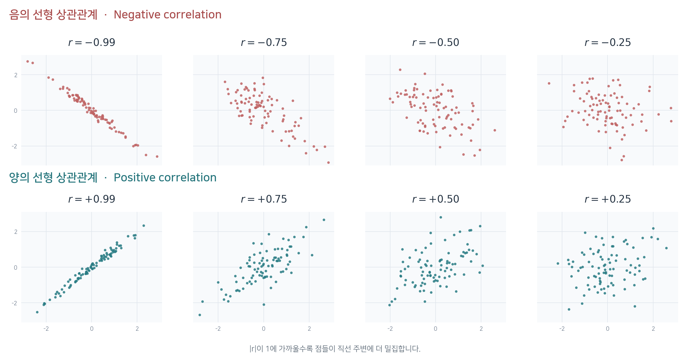
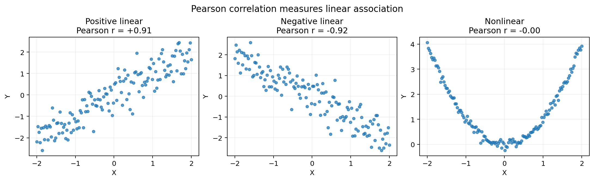
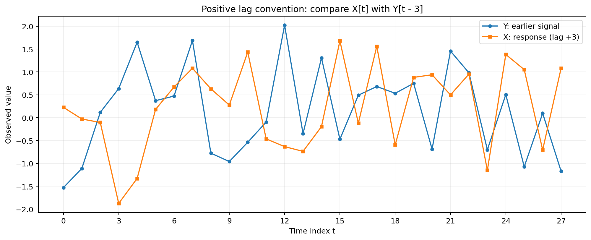
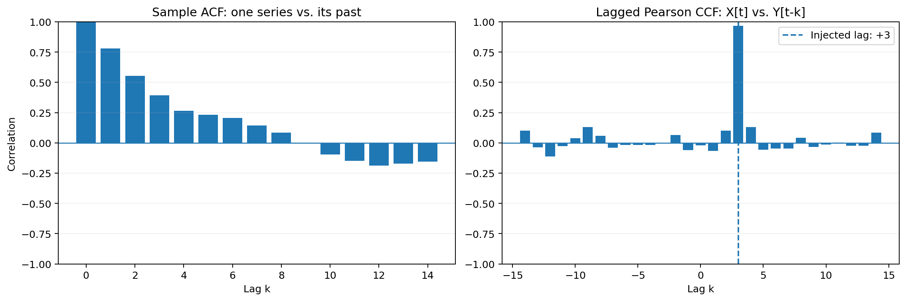

# Advanced Correlation Analysis — 상관관계 심화 분석

두 변수의 관계를 나타내는 **Pearson Correlation(피어슨 상관계수)** 에서 출발하여, 벡터의 내적과 L2 노름으로 공식을 해석하고, 시간 간격을 고려하는 **Autocorrelation(자기상관)** 및 **Cross-Correlation(상호상관)** 으로 확장합니다.

> **선행 개념:** 평균, 편차, 제곱근, 좌표평면, Python 배열  
> **학습 목표:** 상관계수의 수학적 의미 이해 · 시차(Lag) 해석 · Python으로 ACF/CCF 계산 및 시각화

---

## 1. 상관관계는 무엇을 비교하나요?

상관관계(Correlation)는 **두 데이터가 함께 변하는 경향**을 나타내는 개념입니다. 예를 들어 기온과 아이스크림 판매량이 함께 증가하는지, 공부 시간과 시험 점수가 비슷한 방향으로 변화하는지 살펴볼 수 있습니다.

그런데 데이터를 비교할 때는 **무엇과 무엇을 비교하는지** 먼저 정해야 합니다.

| 구분 | 비교하는 대상 | 질문 예시 |
|---|---|---|
| Pearson Correlation | 같은 순서로 관측한 두 변수 | 기온이 높을수록 판매량도 높은가? |
| Autocorrelation (ACF) | **한 변수**의 현재 값과 과거 값 | 오늘 기온과 어제 기온은 비슷한가? |
| Cross-Correlation (CCF) | **두 변수**를 서로 다른 시점에서 비교 | 광고를 한 뒤 며칠 후 방문자가 증가하는가? |

Pearson은 **상관계수를 계산하는 대표적인 방법**이고, Auto/Cross는 **어떤 시차를 두고 데이터를 비교할지**를 다루는 개념입니다. 이 구분을 이해하면 세 주제를 하나의 흐름으로 연결할 수 있습니다.

## 2. Pearson Correlation — 피어슨 상관계수

**Pearson Correlation Coefficient(피어슨 상관계수)** 란 두 수치형 변수 사이의 **선형적 관계가 어느 방향으로, 얼마나 뚜렷하게 나타나는지**를 수치화한 통계량입니다. 상관계수 $r$은 $-1$부터 $1$까지의 값을 가지며, 부호는 **방향**, 절댓값은 **선형적 관계의 강도**를 나타냅니다.

피어슨 상관계수를 이해하려면 다음 네 가지 개념을 알아야 합니다.

1. **연속형 변수(Continuous Variable)**  
   일정한 범위에서 연속적인 값을 가질 수 있는 수치형 변수입니다. 키, 몸무게, 기온, 공부 시간 등이 대표적인 예입니다. 반면 커피를 마신 잔 수나 사람 수는 숫자로 표현되더라도 일반적으로 **이산형 변수(Discrete Variable)** 에 해당합니다.

2. **선형적 관계(Linear Relationship)**  
   두 변수의 값을 산점도에 표시했을 때, 점들이 **하나의 직선 주변에 분포하는 관계**를 의미합니다. 점들이 직선에 가깝게 모일수록 선형적 관계가 뚜렷합니다. 반드시 원점을 지나는 정비례 관계일 필요는 없습니다.

3. **방향(Direction)**
   - **양의 상관관계($r > 0$)**: 한 변수가 증가할 때 다른 변수도 증가하는 경향입니다. 예를 들어 공부 시간이 길수록 시험 점수가 높아지는 관계를 생각할 수 있습니다.
   - **음의 상관관계($r < 0$)**: 한 변수가 증가할 때 다른 변수는 감소하는 경향입니다. 예를 들어 게임 시간이 길수록 시험 점수가 낮아지는 관계를 생각할 수 있습니다.
   - **상관계수가 0($r = 0$)**: 두 변수 사이에 **선형적 관계가 관찰되지 않음**을 의미합니다. 곡선 형태의 비선형 관계는 존재할 수 있습니다.

4. **강도(Strength)**  
   상관계수의 **절댓값** $|r|$으로 선형적 관계의 강도를 판단합니다.
   - **$|r|$이 1에 가까울수록**: 점들이 하나의 직선에 가깝게 모이며 선형적 관계가 강해집니다.
   - **$|r|$이 0에 가까울수록**: 점들이 직선에서 넓게 퍼지며 선형적 관계가 약해집니다.
   - **$r = 1$ 또는 $r = -1$**: 모든 점이 기울기가 0이 아닌 하나의 직선 위에 놓이는 완전한 선형 관계입니다.



> **핵심 정리:** 피어슨 상관계수는 “공부 시간이 늘어날수록 시험 점수도 높아지는 경향이 얼마나 뚜렷한가?”를 $-1$부터 $1$ 사이의 값으로 나타냅니다. 단, **상관관계가 인과관계를 의미하지는 않으며**, 상관계수만으로 예측의 정확도를 단정할 수도 없습니다.

### 2.1. 기본 표현식

관측값이 $n$개인 두 변수 $X$와 $Y$의 피어슨 상관계수는 다음과 같습니다.

$$
r=\frac{\sum_{i=1}^{n}(x_i-\bar{x})(y_i-\bar{y})}
{\sqrt{\sum_{i=1}^{n}(x_i-\bar{x})^2}\sqrt{\sum_{i=1}^{n}(y_i-\bar{y})^2}}
$$

- $x_i,y_i$: $i$번째 관측값
- $\bar{x},\bar{y}$: 각 변수의 평균
- $x_i-\bar{x},y_i-\bar{y}$: 평균에서 얼마나 떨어져 있는지를 나타내는 **편차**
- $r$: 두 변수 사이의 **선형 관계**의 방향과 강도 ($-1\le r\le 1$)

분자는 두 변수가 평균보다 **함께 크거나 함께 작을 때** 양수가 되기 쉽습니다. 반대로 한쪽은 평균보다 크고 다른 쪽은 작으면 음수가 되기 쉽습니다. 분모는 두 데이터의 변동 크기를 조절하여 서로 다른 단위의 데이터도 비교할 수 있게 만듭니다.

| 상관계수 | 의미 |
|---:|---|
| $r=+1$ | 완벽한 양의 선형 관계 |
| $r\approx 0$ | 선형 관계가 거의 나타나지 않음 |
| $r=-1$ | 완벽한 음의 선형 관계 |

상관계수가 0에 가깝더라도 **곡선 형태의 관계**는 존재할 수 있습니다.



### 2.2. 평균 중심화(Mean Centering)

위 공식을 벡터로 간단하게 나타내기 위해 모든 값에서 평균을 뺍니다.

$$
\mathbf{x}_c=\mathbf{x}-\bar{x}\mathbf{1},
\qquad
\mathbf{y}_c=\mathbf{y}-\bar{y}\mathbf{1}
$$

여기서 $\mathbf{1}=(1,1,\ldots,1)$은 모든 원소가 1인 벡터입니다. 즉, $\bar{x}\mathbf{1}$은 평균 $\bar{x}$를 관측값 개수만큼 반복한 벡터입니다.

예를 들어 $\mathbf{x}=(1,2,3)$이면 평균은 2이고,

$$
\mathbf{x}_c=(1-2,\ 2-2,\ 3-2)=(-1,0,1)
$$

이처럼 **데이터의 평균을 0으로 옮기되, 값 사이의 상대적인 차이는 유지**하는 과정을 평균 중심화라고 합니다.

### 2.3. 내적(Dot Product)과 L2 노름(L2 Norm)

두 벡터의 **내적**은 같은 위치의 원소끼리 곱한 값을 모두 더한 값입니다.

$$
\langle\mathbf{a},\mathbf{b}\rangle
=\mathbf{a}\cdot\mathbf{b}
=\sum_{i=1}^{n}a_i b_i
$$

**L2 노름**은 벡터의 길이(유클리드 길이)입니다. 2차원 좌표에서 피타고라스 정리로 거리를 구하는 방법을 여러 차원으로 확장한 것과 같습니다.

$$
\|\mathbf{a}\|_2=\sqrt{a_1^2+a_2^2+\cdots+a_n^2}
=\sqrt{\sum_{i=1}^{n}a_i^2}
$$

따라서 Pearson 상관계수는 아래와 같이 표현할 수 있습니다.

**L2 노름을 이용한 벡터 표현식**

$$
\boxed{
r=\frac{\langle\mathbf{x}_c,\mathbf{y}_c\rangle}
{\|\mathbf{x}_c\|_2\|\mathbf{y}_c\|_2}
}
$$

분자에는 **평균 중심화된 두 벡터의 내적**, 분모에는 **각 벡터의 L2 노름을 곱한 값**이 들어갑니다.

### 2.4. 직접 계산해 보기

$$
\mathbf{x}=(1,2,3),\qquad \mathbf{y}=(2,4,6)
$$

평균 중심화 후 두 벡터는 다음과 같습니다.

$$
\mathbf{x}_c=(-1,0,1),\qquad \mathbf{y}_c=(-2,0,2)
$$

**① 내적**

$$
\langle\mathbf{x}_c,\mathbf{y}_c\rangle=(-1)(-2)+0\cdot0+1\cdot2=4
$$

**② L2 노름**

$$
\|\mathbf{x}_c\|_2=\sqrt{2},\qquad
\|\mathbf{y}_c\|_2=\sqrt{8}
$$

**③ 상관계수**

$$
r=\frac{4}{\sqrt{2}\sqrt{8}}=\frac44=1
$$

$Y=2X$이므로 두 변수는 완벽한 양의 선형 관계를 가집니다. 상관계수는 두 값의 **크기가 같은지**가 아니라 **변화하는 방향이 얼마나 일치하는지**를 판단합니다.

### 2.5. 코사인 유사도와 연결

벡터 사이 각도를 $\theta$라고 하면 코사인 유사도는 다음과 같습니다.

$$
\mathrm{CosSim}(\mathbf{a},\mathbf{b})
=\frac{\langle\mathbf{a},\mathbf{b}\rangle}
{\|\mathbf{a}\|_2\|\mathbf{b}\|_2}
=\cos\theta
$$

이를 평균 중심화된 벡터에 적용하면,

$$
\boxed{
\mathrm{Corr}(\mathbf{x},\mathbf{y})
=\mathrm{CosSim}(\mathbf{x}_c,\mathbf{y}_c)
=\cos\theta
}
$$

즉, **Pearson 상관계수는 평균 중심화된 두 벡터의 코사인 유사도**입니다. 여기서 $\theta$는 원본 벡터가 아니라 평균 중심화된 벡터 사이의 각도입니다. 두 벡터의 각도에 대한 코사인 값이 $[-1,1]$에 있기 때문에 Pearson 상관계수도 이 범위에 있습니다.

> **주의:** 평균 중심화를 하지 않은 원본 벡터의 코사인 유사도는 일반적으로 Pearson 상관계수와 다릅니다. 또한 변수 중 하나의 값이 모두 같아 L2 노름이 0이면 Pearson 상관계수는 정의되지 않습니다.

### 2.6. 공분산(Covariance)과의 관계

표본공분산과 표본표준편차를 이용해도 같은 피어슨 상관계수를 얻습니다.

$$
s_{xy}=\frac{1}{n-1}\sum_{i=1}^{n}(x_i-\bar{x})(y_i-\bar{y})
$$

$$
r=\frac{s_{xy}}{s_xs_y}
$$

두 표본표준편차에도 $1/(n-1)$에서 나온 계수가 들어 있으므로, 이를 나누면 2.1절의 공식과 같아집니다. **공분산을 표준화한 값이 Pearson 상관계수**라고 이해할 수 있습니다.

## 3. Lag(시차) — 시간을 어긋나게 비교하기

지금까지는 같은 순서에 있는 $x_i$와 $y_i$를 비교했습니다. 하지만 시계열(Time Series)은 **시간 순서대로 기록한 데이터**이기 때문에, 어떤 현상의 효과가 나중에 나타날 수 있습니다.

예를 들어 광고가 노출된 직후가 아니라 **이틀 뒤**에 방문자 수가 증가한다면 같은 날끼리 비교하는 것만으로는 관계를 놓칠 수 있습니다.

시간 간격을 나타내는 $k$를 **시차(Lag)**라고 합니다. 하루 단위로 수집했다면 $k=2$는 이틀 차이, 한 시간 단위라면 두 시간 차이를 의미합니다.

이 자료에서는 **$X_t$와 $Y_{t-k}$를 비교하는 방식**을 사용합니다.

| 시차 | 비교 대상 | 해석 |
|---:|---|---|
| $k=0$ | $X_t$와 $Y_t$ | 같은 시점 비교 |
| $k=+2$ | $X_t$와 $Y_{t-2}$ | **Y가 X보다 두 시점 앞섬** |
| $k=-2$ | $X_t$와 $Y_{t+2}$ | **X가 Y보다 두 시점 앞섬** |

시차의 부호는 문헌이나 라이브러리에 따라 다르게 정의될 수 있습니다. **코드에서 어떤 두 구간을 비교하는지** 확인하는 것이 가장 확실합니다.



## 4. Autocorrelation (ACF) — 자기상관

### 4.1. 개념

**Autocorrelation(자기상관)**은 하나의 시계열을 **시간만 이동시켜 자기 자신과 비교**하는 방법입니다.

예를 들어 다음과 같은 질문을 할 수 있습니다.

- 오늘 기온과 어제 기온은 비슷한가? → Lag 1
- 오늘 기온과 일주일 전 기온은 비슷한가? → Lag 7 (일 단위 데이터 기준)
- 매주 비슷한 요일에 방문자가 늘어나는가? → 여러 Lag에서 반복 패턴 확인

**ACF(Autocorrelation Function)**는 시차 $k$를 바꾸어 가며 자기상관을 계산한 함수입니다.

### 4.2. 이론적 표현식

평균과 분산이 시간에 따라 일정하고, 공분산이 두 시점 사이의 간격에만 의존하는 **약정상(Weak Stationarity)** 시계열을 가정하겠습니다.

$$
\gamma_{XX}(k)=\mathrm{Cov}(X_t,X_{t-k})
$$

$$
\boxed{
\rho_{XX}(k)
=\frac{\gamma_{XX}(k)}{\gamma_{XX}(0)}
=\frac{\mathrm{Cov}(X_t,X_{t-k})}
{\mathrm{Var}(X_t)}
}
$$

- $\gamma_{XX}(k)$: 시차 $k$에서의 **자기공분산**
- $\gamma_{XX}(0)$: 시차 0의 자기공분산, 즉 분산
- $\rho_{XX}(k)$: 시차 $k$에서의 자기상관

$k=0$에서는 자기 자신과 같은 시점에 비교하므로 $\rho_{XX}(0)=1$입니다. 단, 분산은 0이 아니어야 합니다.

### 4.3. 실제 데이터의 표본 ACF

관측값 $x_1,x_2,\ldots,x_n$에서 자주 사용하는 **표본 ACF 추정식의 한 형태**는 다음과 같습니다.

$$
\boxed{
\hat\rho_{XX}(k)=
\frac{\sum_{t=k+1}^{n}(x_t-\bar{x})(x_{t-k}-\bar{x})}
{\sum_{t=1}^{n}(x_t-\bar{x})^2}
},\qquad 0\le k<n
$$

이 방식에서는 전체 데이터의 평균 $\bar{x}$를 사용하고, **모든 시차에 같은 분모**를 사용합니다.

### 4.4. L2 노름으로 계산하는 구간별 자기상관

시차를 적용한 뒤 **서로 겹치는 구간끼리 Pearson 상관계수**를 구할 수도 있습니다.

$$
\mathbf{x}_{k,+}=(x_{k+1},\ldots,x_n),\qquad
\mathbf{x}_{k,-}=(x_1,\ldots,x_{n-k})
$$

각 구간에서 **해당 구간의 평균**을 빼서 중심화한 벡터를 각각 $\widetilde{\mathbf{x}}_{k,+}$와 $\widetilde{\mathbf{x}}_{k,-}$라고 하면,

$$
\boxed{
r_{XX}(k)
=\frac{
\langle\widetilde{\mathbf{x}}_{k,+},\widetilde{\mathbf{x}}_{k,-}\rangle
}{
\|\widetilde{\mathbf{x}}_{k,+}\|_2
\|\widetilde{\mathbf{x}}_{k,-}\|_2
}
}
$$

이는 **겹치는 구간의 Pearson 상관계수**입니다. 4.3절의 표본 ACF와는 평균을 구하는 범위와 분모가 달라 **일반적으로 숫자가 일치하지 않습니다.** 둘 다 시차에 따른 관계를 살펴보는 데 사용되지만, 같은 추정식이라고 혼동하지 않아야 합니다.

**차이를 직접 확인하는 예시**

$$
\mathbf{x}=(1,2,4,3,5),\qquad k=1
$$

- 전체 평균을 사용하는 4.3절의 표본 ACF: $\hat\rho_{XX}(1)=0.10$
- 겹치는 네 쌍을 각각 중심화한 Pearson 상관계수: $r_{XX}(1)=0.40$

데이터가 짧을 때는 추정 방식에 따른 차이가 특히 눈에 띌 수 있습니다.

## 5. Cross-Correlation (CCF) — 상호상관

### 5.1. 개념

**Cross-Correlation(상호상관)**은 **서로 다른 두 시계열**을 시간만큼 어긋나게 비교하는 방법입니다.

예를 들어 $Y$를 광고 노출량, $X$를 방문자 수라고 가정하겠습니다. 광고가 먼저 늘고 이틀 후 방문자가 늘어난다면, $X_t$와 $Y_{t-2}$ 사이에 높은 상관이 나타날 수 있습니다.

이는 **두 사건이 일정한 시간 간격을 두고 함께 변하는지** 찾는 방법입니다. 높은 상호상관이 발견되었다고 해서 원인과 결과가 증명되는 것은 아닙니다.

### 5.2. 이론적 표현식

두 시계열은 **공동 약정상(Joint Weak Stationarity)**이라고 가정합니다. 이 경우 두 변수의 평균과 분산은 시간에 따라 일정하며, 교차공분산은 시차에만 의존합니다.

$$
\gamma_{XY}(k)=\mathrm{Cov}(X_t,Y_{t-k})
$$

$$
\boxed{
\rho_{XY}(k)=
\frac{\gamma_{XY}(k)}{\sigma_X\sigma_Y}
=\frac{\mathrm{Cov}(X_t,Y_{t-k})}{\sigma_X\sigma_Y}
}
$$

- $\gamma_{XY}(k)$: 두 시계열의 **교차공분산**
- $\sigma_X,\sigma_Y$: 각각의 표준편차
- $\rho_{XY}(k)$: 시차 $k$에서의 **교차상관**

$k=0$에서는 같은 시점의 $X_t$와 $Y_t$를 비교하므로, 두 변수의 일반적인 상관관계와 연결됩니다.

### 5.3. 유효한 비교 구간과 L2 노름 표현식

실제 데이터는 무한히 이어지지 않고 관측값의 개수가 정해져 있습니다. 따라서 시차 $k$를 적용할 때는 **두 시계열의 인덱스가 모두 유효한 구간**에서만 값을 비교해야 합니다.

길이가 $n$인 두 시계열 $X=(x_1,\ldots,x_n)$과 $Y=(y_1,\ldots,y_n)$에 대해, 비교 가능한 시점의 집합을 다음과 같이 정의합니다.

**겹치는 구간(Overlap Region)**

$$
I_k=\left\lbrace t \mid 1\le t\le n,\quad 1\le t-k\le n \right\rbrace
$$

$$
N_k=|I_k|=n-|k|,\qquad |k|<n
$$

- $I_k$: 시차 $k$를 적용해도 두 값 $x_t$, $y_{t-k}$가 모두 존재하는 시점의 집합
- $N_k$: 실제로 비교할 수 있는 관측값 쌍의 개수
- $|k|$: 시차의 절댓값. 시차가 0에서 멀어질수록 비교 가능한 구간이 짧아집니다.

각 비교 구간의 평균을 **따로** 계산합니다.

$$
\bar{x}_k=\frac{1}{N_k}\sum_{t\in I_k}x_t,
\qquad
\bar{y}_k=\frac{1}{N_k}\sum_{t\in I_k}y_{t-k}
$$

이 평균을 이용하면 겹치는 구간의 **시차별 Pearson 상관계수**는 다음과 같이 계산할 수 있습니다.

$$
\boxed{
r_{XY}(k)=
\frac{\sum_{t\in I_k}(x_t-\bar{x}_k)(y_{t-k}-\bar{y}_k)}
{\sqrt{\sum_{t\in I_k}(x_t-\bar{x}_k)^2}
\sqrt{\sum_{t\in I_k}(y_{t-k}-\bar{y}_k)^2}}
}
$$

이 공식은 양수·음수 시차에 모두 적용됩니다. 다만 $N_k\ge2$이고, 두 비교 구간에 각각 변동이 있어야 상관계수를 계산할 수 있습니다.

**L2 노름을 이용한 표현식**

$t\in I_k$를 오름차순으로 정렬하여 두 비교 벡터를 만들고, 각 벡터의 평균을 빼서 $\mathbf{a}_{k,c}$, $\mathbf{b}_{k,c}$라고 나타내겠습니다.

$$
\mathbf{a}_k=(x_t)_{t\in I_k},
\qquad
\mathbf{b}_k=(y_{t-k})_{t\in I_k}
$$

$$
\boxed{
r_{XY}(k)=
\frac{\langle\mathbf{a}_{k,c},\mathbf{b}_{k,c}\rangle}
{\|\mathbf{a}_{k,c}\|_2\|\mathbf{b}_{k,c}\|_2}
}
$$

즉, **유효한 구간을 먼저 선택하고 → 각 구간을 평균 중심화하고 → 내적을 L2 노름의 곱으로 나누는 과정**입니다.

이 자료에서 $r_{XY}(k)$는 **겹치는 구간별 Pearson 상관계수**를 의미합니다. 5.2절의 이론적 교차상관 $\rho_{XY}(k)$, 8.5절의 비정규화 상호상관 $R_{XY}(k)$와는 계산 방식과 의미가 다릅니다.

### 5.4. 시차 +2를 직접 확인하는 예시

$$
\mathbf{Y}=(1,3,2,5,4,6)
$$

$$
\mathbf{X}=(0,0,1,3,2,5)
$$

$k=+2$로 설정하면 다음과 같이 비교합니다.

| 비교 시점 | $X_t$ | $Y_{t-2}$ |
|---|---:|---:|
| $t=3$ | 1 | 1 |
| $t=4$ | 3 | 3 |
| $t=5$ | 2 | 2 |
| $t=6$ | 5 | 5 |

따라서 겹치는 구간은 $(1,3,2,5)$와 $(1,3,2,5)$로 같고, 이 두 구간의 피어슨 상관계수는 **1**입니다.

이는 **Y가 두 시점 먼저 나타나는 형태로 구성된 예시**입니다. 실제 데이터에서는 잡음, 다른 변수, 우연한 패턴 때문에 이렇게 정확히 일치하지 않는 경우가 많습니다.

### 5.5. ACF와 CCF를 그래프로 읽기



왼쪽은 **ACF**입니다. Lag 0에서 1이며, 이후 양의 상관이 서서히 줄어드는 가상 시계열을 보여 줍니다. 오른쪽은 **CCF**로, $Y$의 변화가 먼저 일어나고 $X$의 변화가 세 시점 늦게 나타나도록 만든 데이터입니다. 이 자료의 부호 규약에서는 **Lag +3 부근에 최대 상관**이 나타납니다.

> ACF/CCF 그래프에서 막대가 높다는 이유만으로 주기성, 영향 관계, 통계적 유의성이 자동으로 입증되는 것은 아닙니다. 표본 크기와 추정 방식, 데이터의 시간적 구조를 함께 확인해야 합니다.

## 6. Pearson · ACF · CCF 한눈에 비교

| 관점 | Pearson | Autocorrelation | Cross-Correlation |
|---|---|---|---|
| 데이터 | 두 변수 | 하나의 시계열 | 두 시계열 |
| 시간 이동 | 없음 | 있음 | 있음 |
| 대표적인 질문 | 함께 증가하는가? | 과거의 자신과 비슷한가? | 어느 쪽이 몇 시점 앞서 변하는가? |
| Lag 0 | 같은 시점의 Pearson $r$ | 분산이 0이 아니면 1 | 같은 시점의 두 변수 상관 |
| 대표적인 시각화 | 산점도·상관행렬 히트맵 | ACF 막대그래프 | CCF 막대그래프 |

**중요한 연결:** `Lag 0`에서 두 시계열의 **겹치는 구간별 Pearson CCF**는 일반적인 Pearson 상관계수와 동일합니다. 자기상관에서는 비교 대상이 자기 자신이므로 `Lag 0`이 1입니다.

## 7. Python 실습 — 상관계수 계산과 시차 탐색

### 7.1. Pearson을 L2 노름으로 구현

아래는 NumPy로 공식을 직접 구현한 코드입니다. `np.dot()`은 내적을, `np.linalg.norm()`은 벡터의 L2 노름을 계산합니다.

```python
import numpy as np


def pearson_l2(x, y):
    x = np.asarray(x, dtype=float)
    y = np.asarray(y, dtype=float)
    if x.ndim != 1 or y.ndim != 1 or len(x) != len(y) or len(x) < 2:
        raise ValueError("두 배열은 길이가 같은 1차원 배열이어야 합니다.")

    xc = x - x.mean()
    yc = y - y.mean()
    denominator = np.linalg.norm(xc) * np.linalg.norm(yc)
    if denominator == 0:
        raise ValueError("상수 데이터의 상관계수는 정의되지 않습니다.")
    return float(np.dot(xc, yc) / denominator)


x = np.array([1, 2, 3])
y = np.array([2, 4, 6])

print(pearson_l2(x, y))       # 1.0
print(np.corrcoef(x, y)[0, 1])  # 1.0 (검산)
```

`np.corrcoef()`와 비교하면 직접 구현한 공식이 올바른지 확인할 수 있습니다. 실제 데이터에서는 결측값(`NaN`) 처리도 별도로 고려해야 합니다.

### 7.2. 시차를 이동해 Pearson 계산

**이 자료의 규칙:** 양수 Lag에서는 `X[t]`와 과거의 `Y[t-k]`를 비교합니다.

```python
import numpy as np


def lagged_pearson(x, y, lag):
    x = np.asarray(x, dtype=float)
    y = np.asarray(y, dtype=float)
    if x.ndim != 1 or y.ndim != 1 or len(x) != len(y):
        raise ValueError("두 배열의 길이가 같아야 합니다.")
    if abs(lag) >= len(x):
        raise ValueError("Lag의 절댓값은 데이터 길이보다 작아야 합니다.")

    if lag > 0:
        a, b = x[lag:], y[:-lag]
    elif lag < 0:
        a, b = x[:lag], y[-lag:]
    else:
        a, b = x, y

    if len(a) < 3 or np.std(a) == 0 or np.std(b) == 0:
        return np.nan
    return float(np.corrcoef(a, b)[0, 1])


y = np.array([1, 3, 2, 5, 4, 6])
x = np.array([0, 0, 1, 3, 2, 5])

print(lagged_pearson(x, y, lag=2))  # 1.0
```

이는 **구간별 Pearson 방식**이며, 특정 통계 라이브러리의 표본 ACF/CCF와 항상 같은 값을 출력하는 함수는 아닙니다.

### 7.3. 전체 예제 실행과 그래프 생성

함께 제공되는 `examples/correlation_lab.py`에는 다음 내용이 포함되어 있습니다.

- Pearson 기본 공식과 L2 표현식 결과 비교
- 선형 관계와 비선형 관계의 산점도 생성
- 자기상관을 가진 가상 시계열의 표본 ACF 계산
- 한 신호가 **3시점 뒤에 반응하도록 만든 데이터**의 시차별 CCF 계산
- **고정 분모 표본 ACF**와 **겹치는 구간별 Pearson 자기상관**의 결과 비교

**설치 및 실행**

```bash
python -m pip install -r requirements.txt
python examples/correlation_lab.py
```

프로그램을 실행하면 그림 파일을 생성하고, 상관계수와 가장 높은 CCF가 발견된 Lag를 터미널에 표시합니다. 예제는 난수 시드를 고정하여 같은 환경에서는 재현 가능한 결과를 만들도록 구성했습니다.

## 8. 해석할 때 주의할 점

### 8.1. 상관관계는 인과관계가 아니다

광고 노출량과 방문자 수가 서로 다른 시점에서 높은 상관을 보이더라도, 광고가 방문자 증가의 **원인이라고 단정할 수 없습니다**. 공휴일, 계절, 행사처럼 두 변수에 함께 영향을 주는 요인이 있을 수 있습니다.

### 8.2. 추세(Trend)와 계절성(Seasonality)

두 데이터가 시간이 흐를수록 함께 증가한다면, 직접적인 관계가 없더라도 높은 상관이 나타날 수 있습니다. 매주 반복되는 패턴도 상관을 높일 수 있습니다. 시계열을 분석할 때는 그래프를 먼저 확인하고, 필요한 경우 추세 제거·차분·계절 조정 등을 검토합니다.

- **추세:** 장기간 지속되는 증가 또는 감소 방향
- **계절성:** 특정 주기마다 반복되는 패턴
- **차분:** 이전 값과 현재 값의 차이를 이용하여 변화를 살펴보는 방법

### 8.3. 시차가 커지면 비교할 데이터가 줄어든다

관측값이 $n$개일 때 시차 $k$로 겹치는 두 구간을 비교하면 실제 비교 가능한 값의 개수는 $n-|k|$개입니다. 큰 시차에서는 적은 데이터로 상관을 계산하므로 결과가 불안정해질 수 있습니다.

### 8.4. 이상값·결측값·상수 데이터

특별히 크거나 작은 이상값(Outlier)은 Pearson 상관계수를 크게 바꿀 수 있습니다. 결측값 처리 방법에 따라 결과가 달라질 수 있으며, 한 구간의 값이 모두 같으면 표준편차가 0이므로 상관계수가 정의되지 않습니다.

### 8.5. 유한 시계열의 비정규화 상호상관과 경계 처리

신호 처리에서는 **두 신호의 곱을 시차별로 더한 값**을 Cross-Correlation이라고 부르기도 합니다. 이때 계산 범위를 정확하게 정의하려면 **신호가 실제로 겹치는 구간**을 고려해야 합니다.

두 신호 $X=(x_1,\ldots,x_n)$, $Y=(y_1,\ldots,y_n)$에 대해 $1\le t\le n$에서 계산할 항을 다음과 같이 정의하겠습니다.

**경계를 고려한 구간별 곱(Piecewise Definition)**

$$
q_t(k)=
\begin{cases}
x_t y_{t-k}, & 1\le t-k\le n, \\
0, & \mathrm{otherwise}
\end{cases}
$$

시차 때문에 $y_{t-k}$가 원본 데이터의 범위 밖에 있으면 해당 항을 0으로 처리합니다. 그러면 **비정규화 상호상관(Unnormalized Cross-Correlation)**을 다음과 같이 나타낼 수 있습니다.

$$
\boxed{
R_{XY}(k)=\sum_{t=1}^{n}q_t(k)
=\sum_{t\in I_k}x_t y_{t-k}
}
$$

여기서 $I_k$는 5.3절에서 정의한 겹치는 구간입니다. 즉, **범위 밖의 항을 0으로 처리하는 방법**과 **처음부터 유효한 구간만 합산하는 방법**은 같은 결과를 제공합니다.

단, 이 식은 곱의 합일 뿐 **평균 중심화와 L2 노름 정규화를 포함하지 않습니다.** 따라서 일반적으로 값이 $[-1,1]$ 범위에 있지 않으며, Pearson 상관계수와 동일하지 않습니다.

| 기호 | 의미 | 구분 |
|---|---|---|
| $\rho_{XY}(k)$ | 확률과정의 이론적 교차상관 | 모집단 개념 |
| $r_{XY}(k)$ | 겹치는 구간에서 계산한 시차별 Pearson 상관계수 | 평균 중심화 및 L2 노름 사용 |
| $R_{XY}(k)$ | 유효한 구간에서 원 신호의 곱을 더한 값 | 비정규화 상호상관 |

실제 구현에서 함수를 비교할 때는 **평균 중심화 여부, 분모의 정규화 방식, 경계 처리 방식, 시차 부호의 정의**를 확인해야 합니다.

## 9. Quiz & Practice — 연습문제

문제를 먼저 풀어본 뒤, 각 문제 아래의 **정답 및 해설**을 펼쳐 확인해 보세요. 객관식은 선택지 하나를 고르는 형식이며, 주관식은 풀이 과정이나 판단 근거까지 작성하는 연습입니다.

### 문제 1. Pearson 상관계수 계산 (객관식)

두 벡터가 다음과 같을 때 Pearson 상관계수는 얼마인가요?

$$
\mathbf{x}=(1,2,3),\qquad \mathbf{y}=(3,2,1)
$$

- **A.** $-1$
- **B.** $-0.5$
- **C.** $0$
- **D.** $1$

<details>
<summary>정답 및 해설</summary>

**정답: A. $-1$**

두 벡터의 평균은 모두 2이므로, 평균 중심화된 벡터는 다음과 같습니다.

$$
\mathbf{x}_c=(-1,0,1),\qquad \mathbf{y}_c=(1,0,-1)
$$

내적과 L2 노름을 차례대로 구하면 다음과 같습니다.

$$
\langle\mathbf{x}_c,\mathbf{y}_c\rangle=-1+0-1=-2
$$

$$
\|\mathbf{x}_c\|_2=\sqrt{2},\qquad
\|\mathbf{y}_c\|_2=\sqrt{2}
$$

$$
r=\frac{-2}{\sqrt{2}\sqrt{2}}=-1
$$

- **A:** 정답입니다. $X$가 증가할 때 $Y$가 일정한 비율로 감소하는 완벽한 음의 선형 관계입니다.
- **B:** 음의 관계라는 방향은 맞지만, 관계의 강도를 과소평가한 값입니다.
- **C:** 선형 관계가 없다는 뜻이므로 이 데이터에는 해당하지 않습니다.
- **D:** 완벽한 양의 선형 관계를 뜻하며, 실제 데이터의 변화 방향과 반대입니다.

</details>

### 문제 2. 상관계수 0의 의미 (주관식)

다음 두 변수의 Pearson 상관계수는 0입니다.

$$
X=(-2,-1,0,1,2),\qquad Y=(4,1,0,1,4)
$$

두 변수 사이에 **아무런 관계도 없다**고 결론 내릴 수 있나요? 그 이유를 식이나 데이터의 패턴으로 설명해 보세요.

<details>
<summary>모범답안 및 상세 해설</summary>

**모범답안:** 관계가 없다고 결론 내릴 수 없습니다. Pearson 상관계수는 주로 **선형 관계**를 측정하며, 이 자료에는 $Y=X^2$라는 **비선형 관계**가 존재합니다.

이 데이터에서는 $X$의 평균이 0, $Y$의 평균이 2입니다. Pearson 공식의 분자를 계산하면 다음과 같습니다.

$$
\sum_{i=1}^{5}(x_i-\bar{x})(y_i-\bar{y})
=(-2)(2)+(-1)(-1)+0(-2)+1(-1)+2(2)=0
$$

분모는 0이 아니므로 $r=0$입니다. 하지만 $X$의 절댓값이 커질수록 $Y$가 커지는 규칙이 있습니다.

따라서 **상관계수가 0이라는 사실은 선형적 관계가 관측되지 않는다는 뜻**이지, 모든 형태의 관계가 없다는 뜻은 아닙니다. 산점도를 그리면 U자 모양의 관계를 확인할 수 있습니다.

**핵심 채점 요소:** (1) '관계가 없다'는 결론을 거부했는지, (2) $Y=X^2$ 관계를 발견했는지, (3) Pearson의 선형성 한계를 설명했는지 확인해 보세요.

</details>

### 문제 3. Pearson과 코사인 유사도의 관계 (객관식)

Pearson 상관계수를 **코사인 유사도와 같은 형태로** 계산하려면, 원본 벡터에 가장 먼저 적용해야 하는 연산은 무엇인가요?

- **A.** 모든 원소를 제곱합니다.
- **B.** 각 벡터에서 해당 벡터의 평균을 뺍니다.
- **C.** 모든 원소를 최댓값으로 나눕니다.
- **D.** 각 벡터의 원소를 오름차순으로 정렬합니다.

<details>
<summary>정답 및 해설</summary>

**정답: B. 각 벡터에서 해당 벡터의 평균을 뺍니다.**

Pearson 상관계수는 평균 중심화된 벡터의 코사인 유사도입니다.

$$
\mathbf{x}_c=\mathbf{x}-\bar{x}\mathbf{1},\qquad
\mathbf{y}_c=\mathbf{y}-\bar{y}\mathbf{1}
$$

$$
r=\frac{\langle\mathbf{x}_c,\mathbf{y}_c\rangle}
{\|\mathbf{x}_c\|_2\|\mathbf{y}_c\|_2}
$$

- **A:** 원소를 제곱하면 부호와 데이터의 원래 관계가 달라지므로 평균 중심화와 같지 않습니다.
- **B:** 정답입니다. 두 벡터의 평균을 각각 0으로 옮긴 뒤 내적과 L2 노름을 사용합니다.
- **C:** 최댓값으로 나누는 것은 크기를 재조정하는 방법이지만 평균 중심화가 아닙니다.
- **D:** 각 벡터를 독립적으로 정렬하면 원래 관측값의 짝이 달라질 수 있어 잘못된 상관계수가 나옵니다.

**주의:** 중심화된 벡터 중 하나라도 L2 노름이 0이면 이 식은 정의되지 않습니다.

</details>

### 문제 4. 표본 ACF와 구간별 Pearson 비교 (주관식 · 심화)

다음 시계열에서 $k=1$일 때 두 계산 결과를 구해 보세요.

$$
\mathbf{x}=(1,2,4,3,5)
$$

1. 전체 평균과 고정 분모를 사용하는 **표본 ACF** $\hat\rho_{XX}(1)$
2. 시차를 적용한 두 구간을 각각 중심화하는 **겹치는 구간별 Pearson 상관계수** $r_{XX}(1)$

두 값이 다르게 나오는 이유도 함께 설명해 보세요.

<details>
<summary>모범답안 및 단계별 풀이</summary>

**모범답안:** 표본 ACF는 **0.10**, 겹치는 구간별 Pearson 상관계수는 **0.40**입니다. 평균을 계산하는 범위와 분모의 정규화 방식이 서로 다르기 때문입니다.

**① 표본 ACF 계산**

전체 평균은 3이므로 편차는 다음과 같습니다.

$$
\bar{x}=3,\qquad (x_i-\bar{x})=(-2,-1,1,0,2)
$$

시차 1에서 분자는 이웃한 편차끼리 곱한 합이고, 분모는 전체 편차 제곱합입니다.

$$
\sum_{t=2}^{5}(x_t-\bar{x})(x_{t-1}-\bar{x})
=2-1+0+0=1
$$

$$
\sum_{t=1}^{5}(x_t-\bar{x})^2=4+1+1+0+4=10
$$

$$
\hat\rho_{XX}(1)=\frac{1}{10}=0.10
$$

**② 겹치는 구간별 Pearson 계산**

시차 1로 겹치는 두 구간을 만듭니다.

$$
\mathbf{a}=(2,4,3,5),\qquad \mathbf{b}=(1,2,4,3)
$$

각 구간의 평균은 각각 3.5와 2.5입니다. 따라서 중심화된 벡터는 다음과 같습니다.

$$
\mathbf{a}_c=(-1.5,0.5,-0.5,1.5)
$$

$$
\mathbf{b}_c=(-1.5,-0.5,1.5,0.5)
$$

$$
\langle\mathbf{a}_c,\mathbf{b}_c\rangle=2,\qquad
\|\mathbf{a}_c\|_2=\sqrt{5},\qquad
\|\mathbf{b}_c\|_2=\sqrt{5}
$$

$$
r_{XX}(1)=\frac{2}{\sqrt{5}\sqrt{5}}=0.40
$$

**③ 결과가 다른 이유**

표본 ACF는 **전체 시계열의 평균과 전체 편차 제곱합**을 사용합니다. 반면 겹치는 구간별 Pearson은 **길이가 줄어든 두 구간의 평균과 각 구간의 L2 노름**을 사용합니다. 서로 다른 계산법이므로 두 값이 반드시 같을 필요는 없습니다.

</details>

### 문제 5. 어떤 분석 방법이 적절할까요? (객관식)

하루 단위로 기록한 한 매장의 방문자 수가 **7일마다 비슷한 패턴으로 반복되는지** 확인하려고 합니다. 가장 직접적인 분석 방법은 무엇인가요?

- **A.** 같은 날짜의 방문자 수와 매출액에 대한 Pearson 상관계수
- **B.** 방문자 수 시계열의 Lag 1 자기상관
- **C.** 방문자 수 시계열의 Lag 7 자기상관
- **D.** 방문자 수와 매출액 사이의 Lag 7 상호상관

<details>
<summary>정답 및 해설</summary>

**정답: C. 방문자 수 시계열의 Lag 7 자기상관**

매장의 **방문자 수라는 한 변수**를 날짜를 이동시켜 자기 자신과 비교해야 합니다. 하루 단위 자료에서 $k=7$은 7일 전과 현재를 비교합니다.

- **A:** 서로 다른 두 변수의 같은 날짜 선형 관계를 확인하는 방법이므로, 방문자 수 자체의 7일 반복 여부를 직접 측정하지 않습니다.
- **B:** 어제와 오늘의 비슷함을 보는 방법으로, 주간 반복 여부를 직접 확인하려는 목적과 시차가 다릅니다.
- **C:** 정답입니다. Lag 7의 ACF를 확인하면 일주일 간격으로 반복되는 경향이 있는지 살펴볼 수 있습니다.
- **D:** 서로 다른 두 시계열의 시차 관계를 보는 방법이므로, 방문자 수 한 변수의 반복을 확인하는 목적과 다릅니다.

다만 **Lag 7에서 자기상관이 높다는 사실만으로 7일 주기가 확정되는 것은 아닙니다.** Lag 14, Lag 21 등의 반복 패턴과 원본 시계열 그래프도 함께 확인하는 것이 좋습니다.

</details>

### 문제 6. Cross-Correlation의 시차 맞추기 (주관식)

이 자료에서는 $X_t$와 $Y_{t-k}$를 비교합니다. 다음 자료에서 $k=+2$일 때 **어떤 값끼리 비교하는지**, **겹치는 구간의 Pearson 상관계수**, **시차 부호의 의미**를 순서대로 설명해 보세요.

$$
\mathbf{Y}=(1,3,2,5,4,6),\qquad
\mathbf{X}=(0,0,1,3,2,5)
$$

<details>
<summary>모범답안 및 상세 해설</summary>

**모범답안:** $X$의 세 번째 값부터 여섯 번째 값까지, $Y$의 첫 번째 값부터 네 번째 값까지 비교합니다. 두 구간은 모두 $(1,3,2,5)$이므로 Pearson 상관계수는 **1**입니다. 양수 시차 $+2$는 **Y가 X보다 두 시점 앞서는 방향으로 비교한다**는 뜻입니다.

비교하는 값을 표로 나타내면 다음과 같습니다.

| 시점 $t$ | $X_t$ | $Y_{t-2}$ |
|---:|---:|---:|
| 3 | 1 | 1 |
| 4 | 3 | 3 |
| 5 | 2 | 2 |
| 6 | 5 | 5 |

따라서 두 비교 구간이 동일하고 값의 변동도 존재하므로,

$$
r_{XY}(2)=1
$$

이 문제에서 중요한 점은 **'양수 Lag = Y가 먼저 나타나는 방향'**이라는 약속입니다. 라이브러리마다 시차 부호의 정의가 다를 수 있으므로 실제 분석에서는 어떤 배열을 앞뒤로 잘랐는지 확인해야 합니다.

또한 이 예시는 두 구간이 정확히 일치하도록 만든 데이터입니다. 실제 관측에서 비슷한 결과가 나와도 인과관계까지 증명되는 것은 아닙니다.

</details>

### 문제 7. 시차와 비교 가능한 데이터 개수 (객관식)

관측값이 12개인 두 시계열에 $|k|=5$를 적용하여 **겹치는 부분만** 비교하려고 합니다. 비교 가능한 관측값 쌍은 몇 개인가요?

- **A.** 5쌍
- **B.** 7쌍
- **C.** 12쌍
- **D.** 17쌍

<details>
<summary>정답 및 해설</summary>

**정답: B. 7쌍**

길이가 $n$인 두 시계열을 $|k|$만큼 이동시키면 서로 겹치는 값의 개수는 다음과 같습니다.

$$
N_{\mathrm{overlap}}=n-|k|
$$

$$
N_{\mathrm{overlap}}=12-5=7
$$

- **A:** 5는 이동한 시차의 크기이지, 남아 있는 비교 쌍의 개수가 아닙니다.
- **B:** 정답입니다. 12개 중 시차 때문에 겹치지 않는 5개를 제외하면 7쌍이 남습니다.
- **C:** 시차 0이라면 12쌍을 모두 비교할 수 있지만, 이 문제에서는 시차가 5입니다.
- **D:** 시차만큼 자료가 늘어나는 것은 아닙니다. 겹치는 구간은 오히려 줄어듭니다.

시차가 커질수록 비교할 쌍이 적어지므로, 소수의 관측값이나 이상값에 분석 결과가 크게 좌우될 수 있습니다.

</details>

### 문제 8. 높은 상관관계를 해석하는 방법 (객관식)

두 온라인 서비스의 주간 이용량이 비슷한 주기로 늘고 줄어 높은 상관관계를 보였습니다. 다음 설명 중 **가장 적절한 것**은 무엇인가요?

- **A.** 상관계수가 높으므로 서비스 A가 서비스 B의 이용량을 증가시켰다고 확정할 수 있습니다.
- **B.** 주간 패턴이 비슷하면 두 서비스의 이용량은 반드시 동일한 값이어야 합니다.
- **C.** 높은 상관관계는 공통된 요일 효과 등으로도 나타날 수 있어 추가 확인이 필요합니다.
- **D.** 상관관계가 높다면 추세나 계절성은 분석 결과에 영향을 주지 않습니다.

<details>
<summary>정답 및 해설</summary>

**정답: C. 높은 상관관계는 공통된 요일 효과 등으로도 나타날 수 있어 추가 확인이 필요합니다.**

- **A:** 상관관계만으로는 원인과 결과를 확정할 수 없습니다. 두 서비스가 제3의 요인에 동시에 영향을 받을 수 있습니다.
- **B:** 상관관계는 변화하는 방향과 패턴을 다루므로 실제 이용량의 크기까지 같을 필요는 없습니다.
- **C:** 정답입니다. 주말, 공휴일, 행사처럼 두 서비스 모두에 영향을 주는 요인 때문에 높은 상관이 나타날 수 있습니다.
- **D:** 추세와 계절성은 상관계수를 높이거나 시차 해석을 어렵게 만들 수 있어 반드시 살펴볼 필요가 있습니다.

**추가 확인 방법:** 원본 시계열 그래프를 확인하고, 요일별 반복이나 장기적인 추세가 있는지 살펴본 뒤 필요에 따라 계절 조정이나 차분을 검토할 수 있습니다.

</details>

### 문제 9. 상관계수를 계산할 수 없는 경우 (주관식)

다음 자료의 Pearson 상관계수를 계산할 수 있는지 판단하고, **L2 노름을 사용한 공식**을 바탕으로 그 이유를 설명해 보세요.

$$
\mathbf{x}=(5,5,5,5),\qquad
\mathbf{y}=(1,2,3,4)
$$

<details>
<summary>모범답안 및 상세 해설</summary>

**모범답안:** Pearson 상관계수를 계산할 수 없습니다. $X$의 모든 값이 같아서 평균 중심화된 벡터가 영벡터가 되고, L2 노름이 0이 되기 때문입니다.

$X$의 평균은 5이므로 다음과 같습니다.

$$
\mathbf{x}_c=(5-5,5-5,5-5,5-5)=(0,0,0,0)
$$

$$
\|\mathbf{x}_c\|_2=\sqrt{0^2+0^2+0^2+0^2}=0
$$

Pearson의 L2 노름 표현식에 대입하면,

$$
r=\frac{\langle\mathbf{x}_c,\mathbf{y}_c\rangle}
{\|\mathbf{x}_c\|_2\|\mathbf{y}_c\|_2}
$$

분모가 0이 되어 계산이 정의되지 않습니다. 따라서 상관계수를 **0이라고 기록하는 것도 올바르지 않습니다.** $r=0$은 계산 가능한 데이터에서 선형적 관계가 관측되지 않는 경우를 나타내며, 이 문제는 아예 계산할 수 없는 경우입니다.

Python에서는 이러한 경우 `NaN`이 나타나거나 함수에서 오류가 발생할 수 있습니다.

</details>

### 문제 10. 실제 데이터 분석 설계 (주관식 · 응용)

한 서비스에서 **하루 광고 노출량과 하루 방문자 수**를 30일 동안 기록했습니다. 광고 노출량이 변한 뒤 며칠 후 방문자 수에 비슷한 변화가 나타나는지 알아보고 싶습니다.

다음 네 가지를 포함하여 간단한 분석 계획을 작성해 보세요.

1. $X$와 $Y$에 각각 어떤 데이터를 넣을 것인지
2. Pearson, ACF, CCF 중 어떤 분석을 사용할 것인지
3. 시차 $k=+2$에서 어떤 값을 비교하는지
4. 상관관계가 높을 때도 유의해야 하는 점 한 가지

<details>
<summary>모범답안 및 상세 해설</summary>

**모범답안 예시**

1. $X_t$에는 **$t$일의 방문자 수**, $Y_t$에는 **$t$일의 광고 노출량**을 넣겠습니다.
2. 서로 다른 두 시계열을 날짜별로 이동하면서 비교해야 하므로 **Cross-Correlation(CCF)**을 사용하겠습니다.
3. 이 자료의 시차 규칙에 따라 $k=+2$에서는 **오늘의 방문자 수 $X_t$와 이틀 전 광고 노출량 $Y_{t-2}$**를 비교하겠습니다.
4. 높은 상관관계만으로 광고가 방문자 증가의 원인이라고 단정하지 않겠습니다. 주말, 공휴일, 이벤트, 장기 추세처럼 두 변수에 함께 영향을 미치는 요인을 점검하겠습니다.

**해설**

여기서는 서로 다른 두 변수를 시간차를 두고 비교하므로 ACF보다 CCF가 적절합니다. $k=0$만 비교하는 Pearson 상관계수도 참고할 수 있지만, 여러 날짜 차이 중 어느 지점에서 관계가 강한지를 알아보려면 시차를 바꾸어 가며 비교해야 합니다.

30일 동안 모두 관측했다면 시차 $+2$에서 비교 가능한 쌍은 **28개**입니다.

$$
N_{\mathrm{overlap}}=30-2=28
$$

자료를 해석할 때에는 원본 두 시계열의 그래프를 먼저 비교하고, 이후 시차별 CCF 그래프를 그리면 이해하기 쉽습니다. 다만 **시차가 앞선다는 사실은 원인임을 증명하지 않습니다.** 가상의 데이터에서 강한 시차 상관이 발견되더라도 다른 요인이나 우연한 패턴의 가능성을 함께 고려해야 합니다.

</details>

## 10. Summary — 핵심 정리

- **Pearson Correlation:** 같은 순서로 관측한 두 변수의 선형 관계를 측정합니다.
- **Mean Centering:** 각 관측값에서 해당 변수의 평균을 빼는 과정입니다.
- **L2 Norm:** 벡터의 길이를 나타냅니다. Pearson 상관계수는 평균 중심화된 두 벡터의 **내적을 L2 노름의 곱으로 나누어** 표현할 수 있습니다.
- **Cosine Similarity:** 평균 중심화된 두 벡터의 코사인 유사도는 Pearson 상관계수와 같습니다.
- **Autocorrelation (ACF):** 한 시계열을 시차만큼 이동시켜 자기 자신과 비교합니다.
- **Cross-Correlation (CCF):** 서로 다른 두 시계열을 시차만큼 이동시켜 관계를 살펴봅니다.
- **Lag 부호:** 이 자료에서는 $X_t$와 $Y_{t-k}$를 비교하므로 양수 Lag에서 **Y가 먼저 나타나는 방향**으로 해석합니다.
- **추정식 구분:** 표본 ACF/CCF와 겹치는 구간별 Pearson 상관계수는 평균과 정규화 방식에 따라 값이 달라질 수 있습니다.
- **해석 원칙:** 높은 상관관계만으로 인과관계는 증명되지 않습니다. 추세·계절성·이상값·표본 크기 등을 함께 검토해야 합니다.

**추가 확장 주제:** Spearman·Kendall 순위상관, Partial Correlation(편상관), 시계열의 정상성, FFT를 활용한 상관 연산을 살펴볼 수 있습니다.
