# Chapter 04. Seaborn

Seaborn을 이용해 **데이터의 분포·범주별 차이·변수 사이의 관계**를 시각화합니다. Chapter 03의 Matplotlib `Figure`·`Axes`를 기반으로, 자주 사용하는 Seaborn 그래프와 Figure-level Facets를 학습합니다.

각 예제는 **문제 상황 → 필요한 개념 → 코드 → 실제 그래프 → 코드 해설** 순서로 작성했습니다. 처음 등장하는 중요한 용어는 정의와 용도를 설명하고, 선택적 내용은 접어두었습니다. Coding Practice와 프로젝트는 완성 코드가 아닌 **시작 코드·요구사항·검증 기준**을 제공합니다.

모든 데이터는 **교육용 가상 데이터**입니다. 실제 매출, 서비스 성능, 도서관 방문 통계 또는 자전거 수요를 나타내지 않습니다.

- **권장 환경:** Python 3.11 이상, Seaborn 0.13.2, Matplotlib, Pandas, NumPy, SciPy
- **실행 검증:** Python 3.13.5, Seaborn 0.13.2, Matplotlib 3.10.8, Pandas 2.2.3, NumPy 2.3.5
- **자료 구성:** Example 22개 · Coding Practice 18개 · Mini Project 3개 · Advanced Project 1개 · Quiz 20문제

<details>
<summary><strong>선행 학습 목록</strong></summary>

- [Chapter 01 — Introduction to Data Visualization](../Chapter-01/)
- [Chapter 02 — Principles of Data Visualization](../Chapter-02/)
- [Chapter 03 — Matplotlib](../Chapter-03/)
- [Data Processing Chapter 03 — NumPy Fundamentals](../../Data_Processing/Chapter-03/)
- [Data Processing Chapter 04 — Pandas & DataFrames](../../Data_Processing/Chapter-04/)
- [Data Processing Chapter 06 — Data Cleaning & Validation](../../Data_Processing/Chapter-06/)
- [Data Processing Chapter 07 — Data Transformation & Aggregation](../../Data_Processing/Chapter-07/)

</details>

<a id="contents"></a>
## Contents

| Section | Topic |
|:---:|---|
| [4.1](#section-4-1) | Learning Goals & Getting Started |
| [4.2](#section-4-2) | Seaborn & Tidy Data — 첫 시각화와 Long-form |
| [4.3](#section-4-3) | Semantic Mapping — hue, style, size |
| [4.4](#section-4-4) | Lineplot — 집계와 관측 단위 |
| [4.5](#section-4-5) | Relplot — Figure-level Facets |
| [4.6](#section-4-6) | Countplot vs. Barplot — 빈도·평균·합계 |
| [4.7](#section-4-7) | Boxplot, Violin & Strip — 분포 비교 |
| [4.8](#section-4-8) | Histplot — 분포의 구간 설정 |
| [4.9](#section-4-9) | KDE & ECDF — 밀도와 누적 비율 |
| [4.10](#section-4-10) | Displot & Catplot — 그룹별 분포 |
| [4.11](#section-4-11) | Jointplot & Pairplot — 변수 사이의 관계 |
| [4.12](#section-4-12) | Heatmap — 상관관계와 피벗 데이터 |
| [4.13](#section-4-13) | Color, Order & Legends — 일관된 표현 |
| [4.14](#section-4-14) | Missing Data — 기록 부재와 실제 0 구분 |
| [4.15](#section-4-15) | Export — Figure-level과 Axes-level 저장 |
| [4.16](#section-4-16) | Native Scale — 범주형 위치와 실제 좌표 |
| [4.17](#section-4-17) | Error Bars — CI와 SD의 의미 |
| [4.18](#section-4-18) | Graph Selection & Common Pitfalls |
| [4.19](#section-4-19) | Mini Project 01 — Retail Sales Comparison |
| [4.20](#section-4-20) | Mini Project 02 — Service Response Time Report |
| [4.21](#section-4-21) | Mini Project 03 — Library Usage Review |
| [4.22](#section-4-22) | Coding Practice — 18 Exercises |
| [4.23](#section-4-23) | Advanced Project 01 — Public Bicycle Demand Report Generator |
| [4.24](#section-4-24) | Quiz — Visual Code Reading & Completion |
| [4.25](#section-4-25) | Summary |
| [4.26](#section-4-26) | References & Directory Structure |

---

<a id="section-4-1"></a>
## 4.1. Learning Goals & Getting Started

### 학습 목표

1. Seaborn이 Matplotlib 위에서 동작한다는 점과 두 도구의 역할을 설명합니다.
2. Long-form 데이터와 `hue`, `style`, `size`의 의미를 이해합니다.
3. 빈도·합계·평균·분포를 구분해 적절한 그래프를 선택합니다.
4. Axes-level 함수와 Figure-level 함수의 차이를 설명하고 Facet을 제작합니다.
5. 분포 그래프(KDE·ECDF·Box·Violin)와 Heatmap을 올바르게 읽습니다.
6. 자료가 없는 날짜를 0으로 바꾸지 않고, 가정과 단위를 명확히 표시합니다.
7. 예제·실습·프로젝트를 통해 그래프 결과를 반복 가능하게 저장합니다.

### 실행 준비

`Data_Visualization/Chapter-04/` 폴더를 기준으로 실행합니다.

```bash
python -m pip install -r requirements.txt
python examples/01_seaborn_intro.py
python examples/17_heatmap_pivot.py
python -m unittest discover -s tests -v
```

Python 파일은 화면 창을 강제로 열지 않고 `figures/`에 PNG를 저장합니다. 프로젝트의 결과는 `output/`에 저장되며 Git 추적에서 제외됩니다. 입력 데이터는 `data/`에 보관합니다.

| 구분 | 대표 함수 | 적합한 질문 |
|---|---|---|
| 관계 | `scatterplot()`, `lineplot()` | 두 변수가 어떤 관계인지, 시간에 따라 어떻게 변하는지 |
| 범주별 비교 | `countplot()`, `barplot()` | 각 범주의 건수, 평균 또는 합계 |
| 범주별 분포 | `boxplot()`, `violinplot()`, `stripplot()` | 각 그룹의 중앙값과 분포 |
| 수치 분포 | `histplot()`, `kdeplot()`, `ecdfplot()` | 값이 어디에 집중되는지, 기준값 이하 비율 |
| 행렬 | `heatmap()` | 범주 조합, 시간대, 상관관계 패턴 |
| 패널 구성 | `relplot()`, `displot()`, `catplot()` | 동일 기준으로 그룹별 분할 비교 |

### Axes-level과 Figure-level

- **Axes-level:** `sns.scatterplot(..., ax=ax)`처럼 이미 생성한 Matplotlib Axes에 그립니다. 하나의 Figure에서 서로 다른 그래프 종류를 조합할 때 유용합니다.
- **Figure-level:** `sns.relplot(...)`, `sns.displot(...)`처럼 내부적으로 Figure와 여러 Axes를 생성하고 관리합니다. 결과를 반환받은 객체의 `.figure`에 접근하여 저장합니다.

```python
# Axes-level
fig, ax = plt.subplots()
sns.scatterplot(data=df, x="x", y="y", ax=ax)

# Figure-level
g = sns.relplot(data=df, x="x", y="y", col="group")
g.figure.savefig("figure.png")
```

위 코드는 구조를 보여주기 위한 일부 예시이며, `df`를 정의한 완성 코드는 아래 각 Section에 제공합니다. **Figure-level 함수에 기존 `ax`를 넘겨 새 그래프를 끼워 넣는 방식은 사용하지 않습니다.**

<details>
<summary><strong>참고 — 주요 매개변수와 자주 헷갈리는 이름</strong></summary>

- `x`, `y`: 가로축과 세로축에 사용할 데이터 열 이름
- `hue`: 색상으로 구분할 그룹
- `style`: 표식 모양이나 선 스타일로 구분할 그룹
- `row`, `col`: Figure-level 함수가 생성할 패널의 행·열 그룹
- `estimator`: 동일한 그룹의 관측값을 어떤 통계량으로 요약할지 지정
- `errorbar`: 신뢰구간·표준편차 등의 불확실성 표시
- `palette`: 여러 범주에 배정할 색상 조합
- `native_scale`: 범주로 인식할 수도 있는 숫자·날짜 값의 원래 간격 유지

</details>

---

<a id="section-4-2"></a>
## 4.2. Seaborn & Tidy Data — 첫 시각화와 Long-form

### Example 01 — Seaborn Intro

**문제 상황**

매장 담당자가 완료된 주문의 접수 채널별 건수를 한눈에 비교하려고 합니다.

**필요한 개념**

`sns.countplot()`은 원본 데이터의 행 수를 세어 범주별 막대를 그립니다. `DataFrame`의 각 행이 무엇을 의미하는지 먼저 확인해야 합니다.

**예제 코드 — [`01_seaborn_intro.py`](./examples/01_seaborn_intro.py)**

```python
from pathlib import Path
import matplotlib
matplotlib.use("Agg")
import matplotlib.pyplot as plt
import seaborn as sns
import pandas as pd
import numpy as np

ROOT = Path(__file__).resolve().parents[1]
DATA = ROOT / "data"
OUT = ROOT / "figures"
OUT.mkdir(exist_ok=True)
sns.set_theme(style="whitegrid", palette="colorblind")

df = pd.read_csv(DATA / "retail_orders.csv")
completed = df.loc[df.status.eq("Completed")]
fig, ax = plt.subplots(figsize=(7, 4), layout="constrained")
sns.countplot(data=completed, x="channel", color="steelblue", ax=ax)
ax.set(title="Completed orders by channel", xlabel="Channel", ylabel="Order lines")
fig.savefig(OUT / "01_seaborn_intro.png", dpi=145)
plt.close(fig)
print("Completed:", len(completed))
```

**실행 결과**

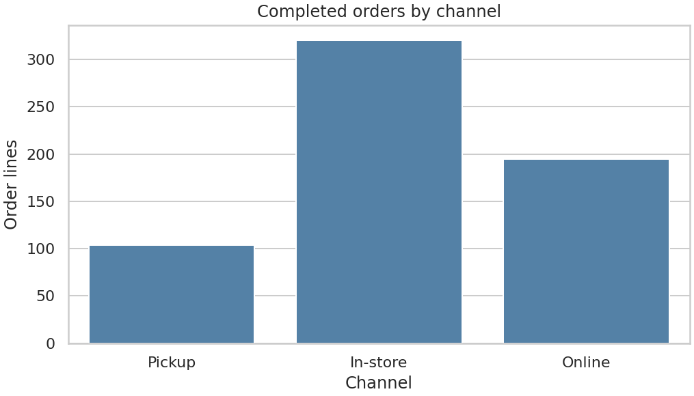

**핵심 코드 해설**

`countplot()`은 `x`에 지정한 범주별 행 수를 세며, `color`로 전체 막대에 동일 색상을 적용합니다. `ax`는 Matplotlib에서 배운 Axes 객체입니다.

**해석 및 주의 사항:** 완료 주문만 포함하므로 취소·반품 주문까지 센 전체 건수와 결과가 다릅니다.

### Example 02 — Tidy Vs Wide

**문제 상황**

두 지점의 월별 방문 건수를 서로 다른 계열의 선 그래프로 표현하려고 합니다.

**필요한 개념**

Seaborn은 보통 `month`, `branch`, `visitors`처럼 **변수 하나에 열 하나**를 대응시키는 Long-form(Tidy) 구조가 편리합니다. `melt()`는 Wide 데이터의 여러 열을 범주 열과 값 열로 변환합니다.

**예제 코드 — [`02_tidy_vs_wide.py`](./examples/02_tidy_vs_wide.py)**

```python
from pathlib import Path
import matplotlib
matplotlib.use("Agg")
import matplotlib.pyplot as plt
import seaborn as sns
import pandas as pd
import numpy as np

ROOT = Path(__file__).resolve().parents[1]
DATA = ROOT / "data"
OUT = ROOT / "figures"
OUT.mkdir(exist_ok=True)
sns.set_theme(style="whitegrid", palette="colorblind")

wide = pd.DataFrame({"month": ["Jan", "Feb", "Mar"], "Central": [12, 15, 19], "North": [9, 11, 14]})
long = wide.melt(id_vars="month", var_name="branch", value_name="visitors_hundreds")
fig, ax = plt.subplots(figsize=(7, 4), layout="constrained")
sns.lineplot(data=long, x="month", y="visitors_hundreds", hue="branch", marker="o", errorbar=None, ax=ax)
ax.set(title="Tidy data and multiple series", ylabel="Visitors (hundreds)")
fig.savefig(OUT / "02_tidy_vs_wide.png", dpi=145)
plt.close(fig)
print("Long-form rows:", len(long))
```

**실행 결과**

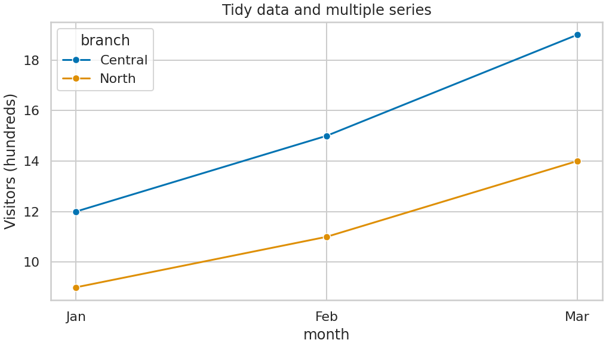

**핵심 코드 해설**

`melt(id_vars=...)`로 월 열을 유지하고 지점명을 `branch`, 수치를 `visitors_hundreds`로 합칩니다. `hue="branch"`는 지점별 계열을 나눕니다.

**해석 및 주의 사항:** Long-form 변환은 시각화용 데이터 구조 변경이지, 원본 데이터 손실을 의미하지 않습니다.


---

<a id="section-4-3"></a>
## 4.3. Semantic Mapping — hue, style, size

### Example 03 — Hue Style Size

**문제 상황**

서비스별 응답시간을 비교하면서 우선순위별 차이도 동시에 보고 싶습니다.

**필요한 개념**

`hue`는 색상, `style`은 표식 모양, `size`는 크기와 연결합니다. 서로 다른 정보를 여러 시각적 속성으로 표현할 수 있지만 한 그래프에 너무 많은 정보를 넣으면 읽기 어려워집니다.

**예제 코드 — [`03_hue_style_size.py`](./examples/03_hue_style_size.py)**

```python
from pathlib import Path
import matplotlib
matplotlib.use("Agg")
import matplotlib.pyplot as plt
import seaborn as sns
import pandas as pd
import numpy as np

ROOT = Path(__file__).resolve().parents[1]
DATA = ROOT / "data"
OUT = ROOT / "figures"
OUT.mkdir(exist_ok=True)
sns.set_theme(style="whitegrid", palette="colorblind")

df = pd.read_csv(DATA / "service_requests.csv").sample(120, random_state=7)
fig, ax = plt.subplots(figsize=(8, 4.6), layout="constrained")
sns.scatterplot(data=df, x="hour", y="response_ms", hue="service", style="priority", s=75, alpha=.7, ax=ax)
ax.set(title="Response time by hour", xlabel="Hour", ylabel="Response time (ms)")
ax.legend(bbox_to_anchor=(1.02, 1), loc="upper left", fontsize=8)
fig.savefig(OUT / "03_hue_style_size.png", dpi=145, bbox_inches="tight")
plt.close(fig)
```

**실행 결과**

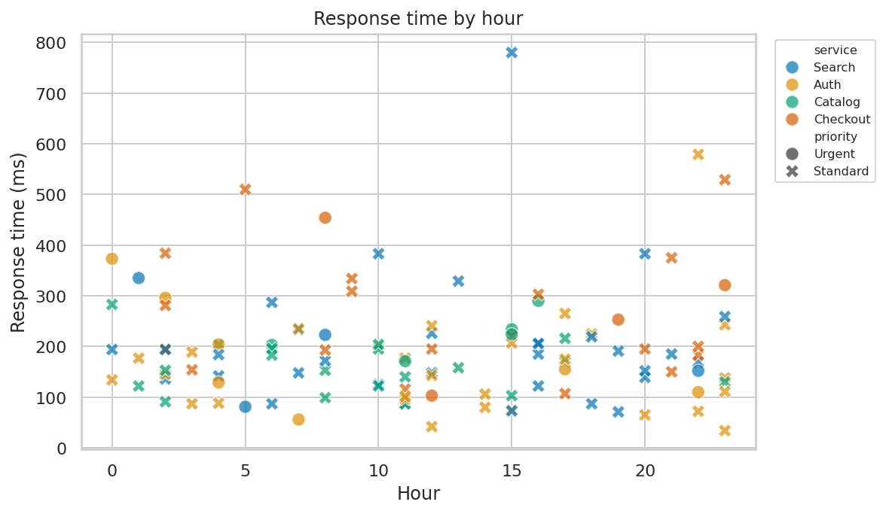

**핵심 코드 해설**

`hue="service"`는 서비스별 색, `style="priority"`는 우선순위별 마커를 나눕니다. `alpha`는 투명도이며 중첩이 심한 산점도에서 도움이 됩니다.

**해석 및 주의 사항:** 이 예제에서 응답시간의 분포와 우선순위는 확인할 수 있지만, 우선순위가 응답시간을 변화시켰다는 인과관계는 확인할 수 없습니다.


---

<a id="section-4-4"></a>
## 4.4. Lineplot — 집계와 관측 단위

### Example 04 — Lineplot Estimator

**문제 상황**

하루 시간대마다 여러 요청이 발생합니다. 이를 서비스별 시간대 평균으로 요약하려고 합니다.

**필요한 개념**

`lineplot()`은 같은 `x`에 여러 `y` 관측값이 있으면 기본적으로 추정 통계량을 계산합니다. 평균이 필요한지, 개별 측정 궤적이 필요한지 구별해야 합니다.

**예제 코드 — [`04_lineplot_estimator.py`](./examples/04_lineplot_estimator.py)**

```python
from pathlib import Path
import matplotlib
matplotlib.use("Agg")
import matplotlib.pyplot as plt
import seaborn as sns
import pandas as pd
import numpy as np

ROOT = Path(__file__).resolve().parents[1]
DATA = ROOT / "data"
OUT = ROOT / "figures"
OUT.mkdir(exist_ok=True)
sns.set_theme(style="whitegrid", palette="colorblind")

df = pd.read_csv(DATA / "service_requests.csv")
fig, ax = plt.subplots(figsize=(8, 4), layout="constrained")
sns.lineplot(data=df, x="hour", y="response_ms", hue="service", estimator="mean", errorbar=None, marker="o", ax=ax)
ax.set(title="Mean latency per hour", xlabel="Hour", ylabel="Mean response (ms)")
fig.savefig(OUT / "04_lineplot_estimator.png", dpi=145)
plt.close(fig)
print("Unique hours:", df.hour.nunique())
```

**실행 결과**

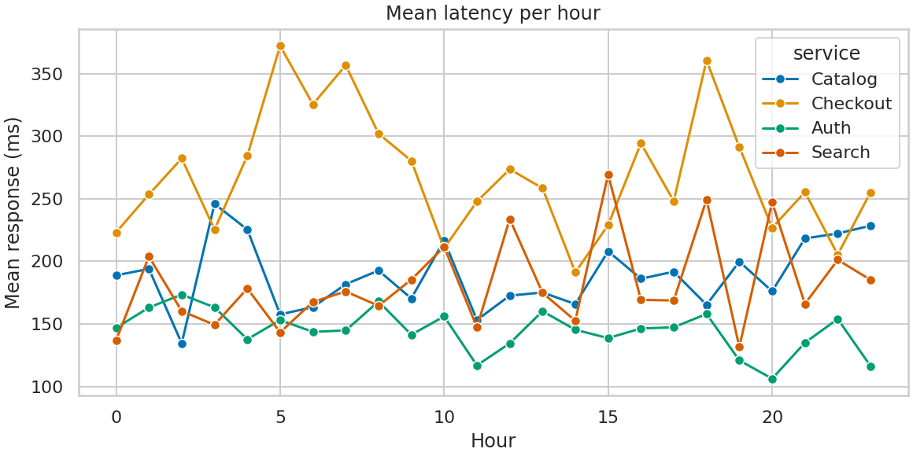

**핵심 코드 해설**

`estimator="mean"`은 같은 시간과 서비스의 평균 응답시간을 계산합니다. `errorbar=None`은 불확실성 표시를 끄는 설정이며, 관측값의 변동이 없다는 뜻은 아닙니다.

**해석 및 주의 사항:** 집계되지 않은 원시 요청을 연결하는 선은 시간순 개별 요청 추이를 의미할 수 있으므로 용도를 분명히 해야 합니다.

<details>
<summary><strong>보충 설명 — 반복 측정값을 원본 그대로 이어 그리면?</strong></summary>

한 시간에 여러 요청이 존재하면 개별 요청이 같은 시각에 겹칩니다. 특정 요청의 연속 측정값이라면 대상 ID와 시각이 유지되는지 확인하고, 평균을 그리는 목적이라면 집계 단위를 명시하세요.

</details>


---

<a id="section-4-5"></a>
## 4.5. Relplot — Figure-level Facets

### Example 05 — Relplot Facets

**문제 상황**

온라인·매장·픽업 주문의 일별 매출을 각각의 작은 그래프로 비교하려고 합니다.

**필요한 개념**

`relplot()`은 Figure-level 함수입니다. `col`로 그룹별 패널(Facet)을 만들고 `kind="line"`처럼 내부 그래프 종류를 지정합니다. 이미 만들어진 `ax`를 전달하는 함수가 아닙니다.

**예제 코드 — [`05_relplot_facets.py`](./examples/05_relplot_facets.py)**

```python
from pathlib import Path
import matplotlib
matplotlib.use("Agg")
import matplotlib.pyplot as plt
import matplotlib.dates as mdates
import seaborn as sns
import pandas as pd
import numpy as np

ROOT = Path(__file__).resolve().parents[1]
DATA = ROOT / "data"
OUT = ROOT / "figures"
OUT.mkdir(exist_ok=True)
sns.set_theme(style="whitegrid", palette="colorblind")

df = pd.read_csv(DATA / "retail_orders.csv").query("status == 'Completed'").copy()
daily = df.groupby(["date", "channel"], as_index=False).revenue_krw.sum()
daily["date"] = pd.to_datetime(daily["date"], format="%Y-%m-%d")
g = sns.relplot(data=daily, x="date", y="revenue_krw", col="channel", kind="line", marker="o", errorbar=None, col_wrap=3, height=3, aspect=1.25)
g.set_axis_labels("Date", "Daily revenue (KRW)")
for ax in g.axes.flat:
    ax.xaxis.set_major_locator(mdates.WeekdayLocator(interval=1))
    ax.xaxis.set_major_formatter(mdates.DateFormatter("%m-%d"))
    ax.tick_params(axis="x", rotation=35, labelsize=8)
g.figure.savefig(OUT / "05_relplot_facets.png", dpi=145, bbox_inches="tight")
plt.close(g.figure)
```

**실행 결과**

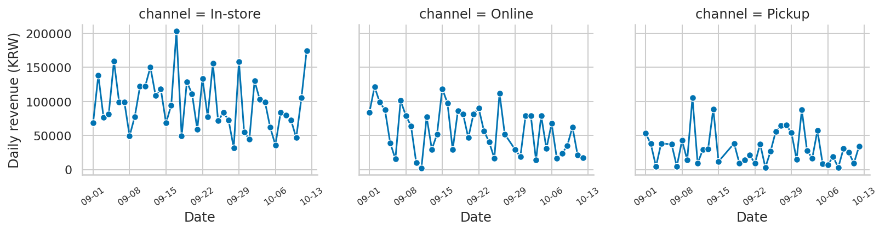

**핵심 코드 해설**

`g = sns.relplot(...)`은 FacetGrid를 반환합니다. 그림 전체는 `g.figure`, 각 그래프 영역은 `g.axes`로 접근합니다.

**해석 및 주의 사항:** 여러 그래프의 축 범위가 서로 다르면 높이 차이만으로 규모를 비교하기 어려워집니다.


---

<a id="section-4-6"></a>
## 4.6. Countplot vs. Barplot — 빈도·평균·합계

### Example 06 — Countplot

**문제 상황**

채널별 전체 주문 수를 확인한 뒤, 완료·반품 상태로 나눈 건수도 표시하려고 합니다.

**필요한 개념**

`countplot()`은 범주별 **관측 행의 개수**를 보여줍니다. `hue`를 추가하면 같은 범주를 다른 하위 그룹으로 구분할 수 있습니다.

**예제 코드 — [`06_countplot.py`](./examples/06_countplot.py)**

```python
from pathlib import Path
import matplotlib
matplotlib.use("Agg")
import matplotlib.pyplot as plt
import seaborn as sns
import pandas as pd
import numpy as np

ROOT = Path(__file__).resolve().parents[1]
DATA = ROOT / "data"
OUT = ROOT / "figures"
OUT.mkdir(exist_ok=True)
sns.set_theme(style="whitegrid", palette="colorblind")

df = pd.read_csv(DATA / "retail_orders.csv")
fig, axes = plt.subplots(1,2,figsize=(10,3.8),layout="constrained")
sns.countplot(data=df,x="channel",color="steelblue",ax=axes[0])
sns.countplot(data=df,x="channel",hue="status",ax=axes[1])
axes[0].set(title="All order lines",ylabel="Count")
axes[1].set(title="Grouped by status",ylabel="Count")
fig.savefig(OUT / "06_countplot.png",dpi=145)
plt.close(fig)
```

**실행 결과**

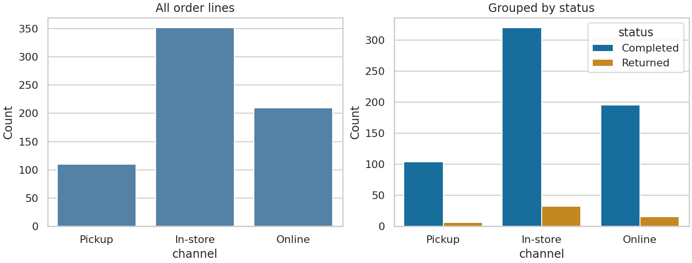

**핵심 코드 해설**

`sns.countplot(data=df, x="channel", hue="status")`는 채널 내 거래 상태별 건수를 셉니다.

**해석 및 주의 사항:** `countplot()`은 주문의 수량이나 매출 합계를 계산하지 않습니다. 한 행이 주문 1건인지 주문 상품 1개인지에 따라서도 해석이 달라집니다.

### Example 07 — Barplot Mean Vs Sum

**문제 상황**

같은 매장 데이터를 바탕으로 주문 한 행의 평균 금액과 전체 매출을 각각 비교하려고 합니다.

**필요한 개념**

`barplot()`은 원본 데이터에 여러 관측값이 있을 때 **기본적으로 평균**을 표시합니다. 총합이 필요하면 `groupby().sum()`으로 먼저 집계하거나 명시적으로 집계 방식을 설정합니다.

**예제 코드 — [`07_barplot_mean_vs_sum.py`](./examples/07_barplot_mean_vs_sum.py)**

```python
from pathlib import Path
import matplotlib
matplotlib.use("Agg")
import matplotlib.pyplot as plt
import seaborn as sns
import pandas as pd
import numpy as np

ROOT = Path(__file__).resolve().parents[1]
DATA = ROOT / "data"
OUT = ROOT / "figures"
OUT.mkdir(exist_ok=True)
sns.set_theme(style="whitegrid", palette="colorblind")

df = pd.read_csv(DATA / "retail_orders.csv").query("status == 'Completed'")
fig, axes = plt.subplots(1,2,figsize=(11,4),layout="constrained")
sns.barplot(data=df,x="branch",y="revenue_krw",estimator="mean",errorbar=None,color="steelblue",ax=axes[0])
total=df.groupby("branch",as_index=False).revenue_krw.sum()
sns.barplot(data=total,x="branch",y="revenue_krw",errorbar=None,color="steelblue",ax=axes[1])
axes[0].set(title="Mean per order line",ylabel="Mean (KRW)")
axes[1].set(title="Total completed revenue",ylabel="Total (KRW)")
fig.savefig(OUT / "07_barplot_mean_vs_sum.png",dpi=145)
plt.close(fig)
```

**실행 결과**

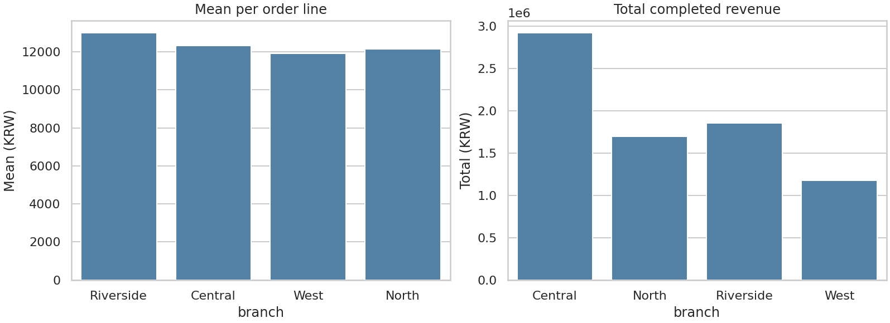

**핵심 코드 해설**

왼쪽은 원본 행의 평균 금액, 오른쪽은 집계된 총매출입니다. 매장별 주문 건수가 다르면 순위도 달라질 수 있습니다.

**해석 및 주의 사항:** `barplot()`으로 그린 모든 막대가 총합이라고 생각하면 잘못된 매출 보고서가 만들어집니다.

<details>
<summary><strong>보충 설명 — 평균과 합계가 다른 이유</strong></summary>

평균 = 매출 합계 ÷ 관측된 주문 행 수입니다. 매장별 주문 행 수가 다르면 매장 평균 순위와 총매출 순위는 달라질 수 있습니다.

</details>


---

<a id="section-4-7"></a>
## 4.7. Boxplot, Violin & Strip — 분포 비교

### Example 08 — Boxplot

**문제 상황**

서비스별 응답시간의 중앙값, 분산 정도, 큰 지연값을 한 그래프에서 비교하려고 합니다.

**필요한 개념**

Boxplot은 중앙값, 제1·제3사분위수, 수염(Whisker), 이상점 등을 표현합니다. 수염은 일반적으로 1.5×IQR 규칙과 연결됩니다.

**예제 코드 — [`08_boxplot.py`](./examples/08_boxplot.py)**

```python
from pathlib import Path
import matplotlib
matplotlib.use("Agg")
import matplotlib.pyplot as plt
import seaborn as sns
import pandas as pd
import numpy as np

ROOT = Path(__file__).resolve().parents[1]
DATA = ROOT / "data"
OUT = ROOT / "figures"
OUT.mkdir(exist_ok=True)
sns.set_theme(style="whitegrid", palette="colorblind")

df = pd.read_csv(DATA / "service_requests.csv")
fig, ax = plt.subplots(figsize=(7.5,4.2),layout="constrained")
sns.boxplot(data=df,x="service",y="response_ms",color="lightblue",ax=ax)
ax.set(title="Latency spread by service",ylabel="Response time (ms)")
fig.savefig(OUT/"08_boxplot.png",dpi=145)
plt.close(fig)
```

**실행 결과**

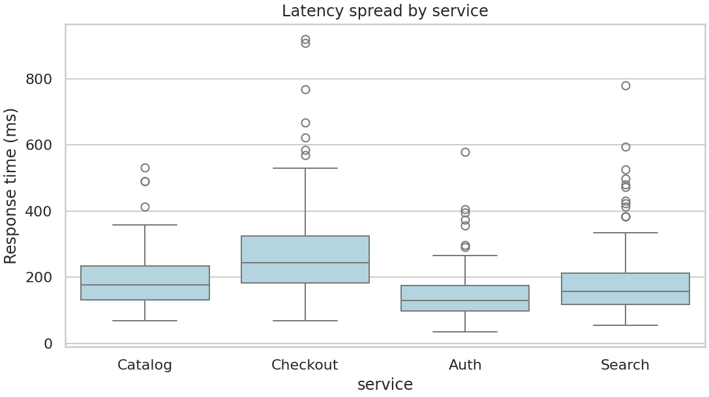

**핵심 코드 해설**

`sns.boxplot()`은 범주별 분포의 요약을 자동 생성합니다. 점으로 표시되는 이상 관측값은 반드시 잘못된 데이터라는 뜻이 아닙니다.

**해석 및 주의 사항:** 응답시간처럼 오른쪽 꼬리가 긴 데이터에서는 평균 하나보다 분포 전체를 확인하는 편이 유용합니다.

### Example 09 — Violin And Strip

**문제 상황**

응답시간 분포의 전체적인 모양과 실제 관측점을 모두 보고 싶습니다.

**필요한 개념**

`violinplot()`은 커널 밀도 추정으로 분포 모양을 부드럽게 표현하고, `stripplot()`은 개별 점을 나타냅니다. `jitter`는 점이 겹치는 문제를 줄여줍니다.

**예제 코드 — [`09_violin_and_strip.py`](./examples/09_violin_and_strip.py)**

```python
from pathlib import Path
import matplotlib
matplotlib.use("Agg")
import matplotlib.pyplot as plt
import seaborn as sns
import pandas as pd
import numpy as np

ROOT = Path(__file__).resolve().parents[1]
DATA = ROOT / "data"
OUT = ROOT / "figures"
OUT.mkdir(exist_ok=True)
sns.set_theme(style="whitegrid", palette="colorblind")

df = pd.read_csv(DATA / "service_requests.csv")
sample = df.sample(110,random_state=12)
fig,axes=plt.subplots(1,2,figsize=(11,4),layout="constrained")
sns.violinplot(data=df,x="service",y="response_ms",inner="quart",cut=0,color="lightblue",ax=axes[0])
sns.stripplot(data=sample,x="service",y="response_ms",jitter=.22,alpha=.45,size=3,color="black",ax=axes[1])
axes[0].set(title="Violin: smoothed distribution")
axes[1].set(title="Strip: 110 observed points")
fig.savefig(OUT/"09_violin_and_strip.png",dpi=145)
plt.close(fig)
```

**실행 결과**

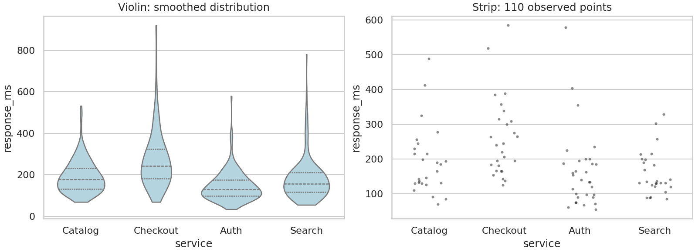

**핵심 코드 해설**

`inner="quart"`는 바이올린 안에 사분위선이 그려지도록 합니다. `cut=0`은 밀도 추정의 표시 범위를 관측값 끝에 맞춥니다.

**해석 및 주의 사항:** 분포가 적은 관측치로 구성되었다면 KDE 기반 바이올린 모양이 실제 관측보다 과하게 매끈해 보일 수 있습니다.


---

<a id="section-4-8"></a>
## 4.8. Histplot — 분포의 구간 설정

### Example 10 — Histplot Bins

**문제 상황**

동일한 응답시간 기록을 히스토그램으로 표현할 때 구간 개수가 결과 해석에 어떤 영향을 주는지 확인하려고 합니다.

**필요한 개념**

`histplot()`은 관측값을 구간(Bin)에 나누고 구간별 빈도를 표시합니다. 구간 수를 바꾸면 분포의 모양과 세부 패턴이 달라 보일 수 있습니다.

**예제 코드 — [`10_histplot_bins.py`](./examples/10_histplot_bins.py)**

```python
from pathlib import Path
import matplotlib
matplotlib.use("Agg")
import matplotlib.pyplot as plt
import seaborn as sns
import pandas as pd
import numpy as np

ROOT = Path(__file__).resolve().parents[1]
DATA = ROOT / "data"
OUT = ROOT / "figures"
OUT.mkdir(exist_ok=True)
sns.set_theme(style="whitegrid", palette="colorblind")

df=pd.read_csv(DATA/"service_requests.csv")
fig,axes=plt.subplots(1,2,figsize=(11,4),layout="constrained")
sns.histplot(data=df,x="response_ms",bins=10,color="steelblue",ax=axes[0])
sns.histplot(data=df,x="response_ms",bins=35,color="steelblue",ax=axes[1])
axes[0].set(title="10 bins",xlabel="Response (ms)")
axes[1].set(title="35 bins",xlabel="Response (ms)")
fig.savefig(OUT/"10_histplot_bins.png",dpi=145)
plt.close(fig)
```

**실행 결과**

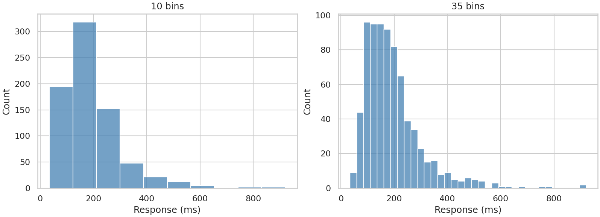

**핵심 코드 해설**

왼쪽은 `bins=10`, 오른쪽은 `bins=35`입니다. 둘 다 같은 원본 데이터를 사용하지만 막대 경계와 높이가 달라집니다.

**해석 및 주의 사항:** 히스토그램의 막대 높이는 각 구간에 포함된 관측 건수입니다. 서로 다른 표본의 히스토그램은 `stat`을 고려해야 공정하게 비교할 수 있습니다.


---

<a id="section-4-9"></a>
## 4.9. KDE & ECDF — 밀도와 누적 비율

### Example 11 — Kde Ecdf

**문제 상황**

우선순위별 응답시간 분포와 특정 지연시간 이내로 처리된 요청의 비율을 함께 확인하려고 합니다.

**필요한 개념**

KDE는 관측 분포를 부드러운 밀도 곡선으로 추정합니다. ECDF는 관측값을 기준으로 누적 비율을 계산합니다. 둘은 동일한 정보를 다른 형태로 보여줍니다.

**예제 코드 — [`11_kde_ecdf.py`](./examples/11_kde_ecdf.py)**

```python
from pathlib import Path
import matplotlib
matplotlib.use("Agg")
import matplotlib.pyplot as plt
import seaborn as sns
import pandas as pd
import numpy as np

ROOT = Path(__file__).resolve().parents[1]
DATA = ROOT / "data"
OUT = ROOT / "figures"
OUT.mkdir(exist_ok=True)
sns.set_theme(style="whitegrid", palette="colorblind")

df=pd.read_csv(DATA/"service_requests.csv")
fig,axes=plt.subplots(1,2,figsize=(11,4),layout="constrained")
sns.kdeplot(data=df,x="response_ms",hue="priority",common_norm=False,cut=0,ax=axes[0])
sns.ecdfplot(data=df,x="response_ms",hue="priority",ax=axes[1])
axes[0].set(title="Smoothed KDE (not exact counts)")
axes[1].set(title="Empirical cumulative share",ylabel="Cumulative proportion")
fig.savefig(OUT/"11_kde_ecdf.png",dpi=145)
plt.close(fig)
```

**실행 결과**

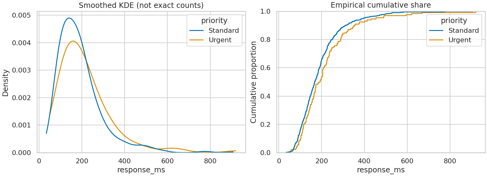

**핵심 코드 해설**

`kdeplot()`은 밀도 추정, `ecdfplot()`은 누적 비율입니다. 예를 들어 ECDF의 `x=500`에서 y값은 500ms 이하인 요청 비율을 뜻합니다.

**해석 및 주의 사항:** KDE는 실제 데이터의 개별 횟수가 아니며, 분포의 꼬리와 좁은 표본 구간에서는 주의가 필요합니다.

<details>
<summary><strong>보충 설명 — ECDF와 백분위수</strong></summary>

ECDF는 관측값 이하의 데이터 비율입니다. 95백분위수(P95)는 약 95%의 관측값이 그 수치 이하가 되는 위치이며, 서로 관련은 있지만 읽는 축이 다릅니다.

</details>


---

<a id="section-4-10"></a>
## 4.10. Displot & Catplot — 그룹별 분포

### Example 12 — Displot

**문제 상황**

서비스 요청의 응답시간 분포를 우선순위별 패널로 나누려고 합니다.

**필요한 개념**

`displot()`은 분포 시각화의 Figure-level 함수로, `col`·`row`를 사용해 그룹별 그래프를 생성합니다.

**예제 코드 — [`12_displot.py`](./examples/12_displot.py)**

```python
from pathlib import Path
import matplotlib
matplotlib.use("Agg")
import matplotlib.pyplot as plt
import seaborn as sns
import pandas as pd
import numpy as np

ROOT = Path(__file__).resolve().parents[1]
DATA = ROOT / "data"
OUT = ROOT / "figures"
OUT.mkdir(exist_ok=True)
sns.set_theme(style="whitegrid", palette="colorblind")

df=pd.read_csv(DATA/"service_requests.csv")
g=sns.displot(data=df,x="response_ms",col="priority",bins=22,height=3,aspect=1.4,color="steelblue")
g.set_axis_labels("Response (ms)","Requests")
g.figure.savefig(OUT/"12_displot.png",dpi=145,bbox_inches="tight")
plt.close(g.figure)
```

**실행 결과**

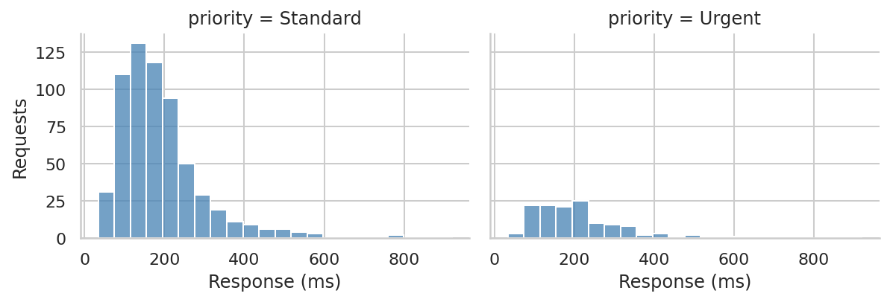

**핵심 코드 해설**

`col="priority"`로 우선순위별 패널을 만들고 `bins`로 구간 수를 지정합니다. 반환된 그리드는 `g.figure`로 저장합니다.

**해석 및 주의 사항:** 단순한 단일 Axes 히스토그램은 `histplot()`, 여러 Facet은 `displot()`이 편리합니다.

### Example 13 — Catplot

**문제 상황**

우선순위별로 서비스를 구분해 응답시간 Boxplot을 동시에 비교하려고 합니다.

**필요한 개념**

`catplot()`은 범주형 시각화의 Figure-level 함수입니다. `kind="box"`, `kind="bar"` 등으로 내부 표현 방식을 선택합니다.

**예제 코드 — [`13_catplot.py`](./examples/13_catplot.py)**

```python
from pathlib import Path
import matplotlib
matplotlib.use("Agg")
import matplotlib.pyplot as plt
import seaborn as sns
import pandas as pd
import numpy as np

ROOT = Path(__file__).resolve().parents[1]
DATA = ROOT / "data"
OUT = ROOT / "figures"
OUT.mkdir(exist_ok=True)
sns.set_theme(style="whitegrid", palette="colorblind")

df=pd.read_csv(DATA/"service_requests.csv")
g=sns.catplot(data=df,x="service",y="response_ms",col="priority",kind="box",height=3.2,aspect=1.35,color="lightblue")
g.set_axis_labels("Service","Response (ms)")
g.figure.savefig(OUT/"13_catplot.png",dpi=145,bbox_inches="tight")
plt.close(g.figure)
```

**실행 결과**

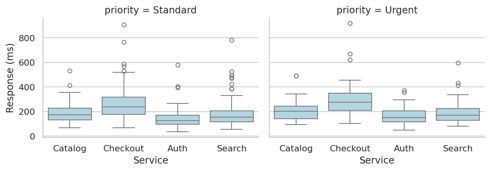

**핵심 코드 해설**

`col="priority"`와 `kind="box"`로 우선순위별 서비스 Boxplot을 배치합니다.

**해석 및 주의 사항:** 서로 다른 패널의 축 범위가 같아야 분포의 크기를 비교하기 쉽습니다.


---

<a id="section-4-11"></a>
## 4.11. Jointplot & Pairplot — 변수 사이의 관계

### Example 14 — Jointplot

**문제 상황**

도서관 방문자가 많은 날 신규 등록자도 많은지 시각적으로 살펴보려고 합니다.

**필요한 개념**

`jointplot()`은 두 변수의 관계 그래프와 각 변수의 주변 분포를 함께 보여줍니다.

**예제 코드 — [`14_jointplot.py`](./examples/14_jointplot.py)**

```python
from pathlib import Path
import matplotlib
matplotlib.use("Agg")
import matplotlib.pyplot as plt
import seaborn as sns
import pandas as pd
import numpy as np

ROOT = Path(__file__).resolve().parents[1]
DATA = ROOT / "data"
OUT = ROOT / "figures"
OUT.mkdir(exist_ok=True)
sns.set_theme(style="whitegrid", palette="colorblind")

df=pd.read_csv(DATA/"library_visits.csv")
g=sns.jointplot(data=df,x="visitors",y="new_members",kind="scatter",height=6,color="teal")
g.figure.suptitle("Visitors and new members",y=1.02)
g.figure.savefig(OUT/"14_jointplot.png",dpi=145,bbox_inches="tight")
plt.close(g.figure)
```

**실행 결과**

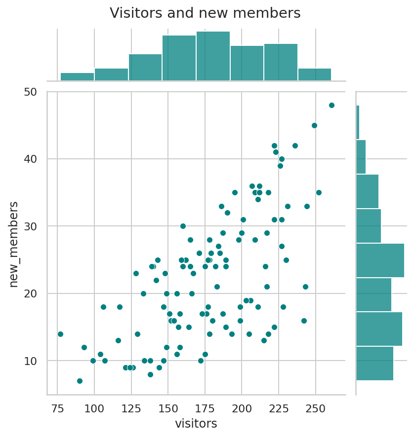

**핵심 코드 해설**

`x="visitors"`, `y="new_members"`가 중심 산점도이며 주변 히스토그램이 각 변수의 분포를 보여줍니다.

**해석 및 주의 사항:** 관계가 보이더라도 원인과 결과를 결정할 수는 없습니다.

### Example 15 — Pairplot

**문제 상황**

도서관 이용량, 신규 등록자, 개관 시간 사이의 여러 관계를 빠르게 탐색하려고 합니다.

**필요한 개념**

`pairplot()`은 여러 변수의 2변수 그래프를 격자로 배열합니다. 탐색 초기에는 편리하지만 변수 수가 늘수록 그래프 수가 빠르게 증가합니다.

**예제 코드 — [`15_pairplot.py`](./examples/15_pairplot.py)**

```python
from pathlib import Path
import matplotlib
matplotlib.use("Agg")
import matplotlib.pyplot as plt
import seaborn as sns
import pandas as pd
import numpy as np

ROOT = Path(__file__).resolve().parents[1]
DATA = ROOT / "data"
OUT = ROOT / "figures"
OUT.mkdir(exist_ok=True)
sns.set_theme(style="whitegrid", palette="colorblind")

df=pd.read_csv(DATA/"library_visits.csv")
g=sns.pairplot(data=df,vars=["visitors","new_members","open_hours"],hue="branch",diag_kind="hist",height=1.9,plot_kws={"alpha":.55,"s":20})
g.figure.savefig(OUT/"15_pairplot.png",dpi=145,bbox_inches="tight")
plt.close(g.figure)
```

**실행 결과**

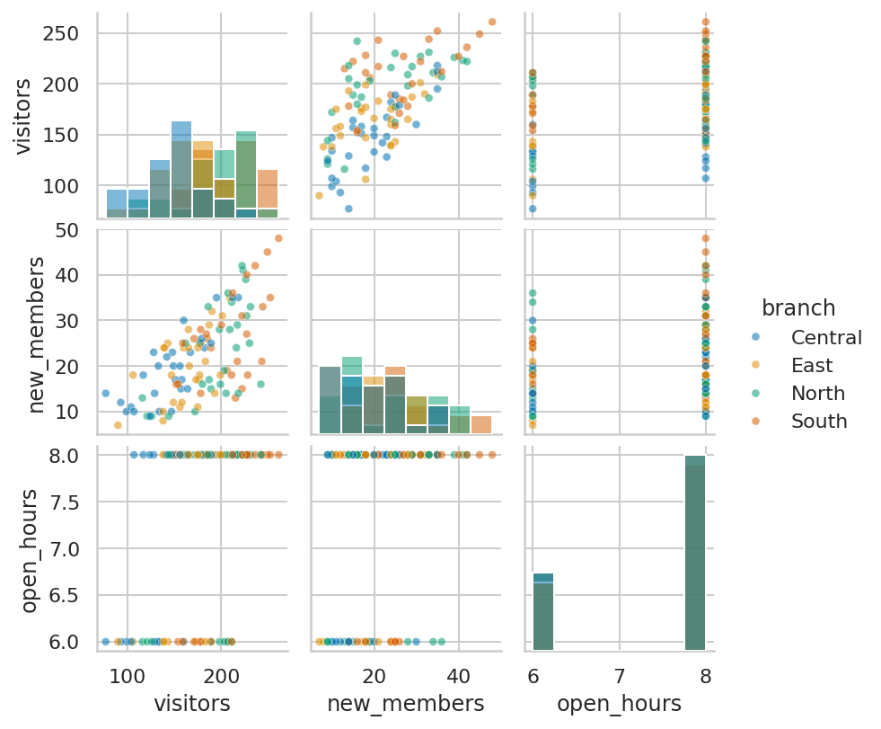

**핵심 코드 해설**

`vars`로 비교할 열만 고르고 `hue="branch"`로 분관을 구분합니다.

**해석 및 주의 사항:** 변수가 많다면 모든 열을 넣기보다 질문에 관련된 소수 열을 골라야 합니다.


---

<a id="section-4-12"></a>
## 4.12. Heatmap — 상관관계와 피벗 데이터

### Example 16 — Heatmap Corr

**문제 상황**

방문자 수와 신규 등록자 수, 개관 시간의 선형 상관관계를 색상으로 요약하려고 합니다.

**필요한 개념**

상관계수는 -1에서 1 사이의 값으로, `heatmap()`을 이용하면 행렬을 색으로 표현할 수 있습니다.

**예제 코드 — [`16_heatmap_corr.py`](./examples/16_heatmap_corr.py)**

```python
from pathlib import Path
import matplotlib
matplotlib.use("Agg")
import matplotlib.pyplot as plt
import seaborn as sns
import pandas as pd
import numpy as np

ROOT = Path(__file__).resolve().parents[1]
DATA = ROOT / "data"
OUT = ROOT / "figures"
OUT.mkdir(exist_ok=True)
sns.set_theme(style="whitegrid", palette="colorblind")

df=pd.read_csv(DATA/"library_visits.csv")
cols=["visitors","new_members","open_hours"]
corr=df[cols].corr(numeric_only=True)
fig,ax=plt.subplots(figsize=(6.5,4.5),layout="constrained")
sns.heatmap(corr,cmap="vlag",vmin=-1,vmax=1,center=0,annot=True,fmt=".2f",square=True,ax=ax)
ax.set(title="Linear correlation (Pearson)")
fig.savefig(OUT/"16_heatmap_corr.png",dpi=145)
plt.close(fig)
```

**실행 결과**

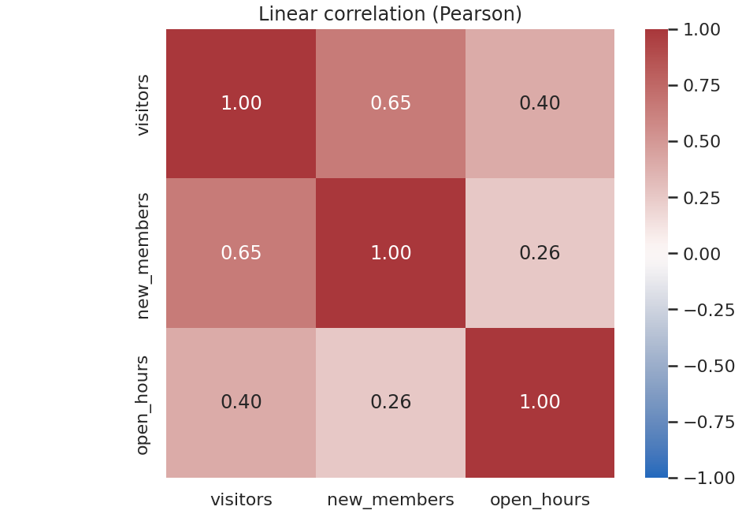

**핵심 코드 해설**

`df[cols].corr()`로 수치형 열의 Pearson 상관계수를 구하고 `vmin=-1`, `vmax=1`, `center=0`으로 비교 가능한 색상 기준을 정합니다.

**해석 및 주의 사항:** 상관관계는 인과관계가 아니며, 범주형 변수는 단순히 `.corr()`로 같은 의미를 갖지 않습니다.

<details>
<summary><strong>보충 설명 — 상관계수 0이 의미하는 것</strong></summary>

Pearson 상관계수 0은 선형 관계가 없다는 뜻에 가깝습니다. 비선형 관계까지 모두 없다고 단정할 수는 없습니다.

</details>

### Example 17 — Heatmap Pivot

**문제 상황**

각 서비스의 시간대별 응답시간을 한 화면에서 확인하려고 합니다.

**필요한 개념**

Heatmap은 2차원 행렬의 각 셀을 색상으로 표현합니다. 원시 데이터가 긴 형식이라면 `pivot_table()`로 행과 열을 구성해야 할 수 있습니다.

**예제 코드 — [`17_heatmap_pivot.py`](./examples/17_heatmap_pivot.py)**

```python
from pathlib import Path
import matplotlib
matplotlib.use("Agg")
import matplotlib.pyplot as plt
import seaborn as sns
import pandas as pd
import numpy as np

ROOT = Path(__file__).resolve().parents[1]
DATA = ROOT / "data"
OUT = ROOT / "figures"
OUT.mkdir(exist_ok=True)
sns.set_theme(style="whitegrid", palette="colorblind")

df=pd.read_csv(DATA/"service_requests.csv")
pivot=df.pivot_table(index="service",columns="hour",values="response_ms",aggfunc="median")
fig,ax=plt.subplots(figsize=(11,4.5),layout="constrained")
sns.heatmap(pivot,cmap="YlGnBu",cbar_kws={"label":"Median response (ms)"},ax=ax)
ax.set(title="Median response by service and hour",xlabel="Hour",ylabel="Service")
fig.savefig(OUT/"17_heatmap_pivot.png",dpi=145)
plt.close(fig)
```

**실행 결과**

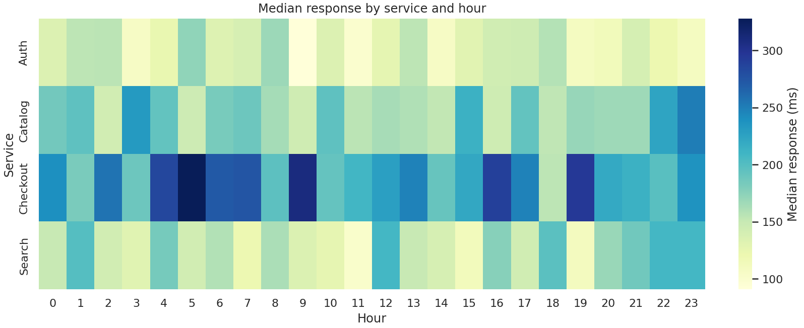

**핵심 코드 해설**

`pivot_table(index="service", columns="hour", values="response_ms", aggfunc="median")`는 서비스 × 시간대별 중앙값을 계산합니다.

**해석 및 주의 사항:** Heatmap 색상은 셀값의 크기를 보여주지만 표본 수가 적은 구간까지 알려주지는 않습니다.


---

<a id="section-4-13"></a>
## 4.13. Color, Order & Legends — 일관된 표현

### Example 18 — Palette Legend

**문제 상황**

매장별 상품 분류의 주문 금액 분포를 채널별로 일관된 색상으로 비교하려고 합니다.

**필요한 개념**

여러 그래프를 함께 비교할 때는 같은 범주에 같은 색상을 사용해야 합니다. Seaborn의 `palette="colorblind"`는 구별 가능한 색상 조합 중 하나입니다.

**예제 코드 — [`18_palette_legend.py`](./examples/18_palette_legend.py)**

```python
from pathlib import Path
import matplotlib
matplotlib.use("Agg")
import matplotlib.pyplot as plt
import seaborn as sns
import pandas as pd
import numpy as np

ROOT = Path(__file__).resolve().parents[1]
DATA = ROOT / "data"
OUT = ROOT / "figures"
OUT.mkdir(exist_ok=True)
sns.set_theme(style="whitegrid", palette="colorblind")

df=pd.read_csv(DATA/"retail_orders.csv").query("status == 'Completed'")
fig,ax=plt.subplots(figsize=(8,4.5),layout="constrained")
sns.boxplot(data=df,x="category",y="revenue_krw",hue="channel",palette="colorblind",ax=ax)
ax.set(title="Consistent channel colors",ylabel="Completed order value (KRW)")
ax.tick_params(axis="x",rotation=25)
ax.legend(title="Channel",bbox_to_anchor=(1.02,1),loc="upper left")
fig.savefig(OUT/"18_palette_legend.png",dpi=145,bbox_inches="tight")
plt.close(fig)
```

**실행 결과**

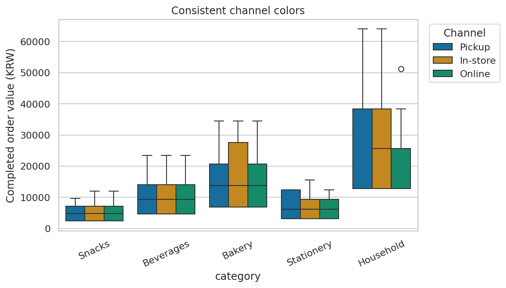

**핵심 코드 해설**

`hue="channel"`과 `palette`를 함께 지정하고, `legend()`로 범례를 그리드 밖에 배치합니다.

**해석 및 주의 사항:** 색상만으로 정보를 구별하기 어려운 상황에서는 범례·선 스타일·레이블 등을 함께 제공합니다.


---

<a id="section-4-14"></a>
## 4.14. Missing Data — 기록 부재와 실제 0 구분

### Example 19 — Missing Values

**문제 상황**

도서관 방문 기록이 없는 날을 포함해 일별 방문자 수 추이를 그리려고 합니다.

**필요한 개념**

시간 흐름 그래프에서 **기록이 없는 날**과 **방문자 수가 0명인 날**은 다릅니다. 예상 날짜 목록을 먼저 만들고 자료가 없는 날은 `NaN`으로 유지해야 합니다.

**예제 코드 — [`19_missing_values.py`](./examples/19_missing_values.py)**

```python
from pathlib import Path
import matplotlib
matplotlib.use("Agg")
import matplotlib.pyplot as plt
import seaborn as sns
import pandas as pd
import numpy as np

ROOT = Path(__file__).resolve().parents[1]
DATA = ROOT / "data"
OUT = ROOT / "figures"
OUT.mkdir(exist_ok=True)
sns.set_theme(style="whitegrid", palette="colorblind")

df=pd.read_csv(DATA/"library_visits.csv",parse_dates=["date"])
days=pd.date_range(df.date.min(),df.date.max(),freq="D")
full=pd.MultiIndex.from_product([sorted(df.branch.unique()),days],names=["branch","date"]).to_frame(index=False)
full=full.merge(df,on=["branch","date"],how="left",validate="one_to_one")
fig,ax=plt.subplots(figsize=(9,4),layout="constrained")
east = full.loc[full.branch.eq("East")].sort_values("date")
sns.scatterplot(data=east, x="date", y="visitors", s=45, ax=ax)
# Matplotlib keeps NaN as a break rather than connecting across the gap.
ax.plot(east["date"], east["visitors"], color="steelblue", linewidth=1.5, alpha=.7)
ax.set(title="Missing record is not zero visitors",ylabel="Observed visitors")
fig.savefig(OUT/"19_missing_values.png",dpi=145)
plt.close(fig)
print("Missing observations:",int(full.visitors.isna().sum()))
```

**실행 결과**

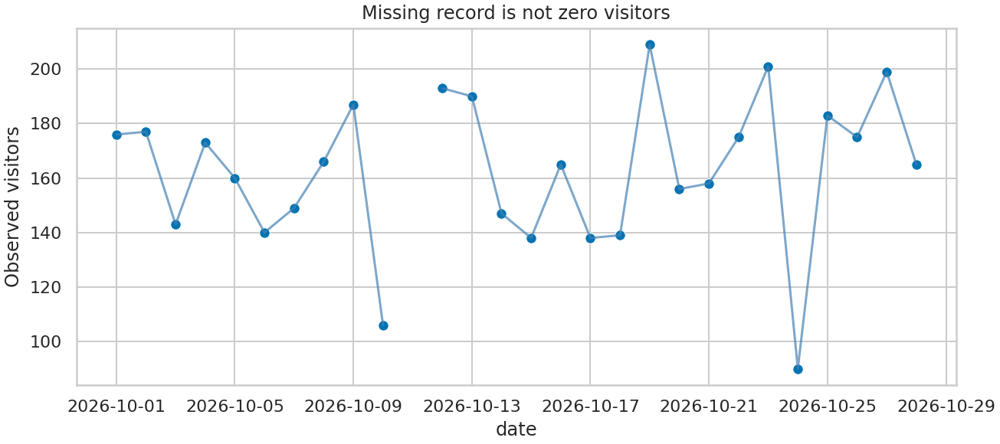

**핵심 코드 해설**

`MultiIndex.from_product()`로 전체 날짜를 만든 뒤 `left merge`합니다. `NaN`은 자동으로 0으로 바꾸지 않습니다. `scatterplot()`은 관측점을 표시하고 Matplotlib의 `ax.plot()`은 누락된 구간에서 선을 끊습니다.

**해석 및 주의 사항:** Seaborn `lineplot()`은 결측 행을 생략하면서 앞뒤 관측점을 직접 이어 보이게 할 수 있습니다. 따라서 누락 구간을 강조하려면 `NaN`을 유지하는 Matplotlib 선과 관측점 레이어를 조합하는 방법을 사용합니다.

<details>
<summary><strong>보충 설명 — 빈 날짜를 연결한 선은 언제 주의해야 하나요?</strong></summary>

날짜 하나가 비어 있는 경우, Seaborn이나 Matplotlib의 처리에 따라 그래프가 앞뒤 점을 연결하는 것처럼 보일 수 있습니다. 연속 관측에 공백이 있다면 누락 지점을 표시하고 수집 상태를 함께 제공하는 것이 안전합니다.

</details>


---

<a id="section-4-15"></a>
## 4.15. Export — Figure-level과 Axes-level 저장

### Example 20 — Save And Close

**문제 상황**

생성한 Seaborn 그래프를 보고서에 사용할 PNG와 편집 가능한 SVG로 저장하려고 합니다.

**필요한 개념**

Axes-level 함수는 Matplotlib의 `fig.savefig()`, Figure-level 함수는 반환 객체의 `g.figure.savefig()`를 사용할 수 있습니다. 다수 그래프를 반복 작성할 때는 `plt.close()`도 중요합니다.

**예제 코드 — [`20_save_and_close.py`](./examples/20_save_and_close.py)**

```python
from pathlib import Path
import matplotlib
matplotlib.use("Agg")
import matplotlib.pyplot as plt
import seaborn as sns
import pandas as pd
import numpy as np

ROOT = Path(__file__).resolve().parents[1]
DATA = ROOT / "data"
OUT = ROOT / "figures"
OUT.mkdir(exist_ok=True)
sns.set_theme(style="whitegrid", palette="colorblind")

df=pd.read_csv(DATA/"service_requests.csv")
fig,ax=plt.subplots(figsize=(7,4),layout="constrained")
sns.histplot(data=df,x="response_ms",bins=22,color="steelblue",ax=ax)
ax.set(title="Saved Seaborn figure",xlabel="Response (ms)")
fig.savefig(OUT/"20_save_and_close.png",dpi=145,bbox_inches="tight")
fig.savefig(OUT/"20_save_and_close.svg",bbox_inches="tight")
plt.close(fig)
print("PNG/SVG saved")
```

**실행 결과**

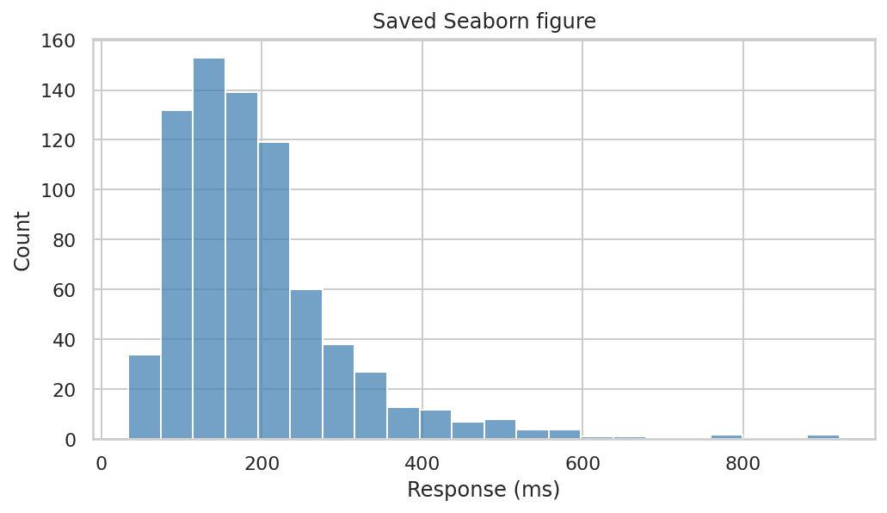

**핵심 코드 해설**

`fig.savefig(..., dpi=145, bbox_inches="tight")`로 파일을 저장하고 `plt.close(fig)`로 Figure를 닫습니다.

**해석 및 주의 사항:** 저장 이미지는 README에서 확인할 수 있도록 `figures/`에 별도 보관하지만 프로젝트 실행 결과는 `output/`에 둡니다.


---

<a id="section-4-16"></a>
## 4.16. Native Scale — 범주형 위치와 실제 좌표

### Example 21 — Native Scale

**문제 상황**

2022년, 2023년, 2025년의 결과를 막대로 표시하면서 중간에 빠진 2024년의 시간 간격이 유지되는지 비교하려고 합니다.

**필요한 개념**

Seaborn의 범주형 그래프는 숫자형 X값도 범주형 위치로 놓을 수 있습니다. `native_scale=True`는 실제 숫자·날짜 간격을 유지하게 합니다.

**예제 코드 — [`21_native_scale.py`](./examples/21_native_scale.py)**

```python
from pathlib import Path
import matplotlib
matplotlib.use("Agg")
import matplotlib.pyplot as plt
import seaborn as sns
import pandas as pd
import numpy as np

ROOT = Path(__file__).resolve().parents[1]
DATA = ROOT / "data"
OUT = ROOT / "figures"
OUT.mkdir(exist_ok=True)
sns.set_theme(style="whitegrid", palette="colorblind")

df=pd.DataFrame({"year":[2022,2023,2025],"sales":[100,130,170]})
fig,axes=plt.subplots(1,2,figsize=(10,4),layout="constrained")
sns.barplot(data=df,x="year",y="sales",color="steelblue",errorbar=None,ax=axes[0])
sns.barplot(data=df,x="year",y="sales",native_scale=True,color="steelblue",errorbar=None,ax=axes[1])
axes[0].set(title="Categorical spacing")
axes[1].set(title="Native numerical spacing")
fig.savefig(OUT/"21_native_scale.png",dpi=145)
plt.close(fig)
```

**실행 결과**

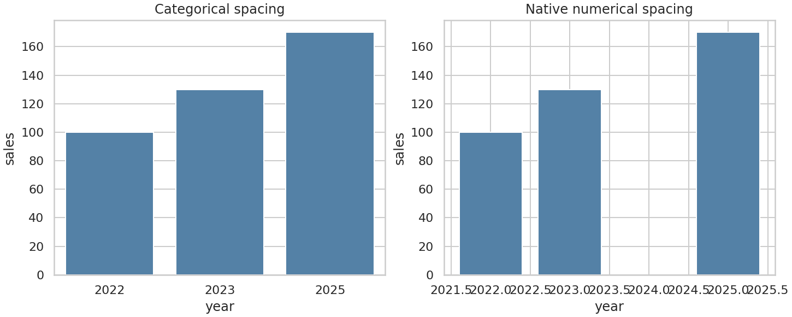

**핵심 코드 해설**

왼쪽 그래프는 순서대로 같은 간격에 배치되고, 오른쪽은 2023년부터 2025년 사이가 두 배 간격으로 표시됩니다.

**해석 및 주의 사항:** 이 예제는 연도 간격의 표현 차이를 보여줍니다. 실제 데이터가 없는 2024년을 0으로 채워서는 안 됩니다.


---

<a id="section-4-17"></a>
## 4.17. Error Bars — CI와 SD의 의미

### Example 22 — Errorbar Intervals

**문제 상황**

서비스별 평균 응답시간 막대에 변동성을 표시하려고 합니다.

**필요한 개념**

`errorbar=("ci", 95)`는 평균 추정의 부트스트랩 신뢰구간을, `errorbar="sd"`는 관측값의 표준편차 범위를 보여줍니다. 두 표현은 의미가 다릅니다.

**예제 코드 — [`22_errorbar_intervals.py`](./examples/22_errorbar_intervals.py)**

```python
from pathlib import Path
import matplotlib
matplotlib.use("Agg")
import matplotlib.pyplot as plt
import seaborn as sns
import pandas as pd
import numpy as np

ROOT = Path(__file__).resolve().parents[1]
DATA = ROOT / "data"
OUT = ROOT / "figures"
OUT.mkdir(exist_ok=True)
sns.set_theme(style="whitegrid", palette="colorblind")

df=pd.read_csv(DATA/"service_requests.csv")
fig,axes=plt.subplots(1,2,figsize=(11,4),layout="constrained")
sns.barplot(data=df,x="service",y="response_ms",estimator="mean",errorbar=("ci",95),seed=7,ax=axes[0],color="steelblue")
sns.barplot(data=df,x="service",y="response_ms",estimator="mean",errorbar="sd",ax=axes[1],color="steelblue")
axes[0].set(title="95% bootstrap CI for mean",ylabel="Response (ms)")
axes[1].set(title="Standard deviation around mean",ylabel="Response (ms)")
fig.savefig(OUT/"22_errorbar_intervals.png",dpi=145)
plt.close(fig)
```

**실행 결과**

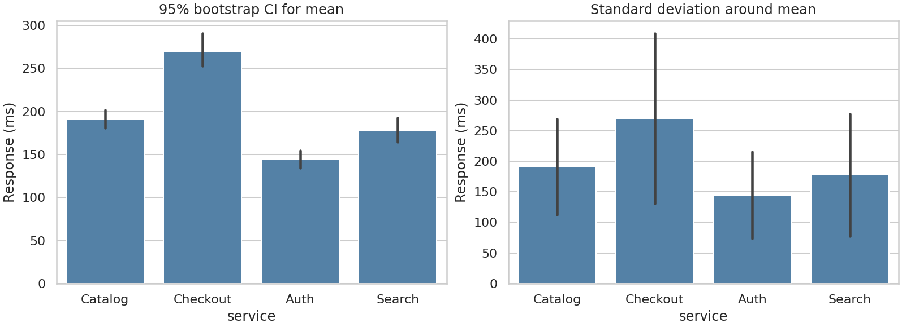

**핵심 코드 해설**

왼쪽은 부트스트랩 95% 신뢰구간(`seed=7`), 오른쪽은 표준편차입니다.

**해석 및 주의 사항:** 신뢰구간이 관측값 95%가 위치한 범위를 의미하지는 않습니다. 표본 간 독립성, 수집 방식 등을 고려해야 합니다.

<details>
<summary><strong>보충 설명 — 신뢰구간과 관측값의 분산은 다릅니다</strong></summary>

평균 신뢰구간은 추정의 불확실성을 다루고, 표준편차는 관측값 간 흩어진 정도를 나타냅니다. 두 그래프가 다른 폭을 갖는 것은 잘못이 아닙니다.

</details>

---

<a id="section-4-18"></a>
## 4.18. Graph Selection & Common Pitfalls

그래프 종류를 외우는 것보다 **데이터의 관측 단위(Grain)**와 보고 싶은 수치를 구별하는 것이 중요합니다.

| 문제 상황 | 추천 그래프 | 확인할 조건 |
|---|---|---|
| 주문 채널별 완료 건수 | Countplot | 한 행이 무엇을 의미하는가? |
| 매장별 총매출 비교 | 집계 후 Barplot | 평균이 아니라 합계가 필요한가? |
| 여러 서비스의 지연시간 분포 | Boxplot / Violinplot | 극단값과 표본 수는 어떤가? |
| 500ms 이하 처리 비율 | ECDF | 기준선과 누적 비율을 같이 읽는가? |
| 변수 사이의 관계 | Scatterplot / Jointplot | 관측 단위가 서로 일치하는가? |
| 범주 × 시간대 행렬 | Heatmap | 셀이 평균인지 합계인지 명시했는가? |
| 그룹별 동일한 질문 반복 | Figure-level Facets | 서로 비교할 축 범위가 같은가? |

**대표적인 오류**

1. `barplot()`의 평균을 매출 합계로 오해함.
2. 한 행이 주문 상품인데 `countplot()`을 주문 건수로 표기함.
3. KDE를 실제 건수 그래프로 해석함.
4. 95% 신뢰구간을 관측값 95%의 범위로 설명함.
5. 날짜가 없는 기록을 자동으로 0으로 채움.
6. Facets의 축 범위가 다른데 막대 높이를 그대로 비교함.
7. 색상에만 의존해 중요한 범주를 구분함.
8. 자료를 합산하면서 분모·집계 단위를 생략함.

<details>
<summary><strong>참고 — Seaborn 0.13의 범주형 그래프 변경 사항</strong></summary>

Seaborn 0.13에서는 범주형 그래프의 색상·범주 위치 처리 방식이 달라졌습니다. 기본적으로 각 범주에 서로 다른 색상을 자동 부여하지 않을 수 있으므로, 구분이 필요할 때는 `hue`를 명시합니다. 숫자·날짜의 실제 간격을 유지하려면 `native_scale=True`를 검토합니다.

</details>

---

<a id="section-4-19"></a>
## 4.19. Mini Project 01 — Retail Sales Comparison

**문제 상황**

672개 주문 상품 행을 대상으로 접수 채널·매장·상품 분류별 거래를 비교하는 시각화 보고서를 제작합니다. 매출의 합계와 주문 한 행의 평균 금액을 구별해야 합니다.

**입력 데이터:** [`data/retail_orders.csv`](./data/retail_orders.csv) (세부 열 설명: [DATA_DICTIONARY.md](./data/DATA_DICTIONARY.md))

**구현 요구사항**

1. 원본의 `status`가 `Completed`인 행만 매출 분석에 사용합니다.
2. 일별 완료 매출은 선 그래프로 표시하고 날짜와 단위를 안내합니다.
3. 매장별 총매출은 합계로 집계한 뒤 가로 막대그래프로 표현합니다.
4. 접수 채널별 주문 금액 분포는 Boxplot으로 표현합니다.
5. 상품 분류별 합계와 데이터 기준을 보고서에 표시합니다.
6. 원본 데이터는 변경하지 않고 PNG·CSV·JSON 결과를 저장합니다.

**제공 코드:** [`projects/mini_01_retail/starter.py`](./projects/mini_01_retail/starter.py)

**완료 기준:** 완료 주문 619행 · 매출 합계 7,654,200원 · 매장 4개

**생성 파일:** `retail_report.png`, `daily_revenue.csv`, `summary.json` (`output/` 디렉터리)

**결과 예시**

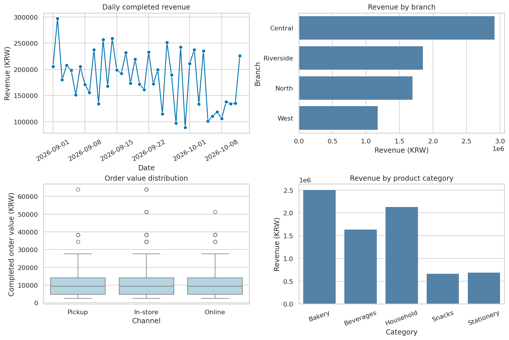

<details>
<summary><strong>구현 힌트 — 확인이 필요한 경우에만 펼치기</strong></summary>

- 데이터의 행 단위와 집계 단위를 먼저 구분합니다.
- `pd.read_csv()`로 입력을 읽고, 시각화 전에 필요한 요약 테이블을 만듭니다.
- 한 페이지에 여러 그래프를 배치할 때는 `fig, axes = plt.subplots(...)`와 `ax=`를 사용합니다.
- 그래프와 집계 결과의 수치가 같은지 직접 비교합니다.
- 완성 코드는 이 README에 포함하지 않았으며, `solutions/mini_projects/`에서 별도로 확인할 수 있습니다.

</details>

---

<a id="section-4-20"></a>
## 4.20. Mini Project 02 — Service Response Time Report

**문제 상황**

서비스 요청 756건의 응답시간을 비교합니다. 평균 한 가지 값만 보는 대신 분포, 95백분위수, 500ms 초과 요청 비율을 함께 보여줍니다.

**입력 데이터:** [`data/service_requests.csv`](./data/service_requests.csv) (세부 열 설명: [DATA_DICTIONARY.md](./data/DATA_DICTIONARY.md))

**구현 요구사항**

1. 서비스별 응답시간 분포를 Boxplot으로 표현합니다.
2. 일반·긴급 요청은 Histplot의 `hue`로 구분합니다.
3. 500ms를 초과한 요청 건수와 서비스별 비율을 계산합니다.
4. 서비스별 P95 응답시간과 요청 건수를 비교합니다.
5. 일시적으로 큰 응답시간을 임의로 제거하지 않습니다.
6. 이미지·CSV·JSON을 저장하고 수치의 단위를 표시합니다.

**제공 코드:** [`projects/mini_02_service/starter.py`](./projects/mini_02_service/starter.py)

**완료 기준:** 요청 756건 · 중앙값 170ms · 500ms 초과 15건

**생성 파일:** `service_report.png`, `service_summary.csv`, `summary.json` (`output/` 디렉터리)

**결과 예시**

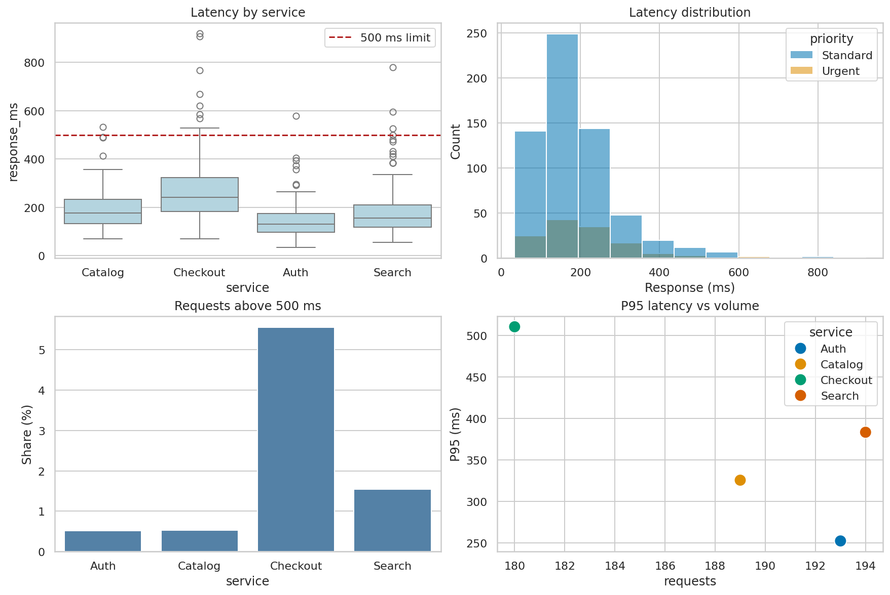

<details>
<summary><strong>구현 힌트 — 확인이 필요한 경우에만 펼치기</strong></summary>

- 데이터의 행 단위와 집계 단위를 먼저 구분합니다.
- `pd.read_csv()`로 입력을 읽고, 시각화 전에 필요한 요약 테이블을 만듭니다.
- 한 페이지에 여러 그래프를 배치할 때는 `fig, axes = plt.subplots(...)`와 `ax=`를 사용합니다.
- 그래프와 집계 결과의 수치가 같은지 직접 비교합니다.
- 완성 코드는 이 README에 포함하지 않았으며, `solutions/mini_projects/`에서 별도로 확인할 수 있습니다.

</details>

---

<a id="section-4-21"></a>
## 4.21. Mini Project 03 — Library Usage Review

**문제 상황**

분관 4곳의 28일간 이용 현황을 비교합니다. 데이터에 하루 기록이 없는 경우 이를 방문자 0명으로 처리하지 않고, 기록 부재임을 구별해야 합니다.

**입력 데이터:** [`data/library_visits.csv`](./data/library_visits.csv) (세부 열 설명: [DATA_DICTIONARY.md](./data/DATA_DICTIONARY.md))

**구현 요구사항**

1. 분관과 날짜의 전체 조합(112개)을 먼저 생성합니다.
2. 원본 기록 110개와 실제 누락 2개를 구별합니다.
3. 분관별 일별 방문자 수를 Facet으로 표현합니다.
4. 관측된 날짜를 기준으로 분관별 평균 방문자 수를 비교합니다.
5. 방문자와 신규 등록자 사이의 관계를 산점도로 나타냅니다.
6. 결과 이미지와 전체 날짜표, 누락 현황 요약을 저장합니다.

**제공 코드:** [`projects/mini_03_library/starter.py`](./projects/mini_03_library/starter.py)

**완료 기준:** 기록 110개 · 예상 112개 · 누락 2개 · 관측 방문자 합계 19,561명

**생성 파일:** `library_facets.png`, `library_summary.png`, `full_calendar.csv`, `summary.json` (`output/` 디렉터리)

**결과 예시**

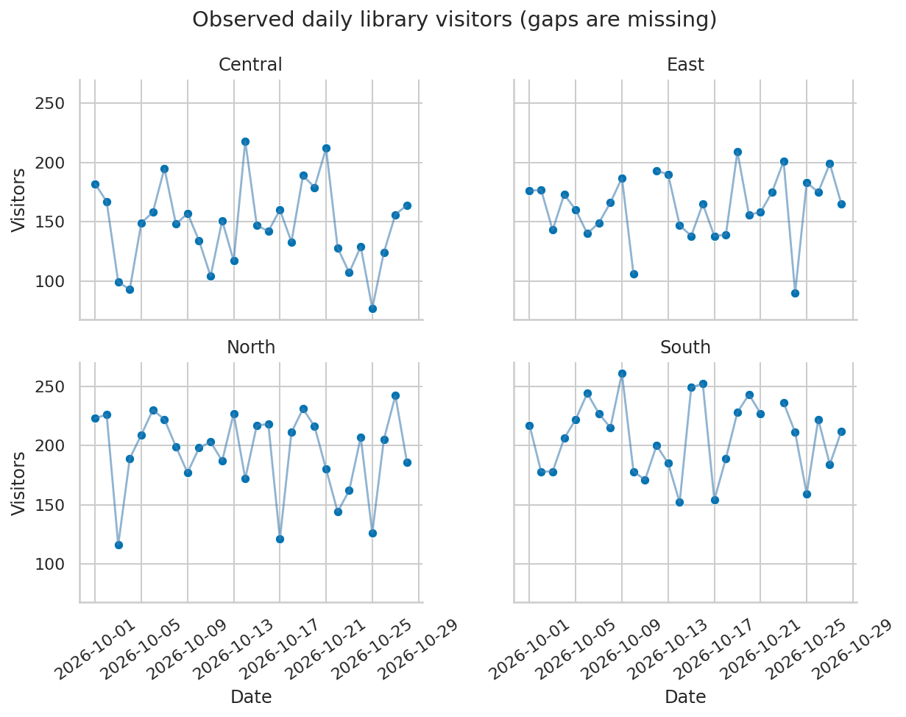

<details>
<summary><strong>구현 힌트 — 확인이 필요한 경우에만 펼치기</strong></summary>

- 데이터의 행 단위와 집계 단위를 먼저 구분합니다.
- `pd.read_csv()`로 입력을 읽고, 시각화 전에 필요한 요약 테이블을 만듭니다.
- 한 페이지에 여러 그래프를 배치할 때는 `fig, axes = plt.subplots(...)`와 `ax=`를 사용합니다.
- 그래프와 집계 결과의 수치가 같은지 직접 비교합니다.
- 완성 코드는 이 README에 포함하지 않았으며, `solutions/mini_projects/`에서 별도로 확인할 수 있습니다.

</details>

---

<a id="section-4-22"></a>
## 4.22. Coding Practice — 18 Exercises

문제는 **부분 완성 코드**로 제공됩니다. 문제 파일의 `TODO`를 확인해 코드 한 줄 또는 필요한 구성을 구현한 뒤 실행하세요. 이미 작성된 자료 경로·Figure 생성 부분을 그대로 활용할 수 있습니다. 정답은 README에 공개하지 않습니다.

| No. | 문제 | 핵심 학습 | 시작 코드 |
|:---:|---|---|---|

| 01 | 완료 주문 채널별 빈도 | `countplot()` | [`01_count_channels.py`](./exercises/01_count_channels.py) |
| 02 | Long-form 데이터의 계열 | `lineplot()`과 `hue` | [`02_tidy_line.py`](./exercises/02_tidy_line.py) |
| 03 | 서비스·우선순위 동시 표현 | `scatterplot()`과 `style` | [`03_scatter_legend.py`](./exercises/03_scatter_legend.py) |
| 04 | 시간대별 평균 | `estimator` | [`04_hour_mean.py`](./exercises/04_hour_mean.py) |
| 05 | 채널별 매출 Facet | `relplot()` | [`05_faceted_channels.py`](./exercises/05_faceted_channels.py) |
| 06 | 거래 상태별 빈도 | `countplot()`과 `hue` | [`06_grouped_counts.py`](./exercises/06_grouped_counts.py) |
| 07 | 평균과 합계 구별 | `groupby().sum()` | [`07_sum_not_mean.py`](./exercises/07_sum_not_mean.py) |
| 08 | 응답시간 분포 비교 | `boxplot()` | [`08_boxplot_groups.py`](./exercises/08_boxplot_groups.py) |
| 09 | 개별 관측점 표현 | `stripplot()` | [`09_strip_jitter.py`](./exercises/09_strip_jitter.py) |
| 10 | 히스토그램 구간 선택 | `bins` | [`10_histogram_bins.py`](./exercises/10_histogram_bins.py) |
| 11 | 누적 비율 | `ecdfplot()` | [`11_ecdf_share.py`](./exercises/11_ecdf_share.py) |
| 12 | 그룹별 분포 패널 | `displot()` | [`12_distribution_facets.py`](./exercises/12_distribution_facets.py) |
| 13 | 우선순위별 Boxplot | `catplot()` | [`13_catplot_boxes.py`](./exercises/13_catplot_boxes.py) |
| 14 | 다변수 관계 탐색 | `pairplot()` | [`14_pairplot_fields.py`](./exercises/14_pairplot_fields.py) |
| 15 | 상관행렬 색상 범위 | `heatmap()` | [`15_correlation_heatmap.py`](./exercises/15_correlation_heatmap.py) |
| 16 | 누락 날짜 보존 | `left merge` | [`16_missing_is_nan.py`](./exercises/16_missing_is_nan.py) |
| 17 | 실제 숫자 간격 표현 | `native_scale` | [`17_native_scale.py`](./exercises/17_native_scale.py) |
| 18 | 변동성 표시 비교 | `errorbar` | [`18_bootstrap_vs_sd.py`](./exercises/18_bootstrap_vs_sd.py) |

### 부분 완성 문제 예시

**문제 상황:** 서비스 요청의 시간대별 평균 응답시간을 나타내려고 합니다. 이미 DataFrame과 Axes가 준비되어 있으므로 `sns.lineplot()`에 적절한 매개변수를 작성하세요.

```python
# 자료 로드 및 Figure 생성은 작성된 상태입니다.

# TODO: 시간(hour)별 응답시간(response_ms)의 평균을
#       서비스별 색상으로 구분하여 표시합니다.
#       신뢰구간은 이 예제에서 생략합니다.

fig.savefig("output.png")
```

이러한 형태로 **수정할 위치와 요구사항**을 제시합니다. 필요하면 `exercises/README.md`에서 실행 방법을 확인하세요.

```bash
python exercises/04_hour_mean.py
```

위 파일은 TODO 부분을 완성하기 전에는 `NotImplementedError`를 발생시킵니다. 정답 파일은 `solutions/practice/`에 분리했습니다.

### 학습 팁

- 코드를 완성한 뒤 예상 그래프 구조를 먼저 설명해 봅니다.
- 생성한 이미지에서 범례·단위·축의 의미가 맞는지 점검합니다.
- 같은 데이터로 다른 통계량을 표현했을 때 결과가 어떻게 달라지는지 확인합니다.
- 학습 중 완성 코드를 참고하더라도 다시 직접 입력하고 설명할 수 있어야 합니다.

---

<a id="section-4-23"></a>
## 4.23. Advanced Project 01 — Public Bicycle Demand Report Generator

이 과제는 **선택적 심화 문제**입니다. 서울 시내 공공자전거 대여소 여러 곳의 시간대별 수요를 비교하는 자동 보고서를 작성합니다. 데이터 수집 시스템에서 일부 시간대의 집계가 누락될 수 있으므로, 단순 합계를 넘어 **집계 가능 여부와 실제 이용 0건을 구별**해야 합니다.

**데이터:** 교육용 가상 대여소 6곳, 관측 기간 21일, 하루 3개 시간대. 대여소 이름과 이용 수치는 실제 통계가 아닙니다.

| 파일 | 용도 | 단위 |
|---|---|---|
| [`bike_trips.csv`](./data/bike_trips.csv) | 개별 이용 기록 | 1행 = 이용 1건 |
| [`bike_stations.csv`](./data/bike_stations.csv) | 대여소 ID·지역 기준표 | 1행 = 대여소 1곳 |
| [`bike_reporting.csv`](./data/bike_reporting.csv) | 수집 가능 여부 | 1행 = 날짜 × 대여소 × 시간대 |

### 문제 상황

대여소별 시간대 수요를 비교하는 보고서를 작성해야 합니다. 특정 대여소는 관측 장비 오류로 일부 시간대의 집계가 누락되었습니다. 이용 기록이 없는 시간이 실제 0건인지, 관측 자체가 불가능했는지 구분해야 합니다. 또한 보고서에서 선택하는 대여소 개수가 달라져도 레이아웃이 정상적으로 만들어져야 합니다.

### 필수 요구사항

1. **입력 및 스키마 검증:** 대여소 ID 고유성, 필수 열, 날짜와 시간대, 집계 가능 여부 값 확인.
2. **유효 기록 분리:** 중복 이용 ID, 미등록 대여소, 음수·과도한 이용시간, 잘못된 날짜·시간대·집계 불가 슬롯에 속한 이용 기록 제외.
3. **커버리지 관리:** 유효한 슬롯과 집계 누락 슬롯을 분리. 집계가 정상적으로 이루어진 슬롯에서 이용 기록이 없을 때만 0건으로 처리.
4. **시간대별 비교:** 대여소 × 시간대별 평균 이용 건수를 Heatmap으로 표현. 평균의 분모는 집계된 슬롯 수.
5. **동적 Facets:** 선택한 대여소 수가 1개, 3개, 6개일 때도 패널이 잘리거나 겹치지 않을 것.
6. **분포 분석:** 이용시간 분포와 대여소별 총이용 건수를 서로 다른 그래프로 표현.
7. **품질 보고:** 입력 행, 정상·제외 행, 대여소별 집계 커버리지를 CSV·JSON으로 저장.
8. **예외 처리:** 존재하지 않는 대여소 ID를 요청하면 오류를 반환. 누락 상태를 조용히 0으로 바꾸지 않을 것.
9. **그래프 출력:** PNG 보고서 3종, CSV 요약표, 제외 기록, JSON 결과를 `output/`에 저장.
10. **결과 검증:** 기본 데이터와 일부 대여소만 선택한 경우 모두 확인.

**문제 제공 파일:** [`projects/advanced_01_bike/starter.py`](./projects/advanced_01_bike/starter.py)

**기본 데이터 기대값:** 원본 이용 기록 6,824행 · 검증 통과 6,819행 · 제외 5행 · 예정 슬롯 378개 · 실제 집계 슬롯 362개 · 집계 누락 16개

**예상 결과 예시**

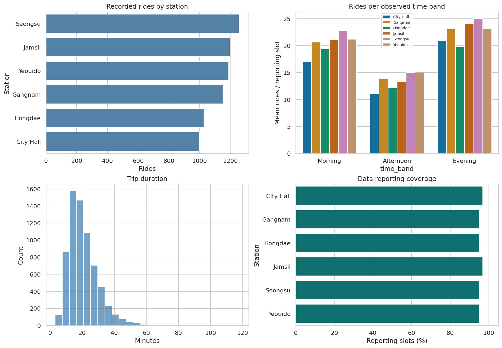

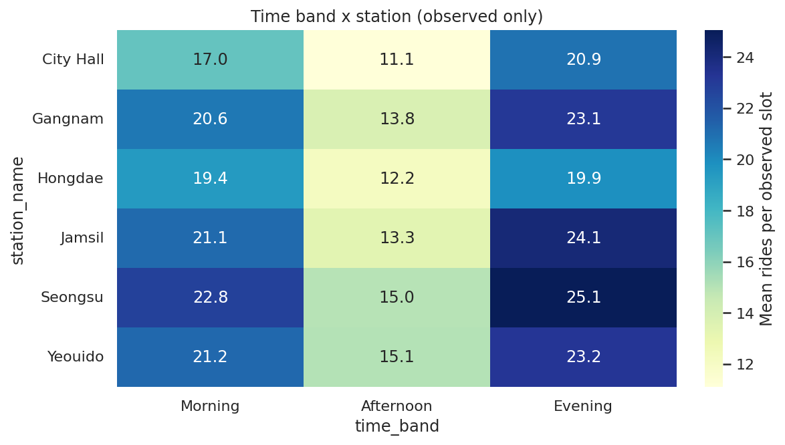

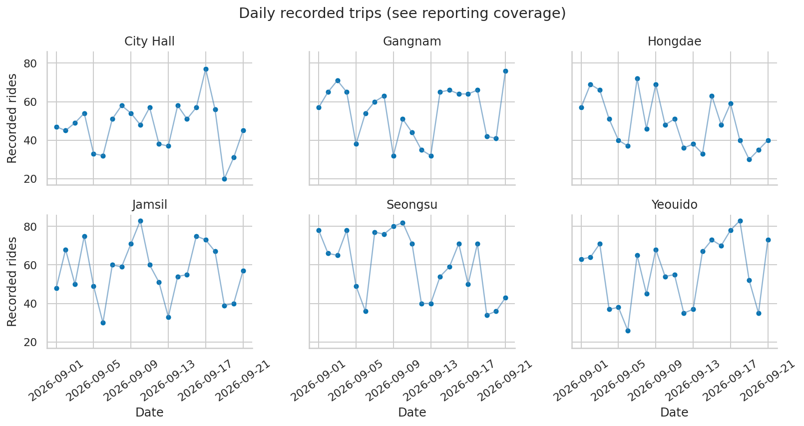

### 단계별 힌트

<details>
<summary><strong>Hint 01 — 데이터 단위를 먼저 확인하기</strong></summary>

개별 이용 데이터는 1행이 이용 1건입니다. 커버리지 데이터는 1행이 날짜 × 대여소 × 시간대 1슬롯입니다. 두 데이터를 같은 의미의 행으로 직접 더해서는 안 됩니다.

</details>

<details>
<summary><strong>Hint 02 — 누락 슬롯을 보존하기</strong></summary>

유효 이용 기록을 슬롯별로 집계한 뒤 **커버리지 테이블을 기준으로 결합**해 보세요. `reporting=0`인 슬롯을 이용 건수 0으로 취급하면 평균 수요가 과소평가될 수 있습니다.

</details>

<details>
<summary><strong>Hint 03 — 다중 패널의 개수 변화에 대응하기</strong></summary>

`relplot(..., col="station_name", col_wrap=3)`처럼 그룹 수에 따라 패널을 생성할 수 있습니다. 고정된 `plt.subplots(2, 3)`를 쓰는 경우 선택 대여소 수가 달라졌을 때 빈 패널을 처리해야 합니다.

</details>

<details>
<summary><strong>Hint 04 — 검증과 출력 분리</strong></summary>

입력 로드, 유효 기록 판정, 슬롯 구성, 통계 요약, 그래프 저장을 함수로 나누면 데이터 조건 변경에 대응하기 쉽습니다. 유효 기록 개수와 Heatmap의 수치가 일치하는지 검증하세요.

</details>

**정답 안내:** README에 완성 코드가 나타나지 않습니다. 충분히 구현한 뒤 `solutions/advanced_projects/advanced_01_bike.py` 및 `EXPLANATION.md`를 별도로 열어 비교하세요. 유일한 정답은 아니며 데이터 검증과 시각화 조건을 모두 충족하면 다른 구조도 가능합니다.

---

<a id="section-4-24"></a>
## 4.24. Quiz — Visual Code Reading & Completion

Quiz는 단순 암기보다 **코드가 생성하는 결과를 예상하고 자주 헷갈리는 개념을 구별하는 능력**에 초점을 맞춥니다. 비슷한 그래프 네 개를 제시하는 문항은 실제 Seaborn 코드로 선택지 이미지를 각각 생성했습니다. 정답은 문항별로 접어서 제공하며, 필요한 경우 코드를 함께 설명합니다.

### Q01. Seaborn과 Matplotlib의 역할

여러 그래프를 한 Figure에 배치하면서 Seaborn의 Boxplot을 그리려면 어떤 호출 방식이 적절합니까?

A. `sns.boxplot(..., ax=axes[0])`  B. `sns.boxplot(..., fig=fig)`  C. `sns.displot(..., ax=axes[0])`  D. `plt.boxplot(..., hue="group")`

<details>
<summary><strong>Q01. 정답 및 해설 확인</strong></summary>

**정답: A**

Seaborn의 Axes-level 함수는 `ax=`로 대상 그래프 영역을 지정합니다. `displot()`은 Figure-level 함수이므로 기존 Axes에 배치하는 용도가 아닙니다.

**확인 코드**

```python
fig, axes = plt.subplots(1, 2)
sns.boxplot(data=df, x="group", y="value", ax=axes[0])
```

</details>

### Q02. Figure-level 객체를 저장하려면?

`g = sns.relplot(data=df, x="day", y="value", col="branch")` 실행 후 그래프를 저장할 올바른 코드는?

A. `g.savefig("result.png")`  B. `g.figure.savefig("result.png")`  C. `g.ax.savefig("result.png")`  D. `sns.savefig("result.png")`

<details>
<summary><strong>Q02. 정답 및 해설 확인</strong></summary>

**정답: B**

`relplot()`의 결과는 FacetGrid 객체입니다. 실제 Figure는 `.figure`에 보관되므로 `g.figure.savefig()`로 저장합니다. `Axes`는 파일 저장 메서드가 아닙니다.

**확인 코드**

```python
g = sns.relplot(data=df, x="day", y="value", col="branch")
g.figure.savefig("result.png", dpi=150)
plt.close(g.figure)
```

</details>

### Q03. Wide에서 Long-form으로 변환

월별 지점 방문자 데이터 `month`, `Central`, `North` 열이 있습니다. Seaborn의 `hue="branch"`를 사용하려면 어떤 코드가 적절합니까?

A. `df.pivot(index="month", columns="Central")`  B. `df.drop(columns="month")`  C. `df.melt(id_vars="month", var_name="branch", value_name="visits")`  D. `df.groupby("month").size()`

<details>
<summary><strong>Q03. 정답 및 해설 확인</strong></summary>

**정답: C**

`melt()`는 지점 이름을 `branch` 열로, 측정값을 `visits` 열로 변환합니다. 월은 유지하므로 `id_vars="month"`를 사용합니다.

**확인 코드**

```python
long_df = df.melt(id_vars="month", var_name="branch", value_name="visits")
sns.lineplot(data=long_df, x="month", y="visits", hue="branch")
```

</details>

### Q04. 색상과 표식으로 두 변수 구별

요청의 `service`와 `priority`를 동시에 구별하려고 합니다. 색상은 서비스, 표식 모양은 우선순위를 나타내야 합니다. 필요한 두 매개변수는?

`sns.scatterplot(data=df, x="hour", y="response_ms", ... )`의 생략된 부분을 답하세요.

<details>
<summary><strong>Q04. 정답 및 해설 확인</strong></summary>

**정답: `hue="service", style="priority"`**

`hue`는 색상으로, `style`은 마커 모양으로 그룹을 표현합니다. 하나의 속성에 너무 많은 범주를 부여하지 않도록 주의합니다.

**확인 코드**

```python
sns.scatterplot(data=df, x="hour", y="response_ms",
                hue="service", style="priority")
```

</details>

### Q05. Barplot의 실행 결과 선택

다음 코드를 실행했을 때 생성되는 그래프는 A–D 중 무엇입니까? 네 선택지는 모두 막대그래프이지만 막대의 위치·높이 또는 오차막대 표현이 다릅니다.

```python
order = ["Auth", "Search", "Catalog", "Checkout"]
sns.barplot(data=df, x="service", y="response_ms", estimator="median",
            errorbar=None, order=order, color="steelblue", ax=ax)
```

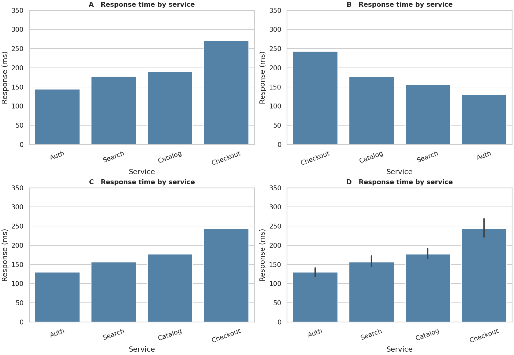

<details>
<summary><strong>Q05. 정답 및 해설 확인</strong></summary>

**정답: C**

`estimator="median"`으로 중앙값을 표시하고, `order`에 명시한 순서로 범주를 배치하며, `errorbar=None`이므로 오차막대가 없습니다. A는 평균, B는 역순, D는 오차막대가 추가된 형태입니다.

**확인 코드**

```python
sns.barplot(data=df, x="service", y="response_ms",
            estimator="median", errorbar=None,
            order=["Auth", "Search", "Catalog", "Checkout"], ax=ax)
```

</details>

### Q06. 히스토그램 구간 수 판별

같은 요청 데이터를 다음 코드로 표현했습니다. 모든 선택지는 Histplot이며 구간 수만 다릅니다.

```python
sns.histplot(data=df, x="response_ms", bins=12, color="steelblue", ax=ax)
```

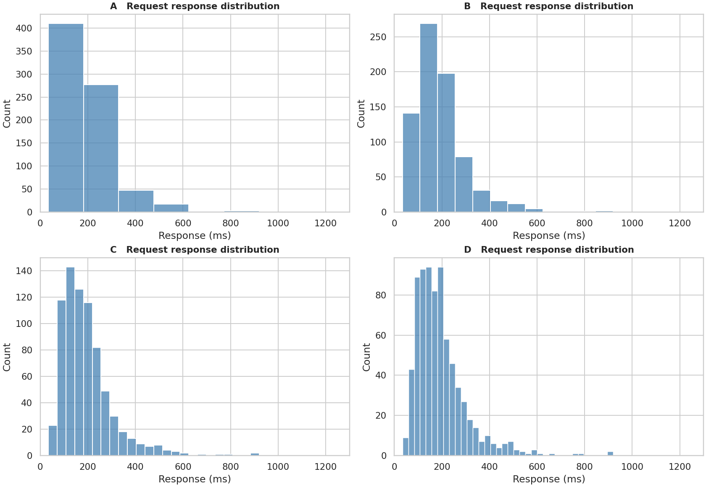

<details>
<summary><strong>Q06. 정답 및 해설 확인</strong></summary>

**정답: B**

B는 12개의 구간을 사용한 그래프입니다. A는 6개, C는 24개, D는 36개 구간입니다. 구간 수가 늘수록 각 구간의 폭이 좁아져 분포가 더 세밀하게 보일 수 있습니다.

**확인 코드**

```python
sns.histplot(data=df, x="response_ms", bins=12, ax=ax)
```

</details>

### Q07. Boxplot의 범주 순서와 이상점

다음과 같은 Boxplot의 실행 결과를 고르세요. 오답도 모두 Boxplot으로 제작되어 있습니다.

```python
sns.boxplot(data=df, x="priority", y="response_ms",
            order=["Urgent", "Standard"], showfliers=False, color="lightblue", ax=ax)
```

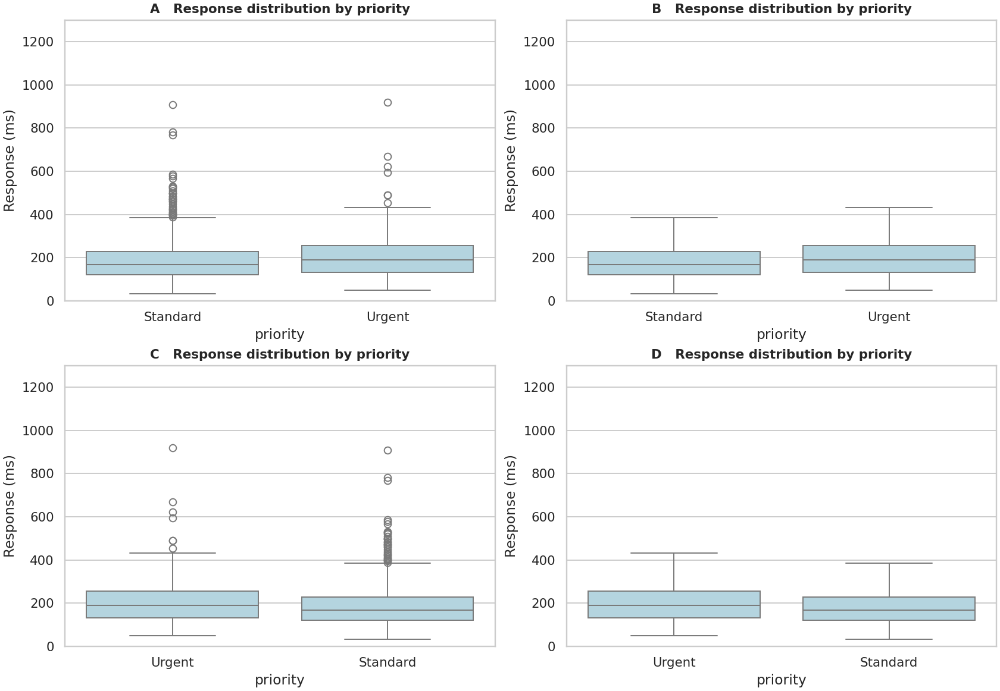

<details>
<summary><strong>Q07. 정답 및 해설 확인</strong></summary>

**정답: D**

D만 `Urgent`가 왼쪽에 있고 이상점(Fliers)이 표시되지 않습니다. A와 B는 범주 순서가 다르고, A와 C는 이상점이 표시됩니다. `showfliers=False`는 데이터를 삭제하지 않고 이상점 표식만 감춥니다.

**확인 코드**

```python
sns.boxplot(data=df, x="priority", y="response_ms",
            order=["Urgent", "Standard"], showfliers=False, color="lightblue", ax=ax)
```

</details>

### Q08. 그룹별 Facet의 실행 결과

다음 코드를 실행하면 어떤 배치가 만들어질까요? 각 선택지는 시간대별 두 그래프로 구성되지만 **범주 순서와 세로축 범위**가 다릅니다.

```python
g = sns.relplot(data=df, x="hour", y="response_ms", col="priority",
            col_order=["Urgent", "Standard"], kind="line",
            estimator="mean", errorbar=None, color="steelblue",
            facet_kws={"sharey": True})
g.set(ylim=(0, 600))
```

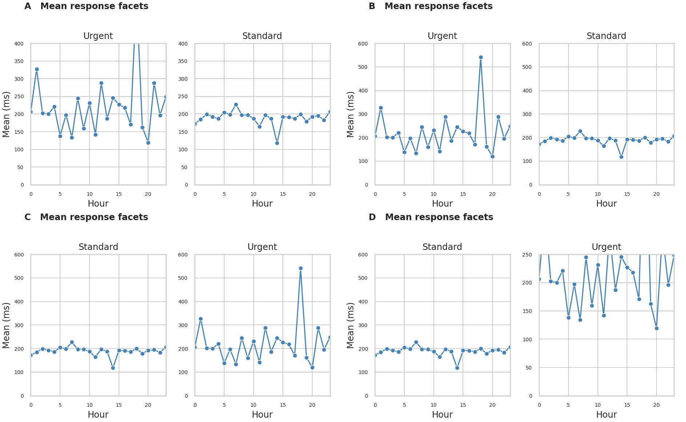

<details>
<summary><strong>Q08. 정답 및 해설 확인</strong></summary>

**정답: B**

`col_order`에 따라 Urgent가 왼쪽, Standard가 오른쪽에 놓입니다. `sharey=True`일 때 두 패널은 공통 Y축 범위를 사용합니다. A는 축 상한이 400으로 다르고 C는 순서가 반대이며 D는 순서 및 축 범위가 다릅니다. 실제 축 범위 수치는 그래프 자동 배치에 따라 달라질 수 있으므로, 이 문항은 패널 순서와 공통 축 범위라는 핵심 특징을 기준으로 판별합니다.

**확인 코드**

```python
g = sns.relplot(data=df, x="hour", y="response_ms",
                col="priority", col_order=["Urgent", "Standard"],
                kind="line", errorbar=None)
g.set(ylim=(0, 600))
```

</details>

### Q09. Heatmap 셀과 색상 표현

다음 행렬을 아래 코드로 시각화했습니다. 4개 선택지 모두 Heatmap입니다.

```python
grid = pd.DataFrame([[4, 2, 6], [3, 8, 5], [7, 1, 9]],
                    index=["North", "Central", "South"],
                    columns=["Morning", "Afternoon", "Evening"])
sns.heatmap(grid, annot=True, fmt="d", cmap="Blues", cbar=False, ax=ax)
```

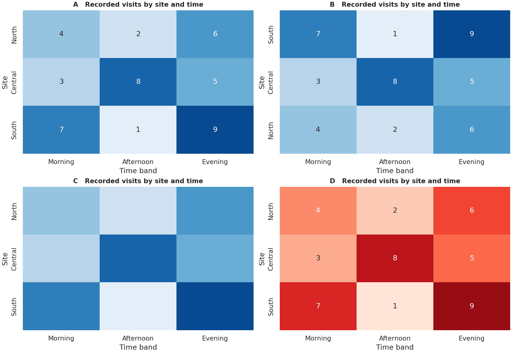

<details>
<summary><strong>Q09. 정답 및 해설 확인</strong></summary>

**정답: A**

A는 셀 숫자를 보여주고(`annot=True`), 정수 형식을 사용하며(`fmt="d"`), 파란 계열 색상 지도(`cmap="Blues"`)를 사용합니다. B는 행 순서가 반대, C는 주석이 없음, D는 빨간색 지도입니다.

**확인 코드**

```python
sns.heatmap(grid, annot=True, fmt="d", cmap="Blues", cbar=False, ax=ax)
```

</details>

### Q10. ECDF 누적 비율 판별

응답시간 대신 아래의 작은 실습 데이터로 누적분포를 그립니다. 네 선택지는 모두 계단형 누적 그래프입니다.

```python
df = pd.DataFrame({"duration": [5, 10, 15, 25, 40, 55, 80]})
sns.ecdfplot(data=df, x="duration", color="steelblue", ax=ax)
```

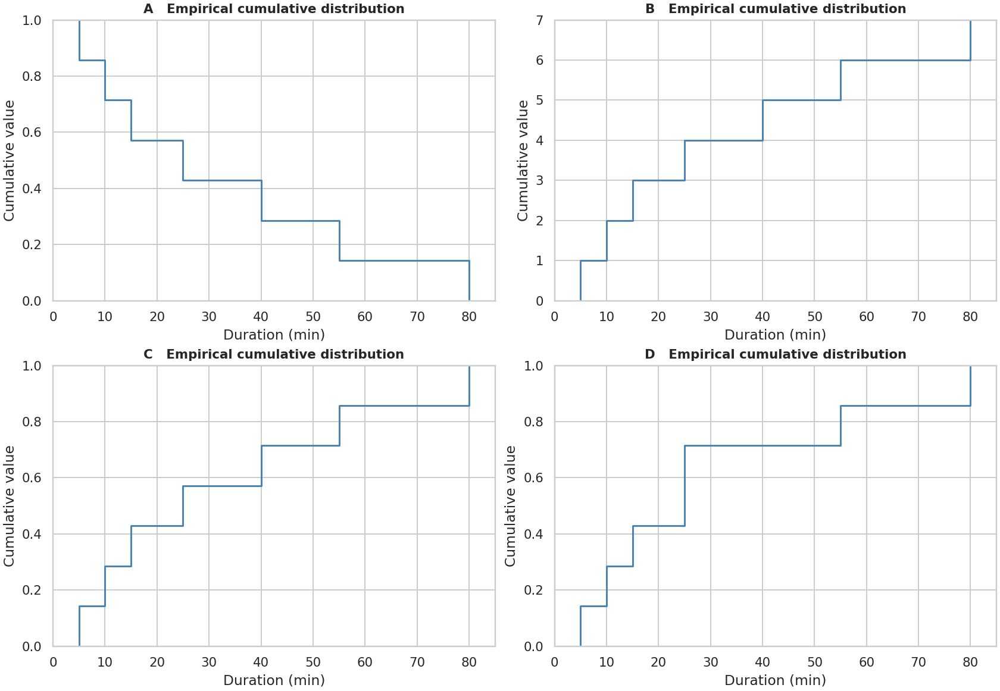

<details>
<summary><strong>Q10. 정답 및 해설 확인</strong></summary>

**정답: C**

ECDF의 기본 누적 비율은 왼쪽에서 오른쪽으로 증가하며 최댓값에서 1이 됩니다. C는 7개의 서로 다른 관측값에 대해 1/7씩 증가합니다. A는 보완 누적 분포, B는 누적 건수, D는 25가 두 번 등장하는 다른 데이터입니다.

**확인 코드**

```python
sns.ecdfplot(data=pd.DataFrame({"duration": [5,10,15,25,40,55,80]}),
             x="duration", ax=ax)
```

</details>

### Q11. Lineplot은 어떤 통계량을 표시할까?

같은 `hour=10`, `service="Search"`에 응답시간 100ms, 200ms, 300ms 세 건이 있습니다. 다음 호출은 이 세 관측을 한 시간 지점에 어떤 수치로 표시할까요?

```python
sns.lineplot(data=df, x="hour", y="response_ms", hue="service", errorbar=None)
```

A. 100ms  B. 200ms  C. 300ms  D. 관측마다 3개의 점을 반드시 표시

<details>
<summary><strong>Q11. 정답 및 해설 확인</strong></summary>

**정답: B — 200ms**

기본 `lineplot()`은 같은 X와 그룹의 관측값을 평균으로 요약합니다. 100, 200, 300의 평균은 200입니다. 3건을 각각 보고 싶다면 원본 관측을 따로 표현하는 방법이 필요합니다.

**확인 코드**

```python
df = pd.DataFrame({"hour": [10, 10, 10], "response_ms": [100, 200, 300], "service": ["Search"] * 3})
sns.lineplot(data=df, x="hour", y="response_ms", hue="service", errorbar=None)
```

</details>

### Q12. 평균 대신 매출 합계 표시하기

다음 코드는 매장별 전체 매출을 보여주려 했지만 원본 주문 행의 평균 금액을 표시합니다. `total` 생성 부분과 그래프 코드를 완성하세요.

```python
completed = df.loc[df.status.eq("Completed")]
# TODO: 매장별 완료 매출의 총합을 계산한 total 데이터프레임 생성
# TODO: total을 이용해 매장별 총매출 Barplot 작성
```

<details>
<summary><strong>Q12. 정답 및 해설 확인</strong></summary>

**정답: 집계 후 Barplot**

`groupby("branch")`로 합계를 구한 뒤 집계 결과를 그려야 매장별 총매출이 나옵니다. 원본 데이터를 그대로 `barplot()`에 넣으면 기본 통계량인 평균이 그려질 수 있습니다.

**확인 코드**

```python
total = completed.groupby("branch", as_index=False)["revenue_krw"].sum()
sns.barplot(data=total, x="branch", y="revenue_krw",
            errorbar=None, ax=ax)
```

</details>

### Q13. Countplot은 무엇을 세는가?

주문 상품 3행이 같은 주문 번호에 속하고, 나머지 2행은 다른 주문 번호입니다. `countplot(x="channel")`이 세는 대상은 무엇입니까?

A. 고유 주문 번호 수  B. 구매 상품 수량 합계  C. 원본 데이터의 행 수  D. 매출 총합

<details>
<summary><strong>Q13. 정답 및 해설 확인</strong></summary>

**정답: C**

`countplot()`은 해당 범주에 속하는 원본 **행 수**를 셉니다. 주문 한 건에 여러 상품 행이 있으면 주문 건수와 일치하지 않을 수 있습니다. 고유 주문 건수를 원하면 먼저 ID 기준으로 중복을 제거하거나 별도 집계해야 합니다.

**확인 코드**

```python
unique_orders = df.drop_duplicates("order_id")
sns.countplot(data=unique_orders, x="channel", ax=ax)
```

</details>

### Q14. 누락된 날짜 처리

어떤 도서관의 10월 10일 방문자는 100명, 10월 11일에는 관측 기록이 없고, 10월 12일은 120명입니다. 다음 코드의 TODO에 어떤 값을 채워야 하나요?

```python
visitors = [100,  # 10월 10일
            ...,  # TODO: 10월 11일은 집계 부재
            120]  # 10월 12일
```

<details>
<summary><strong>Q14. 정답 및 해설 확인</strong></summary>

**정답: `np.nan` 또는 `None`**

집계 부재를 0명으로 채우면 평균과 시계열 해석이 달라집니다. 결측을 유지하고 별도 상태 표시가 필요한지를 검토해야 합니다.

**확인 코드**

```python
visitors = [100, np.nan, 120]
```

</details>

### Q15. Boxplot의 이상점 표현

`sns.boxplot(..., showfliers=False)`를 사용하면 무엇이 일어날까요?

A. 이상 관측값이 원본 DataFrame에서 삭제됨  B. 이상점 마커만 표시하지 않음  C. 모든 값이 평균으로 바뀜  D. x축 방향이 뒤집힘

<details>
<summary><strong>Q15. 정답 및 해설 확인</strong></summary>

**정답: B**

`showfliers=False`는 Boxplot의 이상점 **표시**를 감출 뿐 데이터프레임을 변경하지 않습니다. 이상점은 오류가 아닌 실제 관측값일 수도 있습니다.

**확인 코드**

```python
sns.boxplot(data=df, x="service", y="response_ms", showfliers=False, ax=ax)
```

</details>

### Q16. ECDF에서 기준 이하 비율 읽기

ECDF에서 `x=500` 위치의 y값이 `0.92`라면 해당 분포의 관측값에 대해 무엇을 알 수 있습니까?

<details>
<summary><strong>Q16. 정답 및 해설 확인</strong></summary>

**정답: 관측값의 약 92%가 500 이하**

ECDF는 기준값 이하의 관측 비율을 나타냅니다. 500이 응답시간(ms)이라면 측정된 요청의 약 92%가 500ms 이하라는 뜻입니다. 다만 측정 표본이 전체 요청을 대표하는지는 별도 문제입니다.

**확인 코드**

```python
share = (df["response_ms"] <= 500).mean()
print(f"Share at or below 500ms: {share:.1%}")
```

</details>

### Q17. 신뢰구간과 표준편차 차이

평균 응답시간 그래프의 `errorbar=("ci", 95)`와 `errorbar="sd"`는 같은 의미인가요?

<details>
<summary><strong>Q17. 정답 및 해설 확인</strong></summary>

**정답: 아니요**

`("ci",95)`는 부트스트랩으로 계산한 평균 추정의 95% 신뢰구간입니다. `"sd"`는 관측값의 표준편차를 바탕으로 변동 폭을 표시합니다. 신뢰구간은 관측값 95%의 범위를 뜻하지 않습니다.

**확인 코드**

```python
sns.barplot(data=df, x="service", y="response_ms",
            errorbar=("ci", 95), seed=7, ax=axes[0])
sns.barplot(data=df, x="service", y="response_ms",
            errorbar="sd", ax=axes[1])
```

</details>

### Q18. Heatmap용 피벗 테이블 완성

서비스별 시간대 응답시간의 중앙값을 Heatmap으로 그리려고 합니다. TODO를 완성하세요.

```python
# TODO: index는 service, columns는 hour,
#       values는 response_ms, 집계 통계량은 median
pivot = ...
sns.heatmap(pivot, ax=ax)
```

<details>
<summary><strong>Q18. 정답 및 해설 확인</strong></summary>

**정답: `pivot_table(..., aggfunc="median")`**

`pivot_table()`은 원시 데이터를 서비스 × 시간대 행렬로 변환하고 동일 셀의 여러 관측값을 중앙값으로 집계합니다. 합계·평균을 사용하면 Heatmap의 의미가 달라지므로 라벨에 집계 통계량을 명시해야 합니다.

**확인 코드**

```python
pivot = df.pivot_table(index="service", columns="hour",
                       values="response_ms", aggfunc="median")
sns.heatmap(pivot, ax=ax)
```

</details>

### Q19. Figure-level과 Axes-level 저장 오류 수정

다음 코드가 그래프를 올바르게 저장하도록 수정하세요.

```python
g = sns.displot(data=df, x="response_ms", col="priority")
g.savefig("report.png")
```

<details>
<summary><strong>Q19. 정답 및 해설 확인</strong></summary>

**정답: `g.figure.savefig("report.png")`**

`g`는 Figure 자체가 아닌 FacetGrid 객체입니다. 내부 Figure에 접근해 저장해야 합니다. 저장 후 닫으면 많은 그래프를 반복 출력할 때 자원을 관리하기 쉽습니다.

**확인 코드**

```python
g = sns.displot(data=df, x="response_ms", col="priority")
g.figure.savefig("report.png", dpi=150)
plt.close(g.figure)
```

</details>

### Q20. 날짜의 실제 간격을 유지하는 매개변수

다음 데이터에는 2024년 기록이 없습니다. 범주형 막대그래프에서 2023년과 2025년 사이가 실제 연도 간격을 반영하도록 빈칸을 완성하세요.

```python
df = pd.DataFrame({"year": [2022, 2023, 2025], "value": [100, 130, 170]})
sns.barplot(data=df, x="year", y="value", ________, ax=ax)
```

<details>
<summary><strong>Q20. 정답 및 해설 확인</strong></summary>

**정답: `native_scale=True`**

기본 범주형 배치는 2022, 2023, 2025를 같은 간격으로 놓을 수 있습니다. `native_scale=True`는 숫자형 축의 실제 차이를 반영합니다. 없는 2024년의 값을 임의로 0으로 추가하지 않습니다.

**확인 코드**

```python
sns.barplot(data=df, x="year", y="value", native_scale=True, ax=ax)
```

</details>

---

<a id="section-4-25"></a>
## 4.25. Summary

| 영역 | 핵심 내용 |
|---|---|
| Seaborn 기초 | 데이터 열과 시각적 속성(`x`, `y`, `hue`, `style`) 연결 |
| 데이터 구조 | Long-form을 사용해 그룹별 시각화 구성 |
| 관계 | Scatterplot, Lineplot, Relplot |
| 범주 | Countplot은 행 수, Barplot은 기본적으로 추정값(평균) |
| 분포 | Box, Violin, Strip, Hist, KDE, ECDF |
| 다중 패널 | Displot, Catplot, Relplot, Jointplot, Pairplot |
| 행렬 | Correlation Heatmap, Pivot Heatmap |
| 해석 | 평균과 합계, 결측과 0, 신뢰구간과 표준편차를 구별 |
| 결과물 | Axes-level과 Figure-level 그래프를 파일로 저장 |

### 학습 점검

- 같은 데이터를 Histplot과 ECDF로 그렸을 때 무엇을 각각 알 수 있는지 설명할 수 있는가?
- `sns.barplot()`을 사용하기 전에 집계 방식이 원하는 결과인지 확인할 수 있는가?
- `ax=`를 사용하는 함수와 `g.figure`로 저장하는 함수를 구별할 수 있는가?
- 그룹과 날짜가 일부 누락된 데이터를 0으로 보정하지 않고 시각화할 수 있는가?
- 출력 그래프에서 데이터 단위·분모·집계 통계량·범례·자료의 한계를 안내할 수 있는가?

**다음 장:** Chapter 05 — Exploratory Data Analysis & Statistical Visualization에서는 이 장의 Seaborn 시각화 도구를 활용해 분포 해석과 데이터 탐색 과정에 집중합니다.

---

<a id="section-4-26"></a>
## 4.26. References & Directory Structure

```text
Chapter-04/
├── README.md
├── requirements.txt
├── .gitignore
├── data/                           # 교육용 가상 데이터 및 데이터 사전
├── examples/                       # 개념별 전체 예제 22개
├── figures/
│   └── quiz/                       # 실행 결과 및 그래프 객관식 그림
├── exercises/                      # 부분 완성 Coding Practice 18개
├── projects/
│   ├── mini_01_retail/starter.py
│   ├── mini_02_service/starter.py
│   ├── mini_03_library/starter.py
│   └── advanced_01_bike/starter.py
├── solutions/
│   ├── practice/                   # Coding Practice 정답
│   ├── mini_projects/              # Mini Project 모범 구현과 해설
│   └── advanced_projects/          # Advanced Project 모범 구현과 해설
├── project_utils/
│   └── common.py                   # 공통 그래프 출력 함수
├── tests/
│   └── test_chapter04.py
└── output/                         # 실행 시 생성; ZIP에는 포함하지 않음
```

### 실행 명령

```bash
# 시작할 예제
python examples/11_kde_ecdf.py

# TODO를 완성한 후 실행
python exercises/08_boxplot_groups.py

# 프로젝트의 시작 파일: TODO가 남아 있으면 실행 시 오류가 정상임
python projects/mini_02_service/starter.py

# 자동 검증
python -m unittest discover -s tests -v
```

### 공식 문서

- [Seaborn 0.13.2 Documentation](https://seaborn.pydata.org/)
- [Seaborn — Overview of Plotting Functions](https://seaborn.pydata.org/tutorial/function_overview.html)
- [Seaborn — Relational Plots](https://seaborn.pydata.org/tutorial/relational.html)
- [Seaborn — Categorical Plots](https://seaborn.pydata.org/tutorial/categorical.html)
- [Seaborn — Distribution Plots](https://seaborn.pydata.org/tutorial/distributions.html)
- [Seaborn — Error Bars](https://seaborn.pydata.org/tutorial/error_bars.html)
- [Seaborn — FacetGrid](https://seaborn.pydata.org/generated/seaborn.FacetGrid.html)
- [Seaborn — Frequently Asked Questions](https://seaborn.pydata.org/faq.html)
- [Matplotlib Documentation](https://matplotlib.org/stable/)
- [Pandas User Guide](https://pandas.pydata.org/docs/user_guide/index.html)

---

[← Data Visualization](../README.md) · [Chapter 03 — Matplotlib](../Chapter-03/)
