# Chapter 05. Exploratory Data Analysis & Statistical Visualization

수치와 그래프를 통해 데이터를 탐색하고, **분포·결측·이상치·상관관계·그룹별 차이·불확실성**을 근거 있게 해석합니다. Chapter 03–04에서 그래프를 그리는 방법을 학습했다면, 이번 Chapter에서는 **그 그래프를 보고 어떤 결론까지 내릴 수 있는지** 확인합니다.

모든 예제는 **문제 상황 → 필요한 개념 → 실행 가능한 코드 → 실제 그래프 → 핵심 해설**의 흐름을 따릅니다. 새로운 개념은 처음 등장할 때 정의·원리·해석 방법을 설명합니다. 앞선 Chapter에서 배운 내용은 필요한 범위만 복습하며, 선택적인 심화 사항은 접어두었습니다.

본 자료의 배송·문의·제조 기록은 **모두 교육용 가상 데이터**입니다. 실제 기관·기업의 통계를 나타내지 않습니다. 상관관계와 집단 차이를 관측했다는 이유만으로 원인·정책 효과를 단정해서는 안 됩니다.

- **기본 환경:** Python 3.11 이상 권장, NumPy, Pandas, Matplotlib, Seaborn
- **실행 검증 환경:** Python 3.13.5 / NumPy 2.3.5 / Pandas 2.2.3 / Matplotlib 3.10.8 / Seaborn 0.13.2
- **학습자료 구성:** Example 20개 · Coding Practice 18개 · Mini Project 3개 · Advanced Project 1개 · Quiz 22문제
- **정답 공개 원칙:** README 본문은 Example·Quiz의 모범 코드만 공개. Coding Practice와 Project 정답 코드는 별도 `solutions/`에 보관

<details>
<summary><strong>선행 학습 목록</strong></summary>

- [Chapter 01 — Introduction to Data Visualization](../Chapter-01/)
- [Chapter 02 — Principles of Data Visualization](../Chapter-02/)
- [Chapter 03 — Matplotlib](../Chapter-03/)
- [Chapter 04 — Seaborn](../Chapter-04/)
- [Data Processing Chapter 04 — Pandas & DataFrames](../../Data_Processing/Chapter-04/)
- [Data Processing Chapter 06 — Data Cleaning & Validation](../../Data_Processing/Chapter-06/)
- [Data Processing Chapter 07 — Data Transformation & Aggregation](../../Data_Processing/Chapter-07/)


</details>
<a id="contents"></a>
## Contents

| Section | Topic |
|:---:|---|
| [5.1](#section-5-1) | Learning Goals & Getting Started |
| [5.2](#section-5-2) | EDA Workflow & Interpretation |
| [5.3](#section-5-3) | EDA Questions & Data Overview |
| [5.4](#section-5-4) | Summary Statistics & Denominators |
| [5.5](#section-5-5) | Missingness & Availability |
| [5.6](#section-5-6) | Skew & Long-Tailed Data |
| [5.7](#section-5-7) | IQR & Outlier Candidates |
| [5.8](#section-5-8) | Sensitivity to Extreme Values |
| [5.9](#section-5-9) | Groupwise Median & Sample Size |
| [5.10](#section-5-10) | ECDF & Percentile Reading |
| [5.11](#section-5-11) | Counts vs. Rates |
| [5.12](#section-5-12) | Correlation & Scatter |
| [5.13](#section-5-13) | Pearson vs. Spearman |
| [5.14](#section-5-14) | Correlation Matrix Caveats |
| [5.15](#section-5-15) | Simpson’s Paradox — Aggregation Trap |
| [5.16](#section-5-16) | Group Composition & Denominator |
| [5.17](#section-5-17) | Rate Intervals & Sample Size |
| [5.18](#section-5-18) | Bootstrap for the Mean |
| [5.19](#section-5-19) | Category Interactions & Rates |
| [5.20](#section-5-20) | Selection Bias in Available Records |
| [5.21](#section-5-21) | Stratified Scatter & Confounding |
| [5.22](#section-5-22) | EDA Checklist & Compact Report |
| [5.23](#section-5-23) | Mini Project 01 — Delivery Reliability Review |
| [5.24](#section-5-24) | Mini Project 02 — Support Response Study |
| [5.25](#section-5-25) | Mini Project 03 — Manufacturing Quality Exploration |
| [5.26](#section-5-26) | Coding Practice — 18 Exercises |
| [5.27](#section-5-27) | Advanced Project 01 — Multi-Facility Quality EDA Generator |
| [5.28](#section-5-28) | Quiz — Data Interpretation & Visual Code Reading |
| [5.29](#section-5-29) | Summary |
| [5.30](#section-5-30) | References & Directory Structure |


---

<a id="section-5-1"></a>
## 5.1. Learning Goals & Getting Started


### 이 Chapter의 핵심 질문

데이터를 시각화할 수 있다는 것과 **그 결과를 정확하게 해석할 수 있다는 것**은 다른 능력입니다. EDA에서는 같은 데이터라도 집계 기준과 분석 대상에 따라 결론이 달라질 수 있음을 확인합니다. 따라서 "얼마나 큰가?"뿐 아니라 "누구를 대상으로 계산했는가?", "자료가 빠진 부분은 없는가?", "이 차이가 얼마나 안정적인가?"를 함께 질문합니다.

앞선 Chapter에서 배운 Matplotlib·Seaborn의 기본 그리기 방법은 반복하지 않습니다. 이번 Chapter에서 새로 등장하는 통계 개념은 **정의, 필요한 이유, 계산·해석 예시, 한계**를 먼저 설명한 뒤 실제 코드에 적용합니다.


### 학습 목표

1. 관측 단위와 데이터 품질을 먼저 확인한 뒤 탐색 질문을 정합니다.
2. 평균·중앙값·분위수·IQR을 구분하고 각 수치가 적절한 상황을 설명합니다.
3. 표본 수와 분모를 확인하면서 범주별 비율·분포를 비교합니다.
4. Pearson과 Spearman 상관계수의 차이 및 상관관계의 한계를 이해합니다.
5. Simpson의 역설과 선택 편향 등 집계가 오해를 일으킬 수 있는 상황을 발견합니다.
6. 부트스트랩·Wilson 구간을 사용해 추정의 불확실성을 시각화합니다.
7. 결론이 과장되지 않도록 분석 결과·가정·해석 한계를 함께 기록합니다.

### 실행 준비

`Data_Visualization/Chapter-05/` 폴더를 현재 작업 경로로 설정한 뒤 실행합니다.

```bash
python -m pip install -r requirements.txt
python examples/01_question_first.py
python examples/13_simpson_paradox.py
python solutions/mini_01_delivery/solution.py
python solutions/advanced_01_quality/reference_solution.py
python -m unittest discover -s tests -v
```

- 예제는 `figures/`에 이미 포함된 PNG를 동일한 내용으로 다시 생성합니다.
- 프로젝트 정답 코드 실행 결과는 `output/`에 생성되며 Git 추적에서 제외합니다.
- `projects/`의 `starter.py`는 학습자가 완성해야 하므로 `NotImplementedError`를 포함합니다.
- 모든 예제는 네트워크 연결 없이 실행 가능합니다.
- `matplotlib.use('Agg')`는 GUI 창 없이 PNG를 생성하기 위한 비대화형 Backend 설정입니다. 일반적인 대화형 실행에서는 `plt.show()`를 활용할 수도 있습니다.


---

<a id="section-5-2"></a>
## 5.2. EDA Workflow & Interpretation

EDA(탐색적 데이터 분석)는 관측된 데이터를 요약·시각화하여 **특징, 예상 밖 패턴, 추가로 검토할 질문**을 발견하는 과정입니다. 통계적 가설 검정이나 인과추론을 대신하지 않습니다.


### EDA는 탐색이며, 결론을 확정하는 검증과 다릅니다

EDA는 숫자와 그림을 이용해 데이터의 특징을 이해하는 **탐색 과정**입니다. 처음부터 정답을 증명하기보다, 데이터에 어떤 특성이 있는지 발견해 **추가로 검토할 질문을 구체화**합니다. 따라서 특정 그래프에서 두 집단의 차이가 발견되더라도 그 차이가 우연인지, 모집단에도 유지되는지, 무엇이 원인인지는 별도의 분석이 필요할 수 있습니다.

예를 들어 전체 배송 데이터에서 배송사 B의 정시 배송률이 높다고 해도, 배송사가 실제로 더 잘 운영됐다고 결론 내리기 전에 배송 지역이 서로 다른 비율로 포함됐는지 확인해야 합니다. 같은 수치라도 **관측 대상·분모·집단 구성**에 따라 의미가 달라지기 때문입니다.

**기술통계(Descriptive Statistics)**는 관측 자료의 특징을 요약합니다. **통계적 추론(Statistical Inference)**은 표본을 통해 더 큰 모집단에 대한 불확실성을 평가합니다. **인과추론(Causal Inference)**은 어떤 요인이 결과를 변화시켰는지 검토합니다. 이 장은 첫 번째를 중심으로 두 번째의 기초 개념을 배우고, 세 번째의 결론을 함부로 내리지 않는 방법을 익힙니다.


```text
분석 질문 정의
    ↓
관측 단위·기간·수집 기준 확인
    ↓
데이터 품질 확인 (중복·결측·범위·선택 편향)
    ↓
분포 확인 (평균·중앙값·분위수·IQR)
    ↓
그룹 비교 (건수·비율·분모·구성비)
    ↓
변수 관계 탐색 (Scatter·Correlation·Stratification)
    ↓
불확실성·민감도 확인
    ↓
그래프·수치·해석 한계가 포함된 보고서
```

### 핵심 구분

| 개념 | 질문 | 주의점 |
|---|---|---|
| 평균(Mean) | 평균적인 값은? | 극단적인 관측값에 영향받기 쉬움 |
| 중앙값(Median) | 가운데 관측값은? | 전체 규모·분산을 나타내지 않음 |
| 백분위수(Percentile) | 상위 또는 하위 몇 % 기준은? | 계산 방식과 관측 집합을 명시해야 함 |
| 결측률(Missing Share) | 측정하지 못한 값이 얼마나 있나? | `0`과 결측은 다름 |
| 집단 비율(Rate) | 해당 집단의 전체 기록 중 몇 %인가? | 반드시 분모 확인 |
| 상관계수(Correlation) | 함께 변하는 경향이 있나? | 인과관계를 의미하지 않음 |
| 구간 추정(Interval) | 추정이 얼마나 흔들릴 수 있나? | 표본 대표성 문제를 자동 해결하지 않음 |

**통계 그래프를 해석할 때는 축 범위, 누락 데이터, 표본 수(n), 시간 범위, 관측 단위(Grain), 단위를 먼저 확인합니다.**


---

<a id="section-5-3"></a>
## 5.3. EDA Questions & Data Overview

**문제 상황**

배송 데이터가 주어졌습니다. 먼저 행 수, 배송 상태, 사용 가능한 소요일의 개수를 파악해야 합니다.

**필요한 개념**

EDA는 그래프를 무작정 만드는 과정이 아니라 데이터의 관측 단위·질문·품질을 확인하고 가설을 만드는 탐색입니다.

#### 분석을 시작하기 전에: 관측 단위와 분석 대상

탐색적 데이터 분석(EDA)에서는 **한 행이 무엇을 나타내는지** 먼저 정의합니다. 배송 기록이라면 한 행이 배송 한 건인지, 배송 상태가 바뀔 때마다 생성된 이력인지에 따라 `len(df)`의 의미가 달라집니다. 같은 배송 ID가 여러 번 기록되었다면 행 수를 그대로 배송 건수로 해석할 수 없습니다.

또한 **전체 수집 기록**과 **특정 통계량을 계산할 수 있는 기록**은 구별해야 합니다. 예를 들어 예제 데이터는 총 600행이고 배송 ID도 600개이지만, 소요일이 기록된 행은 573개입니다. 상태별 건수와 소요일이 알려진 건수는 서로 다른 기준으로 산출된 수치입니다. 배송 지연을 분석하려면 먼저 완료 상태와 소요일 존재 여부를 조합해 분석 대상을 정의해야 합니다.

실제 분석에서 질문은 다음과 같이 구체화할 수 있습니다.

- 모호한 질문: "어느 배송사가 좋은가?"
- 확인 가능한 질문: "배송 완료 및 소요일 확인 기록 가운데, 배송사별로 약속된 기한 내 배송된 비율은 얼마인가?"

두 번째 질문은 **분자(기한 내 배송 건수)**, **분모(기준에 맞는 배송 건수)**, **관측 기간**, **제외 기준**을 정할 수 있어 재현 가능합니다. EDA의 첫 단계에서 그림보다 데이터 정의가 중요한 이유입니다.

**예제 코드 — [01_question_first.py](./examples/01_question_first.py)**

```python
from pathlib import Path
import numpy as np
import pandas as pd
import matplotlib
matplotlib.use('Agg')
import matplotlib.pyplot as plt
import seaborn as sns

ROOT = Path(__file__).resolve().parents[1]
sns.set_theme(style='whitegrid')

raw = pd.read_csv(ROOT / 'data/shipments.csv')
print('Rows:', len(raw))
print('Unique IDs:', raw['shipment_id'].nunique())
print('Status:', raw['status'].value_counts().to_dict())
print('Known duration:', raw['actual_days'].notna().sum())
fig, ax = plt.subplots(figsize=(6, 3.6))
raw['status'].value_counts().plot.bar(ax=ax, color=['#4E85AF','#CB9362'])
ax.set(title='Shipment record status', ylabel='Records', xlabel='Status')
fig.tight_layout()
fig.savefig(ROOT / 'figures/01_question_first.png', dpi=145)
plt.close(fig)
```

**실행 결과 (터미널)**

```text
Rows: 600
Unique IDs: 600
Status: {'delivered': 582, 'cancelled': 18}
Known duration: 573
```

**실행 결과 (그래프)**

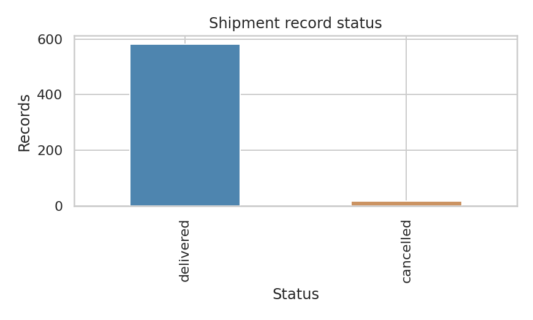

**핵심 해설**

배송 중인 기록이나 취소 기록이 소요일 통계의 분모에 섞이면 해석이 달라집니다. 가장 먼저 데이터의 관측 단위를 확인합니다.


---

<a id="section-5-4"></a>
## 5.4. Summary Statistics & Denominators

**문제 상황**

응답시간 평균과 90백분위수를 비교해 문의 처리 시간의 전반적인 수준을 확인하려고 합니다.

**필요한 개념**

`describe()`는 건수·평균·표준편차·사분위수 등을 요약합니다. 표본 수가 열마다 다른 이유는 결측값이 제외되기 때문입니다.

#### 평균·중앙값·분위수는 서로 다른 정보를 제공합니다

평균(Mean)은 모든 값을 더한 뒤 관측 개수로 나눈 값입니다. 중앙값(Median)은 값을 순서대로 정렬했을 때 가운데 위치하는 값입니다. 백분위수(Percentile)는 데이터의 일정 비율이 그 값 **이하**에 놓이도록 하는 기준값입니다. 정확한 분위수 계산값은 사용한 보간 규칙에 따라 조금 달라질 수 있습니다.

$$
\bar{x}=\frac{1}{n}\sum_{i=1}^{n}x_i
$$

예를 들어 `[10, 15, 20, 25, 130]`분의 평균은 40분이고 중앙값은 20분입니다. 대부분의 문의는 25분 이내에 처리됐지만, 마지막 130분 기록이 평균을 크게 높였습니다. 따라서 "일반적인 문의는 얼마나 걸리는가?"에는 중앙값이, "전체 응답시간의 평균 규모는?"에는 평균이 더 직접적으로 답합니다.

P90(90백분위수)은 관측 응답시간의 약 90%가 해당 시간 이하라는 뜻입니다. 이는 최악의 10%에 가까운 지연을 살펴볼 때 유용하지만, 모든 고객에게 그 시간 안에 응답했다는 뜻은 아닙니다. 예제의 평균 49.00분, 중앙값 34.10분, P90 102.36분은 **동일한 분포의 서로 다른 모습**입니다.

`describe()`의 `count`는 결측값을 제외한 유효 관측 수입니다. 전체 문의가 540건이라도 응답시간이 있는 529건으로 통계량을 계산했다면 이를 보고서에 함께 밝혀야 합니다.

**예제 코드 — [02_describe.py](./examples/02_describe.py)**

```python
from pathlib import Path
import numpy as np
import pandas as pd
import matplotlib
matplotlib.use('Agg')
import matplotlib.pyplot as plt
import seaborn as sns

ROOT = Path(__file__).resolve().parents[1]
sns.set_theme(style='whitegrid')

df = pd.read_csv(ROOT / 'data/support_tickets.csv')
minutes = df['first_response_min'].dropna()
summary = minutes.describe(percentiles=[.5,.9])
print(summary[['count','mean','50%','90%']].round(2).to_string())
fig, ax = plt.subplots(figsize=(6.5, 3.5))
values = [summary['mean'], summary['50%'], summary['90%']]
ax.bar(['Mean','Median','P90'], values, color=['#5089B3','#6CA59A','#D09C72'])
ax.set(title='Three views of response time', ylabel='Minutes')
fig.tight_layout(); fig.savefig(ROOT / 'figures/02_describe.png',dpi=145);plt.close(fig)
```

**실행 결과 (터미널)**

```text
count    529.00
mean      49.00
50%       34.10
90%      102.36
```

**실행 결과 (그래프)**

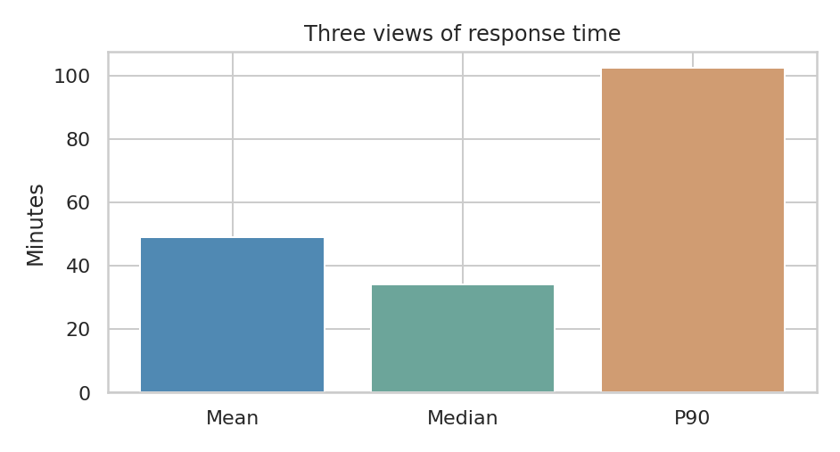

**핵심 해설**

평균·중앙값·P90은 각각 다른 질문에 답합니다. 동일한 통계량이라도 유효 기록 수와 단위를 함께 표시합니다.


---

<a id="section-5-5"></a>
## 5.5. Missingness & Availability

**문제 상황**

측정되지 않은 응답시간이 얼마나 많은지 팀별로 확인하고, 결측을 0분으로 취급하지 않아야 합니다.

**필요한 개념**

결측률은 `isna()`로 계산하며, 분모는 전체 해당 팀의 문의 건수입니다. 0분은 실제 관측값이므로 결측과 구별합니다.

#### 결측은 값 0과 다릅니다

결측(Missing Value)은 **관측값이 기록되지 않았거나 사용할 수 없는 상태**입니다. 반면 0분은 실제로 측정된 응답시간이 0이라는 뜻입니다. 두 경우를 섞으면 평균, 분포, 비율이 실제와 달라집니다.

팀 A의 문의가 100건이고 그중 5건의 응답시간이 비어 있다면 결측률은 `5 / 100 = 5%`입니다. 결측률을 계산할 때 분모는 **응답시간이 관측된 건수 95건이 아니라 전체 해당 팀 문의 100건**입니다.

$$
\mathrm{Missing\ Rate}=\frac{N_{\mathrm{missing}}}{N_{\mathrm{total}}}\times100\%
$$

- $N_{\mathrm{missing}}$: 결측 기록 수
- $N_{\mathrm{total}}$: 전체 분석 대상 기록 수

결측의 형태에는 두 가지가 있습니다. 행은 존재하지만 특정 열이 `NaN`인 경우와, 특정 날짜·시간에 존재해야 할 행 자체가 없는 경우입니다. 전자는 `isna()`로 찾지만, 후자는 예상 날짜나 ID 목록과 비교해야 발견할 수 있습니다.

결측이 왜 발생했는지도 중요합니다. 단순한 기록 실패뿐 아니라 응답이 오래 걸린 문의에서만 측정이 누락된다면, 결측을 제외한 평균은 실제보다 낮아질 수 있습니다. `dropna()`는 계산 대상을 정하는 기능이지 결측으로 인한 편향을 제거하는 기능은 아닙니다.

<details>
<summary><strong>심화 — MCAR, MAR, MNAR</strong></summary>

- **MCAR(완전 무작위 결측):** 결측 발생이 관측 변수와 관측되지 않은 값 모두에 의존하지 않는 상황
- **MAR(조건부 무작위 결측):** 관측된 다른 변수를 조건으로 보면 결측 여부가 누락값 자체에 더 이상 의존하지 않는 상황
- **MNAR(비무작위 결측):** 관측된 변수로 설명하고도 결측 여부가 누락된 값 자체 등에 의존하는 상황

이 분류는 결측 처리 방법을 고민하기 위한 개념입니다. 결측률 그래프만으로 어느 유형인지 단정할 수 없습니다.

</details>

**예제 코드 — [03_missingness.py](./examples/03_missingness.py)**

```python
from pathlib import Path
import numpy as np
import pandas as pd
import matplotlib
matplotlib.use('Agg')
import matplotlib.pyplot as plt
import seaborn as sns

ROOT = Path(__file__).resolve().parents[1]
sns.set_theme(style='whitegrid')

df = pd.read_csv(ROOT/'data/support_tickets.csv')
rate = df.groupby('team')['first_response_min'].apply(lambda s:s.isna().mean()).sort_values()
print('Missing fraction:',rate.round(3).to_dict())
fig,ax=plt.subplots(figsize=(7,3.5))
ax.barh(rate.index,rate,color='#9A80B3')
ax.set(xlim=(0,.15),xlabel='Missing share',title='First-response data missingness')
fig.tight_layout();fig.savefig(ROOT/'figures/03_missingness.png',dpi=145);plt.close(fig)
```

**실행 결과 (터미널)**

```text
Missing fraction: {'Billing': 0.013, 'Technical': 0.017, 'Account': 0.033}
```

**실행 결과 (그래프)**

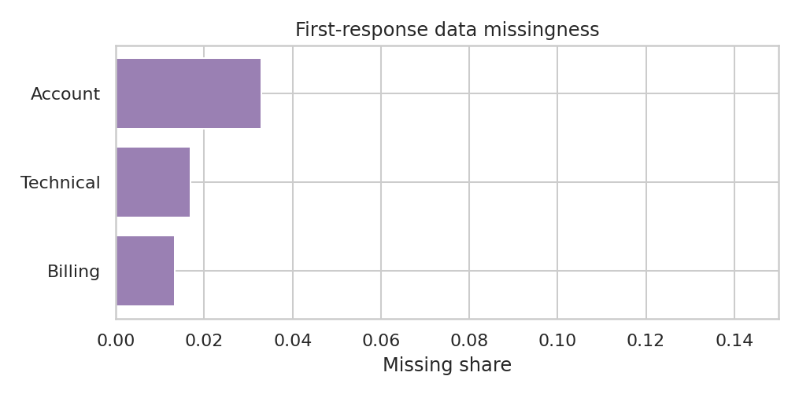

**핵심 해설**

결측률이 특정 팀에 집중된다면 전체 평균은 편향될 수 있습니다. 결측이 무작위로 발생했다고 단정하지 않습니다.

<details>
<summary><strong>보충 설명</strong></summary>

MCAR·MAR·MNAR의 구분은 결측 원인을 생각할 때 참고할 만하지만, 단순한 통계표만으로 원인 유형을 확정할 수 없습니다.

</details>


---

<a id="section-5-6"></a>
## 5.6. Skew & Long-Tailed Data

**문제 상황**

대부분의 문의는 빨리 처리되지만 일부는 매우 늦게 응답되는 데이터를 분석합니다.

**필요한 개념**

오른쪽 꼬리가 긴 분포에서는 평균이 큰 관측값에 끌릴 수 있어 중앙값·분위수를 함께 봅니다.

#### 분포의 모양이 평균의 의미를 바꿉니다

분포(Distribution)는 값들이 어떤 범위에 얼마나 자주 나타나는지를 보여줍니다. 오른쪽으로 긴 꼬리를 가진 **우측 비대칭(Right-skewed) 분포**에서는 대다수 값이 낮은 구간에 몰려 있고 일부 값만 매우 큽니다. 고객 응답시간·배송 지연·파일 크기 등에서 자주 나타나는 형태입니다.

예를 들어 응답시간 `[8, 10, 12, 14, 100]`분을 보면 다섯 건 중 네 건은 14분 이내이지만 평균은 28.8분입니다. 중앙값은 12분이므로 "보통 어느 정도인가?"라는 질문에는 두 통계량이 서로 다른 인상을 줍니다. 예제에서도 평균 49.0분이 중앙값 34.1분보다 큽니다.

히스토그램에서 먼저 살펴볼 것은 **값이 집중된 위치, 꼬리가 늘어지는 방향, 여러 봉우리의 존재, 극단적인 값**입니다. `bins`를 바꿔도 공통적으로 나타나는 패턴인지 확인하는 것이 좋습니다. 다만 "긴 꼬리"라는 표현만으로 특정한 확률분포나 멱법칙(Power Law)을 따른다고 단정해서는 안 됩니다.

**예제 코드 — [04_skewed_distribution.py](./examples/04_skewed_distribution.py)**

```python
from pathlib import Path
import numpy as np
import pandas as pd
import matplotlib
matplotlib.use('Agg')
import matplotlib.pyplot as plt
import seaborn as sns

ROOT = Path(__file__).resolve().parents[1]
sns.set_theme(style='whitegrid')

df=pd.read_csv(ROOT/'data/support_tickets.csv')
x=df['first_response_min'].dropna()
fig,ax=plt.subplots(figsize=(7,4))
sns.histplot(x,bins=35,ax=ax,color='#6598BD')
ax.axvline(x.mean(),color='#B44343',ls='--',label=f'Mean: {x.mean():.1f}')
ax.axvline(x.median(),color='#24866E',ls='-',label=f'Median: {x.median():.1f}')
ax.set(xlabel='Minutes',title='Response time with a long right tail')
ax.legend();fig.tight_layout();fig.savefig(ROOT/'figures/04_skewed_distribution.png',dpi=145);plt.close(fig)
print('Mean:',round(x.mean(),1),'Median:',round(x.median(),1))
```

**실행 결과 (터미널)**

```text
Mean: 49.0 Median: 34.1
```

**실행 결과 (그래프)**

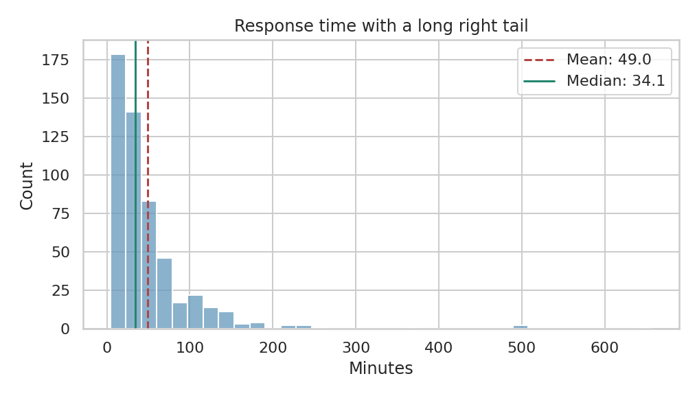

**핵심 해설**

일부 매우 큰 응답시간 때문에 평균과 중앙값이 달라질 수 있습니다. 관측을 임의로 삭제하지 않고 분포와 기준을 먼저 확인합니다.


---

<a id="section-5-7"></a>
## 5.7. IQR & Outlier Candidates

**문제 상황**

배송 시간이 유난히 긴 기록을 찾아 검토 대상으로 표시하고 싶습니다.

**필요한 개념**

사분위범위 IQR = Q3 − Q1. 자주 쓰는 탐색 기준은 Q1 − 1.5×IQR 미만 또는 Q3 + 1.5×IQR 초과입니다. 이상치 후보일 뿐 오류 확정은 아닙니다.

#### 사분위수와 IQR의 원리

제1사분위수(Q1)는 데이터의 하위 약 25%에 해당하는 위치, 제3사분위수(Q3)는 하위 약 75%에 해당하는 위치입니다. 두 값의 차이인 **사분위범위(IQR)**는 데이터 중간 50%가 퍼져 있는 폭을 나타냅니다.

IQR은 큰 값 하나만으로 크게 변하는 평균·표준편차와 달리, 중간 구간의 퍼짐에 초점을 맞춥니다. 이상치 후보를 찾을 때 흔히 다음 경계를 사용합니다.

$$
L=Q_1-1.5\,IQR,\qquad U=Q_3+1.5\,IQR
$$

가령 Q1이 2일, Q3이 6일이면 IQR은 4일이고 상한은 12일입니다. 13일 배송은 **검토 후보**이지만, 반드시 잘못 기록됐다는 의미는 아닙니다. 날씨·지역·주문 특성 때문에 실제로 오래 걸렸을 수 있습니다.

Boxplot의 수염(Whisker)은 기본적인 1.5×IQR 방식에서 경계값 자체까지 무조건 뻗는 것이 아니라, 일반적으로 **그 경계 안에 있는 실제 최솟값·최댓값**에 도달합니다. 경계 밖 관측은 점으로 표시될 수 있습니다. 데이터의 단위상 불가능한 하한(예: 음수 배송일)이 계산되더라도 실제 음수 관측이 있다는 뜻은 아닙니다.

**예제 코드 — [05_outlier_iqr.py](./examples/05_outlier_iqr.py)**

```python
from pathlib import Path
import numpy as np
import pandas as pd
import matplotlib
matplotlib.use('Agg')
import matplotlib.pyplot as plt
import seaborn as sns

ROOT = Path(__file__).resolve().parents[1]
sns.set_theme(style='whitegrid')

df=pd.read_csv(ROOT/'data/shipments.csv')
x=df.loc[df['status'].eq('delivered'),'actual_days'].dropna()
q1,q3=x.quantile([.25,.75]); iqr=q3-q1
upper=q3+1.5*iqr;lower=q1-1.5*iqr
suspect=x[(x<lower)|(x>upper)]
print('IQR:',round(iqr,2),'bounds:',round(lower,2),round(upper,2),'candidates:',len(suspect))
fig,ax=plt.subplots(figsize=(7,3.3));sns.boxplot(x=x,ax=ax,color='#7AAFC5')
ax.set(title='Delivery duration and outlier candidates',xlabel='Actual days')
fig.tight_layout();fig.savefig(ROOT/'figures/05_outlier_iqr.png',dpi=145);plt.close(fig)
```

**실행 결과 (터미널)**

```text
IQR: 2.06 bounds: -1.34 6.9 candidates: 12
```

**실행 결과 (그래프)**

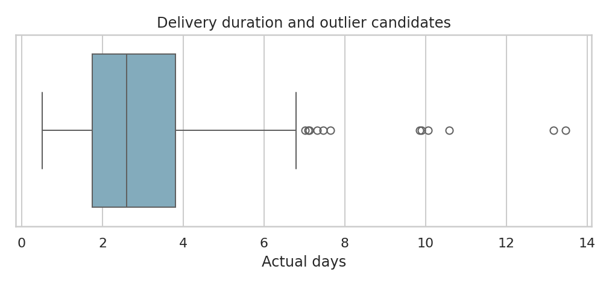

**핵심 해설**

IQR은 산포가 큰 집단과 작은 집단에서 다른 경계를 만들 수 있습니다. 업무상 확인할 값인지 판단한 후 처리 정책을 정합니다.


---

<a id="section-5-8"></a>
## 5.8. Sensitivity to Extreme Values

**문제 상황**

극단적인 배송 기록 1건 때문에 평균이 얼마나 변하는지 살펴봅니다.

**필요한 개념**

민감도 분석은 포함·제외한 결과를 둘 다 비교해 특정 판단이 결론에 미치는 영향을 확인하는 방법입니다.

#### 극단값을 제외했을 때 결론이 바뀌는가?

민감도 분석(Sensitivity Analysis)은 분석에 사용한 **판단이나 가정이 결과를 얼마나 바꾸는지** 확인하는 과정입니다. 여기서는 한 건의 긴 배송 기록을 포함한 경우와 제외한 경우의 평균을 비교합니다.

예제의 7개 소요일 `[1.5, 1.9, 2.1, 2.3, 2.0, 2.2, 19.0]`에서 전체 평균은 약 4.43일, 19.0일을 제외한 평균은 2.0일입니다. 같은 데이터라도 한 건의 영향 때문에 "평균 배송일"이 두 배 이상 달라지는 셈입니다.

하지만 값이 크다는 이유만으로 삭제해서는 안 됩니다. **측정 오류인지, 드물지만 실제 발생한 사건인지**를 먼저 구분해야 합니다. 기준을 달리한 결과를 나란히 제시하고, 본래 분석과 별도로 어떻게 처리했는지 기록해야 비교가 가능합니다.

실무에서는 평균과 함께 중앙값·분위수 등 극단값에 비교적 덜 민감한 통계량을 살펴보기도 합니다. 민감도 분석은 마음에 드는 결과를 고르는 작업이 아니라, 결론이 어떤 판단에 의존하는지 드러내는 작업입니다.

**예제 코드 — [06_outlier_sensitivity.py](./examples/06_outlier_sensitivity.py)**

```python
from pathlib import Path
import numpy as np
import pandas as pd
import matplotlib
matplotlib.use('Agg')
import matplotlib.pyplot as plt
import seaborn as sns

ROOT = Path(__file__).resolve().parents[1]
sns.set_theme(style='whitegrid')

values=pd.Series([1.5,1.9,2.1,2.3,2.0,2.2,19.0])
mean_all=values.mean();mean_without=values[values<10].mean()
print('Mean all:',round(mean_all,2),'Without flagged value:',round(mean_without,2))
fig,ax=plt.subplots(figsize=(6,3.5))
ax.bar(['All records','Flagged excluded'],[mean_all,mean_without],color=['#B68C68','#6C9EA2'])
ax.set(ylabel='Average days',title='Sensitivity to one extreme observation')
fig.tight_layout();fig.savefig(ROOT/'figures/06_outlier_sensitivity.png',dpi=145);plt.close(fig)
```

**실행 결과 (터미널)**

```text
Mean all: 4.43 Without flagged value: 2.0
```

**실행 결과 (그래프)**

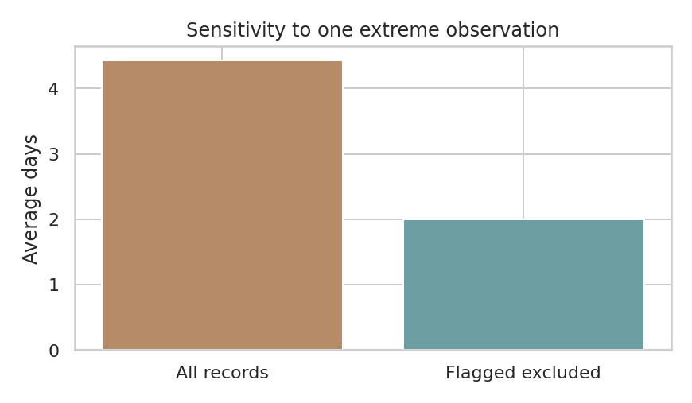

**핵심 해설**

데이터를 무단으로 제거하지 말고, ‘검토 대상 제외 시’와 ‘전체 포함 시’의 결과를 모두 보고하면 변화의 원인이 명확해집니다.


---

<a id="section-5-9"></a>
## 5.9. Groupwise Median & Sample Size

**문제 상황**

서로 다른 배송 지역의 소요일 분포를 비교하면서 표본 수도 확인해야 합니다.

**필요한 개념**

그룹별 중앙값이나 Boxplot만으로 충분하지 않습니다. 각 그룹의 관측 수와 결측 건수도 함께 확인해야 합니다.

#### 집단의 중앙값만 같아도 분포는 다를 수 있습니다

그룹 비교에서는 대표값 하나가 아니라 **중심(평균·중앙값), 퍼짐(IQR 등), 표본 수(n)**를 함께 봅니다. 예를 들어 두 지역의 중앙 배송일이 모두 3일이어도 한 지역은 대부분 2~4일에 몰리고, 다른 지역은 1~10일까지 넓게 퍼질 수 있습니다. 중앙값만으로는 후자의 불안정성을 알기 어렵습니다.

표본 수가 다르면 수치의 안정성도 달라집니다. 10건에서 얻은 중앙값과 1,000건에서 얻은 중앙값이 같아도, 새 관측이 추가될 때 결과가 흔들릴 가능성은 다릅니다. 다만 **표본이 크다고 자동으로 대표성이 확보되는 것은 아닙니다.** 특정 조건의 배송만 모였다면 큰 표본도 편향될 수 있습니다.

Boxplot을 읽을 때에는 중앙선이 중앙값, 상자의 아래·위 경계가 Q1·Q3, 상자의 높이가 IQR이라는 점을 확인합니다. 이상점은 조사 후보이지 제거 대상 목록이 아닙니다. 각 그룹의 `n`을 함께 표기하면 서로 다른 규모의 집단을 오해할 위험을 줄일 수 있습니다.

**예제 코드 — [07_group_comparison.py](./examples/07_group_comparison.py)**

```python
from pathlib import Path
import numpy as np
import pandas as pd
import matplotlib
matplotlib.use('Agg')
import matplotlib.pyplot as plt
import seaborn as sns

ROOT = Path(__file__).resolve().parents[1]
sns.set_theme(style='whitegrid')

raw=pd.read_csv(ROOT/'data/shipments.csv')
valid=raw.loc[raw.status.eq('delivered') & raw.actual_days.notna()].copy()
counts=valid.groupby('zone').size()
print('Group n:',counts.to_dict())
fig,ax=plt.subplots(figsize=(7,4))
sns.boxplot(data=valid,x='zone',y='actual_days',order=['Urban','Suburban','Remote'],ax=ax)
ax.set(title='Delivery duration by zone',ylabel='Days')
for i,z in enumerate(['Urban','Suburban','Remote']):ax.text(i,ax.get_ylim()[1]*.92,f'n={counts[z]}',ha='center',fontsize=9)
fig.tight_layout();fig.savefig(ROOT/'figures/07_group_comparison.png',dpi=145);plt.close(fig)
```

**실행 결과 (터미널)**

```text
Group n: {'Remote': 107, 'Suburban': 182, 'Urban': 284}
```

**실행 결과 (그래프)**

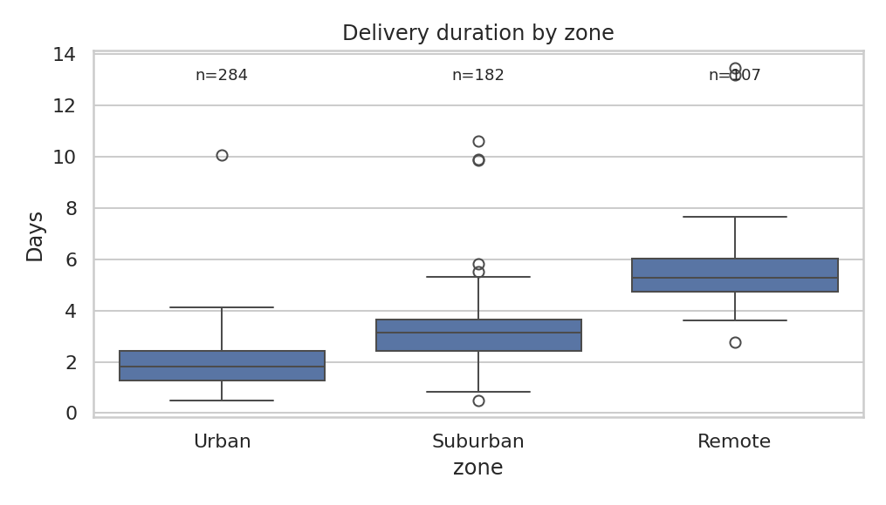

**핵심 해설**

그룹 크기가 다르면 극단값의 영향과 신뢰도가 달라집니다. Boxplot만 보고 정시 배송의 원인을 판단하지 않습니다.


---

<a id="section-5-10"></a>
## 5.10. ECDF & Percentile Reading

**문제 상황**

고객 문의 중 60분 이내 응답한 비율을 그래프에서 읽고 싶습니다.

**필요한 개념**

ECDF는 기준값 이하인 관측의 비중을 누적해서 보여줍니다. 특정 SLA 기준과 분위수를 함께 확인할 때 유용합니다.

#### ECDF는 "기준 이하가 몇 %인가?"에 답합니다

경험적 누적분포함수(ECDF)는 관측값을 작은 순서로 정렬한 뒤, 특정 기준값 **이하**에 포함된 관측값 비율을 나타냅니다. 값의 분포를 연속적인 누적 비율로 보기 때문에 서비스 목표 시간(SLA)을 확인하기에 유용합니다.

$$
F_n(t)=\frac{1}{n}\sum_{i=1}^{n}\mathbf{1}(x_i\le t)
$$

여기서 $n$은 유효 관측 개수이고, $\mathbf{1}(x_i\le t)$는 해당 관측값이 기준 $t$ 이하면 1, 아니면 0입니다. 예를 들어 `[10, 20, 30, 60]`분 중 30분 이하는 3건이므로 $F_n(30)=3/4=0.75$입니다.

**ECDF를 읽는 방향**에 따라 질문이 달라집니다. x축에서 60분을 골라 y값을 읽으면 "60분 이내에 응답한 비율"이고, y축에서 0.9를 골라 x값을 읽으면 "관측의 약 90%가 이내에 들어오는 시간(P90)"을 찾는 것입니다. 예제에서는 60분 이하인 유효 관측의 비율이 0.762(76.2%)입니다.

단, 결측값은 ECDF의 유효 표본에서 제외됩니다. 이를 전체 문의 중 76.2%가 60분 이내 응답됐다는 뜻으로 바꾸려면 결측 기록을 어떻게 처리할지 별도로 정해야 합니다.

**예제 코드 — [08_ecdf_threshold.py](./examples/08_ecdf_threshold.py)**

```python
from pathlib import Path
import numpy as np
import pandas as pd
import matplotlib
matplotlib.use('Agg')
import matplotlib.pyplot as plt
import seaborn as sns

ROOT = Path(__file__).resolve().parents[1]
sns.set_theme(style='whitegrid')

raw=pd.read_csv(ROOT/'data/support_tickets.csv')
x=raw.first_response_min.dropna()
fig,ax=plt.subplots(figsize=(7,4))
sns.ecdfplot(x=x,ax=ax,color='#397BA8',lw=2)
ax.axvline(60,color='#C45F54',ls='--',label='60 min benchmark')
ax.set(xlim=(0,250),ylim=(0,1.02),xlabel='First response (minutes)',ylabel='Share at or below x',title='Cumulative response distribution')
ax.legend();fig.tight_layout();fig.savefig(ROOT/'figures/08_ecdf_threshold.png',dpi=145);plt.close(fig)
print('<= 60 minutes:',round((x<=60).mean(),3))
```

**실행 결과 (터미널)**

```text
<= 60 minutes: 0.762
```

**실행 결과 (그래프)**

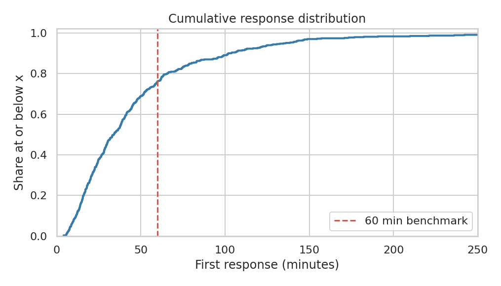

**핵심 해설**

ECDF의 0.8 지점은 관측의 약 80%가 해당 시간 이내임을 나타냅니다. 분모에서 제외된 누락 기록 수는 별도로 기록합니다.


---

<a id="section-5-11"></a>
## 5.11. Counts vs. Rates

**문제 상황**

생산 라인의 불량 건수만 비교하면 검사량이 많은 라인이 불리해질 수 있습니다.

**필요한 개념**

불량률 = 불량 건수 ÷ 검사 건수. 건수와 비율은 서로 다른 질문이므로 분모를 반드시 제공합니다.

#### 건수와 비율의 차이는 분모에서 시작됩니다

건수(Count)는 사건이 발생한 절대 수이고, 비율(Rate 또는 Proportion)은 **어떤 대상 가운데 얼마만큼 발생했는지**를 말합니다. 생산라인 A에서 불량품 15개, B에서 20개가 나왔다고 해서 B의 품질이 더 나쁘다고 할 수는 없습니다.

A가 100개를 검사했다면 불량률은 15%, B가 1,000개를 검사했다면 2%입니다. 불량 건수는 B가 많지만 비율은 A가 높습니다. 따라서 반드시 "무엇을 분모로 하는가"를 먼저 정의해야 합니다.

$$
\hat{p}=\frac{k}{n}
$$

- $\hat{p}$: 관측된 사건 비율(표본비율)
- $k$: 해당 사건이 발생한 기록 수
- $n$: 비교 가능한 전체 기록 수

**서로 다른 분모를 사용할 때 주의:** 완료된 배송 중 지연 비율과 접수된 전체 배송 중 지연 비율은 다른 지표입니다. 결측이나 취소 기록의 처리 기준을 섞어 계산하면 비율을 공정하게 비교할 수 없습니다. 관측 기간이 다른 시스템이라면 단순 건수 대신 시간당 발생량처럼 노출량(Exposure)을 반영한 지표가 필요할 수도 있습니다.

**예제 코드 — [09_rates_counts.py](./examples/09_rates_counts.py)**

```python
from pathlib import Path
import numpy as np
import pandas as pd
import matplotlib
matplotlib.use('Agg')
import matplotlib.pyplot as plt
import seaborn as sns

ROOT = Path(__file__).resolve().parents[1]
sns.set_theme(style='whitegrid')

raw=pd.read_csv(ROOT/'data/inspections.csv').drop_duplicates('inspection_id')
g=raw.groupby('line',as_index=False).agg(n=('is_defective','size'),defects=('is_defective','sum'))
g['rate']=g.defects/g.n
fig,axes=plt.subplots(1,2,figsize=(10,3.8),layout='constrained')
axes[0].bar(g.line,g.defects,color='#4E86B0');axes[0].set(title='Defect count',ylabel='Cases')
axes[1].bar(g.line,g.rate,color='#60A092');axes[1].set(title='Defect share',ylabel='Rate',ylim=(0,.3))
fig.savefig(ROOT/'figures/09_rates_counts.png',dpi=145);plt.close(fig)
print(g[['line','n','defects','rate']].round(3).to_string(index=False))
```

**실행 결과 (터미널)**

```text
line   n  defects  rate
  A1 116       10 0.086
  A2 116       10 0.086
  B1 116       16 0.138
  B2 116        9 0.078
  C1 116        5 0.043
  C2 116       16 0.138
```

**실행 결과 (그래프)**

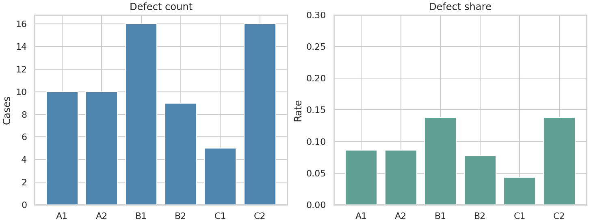

**핵심 해설**

표본 수가 거의 같더라도 분모와 집계 규칙을 보고하는 습관이 중요합니다. 작동 횟수가 다른 시스템에서는 더욱 그렇습니다.


---

<a id="section-5-12"></a>
## 5.12. Correlation & Scatter

**문제 상황**

응답시간과 만족도 사이에 관계가 있는지 확인하고 싶습니다.

**필요한 개념**

상관계수는 두 수치 변수의 함께 변하는 정도를 요약하며, 인과관계를 증명하지 않습니다. 범주·측정 방식에 따라서도 해석이 달라집니다.

#### 산점도와 상관계수가 각각 보여주는 것

산점도는 두 수치형 변수의 관측값을 $(x,y)$ 점으로 그려 **관계의 모양**을 보여줍니다. 점들이 오른쪽 위로 뻗으면 함께 증가하는 경향, 오른쪽 아래로 뻗으면 한 값이 커질수록 다른 값이 작아지는 경향을 의심할 수 있습니다.

Pearson 상관계수 $r$은 이러한 관계 중 **선형적인 동행 정도**를 -1부터 1까지의 숫자로 요약합니다. $r=1$은 완전한 양의 선형 관계, $r=-1$은 완전한 음의 선형 관계, $r\approx 0$은 뚜렷한 **선형** 관계가 거의 없음을 의미합니다. 0이라는 이유로 모든 비선형 관계가 없다고 결론 내릴 수는 없습니다.

예제에서는 응답시간과 고객 평점의 Pearson $r=-0.004$이며, 두 값이 모두 존재하는 기록은 529개입니다. 이는 전체 자료에서 **선형적 관계가 거의 보이지 않는다**는 기술통계적 관찰입니다. 다만 우선순위·팀 등이 섞이면서 서로 다른 집단의 관계가 가려질 수 있습니다.

상관관계는 인과관계가 아닙니다. 예를 들어 응답시간이 긴 문의가 복잡한 문제에 집중되어 있다면, 문제의 복잡도가 응답시간과 만족도 모두에 영향을 줄 수 있습니다. 고객 평점이 1~5의 순서형 척도라는 점도 숫자 사이 간격을 동일한 크기로 간주하는 Pearson 해석의 한계입니다.

**예제 코드 — [10_correlation.py](./examples/10_correlation.py)**

```python
from pathlib import Path
import numpy as np
import pandas as pd
import matplotlib
matplotlib.use('Agg')
import matplotlib.pyplot as plt
import seaborn as sns

ROOT = Path(__file__).resolve().parents[1]
sns.set_theme(style='whitegrid')

df=pd.read_csv(ROOT/'data/support_tickets.csv').dropna(subset=['first_response_min','customer_rating'])
pearson=df['first_response_min'].corr(df['customer_rating'])
fig,ax=plt.subplots(figsize=(7,4))
sns.scatterplot(data=df,x='first_response_min',y='customer_rating',alpha=.35,ax=ax)
ax.set(xlim=(0,250),xlabel='Response (minutes)',ylabel='Customer rating',title=f'Response and rating (Pearson r={pearson:.2f})')
fig.tight_layout();fig.savefig(ROOT/'figures/10_correlation.png',dpi=145);plt.close(fig)
print('Pearson r:',round(pearson,3),'paired n:',len(df))
```

**실행 결과 (터미널)**

```text
Pearson r: -0.004 paired n: 529
```

**실행 결과 (그래프)**

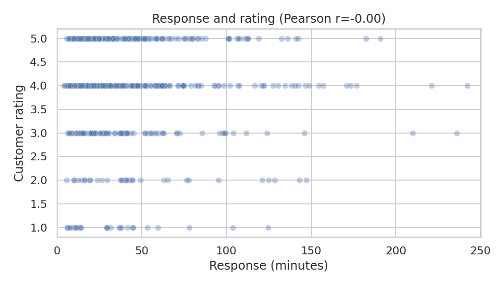

**핵심 해설**

관측된 관계가 약해도 특정 하위집단에는 관계가 있을 수 있습니다. 고객 평점은 1–5의 순서형 값이므로 Pearson 계수 해석에는 한계가 있습니다.


---

<a id="section-5-13"></a>
## 5.13. Pearson vs. Spearman

**문제 상황**

관계가 완벽한 직선이 아니어도 한 값이 증가할수록 다른 값이 증가하는지 비교해 봅니다.

**필요한 개념**

Pearson은 선형 관계, Spearman은 순위 기준 단조 관계를 나타냅니다. 단조적 곡선에서는 서로 다른 값이 나올 수 있습니다.

#### 직선 관계와 순위 관계를 구별합니다

**Pearson**은 실제 수치의 선형적인 관계에 초점을 맞춥니다. **Spearman**은 수치를 순위로 바꾼 뒤 순위끼리 Pearson 상관을 계산하므로, 대체로 한 변수가 커질 때 다른 변수도 계속 증가하거나 감소하는 **단조(Monotonic) 관계**를 살펴보는 데 유용합니다.

$$
r_{XY}=\frac{\sum_i(x_i-\bar x)(y_i-\bar y)}{\sqrt{\sum_i(x_i-\bar x)^2}\sqrt{\sum_i(y_i-\bar y)^2}}
$$

Spearman의 계수 $\rho_s$는 이 식에 원래 값 대신 각 변수의 **순위**를 넣어 계산한다고 이해하면 됩니다. 단조 증가는 매번 같은 양만큼 증가하는 직선일 필요가 없습니다. 예를 들어 $y=x^2$이고 $x>0$이라면 증가 속도는 빨라지지만 값의 순서는 항상 같아 Spearman이 1이 될 수 있습니다.

실제 예제의 Pearson은 약 0.969, Spearman은 1.0입니다. 이는 두 방법이 모순된다는 뜻이 아니라 **서로 다른 관계를 측정하기 때문**입니다. 순위가 같은 값(동점)은 평균 순위를 쓰는 등 별도 처리가 필요하고, Spearman이 1이라고 인과관계가 성립하는 것도 아닙니다.

**예제 코드 — [11_pearson_spearman.py](./examples/11_pearson_spearman.py)**

```python
from pathlib import Path
import numpy as np
import pandas as pd
import matplotlib
matplotlib.use('Agg')
import matplotlib.pyplot as plt
import seaborn as sns

ROOT = Path(__file__).resolve().parents[1]
sns.set_theme(style='whitegrid')

x=np.arange(1,51,dtype=float);y=x**2
frame=pd.DataFrame({'x':x,'y':y})
p=frame.x.corr(frame.y,method='pearson')
s=frame.x.corr(frame.y,method='spearman')
fig,ax=plt.subplots(figsize=(6.5,4));ax.scatter(x,y,s=19,alpha=.7)
ax.set(xlabel='Input',ylabel='Squared response',title=f'Pearson {p:.2f} vs Spearman {s:.2f}')
fig.tight_layout();fig.savefig(ROOT/'figures/11_pearson_spearman.png',dpi=145);plt.close(fig)
print('Pearson:',round(p,3),'Spearman:',round(s,3))
```

**실행 결과 (터미널)**

```text
Pearson: 0.969 Spearman: 1.0
```

**실행 결과 (그래프)**

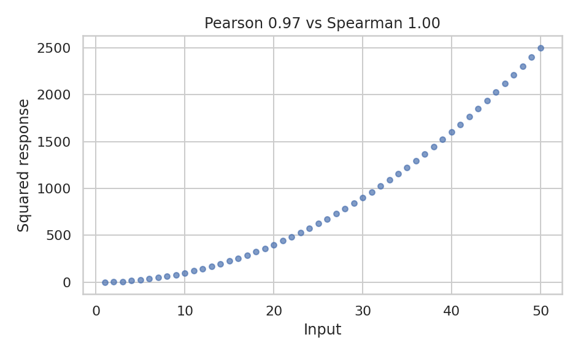

**핵심 해설**

Spearman이 1이어도 인과관계나 완벽한 직선 관계라는 뜻은 아닙니다. 극단값·동점·표본 범위에도 주의합니다.


---

<a id="section-5-14"></a>
## 5.14. Correlation Matrix Caveats

**문제 상황**

측정값이 여럿인 검사 데이터를 한 번에 비교하려고 합니다.

**필요한 개념**

상관행렬은 수치형 열의 쌍별 상관계수를 보여줍니다. ID나 이진 변수, 상수 열을 기계적으로 포함하기보다 변수 의미를 먼저 봅니다.

#### 상관행렬은 여러 관계를 한눈에 보는 도구입니다

상관행렬(Correlation Matrix)은 여러 변수의 **모든 두 변수 조합**에 대한 상관계수를 행과 열로 정리한 표입니다. 변수 A와 B의 상관계수는 B와 A의 상관계수와 같으므로 행렬은 대칭입니다. 값이 변하는 변수와 자기 자신의 상관계수는 1입니다.

히트맵은 행렬의 각 셀을 색상으로 표현해 어떤 변수쌍에 큰 양·음의 상관이 있는지 빠르게 탐색하도록 돕습니다. 상관계수 히트맵에서는 보통 색상 범위를 -1~1로 고정하고 0을 중심으로 설정해야 그래프 간 비교가 가능합니다.

주의할 것은 **행렬에 넣을 열의 의미**입니다. `inspection_id`처럼 숫자로 표시됐어도 단순 식별자는 연속적인 측정 변수가 아닙니다. 반면 불량 여부처럼 0/1로 코딩된 열도 수학적으로 Pearson 계수를 계산할 수 있지만, 이를 "결과 집단 간 차이와 관련된 지표"라는 맥락에서 해석해야 합니다. 상수 열은 변동이 없어 상관계수가 정의되지 않습니다.

또한 결측값이 있으면 변수쌍마다 서로 다른 행을 이용해 계산할 수 있으므로, 보기에는 하나의 행렬이라도 각 셀의 표본 수가 다를 수 있습니다. 우연히 큰 값을 찾지 않도록 필요한 변수쌍을 우선 정하고 산점도와 분석 대상 기록을 함께 확인합니다.

**예제 코드 — [12_correlation_heatmap.py](./examples/12_correlation_heatmap.py)**

```python
from pathlib import Path
import numpy as np
import pandas as pd
import matplotlib
matplotlib.use('Agg')
import matplotlib.pyplot as plt
import seaborn as sns

ROOT = Path(__file__).resolve().parents[1]
sns.set_theme(style='whitegrid')

df=pd.read_csv(ROOT/'data/inspections.csv').drop_duplicates('inspection_id')
columns=['thickness_mm','temperature_c','is_defective']
corr=df[columns].corr(numeric_only=True)
fig,ax=plt.subplots(figsize=(6.4,4.6));sns.heatmap(corr,annot=True,fmt='.2f',vmin=-1,vmax=1,center=0,cmap='vlag',ax=ax)
ax.set(title='Inspection data correlation matrix')
fig.tight_layout();fig.savefig(ROOT/'figures/12_correlation_heatmap.png',dpi=145);plt.close(fig)
print(corr.round(2).to_string())
```

**실행 결과 (터미널)**

```text
thickness_mm  temperature_c  is_defective
thickness_mm           1.00           0.02          0.04
temperature_c          0.02           1.00          0.02
is_defective           0.04           0.02          1.00
```

**실행 결과 (그래프)**

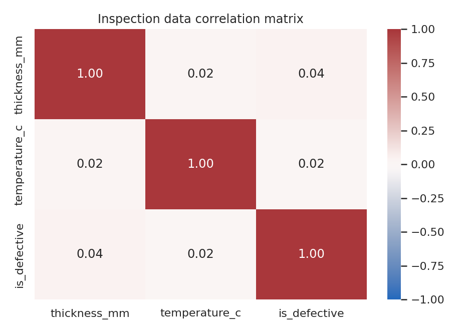

**핵심 해설**

결측이 있으면 각 변수쌍에 사용된 관측 수가 달라질 수 있습니다. 색상이 진하다는 이유만으로 중요한 원인이라 결론 내리지 않습니다.


---

<a id="section-5-15"></a>
## 5.15. Simpson’s Paradox — Aggregation Trap

**문제 상황**

배송사 A가 전체 정시 배송률은 낮지만, 각 배송 지역에서는 오히려 더 좋은 사례가 발생했습니다.

**필요한 개념**

집단 구성비가 다르면 전체 비교 방향과 하위집단 비교 방향이 달라지는 현상이 Simpson의 역설입니다.

#### Simpson의 역설은 왜 발생할까요?

**Simpson의 역설(Simpson's Paradox)**은 집단별 비교에서는 일관된 방향으로 나타난 차이가 여러 집단을 합치면 반대 방향으로 나타나는 현상입니다. 통계 계산이 틀린 것이 아니라, **각 집단이 전체에서 차지하는 비중이 서로 다르기 때문에** 발생할 수 있습니다.

이 예제에서 배송사 A의 정시 배송률은 Urban 95%, Remote 70%이고, B는 각각 90%, 60%입니다. 즉 두 지역 모두 A가 더 높습니다. 하지만 A는 어려운 Remote 주문 비중이 약 83.3%이고 B는 약 11.1%입니다. 전체 정시 배송률은 각 지역의 비율을 동일하게 평균 내는 것이 아니라 해당 지역의 주문 비중으로 가중한 평균입니다.

$$
R_{\mathrm{total}}=\sum_g w_g R_g,\qquad w_g=\frac{n_g}{\sum_h n_h}
$$

- A의 전체 정시 배송률 ≈ $0.833\times0.70+0.167\times0.95=0.742$ (74.2%)
- B의 전체 정시 배송률 ≈ $0.111\times0.60+0.889\times0.90=0.867$ (86.7%)

따라서 **각 지역에서는 A가 우수하지만 전체에서는 B가 우수한 것처럼 보입니다.** 지역별 배송 난도가 다른 상태에서 집계 비율만으로 배송사의 성능 차이를 평가하면 판단이 달라질 수 있습니다.

이는 "항상 하위집단 결과만 맞다"는 뜻도 아닙니다. 분석 질문이 실제 운영 전체의 달성률인지, 동일한 배송 난도에서의 성능 비교인지에 따라 필요한 지표가 다릅니다. 전체 집계와 조건별 비교를 함께 보고 결론의 범위를 명시해야 합니다.

**예제 코드 — [13_simpson_paradox.py](./examples/13_simpson_paradox.py)**

```python
from pathlib import Path
import numpy as np
import pandas as pd
import matplotlib
matplotlib.use('Agg')
import matplotlib.pyplot as plt
import seaborn as sns

ROOT = Path(__file__).resolve().parents[1]
sns.set_theme(style='whitegrid')

df=pd.read_csv(ROOT/'data/simpson_delivery.csv')
pooled=df.groupby('carrier').on_time.mean()
within=df.groupby(['zone','carrier']).on_time.mean().unstack()
fig,axes=plt.subplots(1,2,figsize=(10,4),layout='constrained')
pooled.plot.bar(ax=axes[0],color='#6F99B6',rot=0)
axes[0].set(ylim=(0,1),ylabel='On-time share',title='Overall comparison')
within.plot.bar(ax=axes[1],rot=0,color=['#6F99B6','#C78D74'])
axes[1].set(ylim=(0,1),ylabel='On-time share',title='Within each zone')
fig.savefig(ROOT/'figures/13_simpson_paradox.png',dpi=145);plt.close(fig)
print('Overall:',pooled.round(3).to_dict())
print('By zone: ',within.round(3).to_dict())
```

**실행 결과 (터미널)**

```text
Overall: {'A': 0.742, 'B': 0.867}
By zone:  {'A': {'Remote': 0.7, 'Urban': 0.95}, 'B': {'Remote': 0.6, 'Urban': 0.9}}
```

**실행 결과 (그래프)**

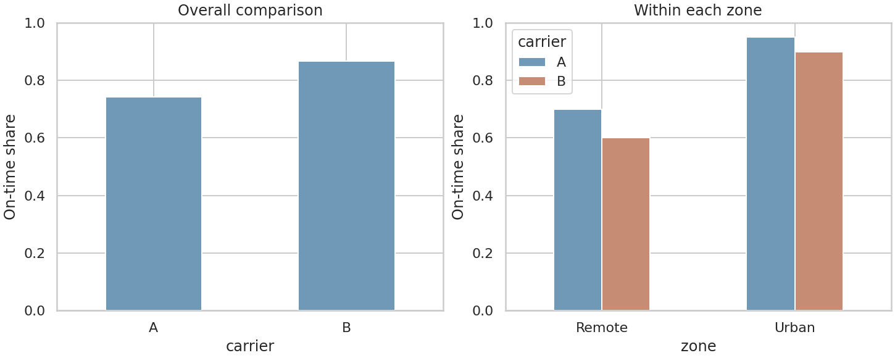

**핵심 해설**

A는 Urban과 Remote에서 각각 B보다 높지만, A에 어려운 Remote 주문이 더 많이 배정돼 전체 비율은 낮습니다. 전체와 하위집단을 함께 보고 편향 가능성을 검토합니다.


---

<a id="section-5-16"></a>
## 5.16. Group Composition & Denominator

**문제 상황**

집계 결과가 역전되는 이유가 배송지역별 주문 구성비에 있는지 확인합니다.

**필요한 개념**

구성비 그래프는 각 그룹에 어떤 종류의 관측이 얼마나 섞여 있는지 보여줍니다.

#### 구성비는 전체 평균을 만드는 가중치입니다

앞 절에서는 지역마다 배송사의 정시 배송률이 달랐습니다. 그렇다면 이제 질문은 "**각 배송사가 어떤 지역의 주문을 얼마나 많이 처리했는가?**"로 바뀝니다. 구성비(Composition)는 이 질문에 답합니다.

`pd.crosstab(..., normalize="index")`는 각 배송사를 한 행으로 두고 그 배송사의 주문 100%가 지역별로 어떻게 나뉘는지 계산합니다. 예제에서 A의 주문은 Remote 83.3%·Urban 16.7%, B는 Remote 11.1%·Urban 88.9%입니다. 이 구성비가 바로 앞 절의 가중평균에서 사용된 $w_g$에 해당합니다.

100% 누적 막대그래프는 각 그룹의 **상대적인 구성**을 비교하기 좋습니다. 하지만 두 배송사가 같은 주문 수를 처리했다는 뜻은 아닙니다. 예를 들어 두 막대 모두 높이가 100%여도 한쪽은 20건, 다른 한쪽은 2,000건일 수 있으므로 **절대 건수(n)**도 따로 확인해야 합니다.

구성비를 조정해 공정하게 비교하려면 어떤 기준 집단의 구성비를 사용할지 미리 정해야 합니다. 이는 단순히 그래프의 순서를 바꾸는 문제가 아니라 **비교할 대상을 정의하는 문제**입니다.

**예제 코드 — [14_composition_counts.py](./examples/14_composition_counts.py)**

```python
from pathlib import Path
import numpy as np
import pandas as pd
import matplotlib
matplotlib.use('Agg')
import matplotlib.pyplot as plt
import seaborn as sns

ROOT = Path(__file__).resolve().parents[1]
sns.set_theme(style='whitegrid')

df=pd.read_csv(ROOT/'data/simpson_delivery.csv')
table=pd.crosstab(df.carrier,df.zone,normalize='index')
fig,ax=plt.subplots(figsize=(6.7,4))
table[['Urban','Remote']].plot.bar(stacked=True,ax=ax,color=['#77ADCC','#C7A077'],rot=0)
ax.set(title='Order mix by carrier',ylabel='Share of orders',ylim=(0,1))
fig.tight_layout();fig.savefig(ROOT/'figures/14_composition_counts.png',dpi=145);plt.close(fig)
print(table.round(3).to_string())
```

**실행 결과 (터미널)**

```text
zone     Remote  Urban
carrier               
A         0.833  0.167
B         0.111  0.889
```

**실행 결과 (그래프)**

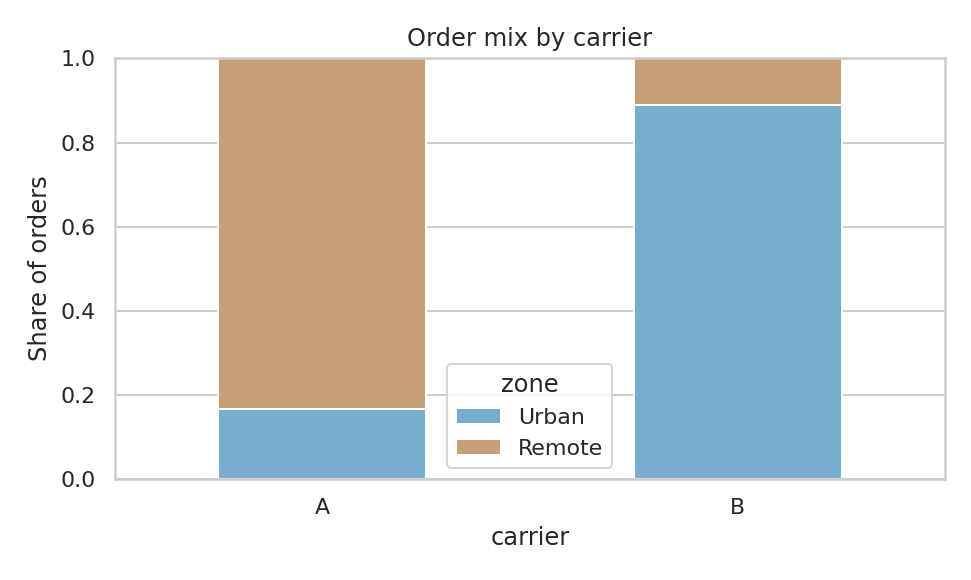

**핵심 해설**

구성비를 비교하면 A와 B가 서로 다른 조건의 데이터를 많이 포함한다는 사실이 드러납니다. 구성비 차이를 무시한 전체 순위는 판단을 왜곡할 수 있습니다.


---

<a id="section-5-17"></a>
## 5.17. Rate Intervals & Sample Size

**문제 상황**

불량률이 같은 10%여도 검사 건수가 10건인 라인과 1,000건인 라인의 불확실성은 다릅니다.

**필요한 개념**

Wilson 구간은 성공/실패처럼 이항 결과의 비율 불확실성을 표현하는 방법입니다. 표본 수가 적을수록 대체로 구간이 넓어집니다.

#### 같은 비율이라도 표본 수가 다르면 정밀도가 다릅니다

관측 비율이 10%인 집단 두 개가 있더라도 하나는 10건 중 1건, 다른 하나는 1,000건 중 100건일 수 있습니다. 비율의 점추정값은 같지만, 작은 표본에서는 새 관측 몇 건만 추가돼도 비율이 크게 달라집니다.

**Wilson 점수 구간(Wilson Score Interval)**은 성공·실패로 구분되는 이항 자료에서 비율의 불확실성을 나타내는 한 가지 방법입니다. 단순히 $\hat p\pm1.96\sqrt{\hat p(1-\hat p)/n}$으로 계산하는 방법보다 작은 표본이나 극단적인 비율에서 일반적으로 더 합리적인 경계를 제공합니다.

$$
\hat p=\frac{k}{n},\quad d=1+\frac{z^2}{n},\quad
c=\frac{\hat p+\frac{z^2}{2n}}{d}
$$

$$
h=\frac{z}{d}\sqrt{\frac{\hat p(1-\hat p)}{n}+\frac{z^2}{4n^2}},\qquad
\mathrm{Wilson\ Interval}=[c-h,\ c+h]
$$

여기서 $k$는 해당 사건 건수, $n$은 전체 대상 건수, $z\approx1.96$은 양측 95% 신뢰수준에 대응하는 정규분포 기준값입니다. 예제의 구간은 10건 중 1건일 때 약 1.8~40.4%, 100건 중 10건일 때 약 5.5~17.4%, 1,000건 중 100건일 때 약 8.3~12.0%입니다.

**95% 신뢰구간의 정확한 의미:** 같은 방식의 표본추출과 구간 계산을 매우 여러 번 반복하면, 그 구간들 가운데 약 95%가 참인 모집단 비율을 포함하도록 설계된 절차라는 뜻입니다. 이번에 계산한 특정 구간 안에 고정된 참값이 있을 확률이 95%라고 해석하지 않습니다. 또한 Wilson 구간은 표본추출 방식과 관측의 독립성 같은 전제까지 대신 확인해 주지는 않습니다.

**예제 코드 — [15_sample_size_ci.py](./examples/15_sample_size_ci.py)**

```python
from pathlib import Path
import numpy as np
import pandas as pd
import matplotlib
matplotlib.use('Agg')
import matplotlib.pyplot as plt
import seaborn as sns

ROOT = Path(__file__).resolve().parents[1]
sns.set_theme(style='whitegrid')

from math import sqrt

def wilson(k,n,z=1.96):
    p=k/n;den=1+z*z/n
    center=(p+z*z/(2*n))/den
    radius=z*sqrt(p*(1-p)/n+z*z/(4*n*n))/den
    return center-radius,center+radius

n=[10,100,1000];k=[1,10,100];intervals=[wilson(a,b) for a,b in zip(k,n)]
fig,ax=plt.subplots(figsize=(7,4))
for idx,(lo,hi) in enumerate(intervals):
    ax.errorbar(.1,idx,xerr=[[.1-lo],[hi-.1]],fmt='o',capsize=4,color='#337CA3')
ax.set(yticks=range(3),yticklabels=[f'n={x}' for x in n],xlabel='Observed defect share',title='Same rate, different uncertainty',xlim=(0,.45))
fig.tight_layout();fig.savefig(ROOT/'figures/15_sample_size_ci.png',dpi=145);plt.close(fig)
print('Intervals:',[(round(lo,3),round(hi,3)) for lo,hi in intervals])
```

**실행 결과 (터미널)**

```text
Intervals: [(0.018, 0.404), (0.055, 0.174), (0.083, 0.12)]
```

**실행 결과 (그래프)**

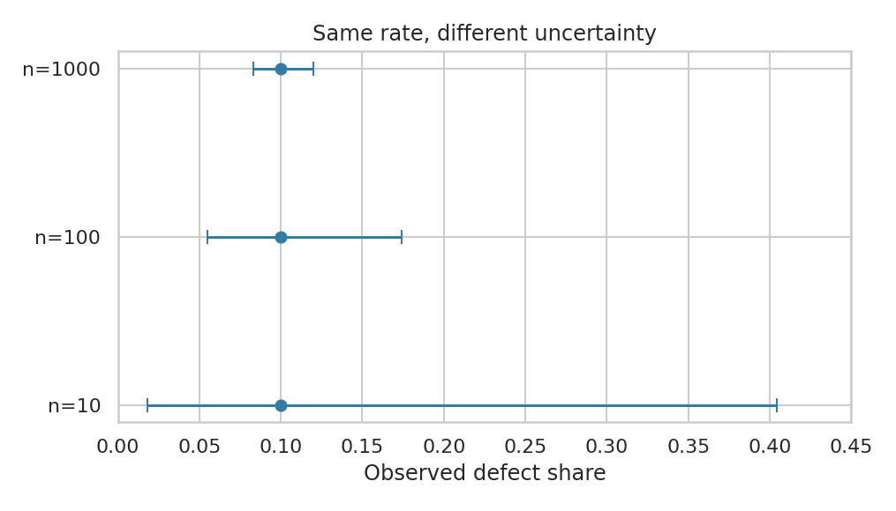

**핵심 해설**

95% 구간은 일정한 반복 표본추출 절차에서의 장기적 포함 성질을 나타내며, 각 구간 자체에 모수가 있을 확률이 95%라는 뜻이 아닙니다.


---

<a id="section-5-18"></a>
## 5.18. Bootstrap for the Mean

**문제 상황**

우선순위별 평균 응답시간을 추정하는데 표준편차가 크고 분포가 치우쳐 있습니다.

**필요한 개념**

부트스트랩은 원래 관측에서 복원 추출해 통계량의 변동성을 살펴봅니다. 여기서는 이해하기 쉬운 퍼센타일 구간을 사용합니다.

#### Bootstrap은 데이터를 다시 뽑아 통계량의 흔들림을 살핍니다

**부트스트랩(Bootstrap)**은 이미 얻은 표본을 바탕으로, 원래 관측값을 **복원 추출(같은 값이 여러 번 나와도 허용)**하여 새로운 표본을 반복해서 만드는 방법입니다. 새로 만든 각 표본에서 평균 같은 통계량을 계산하면 그 통계량이 표본에 따라 얼마나 달라질 수 있는지 살펴볼 수 있습니다.

예를 들어 원본 표본이 `[2, 4, 6]`이라면 한 번의 부트스트랩 표본은 `[2, 2, 6]`이 될 수 있습니다. 표본의 크기는 원래와 같은 3개로 유지하면서 각 원소를 **독립적으로 다시 뽑는 것**입니다. 이런 작업을 수백~수천 번 반복하면 부트스트랩 평균들의 분포가 생깁니다.

예제의 `rng.choice(x, size=(1500, len(x)), replace=True)`는 원본과 같은 길이의 재표본 1,500개를 만들고, `.mean(axis=1)`로 각각의 평균을 구합니다. 그 평균 분포의 2.5백분위수와 97.5백분위수를 선택하는 **퍼센타일 부트스트랩 구간**은 다음과 같습니다.

$$
[\,Q_{0.025}(\bar x^*),\ Q_{0.975}(\bar x^*)\,]
$$

$\bar x^*$는 재표본 평균을 뜻합니다. 이 예제에서는 평균 응답시간 26.64분과 약 22.97~30.86분의 구간을 얻습니다. `default_rng(25)`로 난수 시드를 고정해 같은 환경에서 결과를 재현할 수 있도록 합니다.

부트스트랩은 **표본에서 관측된 구조를 다시 사용하는 기법**이므로, 원자료가 대표성을 잃었거나 시간상 연속성이 있는 경우 그 문제를 자동으로 해결하지 않습니다. 매우 작은 표본·강한 비대칭 분포에서는 단순 퍼센타일 구간의 정확도도 제한될 수 있습니다.

**예제 코드 — [16_bootstrap_mean.py](./examples/16_bootstrap_mean.py)**

```python
from pathlib import Path
import numpy as np
import pandas as pd
import matplotlib
matplotlib.use('Agg')
import matplotlib.pyplot as plt
import seaborn as sns

ROOT = Path(__file__).resolve().parents[1]
sns.set_theme(style='whitegrid')

df=pd.read_csv(ROOT/'data/support_tickets.csv')
x=df.loc[df.priority.eq('High'),'first_response_min'].dropna().to_numpy()
rng=np.random.default_rng(25)
boot=rng.choice(x,size=(1500,len(x)),replace=True).mean(axis=1)
lo,hi=np.quantile(boot,[.025,.975])
fig,ax=plt.subplots(figsize=(7,4));sns.histplot(boot,bins=25,ax=ax,color='#7F9CC5')
ax.axvline(lo,ls='--',color='#A25E46');ax.axvline(hi,ls='--',color='#A25E46')
ax.set(title='Bootstrap distribution of mean response',xlabel='Resampled mean (min)')
fig.tight_layout();fig.savefig(ROOT/'figures/16_bootstrap_mean.png',dpi=145);plt.close(fig)
print('Mean:',round(x.mean(),2),'percentile interval:',round(lo,2),round(hi,2))
```

**실행 결과 (터미널)**

```text
Mean: 26.64 percentile interval: 22.97 30.86
```

**실행 결과 (그래프)**

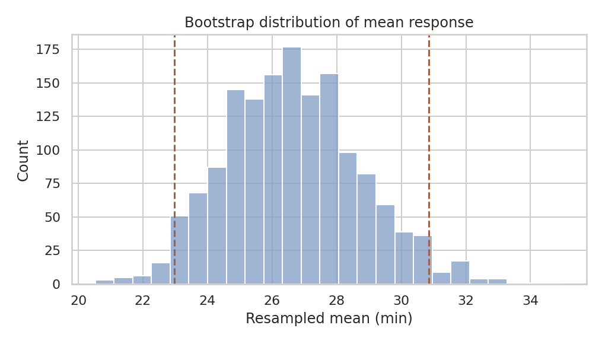

**핵심 해설**

복원 추출은 원자료에 존재하는 편향을 없애지 못하며, 시간상 자기상관이나 군집 구조가 있다면 단순 행 재표본추출이 적절하지 않을 수 있습니다.

<details>
<summary><strong>보충 설명</strong></summary>

정확한 구간추정이 필요한 작업에서는 SciPy의 `scipy.stats.bootstrap`과 BCa 등 다른 방법을 검토할 수 있습니다.

</details>


---

<a id="section-5-19"></a>
## 5.19. Category Interactions & Rates

**문제 상황**

생산 라인과 근무조를 동시에 구분하여 불량률 차이를 파악하려고 합니다.

**필요한 개념**

`crosstab()`은 두 범주의 조합별 기록을 집계합니다. Heatmap에 표시할 값이 건수인지 비율인지 명확히 정의해야 합니다.

#### 두 범주를 동시에 나누면 한 집단 내부의 차이가 보입니다

생산라인별 불량률이 높다고 해서 모든 근무조에서 동일하게 높은 것은 아닐 수 있습니다. **상호작용을 탐색한다**는 것은 두 분류 기준을 결합했을 때 결과 패턴이 어떻게 달라지는지 살펴본다는 뜻입니다.

교차표(Crosstab)는 두 범주의 조합에 따라 관측 수를 정리합니다. 피벗 테이블(Pivot Table)은 같은 형태의 행렬에 불량 여부의 평균 같은 집계값도 넣을 수 있습니다. `is_defective`가 불량이면 1, 정상이면 0이라면 이 열의 평균은 해당 셀의 **불량률**과 같습니다.

예를 들어 A라인 주간조에 10건의 검사가 있고 그중 2건이 불량이면 불량률은 20%입니다. B라인 야간조에 200건 중 10건이 불량이면 불량 건수는 더 많지만 불량률은 5%입니다. 두 히트맵을 나란히 두면 **검사량과 불량 비율을 혼동하지 않도록** 도와줍니다.

셀에 표본이 적으면 비율이 크게 흔들릴 수 있으므로 `count`와 `rate`를 함께 봐야 합니다. 색상 범위(`vmin`, `vmax`)를 보고 다른 그래프와 같은 척도로 비교하는지도 확인합니다. 어떤 조합의 검사가 아예 없다면 그 셀은 **결측 조합**이지 불량률 0%가 아닙니다.

**예제 코드 — [17_crosstab.py](./examples/17_crosstab.py)**

```python
from pathlib import Path
import numpy as np
import pandas as pd
import matplotlib
matplotlib.use('Agg')
import matplotlib.pyplot as plt
import seaborn as sns

ROOT = Path(__file__).resolve().parents[1]
sns.set_theme(style='whitegrid')

df=pd.read_csv(ROOT/'data/inspections.csv').drop_duplicates('inspection_id')
rate=pd.pivot_table(df,index='line',columns='shift',values='is_defective',aggfunc='mean')
count=pd.pivot_table(df,index='line',columns='shift',values='is_defective',aggfunc='size')
fig,axes=plt.subplots(1,2,figsize=(10,5),layout='constrained')
sns.heatmap(count,annot=True,fmt='.0f',cmap='Blues',ax=axes[0]);axes[0].set_title('Inspection count')
sns.heatmap(rate,annot=True,fmt='.1%',vmin=0,vmax=.3,cmap='YlOrBr',ax=axes[1]);axes[1].set_title('Defect share')
fig.savefig(ROOT/'figures/17_crosstab.png',dpi=145);plt.close(fig)
print('Counts:', count.to_dict())
```

**실행 결과 (터미널)**

```text
Counts: {'Day': {'A1': 58, 'A2': 58, 'B1': 58, 'B2': 58, 'C1': 58, 'C2': 58}, 'Night': {'A1': 58, 'A2': 58, 'B1': 58, 'B2': 58, 'C1': 58, 'C2': 58}}
```

**실행 결과 (그래프)**

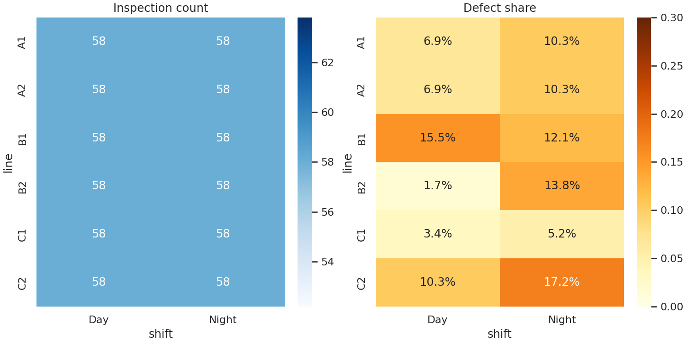

**핵심 해설**

라벨과 범례 없이 Heatmap만 제시하면 높은 색상값이 불량 건수인지 비율인지 알기 어렵습니다. 그룹별 n을 함께 확인합니다.


---

<a id="section-5-20"></a>
## 5.20. Selection Bias in Available Records

**문제 상황**

해결 완료 문의만 분석하면 모든 문의의 고객 경험을 대표한다고 볼 수 있을까요?

**필요한 개념**

선택 편향은 특정 조건을 만족한 일부 기록만 분석해서 전체의 특징을 잘못 추정할 때 발생합니다.

#### 선택 편향은 "어떤 기록이 분석에 들어왔는가"의 문제입니다

선택 편향(Selection Bias)은 분석에 포함되는 과정이 결과와 관련되어 있어, **선택된 자료의 통계량이 원래 알고 싶던 대상의 특성을 제대로 대표하지 못하는 현상**입니다. 예를 들어 해결 완료 문의만 모으면 해결되지 않은 복잡한 문의가 누락될 수 있습니다.

"전체 접수 문의의 고객 경험"을 알고 싶다면 해결 완료 여부와 관계없이 전체 대상의 상황을 고려해야 합니다. 반면 "해결 완료 문의의 첫 응답시간"을 묻는다면 해결 완료 집단만 분석하는 것이 질문에 맞을 수 있습니다. **대상 집단을 어떻게 정의하느냐**가 핵심입니다.

이 예제에서는 전체 유효 기록의 중앙 응답시간이 34.1분, 해결 완료 건만의 중앙값은 34.5분입니다. 두 수치가 비슷하다고 해서 선택 편향의 가능성이 사라진 것은 아닙니다. 특정 평균이나 중앙값이 우연히 비슷해도 분포의 꼬리·누락률·집단 구성은 다를 수 있습니다.

선택 편향을 점검할 때는 우선 전체 모집단, 포함·제외 조건, 제외된 기록의 규모와 특성을 적어야 합니다. 관측되지 않은 기록의 결과는 그래프만으로 확인할 수 없으므로 **해석 범위를 선택된 자료로 제한**할 수도 있습니다.

**예제 코드 — [18_selection_bias.py](./examples/18_selection_bias.py)**

```python
from pathlib import Path
import numpy as np
import pandas as pd
import matplotlib
matplotlib.use('Agg')
import matplotlib.pyplot as plt
import seaborn as sns

ROOT = Path(__file__).resolve().parents[1]
sns.set_theme(style='whitegrid')

df=pd.read_csv(ROOT/'data/support_tickets.csv')
all_median=df.first_response_min.median()
resolved_median=df.loc[df.resolved.eq(1),'first_response_min'].median()
fig,ax=plt.subplots(figsize=(7,3.6))
ax.bar(['All recorded','Resolved only'],[all_median,resolved_median],color=['#6A9FC5','#BD9271'])
ax.set(ylabel='Median first response (min)',title='Effect of restricting the analyzed sample')
fig.tight_layout();fig.savefig(ROOT/'figures/18_selection_bias.png',dpi=145);plt.close(fig)
print('All:',round(all_median,1),'Resolved only:',round(resolved_median,1))
```

**실행 결과 (터미널)**

```text
All: 34.1 Resolved only: 34.5
```

**실행 결과 (그래프)**

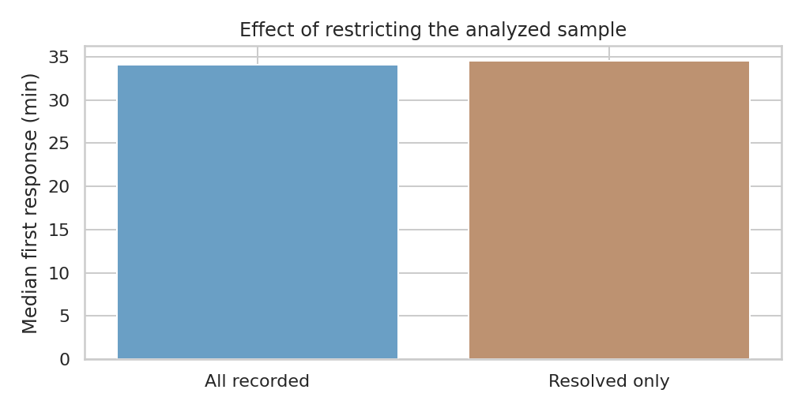

**핵심 해설**

이 예시에서 결과가 비슷하더라도 선택 편향의 위험이 사라진 것은 아닙니다. 어떤 관측이 포함됐는지 먼저 정의해야 합니다.


---

<a id="section-5-21"></a>
## 5.21. Stratified Scatter & Confounding

**문제 상황**

서로 다른 우선순위의 문의가 섞여 있어 전체 산점도만으로 그룹별 차이를 파악하기 어렵습니다.

**필요한 개념**

층화(Stratification)는 데이터를 비교 가능한 하위집단으로 나눠 관계를 확인하는 방법입니다.

#### 층화와 교란변수를 함께 이해합니다

층화(Stratification)는 전체 데이터를 **비교 가능한 하위집단으로 나누어** 관계를 다시 살펴보는 방법입니다. 예를 들어 문의의 우선순위를 High·Normal·Low로 나누고 각 그룹 안에서 응답시간과 만족도를 비교하면, 전체 산점도에 가려진 다른 패턴을 발견할 수 있습니다.

교란변수(Confounder)는 관심 있는 두 변수에 모두 관련되어 이들의 관계를 왜곡할 수 있는 제3의 변수입니다. 예컨대 문의 난도가 응답시간과 고객 만족도 모두에 영향을 준다면, 난도를 고려하지 않은 응답시간-만족도 관계는 해석이 어려울 수 있습니다. **우선순위가 실제 교란변수인지는 데이터와 문제 맥락을 검토해야 하며**, 단순히 그룹을 나눴다고 확정되는 것은 아닙니다.

예제에서는 `sharey=True`로 만족도 축을 통일해 세 그룹을 비교합니다. 축 범위가 달라지면 같은 정도의 차이도 다르게 보일 수 있으므로 일정한 비교 기준을 유지합니다. 각 그래프 제목에 `n`을 적은 이유는 그룹별 점의 수가 다를 수 있기 때문입니다.

층화는 관계를 **발견하고 비교하는 탐색 도구**이며, 그 자체로 인과관계를 증명하지는 않습니다. 지나치게 작은 하위집단으로 나누면 우연한 모양을 의미 있는 패턴으로 오해할 위험도 높아집니다.

**예제 코드 — [19_scatter_facets.py](./examples/19_scatter_facets.py)**

```python
from pathlib import Path
import numpy as np
import pandas as pd
import matplotlib
matplotlib.use('Agg')
import matplotlib.pyplot as plt
import seaborn as sns

ROOT = Path(__file__).resolve().parents[1]
sns.set_theme(style='whitegrid')

df=pd.read_csv(ROOT/'data/support_tickets.csv').dropna(subset=['first_response_min'])
fig,axes=plt.subplots(1,3,figsize=(12,3.7),sharey=True,layout='constrained')
for ax,priority in zip(axes,['High','Normal','Low']):
    part=df.loc[df.priority.eq(priority)]
    sns.scatterplot(data=part,x='first_response_min',y='customer_rating',alpha=.5,ax=ax,color='#4B84A6')
    ax.set(xlim=(0,250),title=f'{priority} (n={len(part)})',xlabel='Response min')
axes[0].set_ylabel('Rating');fig.savefig(ROOT/'figures/19_scatter_facets.png',dpi=145);plt.close(fig)
```

**실행 결과 (그래프)**

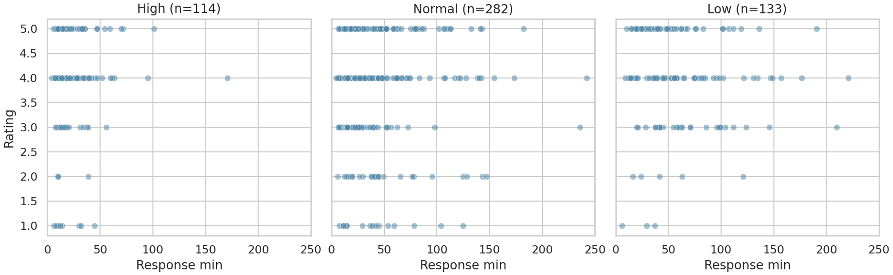

**핵심 해설**

하위집단별 그림은 집단 간 분포와 범위의 차이를 드러냅니다. 동시에 여러 그림을 탐색하면 우연한 패턴을 과대해석하지 않도록 주의합니다.


---

<a id="section-5-22"></a>
## 5.22. EDA Checklist & Compact Report

**문제 상황**

품질 검사 결과를 전달할 때 분포만이 아니라 표본 수·결측·비율·해석 한계도 한 장에 담아야 합니다.

**필요한 개념**

EDA 보고서는 질문, 관측 단위, 수치 요약, 시각화, 한계와 후속 확인 사항을 함께 담는 것이 좋습니다.

#### EDA 보고서는 "관측"과 "해석"을 구분해 전달합니다

좋은 EDA 보고서는 그래프가 많기보다 **독자가 분석의 조건을 확인하고 같은 결론에 도달할 수 있도록** 구성되어 있습니다. 최소한 분석 질문, 데이터의 출처·기간, 한 행의 의미, 전처리·제외 기준, 유효 표본 수, 그래프와 통계량, 해석의 한계가 필요합니다.

예를 들어 "공장 A의 불량률이 더 높다"는 관측된 **기술통계적 결과**일 수 있지만, "A 공장의 설비가 원인이다"는 **인과적 설명**입니다. 뒤의 결론을 내리려면 설비, 교대조, 제품 종류, 검사 기준 등 다른 요인을 확인해야 합니다. 보고서에서 두 수준의 문장을 구별해야 합니다.

이 예제는 두께 히스토그램에서 `8~12mm`만 표시합니다. 따라서 해당 범위를 벗어난 값이 원본에 존재하더라도 그래프에 보이지 않을 수 있습니다. 이를 숨기지 말고 **그래프에서 사용한 필터 및 축 범위**를 함께 표시해야 합니다. 다른 패널은 전체 고유 검사 기록을 사용할 수 있으므로 패널마다 분모와 필터가 서로 같은지도 확인해야 합니다.

**보고서 점검 순서:** ① 질문과 대상 명시 → ② 원본·유효·제외 건수 확인 → ③ 그래프의 축·단위·색상·표본 수 표시 → ④ 수치와 그림이 같은 데이터를 나타내는지 검증 → ⑤ 관측된 사실과 가능한 해석을 구분하여 기록합니다.

**예제 코드 — [20_eda_report.py](./examples/20_eda_report.py)**

```python
from pathlib import Path
import numpy as np
import pandas as pd
import matplotlib
matplotlib.use('Agg')
import matplotlib.pyplot as plt
import seaborn as sns

ROOT = Path(__file__).resolve().parents[1]
sns.set_theme(style='whitegrid')

df=pd.read_csv(ROOT/'data/inspections.csv').drop_duplicates('inspection_id')
fig,axes=plt.subplots(2,2,figsize=(10,7),layout='constrained')
valid_thickness = df.loc[df.thickness_mm.between(8, 12), 'thickness_mm']
sns.histplot(valid_thickness,bins=20,ax=axes[0,0],color='#6599BB')
axes[0,0].set(xlim=(8,12),title='Thickness distribution (valid 8–12 mm)')
sns.barplot(data=df,x='plant',y='is_defective',errorbar=None,ax=axes[0,1],color='#79A99D')
axes[0,1].set(ylim=(0,.25),title='Observed defect share')
sns.boxplot(data=df,x='shift',y='temperature_c',ax=axes[1,0],color='#B19ABE')
axes[1,0].set(title='Temperature by shift')
missing=df.isna().sum().sort_values(ascending=False)
axes[1,1].barh(missing.index,missing.values,color='#C58F65')
axes[1,1].set(title='Missing values per field',xlabel='Records')
fig.suptitle('Inspection EDA — summary with stated limitations')
fig.savefig(ROOT/'figures/20_eda_report.png',dpi=145);plt.close(fig)
print('Unique inspections:',len(df),'Defect rate:',round(df.is_defective.mean(),3))
```

**실행 결과 (터미널)**

```text
Unique inspections: 696 Defect rate: 0.095
```

**실행 결과 (그래프)**

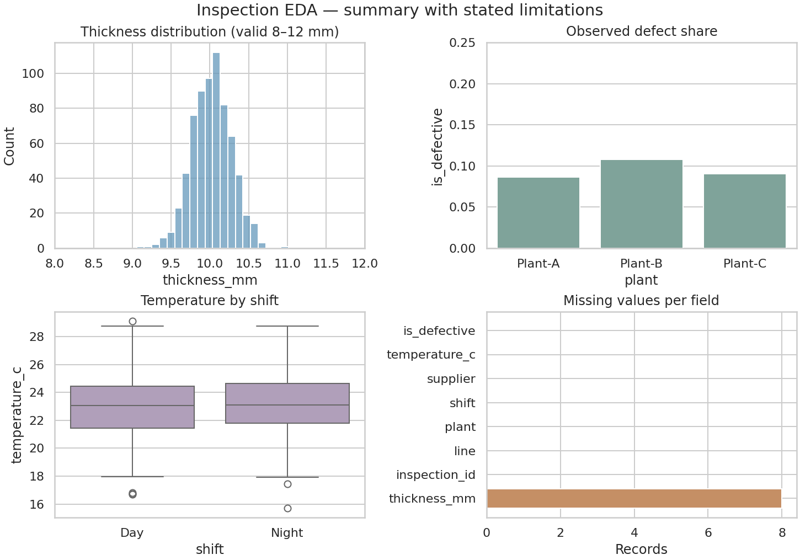

**핵심 해설**

축을 8–12mm로 제한한 히스토그램에 바깥쪽 비정상 측정값이 표시되지 않는다는 점을 반드시 밝혀야 합니다. 시각화 범위 밖에 숨겨진 값이 없는지 함께 확인합니다.


---

<a id="section-5-23"></a>
## 5.23. Mini Project 01 — Delivery Reliability Review

**문제 상황**

배송사가 여러 지역에 배송을 수행하고 있습니다. 전체 정시 배송률만 보면 지역별 거리와 배송 난도가 섞여 평가가 달라질 수 있습니다. 배송 소요일·지역·배송사에 따른 차이를 탐색하세요.

**입력 데이터:** [`shipments.csv`](./data/shipments.csv) · [Data Dictionary](./data/DATA_DICTIONARY.md)

**구현 요구사항**

- 배송 완료이면서 실제 소요일이 측정된 기록만 정시 배송률 계산에 사용합니다.
- 지역 및 배송사별 정시 배송 비율뿐 아니라 분모(n)도 저장합니다.
- 배송 소요일 분포·지역별 Boxplot·지역별 및 배송사별 비율을 2×2 Figure로 작성합니다.
- 취소 또는 측정 불가 기록은 0일 배송으로 처리하지 않습니다.
- 해석에서 지역 구성비의 영향을 검토합니다.

**Starter Code:** [`projects/mini_01_delivery/starter.py`](./projects/mini_01_delivery/starter.py) · [문제 설명](./projects/mini_01_delivery/TASK.md)

```python
from pathlib import Path
import pandas as pd

ROOT = Path(__file__).resolve().parents[2]
DATA = ROOT / 'data' / 'shipments.csv'


def run():
    raw = pd.read_csv(DATA)
    print('Input rows:', len(raw))
    # TODO: 정상 배송 추출, 정시 비율 계산, 운송사·지역별 2×2 그래프를 구현
    raise NotImplementedError('README의 요구사항에 따라 구현하세요.')


if __name__ == '__main__':
    run()
```

**기대 결과 예시 (완성 코드 공개 아님)**

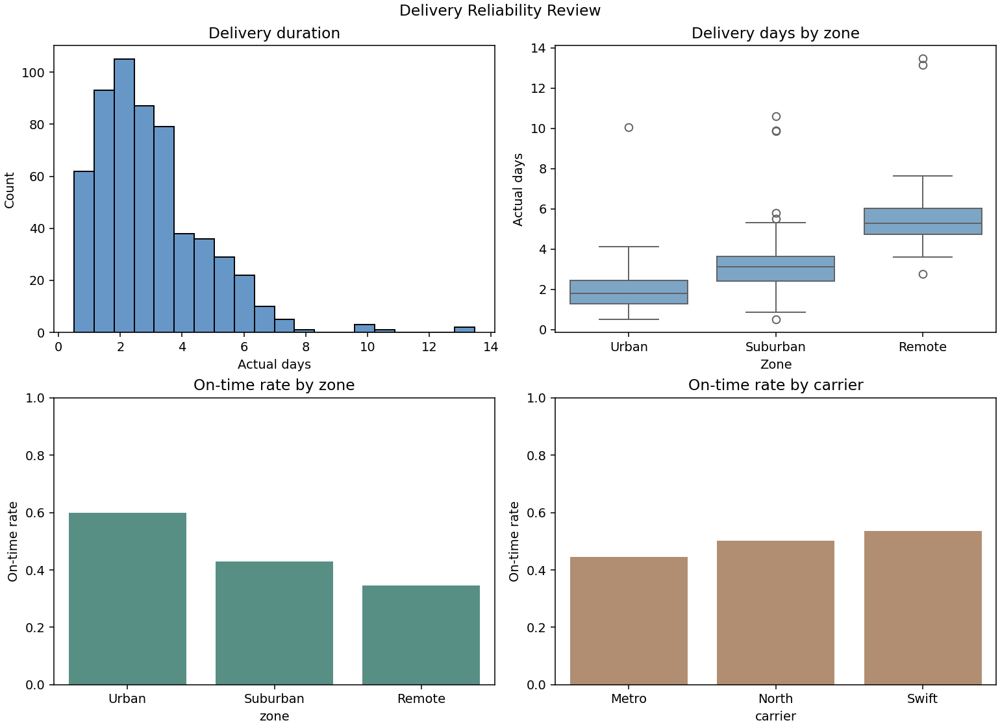

**확인 지표:** raw_count 600, valid_count 573, excluded_count 27, on_time_rate 약 49.74%

**검증 기준**

- 원본 `data/`에 변경 사항이 없어야 합니다.
- 출력 CSV의 행 개수와 JSON 요약 결과가 동일한 집계를 나타내야 합니다.
- 그림에는 범주·단위·기준값이 표시돼야 합니다.
- 문제가 발생한 데이터의 제외 여부와 이유가 설명돼야 합니다.

<details>
<summary><strong>구현 힌트</strong></summary>

1. 원본 행 수와 조건에 맞는 기록 수를 구분하세요.
2. 비교 집단마다 건수(n)와 비율을 함께 계산하세요.
3. 그래프를 저장한 뒤 `plt.close(fig)`로 Figure를 닫으세요.
4. `solutions/`의 별도 모범 구현은 충분히 시도한 후 비교하세요.

</details>


---

<a id="section-5-24"></a>
## 5.24. Mini Project 02 — Support Response Study

**문제 상황**

고객 문의의 첫 응답시간을 분석합니다. 일부 문의의 응답시간은 매우 길고, 일부 기록은 측정값이 없습니다. 우선순위별 응답의 중앙값·P90과 60분 이내 응답 비율을 비교하세요.

**입력 데이터:** [`support_tickets.csv`](./data/support_tickets.csv) · [Data Dictionary](./data/DATA_DICTIONARY.md)

**구현 요구사항**

- 누락된 응답시간을 0분으로 치환하지 않고 유효 관측만 계산합니다.
- 평균보다 중앙값·P90·ECDF가 유용할 수 있는 이유를 설명합니다.
- Histogram·ECDF·Boxplot·60분 기준 비율을 생성합니다.
- 우선순위별 유효 표본 수와 그래프 표시 범위를 명시합니다.
- 응답시간과 고객 만족도의 인과관계를 단정하지 않습니다.

**Starter Code:** [`projects/mini_02_support/starter.py`](./projects/mini_02_support/starter.py) · [문제 설명](./projects/mini_02_support/TASK.md)

```python
from pathlib import Path
import pandas as pd

ROOT = Path(__file__).resolve().parents[2]
DATA = ROOT / 'data' / 'support_tickets.csv'


def run():
    raw = pd.read_csv(DATA)
    print('Input rows:', len(raw))
    # TODO: 결측 응답시간 제외, 우선순위별 P90, ECDF, 분포 그래프 구현
    raise NotImplementedError('README의 요구사항에 따라 구현하세요.')


if __name__ == '__main__':
    run()
```

**기대 결과 예시 (완성 코드 공개 아님)**

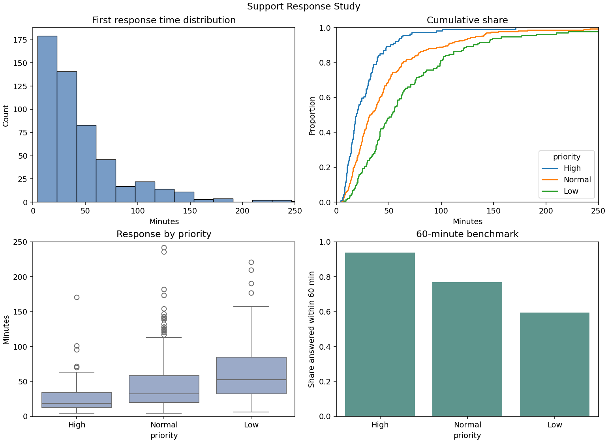

**확인 지표:** raw_count 540, valid_count 529, median_min 34.1

**검증 기준**

- 원본 `data/`에 변경 사항이 없어야 합니다.
- 출력 CSV의 행 개수와 JSON 요약 결과가 동일한 집계를 나타내야 합니다.
- 그림에는 범주·단위·기준값이 표시돼야 합니다.
- 문제가 발생한 데이터의 제외 여부와 이유가 설명돼야 합니다.

<details>
<summary><strong>구현 힌트</strong></summary>

1. 원본 행 수와 조건에 맞는 기록 수를 구분하세요.
2. 비교 집단마다 건수(n)와 비율을 함께 계산하세요.
3. 그래프를 저장한 뒤 `plt.close(fig)`로 Figure를 닫으세요.
4. `solutions/`의 별도 모범 구현은 충분히 시도한 후 비교하세요.

</details>


---

<a id="section-5-25"></a>
## 5.25. Mini Project 03 — Manufacturing Quality Exploration

**문제 상황**

검사 데이터에서 생산 라인별 불량률과 두께 측정 분포를 확인합니다. 원본에는 같은 검사 ID가 반복되거나 두께가 비현실적으로 큰 값이 포함돼 있습니다.

**입력 데이터:** [`inspections.csv`](./data/inspections.csv) · [Data Dictionary](./data/DATA_DICTIONARY.md)

**구현 요구사항**

- 검사 ID의 중복을 탐지하여 별도 건수로 기록합니다.
- 두께 누락 또는 범위 밖 값은 `measurement_review`로 분리해 남깁니다.
- 불량 여부와 측정 검토 여부를 서로 다른 개념으로 취급합니다.
- 라인별 검사 수·불량 건수·불량률·측정 검토 수를 보고합니다.
- Boxplot과 비율 그래프를 제작하고 표본 수·단위를 표시합니다.

**Starter Code:** [`projects/mini_03_quality/starter.py`](./projects/mini_03_quality/starter.py) · [문제 설명](./projects/mini_03_quality/TASK.md)

```python
from pathlib import Path
import pandas as pd

ROOT = Path(__file__).resolve().parents[2]
DATA = ROOT / 'data' / 'inspections.csv'


def run():
    raw = pd.read_csv(DATA)
    print('Input rows:', len(raw))
    # TODO: 중복 제거, 측정 검토 상태 기록, 라인별 불량률과 분포 그래프 구현
    raise NotImplementedError('README의 요구사항에 따라 구현하세요.')


if __name__ == '__main__':
    run()
```

**기대 결과 예시 (완성 코드 공개 아님)**

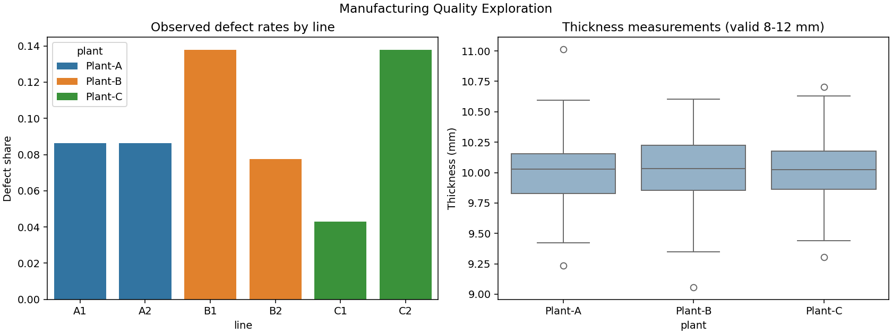

**확인 지표:** raw_count 700, duplicate_count 4, unique_count 696, measurement_review 11

**검증 기준**

- 원본 `data/`에 변경 사항이 없어야 합니다.
- 출력 CSV의 행 개수와 JSON 요약 결과가 동일한 집계를 나타내야 합니다.
- 그림에는 범주·단위·기준값이 표시돼야 합니다.
- 문제가 발생한 데이터의 제외 여부와 이유가 설명돼야 합니다.

<details>
<summary><strong>구현 힌트</strong></summary>

1. 원본 행 수와 조건에 맞는 기록 수를 구분하세요.
2. 비교 집단마다 건수(n)와 비율을 함께 계산하세요.
3. 그래프를 저장한 뒤 `plt.close(fig)`로 Figure를 닫으세요.
4. `solutions/`의 별도 모범 구현은 충분히 시도한 후 비교하세요.

</details>


---

<a id="section-5-26"></a>
## 5.26. Coding Practice — 18 Exercises

Coding Practice는 **이미 제공된 코드의 일부를 완성하는 형식**입니다. 기본 데이터를 읽는 코드와 함수의 방향을 제공하며, 완성된 답안은 README에 표시하지 않습니다. 각 문제에 연결된 `exercises/` 파일을 수정해 실행하세요.

**정답 코드:** 같은 번호의 [`solutions/`](./solutions/)에 분리했습니다. 정답 코드에는 학습한 개념을 재확인할 수 있도록 핵심 연산이 포함돼 있습니다.

### Coding Practice 01 — Dataset Overview

**문제 상황:** 배송 보고서를 작성하기 전에 전체 행과 유일한 배송 ID 수를 확인합니다.

**요구사항:** 전체 행·고유 ID·상태별 건수를 출력합니다.

**시작 코드 — [`01_dataset_overview.py`](./exercises/01_dataset_overview.py)**

```python
from pathlib import Path
import numpy as np
import pandas as pd

ROOT = Path(__file__).resolve().parents[1]

df = pd.read_csv(ROOT / "data/shipments.csv")

# TODO: 전체 행·고유 ID·상태별 건수를 출력합니다.
raise NotImplementedError("TODO: 요구사항에 맞게 완성하세요")
```

**확인 기준:** rows 600, unique_ids 600

<details>
<summary><strong>힌트 확인</strong></summary>

`len`, `nunique`, `value_counts`

</details>

### Coding Practice 02 — Missing Share

**문제 상황:** 문의 시스템에서 팀별 응답시간 누락 비율을 구합니다.

**요구사항:** `team`별 결측률을 0–1 범위로 출력합니다.

**시작 코드 — [`02_missing_share.py`](./exercises/02_missing_share.py)**

```python
from pathlib import Path
import numpy as np
import pandas as pd

ROOT = Path(__file__).resolve().parents[1]

df = pd.read_csv(ROOT / "data/support_tickets.csv")

# TODO: `team`별 결측률을 0–1 범위로 출력합니다.
raise NotImplementedError("TODO: 요구사항에 맞게 완성하세요")
```

**확인 기준:** 팀별 결측률 3개

<details>
<summary><strong>힌트 확인</strong></summary>

`groupby().apply()`와 `isna()`

</details>

### Coding Practice 03 — Mean Median P90

**문제 상황:** 첫 응답시간의 대표값을 비교합니다.

**요구사항:** 평균·중앙값·P90을 소수 1자리로 출력합니다.

**시작 코드 — [`03_mean_median_p90.py`](./exercises/03_mean_median_p90.py)**

```python
from pathlib import Path
import numpy as np
import pandas as pd

ROOT = Path(__file__).resolve().parents[1]

s = pd.read_csv(ROOT / "data/support_tickets.csv").first_response_min.dropna()

# TODO: 평균·중앙값·P90을 소수 1자리로 출력합니다.
raise NotImplementedError("TODO: 요구사항에 맞게 완성하세요")
```

**확인 기준:** 세 가지 대표값

<details>
<summary><strong>힌트 확인</strong></summary>

`quantile(.9)`

</details>

### Coding Practice 04 — Iqr Candidates

**문제 상황:** 소요일의 검토 대상 이상치를 찾습니다.

**요구사항:** Q1/Q3를 구하고 IQR 상한 초과 건수를 출력합니다.

**시작 코드 — [`04_iqr_candidates.py`](./exercises/04_iqr_candidates.py)**

```python
from pathlib import Path
import numpy as np
import pandas as pd

ROOT = Path(__file__).resolve().parents[1]

x = pd.read_csv(ROOT / "data/shipments.csv").actual_days.dropna()

# TODO: Q1/Q3를 구하고 IQR 상한 초과 건수를 출력합니다.
raise NotImplementedError("TODO: 요구사항에 맞게 완성하세요")
```

**확인 기준:** 상한과 이상치 후보 건수

<details>
<summary><strong>힌트 확인</strong></summary>

1.5 × IQR을 오류 확정으로 해석하지 않습니다.

</details>

### Coding Practice 05 — Outlier Influence

**문제 상황:** 극단값 포함 여부가 평균에 주는 영향을 확인합니다.

**요구사항:** 전체 평균과 검토 대상 제외 평균의 차이를 출력합니다.

**시작 코드 — [`05_outlier_influence.py`](./exercises/05_outlier_influence.py)**

```python
from pathlib import Path
import numpy as np
import pandas as pd

ROOT = Path(__file__).resolve().parents[1]

s = pd.Series([2, 2, 3, 3, 4, 40],dtype=float)

# TODO: 전체 평균과 검토 대상 제외 평균의 차이를 출력합니다.
raise NotImplementedError("TODO: 요구사항에 맞게 완성하세요")
```

**확인 기준:** all 9.0, sensitivity 2.8

<details>
<summary><strong>힌트 확인</strong></summary>

기존 관측은 덮어쓰지 않습니다.

</details>

### Coding Practice 06 — Group Median

**문제 상황:** 지역별 소요일 분포가 다른지 비교합니다.

**요구사항:** 지역별 n과 중앙값을 DataFrame으로 출력합니다.

**시작 코드 — [`06_group_median.py`](./exercises/06_group_median.py)**

```python
from pathlib import Path
import numpy as np
import pandas as pd

ROOT = Path(__file__).resolve().parents[1]

df = pd.read_csv(ROOT / "data/shipments.csv")
df = df.loc[df.status.eq("delivered") & df.actual_days.notna()]

# TODO: 지역별 n과 중앙값을 DataFrame으로 출력합니다.
raise NotImplementedError("TODO: 요구사항에 맞게 완성하세요")
```

**확인 기준:** 지역별 표본 수 및 중앙값

<details>
<summary><strong>힌트 확인</strong></summary>

`agg(["size","median"])`

</details>

### Coding Practice 07 — Sla Rate

**문제 상황:** 60분 안에 첫 응답이 이뤄진 비율을 구합니다.

**요구사항:** 기록된 응답시간 중 60분 이하 비율을 계산합니다.

**시작 코드 — [`07_sla_rate.py`](./exercises/07_sla_rate.py)**

```python
from pathlib import Path
import numpy as np
import pandas as pd

ROOT = Path(__file__).resolve().parents[1]

x = pd.read_csv(ROOT / "data/support_tickets.csv").first_response_min.dropna()

# TODO: 기록된 응답시간 중 60분 이하 비율을 계산합니다.
raise NotImplementedError("TODO: 요구사항에 맞게 완성하세요")
```

**확인 기준:** 응답시간 측정 529건

<details>
<summary><strong>힌트 확인</strong></summary>

누락은 분모에서 제외하고 건수를 보고합니다.

</details>

### Coding Practice 08 — Defect Ratio

**문제 상황:** 라인별 불량 건수와 비율을 함께 출력합니다.

**요구사항:** 중복 검사 ID를 제거하고 n, defects, rate를 계산합니다.

**시작 코드 — [`08_defect_ratio.py`](./exercises/08_defect_ratio.py)**

```python
from pathlib import Path
import numpy as np
import pandas as pd

ROOT = Path(__file__).resolve().parents[1]

df = pd.read_csv(ROOT / "data/inspections.csv")

# TODO: 중복 검사 ID를 제거하고 n, defects, rate를 계산합니다.
raise NotImplementedError("TODO: 요구사항에 맞게 완성하세요")
```

**확인 기준:** 고유 검사 696건 기준

<details>
<summary><strong>힌트 확인</strong></summary>

분모가 없는 비율 비교는 피합니다.

</details>

### Coding Practice 09 — Pearson Spearman

**문제 상황:** 선형 상관과 순위 상관을 비교합니다.

**요구사항:** `x`, `y=x**2`의 Pearson·Spearman 계수를 계산합니다.

**시작 코드 — [`09_pearson_spearman.py`](./exercises/09_pearson_spearman.py)**

```python
from pathlib import Path
import numpy as np
import pandas as pd

ROOT = Path(__file__).resolve().parents[1]

x = np.arange(1, 31)
y = x ** 2

# TODO: `x`, `y=x**2`의 Pearson·Spearman 계수를 계산합니다.
raise NotImplementedError("TODO: 요구사항에 맞게 완성하세요")
```

**확인 기준:** Spearman = 1.000

<details>
<summary><strong>힌트 확인</strong></summary>

`Series.corr(..., method="spearman")`

</details>

### Coding Practice 10 — Paired Samples

**문제 상황:** 상관계수에 사용된 실제 관측쌍을 확인합니다.

**요구사항:** 두 열 모두 결측이 아닌 행 수를 출력합니다.

**시작 코드 — [`10_paired_samples.py`](./exercises/10_paired_samples.py)**

```python
from pathlib import Path
import numpy as np
import pandas as pd

ROOT = Path(__file__).resolve().parents[1]

df = pd.read_csv(ROOT / "data/support_tickets.csv")

# TODO: 두 열 모두 결측이 아닌 행 수를 출력합니다.
raise NotImplementedError("TODO: 요구사항에 맞게 완성하세요")
```

**확인 기준:** paired n = 529

<details>
<summary><strong>힌트 확인</strong></summary>

서로 다른 두 열의 n이 항상 같지는 않습니다.

</details>

### Coding Practice 11 — Simpson Groups

**문제 상황:** 배송사를 지역별로 나눠 정시 비율을 비교합니다.

**요구사항:** 전체 비율과 `zone`별 비율을 각각 출력합니다.

**시작 코드 — [`11_simpson_groups.py`](./exercises/11_simpson_groups.py)**

```python
from pathlib import Path
import numpy as np
import pandas as pd

ROOT = Path(__file__).resolve().parents[1]

df = pd.read_csv(ROOT / "data/simpson_delivery.csv")

# TODO: 전체 비율과 `zone`별 비율을 각각 출력합니다.
raise NotImplementedError("TODO: 요구사항에 맞게 완성하세요")
```

**확인 기준:** 전체에서는 A < B, 각 지역에서는 A > B

<details>
<summary><strong>힌트 확인</strong></summary>

전체 평균만 보고 우수한 배송사를 단정하지 않습니다.

</details>

### Coding Practice 12 — Composition Share

**문제 상황:** 운송사별 배송지역 구성비를 구합니다.

**요구사항:** 행별 합이 1인 구성비 테이블을 만듭니다.

**시작 코드 — [`12_composition_share.py`](./exercises/12_composition_share.py)**

```python
from pathlib import Path
import numpy as np
import pandas as pd

ROOT = Path(__file__).resolve().parents[1]

df = pd.read_csv(ROOT / "data/simpson_delivery.csv")

# TODO: 행별 합이 1인 구성비 테이블을 만듭니다.
raise NotImplementedError("TODO: 요구사항에 맞게 완성하세요")
```

**확인 기준:** 각 운송사별 합계 1.0

<details>
<summary><strong>힌트 확인</strong></summary>

`pd.crosstab(..., normalize="index")`

</details>

### Coding Practice 13 — Bootstrap Interval

**문제 상황:** 기온 측정 표본의 평균 불확실성을 재표본추출로 확인합니다.

**요구사항:** 시드를 고정하고 평균 부트스트랩 1,000회 후 2.5%·97.5% 분위수를 출력합니다.

**시작 코드 — [`13_bootstrap_interval.py`](./exercises/13_bootstrap_interval.py)**

```python
from pathlib import Path
import numpy as np
import pandas as pd

ROOT = Path(__file__).resolve().parents[1]

x = np.array([18.2, 19.5, 20.1, 22.8, 21.0, 19.9])

# TODO: 시드를 고정하고 평균 부트스트랩 1,000회 후 2.5%·97.5% 분위수를 출력합니다.
raise NotImplementedError("TODO: 요구사항에 맞게 완성하세요")
```

**확인 기준:** 실행할 때마다 동일한 구간

<details>
<summary><strong>힌트 확인</strong></summary>

`np.random.default_rng(seed)`

</details>

### Coding Practice 14 — Categorical Heatmap

**문제 상황:** 교대조별 라인 불량률을 표로 확인합니다.

**요구사항:** `line` 행, `shift` 열로 평균 불량률 피벗테이블을 만듭니다.

**시작 코드 — [`14_categorical_heatmap.py`](./exercises/14_categorical_heatmap.py)**

```python
from pathlib import Path
import numpy as np
import pandas as pd

ROOT = Path(__file__).resolve().parents[1]

df = pd.read_csv(ROOT / "data/inspections.csv").drop_duplicates("inspection_id")

# TODO: `line` 행, `shift` 열로 평균 불량률 피벗테이블을 만듭니다.
raise NotImplementedError("TODO: 요구사항에 맞게 완성하세요")
```

**확인 기준:** 6행 × 2열의 비율 테이블

<details>
<summary><strong>힌트 확인</strong></summary>

`aggfunc="mean"`을 사용하면 0/1 평균이 비율이 됩니다.

</details>

### Coding Practice 15 — Selection Check

**문제 상황:** 해결된 문의만 분석하는 경우 대표값이 어떻게 달라지는지 확인합니다.

**요구사항:** 전체와 해결된 문의의 첫 응답시간 중앙값을 비교합니다.

**시작 코드 — [`15_selection_check.py`](./exercises/15_selection_check.py)**

```python
from pathlib import Path
import numpy as np
import pandas as pd

ROOT = Path(__file__).resolve().parents[1]

df = pd.read_csv(ROOT / "data/support_tickets.csv")

# TODO: 전체와 해결된 문의의 첫 응답시간 중앙값을 비교합니다.
raise NotImplementedError("TODO: 요구사항에 맞게 완성하세요")
```

**확인 기준:** 두 집단의 중앙값 출력

<details>
<summary><strong>힌트 확인</strong></summary>

결과 차이가 작아도 선택 편향 가능성이 사라지지 않습니다.

</details>

### Coding Practice 16 — Validation Duplicate

**문제 상황:** 품질 검사 원본에 중복 검사 ID가 있는지 검증합니다.

**요구사항:** 중복 ID 수를 구하고 고유 검사 행만 남깁니다.

**시작 코드 — [`16_validation_duplicate.py`](./exercises/16_validation_duplicate.py)**

```python
from pathlib import Path
import numpy as np
import pandas as pd

ROOT = Path(__file__).resolve().parents[1]

df = pd.read_csv(ROOT / "data/inspections.csv")

# TODO: 중복 ID 수를 구하고 고유 검사 행만 남깁니다.
raise NotImplementedError("TODO: 요구사항에 맞게 완성하세요")
```

**확인 기준:** duplicates 4, unique 696

<details>
<summary><strong>힌트 확인</strong></summary>

중복을 제거하기 전에 어떤 행을 보존할지 정책을 정의합니다.

</details>

### Coding Practice 17 — Review Measurements

**문제 상황:** 두께 측정 결측과 범위 밖 관측을 별도 표시합니다.

**요구사항:** 8–12mm 범위 외 값과 결측을 review=True로 표시합니다.

**시작 코드 — [`17_review_measurements.py`](./exercises/17_review_measurements.py)**

```python
from pathlib import Path
import numpy as np
import pandas as pd

ROOT = Path(__file__).resolve().parents[1]

df = pd.read_csv(ROOT / "data/inspections.csv").drop_duplicates("inspection_id")

# TODO: 8–12mm 범위 외 값과 결측을 review=True로 표시합니다.
raise NotImplementedError("TODO: 요구사항에 맞게 완성하세요")
```

**확인 기준:** review 11

<details>
<summary><strong>힌트 확인</strong></summary>

비정상 측정과 불량 여부는 별도 필드입니다.

</details>

### Coding Practice 18 — Eda Summary Export

**문제 상황:** EDA 요약 결과를 JSON으로 저장합니다.

**요구사항:** 데이터셋 행 수·중복·불량률을 JSON으로 출력하고 저장합니다.

**시작 코드 — [`18_eda_summary_export.py`](./exercises/18_eda_summary_export.py)**

```python
from pathlib import Path
import numpy as np
import pandas as pd

ROOT = Path(__file__).resolve().parents[1]

import json
df = pd.read_csv(ROOT / "data/inspections.csv")

# TODO: 데이터셋 행 수·중복·불량률을 JSON으로 출력하고 저장합니다.
raise NotImplementedError("TODO: 요구사항에 맞게 완성하세요")
```

**확인 기준:** output/practice_18/summary.json 생성

<details>
<summary><strong>힌트 확인</strong></summary>

코드 실행 시 원본 `data/`는 변경하지 않습니다.

</details>


---

<a id="section-5-27"></a>
## 5.27. Advanced Project 01 — Multi-Facility Quality EDA Generator

**문제 상황**

서로 다른 공장의 검사 데이터를 한 번에 검토해야 합니다. 공장 수와 라인 수, 검사 건수는 실행 시점마다 달라질 수 있습니다. 고정된 그래프를 수동으로 만드는 대신, 입력 데이터와 선택한 공장에 따라 **일관된 품질 탐색 보고서를 자동 생성하는 프로그램**을 설계하세요.

**입력 데이터:** [`inspections.csv`](./data/inspections.csv) · 관측 단위: 고유 검사 ID당 1개 행

**요구사항**

1. CSV 필수 열과 검사 ID의 중복을 확인하고, 누락된 열은 명확한 오류로 처리합니다.
2. 동일 검사 ID가 반복되면 중복 건수를 기록하고 중복으로 인한 비율 왜곡을 막습니다.
3. 두께가 8–12mm 범위를 벗어나거나 결측인 값은 자동 삭제하지 않고 검토 대상으로 표시합니다.
4. 공장·라인별 검사 건수, 불량 건수, 불량률을 계산합니다.
5. 불량률에는 표본 크기를 고려한 **Wilson 구간**을 표시합니다.
6. 유효 두께 관측의 평균에 대해 **부트스트랩 구간**을 생성하며 난수 시드를 고정합니다.
7. 선택한 공장 수가 1개·2개·3개로 바뀌어도 각각의 2×2 보고서를 생성합니다.
8. 존재하지 않는 공장을 지정하면 조용히 빈 그림을 만들지 않고 오류를 반환합니다.
9. 원본 데이터는 그대로 보존하고 CSV·JSON·PNG 결과를 출력 폴더에 저장합니다.
10. 결측값이나 작은 표본만으로 원인·품질 보증을 단정하지 않는 설명을 함께 남깁니다.

**완료 기준**

| 입력 조건 | 기대 동작 |
|---|---|
| 기본 CSV 전체 | 모든 공장 보고서 생성 |
| 공장 1개만 선택 | 해당 공장 보고서만 생성 |
| 공장 2개 선택 | 두 개 보고서 생성, 나머지 미생성 |
| 유효하지 않은 공장명 | 명확한 오류 |
| 중복 검사 ID | 중복 건수 기록, 중복 집계 방지 |
| 두께 결측·극단값 | 검토 상태 표시, 평균 계산에서 별도 정책 적용 |
| 입력 파일 없음 | 원본을 변경하지 않고 오류 처리 |

**Starter Code:** [`projects/advanced_01_quality/starter.py`](./projects/advanced_01_quality/starter.py) · [과제 문서](./projects/advanced_01_quality/TASK.md)

```python
from pathlib import Path
import pandas as pd

ROOT = Path(__file__).resolve().parents[2]
DATA = ROOT / 'data' / 'inspections.csv'


def run():
    raw = pd.read_csv(DATA)
    print('Input rows:', len(raw))
    # TODO: 검사 검증·공장별 요약·그래프 저장·예외 처리
    raise NotImplementedError('요구사항에 따라 구현하세요.')


if __name__ == '__main__':
    run()
```

**예상 결과 이미지**

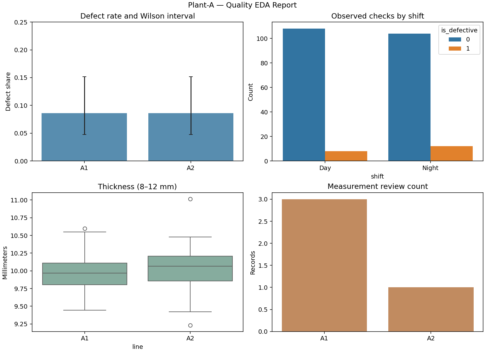

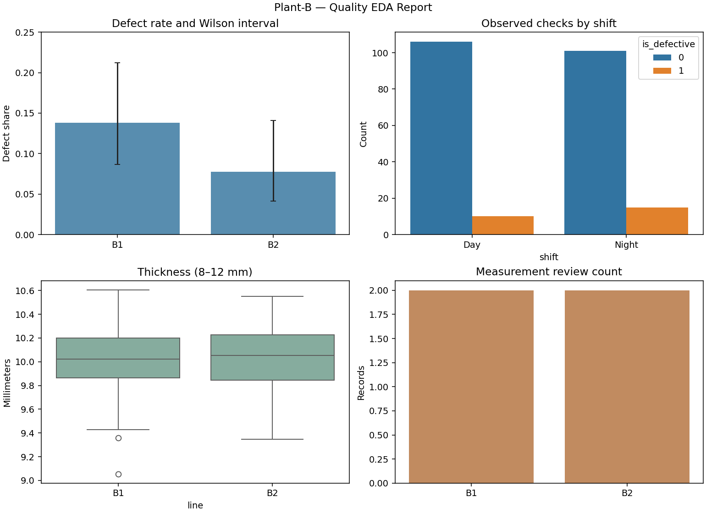

**모범 구현 안내:** 구현 코드와 설계 설명은 각각 `solutions/advanced_01_quality/reference_solution.py` 및 `solutions/advanced_01_quality/EXPLANATION.md`에 보관합니다. README에는 정답 전체 코드를 노출하지 않습니다.

<details>
<summary><strong>힌트 01 — 입력·검증</strong></summary>

필수 열을 먼저 검사하고, 중복 검사 ID의 처리 방침을 정하세요. 두께 값이 이상하다는 사실과 불량 여부가 참이라는 사실을 혼동하지 마세요.

</details>

<details>
<summary><strong>힌트 02 — 비율과 구간</strong></summary>

그룹별 비율은 `sum(is_defective) / n`으로 계산합니다. 표본 크기가 다른 집단을 비교할 때 동일한 오류막대 폭을 고정하지 마세요. Wilson 구간을 먼저 함수로 분리해 테스트하세요.

</details>

<details>
<summary><strong>힌트 03 — 동적 Figure 저장</strong></summary>

`for plant in selected_plants`에서 개별 Figure를 생성하고 `fig.savefig()` 후 `plt.close(fig)`를 호출하세요. 입력 목록에 없는 공장 이름은 미리 검증하세요.

</details>

<details>
<summary><strong>추가 도전 — 검증 범위 확장</strong></summary>

프로젝트를 완성한 경우, 검사 기록의 날짜·사용 설비·검사자 등 추가 필드가 제공될 때 어떤 분류 기준을 도입해야 할지 설계해 보세요. 데이터가 없던 범주는 자동으로 불량률 0%라고 표현하지 않도록 합니다.

</details>


---

<a id="section-5-28"></a>
## 5.28. Quiz — Data Interpretation & Visual Code Reading

Quiz는 Chapter에서 학습한 개념의 적용 여부를 확인합니다. 코드 실행 결과를 읽고, 실제로 발생하기 쉬운 오류를 구별하도록 구성했습니다. **그래프 4개 선택지는 모두 동일하거나 비슷한 형태**이며 차이를 세밀하게 확인해야 합니다.

각 문항의 정답·해설은 문제 아래 `<details>`를 열면 확인할 수 있습니다. 일부 해설에는 직접 실행 가능한 코드를 포함했습니다.

### Q01. 배송 데이터의 정시배송 비율을 계산하기 전에 가장 먼저 확인할 항목은?

A. 그래프 색상

B. 배송 완료 여부와 실제 소요일 측정 여부

C. Figure 크기

D. 저장할 PNG 이름

<details>
<summary><strong>Q01. 정답 및 해설 확인</strong></summary>

**정답: B.** 분석 대상의 정의와 분모가 먼저입니다. 취소나 미측정 배송을 0일 배송으로 계산하면 정시배송률이 왜곡됩니다.

</details>

### Q02. 응답시간 열에 결측값이 있을 때 올바른 설명은?

A. 결측을 반드시 0분으로 치환합니다.

B. 결측과 응답시간 0분은 같은 의미입니다.

C. 결측률을 보고하고, 분석에 필요한 관측의 포함 기준을 정합니다.

D. 결측값이 1개라도 있으면 전체 파일을 삭제합니다.

<details>
<summary><strong>Q02. 정답 및 해설 확인</strong></summary>

**정답: C.** 결측의 이유를 확인하지 않고 0으로 대체하면 실제로 즉시 응답한 것처럼 보일 수 있습니다. `s.isna().mean()`으로 결측 비율을 먼저 확인하세요.

```python
missing_rate = df["first_response_min"].isna().mean()
```

</details>

### Q03. `hist()` 코드로 생성되는 막대 높이의 조합을 고르세요.

```python
values = [1, 1, 2, 2, 3, 4, 4, 4]
ax.hist(values, bins=[0, 2, 4, 6])
```

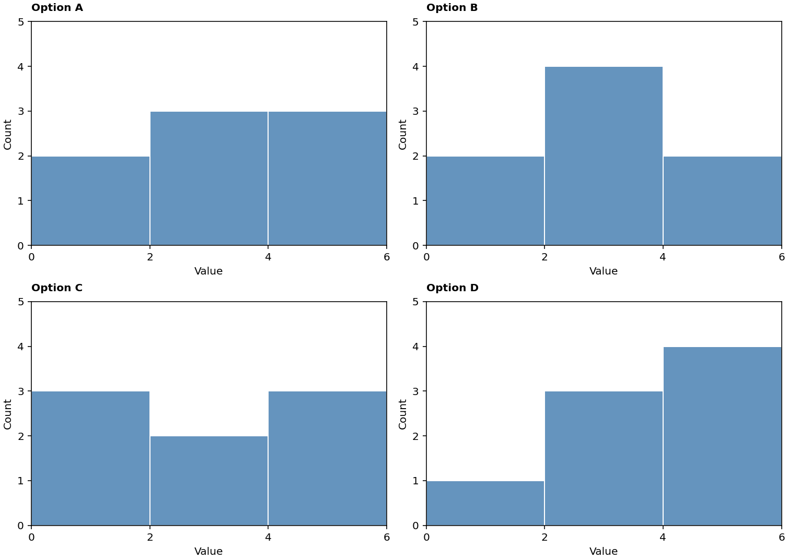

<details>
<summary><strong>Q03. 정답 및 해설 확인</strong></summary>

**정답: A.** `[0, 2)`에 1이 2개, `[2, 4)`에 2가 2개와 3이 1개, `[4, 6]`에 4가 3개 있으므로 각 구간의 높이는 2, 3, 3입니다. 막대의 색·형태가 모두 같으므로 구간 경계를 읽어야 합니다.

</details>

### Q04. 오른쪽 꼬리가 긴 응답시간 분포에서 평균과 중앙값을 함께 제시하는 이유는?

A. 둘은 항상 동일하기 때문입니다.

B. 평균이 큰 값의 영향을 받는 정도를 확인할 수 있기 때문입니다.

C. 중앙값으로 표본 수를 알 수 있기 때문입니다.

D. 그래프를 생략해도 되기 때문입니다.

<details>
<summary><strong>Q04. 정답 및 해설 확인</strong></summary>

**정답: B.** 매우 긴 응답시간이 포함되면 평균이 중앙값보다 높아질 수 있습니다.

```python
print(series.mean(), series.median(), series.quantile(.9))
```

</details>

### Q05. Q1=2, Q3=6인 자료에서 1.5×IQR 규칙의 상한은?

A. 6

B. 8

C. 10

D. 12

<details>
<summary><strong>Q05. 정답 및 해설 확인</strong></summary>

**정답: D.** IQR = 6 − 2 = 4이고 상한은 6 + 1.5×4 = 12입니다. 12를 넘는 값은 *이상치 후보*이므로 오류나 삭제 대상으로 자동 확정하지 않습니다.

</details>

### Q06. 다음 데이터로 계산한 범주별 비율 그래프를 고르세요.

```python
records = {"A": (3, 10), "B": (30, 100), "C": (25, 50)}
rates = {name: success / total for name, (success, total) in records.items()}
ax.bar(list(rates), list(rates.values()))
```

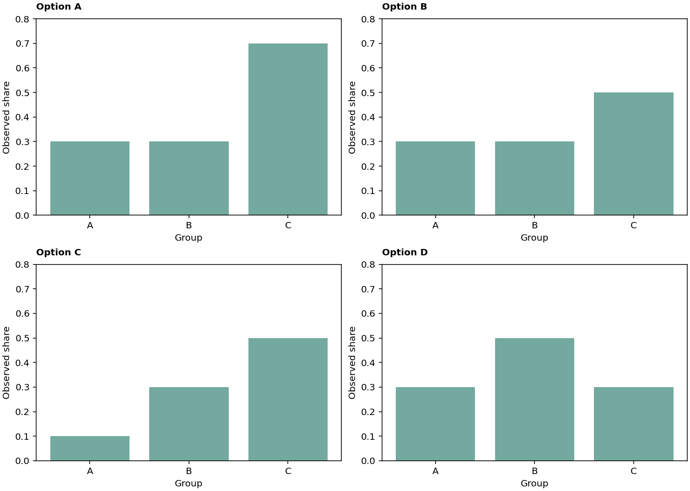

<details>
<summary><strong>Q06. 정답 및 해설 확인</strong></summary>

**정답: B.** A=30%, B=30%, C=50%입니다. A와 B는 성공 건수가 달라도 분모가 달라서 같은 비율입니다.

```python
print({k: v[0] / v[1] for k, v in records.items()})
# {"A": 0.3, "B": 0.3, "C": 0.5}
```

</details>

### Q07. 라인별 불량 건수가 10건과 12건일 때 어떤 결론이 적절할까요?

A. 12건인 라인이 반드시 품질이 나쁩니다.

B. 불량 건수만으로는 비교할 수 없으며 검사 건수가 필요합니다.

C. 두 라인은 동일합니다.

D. 막대그래프를 사용할 수 없습니다.

<details>
<summary><strong>Q07. 정답 및 해설 확인</strong></summary>

**정답: B.** 비교하려는 것이 불량 *비율*이라면 검사 건수가 분모가 됩니다. 예를 들어 10/100=10%, 12/400=3%로 결론은 건수의 순서와 다를 수 있습니다.

</details>

### Q08. Pearson 상관계수가 높다는 사실만으로 알 수 없는 것은?

A. 표본에서 강한 선형 관계가 관측됐는지

B. 선형 관계의 방향

C. 한 변수가 다른 변수의 원인인지

D. 상관계수의 부호

<details>
<summary><strong>Q08. 정답 및 해설 확인</strong></summary>

**정답: C.** 상관은 인과와 다릅니다. 제3의 변수와 관측 과정의 편향을 검토해야 합니다.

</details>

### Q09. 다음 코드의 선 그래프와 일치하는 선택지를 고르세요.

```python
x = [1, 2, 3, 4]
y = [20, float("nan"), 30, 25]
ax.plot(x, y, marker="o")
```

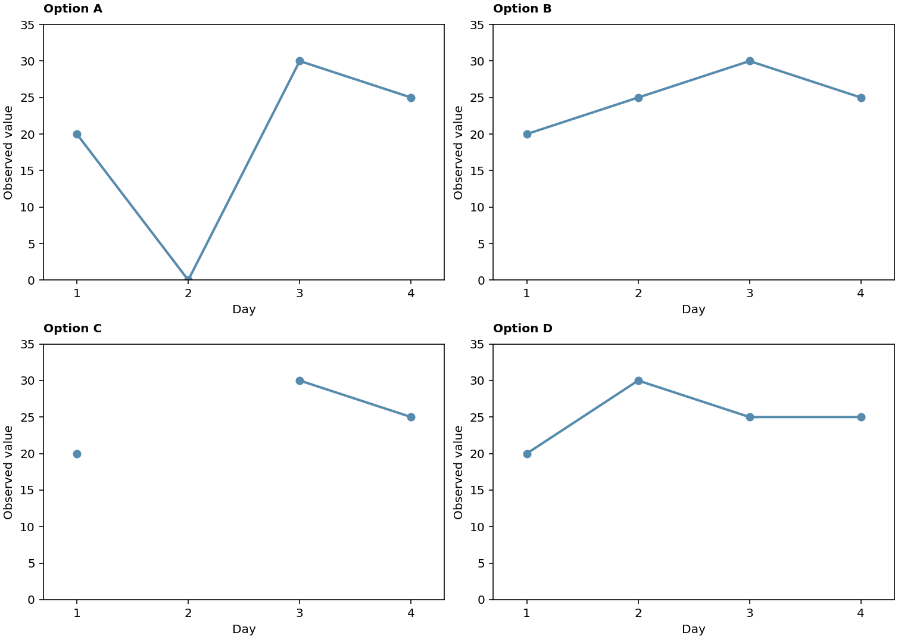

<details>
<summary><strong>Q09. 정답 및 해설 확인</strong></summary>

**정답: C.** `NaN`은 값이 없다는 뜻이므로 그 지점에서 선이 끊깁니다. A처럼 0으로 바꾸면 측정값이 0인 것처럼 나타나고, B처럼 보간하려면 별도의 명시적 근거가 필요합니다.

</details>

### Q10. `y=x²`, `x>0`처럼 단조 증가하지만 곡선인 자료를 설명한 것은?

A. Spearman은 반드시 0입니다.

B. Pearson은 직선이 아니어도 항상 1입니다.

C. Spearman은 1일 수 있으며 Pearson은 1보다 작을 수 있습니다.

D. 상관계수를 계산할 수 없습니다.

<details>
<summary><strong>Q10. 정답 및 해설 확인</strong></summary>

**정답: C.** 순위가 완전히 같은 순서로 증가하면 Spearman은 1일 수 있습니다. Pearson은 직선 관계의 강도를 나타냅니다.

```python
pearson = df["x"].corr(df["y"], method="pearson")
spearman = df["x"].corr(df["y"], method="spearman")
```

</details>

### Q11. 전체로 보면 배송사 B의 정시배송률이 더 높지만, 모든 지역에서는 A가 더 높습니다. 어떤 설명이 타당할까요?

A. 계산이 불가능한 모순입니다.

B. 집단 구성비 차이 때문에 집계 방향이 뒤집힐 수 있습니다.

C. 모든 데이터를 삭제해야 합니다.

D. 그래프 축을 0부터 시작하면 사라지는 현상입니다.

<details>
<summary><strong>Q11. 정답 및 해설 확인</strong></summary>

**정답: B.** Simpson의 역설은 서로 다른 조건의 관측이 한 집계에 섞이며 발생할 수 있습니다. 전체와 지역별 분모·구성비를 함께 확인해야 합니다.

</details>

### Q12. 다음 코드가 데이터를 그리는 Axes 위치를 고르세요.

```python
fig, axes = plt.subplots(2, 2)
axes[0, 1].bar(["A", "B"], [4, 7])
```

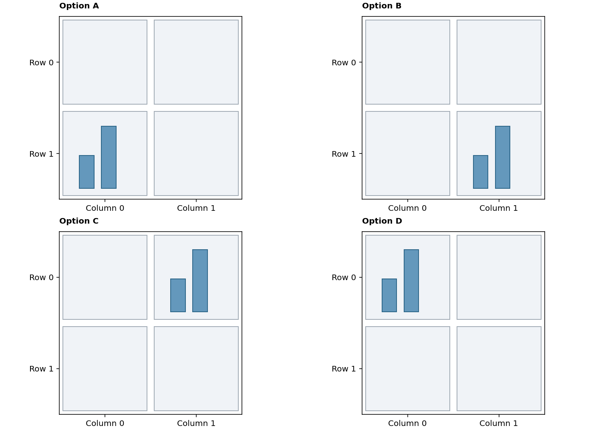

<details>
<summary><strong>Q12. 정답 및 해설 확인</strong></summary>

**정답: C.** `axes[0, 1]`은 첫 번째 행의 두 번째 열, 즉 **오른쪽 위**입니다. 나머지 세 영역은 그래프가 생성되지 않습니다.

```python
axes[1, 0].bar(["A", "B"], [4, 7])  # 왼쪽 아래
```

</details>

### Q13. Pearson 상관계수를 계산할 때 두 열의 결측을 올바르게 처리하는 코드를 완성하세요.

```python
# TODO: x, y 모두 값이 존재하는 행만 사용
paired = df.________(subset=["x", "y"])
r = paired["x"].corr(paired["y"])
```

<details>
<summary><strong>Q13. 정답 및 해설 확인</strong></summary>

**정답: `dropna`**

```python
paired = df.dropna(subset=["x", "y"])
r = paired["x"].corr(paired["y"])
```

단, 짝별 결측 제거가 결과를 대표성 있게 만들어 준다고 단정할 수는 없습니다.

</details>

### Q14. 표본 크기 10건과 1,000건의 관측 비율이 모두 10%라면?

A. 두 추정의 불확실성은 반드시 완전히 같습니다.

B. 보통 작은 표본의 구간이 더 넓습니다.

C. 작은 표본의 결과가 항상 더 정확합니다.

D. 큰 표본은 구간을 계산할 수 없습니다.

<details>
<summary><strong>Q14. 정답 및 해설 확인</strong></summary>

**정답: B.** 작은 표본은 같은 비율이라도 가능한 추정 오차가 더 클 수 있습니다. Wilson 구간 등 표본 크기를 반영하는 방법으로 비교해야 합니다.

</details>

### Q15. `estimator="median"`로 만든 막대그래프의 실행 결과를 고르세요.

```python
frame = pd.DataFrame({
    "group": ["A", "A", "A", "B", "B", "B"],
    "duration": [2, 2, 20, 4, 4, 4],
})
sns.barplot(data=frame, x="group", y="duration", estimator="median", errorbar=None)
```

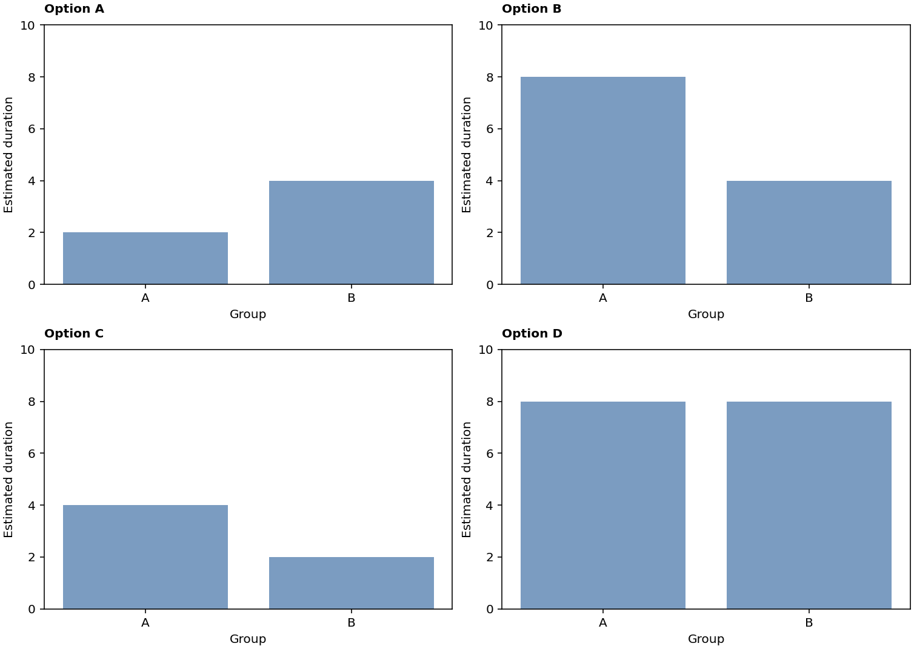

<details>
<summary><strong>Q15. 정답 및 해설 확인</strong></summary>

**정답: A.** A의 중앙값은 2, B의 중앙값은 4입니다. A의 평균은 8이므로 기본 평균 집계와 구분해야 합니다. `errorbar=None`은 자동 구간 표시를 생략합니다.

</details>

### Q16. 부트스트랩을 반복해 95% 구간을 얻었다면 가장 주의해야 할 사항은?

A. 결측과 선택 편향이 자동으로 해결됩니다.

B. 모든 가능한 모집단을 정확히 알게 됩니다.

C. 원본 데이터의 대표성과 재표본추출 가정을 검토해야 합니다.

D. 평균은 계산할 수 없습니다.

<details>
<summary><strong>Q16. 정답 및 해설 확인</strong></summary>

**정답: C.** 부트스트랩은 주어진 자료의 변동성 계산 방법이지 자료의 편향 자체를 제거하지는 못합니다.

```python
rng = np.random.default_rng(17)
resample = rng.choice(values, size=len(values), replace=True)
```

</details>

### Q17. 비율과 평균을 포함한 Heatmap 보고서에서 가장 중요한 것은?

A. 색상이 화려한지

B. 어떤 값(건수·평균·비율)을 색으로 표현했는지와 그룹별 n

C. PNG 파일 이름

D. 축 제목을 삭제했는지

<details>
<summary><strong>Q17. 정답 및 해설 확인</strong></summary>

**정답: B.** 값의 의미와 분모를 확인하지 않으면 색상 강도를 잘못 해석할 수 있습니다. 평균이 아니라 비율을 그린 경우 해당 단위를 그래프에 명시합니다.

</details>

### Q18. 정시배송률 10%가 동일한 두 표본(n=10, n=1000)에 대한 구간 그림을 고르세요.

95% 구간을 동일한 방식으로 계산합니다. 작은 표본의 구간은 넓고, 큰 표본의 구간은 좁아야 합니다.

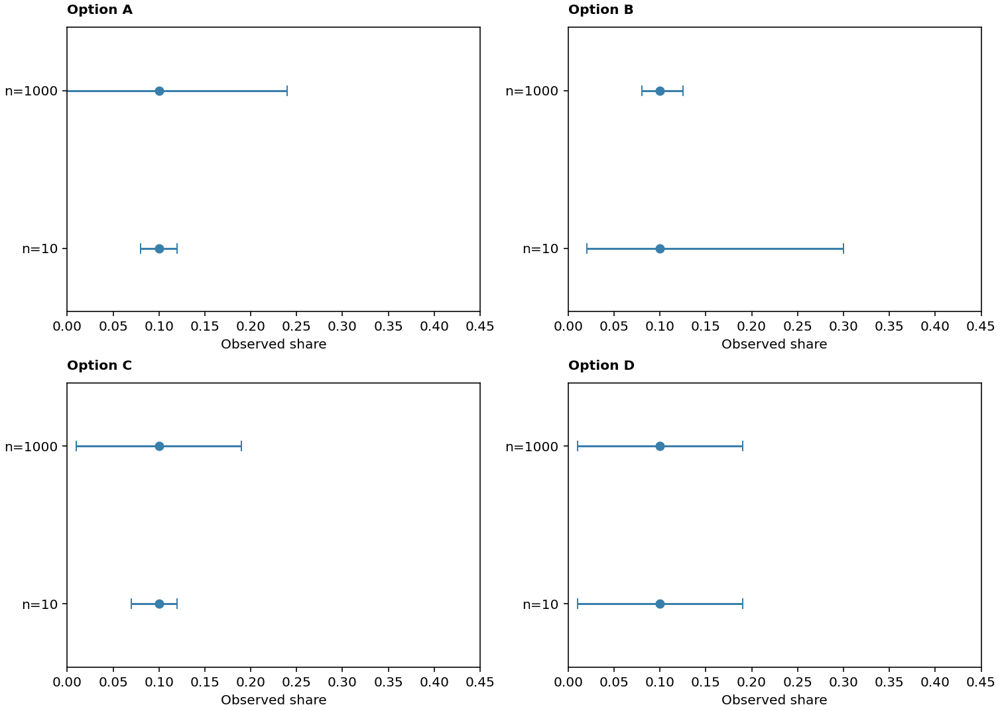

<details>
<summary><strong>Q18. 정답 및 해설 확인</strong></summary>

**정답: B.** 두 점의 중심은 0.10으로 같지만, n=10에 해당하는 구간이 n=1000보다 넓습니다. Q14의 개념을 실제 그림에서 구별하는 문제입니다.

</details>

### Q19. 다음 코드에서 `review`로 표시해야 할 관측은?

```python
review = df["thickness_mm"].isna() | ~df["thickness_mm"].between(8, 12)
```

A. 10.0만

B. NaN과 90.0

C. 8.0과 12.0

D. 아무것도 없음

<details>
<summary><strong>Q19. 정답 및 해설 확인</strong></summary>

**정답: B.** `isna()`는 NaN을, 범위 밖은 `~between(8, 12)`로 확인합니다. 경계값 8.0과 12.0은 범위 안입니다. 검토 대상과 결함 판정은 별개입니다.

</details>

### Q20. 해결 완료된 문의만 분석했을 때 어떤 검토가 필요한가요?

A. 이미 해결됐으므로 표본이 항상 대표적입니다.

B. 응답시간은 모두 0으로 처리합니다.

C. 전체 접수 문의와 분석 대상 문의가 어떻게 다른지 확인합니다.

D. 구간 추정이 불가능합니다.

<details>
<summary><strong>Q20. 정답 및 해설 확인</strong></summary>

**정답: C.** 선택된 표본만으로 전체 문의를 대표한다고 단정할 수 없습니다. 해결되지 않은 문의를 제외하면서 응답 분포가 달라졌는지 확인합니다.

</details>

### Q21. 다음 코드의 TODO를 완성하세요.

```python
fig, ax = plt.subplots()
# TODO: 응답시간의 누적분포 그래프
sns.________(data=df, x="first_response_min", ax=ax)
ax.axvline(60, color="red", linestyle="--")
```

<details>
<summary><strong>Q21. 정답 및 해설 확인</strong></summary>

**정답: `ecdfplot`**

```python
sns.ecdfplot(data=df, x="first_response_min", ax=ax)
```

60분 표시선과 ECDF가 만나는 높이는 기록된 응답시간 중 60분 이하 비율에 해당합니다.

</details>

### Q22. 상관관계가 높은 변수쌍을 20개 탐색한 뒤 그중 가장 강한 하나만 보고했을 때 주의해야 할 점은?

A. 여러 비교 중 우연히 강해 보이는 관계가 나타날 수 있습니다.

B. 가장 높은 상관은 반드시 인과관계입니다.

C. 데이터의 기간을 몰라도 됩니다.

D. 검증할 필요가 없습니다.

<details>
<summary><strong>Q22. 정답 및 해설 확인</strong></summary>

**정답: A.** 많은 관계를 탐색하면 우연한 패턴을 과장할 위험이 있습니다. 탐색 결과를 별도 자료로 재검토하거나 사전에 정의된 질문과 구분해야 합니다.

</details>


---

<a id="section-5-29"></a>
## 5.29. Summary

### 핵심 요약

- **질문부터 시작:** 분석 목적, 관측 단위, 분모와 누락된 값의 의미를 정의합니다.
- **수치의 의미 구분:** 평균·중앙값·P90·IQR·불량률은 서로 다른 질문에 답합니다.
- **그룹별 n 보고:** 집단별 표본 수가 작거나 다르면 비율 차이를 과장할 수 있습니다.
- **상관은 인과가 아님:** Pearson과 Spearman의 차이를 이해하고 제3의 변수를 검토합니다.
- **전체와 하위집단 비교:** Simpson의 역설처럼 그룹 구성비 때문에 결론이 바뀔 수 있습니다.
- **불확실성 표시:** Wilson 구간과 부트스트랩은 자료가 얼마나 흔들릴 수 있는지 살펴보는 도구입니다.
- **과장 금지:** EDA에서 발견한 패턴을 확정적 원인이나 전체 모집단의 특징으로 단정하지 않습니다.
- **재현 가능한 결과:** 입력·규칙·난수 시드·출력 파일·해석 한계를 기록합니다.

### 학습 완료 점검

- [ ] 원본 데이터의 행 수·고유 ID·결측률을 설명할 수 있음
- [ ] 평균과 중앙값의 차이를 실제 사례로 보여줄 수 있음
- [ ] 표본 크기를 밝히면서 두 집단의 비율을 비교할 수 있음
- [ ] 비슷한 그래프 선택지에서 코드 실행 결과를 판별할 수 있음
- [ ] Simpson의 역설을 구성비와 함께 설명할 수 있음
- [ ] 부트스트랩 구간의 의미와 한계를 설명할 수 있음
- [ ] Coding Practice와 Mini Project를 원본 파일을 보존한 채 실행할 수 있음
- [ ] 선택한 공장 수가 바뀌어도 Advanced Project 보고서를 생성할 수 있음

**다음 Chapter:** Chapter 06 — Time Series Visualization에서는 관측 시각·날짜 축·이동평균·추세·계절성·누락 구간을 시간순으로 해석합니다.


---

<a id="section-5-30"></a>
## 5.30. References & Directory Structure

### Directory Structure

```text
Chapter-05/
├── README.md
├── requirements.txt
├── .gitignore
├── data/
│   ├── DATA_DICTIONARY.md
│   ├── shipments.csv
│   ├── support_tickets.csv
│   ├── inspections.csv
│   └── simpson_delivery.csv
├── examples/                  # 20개 독립 실행 Python 코드
├── figures/                   # 20개 Example, 5개 Project 이미지
│   └── quiz/                  # 6개의 이미지 객관식 (각 A–D 선택지)
├── exercises/                 # 18개 부분 완성 코드
├── solutions/                 # Coding Practice 및 Project 모범답안
│   ├── mini_01_delivery/
│   ├── mini_02_support/
│   ├── mini_03_quality/
│   └── advanced_01_quality/
├── projects/
│   ├── mini_01_delivery/
│   ├── mini_02_support/
│   ├── mini_03_quality/
│   └── advanced_01_quality/
├── project_utils/
│   └── eda.py
├── tests/
│   └── test_chapter05.py
└── output/                   # 프로젝트 실행 시 자동 생성 (Git 추적 제외)
```

### Official References

- [Python Documentation](https://docs.python.org/3/)
- [NumPy Statistics](https://numpy.org/doc/stable/reference/routines.statistics.html)
- [Pandas — DataFrame.describe](https://pandas.pydata.org/docs/reference/api/pandas.DataFrame.describe.html)
- [Pandas — DataFrame.corr](https://pandas.pydata.org/docs/reference/api/pandas.DataFrame.corr.html)
- [Pandas — GroupBy](https://pandas.pydata.org/docs/user_guide/groupby.html)
- [Seaborn — Statistical Distributions](https://seaborn.pydata.org/tutorial/distributions.html)
- [Seaborn — Statistical Estimation & Error Bars](https://seaborn.pydata.org/tutorial/error_bars.html)
- [Matplotlib — Axes](https://matplotlib.org/stable/api/axes_api.html)
- [SciPy — bootstrap](https://docs.scipy.org/doc/scipy/reference/generated/scipy.stats.bootstrap.html) (선택적 심화)

---

[← Data Visualization](../README.md) · [Chapter 04 — Seaborn](../Chapter-04/) · [Data Processing](../../Data_Processing/)
