# Chapter 06. Time Series Visualization
시간에 따라 변화하는 데이터를 정확하게 해석하고, **날짜 축·관측 간격·시간대·결측 구간·이동평균·반복 패턴**을 시각화합니다. Chapter 03–05에서 그래프 작성과 분포 해석을 학습했다면, 이번 Chapter에서는 **언제 관측했는지와 어떤 시간 범위를 대표하는지**를 먼저 확인합니다.
모든 핵심 예제는 **문제 상황 → 새로운 개념 설명 → 사용하는 이유 → 전체 실행 코드 → 실제 결과 → 해설**의 흐름으로 작성합니다. 처음 나오는 중요한 용어는 교재처럼 설명하고, 이미 학습한 Matplotlib 기본 기능은 필요한 부분만 짚습니다.
모든 데이터는 **교육용 가상 기록**이며 실제 기관이나 서비스의 운영 통계가 아닙니다. 이미지에 표시한 기준선은 학습용 예시입니다.
- **검증 환경:** Python 3.13.5 / NumPy 2.3.5 / Pandas 2.2.3 / Matplotlib 3.10.8 / Seaborn 0.13.2
- **학습자료 구성:** Examples 24개 · Coding Practice 20개 · Mini Project 3개 · Advanced Project 2개 · Quiz 24문제
- **README 정답 공개:** Example과 Quiz에만 공개; Coding Practice 및 Project의 모범 구현은 `solutions/`에 분리
<details>
<summary><strong>선행 학습 목록</strong></summary>

- [Chapter 01 — Introduction to Data Visualization](../Chapter-01/)
- [Chapter 02 — Principles of Data Visualization](../Chapter-02/)
- [Chapter 03 — Matplotlib](../Chapter-03/)
- [Chapter 04 — Seaborn](../Chapter-04/)
- [Chapter 05 — Exploratory Data Analysis & Statistical Visualization](../Chapter-05/)
- [Data Processing Chapter 04 — Pandas & DataFrames](../../Data_Processing/Chapter-04/)
- [Data Processing Chapter 06 — Data Cleaning & Validation](../../Data_Processing/Chapter-06/)
- [Data Processing Chapter 07 — Data Transformation & Aggregation](../../Data_Processing/Chapter-07/)

</details>
<a id="contents"></a>
## Contents

| Section | Topic |
|:---:|---|
| [6.1](#section-6-1) | Learning Goals & Getting Started |
| [6.2](#section-6-2) | Time Series Fundamentals — 시간·관측·값 |
| [6.3](#section-6-3) | Timestamp Parsing, Sorting & Duplicate Keys |
| [6.4](#section-6-4) | Date Axis — 실제 시간 간격과 눈금 |
| [6.5](#section-6-5) | Expected Timeline — 관측 누락과 실제 0의 구분 |
| [6.6](#section-6-6) | Resampling — 집계 간격과 집계 함수 |
| [6.7](#section-6-7) | Coverage — 집계값이 있어도 완전한가? |
| [6.8](#section-6-8) | Rolling Windows — 이동평균과 계산 기준 |
| [6.9](#section-6-9) | Exponentially Weighted Mean — 지수 가중 평균 |
| [6.10](#section-6-10) | Difference & Percent Change — 절대 변화와 상대 변화 |
| [6.11](#section-6-11) | Weekly Pattern — 요일별 반복 변화 |
| [6.12](#section-6-12) | Hourly Profile, Trend, Seasonality & Noise |
| [6.13](#section-6-13) | Comparing Multiple Series — 공통 축과 지수화 |
| [6.14](#section-6-14) | Event Windows & Annotations — 검토 구간 표시 |
| [6.15](#section-6-15) | Interpolation — 미관측값을 추정할 때의 한계 |
| [6.16](#section-6-16) | Timezone & Calendar Boundaries — UTC와 한국시간 |
| [6.17](#section-6-17) | Week & Month Boundaries — 기간의 경계 |
| [6.18](#section-6-18) | Cumulative Values — 누적 그래프의 한계 |
| [6.19](#section-6-19) | Relative Comparison — 기준 100 지수 |
| [6.20](#section-6-20) | Irregular Sampling & Visual Integrity |
| [6.21](#section-6-21) | Thresholds, Alerts & Interpretation |
| [6.22](#section-6-22) | Time Series Visualization Design Checklist |
| [6.23](#section-6-23) | Mini Project 01 — Daily Store Revenue Trends |
| [6.24](#section-6-24) | Mini Project 02 — Server Metrics Monitoring |
| [6.25](#section-6-25) | Mini Project 03 — Hourly Weather Review |
| [6.26](#section-6-26) | Coding Practice — 20 Exercises |
| [6.27](#section-6-27) | Advanced Project 01 — Multi-Station Air Quality Report Generator |
| [6.28](#section-6-28) | Advanced Project 02 — Urban Traffic Time Series Audit & Reporting |
| [6.29](#section-6-29) | Quiz — Concept, Visual Code Reading & Completion |
| [6.30](#section-6-30) | Summary — 핵심 개념 정리 |
| [6.31](#section-6-31) | References & Directory Structure |

---
<a id="section-6-1"></a>
## 6.1. Learning Goals & Getting Started
### 학습 목표

1. 시계열 데이터의 **관측 단위·주기·시간대**를 구별하고 의미를 설명합니다.
2. 문자열 시각을 날짜형으로 변환하고, 정렬·중복·미관측 시각을 검증합니다.
3. `resample()`로 합계·평균을 올바르게 집계하고 수집 완전성을 함께 계산합니다.
4. 정수 크기의 이동 창과 시간 범위 기반 이동 창의 차이를 이해합니다.
5. 추세·반복 패턴·일시적 변화·누락의 차이를 그래프에서 구별합니다.
6. UTC와 KST의 날짜 경계를 이해하고 비교 기간 및 단위를 정확히 표기합니다.
7. 일별·시간대별 데이터로 보고서를 제작하고 다양한 입력 조건에서 검증합니다.

### 실행 환경

Python 3.11 이상을 권장합니다. 본 자료는 Python 3.13.5, Pandas 2.2.3, NumPy 2.3.5, Matplotlib 3.10.8, Seaborn 0.13.2에서 직접 실행했습니다. 사용한 코드와 API는 더 새로운 버전에서도 참고할 수 있지만, 모든 버전을 따로 검증한 것은 아닙니다.

Chapter-06 폴더에서 실행합니다.

```bash
python -m pip install -r requirements.txt
python examples/01_datetime_parsing.py
python examples/09_rolling_count.py
python -m unittest discover -s tests -v
```

- 인터넷 연결이나 API 키 없이 실습할 수 있습니다.
- `examples/`는 학습 결과 이미지를 `figures/`에 저장합니다.
- `projects/`에는 시작 코드와 과제 설명만 있습니다. 이를 그대로 실행하면 `NotImplementedError`가 발생하는 것이 정상입니다.
- 완성 코드와 별도 해설은 `solutions/`에 제공하며, README 본문에는 프로젝트 정답을 노출하지 않습니다.
- 자동 생성된 `output/` 폴더는 Git에 포함되지 않습니다.

### 데이터 출처와 범위

매출·기상·서버·대기질·도로 교통량 기록은 모두 **교육용 가상 데이터**입니다. 실제 도시·시설의 측정 통계나 법적 기준을 나타내지 않습니다. 필드별 단위·결측 기준은 [Data Dictionary](./data/DATA_DICTIONARY.md)에 명시했습니다.

---
<a id="section-6-2"></a>
## 6.2. Time Series Fundamentals — 시간·관측·값
시계열(Time Series)은 **시간 정보가 연결된 데이터의 집합**입니다. 단순히 날짜 열이 있다는 이유만으로 시계열 분석이 완성되는 것은 아닙니다. 어떤 시각의 값을 기록했는지, 얼마나 자주 수집했는지, 한 행이 무엇을 뜻하는지를 먼저 알아야 합니다.

| 개념 | 의미 | 예시 |
|---|---|---|
| Timestamp (시각) | 관측이 일어난 한 순간 | 2026-10-01 09:00 KST |
| Time Interval (기간) | 시작과 끝이 있는 구간 | 09:00부터 10:00까지 |
| Frequency (빈도) | 반복 관측의 시간 간격 | 5분 간격, 1시간 간격 |
| Observation (관측) | 한 시각 또는 기간에 측정한 기록 | 09:00의 기온 18.2°C |
| Grain (관측 단위) | 한 행이 무엇에 대응하는지 | 관측소 1곳 × 1시간 |
| Time Zone (시간대) | 같은 순간을 표시하는 지역별 시각 기준 | UTC, Asia/Seoul |

**시점 값과 기간 합계는 다릅니다.** 예를 들어 09:00 기온 18°C는 한 순간의 측정값이고, 09:00부터 10:00까지 강수량 3mm는 한 시간 구간의 누적량입니다. 이 둘을 일별로 요약할 때 같은 집계 함수를 사용하면 단위와 의미가 달라집니다.

**빈도도 데이터 출처의 속성입니다.** 5분 센서 기록을 하루 한 번만 표시하는 그래프와, 센서 자체가 하루 한 번 측정한 기록은 서로 다른 데이터입니다. 전자는 원본의 상세 정보를 축약한 결과이고 후자는 애초에 관측 수가 적은 것입니다.

```text
5분 관측(원본) → 1시간 집계 → 1일 보고서
      ↑              ↑              ↑
   측정 간격       집계 구간       표현 간격
```

그래프를 만들기 전에 **시간대, 시작·종료 범위, 측정 간격, 누락 여부, 값의 단위**를 한 문장으로 정리해 보세요. 이 정보가 없다면 선 그래프가 보기 좋아도 해석이 달라질 수 있습니다.

---
<a id="section-6-3"></a>
## 6.3. Timestamp Parsing, Sorting & Duplicate Keys
### 왜 날짜 문자열을 변환할까요?

`"2026-10-03"`은 사람에게는 날짜지만 Python에서는 문자열일 수 있습니다. 문자열 상태에서는 시간 차이를 구하거나 시간 간격으로 집계하기 어렵습니다. Pandas는 `pd.to_datetime()`으로 날짜를 실제 시각 자료형으로 변환합니다.

`errors="coerce"`를 사용하면 해석할 수 없는 문자열이 `NaT`(Not a Time)가 됩니다. `NaT`는 시각 자료형의 결측 상태로, 어떤 날짜로 임의 수정했다는 뜻이 아닙니다. 변환 실패 행은 원본 값과 함께 검사해야 합니다.

### 정렬과 중복

이후 `sort_values()` 또는 `sort_index()`로 시간순 정렬합니다. 같은 시각에 여러 관측값이 등장하면 먼저 **중복이 허용되는 관측 단위인지** 확인해야 합니다. 예컨대 고객 주문은 같은 분에 여러 건 발생할 수 있지만 관측소 1곳에서 한 시간에 한 건만 측정하기로 했다면 중복이 데이터 오류일 수 있습니다.
### Example 01 — Datetime Parsing — 문자열에서 시간으로
**문제 상황**

배송 기록의 날짜가 문자열로 저장되어 있어 시간순 정렬과 기간별 집계가 어렵습니다.
**핵심 개념**

`pd.to_datetime()`은 날짜처럼 보이는 문자열을 `datetime64` 기반의 시각 값으로 변환합니다. 문자열은 문자 코드 순서로 비교되지만, 날짜형은 시간 간격을 계산할 수 있습니다.
**왜 이 기능을 사용할까요?**

잘못된 문자열은 `errors="coerce"`를 이용해 `NaT`로 표시하고, 원본과 함께 검토해야 합니다.
**예제 코드 — [01_datetime_parsing.py](./examples/01_datetime_parsing.py)**

```python
import matplotlib
matplotlib.use('Agg')
import pandas as pd
import matplotlib.pyplot as plt
from pathlib import Path
ROOT = Path(__file__).resolve().parents[1]
raw = pd.Series(['2026-10-01','2026-10-03','not-a-date','2026-10-02'])
dates = pd.to_datetime(raw,format='%Y-%m-%d',errors='coerce')
print('Valid:', int(dates.notna().sum()), 'Invalid:', int(dates.isna().sum()))
valid = dates.dropna().sort_values().reset_index(drop=True)
fig, ax = plt.subplots(figsize=(7,2.8))
ax.scatter(valid,range(1,len(valid)+1),s=70)
ax.set(title='Parsed chronological dates',ylabel='Order')
fig.autofmt_xdate();fig.tight_layout()
fig.savefig(ROOT/'figures/01_datetime_parsing.png',dpi=145);plt.close(fig)
```
**실행 결과 (터미널)**

```text
Valid: 3 Invalid: 1
```
**실제 생성한 그래프**

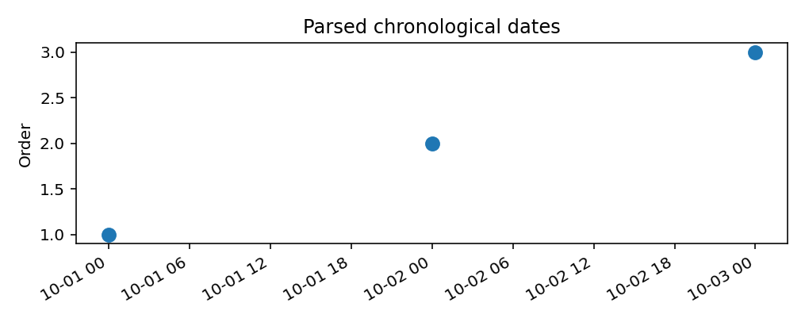
**코드 및 결과 해설**

날짜형으로 변환한 뒤 정렬하면 원래 입력 순서와 상관없이 시간순으로 표시됩니다. `NaT`는 임의 날짜가 아니라 해석할 수 없는 값을 뜻합니다.
### Example 02 — Sort & Duplicate Timestamps — 시간 키 검증
**문제 상황**

센서 기록이 도착 순서대로 저장돼 있고 같은 시각이 중복 전송됐습니다.
**핵심 개념**

시계열은 일반적으로 시각 순서대로 정렬해야 합니다. 한 시각에 여러 행이 허용되는 데이터인지, 중복 수집 오류인지 먼저 관측 단위(Grain)를 정해야 합니다.
**왜 이 기능을 사용할까요?**

시간 키를 임의로 하나만 남기면 실제 관측을 버릴 수 있습니다. 중복 행의 원인을 확인한 뒤 합계·평균·최신값 등의 정책을 선택합니다.
**예제 코드 — [02_sort_and_duplicate.py](./examples/02_sort_and_duplicate.py)**

```python
import matplotlib
matplotlib.use('Agg')
import pandas as pd
import matplotlib.pyplot as plt
from pathlib import Path
ROOT=Path(__file__).resolve().parents[1]
frame=pd.DataFrame({'time':pd.to_datetime(['2026-10-01 10:00','2026-10-01 09:00','2026-10-01 10:00','2026-10-01 11:00']), 'value':[12,10,13,15]})
frame=frame.sort_values('time')
print('Duplicate time rows:',int(frame.duplicated('time',keep=False).sum()))
fig,ax=plt.subplots(figsize=(7,3))
ax.scatter(frame['time'],frame['value'],s=80)
ax.set(title='Two readings at the same timestamp',ylabel='Sensor value')
fig.autofmt_xdate();fig.tight_layout();fig.savefig(ROOT/'figures/02_sort_and_duplicate.png',dpi=145);plt.close(fig)
```
**실행 결과 (터미널)**

```text
Duplicate time rows: 2
```
**실제 생성한 그래프**

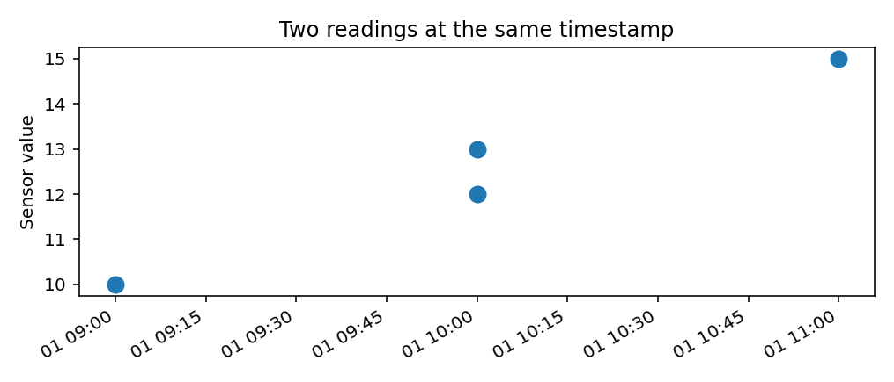
**코드 및 결과 해설**

동일 시각 10:00에 두 관측값이 있음을 점으로 보여줍니다. 이 경우 중복 키 여부를 표시하되 어떤 행을 남길지 자동 판단하지 않습니다.

---
<a id="section-6-4"></a>
## 6.4. Date Axis — 실제 시간 간격과 눈금
Matplotlib은 Python의 `datetime`이나 Pandas 날짜형을 시간 축으로 표현할 수 있습니다. 눈금이 너무 촘촘해 겹칠 때는 실제 날짜를 문자열로 바꾸지 말고 **Locator**와 **Formatter**를 조정합니다.

- **Locator:** 주요 눈금을 어느 시각에 배치할지 결정합니다. `MonthLocator()`는 달의 시작 등 월별 주요 눈금을 지정합니다.
- **Formatter:** 해당 눈금을 어떻게 표시할지 결정합니다. `DateFormatter("%Y-%m")`는 `2026-10` 형태로 표시합니다.

Locator는 관측 간격 자체를 변경하지 않습니다. 5분마다 측정한 자료를 `HourLocator`로 표시하더라도 원본 시각 간격은 그대로입니다. 또한 불규칙 시각은 실제 시간 간격만큼 그래프에서 떨어져 있어야 합니다.
### Example 03 — Date Axis — Locator & Formatter
**문제 상황**

90일 매출 선 그래프에서 날짜 글자가 서로 겹쳐 읽을 수 없습니다.
**핵심 개념**

Matplotlib의 **Locator**는 축 눈금이 놓일 위치를, **Formatter**는 해당 눈금을 어떤 문자열로 표시할지를 결정합니다. `MonthLocator`와 `DateFormatter`를 조합하면 월별 눈금을 만들 수 있습니다.
**왜 이 기능을 사용할까요?**

시각화의 입력은 실제 날짜형이어야 하며 문자열을 범주처럼 취급하면 날짜 간 간격이 왜곡될 수 있습니다.
**예제 코드 — [03_date_axis.py](./examples/03_date_axis.py)**

```python
import matplotlib
matplotlib.use('Agg')
import pandas as pd
import matplotlib.pyplot as plt
import matplotlib.dates as mdates
from pathlib import Path
ROOT=Path(__file__).resolve().parents[1]
df=pd.read_csv(ROOT/'data/sales_daily.csv',parse_dates=['date'])
s=df.query('store_id == "ST-A"').sort_values('date')
fig,ax=plt.subplots(figsize=(9,3.5))
ax.plot(s['date'],s['revenue_krw'],lw=1.3)
ax.xaxis.set_major_locator(mdates.MonthLocator())
ax.xaxis.set_major_formatter(mdates.DateFormatter('%Y-%m'))
ax.set(title='Monthly date ticks',xlabel='Date',ylabel='Revenue (KRW)')
ax.grid(alpha=.25)
fig.tight_layout();fig.savefig(ROOT/'figures/03_date_axis.png',dpi=145);plt.close(fig)
print('Observations:',len(s),'First:',s['date'].min().date())
```
**실행 결과 (터미널)**

```text
Observations: 92 First: 2026-08-01
```
**실제 생성한 그래프**

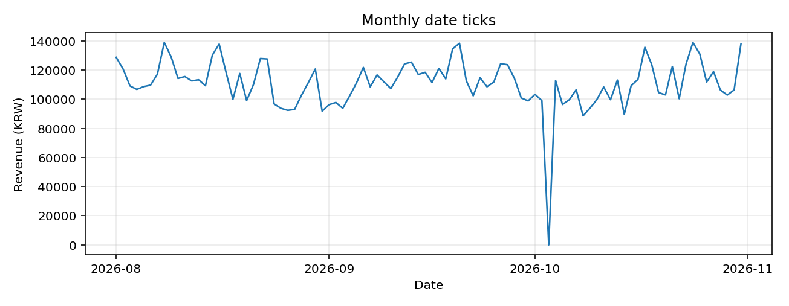
**코드 및 결과 해설**

3개월간의 관측을 월별 눈금으로 표현했습니다. 데이터의 샘플링 주기와 축의 눈금 간격은 별개입니다.

---
<a id="section-6-5"></a>
## 6.5. Expected Timeline — 관측 누락과 실제 0의 구분
센서가 1시간마다 값을 보낸다고 가정해 봅시다. 파일에 09:00과 11:00만 있다면 10:00에 값이 `0`이었다고 할 수 있을까요? **아니요.** 기록이 없어서 알 수 없다는 것만 알 수 있습니다.

`pd.date_range()`로 **예정된 시각의 전체 목록**을 만든 뒤 `reindex()`로 실제 기록을 맞춰야 파일 자체에 없는 시각을 확인할 수 있습니다.

- `0`: 실제로 측정한 값일 수 있습니다. 예: 강수량 0mm, 매출 0원.
- `NaN`: 값을 사용할 수 없습니다. 센서 실패·파일 누락·미수집 등 이유를 추가 확인해야 합니다.
- `NaT`: 시각이 누락됐거나 날짜 문자열을 해석하지 못했습니다.

기록의 결측 원인을 모른 채 `fillna(0)`을 사용하면 **관측 공백이 실제 현상처럼 보이게 됩니다.** 그래프를 그리기 전에 예정 시각과 관측 유무를 구분하는 습관이 중요합니다.
### Example 04 — Expected Timeline — 예정된 시각 생성
**문제 상황**

서버에서 5분마다 측정하는데 실제 파일에는 일부 행이 빠져 있습니다.
**핵심 개념**

`pd.date_range(start, end, freq=...)`는 **관측이 예정된 시간 축**을 만듭니다. 이 축과 실제 기록을 비교하면 원본 자체에 없는 시각도 발견할 수 있습니다.
**왜 이 기능을 사용할까요?**

예정 시각은 수집 계약과 장비 설정에 근거해야 합니다. 임의의 1시간 간격으로 만든 예상 축은 실제 5분 센서의 누락을 제대로 설명하지 못합니다.
**예제 코드 — [04_date_range.py](./examples/04_date_range.py)**

```python
import matplotlib
matplotlib.use('Agg')
import pandas as pd
import matplotlib.pyplot as plt
from pathlib import Path
ROOT=Path(__file__).resolve().parents[1]
df=pd.read_csv(ROOT/'data/server_metrics.csv')
df['time']=pd.to_datetime(df['timestamp_utc'],utc=True)
expected=pd.date_range('2026-10-26', '2026-10-27 23:55',freq='5min',tz='UTC')
observed=pd.DatetimeIndex(df['time'])
missing=expected.difference(observed)
print('Expected:',len(expected),'Observed:',len(observed),'Missing:',len(missing))
fig,ax=plt.subplots(figsize=(8,2.6))
ax.scatter(df['time'],[1]*len(df),s=3,label='Observed')
ax.scatter(missing,[1.12]*len(missing),s=36,marker='x',color='#b84444',label='Missing')
ax.set(title='Expected vs observed five-minute timestamps',yticks=[])
ax.legend();fig.tight_layout();fig.savefig(ROOT/'figures/04_date_range.png',dpi=145);plt.close(fig)
```
**실행 결과 (터미널)**

```text
Expected: 576 Observed: 568 Missing: 8
```
**실제 생성한 그래프**

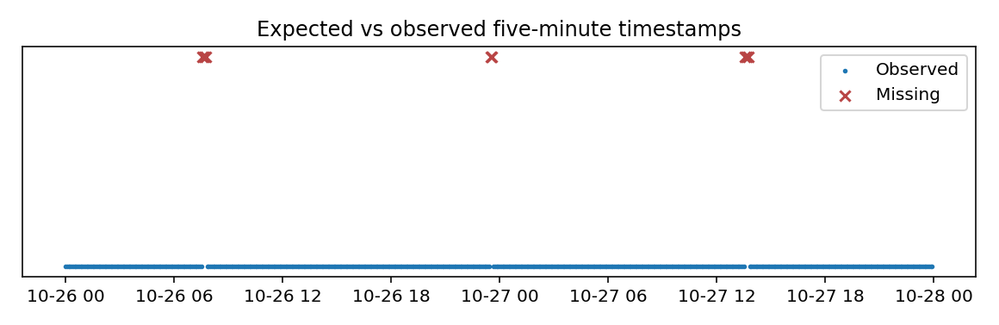
**코드 및 결과 해설**

예정 576개 슬롯과 실제 568개 관측을 비교해 누락 8개를 찾아냅니다.
### Example 05 — Missing vs. Zero — 끊어진 선의 의미
**문제 상황**

매장 매출이 0원인 날과 기록 자체가 없는 날을 한 그래프에 표시해야 합니다.
**핵심 개념**

`reindex()`는 기대 날짜를 모두 만들고 없는 값은 `NaN`으로 남깁니다. `0`은 관측된 값인 반면 `NaN`은 값이 없다는 뜻이므로 선 그래프에서 공백으로 나타나게 해야 합니다.
**왜 이 기능을 사용할까요?**

사라진 값을 `fillna(0)`으로 바꾸면 실제 매출이 없었던 것처럼 보이므로 출처를 확인하지 않은 채 적용하지 않습니다.
**예제 코드 — [05_missing_and_zero.py](./examples/05_missing_and_zero.py)**

```python
import matplotlib
matplotlib.use('Agg')
import pandas as pd
import matplotlib.pyplot as plt
from pathlib import Path
ROOT=Path(__file__).resolve().parents[1]
df=pd.read_csv(ROOT/'data/sales_daily.csv',parse_dates=['date'])
store=df.query('store_id == "ST-C"').set_index('date')['revenue_krw']
expected=pd.date_range('2026-08-20','2026-09-20',freq='D')
s=store.reindex(expected)
print('Missing:',int(s.isna().sum()),'Observed zero:',int(s.eq(0).sum()))
fig,ax=plt.subplots(figsize=(8,3.4))
ax.plot(s.index,s.values,marker='o',label='Daily revenue')
ax.scatter(s[s.eq(0)].index,s[s.eq(0)].values,color='#b64b35',s=75,label='Observed zero')
ax.set(title='Missing is not zero',ylabel='Revenue (KRW)');ax.legend()
fig.autofmt_xdate();fig.tight_layout();fig.savefig(ROOT/'figures/05_missing_and_zero.png',dpi=145);plt.close(fig)
```
**실행 결과 (터미널)**

```text
Missing: 1 Observed zero: 1
```
**실제 생성한 그래프**

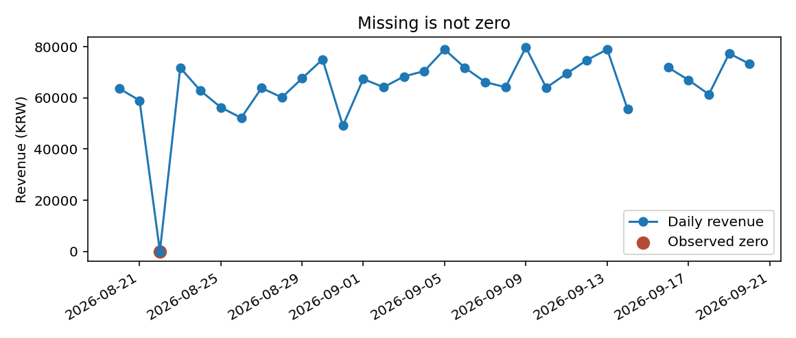
**코드 및 결과 해설**

9월 15일은 매출 0원이 아니라 미관측으로 표시됩니다. 0원으로 측정된 날은 별도로 강조됩니다.

---
<a id="section-6-6"></a>
## 6.6. Resampling — 집계 간격과 집계 함수
`resample()`은 시계열을 일정한 **시간 구간(Bin)**으로 나누고, 각 구간에서 요약값을 계산합니다. 예를 들어 1시간 관측을 1일로 요약할 수 있습니다.

| 원본 값 | 일별 요약에 적절한 계산 | 이유 |
|---|---|---|
| 시간별 차량 통과 대수 | 합계 `sum()` | 구간별 차량 수를 더하면 하루 통과량 |
| 시간별 강수량(mm) | 합계 `sum()` | 서로 겹치지 않는 구간의 누적 강수량 |
| 시간별 기온(°C) | 평균 `mean()` | 한 시점의 기온을 누적하는 것은 의미가 없음 |
| CPU 사용률(%) | 평균·최댓값 등 | 사용률은 비율·상태 값이므로 합산하지 않음 |
| 측정 지연시간(ms) | 평균·백분위수 | 지연시간의 분포와 극단값을 확인해야 함 |

**시간별 강수량 합계 예시**

시각별 구간 강수량이 `[0, 2, 1] mm`이면 세 구간의 강수량 합계는 `3mm`입니다. 반면 기온이 `[18, 21, 19] °C`이면 단순 평균은 `(18+21+19)/3 ≈ 19.33°C`입니다. 기온 합계 `58°C`는 일평균 기온을 뜻하지 않습니다.

**구간 경계도 중요합니다.** `MS`는 월 시작 시각에 붙는 월별 구간, `D`는 하루, `h`는 1시간을 의미합니다. 기간에 걸친 집계가 필요할 때는 **관측 시각이 그 기간의 시작인지 끝인지**, `label`과 `closed`가 어떤 경계를 나타내는지 확인해야 합니다. 이 자료에서는 구간 내 집계와 누락 검증을 우선 학습합니다.
### Example 06 — Resampling — 일별 매출을 월별 합계로
**문제 상황**

매장마다 하루 한 건으로 기록된 매출을 월 단위 보고서로 요약하려고 합니다.
**핵심 개념**

`resample()`은 시계열을 더 큰 시간 구간으로 묶는 기능입니다. **구간마다 누적되는 양**(매출, 차량 통과 대수, 강수량 등)은 보통 `sum()`으로 요약합니다.
**왜 이 기능을 사용할까요?**

집계 전에 행이 중복되어 있지 않은지 검토해야 합니다. 원래 일별 합계는 월별 매출 합계와 같아야 합니다.
**예제 코드 — [06_resample_sum.py](./examples/06_resample_sum.py)**

```python
import matplotlib
matplotlib.use('Agg')
import pandas as pd
import matplotlib.pyplot as plt
from pathlib import Path
ROOT=Path(__file__).resolve().parents[1]
df=pd.read_csv(ROOT/'data/sales_daily.csv',parse_dates=['date'])
a=df.query('store_id == "ST-A"').set_index('date')['revenue_krw'].sort_index()
monthly=a.resample('MS').sum()
print('Months:',len(monthly),'Totals agree:',int(monthly.sum())==int(a.sum()))
fig,ax=plt.subplots(figsize=(7,3.5))
ax.bar(monthly.index.strftime('%Y-%m'),monthly.values)
ax.set(title='Monthly store revenue',ylabel='Revenue (KRW)',xlabel='Month')
fig.tight_layout();fig.savefig(ROOT/'figures/06_resample_sum.png',dpi=145);plt.close(fig)
```
**실행 결과 (터미널)**

```text
Months: 3 Totals agree: True
```
**실제 생성한 그래프**

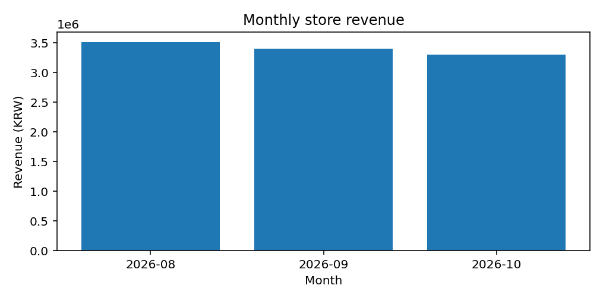
**코드 및 결과 해설**

`MS`는 월 시작 시각에 레이블을 붙입니다. 기록이 없는 날을 0으로 추정했다는 뜻은 아닙니다. 빠진 날이 있다면 월별 합계는 실제보다 작을 수도 있습니다.
### Example 07 — Aggregation Semantics — 평균과 합계의 차이
**문제 상황**

기온과 강수량을 일별로 요약할 때 둘 다 `sum()`을 사용해도 될까요?
**핵심 개념**

기온(°C)은 **그 시점의 상태**이므로 관측 평균을, 강수량(mm)은 **겹치지 않는 기간에 누적된 양**이므로 합계를 이용합니다. 같은 시간 간격에서도 측정값의 의미에 따라 집계 방법이 다릅니다.
**왜 이 기능을 사용할까요?**

기온 평균은 관측 간격이 균일하고 유효한 표본이 있다는 가정에서 단순 평균으로 계산합니다. 누락이 집중됐다면 편향될 수 있습니다.
**예제 코드 — [07_mean_vs_sum.py](./examples/07_mean_vs_sum.py)**

```python
import matplotlib
matplotlib.use('Agg')
import pandas as pd
import matplotlib.pyplot as plt
from pathlib import Path
ROOT=Path(__file__).resolve().parents[1]
df=pd.read_csv(ROOT/'data/weather_hourly.csv',parse_dates=['timestamp_local'])
s=df.query('station_id == "W-A"').set_index('timestamp_local').sort_index()
summary=s.resample('D').agg(temp_mean=('temperature_c','mean'),rain_sum=('precipitation_mm','sum'))
print('Days:',len(summary),'First day mean temp:',round(summary.iloc[0]['temp_mean'],2))
fig,axes=plt.subplots(2,1,figsize=(9,5.5),sharex=True,layout='constrained')
axes[0].plot(summary.index,summary['temp_mean'],marker='o');axes[0].set(ylabel='Mean °C',title='Temperature: mean')
axes[1].bar(summary.index,summary['rain_sum']);axes[1].set(ylabel='Total mm',title='Hourly precipitation: sum',xlabel='Day')
fig.savefig(ROOT/'figures/07_mean_vs_sum.png',dpi=145);plt.close(fig)
```
**실행 결과 (터미널)**

```text
Days: 14 First day mean temp: 15.96
```
**실제 생성한 그래프**

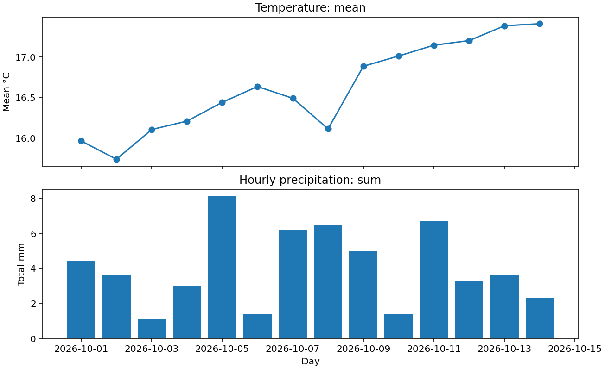
**코드 및 결과 해설**

같은 일별 축을 사용하지만 기온은 평균 °C, 강수량은 총 mm로 해석해야 합니다.

---
<a id="section-6-7"></a>
## 6.7. Coverage — 집계값이 있어도 완전한가?
기상 관측소가 하루 24회 측정하도록 설정되어 있다고 해도, 평균기온을 계산할 수 있다는 이유로 24회가 전부 수집됐다고 볼 수는 없습니다.

관측 완전성(Coverage)은 예정된 슬롯 대비 실제 **유효한 관측 슬롯의 비율**입니다.

$$
\mathrm{Coverage\ Rate} = \frac{N_{\mathrm{valid}}}{N_{\mathrm{expected}}} \times 100\%
$$

- $N_{\mathrm{valid}}$: 유효하게 관측된 슬롯 수(Valid Observations)
- $N_{\mathrm{expected}}$: 관측이 예정된 전체 슬롯 수(Expected Observations)

예정 24개 중 유효한 측정 18개만 존재한다면 Coverage는 `75%`입니다. 이때 계산된 기온 평균은 **수집된 18개 관측의 평균**이지 하루 전체를 빠짐없이 측정한 평균이 아닙니다.

- `resample("D").count()`: 유효한 값이 몇 개 있었는지 계산합니다.
- `resample("D").size()`: 값이 NaN이어도 행이 존재하면 셉니다.
- 데이터 파일에 아예 없는 시각은 예정 슬롯을 복원해야 발견할 수 있습니다.

Coverage를 제공하면 다른 사람이 그래프를 해석할 때 관측 공백의 영향을 판단할 수 있습니다.
### Example 08 — Observation Coverage — 불완전한 구간 표시
**문제 상황**

일평균 기온이 계산됐다고 해서 그날 24시간 모두 관측됐다고 생각할 수 있습니다.
**핵심 개념**

`resample().count()`는 실제 값이 존재한 관측 횟수를 계산합니다. `resample().mean()`으로 평균을 구하더라도 `count`와 나란히 제공해야 구간의 완전성을 판단할 수 있습니다.
**왜 이 기능을 사용할까요?**

빈도와 관측 계약을 기준으로 일별 24개 기록이 모두 있을 때 완전한 날로 정의합니다.
**예제 코드 — [08_group_coverage.py](./examples/08_group_coverage.py)**

```python
import matplotlib
matplotlib.use('Agg')
import pandas as pd
import matplotlib.pyplot as plt
from pathlib import Path
ROOT=Path(__file__).resolve().parents[1]
df=pd.read_csv(ROOT/'data/weather_hourly.csv',parse_dates=['timestamp_local'])
s=df.query('station_id == "W-A"').set_index('timestamp_local')['temperature_c'].sort_index()
daily=s.resample('D').agg(['mean','count'])
print('Incomplete days:',int((daily['count']<24).sum()))
fig,ax=plt.subplots(figsize=(9,3.5))
ax.bar(daily.index,daily['count'],width=.8)
ax.axhline(24,ls='--',color='#b34743',label='Expected hourly samples')
ax.set(title='Daily measurement coverage',ylabel='Available records',ylim=(0,26));ax.legend()
fig.tight_layout();fig.savefig(ROOT/'figures/08_group_coverage.png',dpi=145);plt.close(fig)
```
**실행 결과 (터미널)**

```text
Incomplete days: 2
```
**실제 생성한 그래프**

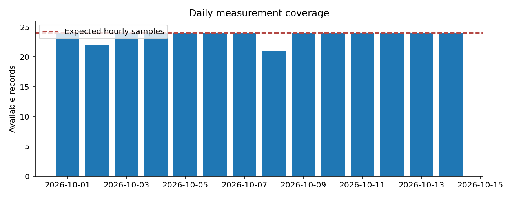
**코드 및 결과 해설**

기온이 평균 20°C라고 계산되어도 관측 수가 20개라면 하루 전체를 대표한다고 단정할 수 없습니다.

---
<a id="section-6-8"></a>
## 6.8. Rolling Windows — 이동평균과 계산 기준
이동평균(Rolling Mean)은 **최근 일정 범위의 관측값을 평균하여** 순간 변동을 완화하는 방법입니다. 주식 가격, 서버 지연, 기온 등에서 변화의 큰 흐름을 볼 때 사용합니다.

다음 3개 값의 단순 이동평균은 다음과 같습니다.

$$
MA_t=\frac{x_{t-2}+x_{t-1}+x_t}{3}
$$

하지만 `rolling(3)`은 **3개 행**, `rolling("60min")`은 **최근 60분 구간**입니다. 수집 간격이 불규칙하다면 둘은 같은 계산이 아닙니다.

| 코드 | 의미 | 주의할 점 |
|---|---|---|
| `rolling(7)` | 현재 행을 포함한 최근 7개 행 | 반드시 7일은 아님 |
| `rolling(7, min_periods=7)` | 유효 관측이 7개여야 계산 | 값이 빠진 구간에서 결과 NaN |
| `rolling("60min")` | 최근 60분 구간에 있는 관측 | 포함된 관측 수가 달라질 수 있음 |

**중요한 원칙:** 미래값을 현재 시점의 이동평균에 사용하지 않아야 합니다. 시간에 따라 실제로 계산할 수 있었던 값만 포함해야 분석 결과를 오해하지 않습니다.
### Example 09 — Rolling Window — 관측 건수 기준
**문제 상황**

최근 7일의 일별 매출을 부드럽게 보고 싶은데 이동평균의 의미가 불분명합니다.
**핵심 개념**

`rolling(window=7)`은 순서대로 나열한 **7개 행**을 참조합니다. 데이터를 일 단위로 정렬하고 모든 날짜를 복원했다면 7개 행이 7일에 대응합니다. `min_periods=7`은 7개 값이 모두 있어야 평균을 계산한다는 뜻입니다.
**왜 이 기능을 사용할까요?**

날짜가 빠진 채로 `rolling(7)`을 사용하면 7개 관측이 7일보다 긴 기간을 뜻할 수도 있습니다.
**예제 코드 — [09_rolling_count.py](./examples/09_rolling_count.py)**

```python
import matplotlib
matplotlib.use('Agg')
import pandas as pd
import matplotlib.pyplot as plt
from pathlib import Path
ROOT=Path(__file__).resolve().parents[1]
df=pd.read_csv(ROOT/'data/sales_daily.csv',parse_dates=['date'])
s=df.query('store_id == "ST-B"').set_index('date')['revenue_krw'].sort_index()
s=s.reindex(pd.date_range(s.index.min(),s.index.max(),freq='D'))
mean7=s.rolling(7,min_periods=7).mean()
print('Rolling valid:',int(mean7.notna().sum()),'Missing daily:',int(s.isna().sum()))
fig,ax=plt.subplots(figsize=(9,3.4))
ax.plot(s.index,s.values,alpha=.35,label='Daily')
ax.plot(mean7.index,mean7.values,lw=2,label='7-day mean (complete window)')
ax.set(title='Rolling seven-day average',ylabel='KRW');ax.legend()
fig.tight_layout();fig.savefig(ROOT/'figures/09_rolling_count.png',dpi=145);plt.close(fig)
```
**실행 결과 (터미널)**

```text
Rolling valid: 65 Missing daily: 3
```
**실제 생성한 그래프**

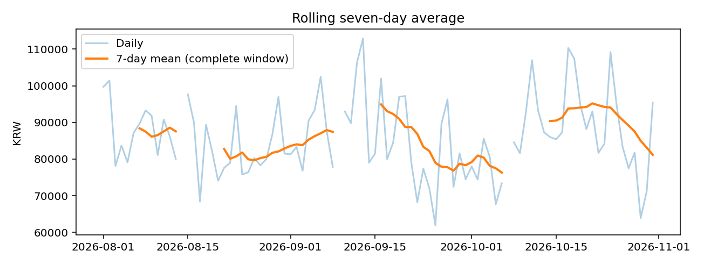
**코드 및 결과 해설**

관측 누락이 있는 기간은 `min_periods=7` 조건에 따라 이동평균도 끊어집니다.
### Example 10 — Time-Offset Rolling — 실제 60분 구간
**문제 상황**

센서 데이터의 샘플 간격이 불규칙할 때 최근 60분의 평균을 계산해야 합니다.
**핵심 개념**

`rolling("60min")`은 마지막 시각에서 이전 60분이라는 **시간 범위**에 포함되는 관측을 계산합니다. 정수 `rolling(12)`와 달리 표본 수가 일정하지 않을 수 있습니다.
**왜 이 기능을 사용할까요?**

시간 기반 창은 기본 경계 포함 규칙과 실제 관측 개수를 검토해야 합니다. 샘플이 적은 구간에서 평균을 해석할 때 주의해야 합니다.
**예제 코드 — [10_rolling_time.py](./examples/10_rolling_time.py)**

```python
import matplotlib
matplotlib.use('Agg')
import pandas as pd
import matplotlib.pyplot as plt
from pathlib import Path
ROOT=Path(__file__).resolve().parents[1]
df=pd.read_csv(ROOT/'data/server_metrics.csv')
df['time']=pd.to_datetime(df['timestamp_utc'],utc=True)
s=df.set_index('time')['latency_ms'].sort_index()
count=s.rolling('60min').count()
mean=s.rolling('60min',min_periods=8).mean()
print('Rolling sample count range:',int(count.min()),int(count.max()))
fig,ax=plt.subplots(figsize=(9,3.5))
ax.plot(s.index,s,alpha=.25,label='Observed')
ax.plot(mean.index,mean,label='Last 60 minutes (min 8)',lw=1.8)
ax.set(title='Time-based rolling mean',ylabel='Latency (ms)');ax.legend()
fig.tight_layout();fig.savefig(ROOT/'figures/10_rolling_time.png',dpi=145);plt.close(fig)
```
**실행 결과 (터미널)**

```text
Rolling sample count range: 1 12
```
**실제 생성한 그래프**

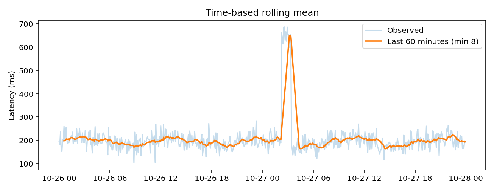
**코드 및 결과 해설**

최근 60분 안의 관측 개수가 달라질 수 있기 때문에 최소 관측 수를 별도로 정해두었습니다.

---
<a id="section-6-9"></a>
## 6.9. Exponentially Weighted Mean — 지수 가중 평균
단순 이동평균은 같은 창 안의 각 관측값을 동일한 비중으로 다룹니다. 반면 지수 가중 평균(EWM)은 **최근 관측에 더 큰 가중치**를 둡니다. 값이 변화하기 시작할 때 비교적 빠르게 반응할 수 있습니다.

기본적인 재귀식은 다음과 같습니다.

$$
E_t=\alpha x_t+(1-\alpha)E_{t-1},\qquad 0<\alpha\le1
$$

여기서 `α`가 클수록 최근 값의 비중이 커집니다. Pandas에서 `ewm(span=12, adjust=False)`는 `α=2/(12+1)`에 대응합니다. 단, 결측값이 끼어 있을 때 EWM의 출력과 유효 관측 처리 규칙은 단순 이동평균과 다르므로 `ignore_na`, `min_periods`의 의미를 확인해야 합니다.

EWM은 데이터를 부드럽게 보여주는 방법이지, 이를 적용했다고 해서 우연한 변동을 모두 제거하거나 미래 값을 정확히 예측하는 것은 아닙니다.
### Example 11 — Exponentially Weighted Mean — 최근 관측에 큰 가중치
**문제 상황**

지연시간이 갑자기 증가할 때 과거 데이터의 영향은 줄이고 최근 변화를 더 빠르게 반영하려고 합니다.
**핵심 개념**

지수 가중 이동평균(EWM)은 최근 값에 큰 가중치를, 오래된 값에 작은 가중치를 줍니다. `ewm(span=12, adjust=False)`는 재귀 형태로 계산하며 평활 계수는 대략 `2/(12+1)`입니다.
**왜 이 기능을 사용할까요?**

EWM은 원인 분석이나 정확한 예측 모델이 아닙니다. 누락 구간의 시간 간격을 항상 동일하게 취급해도 되는지 검토해야 합니다.
**예제 코드 — [11_ewm.py](./examples/11_ewm.py)**

```python
import matplotlib
matplotlib.use('Agg')
import pandas as pd
import matplotlib.pyplot as plt
from pathlib import Path
ROOT=Path(__file__).resolve().parents[1]
s=pd.read_csv(ROOT/'data/server_metrics.csv')
s['time']=pd.to_datetime(s['timestamp_utc'],utc=True)
s=s.set_index('time')['latency_ms'].sort_index().reindex(pd.date_range('2026-10-26','2026-10-27 23:55',freq='5min',tz='UTC'))
e=s.ewm(span=12,adjust=False,ignore_na=False).mean()
r=s.rolling(12,min_periods=12).mean()
print('Series length:',len(s),'EWM valid:',int(e.notna().sum()))
fig,ax=plt.subplots(figsize=(9,3.4))
ax.plot(s.index,s,alpha=.23,label='Observed')
ax.plot(e.index,e,label='EWM (span 12)');ax.plot(r.index,r,label='Complete 12-sample mean')
ax.set(title='Smoothing: EWM vs rolling',ylabel='Latency (ms)');ax.legend()
fig.tight_layout();fig.savefig(ROOT/'figures/11_ewm.png',dpi=145);plt.close(fig)
```
**실행 결과 (터미널)**

```text
Series length: 576 EWM valid: 576
```
**실제 생성한 그래프**

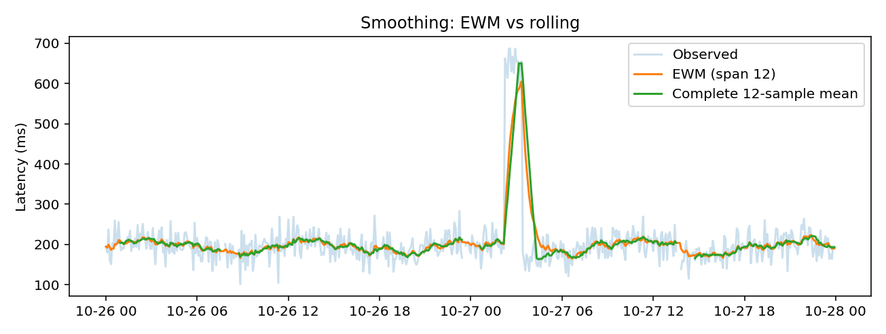
**코드 및 결과 해설**

EWM과 단순 이동평균은 같은 데이터를 입력해도 가중치와 누락 처리에 따라 다른 곡선을 만듭니다.

---
<a id="section-6-10"></a>
## 6.10. Difference & Percent Change — 절대 변화와 상대 변화
지난달 매출이 100에서 120으로 증가했다면 절대 변화량은 `+20`이고 상대 변화율은 `+20%`입니다. 비교하려는 질문에 따라 적합한 표현이 달라집니다.

$$
\Delta x_t=x_t-x_{t-1},\qquad r_t=\frac{x_t-x_{t-1}}{x_{t-1}}\times100\%
$$

- **절대 변화량 (`diff()`):** 값이 실제로 얼마나 증가·감소했는지 확인할 때 사용합니다.
- **상대 변화율 (`pct_change()`):** 규모가 다른 값의 변화를 비율로 비교할 때 사용합니다.

**이전 값이 0이라면?** 분모가 0이 되므로 유한한 변화율을 계산할 수 없습니다. 그래프에서 0%로 표시하는 것은 올바른 대체가 아닙니다. 또한 이전 값이 누락됐다면 변화율 역시 알 수 없으므로 결측을 자동 대체하지 않도록 `fill_method=None`을 명시합니다.
### Example 12 — Difference & Percent Change — 변화량과 변화율
**문제 상황**

지난주 대비 이번 주 매출이 얼마나 변했는지 절대 금액과 비율로 함께 표현하려고 합니다.
**핵심 개념**

`diff()`는 바로 이전 값과의 **차이**를 구하고 `pct_change()`는 이전 값에 대한 **상대 변화율**을 구합니다. 분모가 0이거나 이전 값이 없으면 변화율은 해석할 수 없을 수 있습니다.
**왜 이 기능을 사용할까요?**

`pct_change(fill_method=None)`으로 결측을 임의로 채우지 않고, 백분율로 표현할 때는 100을 곱합니다.
**예제 코드 — [12_diff_pct.py](./examples/12_diff_pct.py)**

```python
import matplotlib
matplotlib.use('Agg')
import numpy as np
import pandas as pd
import matplotlib.pyplot as plt
from pathlib import Path
ROOT=Path(__file__).resolve().parents[1]
s=pd.Series([100,115,120,0,90],index=['W1','W2','W3','W4','W5'],dtype=float)
delta=s.diff();rate=s.pct_change(fill_method=None)*100
rate=rate.replace([np.inf,-np.inf],np.nan)
print('W2 delta:',int(delta.iloc[1]),'W5 rate available:',bool(pd.notna(rate.iloc[-1])))
fig,axes=plt.subplots(1,2,figsize=(9,3.5),layout='constrained')
axes[0].bar(delta.index,delta.values);axes[0].set(title='Absolute change',ylabel='Change (units)')
axes[1].bar(rate.index,rate.values);axes[1].set(title='Relative change',ylabel='Change (%)')
fig.savefig(ROOT/'figures/12_diff_pct.png',dpi=145);plt.close(fig)
```
**실행 결과 (터미널)**

```text
W2 delta: 15 W5 rate available: False
```
**실제 생성한 그래프**

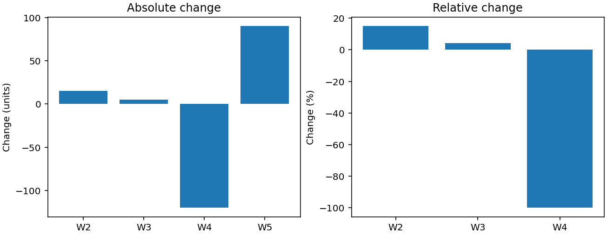
**코드 및 결과 해설**

W4가 0이므로 W5의 증가율은 유한한 백분율로 표시할 수 없습니다. 금액 변화 자체는 계산할 수 있습니다.

---
<a id="section-6-11"></a>
## 6.11. Weekly Pattern — 요일별 반복 변화
시계열에는 장기 추세뿐 아니라 **요일에 따라 반복되는 변화**가 존재할 수 있습니다. 예를 들어 주말에는 상점 방문자가 늘고, 평일 출퇴근 시간에는 교통량이 높아질 수 있습니다.

요일별 차이를 비교할 때는 **기간에 포함된 같은 요일의 횟수**, 관측 누락, 특별 행사 등을 먼저 확인해야 합니다. 월요일 데이터 10개와 일요일 데이터 2개의 평균을 단순 비교하면 우연한 영향이 커질 수 있습니다.

`dt.dayofweek`는 월요일 0부터 일요일 6까지를 반환합니다. `groupby()`로 같은 요일을 묶은 다음 평균과 표본 수를 함께 계산하는 방식이 일반적입니다.
### Example 13 — Weekday & Weekend — 요일 효과
**문제 상황**

매장 매출은 주말에 늘어나는 경향이 있는지 확인하려고 합니다.
**핵심 개념**

요일 효과(Weekly Pattern)는 한 주의 특정 요일에 반복되는 변화입니다. `dt.dayofweek`는 월요일을 0, 일요일을 6으로 표시하므로 주말 구분에 사용합니다.
**왜 이 기능을 사용할까요?**

주말 평균이 높다는 관측만으로 주말이 매출 증가의 원인이라고 단정하지 않습니다. 매장·행사·누락 등을 함께 검토해야 합니다.
**예제 코드 — [13_weekday_pattern.py](./examples/13_weekday_pattern.py)**

```python
import matplotlib
matplotlib.use('Agg')
import pandas as pd
import matplotlib.pyplot as plt
from pathlib import Path
ROOT=Path(__file__).resolve().parents[1]
df=pd.read_csv(ROOT/'data/sales_daily.csv',parse_dates=['date'])
df['weekday']=df['date'].dt.dayofweek
mean=df.groupby('weekday')['revenue_krw'].mean().reindex(range(7))
print('Weekend average higher:',bool(mean.iloc[5:].mean()>mean.iloc[:5].mean()))
fig,ax=plt.subplots(figsize=(8,3.4))
ax.bar(['Mon','Tue','Wed','Thu','Fri','Sat','Sun'],mean.values)
ax.set(title='Average daily revenue by weekday',ylabel='KRW / observed store-day')
fig.tight_layout();fig.savefig(ROOT/'figures/13_weekday_pattern.png',dpi=145);plt.close(fig)
```
**실행 결과 (터미널)**

```text
Weekend average higher: True
```
**실제 생성한 그래프**

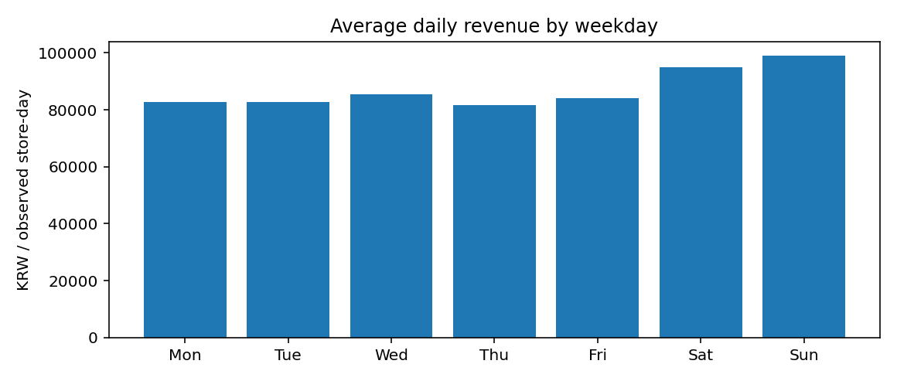
**코드 및 결과 해설**

한 매장의 합계가 아니라 관측된 매장·일자를 분모로 하는 평균임을 확인해야 합니다.

---
<a id="section-6-12"></a>
## 6.12. Hourly Profile, Trend, Seasonality & Noise
시간대별로 반복되는 경향을 확인하려면 여러 날짜의 **동일 시각을 묶어서** 그래프로 표현할 수 있습니다. 예를 들어 28일 동안 08:00의 차량 통과 대수를 모아 평균을 구하면 08:00의 전형적인 관측 수준을 확인할 수 있습니다.

여기서 중요한 세 용어를 구별합니다.

| 개념 | 의미 | 예시 |
|---|---|---|
| Trend (추세) | 비교적 긴 기간에 걸친 방향 | 여러 달 동안 증가하는 매출 |
| Seasonality (계절성) | 일정한 주기로 반복되는 변화 | 매일 오후의 기온 상승, 주말의 이용 변화 |
| Noise (잡음) | 모형·반복 패턴으로 설명되지 않은 변화 | 작은 불규칙 측정 변동 |

**비유:** 매일 아침과 밤의 기온 차이가 반복된다면 이는 하루 주기의 계절성이고, 두 달간 기온 수준이 조금씩 바뀌었다면 더 긴 변화의 추세일 수 있습니다. 갑작스러운 센서 오작동은 잡음 또는 이상치처럼 나타날 수 있습니다. 실제 자료에서는 세 요소가 정확히 분리되지 않을 수 있습니다.

시간대별 평균이 모든 날짜를 대표한다고 단정하지 않도록 표본 수도 함께 제시하세요. 2주 자료에서 나타난 반복 패턴만으로 향후 모든 계절의 현상을 확정할 수는 없습니다.
### Example 14 — Hour-of-Day Profile — 시간대별 전형적인 패턴
**문제 상황**

교통량이 어느 시간대에 집중되는지 28일간의 기록을 한 장으로 요약하려고 합니다.
**핵심 개념**

시각의 `hour` 값을 이용하면 여러 날짜에서 같은 시각에 관측한 값을 묶어 평균적인 시간대 패턴을 만들 수 있습니다.
**왜 이 기능을 사용할까요?**

관측값이 빠진 시간이 있으면 해당 시간의 평균에 포함된 날짜 수가 다를 수 있습니다. 평균과 함께 표본 수를 표시해야 합니다.
**예제 코드 — [14_hourly_profile.py](./examples/14_hourly_profile.py)**

```python
import matplotlib
matplotlib.use('Agg')
import pandas as pd
import matplotlib.pyplot as plt
from pathlib import Path
ROOT=Path(__file__).resolve().parents[1]
df=pd.read_csv(ROOT/'data/traffic_hourly.csv')
df['time']=pd.to_datetime(df['timestamp_utc'],utc=True,errors='coerce').dt.tz_convert('Asia/Seoul')
df['count']=pd.to_numeric(df['vehicle_count'],errors='coerce')
s=df[df['corridor_id'].eq('R-01') & df['count'].ge(0)].drop_duplicates(['time'])
p=s.groupby(s['time'].dt.hour)['count'].agg(['mean','count']).reindex(range(24))
print('Profile hours:',p['count'].notna().sum(),'Min samples:',int(p['count'].min()))
fig,axes=plt.subplots(2,1,figsize=(8,5.3),sharex=True,layout='constrained')
axes[0].plot(p.index,p['mean'],marker='o');axes[0].set(ylabel='Vehicles / hour',title='Typical hourly volume')
axes[1].bar(p.index,p['count']);axes[1].set(ylabel='Days observed',xlabel='Hour (KST)')
fig.savefig(ROOT/'figures/14_hourly_profile.png',dpi=145);plt.close(fig)
```
**실행 결과 (터미널)**

```text
Profile hours: 24 Min samples: 27
```
**실제 생성한 그래프**

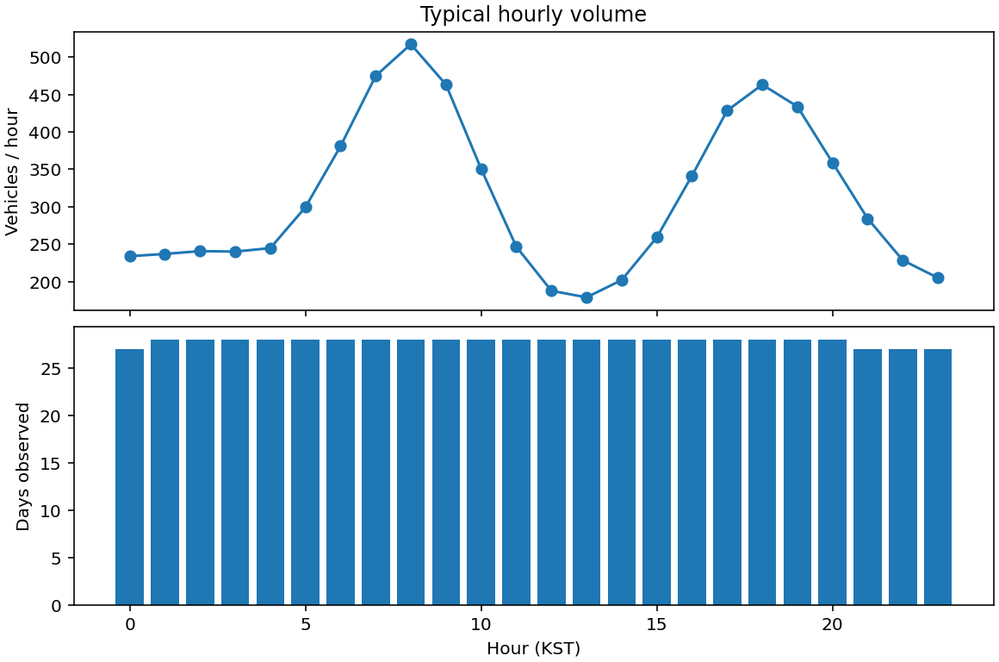
**코드 및 결과 해설**

시간대별 평균 아래 관측 수를 함께 보여주는 것이 평균값의 신뢰도를 해석하는 데 도움이 됩니다.
### Example 15 — Trend, Seasonality & Noise — 변화의 구성
**문제 상황**

기온 데이터에서 하루 주기의 변화와 장기적인 변화가 섞여 있습니다.
**핵심 개념**

시계열의 **추세(Trend)**는 비교적 장기적인 방향, **계절성(Seasonality)**은 반복되는 주기, **잡음(Noise)**은 설명되지 않은 불규칙 변동을 뜻합니다. 계절성은 계절(봄·여름 등)에만 한정되지 않고 하루·한 주 주기에도 적용됩니다.
**왜 이 기능을 사용할까요?**

짧은 기간의 눈대중 관찰만으로 장기 추세나 규칙적 계절성이 확정됐다고 말할 수는 없습니다.
**예제 코드 — [15_seasonality.py](./examples/15_seasonality.py)**

```python
import matplotlib
matplotlib.use('Agg')
import numpy as np
import pandas as pd
import matplotlib.pyplot as plt
from pathlib import Path
ROOT=Path(__file__).resolve().parents[1]
df=pd.read_csv(ROOT/'data/weather_hourly.csv',parse_dates=['timestamp_local'])
s=df.query('station_id == "W-B"').set_index('timestamp_local')['temperature_c'].sort_index()
s=s.reindex(pd.date_range('2026-10-01','2026-10-14 23:00',freq='h'))
mean=s.groupby(s.index.hour).mean()
print('Daily cycle amplitude:',round(float(mean.max()-mean.min()),2))
fig,axes=plt.subplots(2,1,figsize=(9,5.5),layout='constrained')
axes[0].plot(s.index,s);axes[0].set(title='Hourly weather observations',ylabel='Temperature (°C)')
axes[1].plot(mean.index,mean,marker='o');axes[1].set(title='Mean diurnal profile',ylabel='Temperature (°C)',xlabel='Hour')
fig.savefig(ROOT/'figures/15_seasonality.png',dpi=145);plt.close(fig)
```
**실행 결과 (터미널)**

```text
Daily cycle amplitude: 9.99
```
**실제 생성한 그래프**

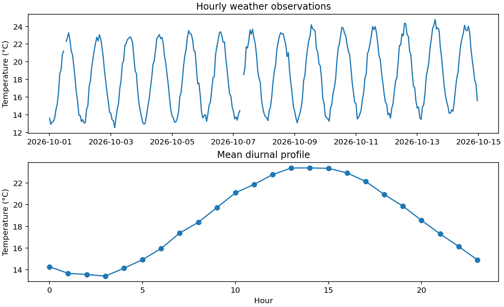
**코드 및 결과 해설**

반복되는 시간대별 패턴은 확인할 수 있지만, 이를 분리한 결과가 곧 정확한 미래 예측은 아닙니다.

---
<a id="section-6-13"></a>
## 6.13. Comparing Multiple Series — 공통 축과 지수화
여러 관측소의 기온을 비교할 때는 그래프마다 Y축 범위가 다르면 변화 폭의 크기가 다르게 느껴질 수 있습니다. 같은 단위라면 `sharey=True`를 사용해 공통 축을 갖도록 할 수 있습니다.

반대로 매장별 매출의 **규모가 매우 다른 경우**에는 절대값 그래프에서 상대 변화가 잘 보이지 않을 수 있습니다. 이때는 각 매장 첫날 값을 100으로 맞춘 지수 그래프가 유용합니다. 하지만 지수화된 그래프는 실제 매출액 차이를 나타내지 않습니다. 따라서 동일한 자료라도 **규모 비교와 변화율 비교는 그래프를 분리**하는 것이 좋습니다.

$$
I_t=\frac{x_t}{x_{\text{baseline}}}\times 100
$$

기준값이 0 또는 결측이면 지수화할 수 없습니다. 어느 시점을 기준으로 100을 설정했는지 제목이나 주석에 분명히 적습니다.
### Example 16 — Shared Axis & Small Multiples — 공정한 비교
**문제 상황**

여러 관측소 기온을 서로 다른 그래프로 그리면 각 그래프의 축 범위가 달라 변화 폭을 과장할 수 있습니다.
**핵심 개념**

Small Multiples는 같은 형식의 작은 그래프를 반복 배치하는 방법입니다. `sharey=True`를 설정하면 같은 단위의 그래프들이 공통 Y축 범위를 사용해 비교가 쉬워집니다.
**왜 이 기능을 사용할까요?**

공통 축은 단위가 같을 때 유용하며, 관측 변수의 단위가 다르면 하나의 Y축을 강제하면 안 됩니다.
**예제 코드 — [16_shared_axis.py](./examples/16_shared_axis.py)**

```python
import matplotlib
matplotlib.use('Agg')
import pandas as pd
import matplotlib.pyplot as plt
from pathlib import Path
ROOT=Path(__file__).resolve().parents[1]
df=pd.read_csv(ROOT/'data/weather_hourly.csv',parse_dates=['timestamp_local'])
daily=df.groupby([df['timestamp_local'].dt.floor('D'),'station_id'])['temperature_c'].mean().unstack()
fig,axes=plt.subplots(3,1,figsize=(9,7),sharex=True,sharey=True,layout='constrained')
for ax,station in zip(axes,sorted(daily.columns)):
    ax.plot(daily.index,daily[station],marker='o');ax.set(title=station,ylabel='Mean °C')
axes[-1].set_xlabel('Day')
fig.savefig(ROOT/'figures/16_shared_axis.png',dpi=145);plt.close(fig)
print('Stations:',len(daily.columns),'Shared y:',bool(axes[0].get_shared_y_axes().joined(axes[0],axes[1])))
```
**실행 결과 (터미널)**

```text
Stations: 3 Shared y: True
```
**실제 생성한 그래프**

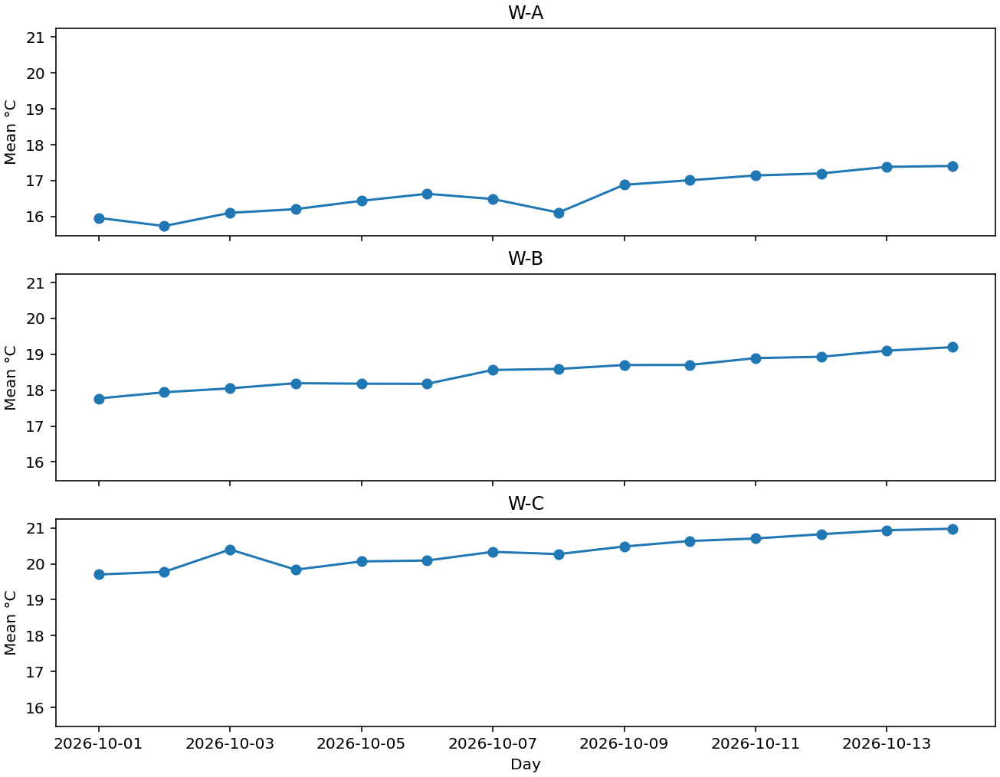
**코드 및 결과 해설**

세 그래프의 같은 눈금 간격이 실제로 같은 기온 차이를 의미합니다.

---
<a id="section-6-14"></a>
## 6.14. Event Windows & Annotations — 검토 구간 표시
서버 장애를 점검하거나 센서 변화가 발생한 기간을 설명할 때 **특정 시간 구간을 음영으로 강조**하면 그래프 해석이 쉬워집니다. `ax.axvspan()`은 두 시각 사이를 표시합니다. 데이터의 값을 수정하거나 시간을 늘리는 기능은 아닙니다.

- `axvline()`: 한 시점에 세로선을 표시합니다.
- `axvspan()`: 일정 시간 범위에 음영을 표시합니다.
- `annotate()`: 특정 데이터 위치를 텍스트와 화살표로 설명할 수 있습니다.

주의할 점은 표시된 시간 구간이 **실제로 확인된 사건의 발생 시점인지**, 단지 분석자가 확인하려는 후보 구간인지를 명확히 설명하는 것입니다. 급등한 값에 색을 칠했다고 해서 그 원인이 밝혀진 것은 아닙니다.
### Example 17 — Event Window — 특정 기간을 표시
**문제 상황**

서버 지연이 급등한 구간이 언제 발생했는지 그래프에 명확히 표시하려고 합니다.
**핵심 개념**

`axvspan(start, end)`는 축 위의 **시간 구간에 음영을 표시**합니다. 데이터 값을 바꾸지 않고 분석 대상 기간을 강조할 수 있습니다.
**왜 이 기능을 사용할까요?**

이벤트 구간은 로그 등 별도 근거가 있을 때 표시해야 합니다. 급등 구간을 강조했다고 해서 원인을 입증한 것은 아닙니다.
**예제 코드 — [17_event_window.py](./examples/17_event_window.py)**

```python
import matplotlib
matplotlib.use('Agg')
import pandas as pd
import matplotlib.pyplot as plt
from pathlib import Path
ROOT=Path(__file__).resolve().parents[1]
df=pd.read_csv(ROOT/'data/server_metrics.csv')
df['time']=pd.to_datetime(df['timestamp_utc'],utc=True)
fig,ax=plt.subplots(figsize=(10,3.5))
ax.plot(df['time'],df['latency_ms'],lw=1)
start=pd.Timestamp('2026-10-27 02:15',tz='UTC');end=pd.Timestamp('2026-10-27 03:30',tz='UTC')
ax.axvspan(start,end,color='#f0ae4f',alpha=.28,label='Review window')
ax.set(title='Latency and marked review window',ylabel='Latency (ms)',xlabel='Time (UTC)');ax.legend()
fig.tight_layout();fig.savefig(ROOT/'figures/17_event_window.png',dpi=145);plt.close(fig)
print('Window length (minutes):',int((end-start).total_seconds()/60))
```
**실행 결과 (터미널)**

```text
Window length (minutes): 75
```
**실제 생성한 그래프**

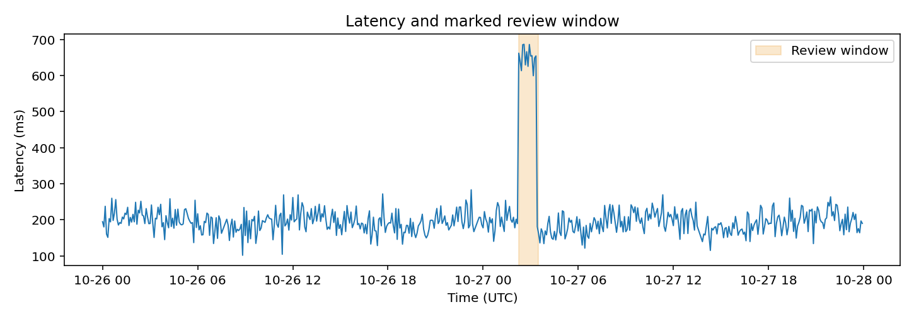
**코드 및 결과 해설**

음영은 검토 대상 기간을 나타내며 실제 기록이 없었던 구간을 채워 넣지 않습니다.

---
<a id="section-6-15"></a>
## 6.15. Interpolation — 미관측값을 추정할 때의 한계
시간 중간에 누락된 관측을 추정하는 대표적인 방법이 보간(Interpolation)입니다. **선형 보간**은 두 관측 시각 사이에서 값이 일정한 속도로 변했다고 가정해 중간 값을 계산합니다.

예를 들어 09:00에 10°C, 11:00에 14°C를 측정했고 10:00이 비어 있다면 선형 보간은 12°C를 제안할 수 있습니다. 그러나 **10:00에 실제로 12°C였다고 관측한 것은 아닙니다.** 두 시각 사이에 갑작스러운 변화가 발생했다면 보간값은 사실과 다를 수 있습니다.

그래프에서는 원본 실선과 추정 점선처럼 스타일을 구별하고, 데이터를 다른 곳에 저장할 때도 관측과 추정을 나타내는 열을 분리하는 것이 좋습니다. 이 자료의 보간은 학습 목적이며 기본 프로젝트의 공식 통계에는 자동 보간을 적용하지 않습니다.
### Example 18 — Interpolation — 관측과 추정을 구분
**문제 상황**

한 시간 기온이 누락되어 선이 끊어졌는데 보고서에서 참고용 추정 곡선도 보고 싶습니다.
**핵심 개념**

`interpolate(method="time")`는 **시간 위치를 바탕으로 누락값을 추정**하는 방법입니다. 실제 관측이 생성되는 것이 아니므로 원래 측정값과 다른 선 스타일로 표현해야 합니다.
**왜 이 기능을 사용할까요?**

센서 장애·급격한 변동이 있는 구간에서 보간값이 실제 현상을 숨길 수 있습니다. 통계 보고서에서는 보간 여부를 명시하고 원본을 보존합니다.
**예제 코드 — [18_interpolation.py](./examples/18_interpolation.py)**

```python
import matplotlib
matplotlib.use('Agg')
import pandas as pd
import matplotlib.pyplot as plt
from pathlib import Path
ROOT=Path(__file__).resolve().parents[1]
df=pd.read_csv(ROOT/'data/weather_hourly.csv',parse_dates=['timestamp_local'])
s=df.query('station_id == "W-C"').set_index('timestamp_local')['temperature_c'].sort_index()
expected=pd.date_range('2026-10-03','2026-10-04 23:00',freq='h')
s=s.reindex(expected);filled=s.interpolate(method='time',limit=3,limit_area='inside')
print('Missing:',int(s.isna().sum()),'Estimated:',int((s.isna() & filled.notna()).sum()))
fig,ax=plt.subplots(figsize=(9,3.5))
ax.plot(s.index,s,label='Observed',lw=1.7)
ax.plot(filled.index,filled,ls='--',alpha=.7,label='Estimated (interpolation)')
ax.set(title='Measured vs estimated temperatures',ylabel='°C');ax.legend()
fig.tight_layout();fig.savefig(ROOT/'figures/18_interpolation.png',dpi=145);plt.close(fig)
```
**실행 결과 (터미널)**

```text
Missing: 4 Estimated: 3
```
**실제 생성한 그래프**

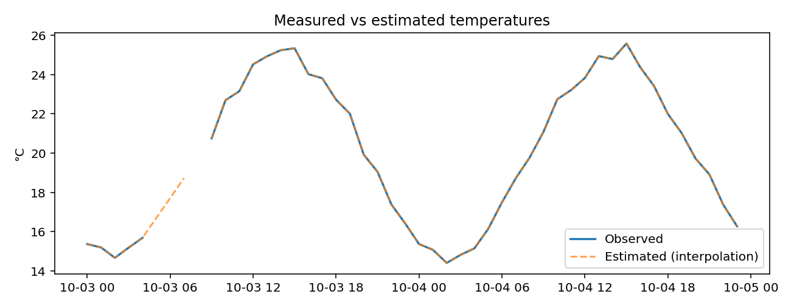
**코드 및 결과 해설**

추정한 값은 점선으로 구분하므로 실제 관측과 혼동하지 않습니다.

---
<a id="section-6-16"></a>
## 6.16. Timezone & Calendar Boundaries — UTC와 한국시간
세계의 여러 시스템은 기록을 UTC로 저장하지만, 지역별 보고서는 해당 지역의 날짜 경계를 사용합니다. `2026-10-01 00:00 UTC`는 `2026-10-01 09:00 KST`와 **같은 순간**입니다. 그 결과 UTC 날짜 기준 일별 합계와 KST 날짜 기준 일별 합계는 서로 다른 관측 시각을 묶을 수 있습니다.

| 함수 | 하는 일 | 사용 조건 |
|---|---|---|
| `tz_localize("UTC")` | 시간대 없는 날짜에 UTC 정보 지정 | 원본이 실제 UTC임을 알고 있을 때 |
| `tz_convert("Asia/Seoul")` | 이미 시간대가 있는 값을 KST로 변환 | timezone-aware 시각일 때 |
| `pd.to_datetime(..., utc=True)` | 문자열을 UTC-aware 시각으로 파싱 | 입력이 UTC 또는 UTC 오프셋을 명시할 때 |

**UTC로 표시한 시각에 단순히 9를 더한 문자열을 만들어 쓰는 것은 권장하지 않습니다.** 연·월·일 경계와 시간대 규칙을 안전하게 처리하려면 시간대 변환 기능을 사용해야 합니다.

또한 다른 지역에서는 여름시간제(DST) 전환으로 어떤 현지 시각이 두 번 발생하거나 존재하지 않을 수 있습니다. 한국의 관측 예제에는 이러한 전환이 없지만, 외국 지역 자료라면 `ambiguous`·`nonexistent` 조건을 확인해야 합니다.
### Example 19 — Timezone — UTC에서 KST로 변환
**문제 상황**

서버 로그는 UTC인데 국내 보고서는 KST 날짜 기준으로 작성해야 합니다.
**핵심 개념**

`tz_localize()`는 시간대가 없는 날짜에 시간대 정보를 **부여**하고, `tz_convert()`는 이미 시간대가 있는 시각을 **같은 순간의 다른 지역 시각으로 변환**합니다. UTC와 KST는 9시간 차이가 있습니다.
**왜 이 기능을 사용할까요?**

시간대 없는 문자열을 UTC로 가정해도 되는지는 반드시 출처를 확인해야 합니다. 이번 서버 로그에는 `Z`가 명시돼 있어 UTC로 파싱합니다.
**예제 코드 — [19_timezone.py](./examples/19_timezone.py)**

```python
import matplotlib
matplotlib.use('Agg')
import pandas as pd
import matplotlib.pyplot as plt
from pathlib import Path
ROOT=Path(__file__).resolve().parents[1]
raw=pd.read_csv(ROOT/'data/server_metrics.csv')
raw['utc']=pd.to_datetime(raw['timestamp_utc'],utc=True)
raw['kst']=raw['utc'].dt.tz_convert('Asia/Seoul')
print('UTC first:',raw.iloc[0]['utc'])
print('KST first:',raw.iloc[0]['kst'])
fig,ax=plt.subplots(figsize=(8,3.1))
ax.plot(raw['kst'],raw['cpu_pct'],lw=.8)
ax.set(title='Same measurements, KST date axis',xlabel='Time (Asia/Seoul)',ylabel='CPU (%)')
fig.tight_layout();fig.savefig(ROOT/'figures/19_timezone.png',dpi=145);plt.close(fig)
```
**실행 결과 (터미널)**

```text
UTC first: 2026-10-26 00:00:00+00:00
KST first: 2026-10-26 09:00:00+09:00
```
**실제 생성한 그래프**

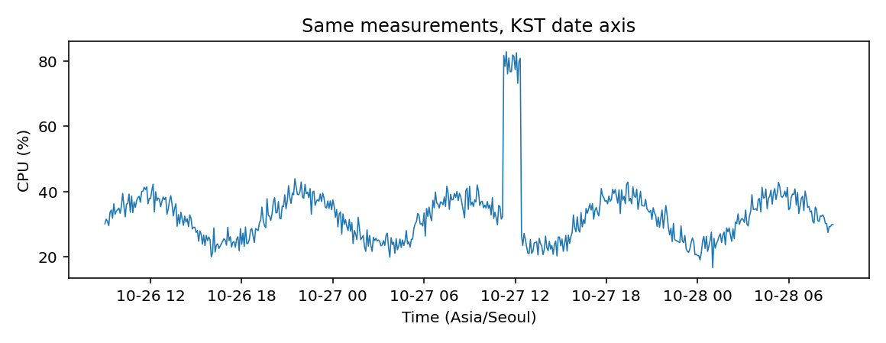
**코드 및 결과 해설**

같은 순간을 다른 시각 표기로 표시한 것입니다. 단순히 UTC 문자열에서 날짜만 잘라 일별 집계하면 한국시간의 하루 경계가 잘못됩니다.

---
<a id="section-6-17"></a>
## 6.17. Week & Month Boundaries — 기간의 경계
`resample("W-SUN")`은 일요일로 끝나는 주별 구간, `resample("MS")`는 월 시작 시점의 월별 구간을 의미합니다. 이런 **Anchor(경계 기준)**가 달라지면 같은 날짜가 서로 다른 집계 구간에 들어갈 수 있습니다.

예를 들어 월요일부터 일요일까지를 한 주로 정할 것인지, 토요일부터 금요일까지를 한 주로 정할 것인지에 따라 주간 매출 보고서의 결과가 달라집니다. 반드시 일주일을 7일로 채우는 것도 아닙니다. 데이터 수집 시작이 토요일이면 첫 번째 주는 토요일·일요일 **2일치**만 포함할 수 있습니다.

주간·월간 그래프에서는 관측 시작일·종료일과 **부분 기간(Partial Period)**을 명시하면 오해를 줄일 수 있습니다.
### Example 20 — Weekly Resampling — 주의 시작과 끝
**문제 상황**

주간 매출 그래프에서 첫 주와 마지막 주가 부분 주간일 수 있습니다.
**핵심 개념**

`resample("W-SUN")`은 **일요일로 끝나는 주**를 기준으로 묶습니다. 기본 주간 라벨은 주 종료 시점이므로 `W-MON`과의 결과를 혼동하면 안 됩니다.
**왜 이 기능을 사용할까요?**

자료가 시작·종료되는 주는 7일 전체가 아닐 수 있습니다. 일부 날짜가 빠졌을 때도 합계만 비교하면 누락 영향을 파악하기 어렵습니다.
**예제 코드 — [20_weekly_boundaries.py](./examples/20_weekly_boundaries.py)**

```python
import matplotlib
matplotlib.use('Agg')
import pandas as pd
import matplotlib.pyplot as plt
from pathlib import Path
ROOT=Path(__file__).resolve().parents[1]
df=pd.read_csv(ROOT/'data/sales_daily.csv',parse_dates=['date'])
s=df.query('store_id == "ST-A"').set_index('date')['revenue_krw'].sort_index()
weekly=s.resample('W-SUN').agg(['sum','count'])
print('First week observed days:',int(weekly.iloc[0]['count']),'Last:',int(weekly.iloc[-1]['count']))
fig,ax=plt.subplots(figsize=(9,3.4))
ax.bar(weekly.index,weekly['sum'],width=5)
ax.set(title='Weeks ending Sunday',xlabel='Week ending date',ylabel='KRW')
fig.tight_layout();fig.savefig(ROOT/'figures/20_weekly_boundaries.png',dpi=145);plt.close(fig)
```
**실행 결과 (터미널)**

```text
First week observed days: 2 Last: 6
```
**실제 생성한 그래프**

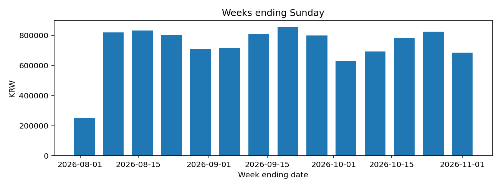
**코드 및 결과 해설**

첫 주 또는 마지막 주가 일부 날짜로만 구성되어 있을 수 있으므로 합계 비교 시 주간 관측 일수를 함께 확인해야 합니다.

---
<a id="section-6-18"></a>
## 6.18. Cumulative Values — 누적 그래프의 한계
`cumsum()`은 시간순으로 정렬된 값을 차례대로 더해 누적 합계를 만듭니다. 일별 판매액을 누적하면 **관측된 기간 동안 보고된 판매액 합계**를 확인할 수 있습니다.

하지만 중간 날짜의 매출이 누락되었다면 이후 날짜에 계산되는 누적 합계도 실제 총매출보다 적을 수 있습니다. `skipna=True`로 누적 계산을 이어가더라도 잃어버린 매출액이 복원되지는 않습니다. 따라서 그래프 제목에는 '누적 매출'보다 **'관측된 매출의 누적 합계'**처럼 범위를 명확히 적으면 좋습니다.
### Example 21 — Cumulative Sum — 누적값과 관측 공백
**문제 상황**

한 매장의 매출이 기간 동안 얼마나 누적됐는지 표현하려고 합니다.
**핵심 개념**

`cumsum()`은 관측된 값을 시간순으로 더해 누적 합계를 만듭니다. 일별 합계를 누적하는 것은 의미 있지만, 온도처럼 상태를 나타내는 값을 누적하면 단위를 별도로 해석해야 합니다.
**왜 이 기능을 사용할까요?**

`cumsum(skipna=True)`는 결측 시각 이후의 계산을 계속할 수 있지만, 누적값이 누락된 날짜의 실제 금액을 포함했다는 뜻은 아닙니다.
**예제 코드 — [21_cumsum.py](./examples/21_cumsum.py)**

```python
import matplotlib
matplotlib.use('Agg')
import pandas as pd
import matplotlib.pyplot as plt
from pathlib import Path
ROOT=Path(__file__).resolve().parents[1]
df=pd.read_csv(ROOT/'data/sales_daily.csv',parse_dates=['date'])
s=df.query('store_id == "ST-B"').set_index('date')['revenue_krw'].sort_index().reindex(pd.date_range('2026-08-01','2026-10-31',freq='D'))
cumulative=s.cumsum()
print('Observed total:',int(s.sum()),'Missing days:',int(s.isna().sum()))
fig,ax=plt.subplots(figsize=(9,3.4))
ax.plot(cumulative.index,cumulative.values)
ax.set(title='Cumulative observed revenue',ylabel='Observed KRW',xlabel='Date')
fig.tight_layout();fig.savefig(ROOT/'figures/21_cumsum.png',dpi=145);plt.close(fig)
```
**실행 결과 (터미널)**

```text
Observed total: 7642200 Missing days: 3
```
**실제 생성한 그래프**

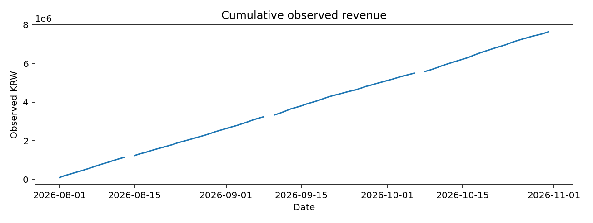
**코드 및 결과 해설**

그래프 제목에 **관측된 매출의 누적 합계**라고 명시했습니다. 누락된 날짜의 금액까지 포함한 전체 매출이라는 뜻은 아닙니다.

---
<a id="section-6-19"></a>
## 6.19. Relative Comparison — 기준 100 지수
절대적인 매출 규모가 다른 매장 간에 어느 매장이 더 빠르게 변화했는지 비교하려면 기준 100 지수를 활용할 수 있습니다.

기준값이 100, 현재값이 120이면 지수는 120이고, 이는 기준 시점 대비 20% 높다는 의미입니다. 단, 이는 **기준일의 매출이 얼마나 컸는지**를 알려주지 않습니다. 1천 원에서 1천2백 원으로 증가한 경우와 10만 원에서 12만 원으로 증가한 경우 모두 지수는 120입니다.

지수화가 실제 차이를 숨길 수 있으므로 규모를 함께 확인할 필요가 있을 때는 원 단위 그래프를 추가하는 것이 좋습니다.
### Example 22 — Normalized Index — 규모가 다른 시계열 비교
**문제 상황**

매장별 매출의 절대 금액 차이가 커서 변화율의 흐름을 비교하기 어렵습니다.
**핵심 개념**

지수화(Normalization to Base 100)는 기준 시점의 값을 100으로 정하고 다른 시점을 `값/기준값 × 100`으로 환산합니다. 기준값이 0이거나 결측이면 지수화할 수 없습니다.
**왜 이 기능을 사용할까요?**

지수 그래프는 절대 매출 규모를 보여주지 않습니다. 기준일과 단위를 반드시 명시해야 합니다.
**예제 코드 — [22_normalized_index.py](./examples/22_normalized_index.py)**

```python
import matplotlib
matplotlib.use('Agg')
import pandas as pd
import matplotlib.pyplot as plt
from pathlib import Path
ROOT=Path(__file__).resolve().parents[1]
df=pd.read_csv(ROOT/'data/sales_daily.csv',parse_dates=['date'])
wide=df.pivot(index='date',columns='store_id',values='revenue_krw').sort_index()
base=wide.iloc[0]
assert base.notna().all() and base.gt(0).all()
indexed=wide.divide(base).multiply(100)
print('Base index:',indexed.iloc[0].round().to_dict())
fig,ax=plt.subplots(figsize=(9,3.5))
for c in indexed:ax.plot(indexed.index,indexed[c],lw=1.2,label=c)
ax.axhline(100,color='gray',ls='--',lw=.8)
ax.set(title='Daily revenue indexed to first day = 100',ylabel='Index (base=100)');ax.legend(ncol=3)
fig.tight_layout();fig.savefig(ROOT/'figures/22_normalized_index.png',dpi=145);plt.close(fig)
```
**실행 결과 (터미널)**

```text
Base index: {'ST-A': 100.0, 'ST-B': 100.0, 'ST-C': 100.0}
```
**실제 생성한 그래프**

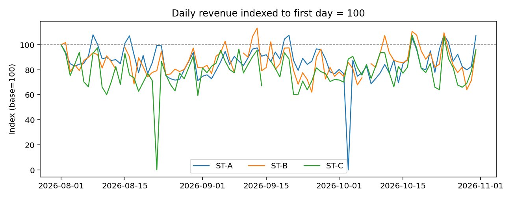
**코드 및 결과 해설**

각 선의 첫 날짜는 100에서 시작하므로 상대적인 변화의 비교에는 적절하지만 규모 차이 비교에는 부적합합니다.

---
<a id="section-6-20"></a>
## 6.20. Irregular Sampling & Visual Integrity
관측 시각이 일정하지 않다면 X축에 관측 순서 1, 2, 3, 4를 쓰는 것과 실제 날짜를 쓰는 것은 다릅니다. 예를 들어 09:00→09:05는 5분, 09:05→10:10은 65분인데 단순 행 번호 축에서는 두 간격이 똑같은 거리로 보입니다.

**시간 축은 시간의 경과를 정직하게 표현해야 합니다.** 실제 시각을 X축으로 사용하고, 빠진 구간을 0으로 잇거나 보간한 경우에는 이를 구분합니다. 필요하다면 X축 범위를 동일하게 맞춰 여러 시계열을 비교합니다.
### Example 23 — Irregular Sampling — 시간 차이 유지
**문제 상황**

실제 센서의 관측 시각이 일정하지 않은데 자료 행 순서대로 그리면 수집 공백이 짧아 보입니다.
**핵심 개념**

날짜형을 X축에 사용하면 실제 시간 간격이 그래프 상의 거리로 표현됩니다. 문자열 범주축이나 단순 정수 인덱스를 사용하면 시간 간격 정보가 사라집니다.
**왜 이 기능을 사용할까요?**

데이터를 먼저 시간순으로 정렬하고 관측 시각이 실제 날짜로 파싱되었는지 확인합니다.
**예제 코드 — [23_irregular_ticks.py](./examples/23_irregular_ticks.py)**

```python
import matplotlib
matplotlib.use('Agg')
import pandas as pd
import matplotlib.pyplot as plt
from pathlib import Path
ROOT=Path(__file__).resolve().parents[1]
times=pd.to_datetime(['2026-10-01 09:00','2026-10-01 09:05','2026-10-01 09:10','2026-10-01 10:15','2026-10-01 10:20'])
values=[20,22,24,28,27]
fig,axes=plt.subplots(1,2,figsize=(10,3.2),layout='constrained')
axes[0].plot(range(len(values)),values,marker='o');axes[0].set(title='Incorrect: row index',xlabel='Observation number')
axes[1].plot(times,values,marker='o');axes[1].set(title='Correct: elapsed time',xlabel='Actual timestamp')
axes[1].tick_params(axis='x',rotation=35)
fig.savefig(ROOT/'figures/23_irregular_ticks.png',dpi=145);plt.close(fig)
print('Largest interval (minutes):',int(times.to_series().diff().max().total_seconds()/60))
```
**실행 결과 (터미널)**

```text
Largest interval (minutes): 65
```
**실제 생성한 그래프**

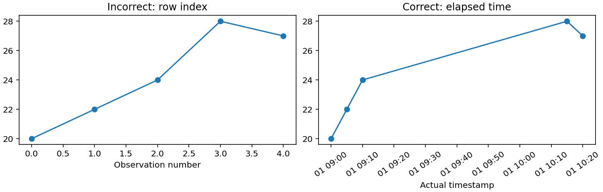
**코드 및 결과 해설**

09:10에서 10:15까지의 65분 공백이 오른쪽에서 더 길게 표현됩니다. 두 그래프의 값은 같지만 시간 정보의 정확성이 다릅니다.

---
<a id="section-6-21"></a>
## 6.21. Thresholds, Alerts & Interpretation
서버 응답 지연처럼 일정 값을 넘으면 추가 확인이 필요한 경우 **임계선(Threshold)**을 표시할 수 있습니다. 다만 다음 두 질문은 다릅니다.

- **순간 초과:** 단일 관측이 설정한 값보다 높았는가?
- **지속적 초과:** 최근 일정 기간의 평균이 설정한 값보다 높았는가?

`latency_ms > 500`은 순간 초과를, `rolling(12, min_periods=12).mean() > 500`은 5분 간격의 유효한 관측 12개가 있는 1시간 창의 평균 초과를 뜻합니다. 기록이 빠진 구간에서는 12개 유효 관측 조건이 충족되지 않으므로 계산을 보류하는 것이 안전합니다.

임계선은 예시 목적에 맞게 설정해야 하며, 이 교재에서 사용한 값은 서비스의 실제 성능 기준이나 공적 기준이 아닙니다.
### Example 24 — Rolling Threshold — 경고선의 의미
**문제 상황**

서버 응답 지연이 기준선을 초과하는 시점을 확인하고 짧은 변동과 지속적인 변동을 구분합니다.
**핵심 개념**

**임계값(Threshold)**은 추가 확인이 필요한 기준값입니다. 관측값의 순간 초과와 일정 시간에 걸친 이동평균 초과는 서로 다른 질문에 답합니다.
**왜 이 기능을 사용할까요?**

경고 기준은 서비스 요구사항에 맞춰 정의해야 합니다. 예시값 500ms는 공식적인 서비스 기준이 아닙니다.
**예제 코드 — [24_alert_rolling.py](./examples/24_alert_rolling.py)**

```python
import matplotlib
matplotlib.use('Agg')
import pandas as pd
import matplotlib.pyplot as plt
from pathlib import Path
ROOT=Path(__file__).resolve().parents[1]
df=pd.read_csv(ROOT/'data/server_metrics.csv')
df['time']=pd.to_datetime(df['timestamp_utc'],utc=True)
s=df.set_index('time')['latency_ms'].sort_index().reindex(pd.date_range('2026-10-26','2026-10-27 23:55',freq='5min',tz='UTC'))
avg=s.rolling(12,min_periods=12).mean()
limit=500
print('Observed exceedances:',int(s.gt(limit).sum()),'Rolling exceedances:',int(avg.gt(limit).sum()))
fig,ax=plt.subplots(figsize=(9,3.5))
ax.plot(s.index,s,alpha=.32,label='Observed');ax.plot(avg.index,avg,lw=2,label='1-hour complete mean')
ax.axhline(limit,color='#b74444',ls='--',label='Illustrative review threshold')
ax.set(title='Momentary vs sustained latency',ylabel='Latency (ms)');ax.legend()
fig.tight_layout();fig.savefig(ROOT/'figures/24_alert_rolling.png',dpi=145);plt.close(fig)
```
**실행 결과 (터미널)**

```text
Observed exceedances: 14 Rolling exceedances: 9
```
**실제 생성한 그래프**

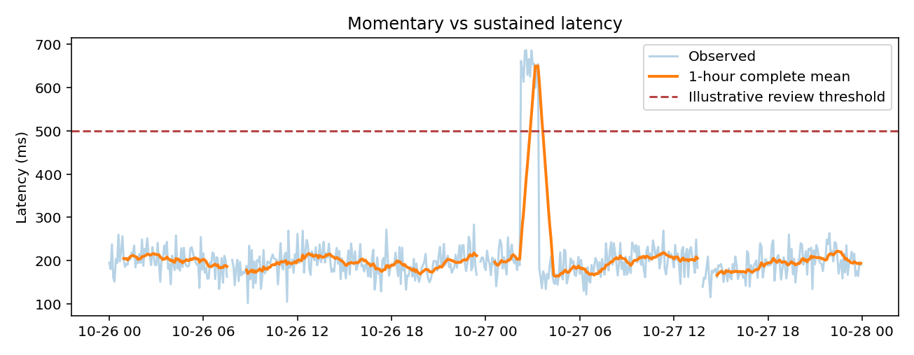
**코드 및 결과 해설**

단발성 초과와 이동평균 초과는 서로 다르므로 요구사항에 맞는 조건을 골라야 합니다.

---
<a id="section-6-22"></a>
## 6.22. Time Series Visualization Design Checklist
시계열 그래프 제작을 마쳤다면 아래 항목을 다시 확인합니다.

| 확인할 내용 | 잘못된 해석을 예방하는 이유 |
|---|---|
| 시간대와 기간 | 같은 시각을 다른 날짜로 묶는 오류 예방 |
| 관측 단위와 빈도 | 일별 합계와 시점 평균의 혼동 방지 |
| 집계 함수 | 기온 합계, 매출 단순 평균 등 부적절한 계산 예방 |
| 예정 슬롯과 유효 관측 수 | 누락이 있는 구간을 완전한 관측으로 오해하지 않음 |
| 실제 0과 결측값 | 미관측을 0으로 표시하는 오류 예방 |
| 이동평균 창과 최소 관측 수 | 7개 값과 7일, 60분과 12개 샘플의 구별 |
| 축과 단위 | 서로 다른 단위의 그래프 비교 오류 예방 |
| 추정값 여부 | 보간값과 실제 관측값의 구분 |
| 부분 기간 여부 | 첫 주·마지막 주, 하루 누락의 과소집계 예방 |
| 차트 제목 및 범례 | 그래프가 답하는 질문을 명확하게 제시 |

특히 **추세와 인과관계는 다릅니다.** 특정 기간에 지표가 함께 상승했다고 해서 한 변수가 다른 변수의 원인이라고 판단할 수는 없습니다. 시계열은 무엇이 언제 변했는지를 보여줄 수 있지만, 원인을 설명하려면 별도의 근거가 필요합니다.

---
<a id="section-6-23"></a>
## 6.23. Mini Project 01 — Daily Store Revenue Trends
**문제 상황**

92일 동안 3개 매장의 매출 기록을 분석하여 매출 흐름과 관측 누락을 동시에 표현합니다.

**입력:** `sales_daily.csv`

**구현할 결과물:** 일별 매출 시계열, 7일 이동평균, 매장별 요약 CSV

**구현 시 유의사항**

`매출 0원`은 유효값, 매출 기록이 없는 날짜는 미관측으로 유지합니다. 일별 합계의 누락 가능성을 보고서에 기록합니다.

**과제 문서:** [`projects/mini_01_sales/TASK.md`](./projects/mini_01_sales/TASK.md)  
**시작 코드:** [`projects/mini_01_sales/starter.py`](./projects/mini_01_sales/starter.py)  
**결과 그래프 예시:**

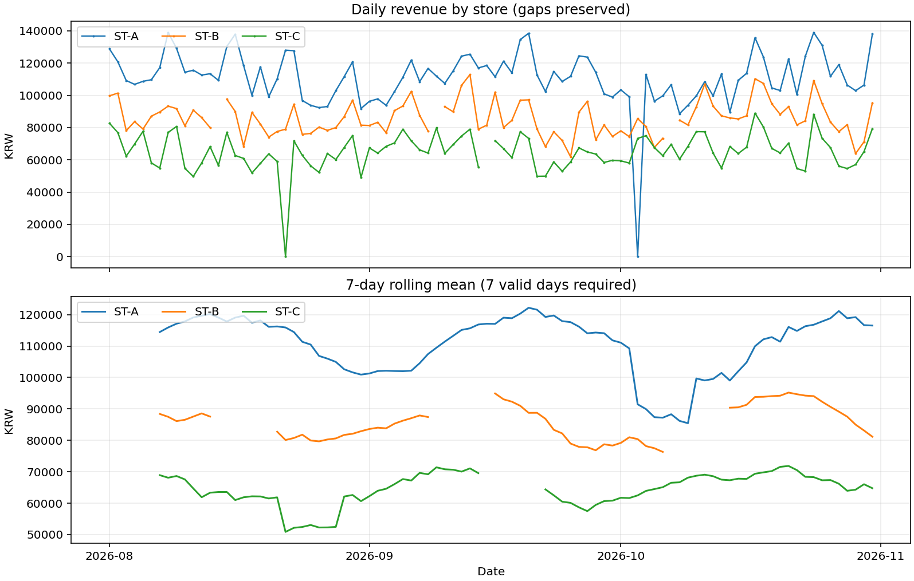

<details>
<summary><strong>힌트 — 첫 단계 접근 방법</strong></summary>

가장 먼저 시간대와 관측 간격을 확인하고, 누락된 예상 시각을 만들어 비교합니다. 그다음 값의 단위에 맞는 집계 방법과 그래프 배치를 결정합니다.

</details>

이 프로젝트의 전체 완성 코드는 README에 공개하지 않습니다. 모범 구현은 `solutions/mini_01_sales/solution.py`에서 별도로 확인할 수 있습니다.

---
<a id="section-6-24"></a>
## 6.24. Mini Project 02 — Server Metrics Monitoring
**문제 상황**

5분마다 수집한 CPU 사용률·지연시간을 비교하고, 이상 구간과 기록 누락을 파악합니다.

**입력:** `server_metrics.csv`

**구현할 결과물:** CPU 및 응답 지연 추이, 1시간 이동평균, 요약 JSON

**구현 시 유의사항**

UTC 기준 로그에서 5분 관측 간격을 복원하고, 12개 샘플이 모두 존재하는 구간만 이동평균을 인정합니다.

**과제 문서:** [`projects/mini_02_server/TASK.md`](./projects/mini_02_server/TASK.md)  
**시작 코드:** [`projects/mini_02_server/starter.py`](./projects/mini_02_server/starter.py)  
**결과 그래프 예시:**

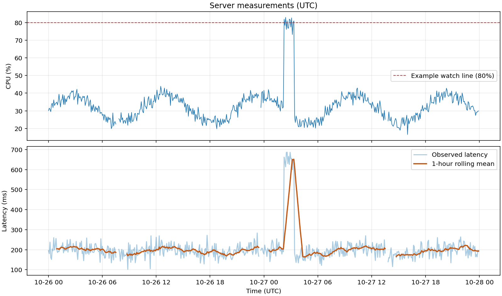

<details>
<summary><strong>힌트 — 첫 단계 접근 방법</strong></summary>

가장 먼저 시간대와 관측 간격을 확인하고, 누락된 예상 시각을 만들어 비교합니다. 그다음 값의 단위에 맞는 집계 방법과 그래프 배치를 결정합니다.

</details>

이 프로젝트의 전체 완성 코드는 README에 공개하지 않습니다. 모범 구현은 `solutions/mini_02_server/solution.py`에서 별도로 확인할 수 있습니다.

---
<a id="section-6-25"></a>
## 6.25. Mini Project 03 — Hourly Weather Review
**문제 상황**

관측소 3곳의 기온·강수량을 시각화하면서 같은 시간 축에서도 집계 규칙이 다른 이유를 적용합니다.

**입력:** `weather_hourly.csv`

**구현할 결과물:** 관측소별 기온 그래프, 일별 평균기온 및 강수량 합계 CSV

**구현 시 유의사항**

기온은 평균, 1시간 구간별 강수량은 합계를 사용합니다. 일부 빠진 관측 시각은 0으로 대체하지 않습니다.

**과제 문서:** [`projects/mini_03_weather/TASK.md`](./projects/mini_03_weather/TASK.md)  
**시작 코드:** [`projects/mini_03_weather/starter.py`](./projects/mini_03_weather/starter.py)  
**결과 그래프 예시:**

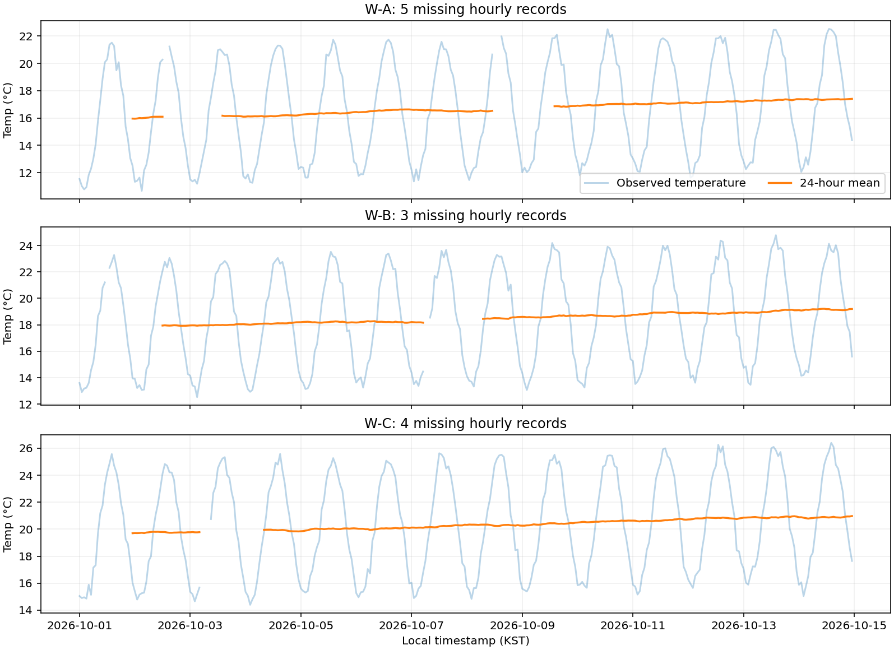

<details>
<summary><strong>힌트 — 첫 단계 접근 방법</strong></summary>

가장 먼저 시간대와 관측 간격을 확인하고, 누락된 예상 시각을 만들어 비교합니다. 그다음 값의 단위에 맞는 집계 방법과 그래프 배치를 결정합니다.

</details>

이 프로젝트의 전체 완성 코드는 README에 공개하지 않습니다. 모범 구현은 `solutions/mini_03_weather/solution.py`에서 별도로 확인할 수 있습니다.

---
<a id="section-6-26"></a>
## 6.26. Coding Practice — 20 Exercises
각 연습문제는 이미 작성된 코드의 일부를 완성하는 방식입니다. 필요한 개념을 앞선 예제에서 확인한 다음, `exercises/`의 TODO 부분을 직접 작성하세요. **완성 코드는 README에서 공개하지 않으며** `solutions/`에 별도로 제공합니다.

아래 문제의 핵심은 문법을 외우는 것이 아니라 **시간과 수치의 의미에 맞는 코드를 선택하는 것**입니다. 먼저 결과를 예측하고, 작성한 코드를 실행해 그래프와 출력이 예상대로 생성되는지 확인하세요.

```bash
python exercises/01_datetime_parsing.py
# TODO가 남아 있다면 NotImplementedError가 발생하는 것이 정상입니다.
```
| No. | 연습문제 | 학습 목표 | 시작 코드 |
|:---:|---|---|---|
| 01 | Timestamp Parsing | 문자열 날짜에서 잘못된 시각을 NaT로 구분하도록 날짜형 변환 코드를 작성합니다. | [실습](./exercises/01_datetime_parsing.py) |
| 02 | Date Tick Locator | 90일 추이의 주요 눈금을 월별로 설정합니다. | [실습](./exercises/02_date_axis.py) |
| 03 | Expected 5-Minute Slots | 5분 간격 예상 관측 슬롯을 만드는 코드를 완성합니다. | [실습](./exercises/03_date_range.py) |
| 04 | Missing vs Zero | 없는 날짜를 복원하되 임의로 0을 채우지 않습니다. | [실습](./exercises/04_missing_and_zero.py) |
| 05 | Monthly Revenue | 일별 매출을 월 시작 시각 기준으로 합산합니다. | [실습](./exercises/05_resample_sum.py) |
| 06 | Mean vs Sum | 기온 평균과 누적 강수량 합계를 각각 집계합니다. | [실습](./exercises/06_mean_vs_sum.py) |
| 07 | Daily Coverage | 하루의 유효 관측 수를 계산합니다. | [실습](./exercises/07_group_coverage.py) |
| 08 | 7-Day Complete Mean | 누락값이 있는 구간을 평균으로 채우지 않는 7일 이동평균을 구합니다. | [실습](./exercises/08_rolling_count.py) |
| 09 | Last 60 Minutes | 최근 60분 관측 중 8개 이상이 존재할 때만 평균을 계산합니다. | [실습](./exercises/09_rolling_time.py) |
| 10 | EWM Smoothing | 최근 관측에 더 큰 가중치를 주는 EWM을 계산합니다. | [실습](./exercises/10_ewm.py) |
| 11 | Change Rate | 결측 자동 대체 없이 이전 값 대비 변화율을 백분율로 계산합니다. | [실습](./exercises/11_diff_pct.py) |
| 12 | Weekday Average | 요일별 관측 매출 평균을 계산합니다. | [실습](./exercises/12_weekday_pattern.py) |
| 13 | Hourly Profile | 시간대별 교통량 평균과 사용 관측 수를 함께 계산합니다. | [실습](./exercises/13_hourly_profile.py) |
| 14 | Daily Cycle | 기온의 시간대별 평균 주기를 계산합니다. | [실습](./exercises/14_seasonality.py) |
| 15 | Shared Y Axes | 관측소별 서브플롯의 날짜축과 기온축을 공유하도록 설정합니다. | [실습](./exercises/15_shared_axis.py) |
| 16 | Limited Interpolation | 누락 추정값을 최대 3개 연속 내부 공백에 한정합니다. | [실습](./exercises/16_interpolation.py) |
| 17 | UTC to KST | UTC 시계열을 한국시간으로 변환합니다. | [실습](./exercises/17_timezone.py) |
| 18 | Week Ending Sunday | 일요일로 끝나는 주의 합계와 관측 일수를 계산합니다. | [실습](./exercises/18_weekly_boundaries.py) |
| 19 | Base-100 Index | 매장별 첫날 값으로 나누어 기준 100 지수를 계산합니다. | [실습](./exercises/19_normalized_index.py) |
| 20 | Rolling Threshold | 최근 완전한 12개 관측을 이용해 경고선과 비교합니다. | [실습](./exercises/20_alert_rolling.py) |

<details>
<summary><strong>학습 방법 — 시작 코드와 모범 구현</strong></summary>

`exercises/`에서 `# TODO:`를 찾은 뒤 필요한 기능을 완성합니다. 문제별 모범 구현은 `solutions/`에 **동일한 파일명**으로 보관했습니다. 먼저 시간대·집계 방법·결측 처리의 의미를 설명할 수 있는지 확인한 다음, 작성한 코드를 실행하여 비교해 보세요.

</details>

---
<a id="section-6-27"></a>
## 6.27. Advanced Project 01 — Multi-Station Air Quality Report Generator
**문제 상황**

대기질 관측소의 PM2.5 기록을 검증하고, 선택된 관측소 수만큼 동적 시계열 보고서를 자동 생성합니다.

이 과제는 조건을 하나씩 추가하는 수준에서 끝나지 않고, **입력이 변해도 동일한 계산 규칙으로 결과물을 만드는 프로그램**을 요구합니다. 난이도는 의도적으로 높지만, 앞에서 배운 시간대·집계·이동평균·결측 검증의 원칙을 결합하면 접근할 수 있습니다.

**입력 데이터:** `air_quality_hourly.csv` + `air_stations.json`

**완료해야 할 결과물:** 검증 감사기록, 관측 수집률 보고서, 동적 PNG

**핵심 검증 기준**

원본의 중복·음수·미등록 관측소·비숫자 입력을 탐지합니다. 24시간 이동평균에 최소 18개 관측 조건을 적용하고, 예시 기준선의 의미를 명시합니다.

**과제 문서:** [`projects/advanced_01_air_quality/TASK.md`](./projects/advanced_01_air_quality/TASK.md)  
**시작 코드:** [`projects/advanced_01_air_quality/starter.py`](./projects/advanced_01_air_quality/starter.py)  
**결과 그래프 예시:**

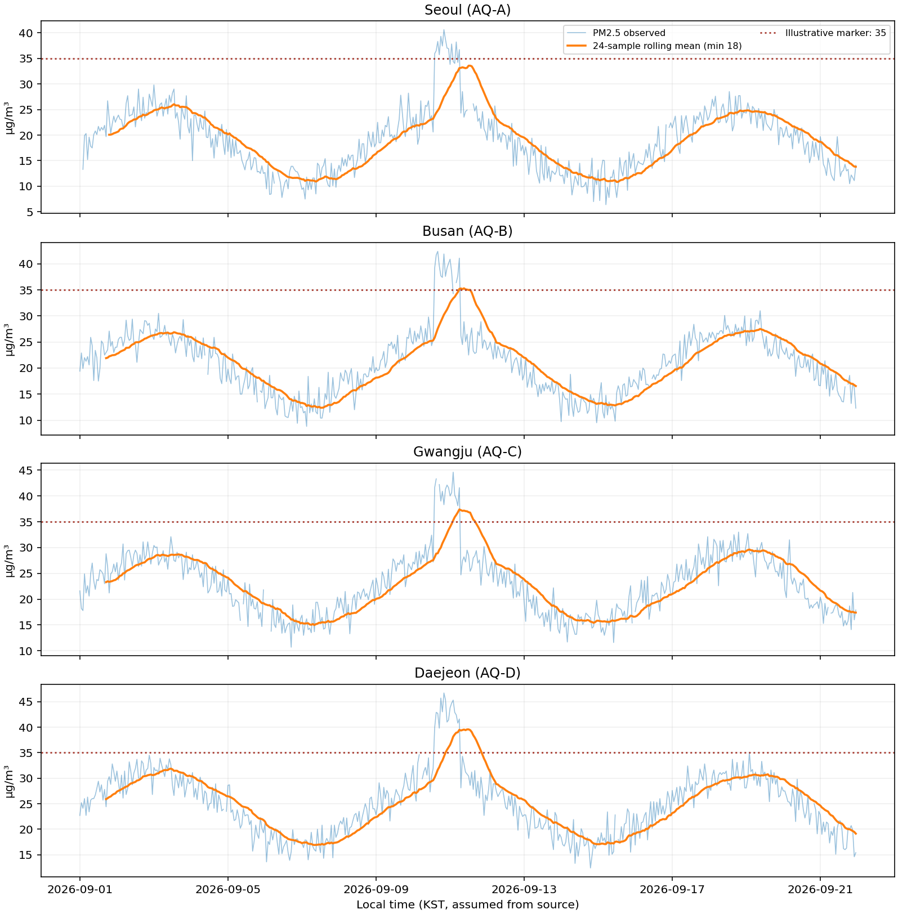

<details>
<summary><strong>Hint 01 — 시간 축</strong></summary>

원본의 시간대·관측 간격·기대 시각 범위를 먼저 정의하세요. 날짜 열을 그대로 문자열로 집계하지 않습니다.

</details>

<details>
<summary><strong>Hint 02 — 검증과 감사 기록</strong></summary>

알 수 없는 ID, 중복 관측 키, 비정상적인 측정값을 검사합니다. 문제가 있는 원본 행과 이유를 따로 저장해 추적할 수 있도록 만듭니다.

</details>

<details>
<summary><strong>Hint 03 — 변하는 입력 규모</strong></summary>

1개만 선택했을 때도 Subplots가 일정하게 동작하도록 `squeeze=False` 또는 1차원 Axes 처리 방식을 검토합니다.

</details>

모범 구현은 `solutions/advanced_01_air_quality/reference_solution.py`, 설계 해설은 같은 폴더의 `EXPLANATION.md`에 별도로 있습니다.

---
<a id="section-6-28"></a>
## 6.28. Advanced Project 02 — Urban Traffic Time Series Audit & Reporting
**문제 상황**

도로 구간별 통과 차량 수를 한국시간 기준으로 분석하고, 누락된 관측 시각을 검토하는 자동 보고서를 만듭니다.

이 과제는 조건을 하나씩 추가하는 수준에서 끝나지 않고, **입력이 변해도 동일한 계산 규칙으로 결과물을 만드는 프로그램**을 요구합니다. 난이도는 의도적으로 높지만, 앞에서 배운 시간대·집계·이동평균·결측 검증의 원칙을 결합하면 접근할 수 있습니다.

**입력 데이터:** `traffic_hourly.csv` + `traffic_corridors.json`

**완료해야 할 결과물:** UTC→KST 변환·감사기록·완전한 일별 합계·요일 프로파일·Heatmap·동적 그래프

**핵심 검증 기준**

시간대가 다른 원본을 동일한 기준으로 맞추고, 하루 24개 관측이 모두 존재할 때만 일별 총량을 인정합니다. 도로 구간 수가 1개 또는 여러 개여도 결과가 생성돼야 합니다.

**과제 문서:** [`projects/advanced_02_traffic/TASK.md`](./projects/advanced_02_traffic/TASK.md)  
**시작 코드:** [`projects/advanced_02_traffic/starter.py`](./projects/advanced_02_traffic/starter.py)  
**결과 그래프 예시:**

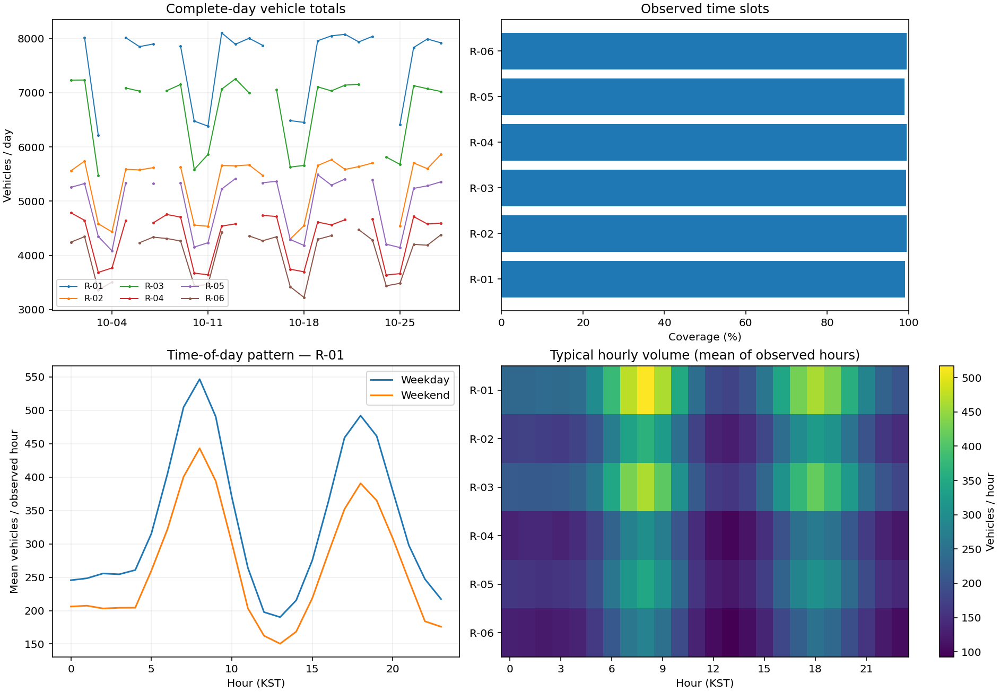

<details>
<summary><strong>Hint 01 — 시간 축</strong></summary>

원본의 시간대·관측 간격·기대 시각 범위를 먼저 정의하세요. 날짜 열을 그대로 문자열로 집계하지 않습니다.

</details>

<details>
<summary><strong>Hint 02 — 검증과 감사 기록</strong></summary>

알 수 없는 ID, 중복 관측 키, 비정상적인 측정값을 검사합니다. 문제가 있는 원본 행과 이유를 따로 저장해 추적할 수 있도록 만듭니다.

</details>

<details>
<summary><strong>Hint 03 — 변하는 입력 규모</strong></summary>

1개만 선택했을 때도 Subplots가 일정하게 동작하도록 `squeeze=False` 또는 1차원 Axes 처리 방식을 검토합니다.

</details>

모범 구현은 `solutions/advanced_02_traffic/reference_solution.py`, 설계 해설은 같은 폴더의 `EXPLANATION.md`에 별도로 있습니다.

---
<a id="section-6-29"></a>
## 6.29. Quiz — Concept, Visual Code Reading & Completion
개념을 암기했는지보다 **제시된 상황에서 코드가 어떤 결과를 만드는지** 확인하는 문제입니다. 그래프 선택 문제는 A–D 모두 비슷한 종류의 그래프로 구성되어 있으며, 차이는 축·시간 간격·결측·이동평균 규칙 등에 있습니다.

문항 아래의 `<details>`를 펼치면 정답, 판단 근거, 필요한 경우 간단한 실행 코드와 오답 설명을 확인할 수 있습니다. 문제에 표시되지 않은 조건을 임의로 가정하지 말고 **지문에 주어진 데이터와 코드를 기준**으로 답하세요.

### Q01. 문자열 `"not-a-date"`가 포함된 날짜 열을 변환하면서 잘못된 행을 확인하려면 어떤 코드가 적절할까요? **A** `astype(str)` / **B** `pd.to_datetime(..., errors="coerce")` / **C** `fillna(0)` / **D** `sort_values()`

<details>
<summary><strong>Q01. 정답 및 해설 확인</strong></summary>

**정답: B**

`pd.to_datetime()`은 날짜 문자열을 시각 자료형으로 변환합니다. `errors="coerce"`는 해석 실패 값을 `NaT`로 남겨 검토할 수 있게 합니다. 단순 문자열 변환이나 정렬은 유효한 시각인지 검사하지 않습니다.

**참고 코드**

```python
dates = pd.to_datetime(raw["timestamp"], errors="coerce")
invalid_rows = raw.loc[dates.isna()]
```

</details>

### Q02. 한 관측소의 센서가 5분마다 기록되도록 설계되어 있습니다. `09:00`, `09:05`, `09:15`의 기록만 있다면 확실하게 알 수 있는 것은 무엇일까요? **A** 09:10은 0이었다 / **B** 09:10은 누락됐다 / **C** 09:10은 09:05와 같았다 / **D** 장비가 09:10에 꺼졌다

<details>
<summary><strong>Q02. 정답 및 해설 확인</strong></summary>

**정답: B**

예정 시각 09:10의 기록이 없습니다. 값은 알 수 있지만 기록은 없는 상황이므로, 실제 값이 0인지나 장비가 꺼졌는지는 추가 정보 없이 확정할 수 없습니다.

</details>

### Q03. 다음 코드가 생성하는 그래프의 **시간 간격**에 가장 정확하게 대응하는 선택지는?

```python
times = pd.to_datetime([
    "2026-10-01 09:00", "2026-10-01 09:05",
    "2026-10-01 10:10", "2026-10-01 10:15",
])
ax.plot(times, [20, 22, 29, 28], marker="o")
```

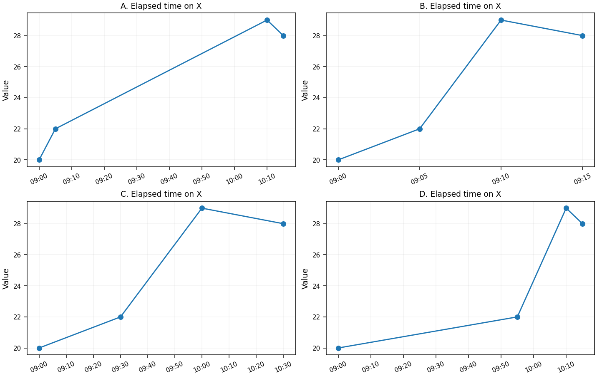

<details>
<summary><strong>Q03. 정답 및 해설 확인</strong></summary>

**정답: A**

실제 시각 차이가 5분, 65분, 5분이므로 2번째 점과 3번째 점 사이의 가로 간격이 특히 커야 합니다. A만 이 시간을 그대로 반영합니다.

**오답 해설**

B는 모든 간격을 동일하게 표현하고, C·D는 관측 시각을 실제와 다른 위치에 배치합니다.

</details>

### Q04. 같은 센서·같은 시각의 행이 두 번 들어왔다면, 아래 TODO에 들어갈 중복 검사 코드를 작성하세요.

```python
# 같은 센서의 같은 시각이 두 번 수집되었는지 검사
# TODO: 중복을 구성하는 모든 행을 True로 표시
duplicated_rows = ...
```

<details>
<summary><strong>Q04. 정답 및 해설 확인</strong></summary>

**정답: `df.duplicated(["station_id", "timestamp"], keep=False)`**

두 열의 조합을 하나의 관측 키로 간주합니다. `keep=False`를 사용하면 중복을 구성하는 모든 행을 표시할 수 있으므로 임의로 첫 번째 데이터만 유지하지 않습니다.

**참고 코드**

```python
duplicated_rows = df.duplicated(
    ["station_id", "timestamp"], keep=False
)
```

</details>

### Q05. 서버의 5분 간격 관측을 **10월 26일 00:00 UTC부터 10월 27일 23:55 UTC까지** 검사하려고 합니다. TODO를 완성하세요.

```python
# TODO: 기대되는 5분 간격의 전체 시각 생성
expected = ...
```

<details>
<summary><strong>Q05. 정답 및 해설 확인</strong></summary>

**정답: `pd.date_range(..., freq="5min", tz="UTC")`**

실제 존재하는 행만 읽으면 파일에 없는 시각은 발견할 수 없습니다. 예정 시각의 목록을 먼저 만들어 실제 관측 시각과 비교합니다.

**참고 코드**

```python
expected = pd.date_range(
    "2026-10-26 00:00", "2026-10-27 23:55",
    freq="5min", tz="UTC"
)
```

</details>

### Q06. 서버 CPU 사용률(%)과 시간별 차량 통과 대수(대)를 하루 기준으로 요약하려고 합니다. 다음 중 더 적절한 조합은? **A** 둘 다 합계 / **B** CPU 합계, 차량 평균 / **C** CPU 평균·최댓값, 차량 합계 / **D** 둘 다 최댓값만

<details>
<summary><strong>Q06. 정답 및 해설 확인</strong></summary>

**정답: C**

CPU 사용률은 시점 상태를 나타내는 백분율이라 단순 합계가 의미를 가지지 않습니다. 차량 통과 대수는 겹치지 않는 시간 구간의 대수이므로 하루 총량을 구하려면 합계가 적절합니다. 단, 누락 시간에는 과소집계가 될 수 있습니다.

</details>

### Q07. 다음 데이터에서 **셋째 날 기록만 없는 상태**로 `ax.plot()`을 호출했습니다. 올바른 결과 그래프는?

```python
dates = pd.date_range("2026-10-01", periods=6, freq="D")
values = [5, 7, float("nan"), 11, 12, 15]
ax.plot(dates, values, marker="o")
```

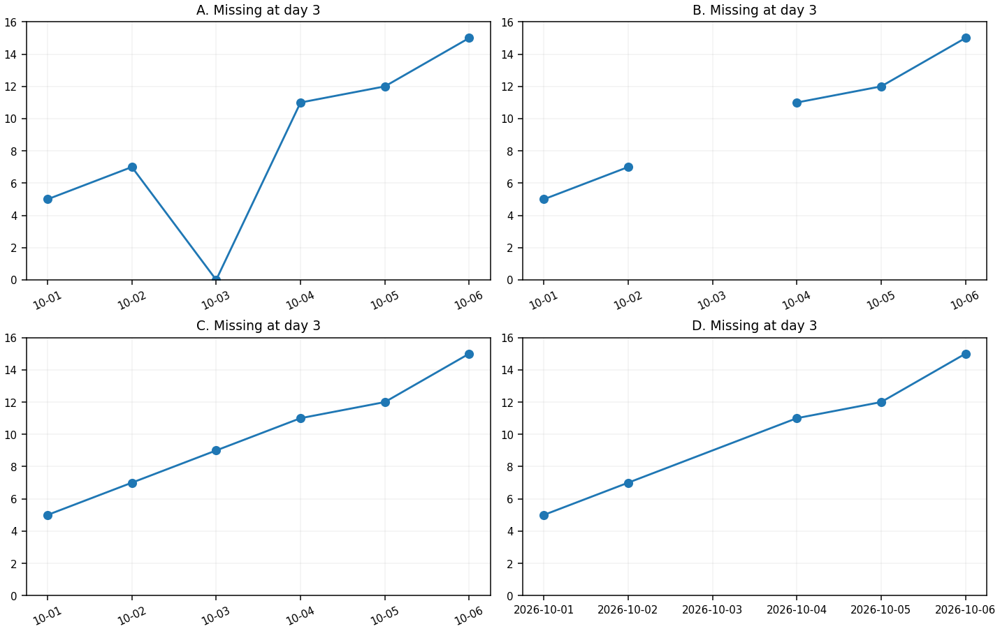

<details>
<summary><strong>Q07. 정답 및 해설 확인</strong></summary>

**정답: B**

`NaN`인 셋째 날은 관측값이 없으므로 선이 그 구간에서 끊어집니다. 실제 값 0과 구별해야 합니다.

**오답 해설**

A는 누락값을 0으로 바꾼 결과, C는 중간값을 추정한 결과, D는 누락 시각을 제거해 앞뒤 점을 직접 연결한 결과입니다.

</details>

### Q08. 하루에 24회 관측하기로 했는데 실제로 유효한 데이터가 18개라면 수집률은 몇 %일까요?

<details>
<summary><strong>Q08. 정답 및 해설 확인</strong></summary>

**정답: 75%**

`18 ÷ 24 × 100 = 75%`입니다. 일평균이 계산된다는 것과 하루의 모든 시각이 관측됐다는 것은 서로 다른 판단입니다.

**참고 코드**

```python
coverage = 18 / 24 * 100
print(f"{coverage:.0f}%")  # 75%
```

</details>

### Q09. 기록이 주로 1시간 간격이지만 일부 시각이 누락됐습니다. `rolling(7)`을 사용하면 항상 최근 **7시간** 평균이 될까요?

<details>
<summary><strong>Q09. 정답 및 해설 확인</strong></summary>

**정답: 아니요**

정수 `rolling(7)`은 최근 7개의 행을 참조합니다. 누락된 시간이 있으면 7개의 행이 7시간보다 긴 범위를 차지할 수 있습니다. 7시간 기준이라면 기대 시각을 복원하거나 시간 기반 이동 창을 사용해야 합니다.

**참고 코드**

```python
# 7개 행(항상 7시간은 아님)
a = series.rolling(7).mean()

# 최근 7시간 시간 범위
b = series.rolling("7h").mean()
```

</details>

### Q10. 일별 자료의 7일 이동평균을 계산하되 **7일의 값이 모두 있는 구간**에서만 평균을 출력하려고 합니다. TODO를 완성하세요.

```python
# series: 누락된 날짜를 NaN으로 유지한 일별 Series
# TODO: 7개의 유효값이 있을 때만 이동평균
smooth = ...
```

<details>
<summary><strong>Q10. 정답 및 해설 확인</strong></summary>

**정답: `series.rolling(7, min_periods=7).mean()`**

정수 7은 7개 행을 의미하므로 미리 일별 전체 날짜를 복원했다는 전제가 필요합니다. `min_periods=7`은 한 날짜라도 결측이면 해당 7일 창의 결과를 `NaN`으로 남깁니다.

**참고 코드**

```python
smooth = series.rolling(7, min_periods=7).mean()
```

</details>

### Q11. 다음 코드를 실행할 때 생성되는 이동평균 그래프는 어느 것인가요?

```python
s = pd.Series([2, 4, float("nan"), 8, 10, 12])
result = s.rolling(3, min_periods=3).mean()
ax.plot(range(1, 7), result, marker="o")
```

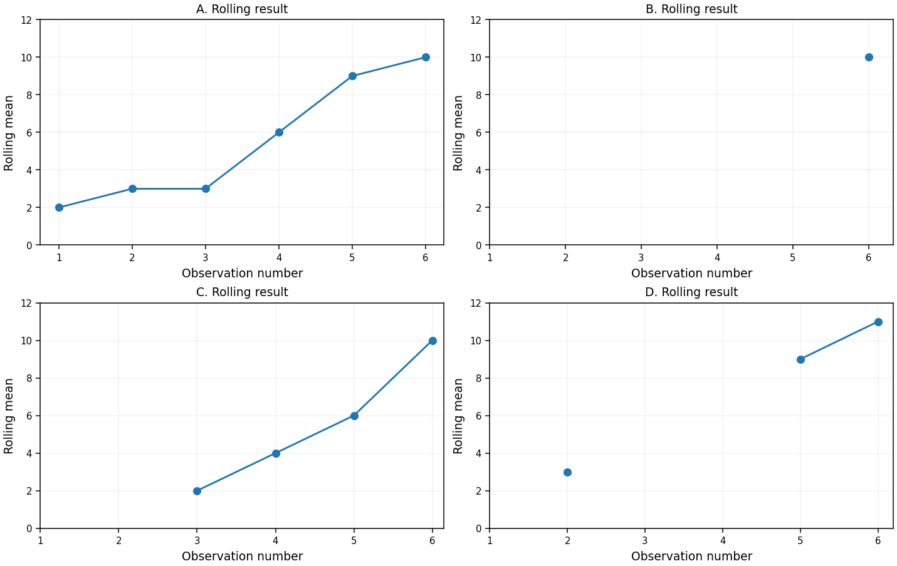

<details>
<summary><strong>Q11. 정답 및 해설 확인</strong></summary>

**정답: B**

3개 관측값이 모두 있어야 평균을 계산합니다. `[2, 4, NaN, 8, 10, 12]`에서는 마지막 세 값 `[8, 10, 12]`만 완전하므로 마지막에만 평균 10이 표시됩니다.

**오답 해설**

A는 1개 이상이면 계산하고, C는 결측을 0으로 바꾼 뒤 계산하며, D는 2개 관측으로 계산한 결과입니다.

</details>

### Q12. EWM의 설명으로 가장 적절한 것은? **A** 모든 이전 관측에 똑같은 가중치 / **B** 누락값을 반드시 0으로 대체 / **C** 최근 관측에 상대적으로 큰 가중치 / **D** 장래의 값까지 사용

<details>
<summary><strong>Q12. 정답 및 해설 확인</strong></summary>

**정답: C**

지수 가중 평균은 최근값에 큰 비중을 부여합니다. 미래 데이터를 사용하거나 항상 결측값을 0으로 채우는 기능이 아닙니다. `span`과 `adjust` 등의 설정을 이해해야 계산의 의미가 분명해집니다.

</details>

### Q13. 직전 매출이 **0원**, 이번 매출이 **100원**일 때 `pct_change()`로 유한한 증가율을 표현할 수 있을까요?

<details>
<summary><strong>Q13. 정답 및 해설 확인</strong></summary>

**정답: 표준적인 유한한 백분율로는 표현할 수 없음**

변화율의 분모가 직전 값 0이기 때문입니다. 이 경우 절대 변화량은 +100원으로 구할 수 있지만, 증가율을 임의로 100%라고 표시하면 의미가 달라집니다.

**참고 코드**

```python
s = pd.Series([0., 100.])
absolute = s.diff()              # +100
relative = s.pct_change(fill_method=None)
# 두 번째 상대변화율은 +inf이므로 별도 처리 필요
```

</details>

### Q14. 다음 코드를 실행하면 그래프가 어떻게 배치되나요?

```python
fig, axes = plt.subplots(2, 1)
axes[0].plot(["Jan", "Feb", "Mar"], [120, 160, 150])
axes[0].set_ylabel("Visitors")
axes[1].bar(["Jan", "Feb", "Mar"], [70, 95, 85])
axes[1].set_ylabel("Sales")
```

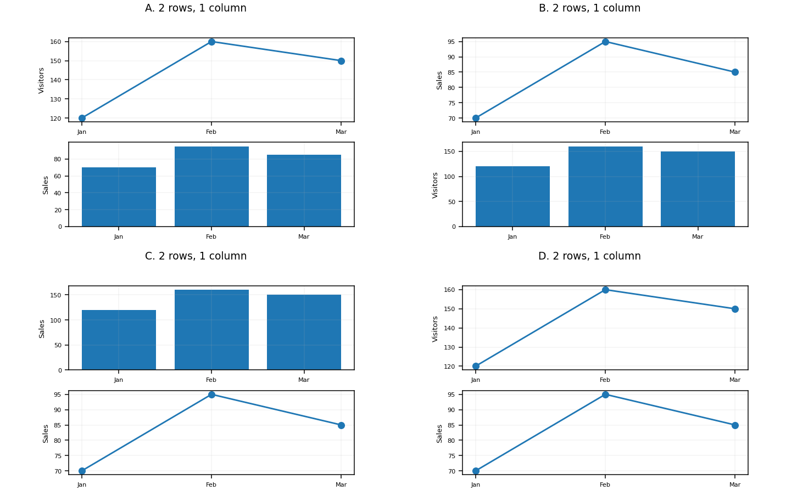

<details>
<summary><strong>Q14. 정답 및 해설 확인</strong></summary>

**정답: A**

`plt.subplots(2, 1)`은 2행 1열이고, `axes[0]`의 선 그래프는 위쪽, `axes[1]`의 막대그래프는 아래쪽에 배치됩니다. 단위가 다른 값은 각 그래프의 축 제목으로 구분합니다.

**오답 해설**

B는 측정 항목의 위치가 뒤바뀌고, C는 그래프 형태가 바뀌며, D는 아래쪽도 선 그래프입니다.

</details>

### Q15. 매장별 매출의 요일 패턴을 비교하려고 합니다. `df["date"]`가 날짜형일 때 **일요일**의 `dayofweek` 값은? **A** 0 / **B** 5 / **C** 6 / **D** 7

<details>
<summary><strong>Q15. 정답 및 해설 확인</strong></summary>

**정답: C**

Pandas에서 월요일이 0, 화요일이 1, ..., 일요일이 6입니다. 날짜가 문자열 상태라면 먼저 `pd.to_datetime()`으로 변환해야 합니다.

**참고 코드**

```python
df["weekday"] = df["date"].dt.dayofweek
sunday = df.loc[df["weekday"].eq(6)]
```

</details>

### Q16. 다음 값은 이미 UTC 시간대 정보가 있습니다. 같은 순간을 한국시간으로 표시하도록 TODO를 완성하세요.

```python
utc_time = pd.Timestamp("2026-10-26 00:00", tz="UTC")
# TODO: 같은 순간의 한국시간 시각으로 변환
kst_time = ...
```

<details>
<summary><strong>Q16. 정답 및 해설 확인</strong></summary>

**정답: `utc_time.tz_convert("Asia/Seoul")`**

`tz_convert()`는 이미 시간대 정보가 있는 시각을 다른 시간대로 변환합니다. 반면 `tz_localize()`는 시간대가 없는 값에 시간대 정보를 지정하는 함수입니다.

**참고 코드**

```python
kst_time = utc_time.tz_convert("Asia/Seoul")
```

</details>

### Q17. 서버에서 사건 확인이 필요한 **02:15 UTC부터 03:30 UTC까지**의 구간을 그래프에 음영으로 표시하려고 합니다. TODO를 완성하세요.

```python
start = pd.Timestamp("2026-10-27 02:15", tz="UTC")
end = pd.Timestamp("2026-10-27 03:30", tz="UTC")
# TODO: 두 시각 사이를 반투명 음영으로 표시
...
```

<details>
<summary><strong>Q17. 정답 및 해설 확인</strong></summary>

**정답: `ax.axvspan(start, end, alpha=0.25)`**

`axvspan()`은 특정 기간을 강조합니다. 시간이 같은 기준(UTC)인지 확인하고, 음영은 사건의 원인이 아니라 검토 대상 시간을 뜻한다는 점을 설명해야 합니다.

**참고 코드**

```python
ax.axvspan(start, end, alpha=0.25, color="orange")
```

</details>

### Q18. 도로 구간이 하루에 3번 측정되도록 설계됐습니다. 첫날은 `4, 3, 3`, 둘째 날은 `4, 5`만 있고 세 번째 기록은 없습니다. **완전한 날만 합계를 인정하는 코드**의 결과로 알맞은 그래프는?

```python
daily = pd.Series([10., 9.], index=["Day 1", "Day 2"])
observed_count = pd.Series([3, 2], index=daily.index)
complete_daily = daily.where(observed_count.eq(3))
ax.bar(complete_daily.index, complete_daily)
```

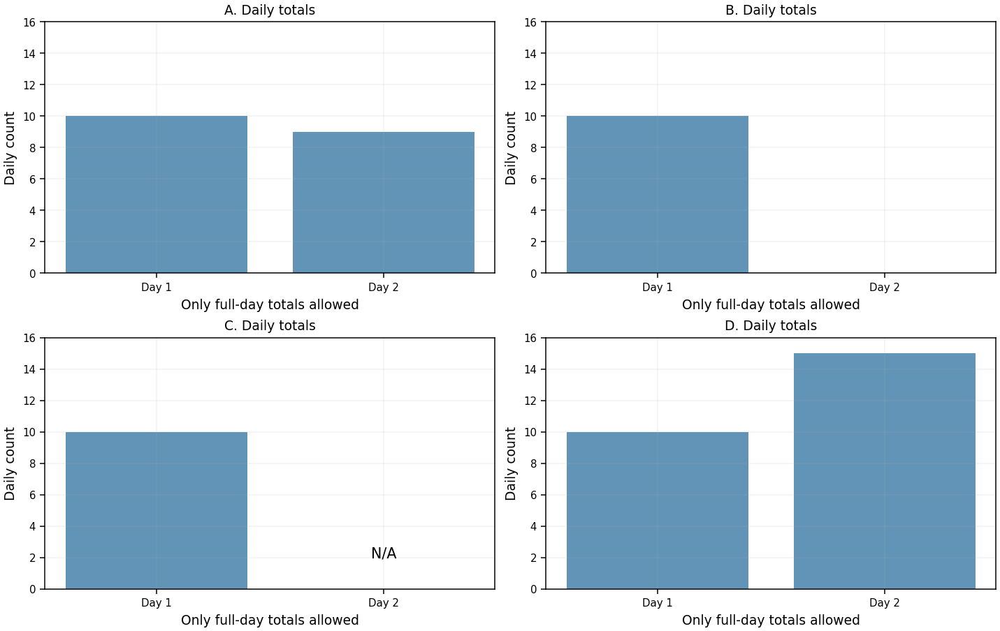

<details>
<summary><strong>Q18. 정답 및 해설 확인</strong></summary>

**정답: C**

첫날의 총량 10은 계산할 수 있지만 둘째 날에는 3개 시각 중 2개만 있어 총량을 확정할 수 없습니다. 둘째 날은 결측(N/A)으로 남겨야 합니다.

**오답 해설**

A는 둘째 날의 부분 합계 9를 완전한 합계처럼 표시하고, B는 기록 누락을 실제 0으로 취급하며, D는 존재하지 않은 값을 더한 결과입니다.

</details>

### Q19. 시간당 차량 통과 대수가 1일 24회 기록되도록 설계됐습니다. 기록이 23개인 날의 일별 총량을 비워두려면 TODO에 어떤 코드를 넣을까요?

```python
# hourly: 하루 24개 슬롯을 가진 시간 인덱스 Series
# TODO: 24개의 유효값이 없으면 일별 합계를 NaN으로 표시
daily_total = ...
```

<details>
<summary><strong>Q19. 정답 및 해설 확인</strong></summary>

**정답: `hourly.resample("D").sum(min_count=24)`**

`min_count=24`는 값이 24개 이상 존재해야 합계를 반환한다는 조건입니다. 해당 자료에서는 예정 간격이 1시간이므로 하루 24개 관측이라는 완료 기준을 적용할 수 있습니다. 기간·시간대·DST 등 다른 환경에서는 기대 관측 수가 달라질 수 있습니다.

**참고 코드**

```python
daily_total = hourly.resample("D").sum(min_count=24)
```

</details>

### Q20. 일요일로 끝나는 주간 매출을 만들 때 올바른 코드는? **A** `resample("MS")` / **B** `resample("W-SUN")` / **C** `rolling(7)` / **D** `groupby("Sunday")`

<details>
<summary><strong>Q20. 정답 및 해설 확인</strong></summary>

**정답: B**

`W-SUN`은 일요일로 끝나는 주간 구간을 표현합니다. 첫 번째 주나 마지막 주는 7일 미만일 수 있으므로 합계와 함께 관측 일수를 확인해야 합니다.

</details>

### Q21. `2026-10-26 00:00 UTC`에 관측한 데이터를 `Asia/Seoul`로 변환한 다음, **시각(hour)**을 X축에 그린 결과로 맞는 것은?

```python
utc = pd.date_range("2026-10-26 00:00", periods=3,
                    freq="h", tz="UTC")
kst = utc.tz_convert("Asia/Seoul")
ax.plot(kst.hour, [12, 16, 14], marker="o")
```

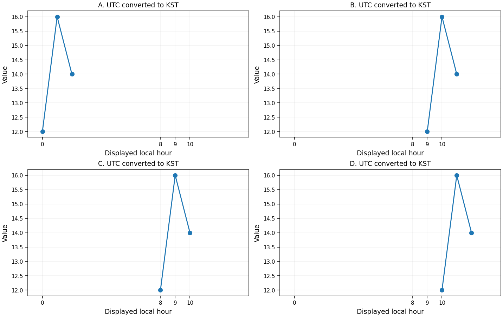

<details>
<summary><strong>Q21. 정답 및 해설 확인</strong></summary>

**정답: B**

UTC 00:00은 KST 09:00입니다. 동일한 순간의 표시만 달라지며 데이터 값은 바뀌지 않습니다.

**오답 해설**

A는 UTC 시각을 그대로 표시하고, C는 8시간, D는 10시간 차이로 변환한 결과입니다.

</details>

### Q22. 매장 매출의 첫 관측값을 기준 100으로 설정하려고 합니다. TODO를 완성하세요. 단, 기준값은 0이 아니고 결측도 아닙니다.

```python
# TODO: 첫날을 100으로 정규화
index100 = ...
```

<details>
<summary><strong>Q22. 정답 및 해설 확인</strong></summary>

**정답: `series / series.iloc[0] * 100`**

첫 관측값을 100으로 설정하는 지수화입니다. 절대 금액의 차이는 숨겨질 수 있으므로 지수 그래프의 목적을 상대적 변화 비교로 명시합니다.

**참고 코드**

```python
index100 = series.div(series.iloc[0]).mul(100)
```

</details>

### Q23. 다음 코드에서 `rolling("60min", min_periods=3)`이 생성하는 그래프는?

```python
times = pd.to_datetime([
  "2026-10-01 09:00", "2026-10-01 09:05",
  "2026-10-01 10:15", "2026-10-01 10:20",
  "2026-10-01 10:25",
])
s = pd.Series([2, 4, 8, 10, 12], index=times)
r = s.rolling("60min", min_periods=3).mean()
ax.plot(times, r, marker="o")
```

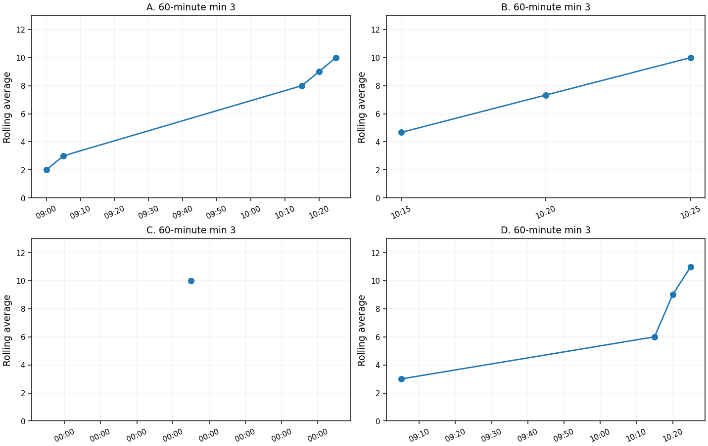

<details>
<summary><strong>Q23. 정답 및 해설 확인</strong></summary>

**정답: C**

첫 두 관측은 60분 안에 세 관측을 채우지 못합니다. 시각 10:15에는 09:05가 이미 60분 범위 밖이므로 다시 관측 수가 부족합니다. 10:25가 되었을 때 10:15, 10:20, 10:25의 세 관측값 평균 10만 계산됩니다.

**오답 해설**

B는 최근 3개 관측을 보지만 시간 간격을 고려하지 않습니다. A와 D도 최소 관측 수가 달라 이전 지점부터 결과가 나타납니다.

</details>

### Q24. 도로별 시계열 보고서에서 선택 구간이 1개일 때도 `for ax, name in zip(axes.flat, selected)` 형태로 처리하려면 빈칸에 어떤 값을 쓰는 것이 안전할까요?

```python
fig, axes = plt.subplots(
    len(selected), 1,
    figsize=(10, 3 * len(selected)),
    # TODO: 한 개여도 2D Axes 배열을 유지
    ...
)
for ax, name in zip(axes.flat, selected):
    ax.set_title(name)
```

<details>
<summary><strong>Q24. 정답 및 해설 확인</strong></summary>

**정답: `squeeze=False`**

`plt.subplots(n, 1)`의 결과 `axes`는 설정에 따라 Axes 한 개 또는 배열이 될 수 있습니다. `squeeze=False`를 지정하면 1개를 선택하더라도 2차원 Axes 배열이 유지돼 `axes.flat`으로 일관되게 순회할 수 있습니다.

**참고 코드**

```python
fig, axes = plt.subplots(
    len(selected), 1, figsize=(10, 3 * len(selected)),
    squeeze=False
)
```

</details>


---
<a id="section-6-30"></a>
## 6.30. Summary — 핵심 개념 정리
| 개념 | 핵심 요약 |
|---|---|
| `pd.to_datetime()` | 문자열을 날짜형으로 변환, 실패를 `NaT`로 검사 가능 |
| `date_range()` | 예정된 관측 시각을 생성해 누락을 찾음 |
| `reindex()` | 실제 관측을 예상 시간 축에 맞추고 결측 유지 |
| `resample()` | 시간 구간으로 집계, 합계·평균의 의미를 구별 |
| `rolling(7)` | 최근 7개 행, 반드시 7일을 뜻하지 않음 |
| `rolling("60min")` | 최근 60분, 실제 관측 수는 달라질 수 있음 |
| `min_periods` | 이동창에서 결과 계산에 필요한 최소 유효 관측 수 |
| `ewm()` | 최근 관측에 큰 가중치를 주는 평활 방식 |
| `diff()` / `pct_change()` | 절대 변화량 / 상대 변화율, 분모 0 주의 |
| `tz_convert()` | 동일한 순간을 다른 시간대 표기로 변환 |
| Coverage | 유효 관측 슬롯 수 / 예정 슬롯 수 |
| Interpolation | 관측하지 않은 값을 추정, 원본과 분리해 표시 |
| `cumsum()` | 관측된 값의 누적, 빠진 값까지 복원하진 않음 |
| `sharey=True` | 같은 단위 시계열의 공정한 축 비교 |

**마지막 점검:** 그래프를 그리기 전에 시간대·관측 단위·누락 기준부터 정하고, 표시된 선이 실제 관측인지 계산·추정 결과인지 구분합니다. 그래프가 매끄럽고 예쁘다는 이유로 정확한 해석이 보장되는 것은 아닙니다.

---
<a id="section-6-31"></a>
## 6.31. References & Directory Structure
### 공식 문서

- [Pandas — Time Series / Date Functionality](https://pandas.pydata.org/docs/user_guide/timeseries.html)
- [Pandas — Resampling](https://pandas.pydata.org/docs/user_guide/timeseries.html#resampling)
- [Pandas — Windowing Operations](https://pandas.pydata.org/docs/user_guide/window.html)
- [Pandas — `tz_localize()`](https://pandas.pydata.org/docs/reference/api/pandas.DataFrame.tz_localize.html)
- [Matplotlib — Dates API](https://matplotlib.org/stable/api/dates_api.html)
- [Matplotlib — Date Tick Locators and Formatters](https://matplotlib.org/stable/gallery/ticks/date_formatters_locators.html)
- [Python — datetime](https://docs.python.org/3/library/datetime.html)

### 파일 구조

```text
Chapter-06/
├── README.md
├── requirements.txt
├── .gitignore
├── data/                 # 교육용 시계열 데이터 및 Data Dictionary
├── examples/             # 실행 가능한 예제 24개
├── figures/              # 실제 그래프 이미지 + Quiz 비교 이미지
│   └── quiz/             # 4개 선택지 비교 그래프 7종
├── exercises/            # 일부 코드가 완성된 Coding Practice 20개
├── projects/             # Mini 3개 · Advanced 2개, TASK 및 Starter
├── solutions/            # Coding Practice 및 프로젝트 별도 모범 구현
├── tests/                # 자동 검증
└── output/               # 실행 시 생성, Git 추적 제외
```

---

[← Data Visualization](../README.md) · [Chapter 05 — EDA](../Chapter-05/) · **Next: Chapter 07 — Plotly & Interactive Visualization**

---
