# Chapter 07. Plotly & Interactive Visualization

Matplotlib·Seaborn으로 시각화를 제작한 경험을 바탕으로, **마우스 오버·확대·범례 선택·드롭다운·시간 범위 변경**이 가능한 인터랙티브 그래프를 구현합니다. 학습의 중심은 단순한 효과 추가가 아니라, **사용자가 어떤 데이터를 보고 있는지 분명하게 유지하면서 탐색 기능을 제공하는 방법**입니다.

처음 등장하는 주요 개념은 **정의 → 필요한 이유 → 문제 상황 → 실행 코드 → 결과 → 해설** 순서로 설명합니다. 이미 다룬 Pandas 집계나 Matplotlib의 기본 그래프 유형은 필요한 부분만 복습합니다.

- **검증 환경:** Python 3.13.5, Plotly 6.5.2, Pandas 2.2.3, NumPy 2.3.5, Matplotlib 3.10.8
- **학습 구성:** Examples 22개 · Coding Practice 18개 · Mini Project 3개 · Advanced Project 1개 · Quiz 22문제
- **코드 공개 기준:** 예제 코드와 Quiz 정답·해설만 README에 공개합니다. Coding Practice 및 프로젝트의 완성 코드는 `solutions/`에 분리했습니다.
- **데이터:** 전부 교육용 가상 데이터입니다. 실제 기관·시설의 공개 통계가 아닙니다.
- **수식:** 필수 개념을 이해하는 데 필요한 경우 외에는 사용하지 않습니다. 이 장의 주요 개념은 코드와 비교 예제로 설명합니다.

<details>
<summary><strong>선행 학습 목록</strong></summary>

- [Chapter 01 — Introduction to Data Visualization](../Chapter-01/)
- [Chapter 02 — Principles of Data Visualization](../Chapter-02/)
- [Chapter 03 — Matplotlib](../Chapter-03/)
- [Chapter 04 — Seaborn](../Chapter-04/)
- [Chapter 05 — Exploratory Data Analysis & Statistical Visualization](../Chapter-05/)
- [Chapter 06 — Time Series Visualization](../Chapter-06/)
- [Data Processing Chapter 04 — Pandas & DataFrames](../../Data_Processing/Chapter-04/)
- [Data Processing Chapter 07 — Data Transformation & Aggregation](../../Data_Processing/Chapter-07/)

</details>

<a id="contents"></a>
## Contents

| Section | Topic |
|:---:|---|
| [7.1](#section-7-1) | Learning Goals & Getting Started |
| [7.2](#section-7-2) | Interactive Visualization Fundamentals — Figure, Trace, Layout |
| [7.3](#section-7-3) | First Interactive Chart — Plotly Express & Graph Objects |
| [7.4](#section-7-4) | Hover Information — Tooltip and Custom Data |
| [7.5](#section-7-5) | Legend, Visibility & Trace Control |
| [7.6](#section-7-6) | Missing Observations — Breaks vs Zero |
| [7.7](#section-7-7) | Navigation — Zoom, Pan, Range Slider & Range Selector |
| [7.8](#section-7-8) | Dropdown & Update Menus |
| [7.9](#section-7-9) | Subplots — Independent Axes |
| [7.10](#section-7-10) | Facets — Small Multiples |
| [7.11](#section-7-11) | Scatter & Bubble Charts |
| [7.12](#section-7-12) | Bar Chart & Aggregation |
| [7.13](#section-7-13) | Distribution — Box Plot & Histogram |
| [7.14](#section-7-14) | Heatmap & Color Encoding |
| [7.15](#section-7-15) | Selecting Data Points |
| [7.16](#section-7-16) | Animation Frames |
| [7.17](#section-7-17) | Export — HTML, JSON & Offline Viewing |
| [7.18](#section-7-18) | Performance, Accessibility & Chart Design |
| [7.19](#section-7-19) | Interactive Visualization Checklist |
| [7.20](#section-7-20) | Mini Project 01 — Retail Sales Interactive Explorer |
| [7.21](#section-7-21) | Mini Project 02 — Service Latency Report |
| [7.22](#section-7-22) | Mini Project 03 — Support Response Explorer |
| [7.23](#section-7-23) | Coding Practice — 18 Exercises |
| [7.24](#section-7-24) | Advanced Project 01 — Regional Electricity Demand Explorer |
| [7.25](#section-7-25) | Quiz — Visual Code Reading, Debugging & Completion |
| [7.26](#section-7-26) | Summary |
| [7.27](#section-7-27) | References & Directory Structure |

---

<a id="section-7-1"></a>
## 7.1. Learning Goals & Getting Started

### 학습 목표

1. `Figure`, `Trace`, `Layout`의 역할을 설명하고 간단한 Plotly 그래프를 만듭니다.
2. `px`와 `go` 중 상황에 맞는 작성 방식을 선택합니다.
3. Hover의 정보와 단위를 구성하고, 범례·드롭다운·Range Slider로 화면 표시 범위를 제어합니다.
4. `make_subplots()`, Facet, Heatmap, Distribution Chart를 실제 데이터로 작성합니다.
5. 선택·애니메이션과 실제 데이터 변경의 차이를 구별합니다.
6. 오프라인 HTML을 작성하고, 브라우저 없이도 Figure의 Trace와 Layout을 테스트합니다.
7. 미관측값·분모·집계 단위가 바뀌어도 의미를 왜곡하지 않는 시각화 보고서를 제작합니다.

### 설치 및 실행

Chapter-07 디렉터리에서 다음 명령어를 실행합니다.

```bash
python -m pip install -r requirements.txt
python examples/01_first_interactive.py
python examples/08_dropdown_visibility.py
python -m unittest discover -s tests -v
```

실행 후 [인터랙티브 HTML 갤러리](./figures/interactive/index.html)의 파일을 브라우저에서 엽니다. 브라우저에서 Hover·Zoom·범례 선택을 직접 해 보세요.

**인터넷 연결 불필요:** ZIP에 `plotly.min.js`가 포함되어 있습니다. HTML과 같은 폴더에 JS 파일을 유지해야 합니다. 일부 HTML은 JavaScript가 내장된 단일 파일로 제공됩니다.

**GitHub에서의 제한:** GitHub는 README 내부에 Plotly HTML의 JavaScript를 실행하지 않습니다. 따라서 아래의 PNG 이미지는 **동일한 데이터와 Trace 구성을 기반으로 별도 렌더링한 정적 미리보기**입니다. 실제 Plotly 화면을 픽셀 그대로 캡처한 이미지가 아닙니다. 축 배치·레이아웃의 세부 표현은 HTML에서 확인해야 합니다.

### 실습 데이터

| 파일 | 관측 단위 | 확인할 특징 |
|---|---|---|
| [`retail_sales.csv`](./data/retail_sales.csv) | 날짜 × 매장 × 상품 분류 | 매출 합계, 범례, 매장 필터 |
| [`service_metrics.csv`](./data/service_metrics.csv) | UTC 15분 × 서비스 | 응답 지연시간, 누락 구간, Range Slider |
| [`support_tickets.csv`](./data/support_tickets.csv) | 고객문의 1건 | 응답시간 분포, 팀·우선순위 |
| [`regional_energy_hourly.csv`](./data/regional_energy_hourly.csv) | UTC 1시간 × 지역 | 검증·누락·지역 선택·다중 그래프 |

필드별 자료형·단위·누락 정책은 [DATA_DICTIONARY.md](./data/DATA_DICTIONARY.md)에 명시했습니다. 원본 CSV는 수정하지 않습니다.

<a id="section-7-2"></a>
## 7.2. Interactive Visualization Fundamentals — Figure, Trace, Layout

### 그래프와 웹페이지의 차이

Matplotlib으로 생성한 PNG는 그린 결과를 저장한 **하나의 정적 이미지**입니다. 반면 Plotly는 그래프의 데이터와 설정을 브라우저에 전달하고, JavaScript가 화면에서 그리므로 사용자가 마우스를 올리거나 확대하거나 표시할 Trace를 선택할 수 있습니다. 이것을 **인터랙티브(Interactive) 시각화**라고 합니다.

이때 **인터랙티브 = 실시간 업데이트**는 아닙니다. HTML 파일을 열었다고 원본 CSV를 계속 확인하거나 서버에서 최신 데이터를 자동으로 가져오는 것은 아닙니다. 기본적인 HTML에는 저장 당시의 데이터가 포함됩니다. 실시간 갱신·여러 그래프의 동기화·사용자별 쿼리는 이후 Streamlit 등에서 다룹니다.

| 객체 | 의미 | 대표 역할 |
|---|---|---|
| `Figure` | 전체 차트 객체 | Trace와 Layout을 함께 보유 |
| `Trace` | 하나의 데이터 계열 표현 | Scatter, Bar, Heatmap 등 |
| `Layout` | 시각화의 전체 설정 | 제목, 축, 범례, 버튼, 마진 |
| `Frame` | 애니메이션의 한 상태 | 주차별 데이터 화면 등 |
| `Renderer` | Figure를 출력하는 방식 | Notebook, Browser, HTML 등 |

Trace는 **그래프 종류**와 같지 않습니다. 같은 선 그래프에 매장 4개를 각각 그리면 Scatter Trace가 4개 있을 수 있습니다. 범례는 일반적으로 이러한 Trace를 제어합니다.

```python
# 개념을 이해하기 위한 최소 예시
fig = go.Figure()
fig.add_trace(go.Scatter(x=[1, 2], y=[3, 5], name="Sales"))
fig.update_layout(title="My Chart")
```

`fig.add_trace()`는 데이터를 나타내는 요소를 추가하고, `fig.update_layout()`은 화면 구성을 변경합니다. 이후 예제에서 반복 사용하므로 역할을 구별해 두세요.

<details>
<summary><strong>참고 — Plotly Express를 사용해도 Figure가 만들어질까요?</strong></summary>

그렇습니다. `px.line()`이나 `px.scatter()`도 `go.Figure`에 해당하는 객체를 반환합니다. 따라서 Plotly Express로 만든 뒤 `fig.update_traces()`와 `fig.update_layout()`을 사용하는 것은 자연스러운 작업입니다.

</details>

<a id="section-7-3"></a>
## 7.3. First Interactive Chart — Plotly Express & Graph Objects

### Express와 Graph Objects를 구별하는 이유

DataFrame의 열을 X축·Y축·색상으로 연결하는 작업이 대부분이라면 Plotly Express가 코드를 줄여 줍니다. 반대로 어떤 Trace를 어느 Subplot에 배치할지 직접 제어하거나 드롭다운으로 여러 Trace를 동시에 표시하려면 Graph Objects가 더 명확합니다. 두 방식을 혼용해도 됩니다.

`fig.show()`는 실행 환경에 따라 Browser/Notebook 등으로 렌더링할 수 있으며, 이번 학습자료는 재현성을 위해 HTML 파일로 저장하도록 구성했습니다. HTML이 생성되면 Python을 종료한 다음에도 브라우저에서 상호작용할 수 있습니다.

### Example 01 — Your First Interactive Chart

**문제 상황**

요일별 매출을 보고 싶은데 마우스를 올려 정확한 값을 확인하고 싶습니다.

**개념 설명**

Plotly의 `Figure`는 데이터 Trace와 그래프 설정 Layout을 함께 담는 객체입니다. 정적 이미지와 달리 HTML로 저장하면 브라우저에서 마우스 오버(Hover)·확대(Zoom)·범례 조작이 가능합니다.

**사용 이유**

`px.line()`은 열 이름을 지정해 간단히 Figure를 만들 수 있습니다. `fig.show()`는 화면에 표시하고, `fig.write_html()`은 공유할 HTML을 저장합니다.

**예제 코드 — [01_first_interactive.py](./examples/01_first_interactive.py)**

```python
from pathlib import Path
import pandas as pd
import numpy as np
import plotly.express as px
import plotly.graph_objects as go
from plotly.subplots import make_subplots

ROOT = Path(__file__).resolve().parents[1]
DATA = ROOT / "data"
OUT = ROOT / "figures" / "interactive"
OUT.mkdir(parents=True, exist_ok=True)

frame = pd.DataFrame({"day": ["Mon", "Tue", "Wed", "Thu", "Fri"],
                      "revenue": [82000, 91000, 86000, 104000, 117000]})
fig = px.line(frame, x="day", y="revenue", markers=True,
              title="Weekday Revenue", labels={"revenue": "Revenue (KRW)"})
fig.update_layout(template="plotly_white")

fig.write_html(OUT / "01_first_interactive.html", include_plotlyjs="directory", config={"displaylogo": False, "responsive": True})
print("Example 01:", len(fig.data), "traces; HTML generated")
```

**실행 결과**

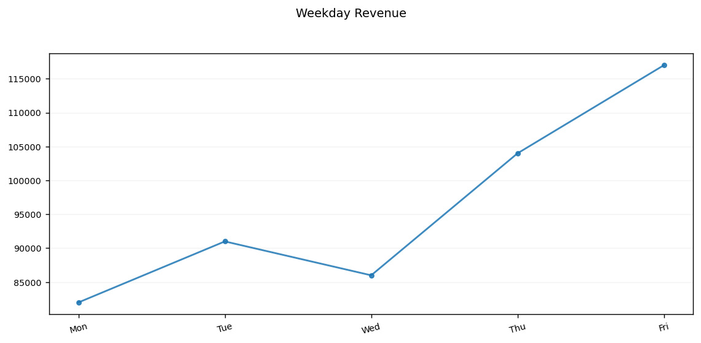

[브라우저에서 인터랙티브 결과 열기](./figures/interactive/01_first_interactive.html) — ZIP을 압축 해제한 뒤 HTML 파일을 브라우저에서 열어 Hover·범례·버튼을 확인합니다.

**결과 해설**

금요일 117,000원이 가장 큰 값이며, HTML에서 각 점에 커서를 올리면 값이 표시됩니다.

### Example 02 — Plotly Express and Graph Objects

**문제 상황**

같은 판매량 그래프를 짧게 만들거나, 개별 Trace를 세밀하게 제어해야 합니다.

**개념 설명**

Plotly Express(`px`)는 DataFrame 열을 그래프의 색·크기·축에 연결하는 고수준 인터페이스입니다. Graph Objects(`go`)는 Trace를 직접 추가하는 저수준 인터페이스입니다. 서로 경쟁 제품이 아니라 하나의 Figure 모델을 사용하는 두 작성 방식입니다.

**사용 이유**

간단한 그래프는 `px`로 시작하고, 여러 타입을 겹치거나 상세 제어가 필요할 때 `go`를 활용합니다.

**예제 코드 — [02_px_vs_go.py](./examples/02_px_vs_go.py)**

```python
from pathlib import Path
import pandas as pd
import numpy as np
import plotly.express as px
import plotly.graph_objects as go
from plotly.subplots import make_subplots

ROOT = Path(__file__).resolve().parents[1]
DATA = ROOT / "data"
OUT = ROOT / "figures" / "interactive"
OUT.mkdir(parents=True, exist_ok=True)

fig = go.Figure()
fig.add_trace(go.Bar(x=["A", "B", "C"], y=[16, 23, 19], name="This Week"))
fig.add_trace(go.Bar(x=["A", "B", "C"], y=[14, 20, 22], name="Last Week"))
fig.update_layout(barmode="group", template="plotly_white", title="Two Weeks")

fig.write_html(OUT / "02_px_vs_go.html", include_plotlyjs="directory", config={"displaylogo": False, "responsive": True})
print("Example 02:", len(fig.data), "traces; HTML generated")
```

**실행 결과**

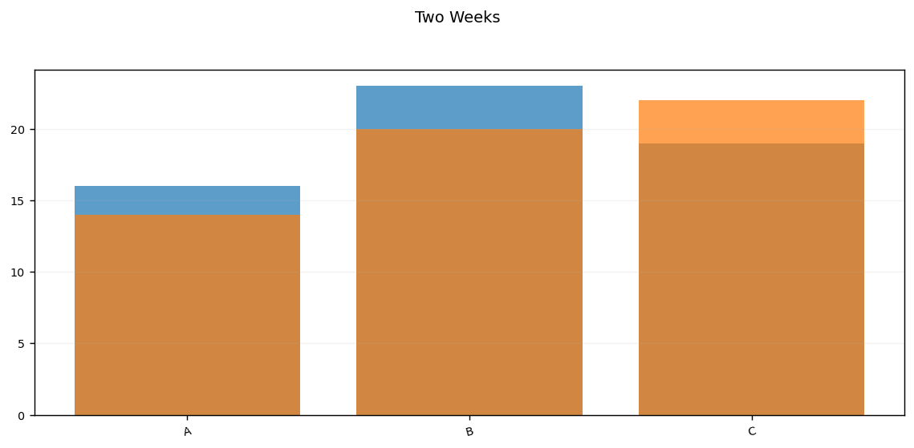

[브라우저에서 인터랙티브 결과 열기](./figures/interactive/02_px_vs_go.html) — ZIP을 압축 해제한 뒤 HTML 파일을 브라우저에서 열어 Hover·범례·버튼을 확인합니다.

**결과 해설**

범례에 This Week와 Last Week의 두 Trace가 나타납니다.

<a id="section-7-4"></a>
## 7.4. Hover Information — Tooltip and Custom Data

### Hover가 유용한 상황

산점도에 점이 500개 있다면 점마다 숫자 레이블을 붙이는 것은 읽기 어렵습니다. Plotly의 Hover는 필요할 때만 세부 정보를 보여 주므로 그래프를 복잡하게 만들지 않고도 관측값을 확인할 수 있습니다.

`hover_name`은 어떤 관측인지 알기 쉬운 제목이고 `hover_data`는 보조 정보입니다. `hovertemplate`는 값의 순서·숫자 표시 형식·추가 영역까지 제어하는 고급 방식입니다. `{}`가 아닌 `%{...}` 구문을 쓰는 것은 Plotly 템플릿 문법이므로 Python f-string과 혼동하지 않아야 합니다.

Hover에 개인식별 정보나 비공개 자료를 넣으면 HTML 파일에 포함될 수 있습니다. 화면에서 보이지 않는 데이터라도 내보내기 파일에 남을 수 있으니 공유 범위를 확인하세요.

### Example 03 — Hover Data: Useful Context

**문제 상황**

매출 산점도 위에 마우스를 올렸을 때 매장명과 날짜도 보여주고 싶습니다.

**개념 설명**

Hover는 특정 데이터 포인트의 상세 정보를 표시합니다. `hover_name`은 굵게 표시하는 이름, `hover_data`는 추가 열입니다. Tooltip은 시각화에 담기 어려운 보조 정보 표시용이지 축 제목과 단위를 대신하지는 않습니다.

**사용 이유**

표시할 정보를 최소한으로 골라 너무 긴 Tooltip을 피합니다.

**예제 코드 — [03_hover_data.py](./examples/03_hover_data.py)**

```python
from pathlib import Path
import pandas as pd
import numpy as np
import plotly.express as px
import plotly.graph_objects as go
from plotly.subplots import make_subplots

ROOT = Path(__file__).resolve().parents[1]
DATA = ROOT / "data"
OUT = ROOT / "figures" / "interactive"
OUT.mkdir(parents=True, exist_ok=True)

df = pd.read_csv(DATA / "retail_sales.csv").head(40)
fig = px.scatter(df, x="units", y="revenue_krw", color="category",
                 hover_name="store", hover_data=["date", "unit_price_krw"],
                 title="Sales Detail on Hover")
fig.update_layout(template="plotly_white")

fig.write_html(OUT / "03_hover_data.html", include_plotlyjs="directory", config={"displaylogo": False, "responsive": True})
print("Example 03:", len(fig.data), "traces; HTML generated")
```

**실행 결과**

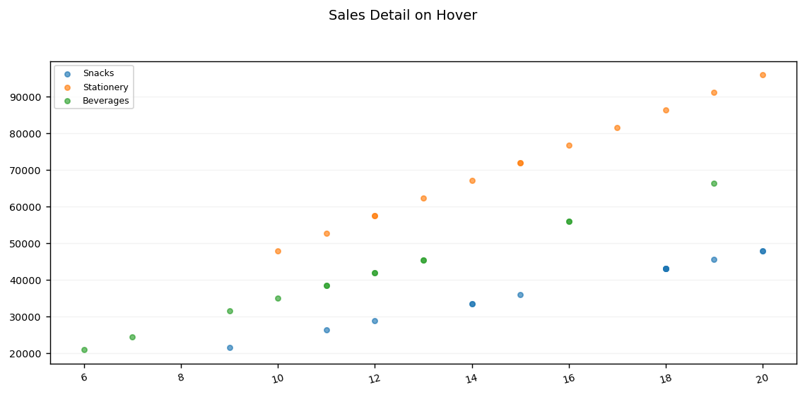

[브라우저에서 인터랙티브 결과 열기](./figures/interactive/03_hover_data.html) — ZIP을 압축 해제한 뒤 HTML 파일을 브라우저에서 열어 Hover·범례·버튼을 확인합니다.

**결과 해설**

Hover에 매장명, 날짜, 단가가 나타나며 그래프 점 위치는 수량과 매출을 나타냅니다.

### Example 04 — Custom Hover Template

**문제 상황**

숫자 포맷을 통일하고 기본 Trace 이름이 Tooltip에 반복 표시되지 않게 하고 싶습니다.

**개념 설명**

`custom_data`는 그래프 위치와 무관한 데이터를 Trace에 전달합니다. `hovertemplate`의 `%{x}`, `%{y}`, `%{customdata[0]}`은 각 점의 값으로 대체됩니다. `<extra></extra>`는 기본 추가 영역을 숨깁니다.

**사용 이유**

금액에 천 단위 구분자와 단위를 지정해 잘못 읽는 일을 줄입니다.

**예제 코드 — [04_hovertemplate.py](./examples/04_hovertemplate.py)**

```python
from pathlib import Path
import pandas as pd
import numpy as np
import plotly.express as px
import plotly.graph_objects as go
from plotly.subplots import make_subplots

ROOT = Path(__file__).resolve().parents[1]
DATA = ROOT / "data"
OUT = ROOT / "figures" / "interactive"
OUT.mkdir(parents=True, exist_ok=True)

df = pd.read_csv(DATA / "retail_sales.csv").head(30)
fig = px.scatter(df, x="units", y="revenue_krw", color="store",
                 custom_data=["date", "category"])
fig.update_traces(hovertemplate="Units: %{x}<br>Revenue: %{y:,.0f} KRW<br>Date: %{customdata[0]}<br>Category: %{customdata[1]}<extra></extra>")
fig.update_layout(template="plotly_white", title="Formatted Hover")

fig.write_html(OUT / "04_hovertemplate.html", include_plotlyjs="directory", config={"displaylogo": False, "responsive": True})
print("Example 04:", len(fig.data), "traces; HTML generated")
```

**실행 결과**

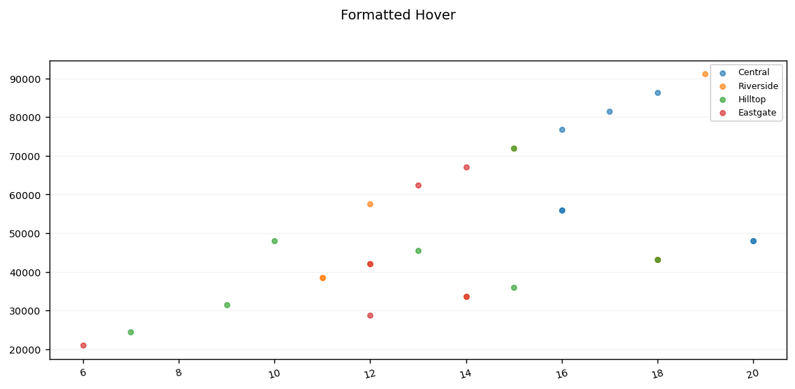

[브라우저에서 인터랙티브 결과 열기](./figures/interactive/04_hovertemplate.html) — ZIP을 압축 해제한 뒤 HTML 파일을 브라우저에서 열어 Hover·범례·버튼을 확인합니다.

**결과 해설**

각 점에서 Revenue: 12,000 KRW 형태의 포맷과 날짜·분류가 표시됩니다.

<a id="section-7-5"></a>
## 7.5. Legend, Visibility & Trace Control

### 범례는 데이터를 삭제하지 않습니다

비슷한 선이 네 개 겹쳤을 때 범례를 클릭하면 한 계열을 숨겨 쉽게 비교할 수 있습니다. 이때 보이지 않는 Trace는 Figure 안에 남아 있습니다. **표시 상태(visibility)**와 **데이터 필터링·재집계**는 서로 다른 개념입니다.

그래프 안에서 범례를 통해 보여줄 대상을 바꾸어도 HTML 파일 안의 실제 데이터가 삭제되지 않습니다. 필요하지 않은 민감 데이터는 내보내기 전에 Python 단계에서 제거해야 합니다.

### Example 05 — Legend and Trace Visibility

**문제 상황**

매장별 매출 추이를 한 화면에서 보되, 일부 매장만 선택해서 보고 싶습니다.

**개념 설명**

하나의 Plotly `Figure`에는 여러 Trace가 있습니다. 색으로 구분된 시리즈의 범례를 클릭하면 해당 Trace를 숨기거나 다시 나타낼 수 있습니다. 더블클릭은 보통 하나만 남기는 동작입니다. 이는 데이터 삭제가 아니라 화면 표시 변경입니다.

**사용 이유**

사용자는 별도의 Python 재실행 없이 선의 표시 여부를 바꿀 수 있습니다.

**예제 코드 — [05_legend_visibility.py](./examples/05_legend_visibility.py)**

```python
from pathlib import Path
import pandas as pd
import numpy as np
import plotly.express as px
import plotly.graph_objects as go
from plotly.subplots import make_subplots

ROOT = Path(__file__).resolve().parents[1]
DATA = ROOT / "data"
OUT = ROOT / "figures" / "interactive"
OUT.mkdir(parents=True, exist_ok=True)

df = pd.read_csv(DATA / "retail_sales.csv", parse_dates=["date"])
daily = df.groupby(["date", "store"], as_index=False)["revenue_krw"].sum()
fig = px.line(daily, x="date", y="revenue_krw", color="store",
              title="Toggle Store Lines")
fig.update_layout(template="plotly_white", hovermode="x unified")

fig.write_html(OUT / "05_legend_visibility.html", include_plotlyjs="directory", config={"displaylogo": False, "responsive": True})
print("Example 05:", len(fig.data), "traces; HTML generated")
```

**실행 결과**


[브라우저에서 인터랙티브 결과 열기](./figures/interactive/05_legend_visibility.html) — ZIP을 압축 해제한 뒤 HTML 파일을 브라우저에서 열어 Hover·범례·버튼을 확인합니다.

**결과 해설**

범례를 클릭하면 해당 매장 선만 숨겨지고 나머지 선은 유지됩니다.

<a id="section-7-6"></a>
## 7.6. Missing Observations — Breaks vs Zero

### 보이지 않는 시간도 데이터 해석에 영향을 줍니다

사용자가 10시의 0건과 11시 미측정값을 같은 값으로 오해하면 그래프는 사실과 다른 결론을 낳습니다. Plotly의 `connectgaps=False`는 결측 지점에서 선을 끊지만, **해당 시각의 행 자체가 없다면** 선을 끊을 근거도 없습니다.

따라서 데이터 수집 규칙이 1시간마다 한 건이라면 먼저 `pd.date_range()`로 예상 슬롯을 만들고 `reindex()`하여 누락을 `NaN`으로 기록해야 합니다. 실제 0은 보존합니다. 이 규칙은 Chapter 06의 시계열 개념을 인터랙티브 그래프에 적용한 것입니다.

### Example 06 — Gaps Are Not Zero

**문제 상황**

센서 기록이 없는 구간이 있을 때 선이 이어져 관측이 계속된 것처럼 보이지 않게 하고 싶습니다.

**개념 설명**

`connectgaps=False`는 `None`이나 `NaN` 같은 결측 지점에서 선을 끊습니다. 단, 누락 시점이 데이터에 아예 존재하지 않으면 끊을 대상도 없으므로 예상 시간 인덱스를 만들고 `reindex()`해야 합니다.

**사용 이유**

실제 측정값 0과 미측정 상태를 반드시 구별합니다.

**예제 코드 — [06_missing_values.py](./examples/06_missing_values.py)**

```python
from pathlib import Path
import pandas as pd
import numpy as np
import plotly.express as px
import plotly.graph_objects as go
from plotly.subplots import make_subplots

ROOT = Path(__file__).resolve().parents[1]
DATA = ROOT / "data"
OUT = ROOT / "figures" / "interactive"
OUT.mkdir(parents=True, exist_ok=True)

source = pd.DataFrame({"time": pd.to_datetime(["2026-10-01 09:00", "2026-10-01 10:00", "2026-10-01 12:00"]),
                       "count": [8, 0, 13]}).set_index("time")
expected = pd.date_range("2026-10-01 09:00", periods=4, freq="h")
full = source.reindex(expected)
fig = go.Figure(go.Scatter(x=full.index, y=full["count"], mode="lines+markers", connectgaps=False))
fig.update_layout(title="11:00 is Missing; 10:00 Is Zero", template="plotly_white")

fig.write_html(OUT / "06_missing_values.html", include_plotlyjs="directory", config={"displaylogo": False, "responsive": True})
print("Example 06:", len(fig.data), "traces; HTML generated")
```

**실행 결과**

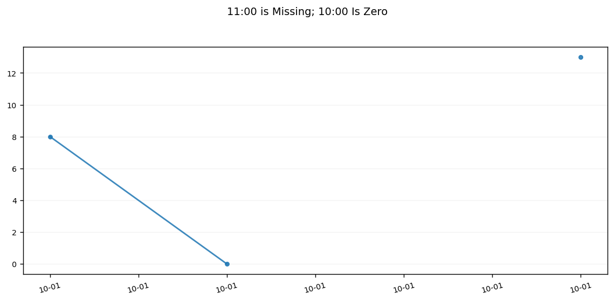

[브라우저에서 인터랙티브 결과 열기](./figures/interactive/06_missing_values.html) — ZIP을 압축 해제한 뒤 HTML 파일을 브라우저에서 열어 Hover·범례·버튼을 확인합니다.

**결과 해설**

10시는 관측값 0, 11시는 결측으로 남아 선이 끊기며 12시에 다시 시작됩니다.

<a id="section-7-7"></a>
## 7.7. Navigation — Zoom, Pan, Range Slider & Range Selector

### Zoom과 Range Slider는 계산이 아니라 화면 조작입니다

Plotly Modebar의 확대·축소·이동(Pan), Range Slider, Range Selector는 사용자가 그래프를 탐색하도록 도와줍니다. 특히 날짜 범위가 길다면 전체 흐름을 먼저 보여주고 최근 7일을 선택할 수 있도록 하는 것이 자연스럽습니다.

**주의할 점:** 그래프의 X축 범위를 7일로 축소해도 제목에 표시한 전체 기간 합계가 자동으로 7일 합계로 바뀌지는 않습니다. 이처럼 **숫자 요약과 표시 기간이 서로 다른 경우**를 명확히 안내해야 합니다. 보고서 안의 요약 통계를 필터에 따라 변경하려면 별도의 코드가 필요합니다.

### Example 07 — Range Slider and Range Selector

**문제 상황**

몇 달치 데이터를 한 번에 보고도 특정 기간을 확대하고 싶습니다.

**개념 설명**

Range Slider는 X축 아래에서 보고 싶은 날짜 범위를 드래그해 선택하는 컨트롤입니다. Range Selector는 7일·1개월·전체 기간 등의 버튼으로 범위를 선택합니다. 둘 다 표시 구간을 바꿀 뿐, 원본 행을 다시 집계하지 않습니다.

**사용 이유**

기간에 따라 세부 변화를 쉽게 탐색할 수 있고 코드 수정이 필요 없습니다.

**예제 코드 — [07_range_slider.py](./examples/07_range_slider.py)**

```python
from pathlib import Path
import pandas as pd
import numpy as np
import plotly.express as px
import plotly.graph_objects as go
from plotly.subplots import make_subplots

ROOT = Path(__file__).resolve().parents[1]
DATA = ROOT / "data"
OUT = ROOT / "figures" / "interactive"
OUT.mkdir(parents=True, exist_ok=True)

df = pd.read_csv(DATA / "retail_sales.csv", parse_dates=["date"])
daily = df.groupby("date", as_index=False)["revenue_krw"].sum()
fig = px.line(daily, x="date", y="revenue_krw", title="Sales — Select Date Range")
fig.update_xaxes(rangeslider_visible=True,
                 rangeselector=dict(buttons=[dict(count=7, label="7d", step="day", stepmode="backward"),
                                             dict(count=1, label="1m", step="month", stepmode="backward"),
                                             dict(label="All", step="all")]))
fig.update_layout(template="plotly_white")

fig.write_html(OUT / "07_range_slider.html", include_plotlyjs="directory", config={"displaylogo": False, "responsive": True})
print("Example 07:", len(fig.data), "traces; HTML generated")
```

**실행 결과**

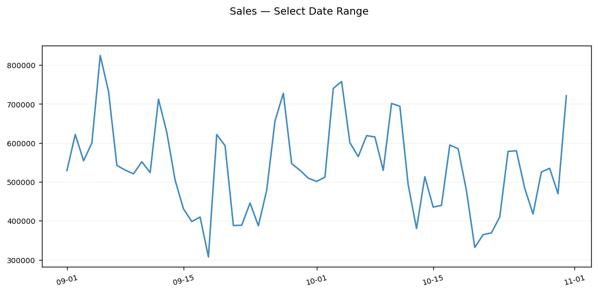

[브라우저에서 인터랙티브 결과 열기](./figures/interactive/07_range_slider.html) — ZIP을 압축 해제한 뒤 HTML 파일을 브라우저에서 열어 Hover·범례·버튼을 확인합니다.

**결과 해설**

7d 버튼과 아래 Range Slider가 나타납니다. 축 범위만 바뀌고 전체 데이터 합계는 그대로입니다.

<a id="section-7-8"></a>
## 7.8. Dropdown & Update Menus

### 드롭다운 버튼이 화면을 바꾸는 원리

드롭다운을 누르면 Plotly는 등록된 버튼의 `method`와 `args`를 사용해 Trace나 Layout의 속성을 변경합니다. `method="update"`는 데이터 표현과 레이아웃 설정을 동시에 바꿀 수 있고, `method="restyle"`은 Trace의 속성, `method="relayout"`은 그래프 전체 설정을 바꿉니다.

예를 들어 4개 매장 Trace에서 한 매장만 보이게 하려면 `visible` 목록을 `[False, True, False, False]`처럼 정확히 네 값으로 지정합니다. 길이나 순서가 틀리면 의도와 다른 매장 데이터가 표시될 수 있습니다. 단독 HTML의 드롭다운은 준비된 Trace를 선택할 뿐 새 파일을 읽거나 Python 함수 전체를 재실행하지 않습니다.

### Example 08 — Dropdown: Select a Store

**문제 상황**

4개 매장의 선을 한 번에 보여주는 대신 한 매장씩 선택하고 싶습니다.

**개념 설명**

Plotly의 `updatemenus`에 드롭다운 버튼을 추가할 수 있습니다. `method="update"`와 `visible` 목록으로 어떤 Trace가 보이는지 설정합니다. `visible` 목록의 길이와 Trace의 순서가 정확히 맞아야 합니다.

**사용 이유**

같은 데이터로 다양한 비교 화면을 제공할 수 있습니다. Python에서 새 데이터를 받아 계산하는 서버 필터와는 다릅니다.

**예제 코드 — [08_dropdown_visibility.py](./examples/08_dropdown_visibility.py)**

```python
from pathlib import Path
import pandas as pd
import numpy as np
import plotly.express as px
import plotly.graph_objects as go
from plotly.subplots import make_subplots

ROOT = Path(__file__).resolve().parents[1]
DATA = ROOT / "data"
OUT = ROOT / "figures" / "interactive"
OUT.mkdir(parents=True, exist_ok=True)

df = pd.read_csv(DATA / "retail_sales.csv", parse_dates=["date"])
daily = df.groupby(["date", "store"], as_index=False)["revenue_krw"].sum()
stores = sorted(daily.store.unique())
fig = go.Figure()
for store in stores:
    one = daily[daily.store == store]
    fig.add_trace(go.Scatter(x=one.date, y=one.revenue_krw, name=store, mode="lines"))
buttons = [dict(label="All", method="update", args=[{"visible": [True] * len(stores)}])]
for i, store in enumerate(stores):
    buttons.append(dict(label=store, method="update", args=[{"visible": [j == i for j in range(len(stores))]}]))
fig.update_layout(updatemenus=[dict(buttons=buttons, x=1, y=1.22, xanchor="right")],
                  margin=dict(t=110), template="plotly_white", title="Choose Store")

fig.write_html(OUT / "08_dropdown_visibility.html", include_plotlyjs="directory", config={"displaylogo": False, "responsive": True})
print("Example 08:", len(fig.data), "traces; HTML generated")
```

**실행 결과**

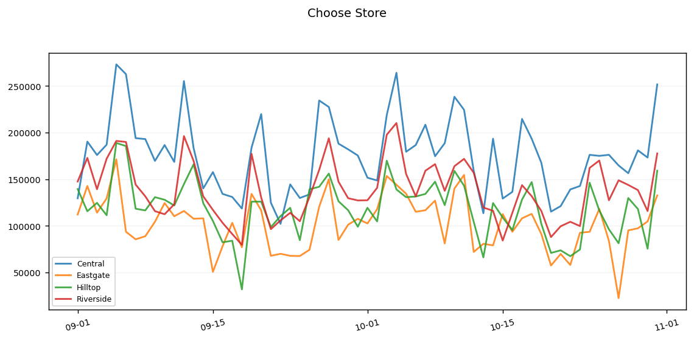

[브라우저에서 인터랙티브 결과 열기](./figures/interactive/08_dropdown_visibility.html) — ZIP을 압축 해제한 뒤 HTML 파일을 브라우저에서 열어 Hover·범례·버튼을 확인합니다.

**결과 해설**

드롭다운에서 매장을 선택하면 해당 Trace만 표시됩니다.

### Example 09 — Restyle vs Relayout vs Update

**문제 상황**

같은 판매량 선 그래프를 선+점으로 바꾸는 버튼이 필요합니다.

**개념 설명**

`restyle`은 Trace 속성을 바꿉니다. `relayout`은 제목·축 범위 등 Layout을 바꿉니다. `update`는 Trace와 Layout을 함께 바꿀 수 있습니다. 서로 다른 변경 대상을 구별하면 버튼 오작동을 줄일 수 있습니다.

**사용 이유**

도구의 역할을 정확히 아는 것이 중요한 개념입니다.

**예제 코드 — [09_buttons_update.py](./examples/09_buttons_update.py)**

```python
from pathlib import Path
import pandas as pd
import numpy as np
import plotly.express as px
import plotly.graph_objects as go
from plotly.subplots import make_subplots

ROOT = Path(__file__).resolve().parents[1]
DATA = ROOT / "data"
OUT = ROOT / "figures" / "interactive"
OUT.mkdir(parents=True, exist_ok=True)

fig = go.Figure(go.Scatter(x=[1, 2, 3, 4], y=[11, 18, 16, 24], mode="lines", name="Orders"))
fig.update_layout(updatemenus=[dict(type="buttons", buttons=[
    dict(label="Lines", method="restyle", args=[{"mode": "lines"}]),
    dict(label="Lines + Markers", method="restyle", args=[{"mode": "lines+markers"}]),
],x=.5,xanchor="center",y=1.22)],margin=dict(t=95),template="plotly_white",title="Trace Style")

fig.write_html(OUT / "09_buttons_update.html", include_plotlyjs="directory", config={"displaylogo": False, "responsive": True})
print("Example 09:", len(fig.data), "traces; HTML generated")
```

**실행 결과**

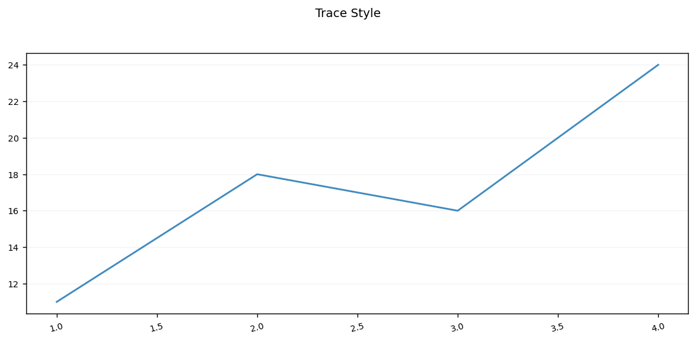

[브라우저에서 인터랙티브 결과 열기](./figures/interactive/09_buttons_update.html) — ZIP을 압축 해제한 뒤 HTML 파일을 브라우저에서 열어 Hover·범례·버튼을 확인합니다.

**결과 해설**

버튼에 따라 선만 표시되거나 각 데이터 포인트가 추가로 표시됩니다.

<a id="section-7-9"></a>
## 7.9. Subplots — Independent Axes

### Plotly의 Subplots

Matplotlib에서 배운 Figure와 Axes의 관계와 마찬가지로, Plotly의 `make_subplots()`는 하나의 Figure 안에 여러 그래프 영역을 배치합니다. `row`, `col`은 **1부터 시작**하므로 `row=1, col=2`는 첫 번째 행의 두 번째 칸입니다. 이미 배운 Matplotlib의 `axes[0]`, `axes[1]`처럼 0부터 시작한다고 착각하기 쉬우니 주의하세요.

서로 단위가 다른 지표를 같은 축에 겹치면 비교가 어렵습니다. 방문자 수와 매출액을 각각 독립된 패널로 나누면 축 제목을 명확히 표기할 수 있습니다.

### Example 10 — Subplots with Different Units

**문제 상황**

방문자 수와 매출액은 단위가 달라 공통 Y축 대신 두 개의 패널에 나누어 그리고 싶습니다.

**개념 설명**

`make_subplots(rows, cols)`로 여러 XY 축 영역을 만듭니다. 각 Trace를 `row=`, `col=`에 정확히 지정해야 합니다. Matplotlib의 Axes 개념과 목적은 비슷하지만 Plotly는 하나의 Figure에 여러 x/y axis 속성을 구성합니다.

**사용 이유**

서로 다른 단위는 가능한 한 각 축 제목으로 구분해 표시합니다.

**예제 코드 — [10_subplot_axes.py](./examples/10_subplot_axes.py)**

```python
from pathlib import Path
import pandas as pd
import numpy as np
import plotly.express as px
import plotly.graph_objects as go
from plotly.subplots import make_subplots

ROOT = Path(__file__).resolve().parents[1]
DATA = ROOT / "data"
OUT = ROOT / "figures" / "interactive"
OUT.mkdir(parents=True, exist_ok=True)

fig = make_subplots(rows=1, cols=2, subplot_titles=("Visitors", "Revenue (10k KRW)"))
fig.add_trace(go.Bar(x=["Jan","Feb","Mar"],y=[110,150,130],name="Visitors"),row=1,col=1)
fig.add_trace(go.Scatter(x=["Jan","Feb","Mar"],y=[81,102,96],mode="lines+markers",name="Revenue"),row=1,col=2)
fig.update_layout(template="plotly_white",title="Two Units, Two Panels")

fig.write_html(OUT / "10_subplot_axes.html", include_plotlyjs="directory", config={"displaylogo": False, "responsive": True})
print("Example 10:", len(fig.data), "traces; HTML generated")
```

**실행 결과**

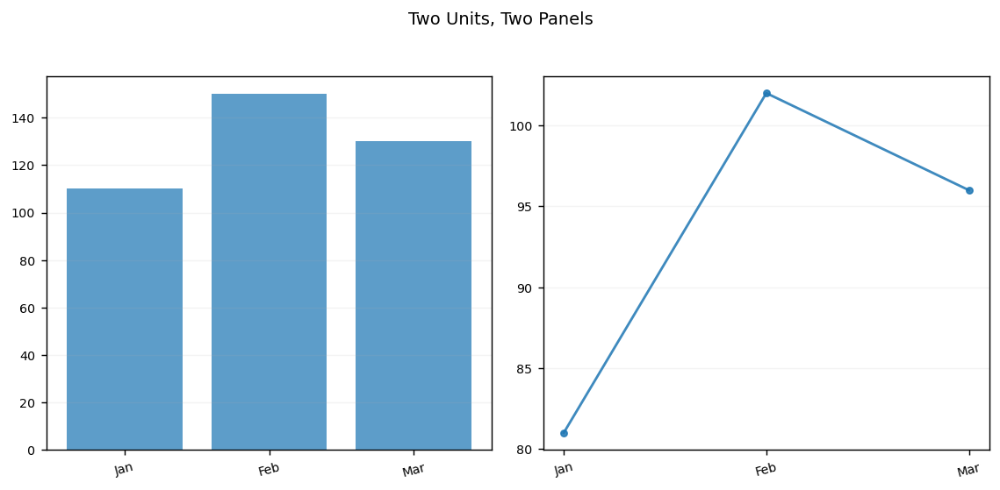

[브라우저에서 인터랙티브 결과 열기](./figures/interactive/10_subplot_axes.html) — ZIP을 압축 해제한 뒤 HTML 파일을 브라우저에서 열어 Hover·범례·버튼을 확인합니다.

**결과 해설**

왼쪽에는 세로 막대, 오른쪽에는 선 그래프가 서로 다른 축으로 나타납니다.

<a id="section-7-10"></a>
## 7.10. Facets — Small Multiples

### Facet은 같은 구조의 작은 그래프를 반복합니다

매장별 데이터를 한 그래프에 겹쳐 표시할 때 선이 너무 많다면 `facet_col`을 사용합니다. 같은 종류의 그래프를 그룹별로 반복 배치하는 방식을 **Small Multiples**라고도 합니다. `facet_col_wrap=2`는 가로로 두 개씩 배치합니다.

동일한 축 범위를 공유하면 규모를 비교하기 쉽습니다. 독립된 축 범위를 사용하면 매장별 변화는 자세히 볼 수 있지만 상대적인 매출 수준을 비교할 때 오해할 수 있으므로 목적에 맞게 선택해야 합니다.

### Example 11 — Facet: Repeat a Chart by Group

**문제 상황**

매장 네 곳의 일별 매출을 겹쳐 그리면 선이 많아져 구별하기 어렵습니다.

**개념 설명**

Facet은 동일한 그래프 구조를 그룹별 소형 패널로 반복합니다. `facet_col`, `facet_col_wrap`을 사용합니다. 축 범위를 공유하면 매장 간 크기를 공정하게 비교할 수 있고, 독립 축은 패턴을 자세히 볼 때 유용하지만 크기 비교에 혼란을 줄 수 있습니다.

**사용 이유**

범주 수가 적을 때 편리합니다. 그룹이 너무 많으면 페이지나 필터가 필요할 수 있습니다.

**예제 코드 — [11_facet_layout.py](./examples/11_facet_layout.py)**

```python
from pathlib import Path
import pandas as pd
import numpy as np
import plotly.express as px
import plotly.graph_objects as go
from plotly.subplots import make_subplots

ROOT = Path(__file__).resolve().parents[1]
DATA = ROOT / "data"
OUT = ROOT / "figures" / "interactive"
OUT.mkdir(parents=True, exist_ok=True)

df = pd.read_csv(DATA / "retail_sales.csv", parse_dates=["date"])
daily=df.groupby(["date","store"],as_index=False)["revenue_krw"].sum()
fig=px.line(daily,x="date",y="revenue_krw",facet_col="store",facet_col_wrap=2,
            title="Daily Sales by Store")
fig.update_layout(template="plotly_white",height=650)

fig.write_html(OUT / "11_facet_layout.html", include_plotlyjs="directory", config={"displaylogo": False, "responsive": True})
print("Example 11:", len(fig.data), "traces; HTML generated")
```

**실행 결과**

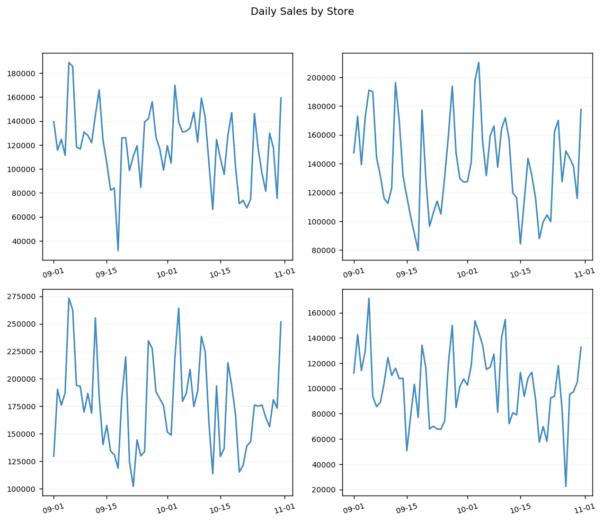

[브라우저에서 인터랙티브 결과 열기](./figures/interactive/11_facet_layout.html) — ZIP을 압축 해제한 뒤 HTML 파일을 브라우저에서 열어 Hover·범례·버튼을 확인합니다.

**결과 해설**

매장 4개의 변화가 2행 2열 패널로 표시됩니다.

<a id="section-7-11"></a>
## 7.11. Scatter & Bubble Charts

### 점의 위치·색·크기에는 서로 다른 의미가 있습니다

산점도의 X·Y 위치는 두 수치를 나타냅니다. Plotly에서 점 색깔에 상품 분류를 넣으면 범주형 비교가 되고, `size`에는 양수 수치를 연결하여 추가 변수의 크기를 나타낼 수 있습니다. 사용자가 점의 크기만 보고 값을 정확히 추정하기는 어렵기 때문에 Hover·범례·단위를 함께 제공해야 합니다.

가능한 모든 열을 한 그래프에 넣는 것보다 **한두 가지 질문이 답을 찾을 수 있는지**가 더 중요합니다.

### Example 12 — Scatter: Color and Size Encoding

**문제 상황**

상품별 판매량과 매출의 관계를 비교하면서 분류와 단가를 함께 보고 싶습니다.

**개념 설명**

산점도는 X/Y 위치로 두 변수의 관계를 나타냅니다. `color`는 범주를, `size`는 세 번째 수치를 표시할 수 있지만 원의 넓이가 커지는 것과 직경이 커지는 것은 다르므로 범례·단위를 확인해야 합니다.

**사용 이유**

그룹 비교에 유용하지만 너무 많은 점은 겹침을 유발할 수 있습니다.

**예제 코드 — [12_bubble_scatter.py](./examples/12_bubble_scatter.py)**

```python
from pathlib import Path
import pandas as pd
import numpy as np
import plotly.express as px
import plotly.graph_objects as go
from plotly.subplots import make_subplots

ROOT = Path(__file__).resolve().parents[1]
DATA = ROOT / "data"
OUT = ROOT / "figures" / "interactive"
OUT.mkdir(parents=True, exist_ok=True)

df=pd.read_csv(DATA/"retail_sales.csv").head(100)
fig=px.scatter(df,x="units",y="revenue_krw",color="category",size="unit_price_krw",
               hover_data=["store","date"],title="Sales: Quantity vs Revenue",size_max=25)
fig.update_layout(template="plotly_white")

fig.write_html(OUT / "12_bubble_scatter.html", include_plotlyjs="directory", config={"displaylogo": False, "responsive": True})
print("Example 12:", len(fig.data), "traces; HTML generated")
```

**실행 결과**

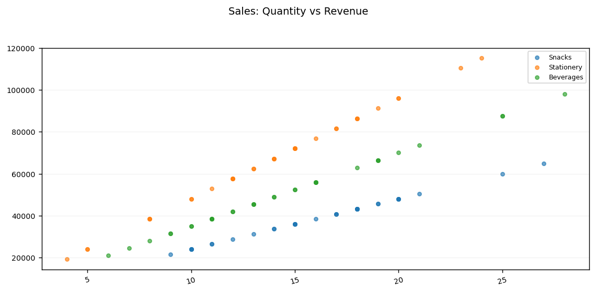

[브라우저에서 인터랙티브 결과 열기](./figures/interactive/12_bubble_scatter.html) — ZIP을 압축 해제한 뒤 HTML 파일을 브라우저에서 열어 Hover·범례·버튼을 확인합니다.

**결과 해설**

마우스를 올려 매장과 날짜를 확인하고 크기 범례가 단가임을 확인합니다.

<a id="section-7-12"></a>
## 7.12. Bar Chart & Aggregation

### 막대 하나가 의미하는 값부터 정의하세요

범주형 매출 그래프에서 막대가 나타내는 값은 총매출, 평균 매출, 거래 건수 중 하나일 수 있습니다. 동일한 데이터라도 집계 기준에 따라 그래프가 달라집니다. `px.bar()`에 행별 원본을 넘기면서 합계로 요약했다고 생각하면 잘못된 보고서를 만들 수 있습니다.

`groupby()`로 **어떤 단위로 묶을지와 어떤 집계 함수를 쓸지** 결정한 후, 결과 테이블을 `px.bar()`로 표현하는 방식을 권장합니다. 매출 합계는 돈의 총량을, 평균 매출은 관측 한 건의 평균을 뜻합니다. 각각의 분모가 다르므로 제목에 집계 기준을 밝히세요.

### Example 13 — Aggregated Bars Are Not Raw Rows

**문제 상황**

매장별 매출액 합계를 비교해야 하는데 원본 행을 그대로 넘기면 여러 막대가 겹쳐 의미가 흐려집니다.

**개념 설명**

Plotly Express `px.bar()`는 같은 X의 여러 행을 자동으로 집계해 하나의 막대 값으로 만든다고 가정하면 안 됩니다. 합계·평균·비율의 분모를 Python/Pandas에서 먼저 결정해 요약한 뒤 시각화해야 합니다.

**사용 이유**

명확한 수치를 표시하려면 집계 이후 데이터로 그래프를 만듭니다.

**예제 코드 — [13_bar_aggregation.py](./examples/13_bar_aggregation.py)**

```python
from pathlib import Path
import pandas as pd
import numpy as np
import plotly.express as px
import plotly.graph_objects as go
from plotly.subplots import make_subplots

ROOT = Path(__file__).resolve().parents[1]
DATA = ROOT / "data"
OUT = ROOT / "figures" / "interactive"
OUT.mkdir(parents=True, exist_ok=True)

df=pd.read_csv(DATA/"retail_sales.csv")
summary=df.groupby("store",as_index=False).agg(total_revenue=("revenue_krw","sum"))
fig=px.bar(summary,x="store",y="total_revenue",text_auto=True,
           title="Store Total Revenue",labels={"total_revenue":"Revenue (KRW)"})
fig.update_layout(template="plotly_white",yaxis_rangemode="tozero")

fig.write_html(OUT / "13_bar_aggregation.html", include_plotlyjs="directory", config={"displaylogo": False, "responsive": True})
print("Example 13:", len(fig.data), "traces; HTML generated")
```

**실행 결과**

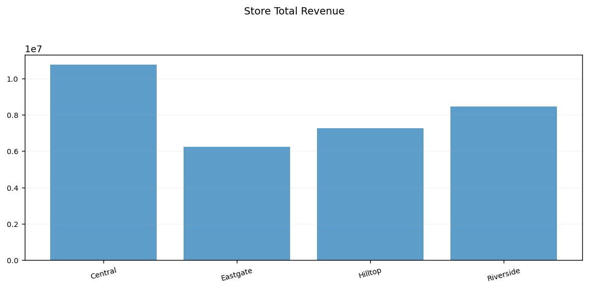

[브라우저에서 인터랙티브 결과 열기](./figures/interactive/13_bar_aggregation.html) — ZIP을 압축 해제한 뒤 HTML 파일을 브라우저에서 열어 Hover·범례·버튼을 확인합니다.

**결과 해설**

하나의 매장당 막대 하나가 생성되며, 막대 값은 집계한 합계입니다.

<a id="section-7-13"></a>
## 7.13. Distribution — Box Plot & Histogram

### 분포 그래프에서는 값의 개수와 형태를 함께 봅니다

Box Plot은 분포의 중심과 사분위 범위를 간결하게 보여주고, Histogram은 응답시간이 어느 구간에 집중되는지 파악하도록 돕습니다. 두 그래프는 같은 값을 다른 관점에서 설명합니다.

이상값은 특정 규칙에 비해 떨어진 관측값을 말하며 곧바로 잘못된 값이라는 뜻이 아닙니다. 분포가 오른쪽으로 긴 꼬리를 갖는 경우 평균·중앙값의 차이도 함께 확인하면 좋습니다. Histogram의 Bin 폭은 그래프 모양에 큰 영향을 주므로 구간별 경계를 주의 깊게 비교해야 합니다.

### Example 14 — Box Plot and Outliers

**문제 상황**

지원팀별 응답시간의 중앙값·사분위 범위·극단값을 살펴보고 싶습니다.

**개념 설명**

Box Plot은 중앙값과 사분위 범위를 통해 분포를 압축해 보여줍니다. Hover로 개별 값과 이상값을 살필 수 있지만, 사분위수 경계 밖 점을 무조건 데이터 오류로 취급하지는 않습니다.

**사용 이유**

서로 다른 팀을 비교할 때 표본 수와 우선순위 구성을 함께 확인해야 합니다.

**예제 코드 — [14_boxplot.py](./examples/14_boxplot.py)**

```python
from pathlib import Path
import pandas as pd
import numpy as np
import plotly.express as px
import plotly.graph_objects as go
from plotly.subplots import make_subplots

ROOT = Path(__file__).resolve().parents[1]
DATA = ROOT / "data"
OUT = ROOT / "figures" / "interactive"
OUT.mkdir(parents=True, exist_ok=True)

df=pd.read_csv(DATA/"support_tickets.csv")
fig=px.box(df,x="team",y="first_response_min",color="team",points="outliers",
           title="Response Time by Team")
fig.update_layout(template="plotly_white",showlegend=False)

fig.write_html(OUT / "14_boxplot.html", include_plotlyjs="directory", config={"displaylogo": False, "responsive": True})
print("Example 14:", len(fig.data), "traces; HTML generated")
```

**실행 결과**


[브라우저에서 인터랙티브 결과 열기](./figures/interactive/14_boxplot.html) — ZIP을 압축 해제한 뒤 HTML 파일을 브라우저에서 열어 Hover·범례·버튼을 확인합니다.

**결과 해설**

상자 높이와 중앙값 선, 상자 밖 점을 비교할 수 있습니다.

### Example 15 — Histogram: Bin Width Changes the Story

**문제 상황**

고객문의 응답시간의 값이 어느 구간에 몰려 있는지 알아보려고 합니다.

**개념 설명**

Histogram은 연속 수치의 일정 구간(Bin)에 속한 관측 개수를 셉니다. `nbins`는 참고할 구간 수로, 실제 경계는 Plotly가 선택할 수 있습니다. 비교할 집단이 있으면 Bin 경계와 정규화 방식을 일관되게 관리해야 합니다.

**사용 이유**

구간 너비를 바꾸면 봉우리 개수나 모양이 달라질 수 있습니다.

**예제 코드 — [15_histogram.py](./examples/15_histogram.py)**

```python
from pathlib import Path
import pandas as pd
import numpy as np
import plotly.express as px
import plotly.graph_objects as go
from plotly.subplots import make_subplots

ROOT = Path(__file__).resolve().parents[1]
DATA = ROOT / "data"
OUT = ROOT / "figures" / "interactive"
OUT.mkdir(parents=True, exist_ok=True)

df=pd.read_csv(DATA/"support_tickets.csv")
fig=px.histogram(df,x="first_response_min",color="team",nbins=25,opacity=.72,
                 barmode="overlay",title="Response Time Histogram")
fig.update_layout(template="plotly_white")

fig.write_html(OUT / "15_histogram.html", include_plotlyjs="directory", config={"displaylogo": False, "responsive": True})
print("Example 15:", len(fig.data), "traces; HTML generated")
```

**실행 결과**

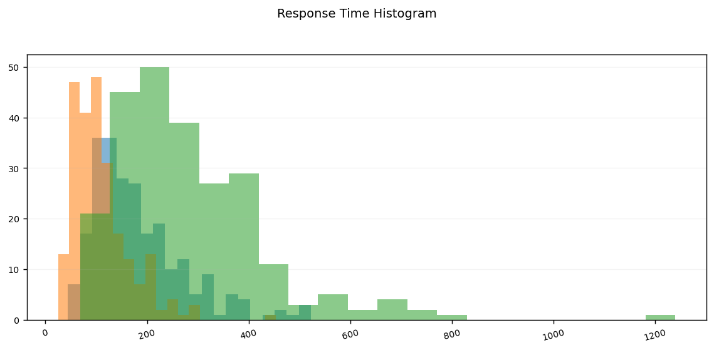

[브라우저에서 인터랙티브 결과 열기](./figures/interactive/15_histogram.html) — ZIP을 압축 해제한 뒤 HTML 파일을 브라우저에서 열어 Hover·범례·버튼을 확인합니다.

**결과 해설**

오른쪽으로 긴 꼬리가 나타나며 팀별 값이 겹칠 수 있습니다.

<a id="section-7-14"></a>
## 7.14. Heatmap & Color Encoding

### Heatmap과 Color Encoding

Heatmap은 두 범주의 조합을 한눈에 살피는 데 유용합니다. 매장과 상품 분류를 각각 행과 열로 배치하면 어느 조합의 매출이 높은지 확인할 수 있습니다. 다만 **없던 기록을 0으로 채우는 것이 올바른지**는 데이터 정의에 따라 판단해야 합니다. 예제의 `fill_value=0`은 실제 집계 범주 내에 해당 조합이 없을 때 0으로 표현하는 학습용 선택이고, 미관측 상태를 0이라고 단정해도 된다는 뜻은 아닙니다.

색은 범주를 구별할 수도 있고 연속값의 크기를 나타낼 수도 있습니다. 숫자를 그룹 ID로 사용하는 데이터에서는 범주 문자열로 변환한 뒤 범주형 팔레트를 사용하는 편이 적절할 수 있습니다. 색각 다양성까지 고려해 글자·범례·수치를 함께 표시하는 습관이 중요합니다.

### Example 16 — Heatmap: Values and Color Scales

**문제 상황**

매장과 상품 분류를 조합한 매출 규모를 표보다 빠르게 비교하고 싶습니다.

**개념 설명**

Heatmap은 행·열의 조합에 대응하는 수치를 색 강도로 표시합니다. 같은 색척도 내에서만 크기를 비교해야 하며, 숫자를 텍스트로 함께 보이면 값 확인에 도움이 됩니다.

**사용 이유**

색이 진하다는 것만으로 통계적 중요성이 크다고 단정하지 않습니다.

**예제 코드 — [16_heatmap.py](./examples/16_heatmap.py)**

```python
from pathlib import Path
import pandas as pd
import numpy as np
import plotly.express as px
import plotly.graph_objects as go
from plotly.subplots import make_subplots

ROOT = Path(__file__).resolve().parents[1]
DATA = ROOT / "data"
OUT = ROOT / "figures" / "interactive"
OUT.mkdir(parents=True, exist_ok=True)

df=pd.read_csv(DATA/"retail_sales.csv")
table=df.pivot_table(index="store",columns="category",values="revenue_krw",aggfunc="sum",fill_value=0)
fig=px.imshow(table,text_auto=True,aspect="auto",color_continuous_scale="Blues",
              title="Sales Heatmap (KRW)")
fig.update_layout(template="plotly_white")

fig.write_html(OUT / "16_heatmap.html", include_plotlyjs="directory", config={"displaylogo": False, "responsive": True})
print("Example 16:", len(fig.data), "traces; HTML generated")
```

**실행 결과**

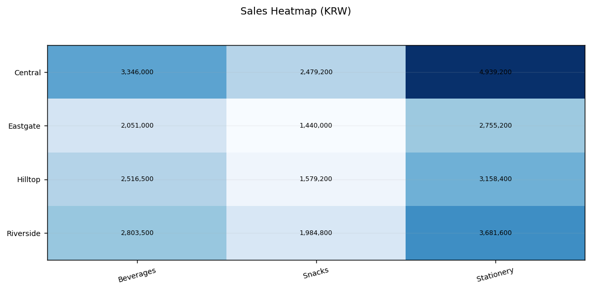

[브라우저에서 인터랙티브 결과 열기](./figures/interactive/16_heatmap.html) — ZIP을 압축 해제한 뒤 HTML 파일을 브라우저에서 열어 Hover·범례·버튼을 확인합니다.

**결과 해설**

각 매장·분류 셀의 집계 매출이 숫자와 색으로 함께 표시됩니다.

### Example 17 — Categorical vs Continuous Colors

**문제 상황**

매장 구분 색과 연속 점수 색을 같은 방식으로 설정해도 되는지 확인하고 싶습니다.

**개념 설명**

범주형 색상은 서로 다른 그룹을 구별합니다. 연속형 색상은 수치의 크고 작음을 하나의 색척도로 나타냅니다. `color`에 숫자를 넣을 때 연속 색상이 사용될 수 있으므로 그룹 번호라면 문자열로 변환합니다.

**사용 이유**

색상만으로 의미를 전달하지 말고 범례·단위·텍스트를 함께 제공합니다.

**예제 코드 — [17_color_types.py](./examples/17_color_types.py)**

```python
from pathlib import Path
import pandas as pd
import numpy as np
import plotly.express as px
import plotly.graph_objects as go
from plotly.subplots import make_subplots

ROOT = Path(__file__).resolve().parents[1]
DATA = ROOT / "data"
OUT = ROOT / "figures" / "interactive"
OUT.mkdir(parents=True, exist_ok=True)

df=pd.DataFrame({"station":["A","B","C","D","E"],"hour":[8,9,10,11,12],"score":[55,64,71,86,94]})
fig=px.scatter(df,x="hour",y="score",color="score",text="station",
               color_continuous_scale="Viridis",title="Continuous Score Color")
fig.update_traces(textposition="top center",marker_size=15)
fig.update_layout(template="plotly_white")

fig.write_html(OUT / "17_color_types.html", include_plotlyjs="directory", config={"displaylogo": False, "responsive": True})
print("Example 17:", len(fig.data), "traces; HTML generated")
```

**실행 결과**

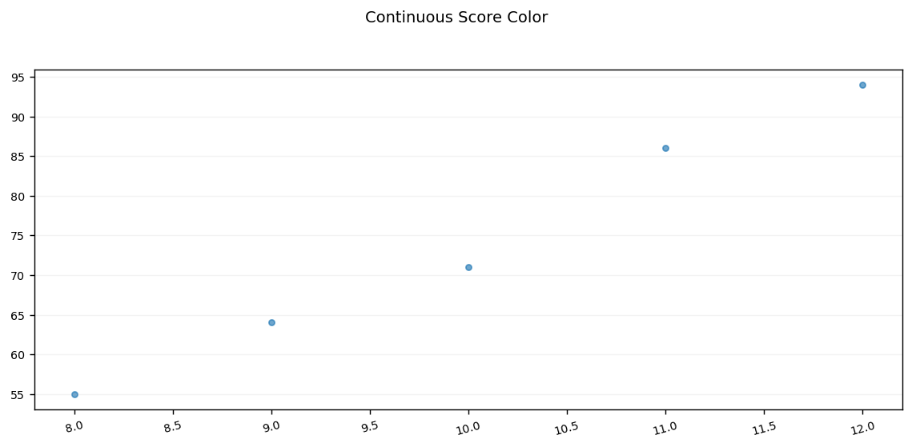

[브라우저에서 인터랙티브 결과 열기](./figures/interactive/17_color_types.html) — ZIP을 압축 해제한 뒤 HTML 파일을 브라우저에서 열어 Hover·범례·버튼을 확인합니다.

**결과 해설**

점 색이 값의 크기에 따라 변하고 색상 막대가 범위를 설명합니다.

<a id="section-7-15"></a>
## 7.15. Selecting Data Points

### 선택한 점이 곧 필터링된 DataFrame은 아닙니다

선택 도구(Box Select, Lasso Select)를 사용하면 사용자가 관심 있는 점을 드래그로 강조할 수 있습니다. 하지만 단일 HTML에서 선택 영역에 맞춰 다른 그래프의 집계까지 자동으로 다시 계산하는 것은 별도의 이벤트 처리나 애플리케이션 구조가 필요합니다. Plotly의 인터랙션과 Streamlit/Dash의 상태 연동을 구분해 두세요.

### Example 18 — Box/Lasso Selection and Limits

**문제 상황**

산점도의 특정 점들만 화면에서 선택해 살펴보고 싶습니다.

**개념 설명**

Plotly의 Modebar에는 영역 선택(Box Select)과 자유형 선택(Lasso Select)이 있습니다. `dragmode="select"`로 기본 드래그 동작을 지정할 수 있습니다. 선택은 브라우저 내의 시각적 상호작용이며, 별도 콜백이 없는 단독 HTML에서 다른 차트를 자동으로 교차 필터링하지 않습니다.

**사용 이유**

시각적으로 탐색하고 선택 범위를 확인하는 데 활용합니다.

**예제 코드 — [18_selection.py](./examples/18_selection.py)**

```python
from pathlib import Path
import pandas as pd
import numpy as np
import plotly.express as px
import plotly.graph_objects as go
from plotly.subplots import make_subplots

ROOT = Path(__file__).resolve().parents[1]
DATA = ROOT / "data"
OUT = ROOT / "figures" / "interactive"
OUT.mkdir(parents=True, exist_ok=True)

df=pd.read_csv(DATA/"support_tickets.csv").head(240)
df["ticket_index"]=np.arange(len(df))
fig=px.scatter(df,x="ticket_index",y="first_response_min",color="team",hover_name="ticket_id",
               title="Use Box Select or Lasso Select")
fig.update_layout(dragmode="select",template="plotly_white")

fig.write_html(OUT / "18_selection.html", include_plotlyjs="directory", config={"displaylogo": False, "responsive": True})
print("Example 18:", len(fig.data), "traces; HTML generated")
```

**실행 결과**

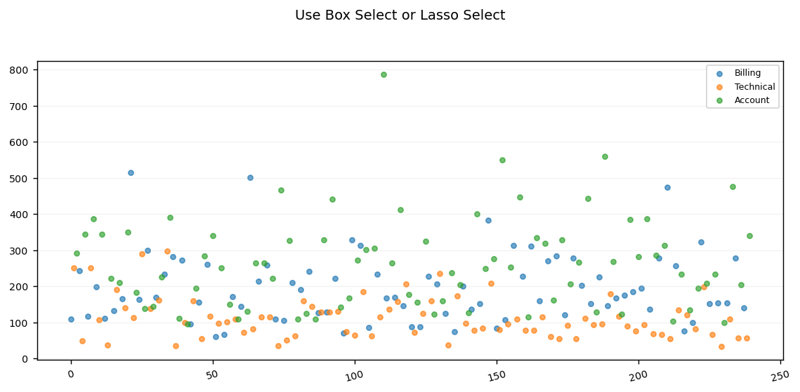

[브라우저에서 인터랙티브 결과 열기](./figures/interactive/18_selection.html) — ZIP을 압축 해제한 뒤 HTML 파일을 브라우저에서 열어 Hover·범례·버튼을 확인합니다.

**결과 해설**

기본 드래그로 점을 선택할 수 있지만 선택한 점에 맞춰 다른 그래프의 집계가 자동 변경되지는 않습니다.

<a id="section-7-16"></a>
## 7.16. Animation Frames

### Animation의 역할과 해석

시간에 따라 변하는 값을 프레임으로 구성하면 변화의 방향을 쉽게 볼 수 있습니다. Plotly의 `animation_frame`은 프레임마다 데이터를 표시하고 슬라이더로 전환합니다. 단, 축 범위가 프레임마다 달라지면 막대 높이를 공정하게 비교하기 어려우므로 동일한 범위를 유지하는 것이 유리합니다.

프레임이 너무 많거나 개별 데이터의 움직임이 복잡하면 오히려 흐름을 읽기 어려울 수 있습니다. 핵심 비교에는 정적 Small Multiples가 더 좋은 경우도 있습니다.

### Example 19 — Animation Frames

**문제 상황**

여러 주에 걸쳐 팀별 평균 최초 응답시간이 어떻게 변하는지 단계별로 보여주고 싶습니다.

**개념 설명**

`animation_frame`은 범주/시점별로 Figure에 Frame을 생성하고 슬라이더와 재생 버튼으로 전환합니다. 동일한 축 범위를 지정하지 않으면 프레임마다 스케일이 변해 비교를 오해할 수 있습니다. 각 Frame은 새로운 데이터나 원래 코드 실행을 뜻하지 않습니다.

**사용 이유**

주차별 차이를 비교하며 동일한 축을 유지합니다.

**예제 코드 — [19_animation.py](./examples/19_animation.py)**

```python
from pathlib import Path
import pandas as pd
import numpy as np
import plotly.express as px
import plotly.graph_objects as go
from plotly.subplots import make_subplots

ROOT = Path(__file__).resolve().parents[1]
DATA = ROOT / "data"
OUT = ROOT / "figures" / "interactive"
OUT.mkdir(parents=True, exist_ok=True)

df=pd.read_csv(DATA/"support_tickets.csv",parse_dates=["created_local"])
df["week"]=df.created_local.dt.to_period("W").astype(str)
grouped=df.groupby(["week","team"],as_index=False).first_response_min.mean()
fig=px.bar(grouped,x="team",y="first_response_min",animation_frame="week",
           range_y=[0,float(grouped.first_response_min.max())*1.2],
           title="Weekly Response Time (Mean)",labels={"first_response_min":"Mean Response (min)"})
fig.update_layout(template="plotly_white")

fig.write_html(OUT / "19_animation.html", include_plotlyjs="directory", config={"displaylogo": False, "responsive": True})
print("Example 19:", len(fig.data), "traces; HTML generated")
```

**실행 결과**

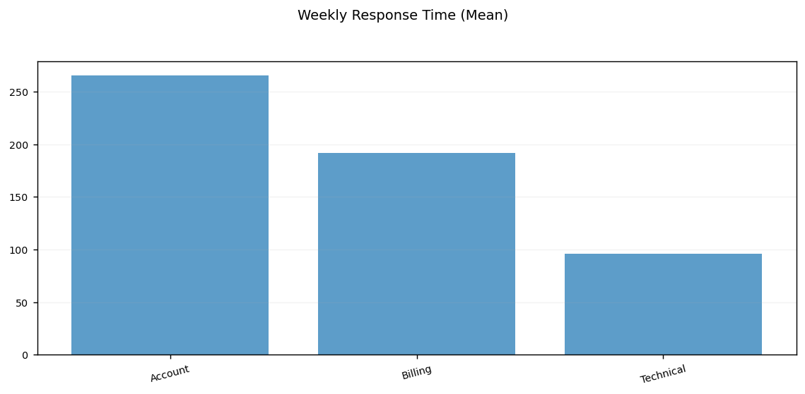

[브라우저에서 인터랙티브 결과 열기](./figures/interactive/19_animation.html) — ZIP을 압축 해제한 뒤 HTML 파일을 브라우저에서 열어 Hover·범례·버튼을 확인합니다.

**결과 해설**

재생 버튼과 주차 슬라이더로 평균값의 시간적 변화를 살펴봅니다.

<a id="section-7-17"></a>
## 7.17. Export — HTML, JSON & Offline Viewing

### HTML·JSON·PNG의 저장 목적

| 파일 | 저장하는 내용 | 인터랙션 | 주요 용도 |
|---|---|---|---|
| HTML | 그래프 데이터와 브라우저 렌더링 코드 | 가능 | 공유·탐색 |
| JSON | Figure 데이터·설정 | 그 자체로 불가 | 버전 관리·복원·검증 |
| PNG | 그려진 정적 이미지 | 불가 | 보고서·인쇄 |

이번 챕터에서는 HTML과 JSON을 중심으로 다룹니다. PNG 변환은 별도의 Kaleido 실행 환경이 필요할 수 있으므로 필수 실습에서 제외했습니다.

**파일 용량과 오프라인 실행** — `include_plotlyjs=True`는 한 HTML에 실행 코드를 모두 포함하므로 단일 파일을 다른 컴퓨터에 보내기 편합니다. `"directory"`는 같은 폴더의 JS 번들을 공유하므로 여러 HTML을 저장할 때 중복 용량을 줄입니다. `"cdn"`은 인터넷에 연결된 환경을 전제로 하므로 오프라인 학습자료와는 맞지 않을 수 있습니다. Plotly의 공식 문서에도 이 차이가 안내되어 있습니다.

### Example 20 — Offline HTML Export

**문제 상황**

보고서를 인터넷이 없는 컴퓨터에서도 브라우저로 열어야 합니다.

**개념 설명**

`include_plotlyjs=True`는 JavaScript를 HTML에 내장해 단일 파일로 만듭니다. `"directory"`는 같은 폴더의 `plotly.min.js`를 공유합니다. 반면 `"cdn"`은 파일이 작지만 인터넷 연결이 필요합니다. HTML은 브라우저에서 인터랙션을 유지하므로 PNG와 용도가 다릅니다.

**사용 이유**

수업 자료 ZIP에서는 같은 폴더에 JS를 넣는 `directory` 방식이 중복 파일 크기를 줄입니다.

**예제 코드 — [20_html_offline.py](./examples/20_html_offline.py)**

```python
from pathlib import Path
import pandas as pd
import numpy as np
import plotly.express as px
import plotly.graph_objects as go
from plotly.subplots import make_subplots

ROOT = Path(__file__).resolve().parents[1]
DATA = ROOT / "data"
OUT = ROOT / "figures" / "interactive"
OUT.mkdir(parents=True, exist_ok=True)

fig=go.Figure(go.Bar(x=["Mon","Tue","Wed"],y=[18,22,25],name="Tickets"))
fig.update_layout(template="plotly_white",title="Offline HTML Example")
fig.write_html(ROOT / "figures/interactive/20_single_file.html", include_plotlyjs=True)

fig.write_html(OUT / "20_html_offline.html", include_plotlyjs="directory", config={"displaylogo": False, "responsive": True})
print("Example 20:", len(fig.data), "traces; HTML generated")
```

**실행 결과**

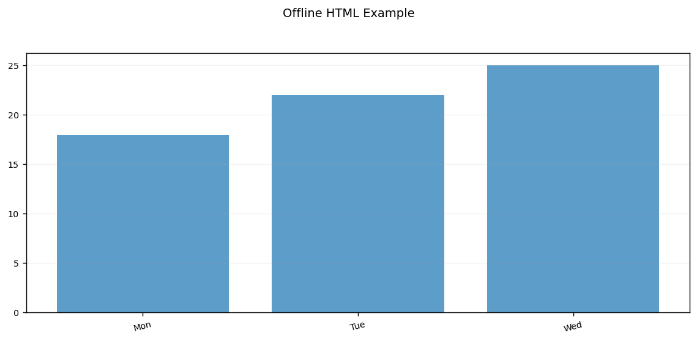

[브라우저에서 인터랙티브 결과 열기](./figures/interactive/20_html_offline.html) — ZIP을 압축 해제한 뒤 HTML 파일을 브라우저에서 열어 Hover·범례·버튼을 확인합니다.

**결과 해설**

`20_single_file.html` 하나만 다른 PC로 복사해도 그래프를 열 수 있습니다. 기본 예제 HTML도 생성됩니다.

### Example 21 — Figure JSON vs HTML

**문제 상황**

그래프의 데이터·레이아웃 설정을 파일로 저장해 나중에 검증하거나 재구성하고 싶습니다.

**개념 설명**

`fig.to_json()`/`fig.write_json()`은 Trace·Layout을 기계가 읽을 수 있는 형태로 저장합니다. 단, JSON을 브라우저에서 직접 열면 인터랙티브 차트로 렌더링되는 것이 아니라 데이터 구조가 보입니다. HTML과 JSON의 목적을 구별하세요.

**사용 이유**

테스트에서는 Trace 개수·종류·축·버튼 설정을 검사할 수 있습니다.

**예제 코드 — [21_figure_json.py](./examples/21_figure_json.py)**

```python
from pathlib import Path
import pandas as pd
import numpy as np
import plotly.express as px
import plotly.graph_objects as go
from plotly.subplots import make_subplots

ROOT = Path(__file__).resolve().parents[1]
DATA = ROOT / "data"
OUT = ROOT / "figures" / "interactive"
OUT.mkdir(parents=True, exist_ok=True)

fig=go.Figure(go.Scatter(x=["A","B","C"],y=[5,8,7],mode="lines+markers"))
fig.update_layout(title="Figure JSON",template="plotly_white")
fig.write_json(ROOT / "figures/interactive/21_figure.json")
restored=__import__("plotly.io", fromlist=["from_json"]).from_json(fig.to_json())
assert len(restored.data)==1

fig.write_html(OUT / "21_figure_json.html", include_plotlyjs="directory", config={"displaylogo": False, "responsive": True})
print("Example 21:", len(fig.data), "traces; HTML generated")
```

**실행 결과**

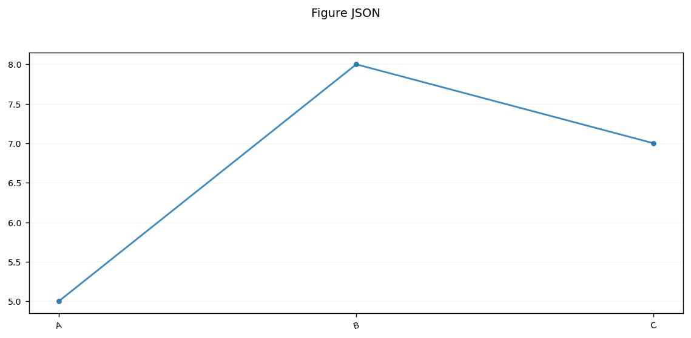

[브라우저에서 인터랙티브 결과 열기](./figures/interactive/21_figure_json.html) — ZIP을 압축 해제한 뒤 HTML 파일을 브라우저에서 열어 Hover·범례·버튼을 확인합니다.

**결과 해설**

JSON 파일이 저장되고 다시 생성한 Figure에 Trace 하나가 존재합니다.

<a id="section-7-18"></a>
## 7.18. Performance, Accessibility & Chart Design

### 많은 데이터를 표현한다고 좋은 그래프가 되는 것은 아닙니다

수천 개 이상 점이 겹치면 브라우저 렌더링이 느려지고 사용자가 중요한 구조를 놓칠 수 있습니다. WebGL 기반 Scattergl은 대량의 점에 유용할 수 있지만, 컴퓨터·브라우저·도형 종류에 따라 결과가 다릅니다. 대량 데이터는 필요하다면 요약하거나 표본 추출하고, 정보 손실과 표본 기준을 함께 설명해야 합니다.

**접근성 체크:** 색만으로 구별하기보다 축 제목, 단위, 범례, Hover, 설명문을 함께 제공합니다. 브라우저에 의존하는 Hover 정보만으로 핵심 결론을 전달하지 마세요. 화면을 볼 수 없거나 인터랙션을 사용하기 어려운 학습자도 요약표로 핵심 결과를 확인할 수 있도록 구성하는 것이 좋습니다.

### Example 22 — WebGL Scatter and Usability

**문제 상황**

수천 개 이상의 점을 그릴 때 브라우저가 느려질 수 있습니다.

**개념 설명**

WebGL 기반 Trace(`Scattergl`)는 대량의 점 렌더링에 유용할 수 있습니다. Plotly Express의 `render_mode="webgl"`로 사용할 수 있습니다. 그러나 항상 빠르다는 보장은 없고 브라우저·장치, 접근성, 이미지 내보내기 등 사용 조건을 확인해야 합니다.

**사용 이유**

데이터를 무작정 전부 표시하기보다 분석 질문에 맞춰 표본 추출·집계를 고려합니다.

**예제 코드 — [22_scattergl_performance.py](./examples/22_scattergl_performance.py)**

```python
from pathlib import Path
import pandas as pd
import numpy as np
import plotly.express as px
import plotly.graph_objects as go
from plotly.subplots import make_subplots

ROOT = Path(__file__).resolve().parents[1]
DATA = ROOT / "data"
OUT = ROOT / "figures" / "interactive"
OUT.mkdir(parents=True, exist_ok=True)

rng=np.random.default_rng(51)
n=4000
data=pd.DataFrame({"x":rng.normal(size=n),"y":rng.normal(size=n)})
fig=px.scatter(data,x="x",y="y",render_mode="webgl",
               title="4000 Points with Scattergl")
fig.update_layout(template="plotly_white")

fig.write_html(OUT / "22_scattergl_performance.html", include_plotlyjs="directory", config={"displaylogo": False, "responsive": True})
print("Example 22:", len(fig.data), "traces; HTML generated")
```

**실행 결과**

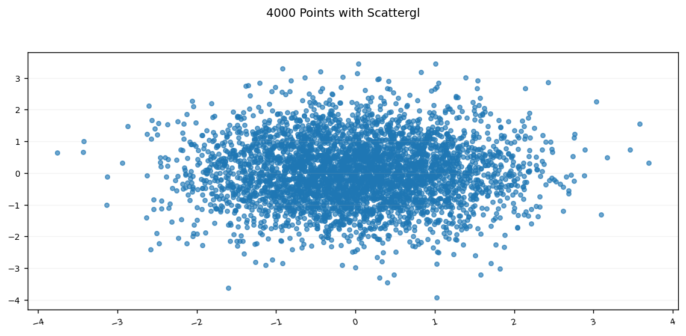

[브라우저에서 인터랙티브 결과 열기](./figures/interactive/22_scattergl_performance.html) — ZIP을 압축 해제한 뒤 HTML 파일을 브라우저에서 열어 Hover·범례·버튼을 확인합니다.

**결과 해설**

`fig.data[0].type`은 `scattergl`입니다. 대량의 점이 브라우저에서 렌더링됩니다.

<a id="section-7-19"></a>
## 7.19. Interactive Visualization Checklist

다음 항목은 그래프 작성 후 반드시 확인하는 체크리스트입니다.

- 데이터의 출처·단위·관측 단위(Grain)·시간대가 명시돼 있습니까?
- Hover에 표시한 값과 그래프의 축 값이 같은 관측을 가리킵니까?
- 범례나 드롭다운으로 숨긴 Trace가 데이터 삭제를 의미하지 않는다는 점이 명확합니까?
- 날짜 Range Slider로 보이는 기간이 변해도 고정된 요약 숫자에 오해의 여지가 없습니까?
- 실제 0과 미관측값이 구별되고, 필요한 경우 누락된 시간 슬롯을 복원했습니까?
- Subplot의 축 단위와 Trace 배치를 확인했습니까?
- HTML 저장 시 `plotly.min.js` 또는 내장 JS가 있어 오프라인에서 열립니까?
- HTML 안에 공유하면 안 되는 데이터가 포함돼 있지 않습니까?
- 실제 사용자가 보고 싶은 질문을 그래프에서 답할 수 있습니까?

<details>
<summary><strong>추가 설명 — Plotly로 모든 필터링을 해결할 수 있을까요?</strong></summary>

아닙니다. Plotly `updatemenus`는 이미 만들어진 Trace를 표시하거나 속성을 바꾸는 데 적합합니다. 입력값에 맞춰 Python의 통계를 새로 계산하고 여러 그래프·표를 함께 업데이트하는 기능은 이후 Chapter 08의 Streamlit에서 다루는 편이 자연스럽습니다.

</details>

<a id="section-7-20"></a>
## 7.20. Mini Project 01 — Retail Sales Interactive Explorer

**문제 상황**

매장별 총매출과 일별 매출 추이를 동시에 확인하고 싶은 매장 담당자가 직접 범례와 기간을 조작할 수 있는 보고서가 필요합니다.

**입력 데이터:** [`retail_sales.csv`](./data/retail_sales.csv)

**완료 목표**

1. 매장별 총매출 합계를 계산한 뒤 가로 막대그래프로 표시합니다.
2. 일별 매출을 매장별 색으로 구분한 선 그래프로 표시합니다.
3. Hover에서 날짜·금액을 확인하고, Range Slider와 범례를 사용할 수 있어야 합니다.
4. 집계 전후 총매출 합계가 일치하는지 검증합니다.
5. 오프라인 HTML과 JSON 요약을 생성하고 원본 CSV를 유지합니다.

**시작 코드:** [`projects/mini_01_sales/starter.py`](./projects/mini_01_sales/starter.py) · **과제 상세:** [`TASK.md`](./projects/mini_01_sales/TASK.md)

**목표 결과물 미리보기**

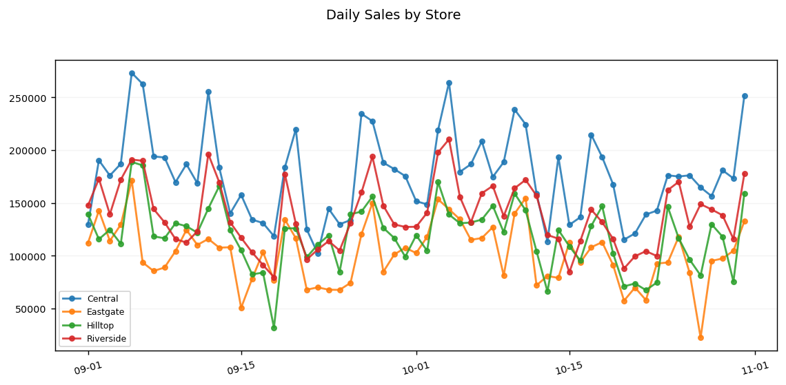

[완성 결과 인터랙티브 HTML 보기](./figures/interactive/23_mini_sales.html) — 구현 목표를 확인하는 용도이며 전체 정답 코드는 README에 공개하지 않습니다.

**참고 데이터 요약:** 총매출 32,734,600원 · 매장 4곳 · 관측 날짜 61일

**검증 방법** — 집계 수치를 직접 확인하고, HTML에서 Hover·범례·기간 선택을 조작한 뒤, `python -m unittest discover -s tests -v`를 실행합니다. 완성 구현은 문제를 푼 뒤 별도의 `solutions/`를 참고하세요.

<a id="section-7-21"></a>
## 7.21. Mini Project 02 — Service Latency Report

**문제 상황**

서비스 3개의 응답시간과 오류율을 비교하고, 특정 기간에 발생한 성능 저하를 시각적으로 조사하려고 합니다.

**입력 데이터:** [`service_metrics.csv`](./data/service_metrics.csv)

**완료 목표**

1. 15분 간격 관측의 원본 UTC 시각을 검사하고 중복을 탐지합니다.
2. 구간별 P95 지연시간과 해당 구간 요청 대비 오류율을 서로 다른 패널로 표시합니다.
3. 구간별 P95의 평균을 전체 요청 P95라고 표현하지 않습니다.
4. 측정이 없는 15분 슬롯은 0으로 대체하지 않고 선을 끊어 표시합니다.
5. 500ms 기준선·범례·날짜 범위 선택을 제공하고 HTML로 저장합니다.

**시작 코드:** [`projects/mini_02_service/starter.py`](./projects/mini_02_service/starter.py) · **과제 상세:** [`TASK.md`](./projects/mini_02_service/TASK.md)

**목표 결과물 미리보기**

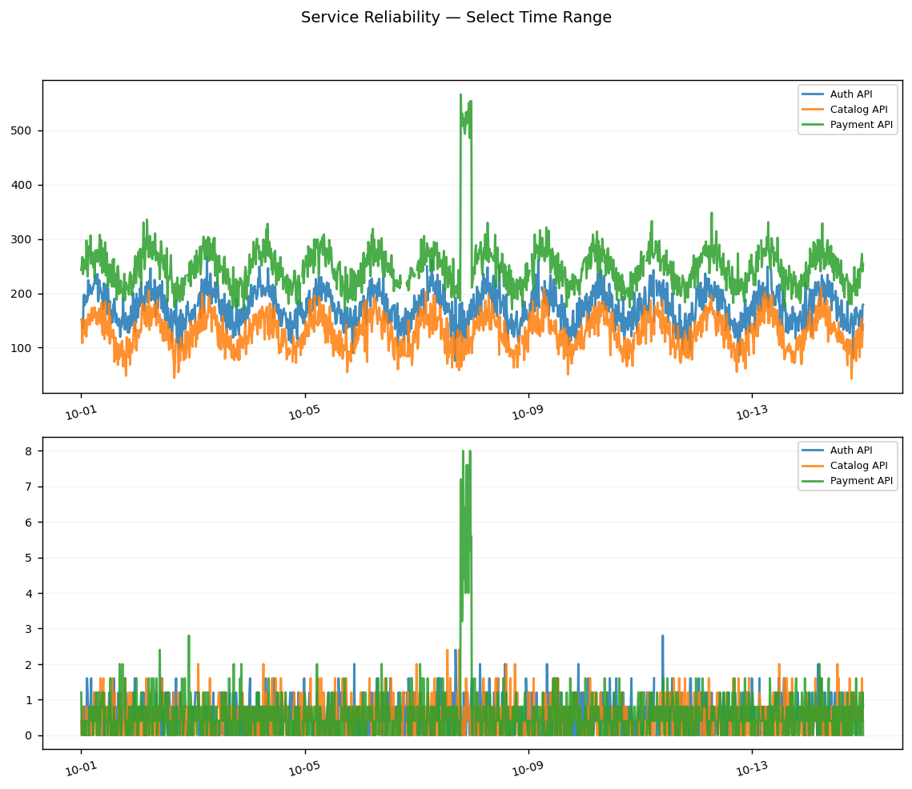

[완성 결과 인터랙티브 HTML 보기](./figures/interactive/24_mini_service.html) — 구현 목표를 확인하는 용도이며 전체 정답 코드는 README에 공개하지 않습니다.

**참고 데이터 요약:** 서비스 3개 · 유효 15분 관측 3,966행

**검증 방법** — 집계 수치를 직접 확인하고, HTML에서 Hover·범례·기간 선택을 조작한 뒤, `python -m unittest discover -s tests -v`를 실행합니다. 완성 구현은 문제를 푼 뒤 별도의 `solutions/`를 참고하세요.

<a id="section-7-22"></a>
## 7.22. Mini Project 03 — Support Response Explorer

**문제 상황**

고객문의 최초 응답시간이 어느 팀과 우선순위에서 길게 나타나는지 확인해야 합니다.

**입력 데이터:** [`support_tickets.csv`](./data/support_tickets.csv)

**완료 목표**

1. 문의 ID의 유일성 및 음수·문자열 측정 오류를 검사합니다.
2. 팀·우선순위별 Box Plot으로 분포를 비교합니다.
3. 응답시간 Histogram을 추가하고 범례로 팀별 분포를 선택합니다.
4. 평균만 제시하지 말고 중앙값과 관측 건수를 함께 요약합니다.
5. 오프라인 HTML 두 개와 숫자 요약을 저장합니다.

**시작 코드:** [`projects/mini_03_support/starter.py`](./projects/mini_03_support/starter.py) · **과제 상세:** [`TASK.md`](./projects/mini_03_support/TASK.md)

**목표 결과물 미리보기**

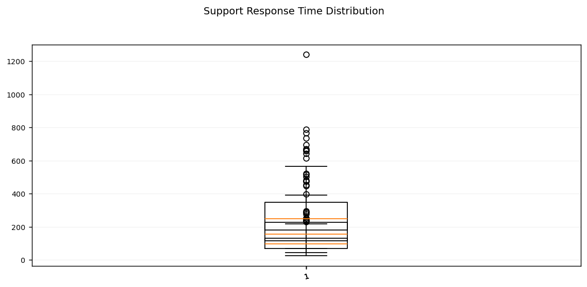

[완성 결과 인터랙티브 HTML 보기](./figures/interactive/25_mini_support.html) — 구현 목표를 확인하는 용도이며 전체 정답 코드는 README에 공개하지 않습니다.

**참고 데이터 요약:** 문의 720건 · 최초 응답시간 중앙값 156분

**검증 방법** — 집계 수치를 직접 확인하고, HTML에서 Hover·범례·기간 선택을 조작한 뒤, `python -m unittest discover -s tests -v`를 실행합니다. 완성 구현은 문제를 푼 뒤 별도의 `solutions/`를 참고하세요.

<a id="section-7-23"></a>
## 7.23. Coding Practice — 18 Exercises

이 Section은 앞에서 배운 개념을 **일부 작성된 코드를 완성하는 방식**으로 연습합니다. 요구사항과 시작 코드가 주어지고, 학습자가 TODO를 완성합니다. 문제를 처음부터 통째로 작성할 필요는 없지만 핵심 기능은 직접 구현해야 합니다.

README에서는 정답을 공개하지 않습니다. 정답 코드는 `solutions/`의 같은 번호 파일에 있습니다. 시작 코드에는 학습할 부분을 나타내기 위해 `NotImplementedError`가 포함될 수 있으며, 완성 전 오류가 발생하는 것은 정상입니다.

```bash
python exercises/01_hover_name.py
# 문제 구현 후 실행
python solutions/01_hover_name.py
```

### Coding Practice 01 — Hover Name

**문제 상황:** 매장별 매출 점에 커서를 올렸을 때 매장명을 제목으로 표시합니다.

**요구사항:** `px.scatter()`에 매장명을 강조하는 Hover 속성을 지정하세요.

**시작 코드 — [01_hover_name.py](./exercises/01_hover_name.py)**

```python
df = pd.read_csv(DATA / 'retail_sales.csv').head(50)
# TODO: use x='units', y='revenue_krw', and hover_name='store'
raise NotImplementedError
```

**검증 기준:** 요구한 Figure 구성·Trace/축/속성을 확인합니다. 파일 저장 문제는 출력 파일이 실제로 존재하는지 확인합니다.

### Coding Practice 02 — Categorical Color

**문제 상황:** 상품 분류별로 산점도의 색을 구별합니다.

**요구사항:** `category`로 범주형 색상을 부여하세요.

**시작 코드 — [02_category_color.py](./exercises/02_category_color.py)**

```python
df = pd.read_csv(DATA / 'retail_sales.csv').head(80)
# TODO: color='category'
raise NotImplementedError
```

**검증 기준:** 요구한 Figure 구성·Trace/축/속성을 확인합니다. 파일 저장 문제는 출력 파일이 실제로 존재하는지 확인합니다.

### Coding Practice 03 — Hover Template

**문제 상황:** 금액을 천 단위 구분자로 표시합니다.

**요구사항:** 금액을 `%{y:,.0f}`로 포맷하고 `<extra></extra>`를 추가하세요.

**시작 코드 — [03_hover_template.py](./exercises/03_hover_template.py)**

```python
fig=go.Figure(go.Scatter(x=['A','B'],y=[12000,18500],mode='markers'))
# TODO: call update_traces(hovertemplate=...)
return fig
```

**검증 기준:** 요구한 Figure 구성·Trace/축/속성을 확인합니다. 파일 저장 문제는 출력 파일이 실제로 존재하는지 확인합니다.

### Coding Practice 04 — Legend Toggle

**문제 상황:** 두 서비스 지연시간을 범례로 구별합니다.

**요구사항:** Trace마다 `name=`을 지정하고 두 Trace를 구성하세요.

**시작 코드 — [04_legend_toggle.py](./exercises/04_legend_toggle.py)**

```python
fig=go.Figure()
hours=['09:00','10:00','11:00']
# TODO: add two named line traces for API-A [120,150,130], API-B [180,170,190]
return fig
```

**검증 기준:** 요구한 Figure 구성·Trace/축/속성을 확인합니다. 파일 저장 문제는 출력 파일이 실제로 존재하는지 확인합니다.

### Coding Practice 05 — Missing Observation

**문제 상황:** 11시 측정이 없을 때 선이 연결되지 않도록 해야 합니다.

**요구사항:** 시간 인덱스를 복원하고 결측 시각을 `NaN`으로 남기세요.

**시작 코드 — [05_missing_gap.py](./exercises/05_missing_gap.py)**

```python
observed=pd.Series([10,0,18],index=pd.to_datetime(['2026-10-01 09:00','2026-10-01 10:00','2026-10-01 12:00']))
# TODO: reindex 09:00–12:00 hourly and set connectgaps=False
raise NotImplementedError
```

**검증 기준:** 요구한 Figure 구성·Trace/축/속성을 확인합니다. 파일 저장 문제는 출력 파일이 실제로 존재하는지 확인합니다.

### Coding Practice 06 — Range Slider

**문제 상황:** 날짜 축에서 관찰할 기간을 직접 선택합니다.

**요구사항:** 날짜 축의 Range Slider를 활성화하세요.

**시작 코드 — [06_range_slider.py](./exercises/06_range_slider.py)**

```python
df=pd.read_csv(DATA/'retail_sales.csv',parse_dates=['date'])
daily=df.groupby('date',as_index=False).revenue_krw.sum()
fig=px.line(daily,x='date',y='revenue_krw')
# TODO: update_xaxes(...)
return fig
```

**검증 기준:** 요구한 Figure 구성·Trace/축/속성을 확인합니다. 파일 저장 문제는 출력 파일이 실제로 존재하는지 확인합니다.

### Coding Practice 07 — Date Range Buttons

**문제 상황:** 날짜 그래프에 7일과 전체 기간 버튼을 추가합니다.

**요구사항:** `rangeselector`의 `buttons`에 7d와 All을 구성하세요.

**시작 코드 — [07_range_buttons.py](./exercises/07_range_buttons.py)**

```python
fig=go.Figure(go.Scatter(x=pd.date_range('2026-10-01',periods=20),y=list(range(20))))
# TODO: add a 7d and All rangeselector
return fig
```

**검증 기준:** 요구한 Figure 구성·Trace/축/속성을 확인합니다. 파일 저장 문제는 출력 파일이 실제로 존재하는지 확인합니다.

### Coding Practice 08 — Dropdown Visibility

**문제 상황:** 버튼으로 매장 A·B·C 중 하나만 표시합니다.

**요구사항:** 드롭다운 버튼의 `visible` 배열 길이를 Trace 개수와 일치시키세요.

**시작 코드 — [08_dropdown.py](./exercises/08_dropdown.py)**

```python
fig=go.Figure()
for name,values in [('A',[5,8]),('B',[7,6]),('C',[9,10])]:
    fig.add_trace(go.Scatter(x=[1,2],y=values,name=name))
# TODO: one button per trace with matching visible array
return fig
```

**검증 기준:** 요구한 Figure 구성·Trace/축/속성을 확인합니다. 파일 저장 문제는 출력 파일이 실제로 존재하는지 확인합니다.

### Coding Practice 09 — Restyle Mode

**문제 상황:** 선 그래프를 선+점 그래프로 전환하는 버튼을 구현합니다.

**요구사항:** `method="restyle"`을 사용해 `mode`를 변경하세요.

**시작 코드 — [09_restyle.py](./exercises/09_restyle.py)**

```python
fig=go.Figure(go.Scatter(x=[1,2,3],y=[3,2,4],mode='lines'))
# TODO: add two buttons for lines vs lines+markers
return fig
```

**검증 기준:** 요구한 Figure 구성·Trace/축/속성을 확인합니다. 파일 저장 문제는 출력 파일이 실제로 존재하는지 확인합니다.

### Coding Practice 10 — Subplot Placement

**문제 상황:** 방문자 그래프는 왼쪽, 매출 그래프는 오른쪽에 표시합니다.

**요구사항:** `row=1, col=1`과 `row=1, col=2`를 정확하게 지정하세요.

**시작 코드 — [10_subplot.py](./exercises/10_subplot.py)**

```python
fig=make_subplots(rows=1,cols=2)
# TODO: left bar [10,20]; right scatter [80,90]
return fig
```

**검증 기준:** 요구한 Figure 구성·Trace/축/속성을 확인합니다. 파일 저장 문제는 출력 파일이 실제로 존재하는지 확인합니다.

### Coding Practice 11 — Facet Wrap

**문제 상황:** 팀별 응답시간을 별도의 작은 그래프로 나눕니다.

**요구사항:** `facet_col="team"`과 `facet_col_wrap=2`를 사용하세요.

**시작 코드 — [11_facet.py](./exercises/11_facet.py)**

```python
df=pd.read_csv(DATA/'support_tickets.csv').head(120)
# TODO: facet by team with two columns
raise NotImplementedError
```

**검증 기준:** 요구한 Figure 구성·Trace/축/속성을 확인합니다. 파일 저장 문제는 출력 파일이 실제로 존재하는지 확인합니다.

### Coding Practice 12 — Aggregate Before Bar

**문제 상황:** 상품 분류별 총매출을 하나의 막대로 비교합니다.

**요구사항:** `groupby()`로 합계를 구한 뒤 `px.bar()`로 표시하세요.

**시작 코드 — [12_sum_first.py](./exercises/12_sum_first.py)**

```python
df=pd.read_csv(DATA/'retail_sales.csv')
# TODO: aggregate by category, then make a bar figure
raise NotImplementedError
```

**검증 기준:** 요구한 Figure 구성·Trace/축/속성을 확인합니다. 파일 저장 문제는 출력 파일이 실제로 존재하는지 확인합니다.

### Coding Practice 13 — Histogram Bins

**문제 상황:** 응답시간의 구간 수를 지정합니다.

**요구사항:** `nbins=20`인 히스토그램을 생성하세요.

**시작 코드 — [13_histogram_bins.py](./exercises/13_histogram_bins.py)**

```python
df=pd.read_csv(DATA/'support_tickets.csv')
# TODO: create histogram of first_response_min with 20 approximate bins
raise NotImplementedError
```

**검증 기준:** 요구한 Figure 구성·Trace/축/속성을 확인합니다. 파일 저장 문제는 출력 파일이 실제로 존재하는지 확인합니다.

### Coding Practice 14 — Group Box Plot

**문제 상황:** 팀별 응답시간의 중앙값과 이상값을 비교합니다.

**요구사항:** X축 `team`, Y축 `first_response_min`인 Box Plot을 생성하세요.

**시작 코드 — [14_box_by_group.py](./exercises/14_box_by_group.py)**

```python
df=pd.read_csv(DATA/'support_tickets.csv')
# TODO: box plot grouped by team
raise NotImplementedError
```

**검증 기준:** 요구한 Figure 구성·Trace/축/속성을 확인합니다. 파일 저장 문제는 출력 파일이 실제로 존재하는지 확인합니다.

### Coding Practice 15 — Sales Heatmap

**문제 상황:** 매장×상품분류 매출 합계를 Heatmap으로 표시합니다.

**요구사항:** `pivot_table()`로 요약하고 `px.imshow()`로 표현하세요.

**시작 코드 — [15_heatmap.py](./exercises/15_heatmap.py)**

```python
df=pd.read_csv(DATA/'retail_sales.csv')
# TODO: pivot sum revenue and use a heatmap
raise NotImplementedError
```

**검증 기준:** 요구한 Figure 구성·Trace/축/속성을 확인합니다. 파일 저장 문제는 출력 파일이 실제로 존재하는지 확인합니다.

### Coding Practice 16 — Continuous Color

**문제 상황:** 센서 점수의 크기를 연속 색상으로 표현합니다.

**요구사항:** `score`를 색상으로 지정하고 색상 막대를 유지하세요.

**시작 코드 — [16_continuous_color.py](./exercises/16_continuous_color.py)**

```python
df=pd.DataFrame({'hour':[9,10,11,12],'score':[50,65,80,95]})
# TODO: scatter with color by score
raise NotImplementedError
```

**검증 기준:** 요구한 Figure 구성·Trace/축/속성을 확인합니다. 파일 저장 문제는 출력 파일이 실제로 존재하는지 확인합니다.

### Coding Practice 17 — Select Mode

**문제 상황:** 마우스 드래그로 여러 점을 선택하는 모드를 기본으로 설정합니다.

**요구사항:** Layout에 `dragmode="select"`를 지정하세요.

**시작 코드 — [17_select_mode.py](./exercises/17_select_mode.py)**

```python
fig=go.Figure(go.Scatter(x=[1,2,3,4],y=[5,8,6,9],mode='markers'))
# TODO: configure the selection drag mode
return fig
```

**검증 기준:** 요구한 Figure 구성·Trace/축/속성을 확인합니다. 파일 저장 문제는 출력 파일이 실제로 존재하는지 확인합니다.

### Coding Practice 18 — Offline File Export

**문제 상황:** 인터넷 없이 열리는 HTML을 출력 폴더에 저장합니다.

**요구사항:** `include_plotlyjs=True`로 단일 HTML 파일을 생성하고 경로를 반환하세요.

**시작 코드 — [18_html_export.py](./exercises/18_html_export.py)**

```python
fig=go.Figure(go.Bar(x=['A','B'],y=[3,7]))
output=ROOT/'output/practice_18.html'
output.parent.mkdir(parents=True,exist_ok=True)
# TODO: export self-contained offline HTML to output
raise NotImplementedError
```

**검증 기준:** 요구한 Figure 구성·Trace/축/속성을 확인합니다. 파일 저장 문제는 출력 파일이 실제로 존재하는지 확인합니다.

<a id="section-7-24"></a>
## 7.24. Advanced Project 01 — Regional Electricity Demand Explorer

### 문제 상황

전력 수요 관측 시스템은 지역 4곳에서 매시간 수치를 기록합니다. 여러 지역을 한 화면에서 비교하는 데서 그치지 않고, **기록 누락·중복·잘못된 값**을 검사한 뒤 사용자가 지역을 선택해 추세와 시간대별 평균을 탐색할 수 있어야 합니다.

이번 과제는 고난도 **선택적 심화 프로젝트**입니다.

**데이터:** [`regional_energy_hourly.csv`](./data/regional_energy_hourly.csv), [`energy_regions.json`](./data/energy_regions.json)

### 필수 요구사항

1. 필수 열과 날짜를 확인하고, UTC에서 KST로 변환한 뒤 분석 날짜 범위 안에 들어오는지 검사합니다.
2. 미등록 지역, 음수 전력 수요, 숫자가 아닌 측정값, 지역·시각 중복 기록은 사유를 기록해 제외합니다. **중복된 두 행 중 하나를 임의 선택하지 않습니다.**
3. 지역별로 2026년 9월 1일부터 10월 5일까지의 예정 시간 슬롯을 복원합니다. 누락된 시간의 전력 수요는 `NaN`으로 유지합니다.
4. 위쪽 패널에는 시간에 따른 지역별 전력 수요(kW), 아래쪽 패널에는 지역별 시간대 평균 수요(kW)를 표시합니다.
5. 지역 선택 드롭다운에는 전체 지역과 개별 지역 옵션이 있어야 합니다. 지역을 선택하면 위·아래 두 패널에서 **같은 지역의 Trace**가 표시되어야 합니다.
6. 위쪽 날짜 축에는 Range Slider를 사용하고, 아래쪽 그래프는 시간(0–23시)을 독립된 X축으로 사용합니다.
7. 오프라인 HTML과 누락 슬롯 목록·제외 기록·수집률 JSON을 생성합니다.
8. 지역을 1곳, 2곳, 4곳으로 선택해도 Trace 개수와 버튼 동작이 올바른지 확인합니다.

**주의:** `demand_kw`는 순간 전력(kW)이지 전력 사용량(kWh)이 아닙니다. 이 파일에서 시간별 관측값을 단순 합산해 소비 전력량이라고 표현하지 않습니다.

### 시작 코드 및 결과물

- [Advanced 01 — TASK.md](./projects/advanced_01_energy/TASK.md)
- [Advanced 01 — starter.py](./projects/advanced_01_energy/starter.py)
- [실습 데이터 정의](./data/DATA_DICTIONARY.md)

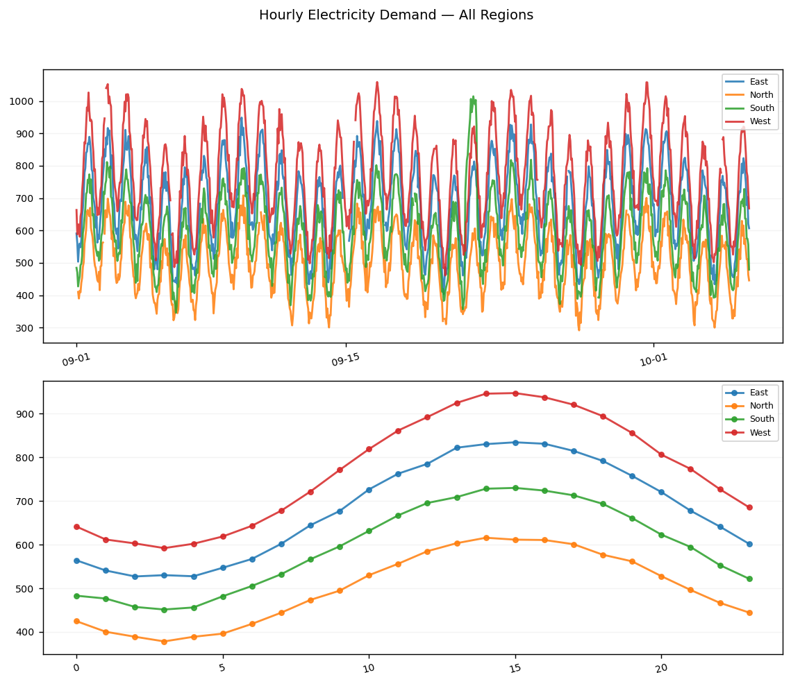

[인터랙티브 보고서 결과 예시](./figures/interactive/26_advanced_energy.html)

**기준 출력(제공 데이터):** 예정 슬롯 3,360개, 유효 관측 3,336개, 제외 기록 8행, 누락 슬롯 24개. 입력값을 변경한 뒤에도 프로그램이 올바르게 동작해야 합니다.

<details>
<summary><strong>Hint 01 — 데이터 검증</strong></summary>

지역과 UTC 시각의 조합을 중복 키로 사용합니다. 관측소 목록과 시각 범위를 먼저 정의한 후 원본 레코드를 검사합니다.

</details>

<details>
<summary><strong>Hint 02 — 미관측 슬롯</strong></summary>

`pd.date_range()`와 `MultiIndex.from_product()`를 이용해 예상되는 지역·시각 조합을 만듭니다. 실제 데이터와 결합한 뒤 값이 없는 곳을 결측으로 유지합니다.

</details>

<details>
<summary><strong>Hint 03 — Plotly Trace 구성</strong></summary>

지역별로 두 개의 Trace를 넣는 경우, 드롭다운에서 같은 지역의 두 Trace를 동시에 켜야 합니다. Trace 번호를 미리 기록해 두면 `visible` 배열을 생성하기 쉽습니다.

</details>

**검증 기준:** `python -m unittest discover -s tests -v`에서 정상·오류·누락·지역 변경 테스트를 확인하세요. 문제를 충분히 시도한 뒤 모범 구현 및 설계 해설을 별도로 확인할 수 있습니다.

<a id="section-7-25"></a>
## 7.25. Quiz — Visual Code Reading, Debugging & Completion

Quiz는 복잡한 수수께끼가 아니라, **화면을 잘못 읽거나 코드의 매개변수를 혼동하기 쉬운 상황**을 확인하도록 구성했습니다. 이미지 객관식은 모두 비슷한 그래프 네 개 중 **실제 코드가 만드는 결과**를 판별하는 방식입니다. 작성형 문제는 전체 프로그램이 아니라 필요한 일부 코드를 완성합니다.

문항마다 **정답과 해설을 별도로 펼쳐 확인**할 수 있습니다. 이미지 선택지의 색상·글꼴은 정적 교육용 도식이고, 핵심 판별 기준인 축·값·배치·연결 방식은 제시한 Plotly 코드에 맞춰 제작했습니다.

### Q01. Plotly Figure의 Trace와 Layout을 바르게 구별한 것은?

A. Trace는 축 제목이고 Layout은 데이터 포인트임
B. Trace는 개별 데이터 표현이고 Layout은 전체 그래프 설정임
C. 둘 다 파일 저장 옵션임
D. Trace와 Layout은 항상 같은 객체임

<details>
<summary><strong>Q01. 정답 및 해설 확인</strong></summary>

**정답: B**

Trace에는 Scatter·Bar 등 데이터 표현이 포함되고, Layout은 제목·축·범례·버튼 등의 속성을 담습니다. `fig.add_trace()`와 `fig.update_layout()`을 구분해 보세요.

**예제 코드 / 핵심 확인 코드**

```python
fig.add_trace(go.Bar(x=["A"], y=[4]))
fig.update_layout(title="Sales")
```

</details>

### Q02. Plotly Express와 Graph Objects에 관한 설명 중 옳은 것은?

A. Express는 이미지를 저장할 수 없음
B. Graph Objects는 드롭다운을 사용할 수 없음
C. 둘 다 Plotly Figure를 생성하며 Graph Objects는 Trace 세부 구성이 편리함
D. Express는 HTML에 저장할 수 없음

<details>
<summary><strong>Q02. 정답 및 해설 확인</strong></summary>

**정답: C**

두 API는 같은 Figure 체계를 사용합니다. 간단한 DataFrame 시각화에는 Express, 세밀한 Trace 배치에는 Graph Objects가 편리합니다.

**예제 코드 / 핵심 확인 코드**

```python
fig = px.bar(df, x="store", y="revenue")
fig.update_layout(title="Sales")
```

</details>

### Q03. 다음 코드에서 날짜를 Hover에 추가하려면 어느 부분을 완성해야 할까?

```python
fig = px.scatter(df, x="units", y="revenue_krw",
                 hover_data=______)
```
A. `"date"`
B. `["date"]`
C. `df.index`만 가능
D. `fig.show()`

<details>
<summary><strong>Q03. 정답 및 해설 확인</strong></summary>

**정답: B**

`hover_data`에 보조 정보를 보여줄 열 이름의 목록을 지정합니다. `hover_name`과 용도가 다릅니다.

**예제 코드 / 핵심 확인 코드**

```python
fig = px.scatter(df, x="units", y="revenue_krw", hover_data=["date"])
```

</details>

### Q04. 다음 코드 실행 결과에 해당하는 그래프를 고르시오.

```python
fig = go.Figure(go.Scatter(
    x=[0, 1, 2, 3], y=[4, 0, None, 7],
    mode="lines+markers", connectgaps=False
))
```
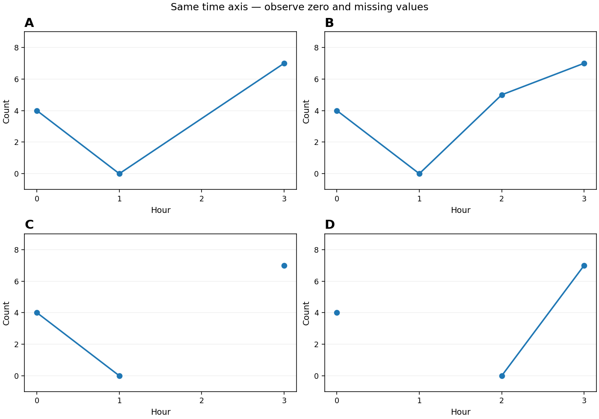

<details>
<summary><strong>Q04. 정답 및 해설 확인</strong></summary>

**정답: C**

x=1의 값은 실제 0이며 x=2는 미측정 상태입니다. `connectgaps=False`이므로 x=1에서 x=3으로 선이 직접 연결되지 않습니다. A는 누락을 가로질러 연결한 그림이고 B는 누락을 값으로 대체했으며 D는 결측 위치가 다릅니다.

**예제 코드 / 핵심 확인 코드**

```python
go.Scatter(x=[0,1,2,3],y=[4,0,None,7],connectgaps=False,mode="lines+markers")
```

</details>

### Q05. 범례에서 매장 A를 클릭하면 기본적으로 어떤 일이 일어나는가?

A. 원본 CSV의 매장 A 데이터가 삭제됨
B. 화면에서 매장 A Trace가 숨겨지거나 다시 나타남
C. 다른 Trace가 모두 재집계됨
D. Python 코드가 서버에서 다시 실행됨

<details>
<summary><strong>Q05. 정답 및 해설 확인</strong></summary>

**정답: B**

Plotly 단독 HTML에서 범례 클릭은 해당 Trace의 표시 상태를 변경합니다. 파일·DataFrame을 변경하는 동작은 아닙니다.

**예제 코드 / 핵심 확인 코드**

```python
fig = px.line(daily, x="date", y="revenue_krw", color="store")
```

</details>

### Q06. 드롭다운에서 3개 Trace 중 두 번째만 표시하려면 어느 `visible`이 맞을까?

```python
fig.add_trace(...)  # A
fig.add_trace(...)  # B
fig.add_trace(...)  # C
```
A. `[False, True]`
B. `[True, False, True]`
C. `[False, True, False]`
D. `[1]`

<details>
<summary><strong>Q06. 정답 및 해설 확인</strong></summary>

**정답: C**

Trace 개수만큼 불리언이 필요합니다. 두 번째 Trace만 표시하므로 `[False, True, False]`가 됩니다.

**예제 코드 / 핵심 확인 코드**

```python
dict(label="B", method="update", args=[{"visible": [False, True, False]}])
```

</details>

### Q07. 날짜 Range Slider로 7일을 선택했을 때 올바른 설명은?

A. 나머지 날짜 행이 원본 CSV에서 삭제됨
B. 전체 매출 합계가 선택 구간으로 자동 재계산됨
C. 그래프 X축의 표시 범위가 변경됨
D. 결측값이 모두 0으로 바뀜

<details>
<summary><strong>Q07. 정답 및 해설 확인</strong></summary>

**정답: C**

Range Slider는 X축의 화면 범위를 조절합니다. 별도의 집계 갱신 로직을 추가하지 않은 HTML에서는 전체 합계가 자동으로 재계산되지 않습니다.

**예제 코드 / 핵심 확인 코드**

```python
fig.update_xaxes(rangeslider_visible=True)
```

</details>

### Q08. 다음 Bar 코드로 만들어지는 그래프를 고르시오.

```python
fig = go.Figure(go.Bar(
    x=["A", "B", "C"], y=[4, 7, 3]
))
```
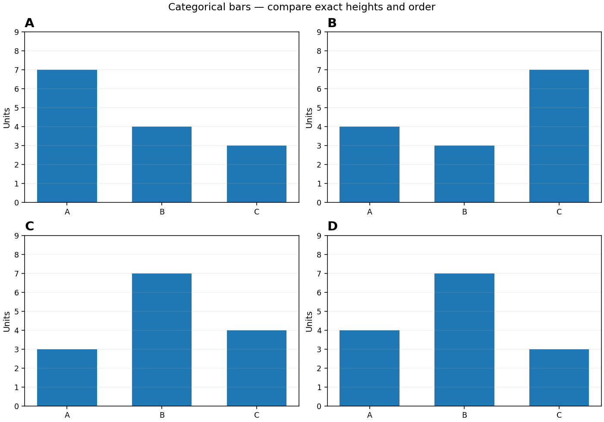

<details>
<summary><strong>Q08. 정답 및 해설 확인</strong></summary>

**정답: D**

막대 순서는 A·B·C이고 높이는 4·7·3입니다. 모양은 모두 막대그래프여도 범주와 값의 대응이 일치해야 합니다.

**예제 코드 / 핵심 확인 코드**

```python
go.Bar(x=["A", "B", "C"], y=[4, 7, 3])
```

</details>

### Q09. 선·점 표시 방식을 변경하는 버튼에는 어떤 method가 적합할까?

A. `relayout`
B. `restyle`
C. `resample`
D. `reindex`

<details>
<summary><strong>Q09. 정답 및 해설 확인</strong></summary>

**정답: B**

Trace의 `mode` 같은 속성을 바꾸는 버튼은 `restyle`이 적합합니다. `relayout`은 제목·축·레이아웃에 사용됩니다.

**예제 코드 / 핵심 확인 코드**

```python
dict(label="Markers", method="restyle", args=[{"mode": "lines+markers"}])
```

</details>

### Q10. 1행 2열의 오른쪽 패널에 두 번째 Scatter Trace를 넣는 코드의 빈칸은?

```python
fig = make_subplots(rows=1, cols=2)
fig.add_trace(go.Bar(...), row=1, col=1)
fig.add_trace(go.Scatter(...), row=__, col=__)
```

<details>
<summary><strong>Q10. 정답 및 해설 확인</strong></summary>

**정답: `row=1, col=2`**

Plotly `make_subplots`의 `row`, `col`은 1부터 시작합니다. Matplotlib의 `axes[0]` 같은 0 기반 인덱스와 혼동하지 마세요.

**예제 코드 / 핵심 확인 코드**

```python
fig.add_trace(go.Scatter(x=[1,2], y=[5,3]), row=1, col=2)
```

</details>

### Q11. 다음 코드가 실제 만드는 1행 2열 그래프를 고르시오.

```python
fig = make_subplots(rows=1, cols=2)
fig.add_trace(go.Bar(x=["A", "B"], y=[3,5]), row=1, col=1)
fig.add_trace(go.Scatter(x=[1,2], y=[5,3], mode="lines+markers"), row=1, col=2)
```
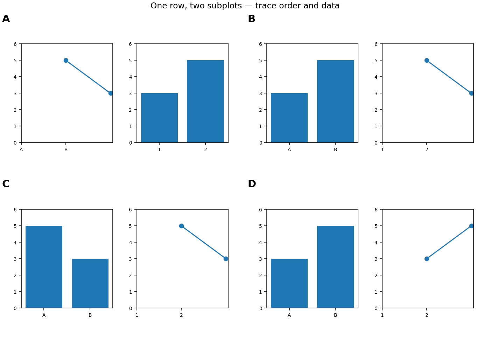

<details>
<summary><strong>Q11. 정답 및 해설 확인</strong></summary>

**정답: B**

왼쪽은 A=3, B=5인 막대이고 오른쪽은 5에서 3으로 감소하는 선입니다. A는 패널 위치가 뒤바뀌었고 C·D는 값이 다릅니다.

**예제 코드 / 핵심 확인 코드**

```python
fig.add_trace(go.Bar(x=["A","B"],y=[3,5]),row=1,col=1)
fig.add_trace(go.Scatter(x=[1,2],y=[5,3]),row=1,col=2)
```

</details>

### Q12. 범주 5개를 Facet으로 2열씩 배치하려면 어느 인자가 필요한가?

A. `facet_col_wrap=2`
B. `facet_row=2`만 사용
C. `nbins=2`
D. `color=2`

<details>
<summary><strong>Q12. 정답 및 해설 확인</strong></summary>

**정답: A**

`facet_col_wrap=2`는 패널을 2열로 줄 바꿈하도록 합니다. `facet_col`에 그룹 열을 지정해야 합니다.

**예제 코드 / 핵심 확인 코드**

```python
px.line(data, x="date", y="value", facet_col="store", facet_col_wrap=2)
```

</details>

### Q13. `px.bar(raw, x="store", y="revenue")`가 매장별 합계를 구한다고 생각해도 될까?

A. 항상 매장당 막대 하나로 합계를 자동 계산함
B. `bar()`가 평균을 자동 계산함
C. 먼저 `groupby()`로 원하는 통계를 요약해 전달해야 함
D. `color`를 넣으면 합계를 계산함

<details>
<summary><strong>Q13. 정답 및 해설 확인</strong></summary>

**정답: C**

`px.bar`는 원본 행을 표현하고 같은 X 위치의 여러 막대를 쌓거나 겹칠 수 있습니다. 어떤 집계가 필요한지 먼저 판단해 `groupby`로 수치를 계산하세요.

**예제 코드 / 핵심 확인 코드**

```python
summary=raw.groupby("store",as_index=False).revenue.sum()
fig=px.bar(summary,x="store",y="revenue")
```

</details>

### Q14. 다음 값 6개의 1 단위 히스토그램 빈도를 올바르게 나타낸 그래프는?

```python
fig = go.Figure(go.Histogram(
    x=[1,1,2,3,3,3],
    xbins=dict(start=0.5, end=3.5, size=1)
))
```
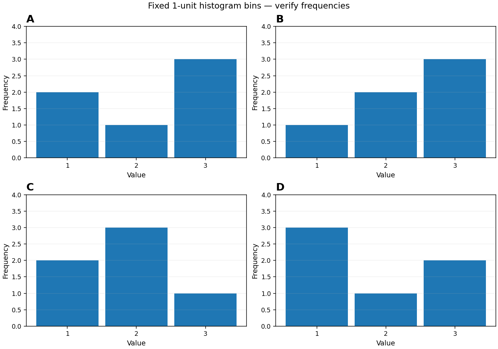

<details>
<summary><strong>Q14. 정답 및 해설 확인</strong></summary>

**정답: A**

값 1은 2개, 2는 1개, 3은 3개입니다. 각 구간의 빈도가 2·1·3이므로 A입니다. 같은 모양의 히스토그램이라도 Bin 경계와 빈도를 확인해야 합니다.

**예제 코드 / 핵심 확인 코드**

```python
go.Histogram(x=[1,1,2,3,3,3], xbins=dict(start=0.5,end=3.5,size=1))
```

</details>

### Q15. Hover 템플릿에서 `<extra></extra>`는 어떤 효과가 있을까?

A. 선을 두껍게 만듦
B. 템플릿 밖에 추가로 표시되는 기본 Trace 정보 영역을 숨김
C. 날짜를 UTC로 변경
D. 범례를 삭제

<details>
<summary><strong>Q15. 정답 및 해설 확인</strong></summary>

**정답: B**

Tooltip 기본 추가 영역을 숨깁니다. 브라우저 화면의 Plotly 범례를 삭제하는 기능이 아닙니다.

**예제 코드 / 핵심 확인 코드**

```python
fig.update_traces(hovertemplate="Value: %{y}<extra></extra>")
```

</details>

### Q16. 실제 CSV에 11시 행이 아예 없는데 `connectgaps=False`만 적용하면 충분한가?

A. 그렇다. 누락된 시각이 자동 삽입됨
B. 그렇다. 항상 그래프가 끊김
C. 아니다. 예상 시각 인덱스를 만들고 미관측 슬롯을 결측값으로 복원해야 함
D. 결측을 0으로 채우는 것이 정답

<details>
<summary><strong>Q16. 정답 및 해설 확인</strong></summary>

**정답: C**

Plotly는 존재하지 않는 시각을 알 수 없습니다. 재인덱싱 등으로 예상 슬롯을 복원하고 해당 값을 `NaN`으로 유지해야 실제로 선이 끊깁니다.

**예제 코드 / 핵심 확인 코드**

```python
times=pd.date_range("2026-10-01 09:00",periods=4,freq="h")
observed=source.reindex(times)
```

</details>

### Q17. Animation으로 주차별 평균을 비교할 때 축의 범위를 고정하는 가장 중요한 이유는?

A. 프레임마다 Plotly가 새 CSV를 읽도록 하기 위해
B. 각 프레임의 수치 크기를 일관되게 비교하기 위해
C. Hover를 제거하기 위해
D. Python 반복문을 없애기 위해

<details>
<summary><strong>Q17. 정답 및 해설 확인</strong></summary>

**정답: B**

프레임마다 Y축 상한이 바뀌면 동일한 막대 높이가 다른 수치를 뜻할 수 있습니다. `range_y`를 공통으로 지정하면 비교가 더 명확해집니다.

**예제 코드 / 핵심 확인 코드**

```python
px.bar(summary,x="team",y="mean_response",animation_frame="week",range_y=[0,300])
```

</details>

### Q18. 다음 세 Trace의 초기 표시 상태와 같은 그래프를 고르시오.

```python
fig.add_trace(go.Scatter(name="A", y=[4,5,7]))
fig.add_trace(go.Scatter(name="B", y=[7,6,5], visible=False))
fig.add_trace(go.Scatter(name="C", y=[2,3,4]))
```
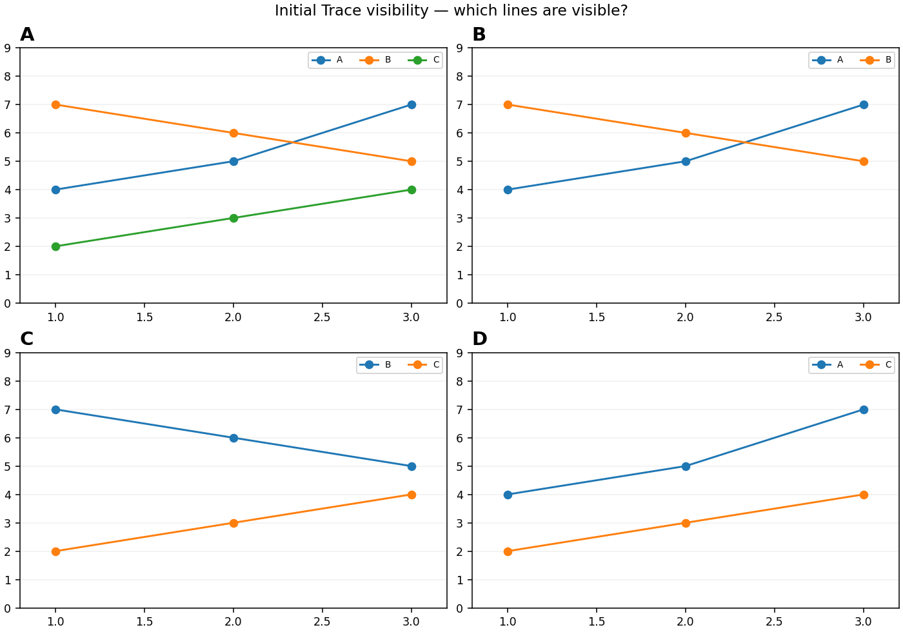

<details>
<summary><strong>Q18. 정답 및 해설 확인</strong></summary>

**정답: D**

A와 C는 보이고 B는 숨겨집니다. 빈도/유형이 같은 선 그래프이므로 범례의 개수와 높이를 확인해야 합니다.

**예제 코드 / 핵심 확인 코드**

```python
fig.data[1].visible = False
```

</details>

### Q19. HTML을 다른 컴퓨터에서 인터넷 없이 단일 파일로 열고 싶을 때 적합한 설정은?

A. `include_plotlyjs="cdn"`
B. `include_plotlyjs=True`
C. `fig.write_json()`만 실행
D. `plt.savefig()`

<details>
<summary><strong>Q19. 정답 및 해설 확인</strong></summary>

**정답: B**

`True`는 Plotly.js를 HTML 안에 포함합니다. `"directory"`도 오프라인에서 사용할 수 있지만 같은 폴더에 JS 파일을 함께 전달해야 합니다.

**예제 코드 / 핵심 확인 코드**

```python
fig.write_html("report.html",include_plotlyjs=True)
```

</details>

### Q20. `fig.write_json()`과 `fig.write_html()`의 차이는?

A. JSON 파일은 웹브라우저에서 자동으로 그래프를 표시함
B. HTML은 그래프가 아니라 원본 CSV를 저장함
C. JSON은 그래프 데이터·설정을 저장하고 HTML은 브라우저에서 렌더링할 결과를 저장함
D. 둘 다 정적 PNG를 저장함

<details>
<summary><strong>Q20. 정답 및 해설 확인</strong></summary>

**정답: C**

JSON은 Trace·Layout 등 기계가 읽는 구조입니다. HTML은 JavaScript를 이용해 브라우저에서 차트를 그립니다. 둘은 서로 다른 목적을 가집니다.

**예제 코드 / 핵심 확인 코드**

```python
fig.write_json("chart.json")
fig.write_html("chart.html")
```

</details>

### Q21. 다음 코드에서 나타나는 두 계열의 막대그래프를 고르시오.

```python
fig = go.Figure()
fig.add_trace(go.Bar(x=["Jan","Feb"],y=[3,5],name="A"))
fig.add_trace(go.Bar(x=["Jan","Feb"],y=[2,4],name="B"))
fig.update_layout(barmode="group")
```
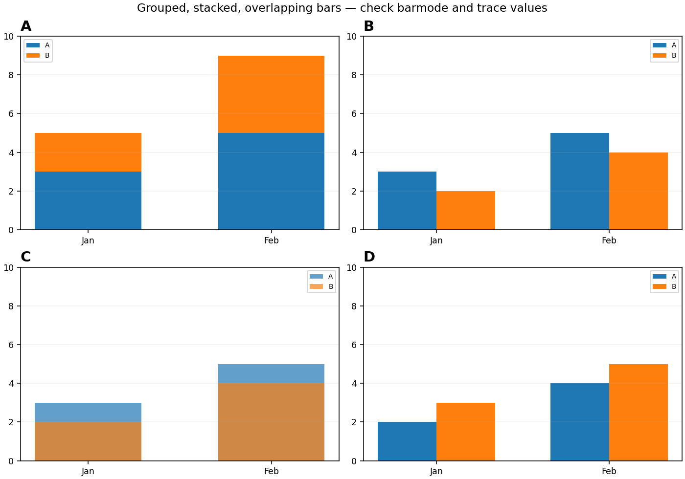

<details>
<summary><strong>Q21. 정답 및 해설 확인</strong></summary>

**정답: B**

`barmode="group"`은 같은 범주에서 A·B 막대를 나란히 배치합니다. A는 누적, C는 겹침, D는 A와 B의 데이터가 뒤바뀐 경우입니다.

**예제 코드 / 핵심 확인 코드**

```python
fig.update_layout(barmode="group")
```

</details>

### Q22. 15분마다 계산한 p95 지연시간의 평균을 하루 전체 요청의 p95라고 표현해도 될까?

A. 각 구간의 p95를 평균하면 전체 요청의 p95와 항상 같음
B. 요청 수가 다르더라도 p95 평균을 전체 p95로 사용할 수 있음
C. 아니다. 전체 요청의 응답시간 분포를 알아야 전체 p95를 정확히 계산할 수 있음
D. 그래프에 Hover가 있으면 p95 평균이 정확한 전체 p95가 됨

<details>
<summary><strong>Q22. 정답 및 해설 확인</strong></summary>

**정답: C**

백분위수는 일반적으로 구간별 백분위수들의 평균과 같지 않습니다. 전체 p95를 계산하려면 전체 요청의 분포 또는 충분한 통계 요약 정보가 필요합니다. 이 장의 서비스 파일은 구간별 p95만 제공하므로 전체 p95로 단정할 수 없습니다.

**예제 코드 / 핵심 확인 코드**

```python
fig.update_yaxes(title_text="15-min P95 Latency (ms)")
```

</details>

<a id="section-7-26"></a>
## 7.26. Summary

### 핵심 정리

| 구분 | 기억할 내용 |
|---|---|
| `Figure` | 전체 데이터 Trace와 Layout을 보유 |
| `Plotly Express` | DataFrame 열과 시각적 속성을 빠르게 연결 |
| `Graph Objects` | 개별 Trace·축·버튼 등 세부 제어 |
| Hover | 관측값 확인과 보조 정보 표시, 단위·포맷 중요 |
| Legend | Trace 표시 여부 변경, 원본 파일 변경 아님 |
| Range Slider | 축 표시 범위 조절, 별도 집계 변경 아님 |
| `updatemenus` | Trace visibility와 Layout 속성 변경 |
| Subplots / Facets | 단위·그룹별 비교를 위한 여러 패널 구성 |
| Missing Values | 미관측은 0이 아니며 예상 시간 슬롯을 복원해야 할 수 있음 |
| HTML Export | 브라우저에서 상호작용 가능한 결과물, 오프라인 JS 필요 |
| Figure JSON | 그래프 구조·설정을 보관하는 파일, 단독 인터랙션 없음 |
| Selection | 화면상의 점 선택과 데이터 서버 필터링은 별개 |
| Animation | 프레임의 공통 축 범위를 유지해 비교 |

**학습 확인:** 다음 장의 Streamlit은 Plotly에서 만든 Figure를 웹 애플리케이션에 표시하고, 입력 위젯에 따라 Python 계산을 다시 수행하는 과정을 다룹니다. 이번 Chapter에서는 Plotly 단독 HTML의 상호작용이 어디까지 가능한지 이해하는 것이 중요합니다.

<a id="section-7-27"></a>
## 7.27. References & Directory Structure

### Directory Structure

```text
Chapter-07/
├── README.md
├── requirements.txt
├── .gitignore
├── data/
│   ├── DATA_DICTIONARY.md
│   ├── retail_sales.csv
│   ├── service_metrics.csv
│   ├── support_tickets.csv
│   ├── regional_energy_hourly.csv
│   └── energy_regions.json
├── examples/                       # Python 예제 22개
├── figures/
│   ├── previews/                   # README용 정적 미리보기
│   ├── interactive/                # 오프라인 HTML + plotly.min.js
│   └── quiz/                       # 이미지 선택지 6세트
├── exercises/                      # Coding Practice 18개, 시작 코드
├── projects/                       # Mini 3개 + Advanced 1개, TASK와 Starter
├── solutions/                      # 별도 정답 코드, Advanced 설계 해설
├── project_core/                   # 공통 입출력 유틸리티
├── tests/                          # 자동 테스트
└── output/                         # 실행 시 생성, Git 추적 제외
```

### 실행 명령어

```bash
# 예제
python examples/04_hovertemplate.py
python examples/07_range_slider.py
python examples/19_animation.py

# 모범 구현 실행 (학습 문제 풀이 후)
python -m solutions.mini_01_sales.solution
python -m solutions.mini_02_service.solution
python -m solutions.mini_03_support.solution
python -m solutions.advanced_01_energy.reference_solution

# 자동 검증
python -m unittest discover -s tests -v
```

프로젝트 모범 구현은 **Chapter-07 폴더에서 `python -m`으로 실행**합니다. 예제는 실행 폴더와 관계없이 자신이 위치한 경로를 기준으로 데이터 파일을 찾습니다. `output/`에 생성된 실행 결과는 Git에 커밋하지 않습니다.

### Official References

- [Plotly Python — Getting Started](https://plotly.com/python/getting-started/)
- [Plotly Python — Plotly Express](https://plotly.com/python/plotly-express/)
- [Plotly Python — Hover Text and Formatting](https://plotly.com/python/hover-text-and-formatting/)
- [Plotly Python — Dropdown Menus](https://plotly.com/python/dropdowns/)
- [Plotly Python — Range Sliders and Selectors](https://plotly.com/python/range-slider/)
- [Plotly Python — Subplots](https://plotly.com/python/subplots/)
- [Plotly Python — Animations](https://plotly.com/python/animations/)
- [Plotly Python — Displaying Figures](https://plotly.com/python/offline/)
- [Plotly Python API — `plotly.io.write_html`](https://plotly.com/python-api-reference/generated/plotly.io.write_html.html)
- [Pandas Documentation](https://pandas.pydata.org/docs/)

---

[← Data Visualization](../README.md) · [Chapter 06 — Time Series Visualization](../Chapter-06/) · Chapter 08 — Dashboard Development with Streamlit (예정)

