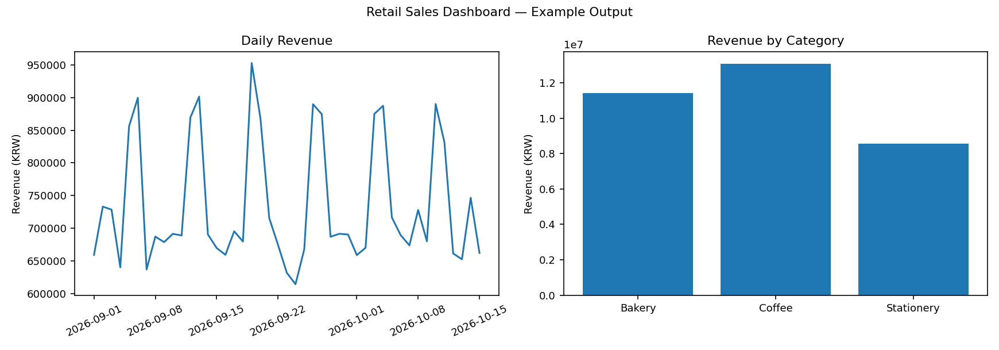
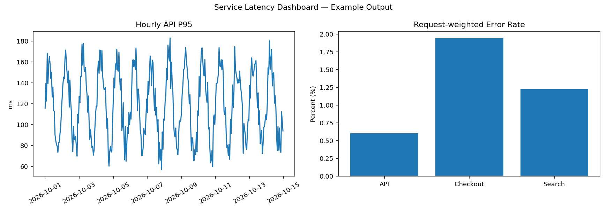
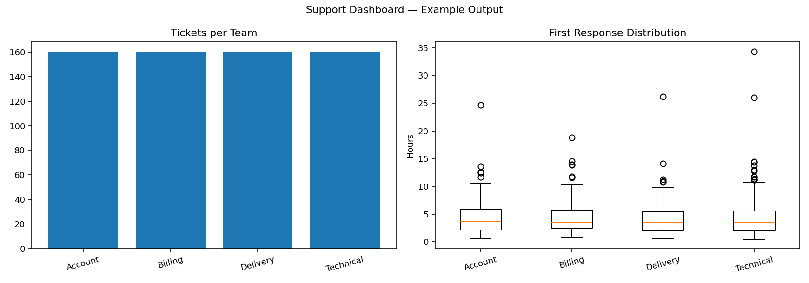
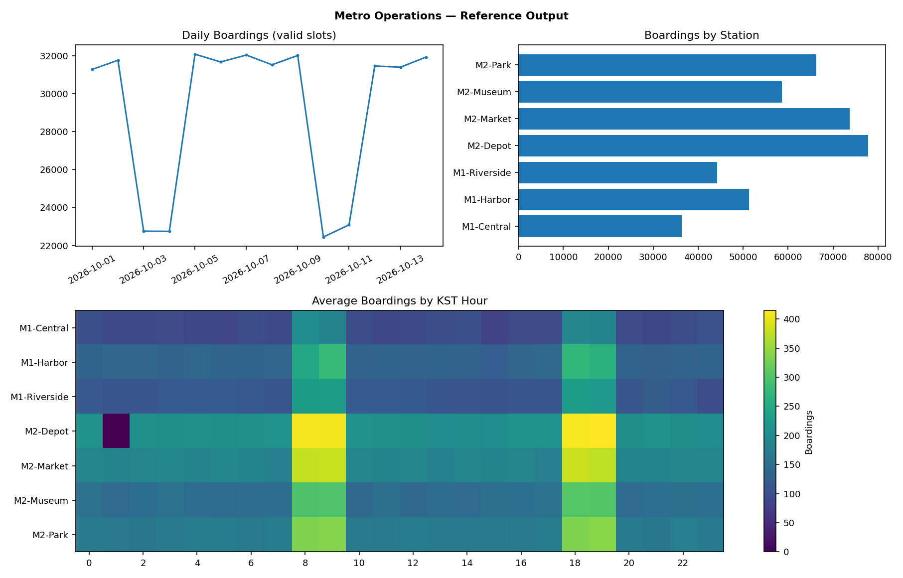
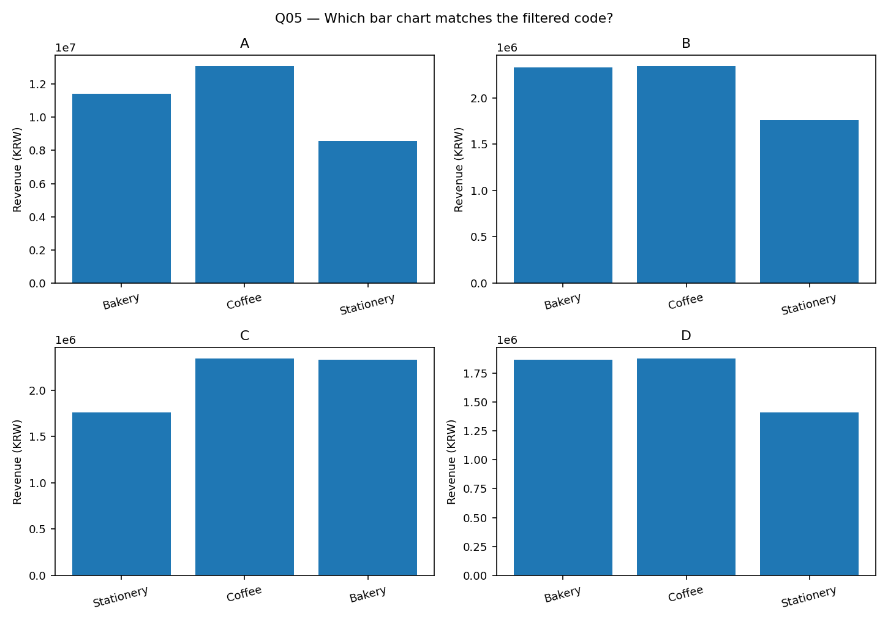
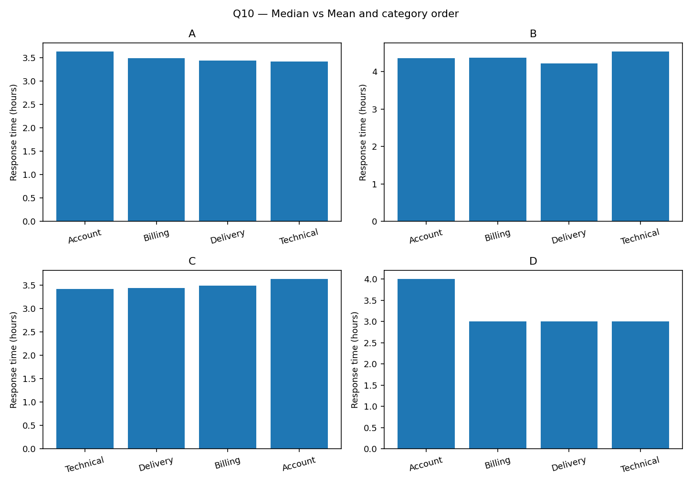
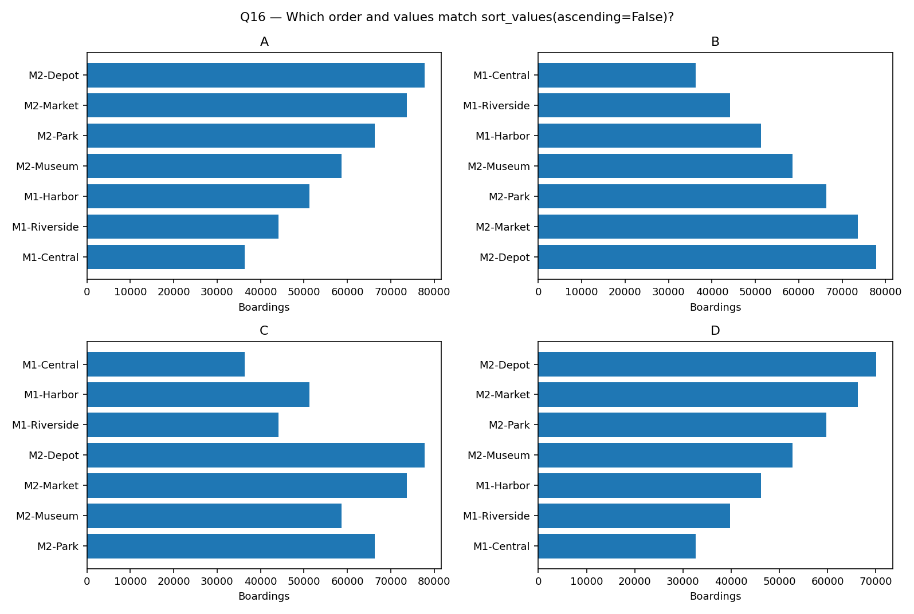
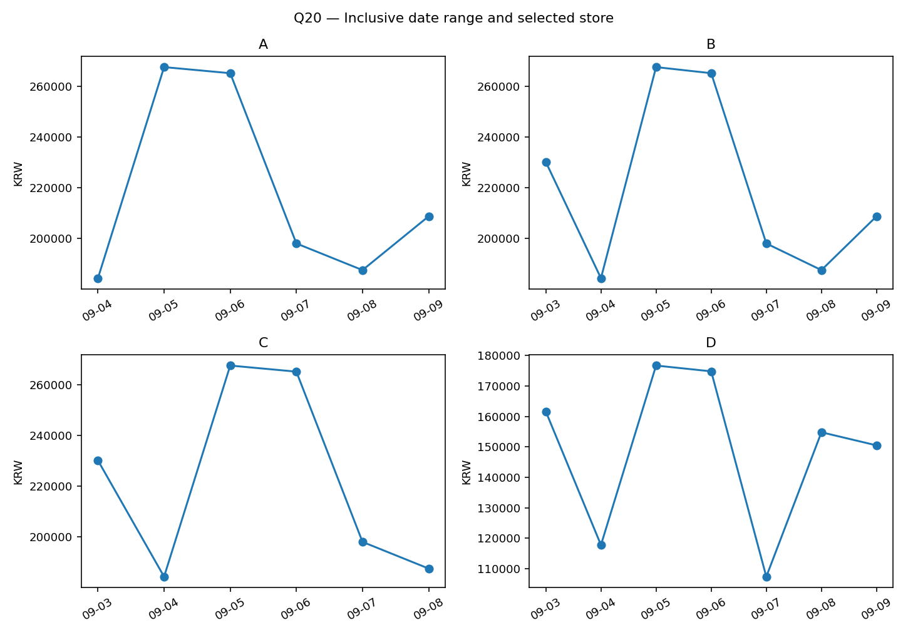

# Chapter 08. Dashboard Development with Streamlit

앞선 Chapter에서 제작한 정적·인터랙티브 그래프를 **사용자가 조건을 바꾸며 탐색할 수 있는 웹 대시보드**로 발전시킵니다. Streamlit을 사용하여 데이터 테이블, 요약 지표(KPI), 필터, Plotly 차트, 업로드·다운로드를 하나의 화면에 연결합니다.

이번 장의 핵심은 위젯을 많이 배치하는 것이 아닙니다. **필터를 바꿨을 때 모든 수치가 같은 데이터 범위를 기준으로 계산되는지**, **누락된 기록을 실제 0으로 오해하지 않는지**, **사용자별 상태와 공유 캐시를 구별하는지**를 이해하고 구현하는 것입니다.

처음 등장하는 개념은 **정의 → 필요한 이유 → 문제 상황 → 예제 코드 → 실행 결과 → 해설** 순서로 설명합니다. 이미 학습한 Pandas·Plotly 기초 문법은 필요한 부분만 복습합니다.

- **기본 환경:** Python 3.11 이상, Streamlit, Pandas, Plotly, Matplotlib
- **학습 구성:** Examples 24개 · Coding Practice 20문제 · Mini Project 3개 · Advanced Project 1개 · Quiz 24문제
- **코드 공개:** Example과 Quiz는 README에서 구현을 확인할 수 있습니다. Coding Practice와 프로젝트의 완성 코드는 `solutions/`에 분리합니다.
- **데이터:** 모든 실습 데이터는 교육용 가상 기록입니다. 실제 매장·철도·서비스 운영 통계가 아닙니다.
- **검증 범위:** Python 3.13.5, Pandas 2.2.3, Plotly 6.5.2 및 Matplotlib 3.10.8의 독립 로직을 실행 검증했습니다. 제작 환경에서 Streamlit 패키지를 설치할 수 없어 실제 Streamlit 서버·브라우저 실행은 검증하지 못했습니다. 테스트와 실행 안내에서 이 차이를 명시합니다.
- **수식:** 불필요한 수식은 사용하지 않습니다. 필요한 계산은 단위·분모·해석을 한국어 문장과 코드로 설명합니다.

<details>
<summary><strong>선행 학습 목록</strong></summary>

- [Chapter 01 — Introduction to Data Visualization](../Chapter-01/)
- [Chapter 02 — Principles of Data Visualization](../Chapter-02/)
- [Chapter 03 — Matplotlib](../Chapter-03/)
- [Chapter 04 — Seaborn](../Chapter-04/)
- [Chapter 05 — Exploratory Data Analysis & Statistical Visualization](../Chapter-05/)
- [Chapter 06 — Time Series Visualization](../Chapter-06/)
- [Chapter 07 — Plotly & Interactive Visualization](../Chapter-07/)
- [Data Processing Chapter 04 — Pandas & DataFrames](../../Data_Processing/Chapter-04/)
- [Data Processing Chapter 06 — Data Cleaning & Validation](../../Data_Processing/Chapter-06/)
- [Data Processing Chapter 07 — Data Transformation & Aggregation](../../Data_Processing/Chapter-07/)

</details>

<a id="contents"></a>
## Contents

| Section | Topic |
|:---:|---|
| [8.1](#section-8-1) | **Learning Goals & Getting Started** — 개발 환경과 앱 실행 |
| [8.2](#section-8-2) | **Dashboard Fundamentals** — 대시보드와 정적 보고서의 차이 |
| [8.3](#section-8-3) | **Streamlit Execution Model** — Rerun·위젯·코드 실행 흐름 |
| [8.4](#section-8-4) | **First Streamlit App** — 기본 화면과 실행 |
| [8.5](#section-8-5) | **Tables, Metrics & Layout** — 데이터 테이블과 KPI, Columns |
| [8.6](#section-8-6) | **Input Widgets & Filtering** — Selectbox, Multiselect, Slider |
| [8.7](#section-8-7) | **Date Range & Data Grain** — 날짜 범위와 선택 조건 |
| [8.8](#section-8-8) | **Plotly in Streamlit** — 인터랙티브 그래프 연결 |
| [8.9](#section-8-9) | **Matplotlib & Native Charts** — 정적 그래프와 출력 자원 |
| [8.10](#section-8-10) | **Tabs & Expanders** — 관련 정보를 정리하는 UI |
| [8.11](#section-8-11) | **Consistent Filtering** — 필터와 KPI·차트의 동기화 |
| [8.12](#section-8-12) | **Forms & Submission** — 입력의 일괄 적용 |
| [8.13](#section-8-13) | **Session State & Callbacks** — 사용자별 상태 유지 |
| [8.14](#section-8-14) | **Caching Data & Resources** — 재실행 비용과 캐시의 범위 |
| [8.15](#section-8-15) | **CSV Download** — 다운로드 데이터의 범위 |
| [8.16](#section-8-16) | **CSV Upload & Validation** — 파일 업로드와 입력 검증 |
| [8.17](#section-8-17) | **Empty States & Error Handling** — 빈 결과와 예외 처리 |
| [8.18](#section-8-18) | **Query Parameters** — 주소를 통한 선택 상태 |
| [8.19](#section-8-19) | **Plotly Selection Events** — 차트 선택과 재집계 |
| [8.20](#section-8-20) | **Editable Tables** — Data Editor와 유효성 |
| [8.21](#section-8-21) | **Multipage Apps** — st.Page와 st.navigation |
| [8.22](#section-8-22) | **Performance, Safety & Accessibility** — 운영·배포 시 주의점 |
| [8.23](#section-8-23) | **Dataset & Core Architecture** — 데이터 구조와 계산 함수 |
| [8.24](#section-8-24) | **Testing & Verification** — 독립 로직 테스트와 AppTest |
| [8.25](#section-8-25) | **Mini Project 01 — Retail Sales Dashboard** — 매장별 매출 분석 |
| [8.26](#section-8-26) | **Mini Project 02 — Service Latency Monitoring** — 서비스 지연 및 오류율 |
| [8.27](#section-8-27) | **Mini Project 03 — Customer Support Workload** — 고객문의 처리 현황 |
| [8.28](#section-8-28) | **Coding Practice — 20 Exercises** — 부분 완성형 실습 |
| [8.29](#section-8-29) | **Advanced Project — Urban Metro Operations Dashboard** — 대규모 관측·품질·다중 페이지 |
| [8.30](#section-8-30) | **Quiz — Code Reading & Dashboard Reasoning** — 객관식·코드 완성·디버깅 |
| [8.31](#section-8-31) | **Summary** — 핵심 개념 최종 정리 |
| [8.32](#section-8-32) | **References & Directory Structure** — 공식 문서와 파일 구성 |

---

<a id="section-8-1"></a>
## 8.1. Learning Goals & Getting Started

### 학습 목표

1. Streamlit의 재실행 모델을 이해하고 `streamlit run`으로 앱을 실행합니다.
2. 입력 위젯을 통해 데이터를 선택하고, **필터 후 계산**하는 대시보드를 만듭니다.
3. `st.session_state`, `st.cache_data`, `st.cache_resource`, Form의 차이를 설명합니다.
4. Plotly·Matplotlib·DataFrame·KPI를 하나의 화면에 배치합니다.
5. 사용자가 올린 파일을 검증하고 **현재 선택 조건**을 CSV로 내보냅니다.
6. UI 코드와 계산 로직을 분리해 테스트 가능한 프로그램을 작성합니다.

### 설치

Chapter-08 폴더에서 다음 명령어를 실행합니다.

```bash
python -m pip install -r requirements.txt
python -m streamlit run examples/01_first_app.py
```

터미널에 출력되는 로컬 주소를 브라우저에서 엽니다. 일반적으로 `http://localhost:8501`입니다. 포트가 이미 사용 중이면 다른 포트로 실행될 수 있습니다.

**중요:** `python examples/01_first_app.py`로 일반 Python 실행을 하는 방식과 다릅니다. Streamlit 앱은 Streamlit 실행기에서 위젯 상태·재실행 문맥을 관리합니다.

가상환경 사용을 권장합니다. 프로젝트에서 요구하는 모든 패키지는 `requirements.txt`에 명시합니다.

```bash
python -m unittest discover -s tests -v
```

위 명령어는 데이터 계산 로직 테스트입니다. 설치된 Streamlit의 실제 UI 확인은 별도입니다.

<details><summary><strong>참고 — 브라우저가 열리지 않는 경우</strong></summary>

명령어를 실행한 터미널에 표시된 Local URL을 주소창에 입력하세요. 방화벽·포트 설정, 가상환경의 Streamlit 설치 여부도 확인해야 합니다. 강제로 공개 네트워크에 바인딩하지 마세요.

</details>

---

<a id="section-8-2"></a>
## 8.2. Dashboard Fundamentals

### Dashboard란 무엇인가요?

**Dashboard(대시보드)**는 여러 지표·표·그래프를 한 화면에서 확인하고, 사용자 선택에 따라 화면을 갱신하도록 구성한 정보 표시 도구입니다. 정적 보고서는 제작 당시의 조건으로 고정된 결과물을 보여줍니다. 대시보드는 사용자가 매장이나 날짜를 선택하면 해당 범위에 맞게 내용을 다시 계산할 수 있습니다.

예를 들어 매출 보고서에 `총매출: 33,046,600원`이 표시돼 있다고 가정합니다. 사용자가 특정 매장을 선택했다면 이 숫자가 여전히 전체 매출인지, 해당 매장의 매출인지가 명확해야 합니다. KPI는 자동으로 필터와 동기화되는 게 아니라 **프로그램이 동일한 데이터 범위에서 다시 계산해야** 합니다.

| 요소 | 역할 | 실수하기 쉬운 부분 |
|---|---|---|
| 필터 | 사용할 데이터 범위 결정 | 표만 바꾸고 KPI는 이전 값을 유지 |
| KPI | 중요한 수치를 요약 | 분모·단위·기간 표기 누락 |
| 시계열 그래프 | 시간에 따른 변화 표시 | 누락된 시간을 0으로 채우기 |
| 분포 차트 | 값의 흩어짐 비교 | 평균만 보고 극단값 무시 |
| 다운로드 | 현재 결과를 파일로 저장 | 전체 원본을 잘못 내보내기 |
| 상태 저장 | 사용자별 설정 유지 | 사용자 세션과 전역 캐시 혼동 |

이 Chapter에서는 웹 프런트엔드 코드를 직접 작성하기보다 **Python으로 화면을 선언하고 데이터 처리 함수를 연결하는 방식**을 사용합니다.

---

<a id="section-8-3"></a>
## 8.3. Streamlit Execution Model

### 재실행(Rerun)의 의미

Streamlit은 일반적으로 사용자가 위젯을 조작하면 Python 스크립트를 **위에서 아래로 다시 실행**합니다. 이것은 페이지 전체를 새로 열어 브라우저를 초기화한다는 뜻이 아닙니다. Streamlit이 현재 세션의 위젯 값을 읽고 Python 코드로 새로운 화면 구성을 계산하는 방식입니다.

```text
사용자: 매장 A 선택
    ↓
위젯 상태 변경
    ↓
Python 스크립트 재실행
    ↓
매장 A 데이터 필터링
    ↓
KPI 및 Plotly Figure 새로 계산
    ↓
브라우저 화면 갱신
```

**왜 중요한가요?** 일반 Python의 지역변수에 버튼 클릭 횟수를 저장하면 스크립트가 재실행될 때 값이 다시 0으로 초기화될 수 있습니다. 반면 같은 CSV 파일을 읽는 코드를 위젯 변경마다 다시 실행하면 불필요한 비용이 생깁니다.

이 두 문제는 각각 **Session State**와 **Cache**로 해결하며, 서로 다른 목적을 가진 기능입니다.

<details><summary><strong>보충 — 모든 입력이 항상 즉시 재실행되나요?</strong></summary>

일반 위젯은 기본적으로 값 변경 후 재실행을 일으킵니다. 하지만 `st.form()`은 여러 입력을 모아 제출할 수 있고, 일부 위젯은 변경 시 재실행 시점을 조절할 수 있습니다. 이번 장에서는 기본 재실행 동작과 Form의 차이를 중심으로 학습합니다.

</details>

---

<a id="section-8-4"></a>
## 8.4. First Streamlit App

### Streamlit 화면의 최소 구성

`import streamlit as st`의 `st`는 라이브러리 이름에 붙인 별칭입니다. `st.title()`은 페이지 제목을 표시하고, `st.write()`는 문자열·숫자·데이터 등 다양한 객체를 화면에 표현할 때 사용합니다. 일반 `print()`는 기본적으로 브라우저가 아니라 **서버 터미널**로 출력됩니다.

처음에는 HTML·CSS를 작성하지 않아도 되는 장점이 있습니다. 다만 화면 구조와 데이터 계산을 한 파일에 섞어 넣으면 테스트와 관리가 어려워지므로 큰 프로젝트는 나누어야 합니다.

### Example 01 — First App

**문제 상황**

웹에서 매출 요약 화면을 열어야 합니다. 첫 실행 화면에 제목과 안내를 출력하세요.

**핵심 개념**

`st.title()`은 페이지 제목, `st.write()`는 일반 출력, `st.info()`는 안내입니다.

**예제 코드** — [`01_first_app.py`](./examples/01_first_app.py)

```python
"""Example 01. 첫 번째 웹 대시보드. Run: streamlit run examples/01_first_app.py"""
from pathlib import Path
import sys
ROOT = Path(__file__).resolve().parents[1]
sys.path.insert(0, str(ROOT))
import streamlit as st
st.set_page_config(page_title='First Dashboard', layout='wide')
st.title('Store Snapshot')
st.write('Data Visualization Chapter 08')
st.info('Streamlit 앱은 터미널에서 streamlit run으로 시작합니다.')
```

**실행 결과**

브라우저에 Store Snapshot 제목과 안내 메시지가 표시됩니다.

---

<a id="section-8-5"></a>
## 8.5. Tables, Metrics & Layout

### 테이블과 KPI의 역할

데이터 테이블은 세부 기록을 확인하는 용도이고, KPI(Key Performance Indicator)는 분석 목표를 대표하는 수치를 간결하게 보여주는 용도입니다. 같은 날짜·매장 필터를 적용했을 때 KPI와 테이블의 범위가 일치해야 합니다.

`st.dataframe()`은 많은 행을 탐색할 수 있는 표를 표시합니다. `st.metric()`은 라벨과 숫자를 카드 형태로 출력하며, `st.columns(3)`을 이용해 세 개를 한 줄에 배치할 수 있습니다. 이 배치는 시각적 위치를 바꾸는 것이지 데이터의 의미를 바꾸지는 않습니다.

**주의:** 매출의 단위는 원(KRW), 판매 수량은 개, 날짜 수는 일입니다. 대시보드 숫자에 단위를 생략하면 단순 숫자라도 해석이 어렵습니다.

### Example 02 — Dataframe

**문제 상황**

주문 내역 중 일부를 스크롤 가능한 표로 표시하세요.

**핵심 개념**

`st.dataframe()`은 표 탐색용입니다. `head(25)`는 미리보기 25행만 제한하며 원본 데이터는 변경하지 않습니다.

**예제 코드** — [`02_dataframe.py`](./examples/02_dataframe.py)

```python
"""Example 02. 테이블 표시. Run: streamlit run examples/02_dataframe.py"""
from pathlib import Path
import sys
ROOT = Path(__file__).resolve().parents[1]
sys.path.insert(0, str(ROOT))
import streamlit as st
from core.analytics import read_retail
df=read_retail()
st.title('Retail Records')
st.caption('한 행 = 날짜 × 매장 × 상품 분류')
st.dataframe(df.head(25), hide_index=True)
```

**실행 결과**

주문 기록 25행을 표시합니다.

### Example 03 — Metrics Columns

**문제 상황**

총매출·상품 수량·일수를 한눈에 비교하는 요약 지표를 배치하세요.

**핵심 개념**

`st.columns()`는 같은 행에 열을 만들며, 각 열의 `metric()`은 값을 카드처럼 표시합니다.

**예제 코드** — [`03_metrics_columns.py`](./examples/03_metrics_columns.py)

```python
"""Example 03. KPI와 레이아웃. Run: streamlit run examples/03_metrics_columns.py"""
from pathlib import Path
import sys
ROOT = Path(__file__).resolve().parents[1]
sys.path.insert(0, str(ROOT))
import streamlit as st
from core.analytics import read_retail, retail_summary
summary=retail_summary(read_retail())
st.title('Sales KPIs')
a,b,c=st.columns(3)
a.metric('Revenue (KRW)',f"{summary['revenue_krw']:,}")
b.metric('Items',f"{summary['quantity']:,}")
c.metric('Days',summary['days'])
```

**실행 결과**

매출 33,046,600원, 판매량 12,184개, 날짜 45일을 표시합니다.

---

<a id="section-8-6"></a>
## 8.6. Input Widgets & Filtering

### 어떤 입력 위젯을 선택해야 하나요?

- `st.selectbox()`: 하나의 매장이나 기준을 선택할 때 사용합니다.
- `st.multiselect()`: 여러 매장·상품 분류를 동시에 포함할 때 사용합니다.
- `st.slider()`: 일정 범위의 숫자 기준을 바꿀 때 적합합니다.
- `st.sidebar`: 여러 필터를 화면 한쪽에 모아 그래프 영역을 확보하는 데 사용합니다.

**문제 상황:** 서버 응답시간이 250ms를 넘으면 경고해야 한다는 기준이 있다고 가정합니다. 사용자가 이 기준을 300ms로 변경하면 ‘기준을 넘은 시간대의 개수’는 바뀌지만, 원본의 지연시간 측정값이 변경되는 것은 아닙니다.

또한 선택지 `[]`는 **아무 항목도 선택하지 않은 상태**입니다. `multiselect()`의 빈 결과를 임의로 전체 데이터로 간주하면 잘못된 KPI를 만들 수 있습니다. 정책을 명확하게 정하고 코드에서도 그대로 처리해야 합니다.

### Example 04 — Selectbox

**문제 상황**

한 매장을 선택하면 그 매장에 해당하는 매출만 보여주도록 만드세요.

**핵심 개념**

`st.selectbox()`는 단일 선택, `select_retail()`은 실제 데이터 필터입니다.

**예제 코드** — [`04_selectbox.py`](./examples/04_selectbox.py)

```python
"""Example 04. 단일 매장 필터. Run: streamlit run examples/04_selectbox.py"""
from pathlib import Path
import sys
ROOT = Path(__file__).resolve().parents[1]
sys.path.insert(0, str(ROOT))
import streamlit as st
from core.analytics import read_retail,select_retail,retail_summary
df=read_retail()
store=st.selectbox('Store',sorted(df['store'].unique()))
filtered=select_retail(df,stores=[store])
st.metric('Selected Store Revenue (KRW)',f"{retail_summary(filtered)['revenue_krw']:,}")
st.dataframe(filtered.head(10),hide_index=True)
```

**실행 결과**

다른 매장을 선택할 때 매출 KPI와 표가 재계산됩니다.

### Example 05 — Multiselect

**문제 상황**

상품 분류를 여러 개 선택해 해당 분류의 기록만 살펴보세요.

**핵심 개념**

`st.multiselect()`는 선택한 값을 리스트로 반환합니다. 빈 선택은 ‘전체 선택’과 같지 않습니다.

**예제 코드** — [`05_multiselect.py`](./examples/05_multiselect.py)

```python
"""Example 05. 복수 분류 필터. Run: streamlit run examples/05_multiselect.py"""
from pathlib import Path
import sys
ROOT = Path(__file__).resolve().parents[1]
sys.path.insert(0, str(ROOT))
import streamlit as st
from core.analytics import read_retail,select_retail
df=read_retail();options=sorted(df['category'].unique())
chosen=st.multiselect('Categories', options,default=options)
filtered=select_retail(df,categories=chosen)
if filtered.empty:st.warning('선택한 분류에 기록이 없습니다.')
else:st.dataframe(filtered.head(20),hide_index=True)
```

**실행 결과**

분류를 해제하면 표의 행이 줄고, 모두 해제하면 빈 결과 안내가 나옵니다.

### Example 07 — Slider

**문제 상황**

서비스별 시간당 P95가 기준을 초과한 기록 수를 확인하세요.

**핵심 개념**

슬라이더의 수치는 **경고 기준값**이며 전체 P95의 재계산을 의미하지 않습니다.

**예제 코드** — [`07_slider.py`](./examples/07_slider.py)

```python
"""Example 07. 임계값 슬라이더. Run: streamlit run examples/07_slider.py"""
from pathlib import Path
import sys
ROOT = Path(__file__).resolve().parents[1]
sys.path.insert(0, str(ROOT))
import streamlit as st
from core.analytics import read_service
service=read_service(); threshold=st.slider('P95 threshold (ms)',100,500,250,10)
exceeded=service.loc[service['p95_ms']>threshold]
st.metric('Hourly records above threshold',len(exceeded))
st.caption('각 시간대의 P95를 비교하며 전체 요청의 P95가 아닙니다.')
```

**실행 결과**

슬라이더를 움직이면 기준 초과 시간대 수가 변경됩니다.

---

<a id="section-8-7"></a>
## 8.7. Date Range & Data Grain

### 날짜 범위와 행의 의미

하루에 한 행이 있는 데이터와 하루에 여러 행이 있는 데이터는 다릅니다. `retail_daily.csv`는 **날짜 × 매장 × 상품 분류**가 한 행의 단위입니다. 같은 날에 여러 행이 존재하므로 날짜별 매출은 먼저 해당 날짜의 `revenue_krw`를 합산해야 합니다.

`st.date_input()`에 두 날짜를 전달하면 기간 선택 위젯이 됩니다. 선택 중 한 날짜만 정해졌다면 한 날짜짜리 튜플이 반환될 수 있습니다. 따라서 `len(range_value) == 2` 확인 후 필터를 수행합니다.

예제의 날짜 필터는 시작일과 종료일을 **모두 포함**합니다. UTC 시간 문자열이 있는 서버 데이터는 그대로 ‘현지 날짜’로 자르면 안 됩니다. UTC인지 KST인지 알고 날짜 범위를 정의해야 합니다.

<details><summary><strong>보충 — 날짜 경계가 헷갈린다면</strong></summary>

`2026-10-01`부터 `2026-10-07`까지 조회할 때 달력 날짜 기준이라면 1일과 7일의 기록도 포함합니다. 그러나 시각 기준 쿼리에서는 ‘종료일 다음 날 00:00 미만’ 같은 반열린 구간을 사용하면 경계 처리가 더 명확할 수 있습니다. 둘은 같은 목적을 다른 방식으로 표현한 것이며, 데이터의 시간대에 따라 구체적으로 정의해야 합니다.

</details>

### Example 06 — Date Range

**문제 상황**

기간을 지정해 해당 날짜의 기록만 포함하도록 구성하세요.

**핵심 개념**

범위 입력은 선택 도중 한 날짜만 반환할 수 있으므로 `len(range_value) != 2` 검사 후 계산합니다.

**예제 코드** — [`06_date_range.py`](./examples/06_date_range.py)

```python
"""Example 06. 날짜 범위. Run: streamlit run examples/06_date_range.py"""
from pathlib import Path
import sys
ROOT = Path(__file__).resolve().parents[1]
sys.path.insert(0, str(ROOT))
import streamlit as st
from core.analytics import read_retail,select_retail,date_bounds
df=read_retail();a,b=date_bounds(df,'date')
range_value=st.date_input('Date range',value=(a,b),min_value=a,max_value=b)
if len(range_value)!=2:st.info('시작일과 종료일을 모두 선택하세요.');st.stop()
filtered=select_retail(df,start=range_value[0],end=range_value[1])
st.write('Rows:',len(filtered))
```

**실행 결과**

기간이 완성된 경우 선택한 양 끝 날짜를 모두 포함한 행 개수를 보여줍니다.

---

<a id="section-8-8"></a>
## 8.8. Plotly in Streamlit

### 기존 Plotly 코드를 재사용하는 이유

Chapter 07에서 `px.line()`, `go.Figure()` 등으로 생성한 Figure는 Streamlit에서도 그대로 사용 가능합니다. `st.plotly_chart(fig)`가 Figure를 웹 대시보드에 표시합니다.

Plotly 자체의 Hover·Zoom은 **기존 Figure 내부의 시각적 상호작용**입니다. 반면 Streamlit의 `selectbox`로 매장을 바꾸면 Python이 다시 필터를 적용하고 Figure를 새로 만듭니다. 두 기능은 서로 다른 층에서 작동합니다.

**성능:** Figure의 Trace 수와 데이터 포인트 수가 지나치게 많으면 브라우저 렌더링이 느려질 수 있습니다. 시간 단위 원본을 아무 제한 없이 전부 그리기보다는, 목적에 맞게 집계·필터링하고 사용자의 탐색 요구에 맞게 보여주어야 합니다.

### Example 08 — Plotly

**문제 상황**

기존 Plotly 매출 그래프를 Streamlit 화면에 그대로 표시하세요.

**핵심 개념**

`st.plotly_chart()`는 Plotly Figure를 앱 안에서 렌더링합니다. `width="stretch"`는 컨테이너 폭에 맞춥니다.

**예제 코드** — [`08_plotly.py`](./examples/08_plotly.py)

```python
"""Example 08. Plotly 연결. Run: streamlit run examples/08_plotly.py"""
from pathlib import Path
import sys
ROOT = Path(__file__).resolve().parents[1]
sys.path.insert(0, str(ROOT))
import streamlit as st
from core.analytics import read_retail,retail_charts
df=read_retail();fig,_=retail_charts(df)
st.title('Interactive Sales Trend')
st.plotly_chart(fig,width='stretch')
```

**실행 결과**

확대·Hover가 가능한 매출 선 그래프가 표시됩니다.

---

<a id="section-8-9"></a>
## 8.9. Matplotlib & Native Charts

### 정적 Figure도 대시보드에서 사용할 수 있을까요?

가능합니다. Matplotlib Figure를 `st.pyplot(fig)`에 전달하면 이미지를 화면에 표시합니다. 다만 Plotly와 달리 사용자 Hover·선택 기능을 자동으로 제공하지는 않습니다.

Matplotlib의 상태 기반 `pyplot`을 통해 Figure를 대량으로 만들 때는 사용한 Figure를 `plt.close(fig)`로 닫는 것이 좋습니다. 이는 열린 Figure를 계속 메모리에 보유하는 문제를 줄여 줍니다. Plotly와 Matplotlib은 목적에 따라 함께 사용할 수 있습니다.

### Example 09 — Matplotlib

**문제 상황**

매장별 매출을 정적 막대그래프로 출력하려고 합니다.

**핵심 개념**

`st.pyplot(fig)`는 Matplotlib Figure를 표시합니다. 대량 재실행 시 `plt.close(fig)`로 자원을 해제합니다.

**예제 코드** — [`09_matplotlib.py`](./examples/09_matplotlib.py)

```python
"""Example 09. Matplotlib 연결. Run: streamlit run examples/09_matplotlib.py"""
from pathlib import Path
import sys
ROOT = Path(__file__).resolve().parents[1]
sys.path.insert(0, str(ROOT))
import streamlit as st
import matplotlib.pyplot as plt
from core.analytics import read_retail
df=read_retail();by=df.groupby('store')['revenue_krw'].sum().sort_values()
fig,ax=plt.subplots(figsize=(7,3.5))
ax.barh(by.index,by.values)
ax.set(xlabel='Revenue (KRW)',title='Revenue by Store')
fig.tight_layout()
st.pyplot(fig)
plt.close(fig)
```

**실행 결과**

가로 막대그래프 한 개가 표시됩니다.

---

<a id="section-8-10"></a>
## 8.10. Tabs & Expanders

### 정보 구조: Tabs, Expander

대시보드의 모든 표와 그래프를 한 화면에 길게 쌓으면 찾기 어려워집니다. `st.tabs()`는 서로 연관된 결과를 같은 위치에서 전환할 수 있게 하고, `st.expander()`는 보조 설명을 접어두는 도구입니다.

단, **Tabs는 자동 성능 최적화가 아닙니다.** 탭에 있는 계산이 언제 실행되는지는 Streamlit API와 작성 코드에 따라 달라집니다. 중요한 비용 큰 계산은 단순히 탭에 넣었다는 이유만으로 건너뛸 거라고 기대하지 않아야 합니다.

또한 정확한 데이터 해석에 필수인 경고·단위 정보를 모두 Expander에 숨기면 사용자가 놓칠 수 있습니다. 중요 정보는 본문에도 표시하세요.

### Example 10 — Tabs

**문제 상황**

두 개의 그래프를 같은 화면에서 탭으로 나누어 표시하세요.

**핵심 개념**

`st.tabs()`는 화면상의 정보 배치 도구입니다. 탭이 데이터 계산을 자동 중단하는 것으로 가정하면 안 됩니다.

**예제 코드** — [`10_tabs.py`](./examples/10_tabs.py)

```python
"""Example 10. Tabs. Run: streamlit run examples/10_tabs.py"""
from pathlib import Path
import sys
ROOT = Path(__file__).resolve().parents[1]
sys.path.insert(0, str(ROOT))
import streamlit as st
from core.analytics import read_retail,retail_charts
df=read_retail();trend,cat=retail_charts(df)
a,b=st.tabs(['Daily Trend','Category Breakdown'])
with a:st.plotly_chart(trend,width='stretch')
with b:st.plotly_chart(cat,width='stretch')
```

**실행 결과**

Daily Trend와 Category Breakdown 두 탭에서 각각 그래프를 확인합니다.

### Example 11 — Expander

**문제 상황**

보조 설명을 읽고 싶은 사람만 펼쳐 볼 수 있도록 만드세요.

**핵심 개념**

`st.expander()`는 보충 내용을 접을 수 있습니다. 중요한 경고를 무조건 접어두지는 않습니다.

**예제 코드** — [`11_expander.py`](./examples/11_expander.py)

```python
"""Example 11. 보조 설명 접기. Run: streamlit run examples/11_expander.py"""
from pathlib import Path
import sys
ROOT = Path(__file__).resolve().parents[1]
sys.path.insert(0, str(ROOT))
import streamlit as st
st.title('Data Notes')
st.write('현재 화면에는 일자별 매출이 표시됩니다.')
with st.expander('용어 설명'):
    st.write('Revenue: quantity × unit price. 누락 기록을 0원과 혼동하면 안 됩니다.')
```

**실행 결과**

기본 화면에는 요약만 보이고 용어 설명을 펼칠 수 있습니다.

---

<a id="section-8-11"></a>
## 8.11. Consistent Filtering

### 가장 중요한 원칙: 먼저 필터, 그다음 계산

대시보드를 만들 때 가장 흔한 오류는 **그래프만 선택 조건에 맞게 바뀌고 KPI는 전체 데이터 값으로 남는 것**입니다. 예를 들어 Central 매장을 선택했는데 상단에는 4개 매장의 전체 매출 33,046,600원이 표시된다면 사용자는 Central 매장의 매출로 오해할 수 있습니다.

권장 흐름은 다음과 같습니다.

```text
전체 데이터
   ↓
사용자가 입력한 매장·분류·날짜 조건
   ↓
필터된 DataFrame 하나 생성
   ↓
KPI 계산 + 그래프 생성 + CSV 내보내기
```

모든 출력이 같은 `filtered` 객체를 사용하도록 구성하면 검증이 쉬워집니다. `core/analytics.py`의 `select_retail()`, `retail_summary()`, `retail_charts()` 함수가 이 분리를 담당합니다.

### Example 24 — Filters Recompute

**문제 상황**

매장을 바꾸면 매출 KPI와 추이 그래프가 동시에 바뀌게 만드세요.

**핵심 개념**

필터 → 집계 → Figure 순서로 계산해야 두 결과가 같은 범위를 나타냅니다.

**예제 코드** — [`24_filters_recompute.py`](./examples/24_filters_recompute.py)

```python
"""Example 24. 필터에 따른 재계산. Run: streamlit run examples/24_filters_recompute.py"""
from pathlib import Path
import sys
ROOT = Path(__file__).resolve().parents[1]
sys.path.insert(0, str(ROOT))
import streamlit as st
from core.analytics import read_retail,select_retail,retail_summary,retail_charts
df=read_retail()
store=st.selectbox('Store',sorted(df['store'].unique()))
selected=select_retail(df,stores=[store])
metrics=retail_summary(selected)
st.metric('Selected revenue (KRW)',f"{metrics['revenue_krw']:,}")
fig,_=retail_charts(selected)
st.plotly_chart(fig,width='stretch')
st.caption('필터링을 먼저 수행한 다음 KPI와 Figure를 모두 재계산합니다.')
```

**실행 결과**

선택 매장의 KPI와 해당 매장 그래프가 함께 갱신됩니다.

---

<a id="section-8-12"></a>
## 8.12. Forms & Submission

### Form은 언제 사용할까요?

필터가 다섯 개 있을 때 사용자가 하나씩 바꾸는 동안 매번 큰 데이터 처리 함수를 재실행하면 불필요한 작업이 많아질 수 있습니다. `st.form()`은 여러 입력을 모아 **제출 버튼으로 한 번에 확정**하게 해 줍니다.

폼 안에서는 `st.form_submit_button()`을 사용해야 하며, 일반 `st.button()`과 역할이 다릅니다. 사용자가 제출 전에 선택을 변경하는 동안에는 폼의 제출 확정 동작이 일어나지 않습니다.

**주의:** Form만 쓴다고 모든 계산이 자동 캐싱되거나 화면 결과가 영구히 보관되는 것은 아닙니다. 제출값을 언제 적용할지와 이전 결과를 보존할지 별도로 결정해야 합니다.

### Example 12 — Form

**문제 상황**

여러 매장을 선택한 뒤 Apply 버튼을 눌렀을 때만 입력을 적용하세요.

**핵심 개념**

`st.form()`은 입력을 한 번에 제출하며, 폼 안의 제출은 `st.form_submit_button()`으로 수행합니다.

**예제 코드** — [`12_form.py`](./examples/12_form.py)

```python
"""Example 12. Form. Run: streamlit run examples/12_form.py"""
from pathlib import Path
import sys
ROOT = Path(__file__).resolve().parents[1]
sys.path.insert(0, str(ROOT))
import streamlit as st
from core.analytics import read_retail,select_retail
df=read_retail();options=sorted(df['store'].unique())
with st.form('store_filter'):
    chosen=st.multiselect('Stores',options,default=options)
    submitted=st.form_submit_button('Apply')
if submitted:st.success('필터가 적용되었습니다.')
st.dataframe(select_retail(df,stores=chosen).head(12),hide_index=True)
st.caption('Form은 제출할 때 위젯 값을 함께 확정합니다.')
```

**실행 결과**

Apply를 눌렀을 때 제출 메시지가 표시됩니다.

---

<a id="section-8-13"></a>
## 8.13. Session State & Callbacks

### Session State와 Callback

`st.session_state`는 **현재 사용자의 세션 안에서 재실행을 넘어 유지해야 할 값**을 관리할 때 사용합니다. 버튼 클릭 횟수, 마지막 선택한 매장, 단계별 입력 상태 등이 대표적입니다. 일반 Python 변수는 스크립트를 다시 실행하면서 초기화되기 때문에 같은 역할을 하지 못합니다.

Session State는 모든 사용자에게 공유되는 서버 전역 저장소도 아닙니다. 서로 다른 사용자는 보통 별도 세션을 갖습니다. 브라우저 연결을 끊거나 새로운 탭을 열면 상태가 달라질 수 있으므로 영구 저장 수단으로 사용해서는 안 됩니다.

**Callback**은 위젯의 이벤트에 연결한 함수입니다. `on_click=increment`처럼 함수 객체를 전달하면 버튼을 누르는 시점에 콜백이 실행됩니다. `on_click=increment()`처럼 괄호를 붙이면 등록 중 함수를 즉시 호출해 의도와 다른 동작을 만들 수 있으므로 구별해야 합니다.

### Example 13 — Session State

**문제 상황**

버튼을 클릭할 때마다 숫자가 증가하는 화면을 만드세요.

**핵심 개념**

스크립트 지역변수는 재실행 때 초기화되지만 `st.session_state`는 사용자 세션 안에서 유지됩니다.

**예제 코드** — [`13_session_state.py`](./examples/13_session_state.py)

```python
"""Example 13. Session State. Run: streamlit run examples/13_session_state.py"""
from pathlib import Path
import sys
ROOT = Path(__file__).resolve().parents[1]
sys.path.insert(0, str(ROOT))
import streamlit as st
st.title('Session Counter')
if 'count' not in st.session_state:st.session_state['count']=0
if st.button('Add one'):st.session_state['count']+=1
if st.button('Reset'):st.session_state['count']=0
st.metric('Count this session',st.session_state['count'])
```

**실행 결과**

Add one 클릭으로 카운터가 증가하고 Reset으로 0이 됩니다.

### Example 14 — Callback

**문제 상황**

버튼 클릭과 동시에 세션 카운터를 증가시키는 함수를 연결하세요.

**핵심 개념**

Callback은 일반적으로 스크립트 본문이 다시 실행되기 전에 호출됩니다.

**예제 코드** — [`14_callback.py`](./examples/14_callback.py)

```python
"""Example 14. Callback. Run: streamlit run examples/14_callback.py"""
from pathlib import Path
import sys
ROOT = Path(__file__).resolve().parents[1]
sys.path.insert(0, str(ROOT))
import streamlit as st
st.title('Callback Counter')
if 'clicks' not in st.session_state:st.session_state.clicks=0
def increment():st.session_state.clicks+=1
st.button('Increment',on_click=increment)
st.write('Clicks:',st.session_state.clicks)
st.caption('Callback은 스크립트 본문 재실행 전에 호출됩니다.')
```

**실행 결과**

Increment 버튼을 누르면 Clicks 지표가 증가합니다.

---

<a id="section-8-14"></a>
## 8.14. Caching Data & Resources

### Caching은 왜 필요할까요?

Streamlit은 위젯을 조작할 때 스크립트를 다시 실행하므로 매번 CSV 파일을 읽거나 대용량 데이터를 집계하면 화면 갱신이 느려질 수 있습니다. 캐시는 이전 계산 결과를 재사용해 이 비용을 줄이는 방법입니다.

| 기능 | 대상 | 주의사항 |
|---|---|---|
| `st.cache_data` | DataFrame, 계산 결과, 직렬화 가능한 데이터 | 데이터 변경이 캐시 키에 반영되어야 함 |
| `st.cache_resource` | 공유 모델, 연결, 변경되지 않는 큰 리소스 | 여러 사용자에게 같은 객체가 제공될 수 있음 |
| `st.session_state` | 사용자별 선택·진행 상태 | 다른 사용자와 공유되는 영구 저장소가 아님 |

데이터용 캐시에서는 **읽기 경로 + 파일 수정 시각**을 인수로 사용하면 파일 변경 시 새로운 결과를 가져오도록 구성할 수 있습니다. 다만 수정 시각이 항상 완벽한 변경 감지 방법인 것은 아니므로, 요구에 따라 TTL이나 내용 해시 등을 선택해야 합니다.

`st.cache_resource`로 반환한 객체는 전역으로 공유될 수 있어 예제처럼 상태를 변경하지 않는 객체가 안전합니다. 사용자별 데이터나 업로드 파일을 무분별하게 공유 캐시에 넣지 마세요.

<details><summary><strong>보충 — 데이터 캐시와 자원 캐시를 헷갈린다면</strong></summary>

데이터 캐시는 **계산해서 얻은 결과를 복사해 재사용**하는 것에 가깝습니다. 자원 캐시는 **하나의 공유 객체를 함께 사용하는 것**에 가깝습니다. 사용자가 각각 다른 DataFrame을 수정해야 한다면 공유 객체를 그대로 나누어 쓰는 방식은 위험할 수 있습니다.

</details>

### Example 15 — Cache Data

**문제 상황**

같은 CSV를 위젯이 바뀔 때마다 다시 읽는 비용을 줄이고 싶습니다.

**핵심 개념**

`@st.cache_data`는 데이터를 반환하는 함수에 사용합니다. 파일 경로뿐 아니라 수정 시각도 인자로 받아 변경을 감지하게 합니다.

**예제 코드** — [`15_cache_data.py`](./examples/15_cache_data.py)

```python
"""Example 15. Cache Data. Run: streamlit run examples/15_cache_data.py"""
from pathlib import Path
import sys
ROOT = Path(__file__).resolve().parents[1]
sys.path.insert(0, str(ROOT))
import streamlit as st
from core.analytics import read_retail,DATA_DIR
p=DATA_DIR/'retail_daily.csv'
@st.cache_data
def load_retail_cached(file_path,modified_ns):
    return read_retail(file_path)
df=load_retail_cached(p,p.stat().st_mtime_ns)
st.metric('Cached rows',len(df))
st.caption('파일 변경 시 수정시각 인수가 달라져 캐시 키가 변경됩니다.')
```

**실행 결과**

Cached rows가 540으로 표시됩니다.

### Example 16 — Cache Resource

**문제 상황**

여러 재실행에서 반복 사용되는 정규식 패턴을 재사용하세요.

**핵심 개념**

`@st.cache_resource`는 공유 리소스를 위해 사용합니다. 공유 객체는 사용자별 정보가 아니며 임의로 수정하지 않아야 합니다.

**예제 코드** — [`16_cache_resource.py`](./examples/16_cache_resource.py)

```python
"""Example 16. Cache Resource. Run: streamlit run examples/16_cache_resource.py"""
from pathlib import Path
import sys
ROOT = Path(__file__).resolve().parents[1]
sys.path.insert(0, str(ROOT))
import streamlit as st
import re
@st.cache_resource
def compile_id_pattern():
    return re.compile(r'^TK-\d{4}$')
pattern=compile_id_pattern()
text=st.text_input('Ticket ID','TK-0001')
st.write('Valid:',bool(pattern.fullmatch(text)))
st.caption('공유 객체는 변경하지 않는다는 원칙을 지키세요.')
```

**실행 결과**

`TK-0001`은 유효하다고 표시됩니다.

---

<a id="section-8-15"></a>
## 8.15. CSV Download

### 다운로드 버튼의 데이터는 무엇인가요?

`st.download_button()`은 문자열·bytes 등의 데이터를 파일 형태로 내려받게 합니다. `data=as_csv_bytes(filtered)`처럼 현재 필터된 DataFrame을 전달해야 다운로드한 파일과 화면의 통계가 일치합니다.

`encoding="utf-8-sig"`로 CSV를 만들면 UTF-8 BOM이 포함돼 일부 스프레드시트 프로그램의 한글 인식에 도움이 될 수 있습니다. 파일에 민감한 정보가 있다면 다운로드 허용 범위, 사용자 권한, 기록 보존 정책을 별도로 설계해야 합니다.

**보안 참고:** 신뢰할 수 없는 문자열을 CSV에 담아 외부 스프레드시트로 열면 수식으로 해석될 수 있는 값이 있습니다. 공개되는 파일은 데이터 출처와 사용 환경에 맞는 CSV 내보내기 보호 정책을 검토하세요.

### Example 17 — Download Button

**문제 상황**

화면의 주문 데이터를 CSV로 저장할 수 있는 버튼을 제공합니다.

**핵심 개념**

`st.download_button()`에 전달한 데이터와 파일명·MIME을 확인하세요.

**예제 코드** — [`17_download_button.py`](./examples/17_download_button.py)

```python
"""Example 17. CSV Download. Run: streamlit run examples/17_download_button.py"""
from pathlib import Path
import sys
ROOT = Path(__file__).resolve().parents[1]
sys.path.insert(0, str(ROOT))
import streamlit as st
from core.analytics import read_retail,as_csv_bytes
df=read_retail()
st.download_button('Download retail CSV',data=as_csv_bytes(df),file_name='retail_export.csv',mime='text/csv')
st.caption('UTF-8 BOM을 포함해 일부 스프레드시트 환경에서 한글 호환성을 높였습니다.')
```

**실행 결과**

버튼을 누르면 CSV가 다운로드됩니다.

---

<a id="section-8-16"></a>
## 8.16. CSV Upload & Validation

### 업로드 파일은 왜 별도 검증이 필요할까요?

`st.file_uploader(type=["csv"])`는 CSV 파일을 선택하도록 도와주지만 **파일 내용의 신뢰성을 보장하지 않습니다.** 잘못된 헤더·숫자·빈 파일·지나치게 큰 파일을 검사해야 합니다.

이번 장의 `parse_uploaded_retail()`은 다음을 검사합니다.

1. 파일이 비어 있지 않고 2MB 이하인지
2. 필요한 열이 모두 존재하는지
3. 숫자 필드가 유효하고 음수가 아닌지
4. 데이터 행 수가 너무 많지 않은지

입력 파일은 메모리에서 읽으며 원본 CSV를 덮어쓰지 않습니다. 공개 웹서비스에 올릴 때는 데이터 개인정보·민감성, 업로드 정책, 접근 권한, 악성 파일 대응, 서버 자원 제한 등을 추가로 검토해야 합니다.

<details><summary><strong>참고 — 업로드 실패를 모두 무시하지 말기</strong></summary>

사용자가 잘못된 CSV를 올린 경우 원인 메시지를 알려줘야 수정할 수 있습니다. 다만 실제 공개 서비스에서 내부 경로·키·서버 스택 추적 정보를 그대로 사용자에게 보여주는 것은 피해야 합니다.

</details>

### Example 18 — Upload Csv

**문제 상황**

외부에서 가져온 매출 CSV를 업로드해 내용을 확인하려고 합니다.

**핵심 개념**

확장자만으로 내용을 신뢰하지 않습니다. 크기·필수 열·숫자·빈 파일 등을 검사합니다.

**예제 코드** — [`18_upload_csv.py`](./examples/18_upload_csv.py)

```python
"""Example 18. CSV Upload. Run: streamlit run examples/18_upload_csv.py"""
from pathlib import Path
import sys
ROOT = Path(__file__).resolve().parents[1]
sys.path.insert(0, str(ROOT))
import streamlit as st
from core.analytics import parse_uploaded_retail
uploaded=st.file_uploader('Upload retail CSV (2MB max)',type=['csv'])
if uploaded is None:st.info('CSV 파일을 선택하세요.')
else:
    try:
        df=parse_uploaded_retail(uploaded.getvalue())
        st.success(f'Valid rows: {len(df)}')
        st.dataframe(df.head(10),hide_index=True)
    except (ValueError,UnicodeError,KeyError) as exc:
        st.error(f'입력 검증 실패: {exc}')
```

**실행 결과**

유효한 파일은 미리보기를 표시하고 오류 파일은 메시지를 표시합니다.

---

<a id="section-8-17"></a>
## 8.17. Empty States & Error Handling

### Empty State는 오류와 다릅니다

필터 선택을 모두 해제했거나 선택한 날짜 범위에 기록이 없는 경우는 정상적인 사용자 행동일 수 있습니다. 그렇다고 아무 값도 없는 그래프를 보여주거나 NaN을 0으로 바꾸면 오해가 생깁니다.

`st.info()`는 상황을 설명하고, `st.warning()`은 주의가 필요한 상태를 표시합니다. `st.stop()`은 이후 화면 생성 코드를 실행하지 않도록 중단합니다. **관측값 0과 관측되지 않은 상태는 다르다**는 원칙을 기억하세요.

### Example 19 — Empty State

**문제 상황**

필터 결과가 없을 때 의미 없는 빈 차트를 그리지 않으려고 합니다.

**핵심 개념**

`st.stop()`은 현재 실행을 중단합니다. 실제 0인 기록과 조건에 맞는 행이 전혀 없는 상태는 다릅니다.

**예제 코드** — [`19_empty_state.py`](./examples/19_empty_state.py)

```python
"""Example 19. 빈 결과 처리. Run: streamlit run examples/19_empty_state.py"""
from pathlib import Path
import sys
ROOT = Path(__file__).resolve().parents[1]
sys.path.insert(0, str(ROOT))
import streamlit as st
from core.analytics import read_retail,select_retail
df=read_retail()
selected=st.multiselect('Stores',sorted(df['store'].unique()),default=[])
filtered=select_retail(df,stores=selected)
if filtered.empty:st.info('매장을 하나 이상 선택하면 그래프를 표시합니다.');st.stop()
st.dataframe(filtered.head(),hide_index=True)
```

**실행 결과**

매장을 선택하지 않으면 안내 후 표가 표시되지 않습니다.

---

<a id="section-8-18"></a>
## 8.18. Query Parameters

### URL로 선택값을 전달하기

`st.query_params`는 주소의 `?store=Central` 같은 Query Parameter를 읽거나 쓸 때 사용합니다. 공유 링크를 통해 특정 조건을 바로 열어볼 수 있으므로 편리합니다.

그러나 URL 주소는 사용자가 직접 수정할 수 있습니다. 따라서 `store` 값이 유효한 매장 목록에 있는지 먼저 검사하고, 허용되지 않은 값이면 안전한 기본값으로 되돌려야 합니다. URL에 비밀번호·토큰·개인정보를 담아서는 안 됩니다.

### Example 20 — Query Params

**문제 상황**

공유 링크를 열 때 특정 매장을 처음 선택된 상태로 보여주려고 합니다.

**핵심 개념**

`st.query_params`를 읽되 주소에서 온 문자열을 신뢰하지 말고 허용 목록과 비교합니다.

**예제 코드** — [`20_query_params.py`](./examples/20_query_params.py)

```python
"""Example 20. URL Query Parameters. Run: streamlit run examples/20_query_params.py"""
from pathlib import Path
import sys
ROOT = Path(__file__).resolve().parents[1]
sys.path.insert(0, str(ROOT))
import streamlit as st
st.title('URL State')
allowed=['Central','Riverside','Westgate','Harbor']
requested=st.query_params.get('store','Central')
if requested not in allowed:requested='Central'
selection=st.selectbox('Store',allowed,index=allowed.index(requested))
if selection!=st.query_params.get('store'):
    st.query_params['store']=selection
st.write('URL parameter:',selection)
st.caption('사용자가 조작한 URL 값은 반드시 허용 목록과 비교해야 합니다.')
```

**실행 결과**

URL의 `?store=Harbor`는 Harbor를 초기 선택합니다.

---

<a id="section-8-19"></a>
## 8.19. Plotly Selection Events

### Plotly의 시각적 선택과 Python 재집계

Chapter 07의 범례 클릭이나 확대·축소는 **주로 브라우저에서 현재 차트를 탐색하는 기능**이었습니다. Streamlit에서는 `st.plotly_chart(..., on_select="rerun")`을 사용해 선택 이벤트를 Python 코드로 전달할 수도 있습니다.

하지만 선택 이벤트를 받는 것만으로 다른 KPI가 자동 변경되지는 않습니다. 선택된 포인트가 어떤 데이터 행을 의미하는지 확인하고, 그 행을 대상으로 집계 함수를 다시 호출하는 코드를 작성해야 합니다.

**중요:** 산점도 선택·선택 취소 같은 상황을 고려해야 하며, 데이터가 집계된 Trace일 경우 선택한 포인트가 원본의 여러 행을 대표할 수도 있습니다.

### Example 21 — Plotly Selection

**문제 상황**

막대그래프의 점 선택 정보를 화면에 표시해 주세요.

**핵심 개념**

선택 이벤트는 `on_select="rerun"`을 지정해야 얻을 수 있습니다. 선택한 점을 분석하려면 별도의 필터·집계 로직이 필요합니다.

**예제 코드** — [`21_plotly_selection.py`](./examples/21_plotly_selection.py)

```python
"""Example 21. Plotly Selection. Run: streamlit run examples/21_plotly_selection.py"""
from pathlib import Path
import sys
ROOT = Path(__file__).resolve().parents[1]
sys.path.insert(0, str(ROOT))
import streamlit as st
import plotly.express as px
from core.analytics import read_retail
by=read_retail().groupby('store',as_index=False)['revenue_krw'].sum()
fig=px.bar(by,x='store',y='revenue_krw')
event=st.plotly_chart(fig,on_select='rerun',selection_mode='points',key='selected_bars')
selected=event.selection.points if event is not None else []
st.write('Selected points:',len(selected))
st.caption('선택한 점이 발생해도 별도 집계 로직이 없다면 KPI는 자동 변경되지 않습니다.')
```

**실행 결과**

차트에서 선택한 점의 개수가 표시됩니다.

---

<a id="section-8-20"></a>
## 8.20. Editable Tables

### 수정 가능한 표와 데이터 검증

`st.data_editor()`는 사용자가 표의 값을 수정할 수 있는 UI를 제공합니다. 반환된 DataFrame은 초기 입력과 구별해 다루는 것이 좋습니다. 이 예제에서는 각 서비스의 지연 임계값을 바꿀 수 있지만, 원본 CSV에 자동 저장하지 않습니다.

입력값이 숫자라는 것만으로 모든 값이 타당하지는 않습니다. 지연 임계값은 양수인지, 필수값이 빠지지 않았는지 추가로 검사해야 합니다. 수정 결과를 실제 시스템 설정으로 저장할 때는 승인·권한·변경 이력 정책을 별도로 설계해야 합니다.

### Example 22 — Data Editor

**문제 상황**

서비스별 임계값 표를 화면에서 편집하도록 합니다.

**핵심 개념**

`st.data_editor()`는 DataFrame을 편집한 **결과**를 반환합니다. 수치 유효성을 다시 검사해야 합니다.

**예제 코드** — [`22_data_editor.py`](./examples/22_data_editor.py)

```python
"""Example 22. Data Editor. Run: streamlit run examples/22_data_editor.py"""
from pathlib import Path
import sys
ROOT = Path(__file__).resolve().parents[1]
sys.path.insert(0, str(ROOT))
import streamlit as st
import pandas as pd
st.title('Threshold Editor')
settings=pd.DataFrame({'service':['API','Search','Checkout'],'threshold_ms':[230,290,380]})
changed=st.data_editor(settings,hide_index=True,num_rows='fixed')
if (pd.to_numeric(changed['threshold_ms'],errors='coerce')<=0).any() or pd.to_numeric(changed['threshold_ms'],errors='coerce').isna().any():
    st.error('임계값은 양수여야 합니다.')
else:st.success('현재 세션에서 검증 완료 (원본 CSV는 수정하지 않음)')
```

**실행 결과**

양수가 아닌 입력이면 경고를 표시합니다.

---

<a id="section-8-21"></a>
## 8.21. Multipage Apps

### Multipage App과 Navigation

화면이 복잡해지면 개요, 데이터 품질, 다운로드를 각각 별도의 페이지로 분리할 수 있습니다. `st.Page()`는 각 페이지를 정의하고, `st.navigation()`은 현재 표시할 페이지를 선택하도록 구성합니다.

`st.navigation()`은 앱의 진입점(Entrypoint)에서 사용하는 라우터 역할입니다. 선택된 페이지 객체의 `.run()` 메서드를 호출해야 해당 페이지가 실행됩니다.

한 페이지에서 선택한 값이 다른 페이지에서도 필요한 경우 `st.session_state`를 고려할 수 있지만, 페이지 이동과 위젯 수명에 따라 값이 사라지는 경우가 있으므로 실제 앱에서는 상태 키를 신중히 설계해야 합니다.

### Example 23 — Navigation

**문제 상황**

Overview와 Details를 서로 다른 페이지로 이동하도록 구성하세요.

**핵심 개념**

`st.Page()`는 개별 페이지, `st.navigation()`은 메뉴 구성과 현재 페이지 반환을 담당합니다.

**예제 코드** — [`23_navigation.py`](./examples/23_navigation.py)

```python
"""Example 23. Multipage Navigation. Run: streamlit run examples/23_navigation.py"""
from pathlib import Path
import sys
ROOT = Path(__file__).resolve().parents[1]
sys.path.insert(0, str(ROOT))
import streamlit as st
from core.analytics import read_retail,retail_summary

def overview():
    st.title('Overview')
    st.metric('Revenue',f"{retail_summary(read_retail())['revenue_krw']:,} KRW")

def details():
    st.title('Details')
    st.dataframe(read_retail().head(20),hide_index=True)

page=st.navigation([st.Page(overview,title='Overview',default=True),st.Page(details,title='Details')])
page.run()
```

**실행 결과**

메뉴에서 Overview·Details를 전환할 수 있습니다.

---

<a id="section-8-22"></a>
## 8.22. Performance, Safety & Accessibility

### 운영 단계에서 확인해야 하는 사항

| 항목 | 점검 사항 |
|---|---|
| 성능 | 위젯 재실행 때 필요 없는 계산이 반복되지 않는가? |
| Cache | 사용자별 민감 데이터가 공유 캐시에 들어가지 않는가? |
| 입력 | 업로드 크기, CSV 열·자료형, 날짜 범위를 검증하는가? |
| 데이터 품질 | 결측·중복·실제 0을 구분하는가? |
| 접근성 | 그래프에 제목·축 단위·설명·색상 외 구분 수단이 있는가? |
| 일관성 | KPI·차트·다운로드가 같은 필터를 사용하는가? |
| 배포 | 인증·접근권한·로그·민감 정보 정책이 명확한가? |

**Streamlit을 실행할 수 있다고 인증·보안이 자동으로 해결되는 것은 아닙니다.** 학습용 CSV를 로컬에서 다루는 예제와 실제 서비스를 공개 배포하는 과정은 구별해야 합니다.

**Plotly 접근성:** `st.plotly_chart()`에서는 가능한 경우 차트가 무엇을 보여주는지 설명하는 `alt` 텍스트를 제공할 수 있습니다. 색상만으로 중요한 범주를 구별하지 않고 축 레이블·단위·제목을 명시하는 것도 필요합니다.

<details><summary><strong>보충 — 대시보드의 빠르기를 확인하려면</strong></summary>

전체 실행시간을 측정하고, CSV 로딩·검증·집계·차트 구성 중 어디서 시간을 사용하는지 나누어 확인하세요. 캐시는 필요한 작업에만 사용하고, 캐시를 도입한 뒤 결과가 이전 데이터로 남지 않는지도 검증해야 합니다.

</details>

---

<a id="section-8-23"></a>
## 8.23. Dataset & Core Architecture

### 데이터와 코드의 역할 분리

이 Chapter의 파일은 크게 **UI(사용자 입력·화면)와 Core(데이터 계산)**로 분리됩니다.

```text
CSV / JSON
    ↓
core/analytics.py · core/metro.py
    ↓
필터·검증·집계·Plotly Figure
    ↓
examples/*.py · projects/*/starter.py
    ↓
Streamlit UI: widget · KPI · table · chart · download
```

계산 로직을 Streamlit에 종속시키지 않으면 데이터 결과가 올바른지 웹 브라우저 없이도 검증할 수 있습니다.

| 데이터 | 주요 특징 | 핵심 프로젝트 |
|---|---|---|
| `retail_daily.csv` | 45일 × 4매장 × 3분류, 540행 | 매장별 매출 |
| `service_hourly.csv` | UTC 14일 × 서비스 3개, 일부 누락 슬롯 | 서비스 지연 |
| `tickets.csv` | 문의 640건, 팀·우선순위·처리상태 | 고객문의 분석 |
| `metro_hourly_raw.csv` | KST 시간대별 7개 역사, 오류 포함 | 도시철도 고난도 |

데이터의 의미·단위·관측 기준은 [DATA_DICTIONARY.md](./data/DATA_DICTIONARY.md)에서 확인할 수 있습니다.

**독립 함수의 핵심 동작:**

```python
from core.analytics import read_retail, select_retail, retail_summary

data = read_retail()
selected = select_retail(data, stores=["Central"])
summary = retail_summary(selected)
print(summary)
```

이 코드는 Streamlit이 없어도 실행됩니다. 즉, `st.metric()`을 확인하기 전에 실제 `summary` 숫자가 맞는지부터 검증할 수 있습니다.

---

<a id="section-8-24"></a>
## 8.24. Testing & Verification

### 무엇을 자동 테스트할 수 있나요?

웹 앱의 품질은 화면이 예쁘게 표시되는 것만으로 판단할 수 없습니다. **동일한 입력이 동일한 집계로 계산되는지** 테스트하는 것이 먼저입니다.

기본 테스트는 `tests/test_logic.py`로 제공합니다.

```bash
python -m unittest discover -s tests -v
```

기본 테스트에는 필터 경계, 전체 합계, 빈 선택, 잘못된 업로드, 중복 관측, 미등록 역사, 시간 슬롯 누락, 누락과 실제 0 구별, 보고서 Plotly Trace 생성 등이 포함됩니다.

Streamlit 패키지가 설치된 환경에서는 공식 테스트 프레임워크 `AppTest`를 이용해 위젯을 조작한 결과까지 확인할 수 있습니다. 선택적 테스트는 `tests/test_apptest_optional.py`에 별도로 제공합니다.

```bash
python -m unittest tests.test_apptest_optional -v
```

**검증 한계:** 이 자료를 생성한 환경에는 Streamlit을 설치할 수 없었습니다. 따라서 위 파일은 설치된 환경에서 사용하기 위한 테스트이며, 로컬 웹 서버·브라우저 동작까지 실행 검증했다고 주장하지 않습니다.

브라우저 확인 항목: 날짜 범위 한쪽만 선택한 경우, 빈 매장 선택, 파일 업로드 실패, 탭 이동, CSV 내보내기, 다중 페이지 메뉴 등을 직접 점검하세요.

---

<a id="section-8-25"></a>
## 8.25. Mini Project 01 — Retail Sales Dashboard

**문제 상황**

45일간 4개 매장의 매출 기록을 조건에 따라 비교할 수 있는 화면입니다. 매장과 분류, 날짜를 바꿨을 때 KPI와 두 그래프가 같은 데이터 범위로 재계산되어야 합니다.

**구현 요구사항**

1. 매장·분류·날짜 복수 필터
2. 총매출·판매수량·관측일 KPI
3. 매출 추이 및 분류별 합계
4. 필터 적용된 CSV 내보내기
5. 빈 선택 시 안전한 안내

**시작 파일과 상세 조건**

- [문제 설명](./projects/mini_01_retail/TASK.md)
- [Starter Code](./projects/mini_01_retail/starter.py)
- 완성 코드는 README에 공개하지 않습니다. 비교용 모범 구현은 `solutions/mini_01_retail/solution.py`에 있습니다.

**예상 결과 예시**



위 그래프는 같은 가상 데이터를 계산해 만든 **정적 참고 이미지**입니다. 실제 Streamlit 화면의 픽셀 단위 스크린샷은 아닙니다. 사용자 선택에 따른 갱신은 앱에서 확인해야 합니다.

**실행**

```bash
python -m streamlit run projects/mini_01_retail/starter.py
```

과제를 먼저 해결한 뒤 필요하면 별도 모범 구현을 실행해 비교할 수 있습니다.

---

<a id="section-8-26"></a>
## 8.26. Mini Project 02 — Service Latency Monitoring

**문제 상황**

서비스 세 종류의 시간별 지연 기록을 살펴봅니다. 응답 지연 기준값과 서비스 선택에 따라 기준 초과 시간대가 달라지는지 확인해야 합니다.

**구현 요구사항**

1. 서비스별 필터 및 임계값 슬라이더
2. 요청 수·오류 건수·요청 가중 오류율
3. 시간별 P95와 서비스별 오류율
4. UTC 축 명시 및 빈 선택 처리
5. 시간대 P95를 전체 P95로 오해하지 않기

**시작 파일과 상세 조건**

- [문제 설명](./projects/mini_02_service/TASK.md)
- [Starter Code](./projects/mini_02_service/starter.py)
- 완성 코드는 README에 공개하지 않습니다. 비교용 모범 구현은 `solutions/mini_02_service/solution.py`에 있습니다.

**예상 결과 예시**



위 그래프는 같은 가상 데이터를 계산해 만든 **정적 참고 이미지**입니다. 실제 Streamlit 화면의 픽셀 단위 스크린샷은 아닙니다. 사용자 선택에 따른 갱신은 앱에서 확인해야 합니다.

**실행**

```bash
python -m streamlit run projects/mini_02_service/starter.py
```

과제를 먼저 해결한 뒤 필요하면 별도 모범 구현을 실행해 비교할 수 있습니다.

---

<a id="section-8-27"></a>
## 8.27. Mini Project 03 — Customer Support Workload

**문제 상황**

고객지원팀의 문의 건수와 응답시간을 비교합니다. 문의 상태·우선순위·팀을 선택할 때 미해결 비율의 분모가 정확해야 합니다.

**구현 요구사항**

1. 팀·우선순위 다중 필터
2. 문의 수·미해결 수·비율·응답시간 중앙값
3. 일별 문의 추이, 팀별 분포
4. 필터 조건을 반영한 CSV
5. 중앙값과 평균의 차이 설명

**시작 파일과 상세 조건**

- [문제 설명](./projects/mini_03_support/TASK.md)
- [Starter Code](./projects/mini_03_support/starter.py)
- 완성 코드는 README에 공개하지 않습니다. 비교용 모범 구현은 `solutions/mini_03_support/solution.py`에 있습니다.

**예상 결과 예시**



위 그래프는 같은 가상 데이터를 계산해 만든 **정적 참고 이미지**입니다. 실제 Streamlit 화면의 픽셀 단위 스크린샷은 아닙니다. 사용자 선택에 따른 갱신은 앱에서 확인해야 합니다.

**실행**

```bash
python -m streamlit run projects/mini_03_support/starter.py
```

과제를 먼저 해결한 뒤 필요하면 별도 모범 구현을 실행해 비교할 수 있습니다.

---

<a id="section-8-28"></a>
## 8.28. Coding Practice — 20 Exercises

각 문제는 **이미 작성된 코드에서 필요한 부분을 완성하는 방식**으로 구성했습니다. 함수의 역할을 이해했다면 짧은 수정으로 해결할 수 있지만, 위젯 선택·필터 범위·KPI 계산처럼 자주 혼동하는 지점을 직접 구현해야 합니다.

- [Coding Practice 전체 목록](./exercises/TASKS.md)
- 시작 코드는 `exercises/`에, 모범 구현은 `solutions/practice/`에 별도로 있습니다.
- 문제 하나를 골라 `python -m streamlit run exercises/01_store_revenue.py`처럼 실행합니다.
- README에는 Coding Practice의 완성 코드를 노출하지 않습니다.

| 번호 | 문제 | 확인할 핵심 |
|:---:|---|---|
| 01 | [매장별 매출 확인](./exercises/01_store_revenue.py) | 매장 선택 위젯을 만들고 선택한 매장의 매출을 다시 계산하세요. |
| 02 | [상품 분류 선택](./exercises/02_category_filter.py) | 상품 분류를 하나 이상 선택하고 해당 범주만 테이블에 표시하세요. |
| 03 | [기간 선택](./exercises/03_date_range.py) | 시작일·종료일을 선택하고 유효한 두 날짜가 있는지 검사하세요. |
| 04 | [시간별 P95 기준 초과](./exercises/04_p95_threshold.py) | 임계값 슬라이더를 만들고 초과 시간대 기록 수를 계산하세요. |
| 05 | [Plotly 그래프 연결](./exercises/05_plotly_sales.py) | 준비한 Figure를 Streamlit에 표시하세요. |
| 06 | [Matplotlib 보고서](./exercises/06_mpl_view.py) | Figure를 표시하고 사용 후 닫아 자원을 관리하세요. |
| 07 | [두 그래프를 탭으로 구성](./exercises/07_tabs.py) | 매출 추이와 분류 그래프를 별도 탭으로 표시하세요. |
| 08 | [설명 접기](./exercises/08_expander.py) | 추가 설명을 접을 수 있는 영역에 표시하세요. |
| 09 | [제출 시 필터 반영](./exercises/09_form.py) | 폼 안에 매장 선택을 만들고 제출 버튼을 지정하세요. |
| 10 | [세션별 카운터](./exercises/10_state_counter.py) | 세션 상태를 초기화하고, Add one 버튼 클릭 시 값이 1 증가하도록 나머지 코드를 완성하세요. |
| 11 | [Callback 구현](./exercises/11_callback.py) | 버튼 클릭 전에 실행되는 increment 콜백을 연결하세요. |
| 12 | [데이터 로딩 캐시](./exercises/12_cache.py) | 파일 변경 시 캐시 키가 바뀌도록 함수에 인수를 전달하세요. |
| 13 | [현재 테이블 내보내기](./exercises/13_download.py) | UTF-8 CSV 다운로드 버튼을 구성하세요. |
| 14 | [업로드 검증](./exercises/14_upload.py) | CSV 업로드 파일을 읽고 크기·내용 검증을 통과한 행만 표시하세요. |
| 15 | [빈 선택 처리](./exercises/15_empty.py) | 매장 선택이 없으면 사용자 안내 후 실행을 중단하세요. |
| 16 | [URL 매장값 검증](./exercises/16_query.py) | 허용 목록에 있는 매장만 URL 선택값으로 사용하세요. |
| 17 | [Plotly 포인트 선택](./exercises/17_selection.py) | 막대그래프의 선택 이벤트를 받아 선택한 점 개수를 표시하세요. |
| 18 | [임계값 편집](./exercises/18_editor.py) | 사용자가 편집한 임계값에 음수·결측이 없는지 검증하세요. |
| 19 | [두 페이지 메뉴](./exercises/19_navigation.py) | Overview·Details 페이지를 Streamlit 네비게이션에 등록하세요. |
| 20 | [필터와 KPI 동기화](./exercises/20_recompute.py) | 선택한 매장의 데이터를 먼저 필터링한 뒤 KPI와 Figure를 계산하세요. |

---

<a id="section-8-29"></a>
## 8.29. Advanced Project — Urban Metro Operations Dashboard

### Urban Metro Operations Dashboard

**문제 상황**

도시철도 운영 기록을 확인하는 팀에서 7개 역의 시간대별 승차 인원과 지연시간을 비교하려고 합니다. 그런데 원본 CSV에는 중복·잘못된 값·누락된 관측이 섞여 있습니다. 원본을 그대로 그리면 이용량이나 관측 완전성이 왜곡될 수 있습니다.

**목표:** 선택 역사와 날짜 범위에 따라 **KPI, 시간대별 그래프, 데이터 품질 표, 다운로드 결과**가 함께 갱신되는 다중 페이지 대시보드를 만듭니다.

**핵심 요구사항**

1. 원본 CSV의 필수 열·유효값·중복 슬롯 검증
2. 역 × 시간 전체 슬롯 생성 후 누락 식별
3. 실제 `boardings = 0`과 미관측 상태 구분
4. 여러 역사 및 날짜 범위 선택에 따른 화면 갱신
5. Overview · Data Quality · Exports 페이지 구현
6. 유효 슬롯과 예정 슬롯을 분모로 수집률 계산
7. 데이터 품질 감사 정보와 누락 슬롯 CSV 내보내기
8. 업로드 CSV는 확장자·크기·내용을 검증
9. 사용자별 Session State로 선택 상태 관리
10. 데이터 로직을 독립 함수로 분리해 자동 테스트

**기본 데이터의 결과 기준**

| 항목 | 값 |
|---|---:|
| 예정 슬롯 | 2,352개 |
| 유효 관측 슬롯 | 2,330개 |
| 누락 또는 제외된 슬롯 | 22개 |
| 제외된 원본 행 | 16행 |
| 유효 승차 인원 합계 | 408,183명 |

이 수치는 **교육용 가상 관측**의 검증 결과입니다. 실제 지하철 통계가 아닙니다. 또한 승차 인원은 열차 내부 혼잡도와 같은 개념이 아닙니다.

**예상 결과 예시**



*예제 데이터로 계산한 정적 참고 그래프이며 Streamlit 브라우저 화면의 스크린샷은 아닙니다.*

- [상세 과제·완료 기준·단계별 힌트](./projects/advanced_01_metro/TASK.md)
- [Starter Code](./projects/advanced_01_metro/starter.py)
- 참고용 모범 구현: `solutions/advanced_01_metro/reference_solution.py`
- 설계 해설: `solutions/advanced_01_metro/EXPLANATION.md`

```bash
python -m streamlit run projects/advanced_01_metro/starter.py
```

<details><summary><strong>Hint 01 — 중복을 다루는 순서</strong></summary>

원본을 숫자로 변환하기 전에 같은 역사·같은 시각의 기록을 찾으세요. 어느 한 기록이 올바른지 확인할 근거가 없다면 중복 슬롯을 모두 제외하고 품질 보고서에 남기는 방법을 고려하세요.

</details>

<details><summary><strong>Hint 02 — 데이터가 없을 때</strong></summary>

원본 DataFrame만 그룹화하면 행 자체가 없는 시간은 나타나지 않습니다. 예정된 모든 역사·시각 조합을 먼저 생성해 검증된 결과와 결합하세요.

</details>

<details><summary><strong>Hint 03 — 화면 구조</strong></summary>

`st.Page()`로 Overview·Data Quality·Exports를 정의한 뒤 `st.navigation()`에서 현재 페이지를 반환하게 구성하세요. 선택한 역사·날짜는 모든 페이지에서 같은 기준이 되어야 합니다.

</details>

고난도 과제지만 복잡한 문법 암기보다 **조건이 달라져도 틀리지 않는 데이터 계산과 화면 구조**에 집중하도록 설계했습니다.

---

<a id="section-8-30"></a>
## 8.30. Quiz — Code Reading & Dashboard Reasoning

단순 암기보다 **코드를 읽고 결과를 예측하거나 자주 발생하는 오류를 찾아내는 문제**를 중심으로 구성했습니다. 이미지 객관식은 모두 비슷한 막대·선 그래프 네 개 중 실제 데이터·코드 조건과 일치하는 한 개를 고르게 합니다.

**이미지 안내:** 선택지 이미지는 학습용 CSV를 계산한 뒤 Matplotlib으로 재현한 **검증 가능한 정적 도식**입니다. Streamlit 화면을 실제로 캡처한 이미지가 아니며, 정답 판단에 필요한 범주·값·순서를 동일하게 표현했습니다.

정답은 각 문제 아래 `<details>`를 펼쳐 확인할 수 있습니다.

### Q01. 사용자가 매장 선택을 바꾸면 Streamlit에서는 기본적으로 어떤 일이 발생하나요?

**선택지:** A. CSV가 자동 수정됨  B. 스크립트가 위에서 아래로 다시 실행됨  C. 서버가 종료됨  D. 다른 사용자의 세션까지 초기화됨

<details>
<summary><strong>Q01. 정답 및 해설 확인</strong></summary>

**정답: B**

위젯 값이 변경되면 Streamlit이 일반적으로 해당 세션의 Python 스크립트를 재실행합니다. 원본 CSV가 자동으로 수정되는 것은 아닙니다.

```python
store = st.selectbox("Store", ["Central", "Harbor"])
filtered = select_retail(df, stores=[store])
# 아래 KPI는 선택값에 맞춰 다시 계산됨
st.metric("Revenue", retail_summary(filtered)["revenue_krw"])
```

</details>

### Q02. 다음 코드에서 Central 매장을 선택해도 잘못된 지표가 표시되는 이유는 무엇인가요?

```python
selected = select_retail(df, stores=["Central"])
st.metric("Revenue", retail_summary(df)["revenue_krw"])
```

**선택지:** A. `st.metric()` 사용 금지  B. `selected` 대신 전체 `df`를 집계  C. `select_retail()`이 CSV를 수정  D. `metric()`은 날짜만 받음

<details>
<summary><strong>Q02. 정답 및 해설 확인</strong></summary>

**정답: B**

`selected`를 만들었지만 실제 KPI는 `retail_summary(df)`로 전체 데이터를 계산했습니다. 필터된 데이터의 합계를 표시해야 합니다.

```python
st.metric("Revenue", retail_summary(selected)["revenue_krw"])
```

</details>

### Q03. 두 개의 KPI를 한 행에 나란히 표시하려면 어떤 코드를 써야 하나요?

**선택지:** A. `st.columns(2)`  B. `st.tabs(2)`  C. `st.navigation(2)`  D. `st.cache_data(2)`

<details>
<summary><strong>Q03. 정답 및 해설 확인</strong></summary>

**정답: A**

`st.columns(2)`는 동일한 행에서 사용 가능한 두 열을 반환합니다.

```python
left, right = st.columns(2)
left.metric("Revenue", "1,000")
right.metric("Orders", "10")
```

</details>

### Q04. `st.multiselect()`가 빈 리스트를 반환한 경우 가장 적절한 처리는?

**선택지:** A. 항상 전체 데이터로 간주  B. 결과 0행으로 필터하고 빈 상태 안내  C. 자동 파일 삭제  D. 모든 매장을 무작위 선택

<details>
<summary><strong>Q04. 정답 및 해설 확인</strong></summary>

**정답: B**

빈 선택은 모든 항목 선택과 다릅니다. 데이터에 맞는 정책을 정해야 하며 예제는 빈 결과 안내를 사용합니다.

```python
selected = st.multiselect("Stores", options, default=[])
if not selected:
    st.info("매장을 하나 이상 선택하세요.")
    st.stop()
```

</details>

### Q05. 다음 코드에서 **Central 매장 매출만** 분류별로 합산하여 `Bakery, Coffee, Stationery` 순서의 막대그래프를 만들었습니다. 실제 그래프에 해당하는 것은?

```python
selected = select_retail(read_retail(), stores=["Central"])
by = selected.groupby("category")["revenue_krw"].sum()
by = by.reindex(["Bakery", "Coffee", "Stationery"])
fig = px.bar(x=by.index, y=by.values)
```



**선택지:** A / B / C / D

<details>
<summary><strong>Q05. 정답 및 해설 확인</strong></summary>

**정답: B**

선택한 매장의 합계를 사용하며 분류 순서와 막대 높이가 모두 일치하는 B입니다. A는 전체 매장 합계, C는 분류의 순서가 뒤바뀌었고 D는 실제 합계보다 막대 높이가 작습니다.

```python
selected = select_retail(read_retail(), stores=["Central"])
by = selected.groupby("category")["revenue_krw"].sum()
print(by.reindex(["Bakery", "Coffee", "Stationery"]).to_dict())
# {'Bakery': 2329600, 'Coffee': 2343900, 'Stationery': 1760400}
```

</details>

### Q06. 기간 선택 위젯이 시작일만 받은 상태라면 어떻게 처리해야 하나요?

**선택지:** A. 종료일을 무조건 오늘로 대체  B. 시작일만으로 집계  C. 두 날짜가 모두 정해질 때까지 안내  D. 데이터 초기화

<details>
<summary><strong>Q06. 정답 및 해설 확인</strong></summary>

**정답: C**

날짜 범위 위젯은 선택 도중 1개 날짜를 반환할 수 있습니다. 두 날짜가 모두 있을 때 집계해야 합니다.

```python
period = st.date_input("Date range", value=(start, end))
if len(period) != 2:
    st.info("시작일과 종료일을 선택하세요.")
    st.stop()
```

</details>

### Q07. 서비스 A는 요청 100건 중 오류 1건, 서비스 B는 요청 300건 중 오류 11건입니다. 합친 오류율 계산 방식은?

**선택지:** A. 두 오류율의 산술평균  B. (1 + 11) / (100 + 300)  C. 오류 11건만 사용  D. 전체 P95 평균

<details>
<summary><strong>Q07. 정답 및 해설 확인</strong></summary>

**정답: B**

합산된 오류율의 분모는 전체 요청 수 400건입니다. 오류는 12건이므로 3%입니다. 각 서비스의 단순 평균 오류율과 다를 수 있습니다.

```python
errors = 1 + 11
requests = 100 + 300
print(errors / requests * 100)  # 3.0
```

</details>

### Q08. DataFrame 로딩 결과를 재사용하면서 반환 객체를 각 호출에서 수정할 수 있도록 하려면 어떤 캐시가 우선 적합한가요?

**선택지:** A. `st.cache_data`  B. `st.cache_resource`  C. `st.session_state`만 사용  D. `st.stop`

<details>
<summary><strong>Q08. 정답 및 해설 확인</strong></summary>

**정답: A**

`st.cache_data`는 데이터 계산 결과에 적합하며 캐시된 데이터의 반환값이 별도로 복제되어 공유 객체의 의도치 않은 직접 변경 위험을 줄입니다.


</details>

### Q09. `st.cache_resource`를 사용할 때 주의할 점은?

**선택지:** A. 반환값이 항상 각 사용자만 접근  B. 공유 자원은 사용자들 사이에서 같은 객체일 수 있음  C. 매 호출마다 새로운 자원 강제  D. 파일 내보내기를 대신함

<details>
<summary><strong>Q09. 정답 및 해설 확인</strong></summary>

**정답: B**

자원 캐시 객체는 여러 세션 간 공유될 수 있습니다. 상태를 변경하거나 개인정보를 넣으면 사용자 간 영향을 줄 수 있으므로 주의해야 합니다.


</details>

### Q10. 고객문의 DataFrame의 팀별 **첫 응답시간 중앙값**을 다음 코드로 계산했습니다. 선택지의 A–D 중 올바른 그래프는?

```python
teams = sorted(df["team"].unique())
by = df.groupby("team")["first_response_hours"].median().reindex(teams)
fig = px.bar(x=by.index, y=by.values)
```



**선택지:** A / B / C / D

<details>
<summary><strong>Q10. 정답 및 해설 확인</strong></summary>

**정답: A**

A는 알파벳순 팀 배열과 중앙값이 일치합니다. B는 평균, C는 팀 순서를 반대로 배치한 경우이며 D는 값을 반올림했습니다.

```python
print(df.groupby("team")["first_response_hours"].median().round(3))
```

</details>

### Q11. 매장 선택과 날짜 선택을 한 번에 제출하려면 어떤 구성인가요?

**선택지:** A. `st.form()`과 `st.form_submit_button()`  B. `st.tabs()`만  C. `st.stop()`만  D. `st.cache_resource()`만

<details>
<summary><strong>Q11. 정답 및 해설 확인</strong></summary>

**정답: A**

폼은 여러 위젯을 모아 제출할 수 있도록 도와줍니다. 폼의 제출 버튼은 `st.form_submit_button()`을 사용합니다.

```python
with st.form("filters"):
    store = st.selectbox("Store", options)
    submitted = st.form_submit_button("Apply")
```

</details>

### Q12. 업로드 위젯에 `type=["csv"]`를 지정했습니다. 이것만으로 파일의 데이터가 안전하고 정상이라고 볼 수 있나요?

**선택지:** A. 네  B. 아니요

<details>
<summary><strong>Q12. 정답 및 해설 확인</strong></summary>

**정답: B**

확장자 제한만으로 CSV 내용의 무결성과 안전성이 보장되지 않습니다. 필수 열, 크기, 숫자 범위, 빈 파일 여부 등을 함께 검사해야 합니다.


</details>

### Q13. UTC 2026-10-01 23:30 기록을 KST의 날짜 기준으로 보고 싶습니다. 가장 적절한 처리는?

**선택지:** A. UTC 문자열에서 날짜만 잘라 10월 1일로 사용  B. UTC 인식 후 Asia/Seoul로 변환  C. NaN으로 변경  D. 시간 정보를 삭제

<details>
<summary><strong>Q13. 정답 및 해설 확인</strong></summary>

**정답: B**

UTC 23:30은 KST 다음 날 08:30입니다. 날짜별 그룹화를 하려면 먼저 대상 시간대로 변환해야 날짜가 어긋나지 않습니다.

```python
ts = pd.Timestamp("2026-10-01 23:30", tz="UTC")
print(ts.tz_convert("Asia/Seoul").date())  # 2026-10-02
```

</details>

### Q14. 버튼 클릭할 때마다 값이 증가해야 하는데 매번 0으로 돌아옵니다. 어떤 저장소가 알맞나요?

**선택지:** A. 스크립트 지역변수  B. `st.session_state`  C. `st.plotly_chart`  D. HTML 내보내기

<details>
<summary><strong>Q14. 정답 및 해설 확인</strong></summary>

**정답: B**

지역변수는 재실행 때 초기화될 수 있습니다. 사용자 세션의 누적값은 Session State에서 보관합니다.

```python
if "count" not in st.session_state:
    st.session_state.count = 0
if st.button("Add"):
    st.session_state.count += 1
```

</details>

### Q15. 같은 기간 그래프는 바뀌었는데 KPI만 전체 기간 값으로 남았습니다. 어디를 먼저 확인해야 하나요?

**선택지:** A. Plotly 색상  B. KPI 집계에 필터된 DataFrame 사용 여부  C. 브라우저 배율  D. 제목 크기

<details>
<summary><strong>Q15. 정답 및 해설 확인</strong></summary>

**정답: B**

대시보드 수치의 일관성은 가장 먼저 같은 필터 범위에서 계산했는지 확인해야 합니다.


</details>

### Q16. 역별 유효 승차 인원을 내림차순 정렬하고 **최댓값이 위쪽**에 오도록 가로 막대그래프를 그립니다. 코드와 일치하는 것은?

```python
by = good.groupby("station_id")["boardings_valid"].sum()
by = by.sort_values(ascending=False)
ax.barh(by.index, by.values)
ax.invert_yaxis()
```



**선택지:** A / B / C / D

<details>
<summary><strong>Q16. 정답 및 해설 확인</strong></summary>

**정답: A**

A는 `sort_values(ascending=False)`로 큰 값부터 정렬한 뒤 `invert_yaxis()`로 맨 위에 큰 값을 배치합니다. B는 순서가 반대, C는 역 ID 순서, D는 실제보다 값이 작습니다.


</details>

### Q17. `st.plotly_chart(..., on_select="rerun")`에서 막대 하나를 선택했습니다. 다른 KPI를 갱신하려면?

**선택지:** A. 무조건 자동 갱신됨  B. 선택 이벤트에서 대상 데이터를 찾아 집계 수행  C. CSS 변경  D. 캐시만 삭제

<details>
<summary><strong>Q17. 정답 및 해설 확인</strong></summary>

**정답: B**

Plotly의 선택 이벤트는 어떤 점이 선택됐는지 알려줍니다. 해당 선택이 무엇을 의미하는지 해석하고 KPI를 새로 계산하는 별도 코드가 필요합니다.

```python
event = st.plotly_chart(fig, on_select="rerun", key="chart")
selected_points = event.selection.points
# selected_points에 대응하는 원본 행을 식별하여 별도 집계
```

</details>

### Q18. 두 페이지를 만들고 현재 페이지를 실행하려면 어떤 방법이 알맞나요?

**선택지:** A. `st.tabs()`만 호출  B. `st.Page()` + `st.navigation()` + `.run()`  C. `plt.show()`  D. `st.cache_data()`

<details>
<summary><strong>Q18. 정답 및 해설 확인</strong></summary>

**정답: B**

Streamlit의 다중 페이지는 `st.Page()`로 정의하고 `st.navigation()`에서 현재 페이지를 선택한 뒤 `.run()`을 실행하는 방식으로 구성할 수 있습니다.

```python
page = st.navigation([st.Page(home, title="Home"), st.Page(detail, title="Detail")])
page.run()
```

</details>

### Q19. Harbor 매장만 선택한 화면에서 CSV 내보내기를 누릅니다. 가장 적절한 데이터 인수는?

**선택지:** A. 원본 전체 `df`  B. 해당 필터가 반영된 `filtered`  C. 경고 메시지  D. KPI 숫자만

<details>
<summary><strong>Q19. 정답 및 해설 확인</strong></summary>

**정답: B**

화면 KPI와 다운로드 결과는 같은 선택 조건이어야 하므로 필터된 데이터에서 CSV를 생성해야 합니다.

```python
st.download_button("Export", as_csv_bytes(filtered), "filtered.csv", "text/csv")
```

</details>

### Q20. `Harbor` 매장의 `2026-09-03`부터 `2026-09-09`까지 **양 끝을 포함**하는 매출 추이 그래프를 만들었습니다. 코드 결과와 일치하는 것은?

```python
selected = select_retail(df, stores=["Harbor"], start="2026-09-03", end="2026-09-09")
by = selected.groupby("date")["revenue_krw"].sum()
fig = px.line(x=by.index, y=by.values, markers=True)
```



**선택지:** A / B / C / D

<details>
<summary><strong>Q20. 정답 및 해설 확인</strong></summary>

**정답: B**

B는 9월 3일부터 9월 9일까지 7일이며 Harbor 매장 값입니다. A는 시작일이 빠졌고 C는 종료일이 빠졌으며 D는 다른 매장의 수치입니다.


</details>

### Q21. 역사·시각이 완전히 같은 기록이 두 개 있습니다. 어느 쪽이 맞는지 알 수 없다면?

**선택지:** A. 마지막 행만 자동 채택  B. 첫 행만 자동 채택  C. 둘 다 별도 검토 대상으로 분리  D. 두 값을 더함

<details>
<summary><strong>Q21. 정답 및 해설 확인</strong></summary>

**정답: C**

검증 규칙이 명확한 증거 없이 하나를 선택하면 중복 합산이나 임의 선택 문제가 생깁니다. 이번 프로젝트는 `keep=False`로 중복 슬롯의 모든 행을 분리합니다.

```python
duplicates = raw.duplicated(["station_id", "timestamp_kst"], keep=False)
issues = raw.loc[duplicates]
```

</details>

### Q22. 어느 역의 새벽 1시 승차 인원이 0명으로 기록됐습니다. 해당 관측과 누락 관측의 차이는?

**선택지:** A. 둘 다 값이 없는 상태  B. 0은 관측된 결과이며 누락은 기록이 없는 상태  C. 0은 반드시 오류  D. 누락은 0으로 보정해야 함

<details>
<summary><strong>Q22. 정답 및 해설 확인</strong></summary>

**정답: B**

실제 0명은 관측된 사실입니다. 같은 시간의 기록이 없는 것은 승차 인원이 0이었다는 뜻이 아니므로 임의로 0으로 대체하면 안 됩니다.


</details>

### Q23. CSV 업로드를 허용할 때 반드시 고려해야 하는 항목을 고르세요.

**선택지:** A. 파일명만 확인  B. 확장자, 크기, 필수 열, 값의 유효성  C. 색상 테마  D. 브라우저 화면 폭

<details>
<summary><strong>Q23. 정답 및 해설 확인</strong></summary>

**정답: B**

CSV 업로드는 입력 검증 없이 신뢰할 수 없습니다. 파일 크기와 행 수, 필수 열과 자료형·수치 범위를 검사해야 합니다.


</details>

### Q24. 예정 관측 슬롯 100개 중 유효 관측이 97개입니다. 다음 코드의 TODO에 들어갈 올바른 계산을 고르세요.

```python
expected = 100
accepted = 97
coverage_pct = ...  # TODO
```

**선택지:** A. `expected / accepted`  B. `accepted / expected * 100`  C. `accepted + expected`  D. `accepted * expected`

<details>
<summary><strong>Q24. 정답 및 해설 확인</strong></summary>

**정답: B**

관측률은 유효 관측 수를 예정 슬롯 수로 나누고 백분율로 나타냅니다. 이 예제의 값은 97%입니다. 예정 슬롯 수가 0이라면 나눗셈을 하지 않고 별도의 상태를 표시해야 합니다.

```python
coverage_pct = 100 * accepted / expected if expected else None
print(coverage_pct)  # 97.0
```

</details>

---

<a id="section-8-31"></a>
## 8.31. Summary

이번 Chapter에서 배운 핵심은 다음과 같습니다.

- Streamlit의 **Rerun**은 위젯 상태를 반영해 Python 코드를 다시 실행하는 기본 구조입니다.
- `st.selectbox`, `st.multiselect`, `st.date_input`, `st.slider`는 사용자의 조건을 입력받습니다.
- 필터된 DataFrame 하나를 기준으로 KPI·차트·CSV를 **일관되게 계산**해야 합니다.
- `st.plotly_chart()`는 Plotly Figure를 웹 화면에 연결하며, 선택 이벤트가 새로운 집계를 자동으로 수행하지는 않습니다.
- `st.session_state`는 사용자 세션 상태, `st.cache_data`는 계산 데이터, `st.cache_resource`는 공유 자원입니다.
- `st.form()`은 입력을 함께 제출하게 하고, `st.download_button`은 현재 결과를 내보냅니다.
- 업로드된 CSV는 크기·필수 열·자료형·값 범위를 검사합니다.
- `st.Page()`와 `st.navigation()`으로 여러 화면을 구성할 수 있습니다.
- 관측값 0과 관측값 부재, 전체 집계와 필터 집계를 혼동하지 않는 것이 중요합니다.

**스스로 확인하기:** 필터를 바꿀 때 KPI, 그래프, 테이블, 다운로드 결과가 모두 같은 기간과 대상을 기준으로 바뀌는지 확인할 수 있다면 이 Chapter의 핵심을 이해한 것입니다.

다음은 **Chapter 09 — Data Visualization Project**입니다. 앞서 Data Processing에서 생성한 기상 데이터 결과를 연결해 완성형 대시보드를 제작합니다.

---

<a id="section-8-32"></a>
## 8.32. References & Directory Structure

### 공식 참고 문서

- [Streamlit Documentation](https://docs.streamlit.io/)
- [Streamlit — Get Started](https://docs.streamlit.io/get-started)
- [Streamlit — Execution Flow](https://docs.streamlit.io/develop/api-reference/execution-flow)
- [Streamlit — Session State](https://docs.streamlit.io/develop/api-reference/caching-and-state/st.session_state)
- [Streamlit — Caching](https://docs.streamlit.io/develop/concepts/architecture/caching)
- [Streamlit — st.plotly_chart](https://docs.streamlit.io/develop/api-reference/charts/st.plotly_chart)
- [Streamlit — Multipage Navigation](https://docs.streamlit.io/develop/concepts/multipage-apps/page-and-navigation)
- [Streamlit — App Testing](https://docs.streamlit.io/develop/api-reference/app-testing/st.testing.v1.apptest)
- [Plotly Python Documentation](https://plotly.com/python/)
- [Pandas Documentation](https://pandas.pydata.org/docs/)

### Directory Structure

```text
Chapter-08/
├── README.md
├── requirements.txt
├── .gitignore
├── data/
│   ├── DATA_DICTIONARY.md
│   ├── retail_daily.csv
│   ├── service_hourly.csv
│   ├── tickets.csv
│   ├── metro_hourly_raw.csv
│   ├── stations.json
│   └── rail_policy.json
├── core/
│   ├── analytics.py
│   └── metro.py
├── examples/                 # Streamlit 예제 24개
├── exercises/                # 부분 완성형 20개
├── projects/                 # Mini 3개 + Advanced 1개 시작 코드·과제
├── solutions/
│   ├── practice/             # Coding Practice 모범 구현 20개
│   ├── mini_01_retail/
│   ├── mini_02_service/
│   ├── mini_03_support/
│   └── advanced_01_metro/
├── figures/
│   ├── previews/             # 프로젝트 정적 참고 이미지
│   └── quiz/                 # 비슷한 그래프 4지선다 이미지
└── tests/                    # 로직 테스트, 선택적 Streamlit AppTest
```

### 권장 실행 순서

```bash
# Streamlit 설치 후 실행
python -m pip install -r requirements.txt
python -m streamlit run examples/01_first_app.py
python -m streamlit run examples/24_filters_recompute.py
python -m streamlit run solutions/mini_01_retail/solution.py
python -m streamlit run solutions/advanced_01_metro/reference_solution.py

# 로직 테스트
python -m unittest discover -s tests -v
```

`projects/`는 문제풀이용 시작 코드이고, `solutions/`는 비교를 위한 모범 구현입니다. README에는 Mini·Advanced 완성 코드를 직접 노출하지 않습니다.

---

[← Data Visualization](../README.md) · [Chapter 07 — Plotly](../Chapter-07/)

